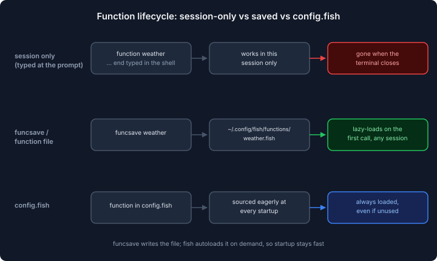
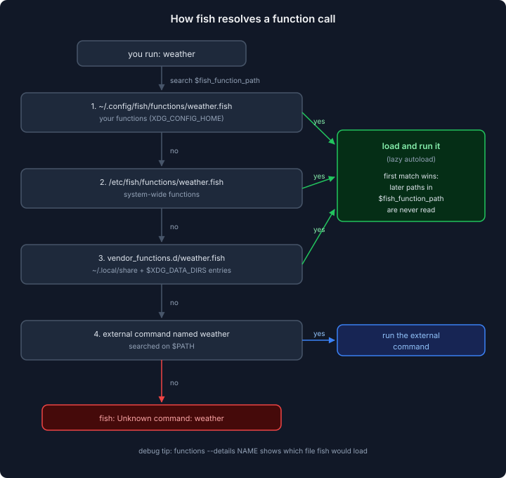

import Button from "@components/widgets/Button.astro";
import Notice from "@components/widgets/Notice.astro";
import ListCheck from "@components/widgets/ListCheck.astro";
import Accordion from "@components/widgets/Accordion.astro";
import Tabs from "@components/widgets/Tabs.astro";
import Tab from "@components/widgets/Tab.astro";

Fish Shell functions are how you build reusable commands. If you've used Bash functions before, the idea is the same (see [how Fish compares to Bash and Zsh](/fish-shell-vs-bash-vs-zsh/) for the shell-level differences), but the implementation is cleaner: no curly braces, explicit argument handling through `$argv`, and lazy loading that keeps startup fast no matter how many functions you save. They're a core fish feature, so there is nothing to install and no plugin manager to maintain.

I use functions for everything from quick shortcuts to project tooling and deploy wrappers. This guide covers creating and saving functions, parsing flags with `argparse`, event handlers, scope, where function files live on disk, and how to debug a function that "mysteriously" doesn't load. Verified on fish 4.9.x (November 2026). If your distro package is older, some of the behavior shown here won't apply: Ubuntu's apt still ships fish 3.7.x, so [install Fish Shell on Ubuntu](/install-fish-shell-ubuntu/) for a current build.

## What you need before you start

This guide assumes fish 4.x. Most of it works on any 4.x release, but a few flags landed later: `functions --color` needs 4.3.3+, and abbreviations with `--description` need 4.9.0+. Everything below is verified against fish 4.9.3 (released 2026-09-08).

<ListCheck>
<ul>
<li>Fish 4.x installed (4.9.x ideal). Check with `fish --version`.</li>
<li>Any terminal you already use. No special requirements.</li>
<li>Optional: git, if you want to version-control your function files with your dotfiles.</li>
</ul>
</ListCheck>

<Tabs>
<Tab name="Ubuntu/Debian">
The apt package is fish 3.7.x, which is too old for the 4.x behavior in this guide. Install a current build from the official repository instead:

```
sudo apt update && sudo apt install fish
fish --version   # confirm you got 4.x, not 3.7.x
```

If the version is still 3.x, follow [install Fish Shell on Ubuntu](/install-fish-shell-ubuntu/) for the repository setup that gets you fish 4.x.
</Tab>
<Tab name="macOS">
```
brew install fish
fish --version
```

For the full terminal environment (fonts, prompt, defaults), see [Fish Shell on macOS setup](/fish-shell-macos-setup/).
</Tab>
<Tab name="Check your version">
```
fish --version
# expect: fish, version 4.9.3 (or newer 4.x)
```

If this prints 3.x, the saving and `argparse` sections still work, but anything flagged 4.x-only below won't.
</Tab>
</Tabs>

<Button text="Install Fish Shell on Ubuntu" link="/install-fish-shell-ubuntu/" variant="outline" color="blue" size="sm" />

Verify before going further: `fish --version` should print `fish, version 4.x`. If it prints `command not found`, fish isn't on your `PATH` or isn't installed yet.

## What's new for functions in fish 4.6 to 4.9

This article was first written in the fish 4.5.0 days. The changes since then that affect functions:

| Version | Released | Function-relevant changes |
|---|---|---|
| 4.7.0 | 2026-05-05 | `funced` no longer loses your work when a function has repeated parse errors without new edits |
| 4.8.0 | 2026-06-24 | Fish stops creating the `__fish_initialized` universal variable; the legacy `$PREFIX/share/fish/functions` install location is removed (packages must use `vendor_functions.d`) |
| 4.8.1 | 2026-07-14 | New `fish_color_function` and `fish_color_builtin` variables: functions and builtins can be colored separately in [Fish Shell syntax highlighting](/fish-shell-syntax-highlighting/) |
| 4.9.0 | 2026-09-03 | Abbreviations accept `--description`, shown in the completion pager |

Current stable at the time of writing is fish 4.9.3 (2026-09-08). Patch releases 4.9.1 to 4.9.3 only fixed macOS dead-key input.

<Notice type="info" title="Verified on fish 4.9.x">
Commands, flags, and expected output in this guide are verified against fish 4.9.x (November 2026). Older 4.x releases handle the basics fine. If you're on Ubuntu's apt package (fish 3.7.x), see [install Fish Shell on Ubuntu](/install-fish-shell-ubuntu/) before trying the 4.x-only flags.
</Notice>

<Notice type="warning" title="Unreleased at time of writing">
Two function changes have landed in fish's master branch but are not in any 4.9.x release. First, a function call now captures the function's definition when the pipeline starts, so a pipeline element can no longer erase or redefine the function out from under later calls (#12991, #12996). Second, `functions --query` will return 0 if any of the named functions exist, matching `type -q`; today it returns the count of nonexistent names (#9855). Don't code against either behavior until the release containing them is the one you run.
</Notice>

## Creating a basic function

```fish
function greet
    echo "Hello, $argv"
end
```

Run `greet World` and it prints `Hello, World`. The variable `$argv` contains all arguments passed to the function. You can access individual arguments with `$argv[1]`, `$argv[2]`, etc.

That function only lasts for the current shell session. Close the terminal and it's gone. I'll cover how to make functions permanent in a moment.

### Functions with named arguments

Fish doesn't have named parameters the way Python does, but `--argument-names` gives you something close:

```fish
function mkcd --argument-names dir
    mkdir -p $dir
    cd $dir
end
```

Now `mkcd projects/new-app` creates the directory and moves into it. The first argument gets assigned to `$dir`. Extra arguments are still available through `$argv`, so nothing is lost by naming them.

You can list multiple argument names:

```fish
function connect --argument-names host port
    ssh -p $port $host
end
```

### Adding a description

```fish
function ll --description "List files in long format"
    ls -la $argv
end
```

The description is documentation for future-you. It shows up when you inspect the function with `functions ll` or `type ll`, and fish also uses it as the description in the tab-completion pager. Bare `functions` prints names only, not descriptions.

Quick check that the function exists and carries its description:

```fish
functions ll          # definition, including the --description
type ll               # same, shorter output
functions -q ll; and echo "ll is defined"
```

## Saving functions permanently

Fish has three ways to keep functions across sessions. They differ in *when* the definition loads, which matters for startup time.



### Method 1: funcsave (the Fish way)

Create a function interactively, then save it:

```fish
function weather --argument-names city --description "One-line weather report"
    curl -fsSL "wttr.in/$city?format=3"
end

funcsave weather
```

This writes the function to `~/.config/fish/functions/weather.fish`. Fish automatically loads it when you use the command in any future session: not at startup, but on demand. This lazy loading is why fish stays fast regardless of how many saved functions you have.

<Notice type="warning" title="wttr.in is a free service">
`wttr.in` rate-limits (HTTP 429) and goes down from time to time. `curl -f` makes that a visible failure instead of printing an HTML error page. The example is about the function mechanics; for anything script-critical, use an endpoint you control.
</Notice>

### Method 2: create the file directly

Write the function file yourself:

```fish
# ~/.config/fish/functions/weather.fish
function weather --argument-names city --description "One-line weather report"
    curl -fsSL "wttr.in/$city?format=3"
end
```

Same result as `funcsave`. I prefer this method for functions I want to version-control with my dotfiles: the file is the whole artifact, so a git clone or symlink deploys it.

### Method 3: put it in config.fish

```fish
# ~/.config/fish/config.fish
function weather --argument-names city --description "One-line weather report"
    curl -fsSL "wttr.in/$city?format=3"
end
```

This works but has two downsides: the function loads on every shell startup (not lazily), and your `config.fish` gets longer. Use autoloading files for anything beyond trivial functions.

<Notice type="info" title="Autoloading rules">
For autoloading to work, the file name must match the function name. A function called `weather` must be in `weather.fish`. If the file contains multiple functions, only the one matching the filename will autoload.
</Notice>

### Verify the function is saved

Don't trust that `funcsave` worked. Confirm it:

```fish
functions --details weather
# ~/.config/fish/functions/weather.fish
functions -q weather; and echo "weather is defined"
fish -c "type weather"
# should report it as a function, not "Unknown command"
```

`functions --details` prints the path where the function is defined or would be autoloaded from. `fish -c "type weather"` is the real test: a fresh, non-interactive shell that has never seen your session. If that works, the function is saved. If it fails, jump to the troubleshooting section below.

## Editing functions

Fish has a built-in function editor:

```fish
funced weather
```

This opens the function in your editor. Fish checks `$VISUAL` first, then `$EDITOR`, and falls back to its own built-in editor if neither is set. In the built-in editor, `enter` finishes and `alt-enter` inserts a literal newline. When you save and close, fish loads the updated function into your current session. Persist it with `funcsave weather`, or skip the separate step with `funced -s weather` (save on exit).

Two options worth knowing: `funced -e vi` forces a specific editor, and `funced -i` forces fish's built-in editor even if `$VISUAL` is set. Since fish 4.7.0, `funced` no longer loses your work if the function has repeated parse errors and you haven't made new changes.

To see a function's current definition without editing:

```fish
functions weather
# or
type weather
```

## Parsing options with argparse

Once a function grows past a couple of positional arguments, `--argument-names` runs out of road. For flags, fish ships `argparse`:

```fish
function deploy --description "Deploy a compose stack"
    argparse h/help n/dry-run 't/tag=?' -- $argv; or return 2
    if set -q _flag_help
        echo "Usage: deploy [--dry-run] [--tag TAG] <service>"
        return 0
    end
    test (count $argv) -ge 1; or begin
        echo "deploy: missing <service>" >&2
        return 2
    end

    set -l service $argv[1]
    set -l tag latest
    set -q _flag_tag; and set tag $_flag_tag

    if set -q _flag_dry_run
        echo "would deploy $service:$tag"
        return 0
    end
    docker compose pull $service
    and docker compose up -d $service
end
```

How the pieces work:

- `argparse h/help n/dry-run 't/tag=?' -- $argv` parses the function's arguments. The specs read `short/long`, so `h/help` accepts `-h` and `--help`. The `=?` suffix on `t/tag` means the value is optional (`--tag v2` or `--tag=v2`).
- Each recognized option becomes a local variable: `_flag_help`, `_flag_dry_run`, `_flag_tag`.
- Unrecognized non-option arguments stay in `$argv` for you to handle. That's where `$service` comes from.
- `; or return 2` is the standard guard: `argparse` prints its own error and returns nonzero when it hits an unknown flag, and exit code 2 is the usual convention for bad usage.
- `--min-args 1` and `--max-args 1` can replace the manual `test (count $argv)` check when `--help` isn't part of the picture.

Since fish 4.1, `argparse` also offers `$argv_opts` (the recognized options as a list), `--move-unknown`, `--strict-longopts`, `=*` multi-value specs, and `fish_opt --delete` for removing a spec mid-function. You rarely need these until you're writing shared helper libraries.

<Notice type="info" title="When to reach for argparse">
Positional-only helpers are fine with `--argument-names`. The moment a function takes flags (or users will expect it to), use `argparse`. It handles `--flag=value` spacing, unknown-flag errors, and abbreviations of long options for you.
</Notice>

## Advanced function options

### Wrapping commands with `--wraps`

`--wraps` makes a function inherit another command's tab completions. This is the missing piece in the `gc` git shortcut:

```fish
function gc --description "git add -A + commit" --wraps "git commit"
    test (count $argv) -gt 0; or begin
        echo "Usage: gc <message>"
        return 1
    end
    git add --all
    git commit -m "$argv"
end
```

With `--wraps "git commit"`, pressing Tab after `gc ` offers git commit's own completions (branch names, `--amend`, and so on). For writing completions from scratch, see [custom tab completions](/fish-shell-autocomplete-suggestions/).

### Sharing scope with `--no-scope-shadowing`

By default a function gets its own local scope: `set` inside it creates function-local copies and never touches the caller's variables. `--no-scope-shadowing` (short: `-S`) runs the function in the caller's scope instead:

```fish
function bump --no-scope-shadowing
    set count (math $count + 1)
end

set -g count 5
bump
echo $count   # 6; the global was updated
```

Without the flag, `set count` inside the function would create a local shadow and the global would stay at 5. One caveat from the docs: this is not a closure. Variable lifetimes are never extended, and the shared scope only lasts for the duration of the call.

### Snapshotting variables with `--inherit-variable`

`--inherit-variable NAME` snapshots a variable's value at *definition* time. The handler sees the snapshot even if the variable changes later. The canonical use is reacting to a specific job:

```fish
sleep 30 &
set pid $last_pid

function __job_done --on-job-exit $pid --inherit-variable pid --description "Report one job's exit"
    echo "job $pid exited with status $argv"
end
```

`--on-job-exit` takes the PID at definition time, and `--inherit-variable pid` makes sure the handler still sees it when the job finally exits.

### Reserved names you can't use

<Notice type="warning" title="Reserved words">
A function can't be named after a reserved word. All of these fail: `[`, `_`, `and`, `argparse`, `begin`, `break`, `builtin`, `case`, `command`, `continue`, `else`, `end`, `eval`, `exec`, `for`, `function`, `if`, `not`, `or`, `read`, `return`, `set`, `status`, `string`, `switch`, `test`, `time`, `while`. People hit this most with `test` and `time`. Pick a prefixed name (`fn_test`, `timer`) instead.
</Notice>

## Practical function examples

These are the patterns I keep around. Every one of them uses a guard clause and proper `$argv` handling, and you can paste any of them straight into `~/.config/fish/functions/`.

### Git shortcut with defaults

```fish
function gc --description "git add -A + commit" --wraps "git commit"
    test (count $argv) -gt 0; or begin
        echo "Usage: gc <message>"
        return 1
    end
    git add --all
    git commit -m "$argv"
end
```

Usage: `gc "fix login redirect"` stages everything and commits with that message. The `--wraps` flag (covered above) is what makes Tab completion work.

### Quick project switcher

```fish
function proj --argument-names name
    set -l base ~/projects
    if test -z "$name"
        ls $base
        return
    end
    if test -d $base/$name
        cd $base/$name
    else
        echo "Project '$name' not found in $base"
        return 1
    end
end
```

Run `proj` to list projects, or `proj myapp` to jump to `~/projects/myapp`. Add tab completions for it too:

```fish
# ~/.config/fish/completions/proj.fish
complete -c proj -f -a "(ls ~/projects)"
```

Now `proj` followed by Tab lists your project directories. See my [autocomplete guide](/fish-shell-autocomplete-suggestions/) for more on writing completions.

### Backup with timestamp

```fish
function bak --argument-names file
    if test -z "$file"
        echo "Usage: bak <file>"
        return 1
    end
    cp "$file" "$file.bak.(date +%Y%m%d-%H%M%S)"
end
```

`bak config.yaml` creates `config.yaml.bak.20261105-141500` (timestamp varies, obviously). The quotes matter: without them, `bak "my file.txt"` breaks on the space. Fish allows command substitution inside double quotes, so the timestamp still expands.

### Docker cleanup

```fish
function docker-clean --description "Remove stopped containers, dangling images, unused volumes"
    echo "Removing stopped containers..."
    docker container prune -f
    echo "Removing dangling images..."
    docker image prune -f
    echo "Removing unused volumes..."
    docker volume prune -f
end
```

One blast-radius note: `docker volume prune` deletes unused volumes. If a database container keeps its data in a named volume that's currently detached, that data goes with it. Comment out the volume line if you're not sure.

## Fish Shell event handlers

Functions can respond to events. This is useful for running code when variables change, when a command finishes, or when fish exits.

### Reacting to variable changes

```fish
function __on_pwd_change --on-variable PWD
    if test -f .node-version
        echo "Node version: "(cat .node-version)
    end
end
```

Every time you change directories, this checks for a `.node-version` file. The `--on-variable PWD` flag triggers the function whenever `$PWD` changes. If you keep per-project Node version files, [nvm.fish setup for Fish Shell](/nvm-fish-shell/) is the fish-native companion to this. To run a check at every prompt instead of on every directory change, use `--on-event fish_prompt`.

### Running code on exit and after commands

```fish
function __on_exit --on-event fish_exit
    echo "Goodbye!"
end
```

```fish
function __notify_long_command --on-event fish_postexec --description "Report slow commands"
    test $CMD_DURATION -gt 10000
    and echo "Took "(math --scale=1 $CMD_DURATION / 1000)"s: $argv"
end
```

This prints a notice when any command takes more than 10 seconds. `$CMD_DURATION` is a special fish variable holding the last command's runtime in milliseconds.

Fish itself emits these built-in events, all usable with `--on-event`:

| Event | Fires |
|---|---|
| `fish_prompt` | before each prompt is drawn (a [Starship prompt setup](/fish-shell-starship-prompt/) can also hook here) |
| `fish_preexec` | before a command line is executed |
| `fish_postexec` | after a command line finishes |
| `fish_posterror` | after an error |
| `fish_cancel` | when the command line is cleared (e.g. Ctrl-C) |
| `fish_exit` | when fish exits |
| `fish_focus_in` / `fish_focus_out` | terminal focus reporting (needs terminal support) |

### Custom events with `emit`

You're not limited to fish's own events. Define a handler for any event name, then fire it with `emit`:

```fish
function __my_backup_done --on-event backup-done
    echo "backup finished: $argv"
end

emit backup-done /mnt/nas
# → backup finished: /mnt/nas
```

Handlers can take arguments from the `emit` call, so `emit backup-done /mnt/nas` lands in the handler's `$argv`. Events are delivered only within the current fish process: there is no way to send an event from one fish process to another.

### Other handler types

Three more `--on-*` flags cover the cases that aren't events:

- `--on-signal SIGSPEC`: runs on a signal, e.g. `--on-signal SIGWINCH` on terminal resize.
- `--on-job-exit PID`: runs when a specific job exits. Use `caller` instead of a PID inside command substitutions. Disowned jobs are excluded.
- `--on-process-exit PID`: runs when a specific process exits. `%self` means the current fish process, which overlaps with `fish_exit`.

<Notice type="warning" title="Event handler naming">
Event handler functions should start with double underscores or a unique prefix to avoid name collisions. Also, event handlers in autoloaded files won't trigger until the function has been loaded once. For handlers that need to work from the start, put them in `config.fish` or `conf.d/`. Two more caveats from the docs: multiple handlers for one event all run but in unspecified order, and fish makes no timing guarantees for `--on-variable` (it may not run for every single `set`). To change a variable without firing handlers, use `set --no-event NAME value`.
</Notice>

Verify which handlers are active:

```fish
functions --handlers                 # every active handler
functions --handlers-type event      # only --on-event handlers
```

This is also how you prove the autoload trap to yourself: define `__on_exit` in `~/.config/fish/functions/__on_exit.fish`, open a new shell, and watch `functions --handlers` stay empty until the function is loaded.

## Scope and variable visibility

Functions have their own local scope by default. Variables set with `set -l` inside a function aren't visible outside it:

```fish
function test_scope
    set -l secret "hidden"
    echo $secret
end
test_scope  # prints "hidden"
echo $secret  # prints nothing
```

Use `set -g` for global variables (visible everywhere in the session) or `set -U` for universal variables (persist across all fish sessions):

```fish
set -g session_var "I last until you close this terminal"
set -U persistent_var "I survive restarts"
```

<Notice type="info" title="Universal variables since fish 4.8.0">
Fish no longer creates `__fish_initialized` or any other universal variable on its own; universal variables appear only when you set them with `set -U`. If an older install left one behind, clean it up with `set --erase __fish_initialized`.
</Notice>

## Functions vs abbreviations vs aliases

Fish has three ways to create shortcuts. Here's when to use each:

| | Functions | Abbreviations | Aliases |
|---|---|---|---|
| Best for | Complex logic, multi-line commands | Interactive command shortcuts | Simple command wrapping |
| Expansion | No expansion, runs as-is | Expands on the command line before running | Wraps as a function internally |
| History shows | Function name | Expanded command | Alias name |
| Arguments | Full `$argv` handling | Position- or regex-based; `--set-cursor`, `--function` | Pass-through `$argv` |

Abbreviations have grown up in fish 4.x. They can be position-aware (`--position anywhere`), regex-based (`--regex`), place the cursor after expansion (`--set-cursor`), and even generate their expansion by calling a fish function (`--function`). Since 4.9.0 they also accept `--description`, shown in the completion pager. They are not universal variables anymore: since fish 3.6 they live in config files, so save them with `abbr > ~/.config/fish/conf.d/myabbrs.fish` (details in [Fish Shell abbreviations vs aliases](/fish-shell-abbreviations-vs-aliases/)).

My default: abbreviations for simple interactive shortcuts (`gs` for `git status`), functions for anything that needs logic. One rule from fish's docs worth keeping: if you want to replace a tool for interactive use (say, a colored `ls`), prefer an abbreviation over a shadowing function.

The "History shows" row matters for history search: because abbreviations expand before execution, what you search later is the real command. See the [Fish Shell history guide](/fish-shell-history-persistence/) for keeping that history across machines.

## Where functions live: fish_function_path

Every time you run a name that isn't a builtin, fish searches `$fish_function_path` in order and stops at the first file that defines the function:

1. `~/.config/fish/functions` (or `$XDG_CONFIG_HOME/fish/functions`): your functions
2. `/etc/fish/functions`: system-wide functions
3. `vendor_functions.d` directories: `~/.local/share/fish/vendor_functions.d` plus the `fish/vendor_functions.d` entries in `$XDG_DATA_DIRS` (typically `/usr/share/fish/vendor_functions.d` and `/usr/local/share/fish/vendor_functions.d`), where packages drop shared functions



Two behaviors worth knowing:

- **First match wins (masking).** A `weather.fish` in `~/.config/fish/functions` means fish never looks at `weather.fish` in `/etc/fish/functions`. Masking is how you override a system-wide or package-shipped function on one machine.
- **Fall-through to external commands.** If no function file matches, fish runs an external command of that name if `$PATH` has one. Otherwise you get `fish: Unknown command`.

<Notice type="info" title="Where should a function go?">
If you're unsure, `~/.config/fish/functions` is the answer. That's the docs' own guidance, and it's where `funcsave` writes.
</Notice>

The ops angle: `~/.config/fish/functions/*.fish` is plain files, so version-control them with your dotfiles and a clone or symlink is a complete deployment (the file name is the registration, nothing to enable). For multiple users on one box or for fleet provisioning, drop shared helper functions into `/etc/fish/functions` or a `vendor_functions.d` directory and every user's fish picks them up lazily. fish 4.8.0 removed the old `$PREFIX/share/fish/functions` location (it had been ignored since 4.2); packages must install into `vendor_functions.d`.

## Managing functions

```fish
functions                    # list defined function names
functions -a                 # include _- and __-prefixed names
functions -n                 # names only, one per line
functions weather            # show a function's definition
functions -q weather         # exit 0 if it exists (handy in scripts)
functions --details weather  # file that defines it / would autoload it
functions -c deploy deploy-staging   # copy the body (not event handlers!)
functions -d "New description" func  # change a description in place
functions --color=always weather     # syntax-highlighted output (fish 4.3.3+)
functions -D -v weather      # verbose: path, line, scope flag, description
funcsave weather             # persist to the autoload file
funced weather               # edit in your editor
functions -e weather         # erase from this session
```

One detail that saves confusion: bare `functions` hides names starting with `_` or `__`, which is exactly how event handlers are conventionally named. If your `__on_exit` handler seems to have vanished, run `functions -a` before blaming the filesystem.

Two flags deserve a closer look. `functions -q` is the exit-status test for guard clauses (`functions -q weather; or return 1`); note that in fish master its multi-name semantics are changing to "0 if any exist" (see the unreleased note at the top), so don't parse the numeric status in scripts you want to keep. `functions -c` copies only the body; event notifications from the original are not attached to the copy:

```fish
functions -c deploy deploy-staging
functions --details deploy-staging   # shows the copy's path
```

To delete a saved function permanently:

```fish
functions -e weather
funcsave weather
```

After `functions -e`, `funcsave` removes the saved definition file from `~/.config/fish/functions/`. That's the rollback path for any function you've saved: erase, then funcsave. One caveat: erasing in one shell does not touch other running shells that already loaded the function; they keep their copy until they reload or exit.

## Troubleshooting Fish Shell functions

Four failure modes cover almost everything. Symptom, cause, fix.

**1. `fish: Unknown command: weather`**
The file name doesn't match the function name, the file isn't in any `$fish_function_path` directory, or the file has a parse error. Run `functions --details weather`: it prints the path fish would load from. If it prints nothing sensible, check that `weather.fish` really is in `~/.config/fish/functions/` and that the `function weather` line inside matches the name exactly.

**2. Edits not picked up in other running shells**
Autoloaded definitions get reloaded by running shells, but not instantly. Other shells also keep their already-loaded copy of an erased function. For an immediate switch, run `exec fish` (or just open a new shell) in the terminal that's misbehaving.

**3. Event handler never fires**
An event handler sitting in an autoloaded function file is inert until that function is loaded once. `functions --handlers` will show it missing. Move the handler into `config.fish` or a `conf.d/` file, or `source` the function file so it loads at startup.

**4. Function shadows a builtin or a real command**
If your `ls` function calls `ls`, you've just written recursion (or shadowed `/bin/ls` unexpectedly). `type -a ls` shows everything the name resolves to. Inside a function with the same name as a command, call the real thing with `command ls`, and prefer an abbreviation if the goal is just to replace a tool for interactive use.

<ListCheck>
<ul>
<li>`fish --version` shows 4.x.</li>
<li>The file name matches the function name exactly (`weather.fish` for `weather`).</li>
<li>`functions --details NAME` points at the file you edited.</li>
<li>`fish -c "type NAME"` succeeds in a fresh shell.</li>
<li>Event handlers live in `config.fish` or `conf.d/`, not in an autoload-only file.</li>
<li>`type -a NAME` shows what the name resolves to when something is shadowed.</li>
</ul>
</ListCheck>

## FAQ

<Accordion label="What's the difference between a fish function and an alias?" group="faq">
An alias in fish is a thin wrapper: `alias ll "ls -la"` creates a function under the hood that runs `ls -la` and passes `$argv` through. A real function gives you logic (conditionals, loops, local variables), event hooks, and its own completions. For interactive replacement of a tool, fish's docs recommend abbreviations over both. Short version: alias for a one-liner you won't think about again, function for anything with logic, abbreviation for interactive shortcuts.
</Accordion>

<Accordion label="Why is my saved function not found in a new shell?" group="faq">
Almost always one of three things. The file name doesn't match the function name (it must be `weather.fish` for a function called `weather`). The file is outside `$fish_function_path` (put it in `~/.config/fish/functions`). Or the file has a parse error and never loads. `functions --details NAME` shows where fish looks, and `fish -c "type NAME"` smoke-tests a fresh shell.
</Accordion>

<Accordion label="Can I write Bash-style function definitions?" group="faq">
No. Fish's syntax is `function name` ... `end`. There are no braces at all, and no Bash-style `name()` declaration form. When porting Bash snippets, drop the braces, use `$argv` instead of `$1`/`$@`, `test` for conditionals, and `math` for arithmetic. The creating-a-basic-function section above is the whole syntax.
</Accordion>

<Accordion label="How do I share functions across machines?" group="faq">
Put the `.fish` files in a git repo with your dotfiles and symlink them into `~/.config/fish/functions/`. The file name is the registration, so there is nothing to enable after copying. For shared machines or fleet provisioning, use `/etc/fish/functions` or a `vendor_functions.d` directory instead; every user's fish reads those via `$fish_function_path`.
</Accordion>

## Related guides

Functions ship with fish: there's no plugin manager and nothing extra to install. If you want to go further (prompt themes, integrations, extra completions), that's where the [best Fish Shell plugins](/best-fish-shell-plugins/) come in.

- [Fish Shell autocomplete and suggestions](/fish-shell-autocomplete-suggestions/) for writing custom completions
- [Fish Shell abbreviations vs aliases](/fish-shell-abbreviations-vs-aliases/) for deciding between the two
- [Fish Shell vs Bash vs Zsh](/fish-shell-vs-bash-vs-zsh/) for the shell-level differences
- [Fish Shell history guide](/fish-shell-history-persistence/) for search, delete, and sync
- [Fish Shell on macOS setup](/fish-shell-macos-setup/) if you're setting up Fish on a Mac
- [Install Fish Shell on Ubuntu](/install-fish-shell-ubuntu/) for a current fish 4.x on Linux
