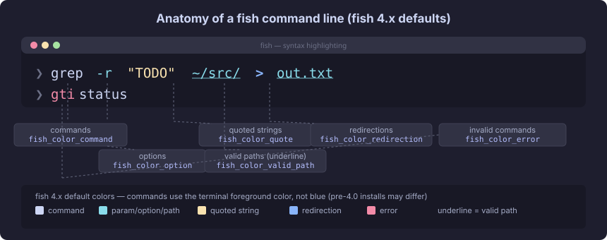
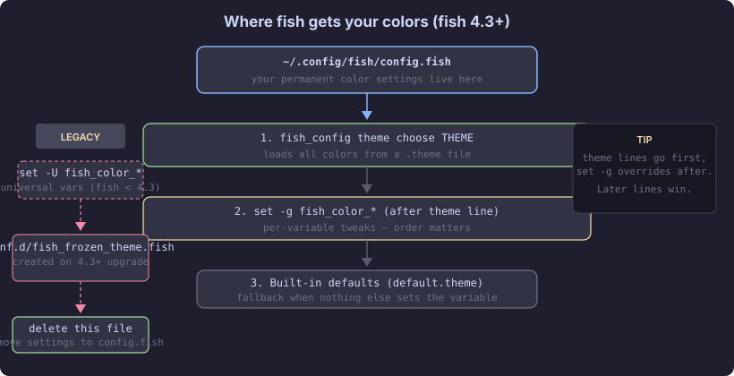

import Notice from "@components/widgets/Notice.astro";
import ListCheck from "@components/widgets/ListCheck.astro";
import Tabs from "@components/widgets/Tabs.astro";
import Tab from "@components/widgets/Tab.astro";
import Accordion from "@components/widgets/Accordion.astro";
import Button from "@components/widgets/Button.astro";

Fish Shell syntax highlighting is one of the main reasons I switched from [Zsh to Fish](/fish-shell-vs-zsh/). In Zsh, you need the [zsh-syntax-highlighting plugin](/enable-syntax-highlighting-zsh/) plus configuration to get commands colored as you type. In Fish, it works from the first launch, with no [Fish Shell plugins](/best-fish-shell-plugins/) to install and nothing to configure.

The shell colors your command line in real time. Valid commands appear in one color, invalid commands turn red, quoted strings get their own color, and file paths that exist are underlined. You catch typos before hitting Enter.

This guide covers how Fish Shell syntax highlighting works in Fish 4.x, how to customize colors for commands, errors, and paths, how to manage themes, and how to fix the issues that trip people up.

## What Fish highlights (Fish 4.x defaults)

Fish colors different parts of the command line based on their meaning. Here are the defaults in fish 4.x:

| Element | Default appearance | Variable |
|---|---|---|
| Valid commands | Terminal normal color (`--reset`) | `fish_color_command` |
| Invalid commands | Bright red (`brred`) | `fish_color_error` |
| Parameters/arguments | Cyan | `fish_color_param` |
| Options (flags starting with `-`) | Falls back to `fish_color_param` (cyan) | `fish_color_option` |
| Quoted strings | Yellow | `fish_color_quote` |
| Redirections (`>`, `>>`, `\|`) | Cyan, bold | `fish_color_redirection` |
| Valid file paths | Underlined | `fish_color_valid_path` |
| Comments (`# ...`) | Red | `fish_color_comment` |
| Escape sequences (`\n`, `\t`) | Bright cyan (`brcyan`) | `fish_color_escape` |
| Autosuggestions | Bright black (`brblack`) | `fish_color_autosuggestion` |
| Selection (vi visual mode) | White on bright black, bold | `fish_color_selection` |
| Search matches | White on bright black, bold | `fish_color_search_match` |
| Builtin commands (fish 4.8.1+) | Falls back to `fish_color_command` | `fish_color_builtin` |
| User-defined functions (fish 4.8.1+) | Falls back to `fish_color_command` | `fish_color_function` |

When a variable isn't set, fish falls back predictably. `fish_color_builtin`, `fish_color_function`, and `fish_color_keyword` all fall back to `fish_color_command`. `fish_color_option` falls back to `fish_color_param`. `fish_color_valid_path` merges its modifiers (like underline) into whatever color the underlying token would get.

The most useful part: command validation happens as you type. Type `gti` instead of `git` and it immediately turns red. You don't need to run the command to know something's wrong.



<Notice type="info" title="Why your Fish still shows blue commands">
If you installed fish before 4.0 and upgraded, your old color scheme survives in a frozen theme file. Fish has not used blue for valid commands since 4.0.0. The default is now the terminal's normal foreground color. Re-run `fish_config theme choose default` to get the current scheme. Screenshots online may show the old blue default.
</Notice>

## Know your Fish version first

Several features in this guide are version-gated. Check what you're running before you wonder why something doesn't work:

```bash
fish --version
```

You want fish 4.x, ideally 4.8.1 or later for everything in this guide. Adaptive themes need 4.3.0+, `fish_color_builtin` and `fish_color_function` need 4.8.1+, and underline styles need 4.0+.

<ListCheck>
<ul>
<li>fish 4.x installed (run `fish --version`, ideally 4.8.1 or later)</li>
<li>A true-color terminal: Ghostty, iTerm2, WezTerm, Alacritty, or Kitty</li>
<li>Access to `~/.config/fish/config.fish`</li>
</ul>
</ListCheck>

Distro packages lag. Ubuntu 24.04 (noble) ships fish 3.7.0, so the new variables simply won't exist there. Ubuntu 25.10 ships 4.0.6. Homebrew ships 4.9.3. On Ubuntu, use the fish-shell PPA or official builds to stay current (see the [install Fish Shell on Ubuntu](/install-fish-shell-ubuntu/) guide). On Mac, [Fish Shell on macOS](/fish-shell-macos-setup/) covers the Homebrew path.

Fish is free and open source. The only cost consideration is keeping it current. Stale distro packages hold you back from the newer color variables and adaptive themes.

## How to change Fish shell colors

There are two routes: the visual web UI for trying things out, and `config.fish` for permanent, repeatable setup.

### Use the fish_config web interface

The quickest way to explore colors:

```bash
fish_config
```

This opens a browser-based tool with a live preview. Under the "Colors" tab, you can click each syntax element and change its color. When you're happy, click "Set Theme" and the changes apply immediately to your current session.

It's good for experimenting. For a setup you want to keep, the `config.fish` route below is what fish recommends.

### Set colors permanently in config.fish

Since fish 4.3.0, the recommended way to persist colors is a line in `~/.config/fish/config.fish`. Fish sets `fish_color_*` variables in the global scope by default, and `config.fish` runs on every shell start, so a `set -g` line there is effectively permanent:

```bash
# ~/.config/fish/config.fish

# Pick a theme first (order matters: overrides below this line win)
fish_config theme choose dracula

# Then tweak individual colors
set -g fish_color_command 5fd700           # bright green
set -g fish_color_error ff5f5f --bold      # bold red
set -g fish_color_quote ff8700             # orange
set -g fish_color_comment 6c7086           # grey
set -g fish_color_autosuggestion 555555    # dim
```

Open a new terminal to see the changes. Verify with `echo $fish_color_command`. It should print your value.

<Notice type="warning" title="set -U and theme save are legacy">
The fish docs mark `fish_config theme save` as "(not recommended)": it stores colors in universal variables, which won't follow your terminal's light/dark changes. Universal variables (`set -U`) still work as an opt-in path, but `config.fish` with `set -g` is the supported approach for fish 4.3+. If you type `set -g` in a one-off session without saving it to `config.fish`, the setting won't survive the next restart.
</Notice>



Migration note: if you upgraded from fish 3.x, fish 4.3+ may have migrated your old universal color variables into `~/.config/fish/conf.d/fish_frozen_theme.fish`. The official advice is to delete that file and set your theme in `config.fish` instead. Fish 4.8.0+ skips creating this file when your theme matches the historical default.

### Available colors, modifiers, and underline styles

Fish accepts named colors, hex codes, and a set of modifiers:

<Tabs>
<Tab name="Named colors">

The 16 standard terminal colors: `black`, `red`, `green`, `yellow`, `blue`, `magenta`, `cyan`, `white`, plus their bright variants (`brblack`, `brred`, `brgreen`, `bryellow`, `brblue`, `brmagenta`, `brcyan`, `brwhite`). Also `normal` (terminal default) and `reset`.

```bash
set -g fish_color_command green
set -g fish_color_error brred --bold
set -g fish_color_quote bryellow
```

</Tab>
<Tab name="Hex colors">

Three- or six-digit hex codes. Useful when you want exact colors from a palette:

```bash
set -g fish_color_command 5fd700           # bright green
set -g fish_color_quote ff8700 --italics   # italic orange
set -g fish_color_comment 6c7086 --dim     # dim grey
set -g fish_color_error ff5f5f --bold      # bold red
```

Hex colors need a true-color terminal. Most modern terminals handle this out of the box.

</Tab>
<Tab name="Modifiers & underline">

Full modifier set: `--foreground=`, `--background=`, `--bold`, `--dim`, `--italics`, `--reverse`, `--strikethrough`, `--underline`, `--underline-color=`.

Underline styles (fish 4.0+): `--underline=single` (default), `double`, `curly`, `dotted`, `dashed`, or `off`.

```bash
# Curly underline for options
set -g fish_color_option --underline=curly

# Underlined paths with a distinct underline color
set -g fish_color_valid_path --underline --underline-color=brgreen

# Strikethrough for deprecated flags
set -g fish_color_param --strikethrough
```

Note that `fish_color_valid_path` merges its modifiers into whatever color the path token would otherwise get. Since fish 4.7.0 it also respects background and underline colors. A `--reset` flag that stops the merge and gives the path its own full color is in master and lands in a future release.

`set_color` additions in newer fish: `--strikethrough` (4.4), `--foreground`/`-f`, `--reset`, and per-mode `=off` toggles like `--italics=off` (4.6).

</Tab>
</Tabs>

## New in Fish 4.8.1: fish_color_builtin and fish_color_function

Fish 4.8.1 (July 2026) added two variables that let you distinguish builtins from external commands and highlight your own functions differently:

```bash
# in config.fish, after your theme choose line
set -g fish_color_builtin magenta   # builtins like cd, set, test
set -g fish_color_function brblue   # your own functions
```

Both fall back to `fish_color_command` when unset, so existing themes look unchanged until you opt in. Nothing breaks by upgrading.

The full fallback rules:

| Variable | Falls back to |
|---|---|
| `fish_color_builtin` | `fish_color_command` |
| `fish_color_function` | `fish_color_command` |
| `fish_color_keyword` | `fish_color_command` |
| `fish_color_option` | `fish_color_param` |
| `fish_color_valid_path` | merges modifiers into the underlying token's color |

<Notice type="info" title="Fish 4.8.1+ only">
On older fish versions, `fish_color_builtin` and `fish_color_function` do nothing. Run `fish --version` to check. If you want to [create your own Fish Shell functions](/fish-shell-functions-custom-commands/), giving them their own color makes them stand out from external commands at a glance.
</Notice>

## Built-in Fish shell themes (fish_config theme)

Fish ships with 25 color themes. The `fish_config theme` subcommands are the interface:

```bash
fish_config theme list              # names of all built-in themes
fish_config theme show dracula      # preview a theme without applying
fish_config theme demo              # sample text in your current theme
fish_config theme choose dracula    # apply now
fish_config theme dump > ~/.config/fish/themes/my.theme   # export current
```

To make a theme permanent, put the `choose` line in `config.fish`:

```bash
# ~/.config/fish/config.fish
fish_config theme choose dracula
```

<ListCheck>
<ul>
<li>`dracula` is a dark theme with purple and pink tones</li>
<li>`nord` uses cool blue tones that are easy on the eyes</li>
<li>`catppuccin-mocha` is a pastel dark theme (also frappe and macchiato)</li>
<li>`solarized` is adaptive and switches with your terminal's light/dark mode</li>
<li>`none` disables almost all highlighting, which is useful for debugging</li>
<li>`default-rgb` is the true-color variant of the default theme</li>
</ul>
</ListCheck>

The full list of built-in themes: `ayu`, `ayu-mirage`, `base16-default`, `base16-eighties`, `bay-cruise`, `catppuccin-frappe`, `catppuccin-macchiato`, `catppuccin-mocha`, `coolbeans`, `default`, `default-rgb`, `dracula`, `fairground`, `just-a-touch`, `lava`, `mono-lace`, `mono-smoke`, `none`, `nord`, `old-school`, `seaweed`, `snow-day`, `solarized`, `tomorrow`, `tomorrow-night-bright`.

<Notice type="warning" title="catppuccin-latte is not built in">
Only the dark Catppuccin variants ship with fish: frappe, macchiato, and mocha (since 4.4.0). The light `catppuccin-latte` theme is a third-party `.theme` file you'd need to add yourself. Also, `solarized` is one adaptive theme (not separate `-dark` and `-light` files), and in the tomorrow family `tomorrow` is the light variant while `tomorrow-night-bright` is the dark one.
</Notice>

Prompt colors are separate from syntax colors. If you want to customize your prompt, see [Fish Shell themes and prompts](/fish-shell-themes-prompts/) or the [Starship prompt with Fish Shell](/fish-shell-starship-prompt/) guide.

### Adaptive light and dark themes

Since fish 4.3.0, theme files can contain `[light]`, `[dark]`, and `[unknown]` sections. Fish tracks `fish_terminal_color_theme` and re-applies the matching variant when your terminal switches between light and dark mode. The built-in `solarized` theme is the canonical example.

<Tabs>
<Tab name="Follow terminal">

```bash
# Just choose the theme: fish picks the right variant
fish_config theme choose solarized
```

Fish detects your terminal's color scheme and applies the `[light]` or `[dark]` section automatically.

</Tab>
<Tab name="Force dark">

```bash
fish_config theme choose solarized --color-theme=dark
```

Always use the dark variant regardless of what the terminal reports.

</Tab>
<Tab name="Force light">

```bash
fish_config theme choose solarized --color-theme=light
```

Always use the light variant regardless of what the terminal reports.

</Tab>
</Tabs>

This is one reason the old `set -U` / `theme save` approach is wrong for adaptive themes. Universal variables freeze one variant and can't track terminal changes.

## Create a custom Fish theme file

Instead of a wall of `set -U` lines, the clean way to build your own theme is a `.theme` file:

```bash
# 1. Dump your current colors as a starting point
fish_config theme dump > ~/.config/fish/themes/my.theme

# 2. Edit the file
nano ~/.config/fish/themes/my.theme

# 3. Apply it
fish_config theme choose my
```

A `.theme` file is plain text. It accepts `fish_color_*` and `fish_pager_color_*` variables only. Nothing else belongs here. A worked example in the format:

```
# name: my-theme
# preferred_background: 1e1e2e

fish_color_normal normal
fish_color_command 5fd700
fish_color_keyword 5fd700
fish_color_quote ff8700
fish_color_redirection 87d7ff
fish_color_end 87d7ff
fish_color_error ff5f5f --bold
fish_color_param 87d7ff
fish_color_option --underline=curly
fish_color_comment 6c7086
fish_color_selection --background=3a3a5c
fish_color_operator ff87d7
fish_color_escape ff87d7
fish_color_autosuggestion 555555
fish_color_valid_path --underline --underline-color=brgreen
fish_color_cwd 5fd7ff
fish_color_cwd_root red
fish_color_user 87d7ff
fish_color_host normal
fish_color_host_remote ff8700
fish_color_status red
fish_color_cancel -r
fish_color_search_match --background=555555
```

You can also add `[light]` and `[dark]` sections for adaptive variants. Put shared colors outside the sections, and light/dark overrides inside them.

<Notice type="info" title="Theme file format">
Only `fish_color_*` and `fish_pager_color_*` variables belong in `.theme` files. Everything else (aliases, functions, abbreviations) goes in `config.fish`.
</Notice>

Since fish 4.3.2, redirection targets are validated too: `> file.txt` highlights the target with `fish_color_valid_path` when the file already exists. It's a visual warning that you're about to clobber something.

To undo: delete `~/.config/fish/themes/my.theme` and run `fish_config theme choose default`.

## Pager (completion menu) colors

The tab completion pager has its own set of colors, separate from the command line syntax colors:

```bash
set -g fish_pager_color_completion normal                      # completion text
set -g fish_pager_color_description yellow --italics            # description text
set -g fish_pager_color_prefix --bold --underline               # matched prefix
set -g fish_pager_color_progress brwhite --background=cyan --bold  # progress bar
set -g fish_pager_color_selected_background -r                  # selection (reverse)
```

These control what you see when you press Tab and browse completions. If you want to understand the completion system itself, see the [Fish Shell autocomplete and suggestions guide](/fish-shell-autocomplete-suggestions/).

One variable worth knowing: `fish_color_history_current` controls the color of the current match in `dirh`/`cdh` directory history navigation.

## Fish vs Zsh vs Bash syntax highlighting

<Tabs>
<Tab name="Bash">

Bash has no syntax highlighting at all. What you type is plain text until you run it. Third-party projects exist (like `ble.sh`), but nothing is built in.

</Tab>
<Tab name="Zsh">

Zsh needs the [zsh-syntax-highlighting plugin](/enable-syntax-highlighting-zsh/). It works well once installed, but it's an external dependency you manage and update. The plugin supports custom highlighter patterns, which gives you flexibility at the cost of configuration. For a broader look, see the [Fish vs Bash vs Zsh comparison](/fish-shell-vs-bash-vs-zsh/).

</Tab>
<Tab name="Fish">

Fish does it natively. The highlighting is part of the shell itself, runs on every keystroke, and validates commands against your PATH in real time. Nothing to install, nothing that falls out of date. This is one of the core arguments for [Fish over Zsh](/fish-shell-vs-zsh/): the feature lives in the shell, so there is no plugin to pin, update, or debug.

</Tab>
</Tabs>

## Troubleshooting Fish shell syntax highlighting

<Notice type="error" title="Old advice alert">
Guides written before 2026 often recommend `set -U` for color settings. That's outdated for fish 4.3+. Use `config.fish` with `set -g` instead. See the [how to change Fish shell colors](#how-to-change-fish-shell-colors) section above.
</Notice>

<Accordion label="Colors look wrong or washed out" group="faq">
Your terminal may not support true color. Test with:

```bash
set_color ff8700; echo "This should be orange"; set_color normal
```

If it's not orange, your terminal needs a different color mode setting. Most modern terminals (Ghostty, iTerm2, WezTerm, Alacritty, Kitty) support true color out of the box. If you're on an older terminal, check its color profile settings. See the [Ghostty terminal setup guide](/ghostty-terminal/) if you want a modern terminal that handles this well.
</Accordion>

<Accordion label="Colors reset after restart" group="faq" expanded="true">
This is the most common issue since fish 4.3. The fix: your color setting must be in `~/.config/fish/config.fish` (or in a `.theme` file chosen from there). If you typed `set -g fish_color_command ...` in an interactive session without saving it to `config.fish`, it won't persist.

Also check for a leftover `~/.config/fish/conf.d/fish_frozen_theme.fish`. If you upgraded from fish 3.x, fish 4.3+ may have migrated your old universal variables into this file, and it shadows your `config.fish` settings. Delete it and set your theme in `config.fish` instead.
</Accordion>

<Accordion label="Theme not applying to all sessions" group="faq">
`fish_config theme choose` applies to the current session and new ones. Running sessions don't auto-update. If you want all sessions to pick up a theme change live, use this pattern in `config.fish`:

```bash
function apply-my-theme --on-variable=my_theme
    fish_config theme choose $my_theme
end
```

Then from any session:

```bash
set -U my_theme dracula
```

All running sessions pick up the change. This is an optional advanced trick. Most people don't need it.
</Accordion>

<Accordion label="New variables do nothing (fish_color_builtin, fish_color_function)" group="faq">
These variables need fish 4.8.1 or later. Run `fish --version` to check. Distro packages lag behind: Ubuntu 24.04 ships fish 3.7.0, and the variables simply don't exist there. Install from the fish-shell PPA or use Homebrew. See [install Fish Shell on Ubuntu](/install-fish-shell-ubuntu/).

Adaptive light/dark themes need fish 4.3.0+. Underline styles need fish 4.0+.
</Accordion>

<Accordion label="My theme looks different from screenshots online" group="faq">
Fish changed its default color scheme in 4.0.0. Valid commands are no longer blue. If you installed fish before 4.0 and upgraded, your old scheme survives in a frozen theme file. Re-run `fish_config theme choose default` to get the current look. Screenshots from older articles will show the blue-command default.
</Accordion>

## Related guides

- [Fish Shell themes and prompts](/fish-shell-themes-prompts/) for Tide, Starship, and Pure prompt setup
- [Fish Shell autocomplete and suggestions guide](/fish-shell-autocomplete-suggestions/) to see how pager colors affect completions
- [Fish Shell vs Zsh](/fish-shell-vs-zsh/) to compare built-in highlighting with the zsh-syntax-highlighting plugin
- [Enable syntax highlighting in Zsh](/enable-syntax-highlighting-zsh/) if you also use Zsh
- [Install Fish Shell on Ubuntu](/install-fish-shell-ubuntu/) to get Fish 4.x from the PPA
- [Fish Shell on macOS](/fish-shell-macos-setup/) for the Homebrew path on Mac

<Button text="Fish Shell vs Zsh: Which Should You Use?" link="/fish-shell-vs-zsh/" variant="outline" color="blue" size="md" icon="arrow-right" />
