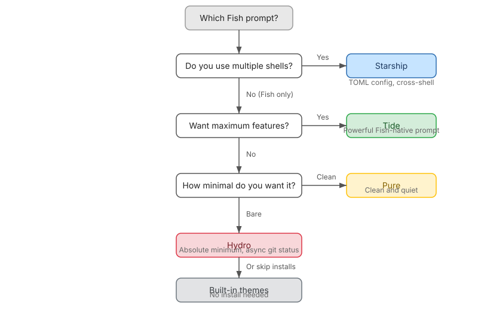

import Notice from "@components/widgets/Notice.astro";
import ListCheck from "@components/widgets/ListCheck.astro";
import Tabs from "@components/widgets/Tabs.astro";
import Tab from "@components/widgets/Tab.astro";
import Accordion from "@components/widgets/Accordion.astro";

The best Fish Shell prompts in 2026 are Tide, Starship, Pure, and Hydro, plus the themes Fish ships with out of the box. Fish comes with a usable default prompt, but most people swap it out for something with more information: git branch, command duration, language versions. This guide covers installing and configuring each one, Fish 4.x compatibility notes, and how to pick the right prompt for your workflow.

Tested with Fish 4.9.3, Tide 6.2.1, Starship 1.27.0, Pure 4.19.2 (November 2026).

**What you need before starting:**

<ListCheck>
<ul>
<li>Fish shell installed (3.x or 4.x; see the Fish 4 notes below). New to Fish? See our <a href="/fish-shell-vs-bash-vs-zsh/">Fish vs Bash vs Zsh comparison</a> first.</li>
<li><a href="/best-fish-shell-plugins/">Fisher plugin manager</a> (needed for Tide, Pure, and Hydro)</li>
<li>Nerd Font set in your terminal emulator (recommended for Tide and Starship icons; optional for Pure and Hydro)</li>
</ul>
</ListCheck>

Beyond the prompt, <a href="/fish-shell-autocomplete-suggestions/">Fish Shell autocomplete and suggestions</a> are half the UX and worth tuning after your prompt looks right.

## Built-in Fish Shell themes

Before you install anything, Fish has its own theme system. Run:

```fish
fish_config theme show
```

This prints available color themes directly in your terminal. To apply one:

```fish
fish_config theme choose dracula
fish_config theme save
```

You can force a dark or light variant with `fish_config theme choose THEME --color-theme=(dark|light)`.

For prompts specifically:

```fish
fish_config prompt show
fish_config prompt choose informative
fish_config prompt save
```

Run `fish_config prompt list` to see everything available. The exact set varies by Fish version. These built-in prompts are light on features (no async rendering, no language detection), but they load instantly and need no external dependencies.

You can also run `fish_config` without arguments to open a browser-based configuration tool where you can preview everything visually. If you want to customize colors beyond the prompt, see our [Fish Shell syntax highlighting guide](/fish-shell-syntax-highlighting/).

## Tide: the Fish-native power prompt

[Tide](https://github.com/IlanCosman/tide) is the most feature-rich Fish-native prompt. It's what Powerlevel10k is to Zsh: async rendering, a configuration wizard, deep git integration, and a transient prompt that collapses old prompts to save scrollback. It's actively maintained (v6.2.1, November 2026, 4.3k stars).

### Install Tide

You need [Fisher](/best-fish-shell-plugins/) first. Then:

```fish
fisher install IlanCosman/tide@v6
tide configure
```

Verify it installed:

```fish
fisher list | grep tide
```

The prompt changes immediately after install.

<Notice type="info" title="Fish 4.x requirement">
On Fish 4.3 or later, make sure you have Tide ≥ 6.2.1. Earlier v6 releases have vi-mode and resize bugs on Fish 4.x; v6.2.1 (November 2026) fixed both.
</Notice>

### Configure Tide

The `tide configure` wizard walks you through:

- Powerline style vs. plain text
- One-line or two-line prompt
- Icon style (Nerd Font required for icons)
- Colors and spacing

It takes about 30 seconds and gives you a polished prompt without manual editing.

<Tabs>
<Tab name="Interactive wizard">
Run `tide configure` and answer the prompts. This is the normal path. You see a live preview as you make each choice.
</Tab>
<Tab name="Automated (dotfiles)">
Run `tide configure --auto` for non-interactive setups. It applies a default preset without prompting, which is what you want in dotfiles bootstrap scripts or CI environments where there's no TTY to answer questions.
</Tab>
</Tabs>

Beyond the wizard, you can extend Tide by [creating custom Fish Shell functions](/fish-shell-functions-custom-commands/) that inject items into the prompt.

### What Tide shows

By default, Tide displays:

- Current directory (smart truncation to the shortest unique prefix)
- Git branch and status (untracked, modified, staged, ahead/behind)
- Command duration (for slow commands)
- Language versions (Node, Python, Rust, Go, Bun, etc.) when you're in a relevant project. For Node, you can [manage Node versions with nvm.fish](/nvm-fish-shell/). The `go` item also triggers on `go.work` workspaces (v6.2.1).
- Time, jobs, and exit status on the right prompt

Nerd Font recommended: install MesloLGS NF or any Nerd Font for the best icon support. Without one, Tide falls back to text-only mode, which still looks fine. Both [Ghostty terminal setup](/ghostty-terminal/) and [WezTerm on macOS](/install-wezterm-mac/) render Nerd Fonts well.

### Customizing Tide

After the wizard, tweak individual settings:

```fish
# Change which items appear on the left and right
set --universal tide_left_prompt_items pwd git newline character
set --universal tide_right_prompt_items status cmd_duration context jobs node

# Change git status symbols
set --universal tide_git_icon ""

# Apply changes without restarting the shell
tide reload
```

<Notice type="info" title="Apply changes instantly">
After any `set --universal` change, run `tide reload` to see it immediately. No shell restart needed.
</Notice>

Run `set --universal | grep tide` to see all Tide variables. Useful ones:

- `tide_jobs_number_threshold`: show job count only above N background jobs
- `tide_transient_prompt`: controls whether old prompts collapse to save scrollback

### Tide on Fish 4.x

Fish 4.x (currently 4.9.3) has been Rust-based since the 4.0 rewrite. Tide v6.2.1 (November 2026) is primarily a Fish 4 compatibility release. It fixes:

- Vi-mode prompt character showing `❮` and `vi_mode` showing `D` under default bindings on Fish 4.3+
- `Broken pipe` panic on terminal resize
- Prompt breaking in running shells after upgrading Fish via Homebrew
- Keystrokes lost while the prompt renders in the background

<Notice type="warning" title="Fish 4.3+ users">
If you're on Fish 4.3+ and see odd vi-mode characters or resize panics, update Tide to v6.2.1+ first before debugging anything else. Run `fisher update IlanCosman/tide` to get the latest.
</Notice>

## Starship: the cross-shell prompt

[Starship](https://starship.rs) is a cross-shell prompt written in Rust. It works with Fish, Zsh, Bash, PowerShell, and more. With 60k+ GitHub stars and active maintenance, it's the practical choice if you use multiple shells or want to share a prompt config with teammates on different shells.

### Install Starship

```bash
curl -sS https://starship.rs/install.sh | sh
```

Add to your Fish config:

```fish
# ~/.config/fish/config.fish
starship init fish | source
```

Verify:

```bash
starship --version   # should be >= 1.27.0
```

<Notice type="warning" title="Security upgrade">
Starship v1.27.0 (October 2026) patched two medium security advisories: GHSA-x486-6jjc-phfp (symlink DoS during prompt rendering) and GHSA-679r-jwc5-r5m3 (git ownership check bypass). If you installed Starship before October 2026, update it: `starship update` (for install.sh installs) or your package manager.
</Notice>

I have a dedicated guide on [setting up Starship with Fish Shell](/fish-shell-starship-prompt/) with configuration examples and preset selection. If you've already set it up with Zsh (maybe following my [Starship and Ghostty guide](/starship-ghostty-terminal/)), the TOML config file carries over.

### Starship presets

Starship has a preset system for quick theming. Current presets include `bracketed-segments`, `catppuccin-powerline`, `gruvbox-rainbow`, `jetpack`, `nerd-font`, `no-empty-icons`, `no-nerd-font`, `no-runtimes`, `pastel-powerline`, `plain-text`, `pure-preset`, and `tokyo-night`.

One worth calling out: `pure-preset` gives you Pure's minimal look in Starship. Useful if you want Pure's aesthetic but need cross-shell support.

```bash
starship preset tokyo-night -o ~/.config/starship.toml
starship preset pure-preset -o ~/.config/starship.toml   # Pure look, cross-shell
```

<ListCheck>
<ul>
<li>Want Pure's look? → `pure-preset`</li>
<li>Powerline style? → `catppuccin-powerline` or `pastel-powerline`</li>
<li>No Nerd Font? → `no-nerd-font` or `plain-text`</li>
<li>Show everything? → `nerd-font`</li>
</ul>
</ListCheck>

v1.27.0 also added Jujutsu VCS modules (`jj_status`, `jj_change`, and others; not in the default format, add manually or via the `vcs` module) and OpenTofu `.tofu` detection in the terraform module.

### Starship vs Tide

Starship doesn't have async rendering, but it's fast enough that it rarely matters on normal-sized repos. The configuration is a single TOML file (`~/.config/starship.toml`) instead of universal variables, which some people find easier to version-control. If git status is slow in huge repos, `command_timeout` in starship.toml (default 500 ms) is the knob. Starship gives up on slow commands rather than hanging indefinitely.

Another cross-shell option worth knowing: Oh My Posh (23k+ stars, actively maintained). Config is JSON/YAML instead of TOML. If you prefer that format or need its specific features, it's a solid alternative to Starship.

## Pure: the minimal Fish prompt

[Pure](https://github.com/pure-fish/pure) is a port of the popular Zsh Pure prompt (see the [best Oh My Zsh plugins](/best-oh-my-zsh-plugins/) if you're coming from that world). It's minimal: just your directory, git branch, and a `❯` character that turns red after a failed command. Currently v4.19.2 (October 2026), supporting Fish 3.x and 4.x.

### Install Pure

```fish
fisher install pure-fish/pure
```

No configuration wizard. It works immediately with sensible defaults. Verify with `fisher list | grep pure`. The new prompt appears right away.

### What Pure shows

- Current directory
- Git branch and dirty/clean status
- Command duration (for long commands)
- Username and hostname over SSH
- Python virtualenv name when active
- The `❯` prompt character

If you like a clean, quiet prompt that stays out of the way, this is it. Pure doesn't show language versions or right-side information unless you enable them. It's for people who want less on screen, not more.

### Customizing Pure

Pure uses Fish variables for configuration:

```fish
set --universal pure_show_system_time true
set --universal pure_enable_single_line_prompt true
set --universal pure_show_jobs true

# Sub-second command duration (new in v4.19.2)
set --universal pure_threshold_command_duration 0
set --universal pure_show_subsecond_command_duration true
```

v4.19.2 (October 2026) added the sub-second duration variables. Useful if you want to see timing for fast commands, not just slow ones.

## Hydro: async Git, zero config

[Hydro](https://github.com/jorgebucaran/hydro) is even more minimal than Pure. It's made by Fisher's author and shows git branch, command duration, and exit status. That's about it.

```fish
fisher install jorgebucaran/hydro
```

Hydro's appeal is zero configuration and near-zero overhead. The git status updates asynchronously: the prompt repaints instantly and the branch info fills in a moment later, same approach as Tide. If you just want a git branch in your prompt without thinking about it, Hydro does that.

<Notice type="info" title="Maintenance status">
Hydro is stable, low-churn software. The author considers it done rather than abandoned. Last commit was February 2026 ("Fix CJK branch name truncation"). No tagged releases; Fisher tracks the repo directly.
</Notice>

## Fish Shell prompt comparison

| | Tide | Starship | Pure | Hydro | Built-in |
|---|---|---|---|---|---|
| Async rendering | Yes | No | Partial | Yes (async git-status repaint) | No |
| Config wizard | Yes | No | No | No | Web UI |
| Cross-shell | No (Fish only) | Yes | No (Fish only) | No (Fish only) | No |
| Config format | Universal vars | TOML file | Universal vars | Minimal | Web UI / vars |
| Nerd Font needed | Recommended | Recommended | No | No | No |
| Language versions | Yes | Yes | No | No | No |
| Git integration | Deep | Good | Basic | Basic | None |
| Transient prompt | Yes | No | No | No | No |
| Setup time | 1 minute | 2-3 minutes | 30 seconds | 10 seconds | 30 seconds |

## Which Fish Shell prompt should you use?

**Tide** if Fish is your only shell and you want the best-looking, most informative prompt with zero lag. The wizard makes setup easy.

**Starship** if you use multiple shells or want a TOML config file you can version-control. I covered this in depth in my [Starship + Fish guide](/fish-shell-starship-prompt/).

**Pure** if you prefer minimalism and a proven design (it's been popular in the Zsh world for years).

**Hydro** if you want the absolute minimum viable prompt.

**Built-in** if you don't want to install anything extra and the default prompts are good enough.

I personally use Starship because I switch between Fish and Zsh on different machines. If I only used Fish, I'd probably pick Tide.

<ListCheck>
<ul>
<li>Fish-only, want maximum features? → Tide</li>
<li>Multiple shells or version-controlled config? → Starship</li>
<li>Minimal, quiet prompt? → Pure</li>
<li>Absolute minimum, zero config? → Hydro</li>
<li>Don't want to install anything? → Built-in themes</li>
</ul>
</ListCheck>



## Verify and roll back your prompt

<Notice type="info" title="Switching is safe">
Switching prompts is safe. Nothing touches your shell config beyond a line in config.fish or Fisher's plugin list. Here's how to check what's active and undo it.
</Notice>

**Verify what's serving your prompt:**

```fish
type fish_prompt
fish --version
starship --version
fisher --version
```

`type fish_prompt` tells you which function is rendering your prompt. If you see `starship`, Starship is active. If you see `fish_prompt` defined by Tide or Pure, that's what's running.

**Roll back to the default Fish prompt:**

```fish
fisher remove IlanCosman/tide    # or pure-fish/pure or jorgebucaran/hydro
fish_config prompt choose default
fish_config prompt save
```

For Starship, delete the `starship init fish | source` line from `~/.config/fish/config.fish`, then open a new shell.

If you want to go beyond the prompt and [create custom Fish Shell functions](/fish-shell-functions-custom-commands/), that's the natural next step after your prompt looks right.

**Common failure modes:**

<Accordion label="Tofu boxes / strange glyphs" group="troubleshooting">
Missing Nerd Font. Tide and Starship use Nerd Font glyphs for icons. Without one, you'll see boxes or question marks. Fix: install MesloLGS NF (or any Nerd Font) and set it in your terminal emulator. Hydro and Pure use plain glyphs and are unaffected.
</Accordion>

<Accordion label="Two prompts fighting each other" group="troubleshooting">
Both Starship init and Tide installed at the same time. Last-loaded wins and it's confusing to debug. Fix: remove one. Run `fisher remove IlanCosman/tide` or delete the `starship init fish | source` line from config.fish. Then open a new shell.
</Accordion>

<Accordion label="Prompt hangs on large repos" group="troubleshooting">
Starship renders synchronously. In huge repos, git status can stall the prompt for up to `command_timeout` (default 500 ms). Fix: raise `command_timeout` in `~/.config/starship.toml`, or switch to Tide (async rendering; prompt paints first, git info fills in).
</Accordion>

<Accordion label="macOS/WSL path errors after upgrade" group="troubleshooting">
Case-mismatched paths broke older Tide versions (`set: --erase` error). Tide v6.2.1 (#630) fixed this. Fix: `fisher update IlanCosman/tide`.
</Accordion>

## Related guides

- [Set up Starship with Fish Shell](/fish-shell-starship-prompt/): full Starship configuration
- [Best Fish Shell plugins](/best-fish-shell-plugins/): Tide, Fisher, and other tools
- [Oh My Fish themes and plugins](/oh-my-fish-install-themes-plugins/): OMF-specific themes
- [Fish Shell syntax highlighting](/fish-shell-syntax-highlighting/): customize colors beyond the prompt
- [Install Fish Shell on Ubuntu](/install-fish-shell-ubuntu/): getting started
- [Fish Shell on macOS](/fish-shell-macos-setup/): Mac-specific setup
- [Starship + Ghostty setup](/starship-ghostty-terminal/): terminal + prompt combo
- [Fish vs Bash vs Zsh comparison](/fish-shell-vs-bash-vs-zsh/): picking the right shell
- [Fish Shell autocomplete and suggestions](/fish-shell-autocomplete-suggestions/): tune the rest of the UX
- [Fish Shell abbreviations vs aliases](/fish-shell-abbreviations-vs-aliases/): speed up your workflow
- [Syncing Fish Shell history across machines](/fish-shell-history-persistence/): keep history consistent
- [Creating custom Fish Shell functions](/fish-shell-functions-custom-commands/): extend beyond the prompt
