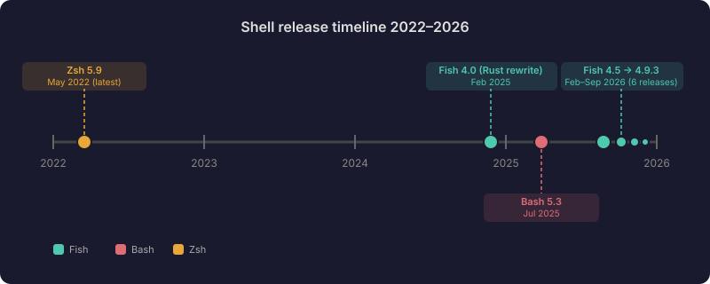
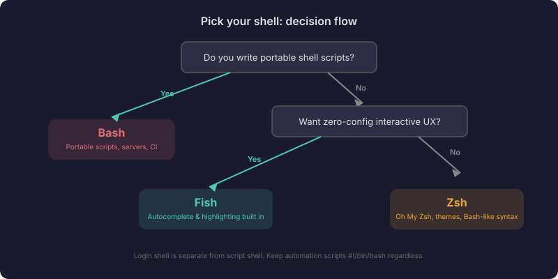

import Accordion from "@components/widgets/Accordion.astro";
import Button from "@components/widgets/Button.astro";
import ListCheck from "@components/widgets/ListCheck.astro";
import Notice from "@components/widgets/Notice.astro";
import Tabs from "@components/widgets/Tabs.astro";
import Tab from "@components/widgets/Tab.astro";

I've used all three of these shells for real work. Bash was my default for years because it was just there. I switched to Zsh when Oh My Zsh blew up, and I stuck with it for a long time. Then I tried Fish on a whim, and it became my daily driver. Each shell has a personality, and the best Linux shell for you depends on what you care about.

This Fish Shell vs Bash vs Zsh comparison isn't theoretical. I'll walk through what matters when you sit down and type commands every day - syntax, autocomplete, performance, plugins, and the gotchas that bite you when you switch.

## Fish vs Bash vs Zsh at a glance (2026)

| Feature | Fish | Bash | Zsh |
|---|---|---|---|
| Latest stable | **4.9.3** (Sep 2026) | **5.3** (Jul 2025) | **5.9** (May 2022) |
| Autosuggestions | Built in | No (needs ble.sh) | Plugin (zsh-autosuggestions) |
| Syntax highlighting | Built in | No | Plugin (zsh-syntax-highlighting) |
| Tab completions | Rich, out of the box | Basic | Good with plugins |
| POSIX compliant | No | Yes | Mostly yes |
| Scripting syntax | Its own | POSIX sh | Mostly POSIX + extensions |
| Config file | `~/.config/fish/config.fish` | `~/.bashrc` | `~/.zshrc` |
| Default on Linux | No | Usually yes | No (default on macOS) |
| Written in | Rust (since 4.0) | C | C |
| Web-based config | Yes (`fish_config`) | No | No |
| Plugin managers | Fisher, Oh My Fish (unmaintained) | None built in | Oh My Zsh, Antigen, zinit |

Zsh ships as the default shell on macOS, so if you want Fish there instead you'll need to [set up Fish Shell on macOS](/fish-shell-macos-setup/) separately. The "latest stable" row is worth staring at: Fish shipped six feature releases in 2026 alone, while Zsh hasn't shipped a stable release since 2022.

## Autosuggestions and completions

This is where Fish pulls ahead immediately. Open a fresh Fish install, start typing, and you get grayed-out suggestions from your command history. Press the right arrow to accept. No config, no plugins, nothing to set up. I wrote a full guide on [Fish Shell autocomplete and suggestions](/fish-shell-autocomplete-suggestions/) that covers everything this system can do.

Bash has nothing like this out of the box. You can install `ble.sh` (still actively developed, though its last tagged release is old - you install from git master) or use `fzf` for fuzzy history search, but it takes effort.

Zsh gets there with `zsh-autosuggestions`, but you have to install it yourself. I've written a guide on [how to enable command autocomplete in Zsh](/enable-command-autocomplete-in-zsh/) if you go that route.

Fish also parses man pages to generate completions automatically. Type `git` and hit tab, and you get completions for subcommands, flags, and branch names without any extra configuration. Zsh can match this with the right setup (compinit plus plugins), but it takes work. Bash's tab completion is bare-bones by comparison.

Since Fish 4.9.0, abbreviations can also show descriptions in the completion pager - a small quality-of-life improvement that's been requested for years. If you haven't looked at abbreviations yet, see [Fish Shell abbreviations vs aliases](/fish-shell-abbreviations-vs-aliases/) for when to use each.

## Syntax highlighting

Fish highlights your commands as you type. Valid commands are one color, invalid ones are red, strings get their own color. You can spot typos before you press enter. I have a detailed guide on [Fish Shell syntax highlighting](/fish-shell-syntax-highlighting/) if you want to see how it works under the hood.

Zsh needs `zsh-syntax-highlighting` for the same behavior. I wrote about [enabling syntax highlighting in Zsh](/enable-syntax-highlighting-zsh/) if you want that.

Bash has no built-in syntax highlighting at all.

## Scripting and POSIX compatibility

Older articles (including the previous version of this one) get the Fish vs Bash compatibility facts wrong.

Fish has its own scripting syntax that's intentionally not POSIX-compliant. The Fish developers made this choice to get a cleaner language. The syntax is easier to read:

<Tabs>
<Tab name="Fish syntax">
```fish
# Fish - cleaner syntax
if test -f ~/.config/fish/local.fish
    source ~/.config/fish/local.fish
end

for file in *.txt
    echo $file
end

# Variables
set greeting "hello"
echo $greeting
```
</Tab>
<Tab name="Bash syntax">
```bash
# Bash - POSIX style
if [ -f ~/.bashrc_local ]; then
    source ~/.bashrc_local
fi

for file in *.txt; do
    echo "$file"
done

# Variables
greeting="hello"
echo "$greeting"
```
</Tab>
</Tabs>

Now, the copy-paste gap is much smaller than it used to be. Fish has supported `&&`, `||`, and `$(command)` for years (`&&`/`||` since fish 3.0 in 2018, `$()` since 3.4 in 2022), so most modern one-liners paste fine. Fish 4.6.0 even added `|&` as a Bash-compatible spelling of `&|`. Here's what works and what doesn't:

```fish
# All of these work in Fish today:
git pull && git push          # && since fish 3.0 (2018)
echo (date)                   # fish-native substitution
echo $(date)                  # $() since fish 3.4 (2022)
some-command |& less          # |& alias for &| since fish 4.6.0 (2026)

# Still different from Bash:
env FOO=bar some-command      # instead of FOO=bar some-command
set -gx FOO bar               # instead of export FOO=bar
echo $status                  # instead of $?
test -f /tmp/x && echo ok     # no [[ ]] - use test or [
```

What still breaks when you paste Bash into Fish:

<ListCheck>
<ul>
<li>Inline environment variables: <code>FOO=bar command</code> doesn't work. Use <code>env FOO=bar command</code> or <code>set -x FOO bar</code>.</li>
<li><code>export FOO=bar</code> becomes <code>set -gx FOO bar</code>.</li>
<li><code>$?</code> is <code>$status</code> in Fish.</li>
<li><code>[[ ]]</code> tests don't exist. Use <code>test</code> or <code>[</code>.</li>
</ul>
</ListCheck>

Bash is also not standing still. Bash 5.3 shipped in July 2025 with a new no-fork command substitution (`${| command; }`) and a `GLOBSORT` variable for sorting glob results. It's actively maintained - it just doesn't ship the interactive UX features (autosuggestions, syntax highlighting) that Fish has built in and Zsh gets from plugins.

In practice, the scripting difference matters less than you'd think. Most of the time you're running commands, not writing shell scripts. And when you do need a shell script, put `#!/bin/bash` at the top and run it as a Bash script from within Fish. For Fish-specific custom commands, check out my guide on [Fish Shell functions](/fish-shell-functions-custom-commands/).

<Notice type="info" title="POSIX compatibility tip">
You can run any Bash script from Fish. Just use `bash script.sh` or make the script executable with a `#!/bin/bash` shebang. Fish's non-POSIX syntax only affects what you type interactively and Fish-specific scripts.
</Notice>

## Configuration

Fish stores its config in `~/.config/fish/config.fish` and supports a `conf.d/` directory for modular config files. It also has a web-based configuration tool: run `fish_config` and a browser opens where you can change colors, view functions, and set variables. It sounds gimmicky, but it's useful for quickly previewing color themes.

Since 4.7.0, Fish no longer applies the default theme in non-interactive shells, so your script output stays clean. Small detail, but it removes a common "why is my script output colored" surprise.

Bash uses `~/.bashrc` (and sometimes `~/.bash_profile`). Everything is manual editing.

Zsh uses `~/.zshrc`. With Oh My Zsh installed, you get a framework that manages plugins and themes, but the config file can get long. I covered some of the [best Oh My Zsh plugins](/best-oh-my-zsh-plugins/) if you're on team Zsh.

## Performance and release cadence in 2026

Fish 4.0 was rewritten from C++ to Rust, released in February 2025. As of November 2026 the latest stable is **4.9.3** (September 2026). Fish shipped roughly quarterly feature releases through 2026 - 4.5, 4.6, 4.7, 4.8, and 4.9 - plus rapid patch releases. Since 4.5.0, Fish no longer reads terminfo at all, dropping the ncurses/terminfo dependency entirely.

Here's how the release timelines compare:



Zsh 5.9 (May 2022) is still the latest stable release - four-plus years without a new stable version. Bash 5.3 shipped in July 2025, so Bash isn't frozen either, but it's clearly on a slower cadence than Fish.

On raw speed: Fish startup feels instant on my machines. It's slightly heavier than a bare Bash shell, but the difference is measured in milliseconds and you won't notice it. Zsh with Oh My Zsh loaded and several plugins can be noticeably slow to start, sometimes taking over a second. There are workarounds (lazy loading, lighter plugin managers like zinit), but it's something you have to actively manage. Plain Bash starts the fastest because it's the most minimal.

For interactive use, Fish feels the snappiest because autosuggestions and completions work instantly. The performance that matters most for a shell is how fast it responds while you're typing, and Fish wins here.

These are day-to-day impressions, not benchmark numbers. I haven't run rigorous shell startup benchmarks, and you'll find wildly different numbers depending on your config and plugins.

Fish 4.7 and 4.8 also fixed long-standing history reliability issues: NUL-byte corruption when the shell got SIGTERM/SIGHUP (#10300), and history search across concurrent sessions. If you run multiple tmux panes or SSH sessions and care about shell history, this matters. For managing multiple terminal sessions, see my guide to the [best terminal multiplexers](/best-terminal-multiplexers/).

## Plugin ecosystems

Fish has two main plugin managers:

- **[Fisher](https://github.com/jorgebucaran/fisher)** - lightweight, fast, zero config. About 9,500 stars as of November 2026. Run `fisher install author/plugin` and you're done.
- **[Oh My Fish](https://github.com/oh-my-fish/oh-my-fish)** - a framework similar to Oh My Zsh. Its README still opens with a warning that it's been unmaintained for years. I'd steer toward Fisher for new setups, but if you're curious, I have a guide on [installing and using Oh My Fish](/oh-my-fish-install-themes-plugins/).

I go into much more detail on this in [Best Fish Shell plugins and tools](/best-fish-shell-plugins/).

Zsh has the largest plugin ecosystem thanks to Oh My Zsh, which has roughly 370 plugins and 140 themes (actual repo counts as of November 2026). Oh My Zsh itself has over 190,000 GitHub stars. Antigen, zinit, and zplug are alternative plugin managers with different performance profiles.

For shared history across shells, [Atuin](https://github.com/atuinsh/atuin) has become the go-to tool (about 32,000 stars as of November 2026). It works across Fish, Zsh, and Bash, syncing your history with search that's better than `Ctrl+R`. If you want to understand how Fish handles history natively, see [how Fish Shell history search and persistence work](/fish-shell-history-persistence/).

Bash doesn't have a real plugin ecosystem. There are dotfile frameworks like bash-it, but adoption is much smaller.

## Learning curve

Bash: you already know it (probably). It's everywhere, and most Linux tutorials assume you're using it. If you need a refresher on the [essential Linux commands](/linux-commands/), those work the same in every shell - only the shell plumbing (variables, substitution, tests) differs.

Zsh: almost no learning curve coming from Bash. The syntax is nearly identical, and Oh My Zsh provides a guided experience. It's essentially Bash with extras.

Fish: there's a small adjustment period. The syntax differences trip you up for the first day or two, especially around variable assignment (`set` instead of `=`) and command substitution. After that, the built-in features mean you have less to learn overall because you don't need to configure as much.

## When to use which shell in 2026

Here's my decision flow for picking the best Linux shell in 2026:



**Pick Fish if** you want a shell that works well out of the box, you don't write POSIX shell scripts often, and you value autosuggestions and syntax highlighting without configuration. Fish's momentum in 2026 (six feature releases, a stable Rust rewrite) makes it a solid bet. If this sounds like you, check out [how to install Fish Shell on Ubuntu](/install-fish-shell-ubuntu/) to get started.

**Pick Zsh if** you want Bash-compatible syntax with modern features via plugins. You're comfortable configuring things. Oh My Zsh gives you a big community and tons of themes, even if the release cadence has slowed.

**Pick Bash if** you write shell scripts that need to run everywhere, you work on servers where Bash is the only shell available, or you prefer maximum POSIX compatibility. Bash 5.3 is actively maintained - it's just not chasing interactive UX features.

All three shells are free. The cost is consistency. Use Fish where you control the environment (workstation, dotfiles-managed VPS), and Bash everywhere else (rescue shells, minimal containers, CI runners). Keep automation scripts as `#!/bin/bash` regardless of your login shell.

<Button text="Install Fish Shell on Ubuntu" link="/install-fish-shell-ubuntu/" variant="solid" color="blue" size="md" icon="arrow-right" />

### Distro packages lag: getting current Fish on a VPS

Fish ships quarterly, but distro packages lag badly. This is a real gotcha if you're following a "just apt install fish" guide:

- **Debian 13 "trixie" (stable)** ships fish 4.0.2 - nine feature releases behind 4.9.3.
- **Ubuntu 24.04 LTS** ships fish 3.7.0, the old pre-Rust C++ build.

On a VPS, don't rely on `apt install fish` for current Fish. Use the standalone binary instead. If you want a cheap dev box where you control the shell environment, a [Hetzner Cloud VPS](https://go.bitdoze.com/hetzner) runs a few euros a month and gives you full root access.

Here's the standalone install path:

```bash
# 1. Download the standalone binary (x86_64 example)
#    Get the exact URL from https://github.com/fish-shell/fish-shell/releases
wget https://github.com/fish-shell/fish-shell/releases/download/4.9.3/fish-4.9.3-linux-x86_64.tar.xz

# 2. Extract and install
tar -xJf fish-4.9.3-linux-x86_64.tar.xz
sudo cp fish-4.9.3-linux-x86_64/bin/* /usr/local/bin/

# 3. Register the shell (required before chsh)
echo /usr/local/bin/fish | sudo tee -a /etc/shells

# 4. Set as login shell
chsh -s /usr/local/bin/fish
```

Verify the install:

```bash
fish --version
# Expected: fish, version 4.9.3

grep fish /etc/shells
# Expected: /usr/local/bin/fish
```

<Notice type="warning" title="Servers stay Bash">
Your login shell and your script shell are different things. `chsh` only affects interactive logins. Keep scripts as `#!/bin/bash` regardless of what your login shell is. Interactive Fish on your workstation or a dotfiles-managed VPS is fine - servers you SSH into for admin work should stay Bash. If you ever need to undo: `chsh -s /bin/bash` restores the login shell, and `rm /usr/local/bin/fish*` removes the standalone install.
</Notice>

If you're on Ubuntu and want a simpler path that stays current, the [install the latest Fish Shell on Ubuntu](/install-fish-shell-ubuntu/) guide covers the PPA route.

<Accordion label="Common install errors" group="install-errors">

**`chsh: /usr/local/bin/fish is not in /etc/shells`**
The standalone binary isn't registered. Fix: `echo /usr/local/bin/fish | sudo tee -a /etc/shells`, then retry `chsh`.

**Building from GitHub source tarball fails**
The auto-generated "Source code (tar.gz)" from GitHub won't build. Use the official `fish-4.9.3.tar.xz` source tarball from the release assets instead - it has the build system pre-configured.

**`apt install fish` gives an ancient version**
Expected. Debian stable and Ubuntu LTS lag months behind. Use the standalone binary or the fish-shell PPA. Pin the version and treat upgrades like any other small tool.

</Accordion>

## My take

A year of rapid Fish 4.x development has validated the bet. Fish shipped six feature releases in 2026, the Rust rewrite is holding up, and the project keeps shipping quality-of-life improvements (abbreviation descriptions, history reliability fixes, `|&` compatibility). Meanwhile Zsh stable is still 5.9 from 2022.

I switched to Fish and haven't looked back. The out-of-the-box experience is just better than anything I managed to build with Zsh plugins. Autosuggestions, syntax highlighting, man page completions, and the clean scripting syntax make day-to-day work faster.

The POSIX incompatibility bothered me for about a week. I learned to use `bash -c 'command'` for the occasional one-liner, and I keep my automation scripts as Bash scripts. It's a non-issue.

If you want a deeper comparison between just Fish and Zsh, I wrote a focused article on [Fish Shell vs Zsh](/fish-shell-vs-zsh/). And if you want to customize your Fish prompt, take a look at [how to set up Starship with Fish Shell](/fish-shell-starship-prompt/) or my [Fish Shell themes and prompts comparison](/fish-shell-themes-prompts/) covering Tide, Starship, Pure, and Hydro.

## Related Fish Shell guides

- [Fish Shell autocomplete and suggestions](/fish-shell-autocomplete-suggestions/) - master Fish's completion system
- [Fish Shell syntax highlighting](/fish-shell-syntax-highlighting/) - how highlighting works in Fish
- [Fish Shell functions and custom commands](/fish-shell-functions-custom-commands/) - write your own Fish functions
- [Fish Shell abbreviations vs aliases](/fish-shell-abbreviations-vs-aliases/) - when to use each
- [Fish Shell history and persistence](/fish-shell-history-persistence/) - manage and persist your command history
- [Fish Shell themes and prompts](/fish-shell-themes-prompts/) - compare Tide, Starship, Pure, and Hydro
- [Oh My Fish guide](/oh-my-fish-install-themes-plugins/) - install themes and plugins with OMF
- [NVM with Fish Shell](/nvm-fish-shell/) - manage Node.js versions in Fish
- [Fish Shell macOS setup](/fish-shell-macos-setup/) - get Fish running on Mac
