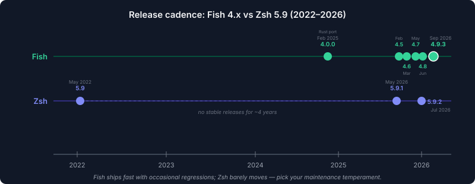
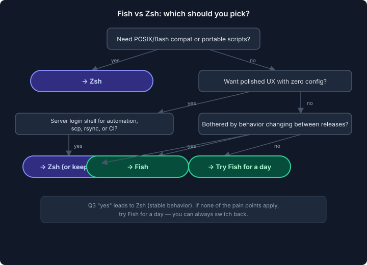

import Button from "@components/widgets/Button.astro";
import Notice from "@components/widgets/Notice.astro";
import ListCheck from "@components/widgets/ListCheck.astro";
import Accordion from "@components/widgets/Accordion.astro";
import Tabs from "@components/widgets/Tabs.astro";
import Tab from "@components/widgets/Tab.astro";

I used Zsh with Oh My Zsh for about three years before switching to Fish. Both are big upgrades over Bash, but they take different approaches to getting there. Zsh gives you a POSIX-compatible shell that you build up with plugins. Fish gives you a polished experience from the first launch but breaks with POSIX conventions. This Fish Shell vs Zsh comparison is current as of Fish 4.9.3 (September 2026) and Zsh 5.9.2 (July 2026): the state of both projects heading into 2027, not a stale snapshot from three years ago. If you want to see how all three shells compare, check my [Fish vs Bash vs Zsh comparison](/fish-shell-vs-bash-vs-zsh/). This article goes deeper on just Fish and Zsh.

## Out-of-the-box experience

This is where Fish and Zsh differ most.

**Fish** gives you autosuggestions, [syntax highlighting](/fish-shell-syntax-highlighting/), tab completions with descriptions, and man page parsing from a fresh install. You open a terminal and everything works. No configuration, no plugins, no framework.

**Zsh** out of the box is plain. It's a step above Bash, with better globbing and some built-in features, but the experience most people associate with Zsh comes from Oh My Zsh and plugins. You need to install [zsh-autosuggestions](/enable-command-autocomplete-in-zsh/) for history-based suggestions and [zsh-syntax-highlighting](/enable-syntax-highlighting-zsh/) for command coloring.

If you care about time-to-productive, Fish wins by a wide margin. You trade configuration flexibility for a shell that works immediately.

## Autosuggestions

Both shells can show inline suggestions from your [command history](/fish-shell-history-persistence/) as you type. The difference is that Fish does it by default and Zsh needs a plugin.

In Fish, press the right arrow to accept the full suggestion or `Alt+Right` to accept one word at a time. Fish also blends history suggestions with file path and command completions. I go into more detail in my [Fish Shell autocomplete and suggestions guide](/fish-shell-autocomplete-suggestions/).

In Zsh with `zsh-autosuggestions`, the behavior is similar but can feel slightly less polished. The plugin sometimes conflicts with other completions or themes. One caveat: the project is quiet. The latest tag (v0.7.1) is from 2020, and the last repo push was mid-2025. It still works, but install it via your distro's package manager or the Oh My Zsh git-clone method rather than chasing the old release tag.

## Tab completions

Fish's tab completion system is more sophisticated out of the box. It reads man pages and generates completions automatically, so commands you've never configured still get useful tab results. Type `rsync --` and press tab, and you'll see all available flags with descriptions.

Fish also displays completions in a pager-style list with descriptions next to each option. You navigate with arrow keys and press enter to select.

Zsh has a powerful completion system too (`compinit` plus `zstyle` configuration), and it can match Fish once properly configured. But "properly configured" is doing a lot of work in that sentence. Most Zsh users rely on Oh My Zsh or frameworks to handle this, and even then it's rarely as complete as what Fish generates from man pages.

## Syntax

This is the real decision point for many people.

**Zsh** is largely POSIX-compatible. Bash scripts run in Zsh with minimal changes, and Zsh scripts look almost identical to Bash:

```zsh
# Zsh
export MY_VAR="hello"
if [[ -f "$HOME/.zshrc" ]]; then
    source "$HOME/.zshrc"
fi
my_list=("one" "two" "three")
for item in "${my_list[@]}"; do
    echo "$item"
done
```

**Fish** has its own syntax. It's arguably cleaner, but it's different:

```fish
# Fish
set -gx MY_VAR "hello"
if test -f ~/.config/fish/config.fish
    source ~/.config/fish/config.fish
end
set my_list one two three
for item in $my_list
    echo $item
end
```

The Fish version has less punctuation. No `[[ ]]`, no `do`/`done`, no semicolons, no `${}`-style variable expansion. Variables are just `$name`, lists don't need quotes around each element, and blocks end with `end` instead of `fi`/`done`/`esac`.

The trade-off: you can't paste Bash commands directly. Here's what still trips people up and how to fix it:

| Bash / Zsh | Fish equivalent |
|---|---|
| `export VAR=value` | `set -gx VAR value` |
| `$(command)` | `(command)` |
| `command1 2>&1 \| grep x` | Same; `\|&` also accepted since Fish 4.6 |
| `command1 && command2` | Works since Fish 3.0 |
| `for f in *.txt; do ...; done` | `for f in *.txt; ...; end` |

<Notice type="info" title="Fish does support && now">
Fish 3.0 added `&&` and `||` support, and Fish 4.6+ accepts `|&` like Bash. So most one-liners from tutorials paste cleanly now. The main things that still break are `export VAR=value` (use `set -gx VAR value`) and `$(cmd)` for command substitution (use `(cmd)`).
</Notice>

## Plugin ecosystem

This is where the "oh my zsh vs fish" question gets interesting.

**Zsh** has the larger ecosystem thanks to Oh My Zsh, which has been around since 2009. As of late 2026 there are 370+ bundled plugins, roughly 140 themes, and a community of 2,500+ contributors. Alternative managers like zinit, antigen, and zplug offer faster loading than the stock Oh My Zsh framework. I have a list of [the best Oh My Zsh plugins](/best-oh-my-zsh-plugins/) if you go that route.

**Fish** has a smaller but focused ecosystem. [Fisher](https://github.com/jorgebucaran/fisher) is the recommended plugin manager. It's fast and stays out of your way, though development has slowed (last release v4.4.8 in January 2026). Popular plugins include Tide (a prompt), fzf.fish (fuzzy search), and [nvm.fish](/nvm-fish-shell/) (Node version management). I cover these in [best Fish Shell plugins and tools](/best-fish-shell-plugins/).

Oh My Fish got a second wind: v8 shipped in April 2026, its first release since 2020, adding Fish 4+ compatibility and fixing the installer. It's worth a look again, but Fisher is still the safer default. If you're curious about OMF, see my [Oh My Fish guide](/oh-my-fish-install-themes-plugins/).

Fish needs fewer plugins to begin with. Features that require a Zsh plugin (autosuggestions, syntax highlighting, good completions) are built into Fish. So while Zsh has more plugins available, Fish users need fewer of them.

## Configuration complexity

**Zsh configuration** can get involved. A typical `.zshrc` with Oh My Zsh includes theme selection, plugin lists, custom aliases, path configuration, and framework settings. It's not uncommon to end up with a 100-line `.zshrc`. Oh My Zsh also adds measurable startup time, especially with many plugins enabled.

**Fish configuration** tends to be shorter. Your `~/.config/fish/config.fish` might just have path additions and some abbreviations. Fish also supports `conf.d/` for splitting config into separate files, and `fish_add_path` handles PATH entries cleanly:

```fish
# ~/.config/fish/config.fish
fish_add_path ~/.local/bin
fish_add_path /opt/my-tool/bin
```

Fish 4.9.0 added a nice quality-of-life feature: abbreviations can now carry descriptions that show up in the completion pager. See [Fish Shell abbreviations vs aliases](/fish-shell-abbreviations-vs-aliases/) for the full breakdown, but here's the gist:

```fish
# Fish 4.9: abbreviations with descriptions
abbr --add gco --description "git checkout" git checkout
abbr --add dc --description "docker compose" docker compose
```

After editing your config, run `fish -c 'echo $PATH'` to verify PATH changes took effect. The `fish_config` web UI also lets you change colors and prompts without editing files.

## Prompt customization

**Zsh** themes through Oh My Zsh give you quick prompt changes. Powerlevel10k has been the go-to for years: it's fast and has a configuration wizard. But the Powerlevel10k README now states the project has "very limited support" with no new features planned and most bugs going unfixed. The last release was v1.20.0 in January 2024. It still works, but it's winding down.

<Notice type="warning" title="Powerlevel10k is in maintenance mode">
The Powerlevel10k README now says the project has very limited support, no new features are in the works, and help requests will be ignored. If you want a prompt that's actively developed, [set up Starship with Fish Shell](/fish-shell-starship-prompt/). It works across both Fish and Zsh and ships updates regularly (v1.27.0 in October 2026).
</Notice>

**Fish** has Tide as its native prompt option, with a similar configuration wizard to Powerlevel10k. Tide is in low-activity mode (last release v6.2.0 in August 2025) but remains the most polished Fish-native prompt. I wrote a guide on [setting up Starship with Fish Shell](/fish-shell-starship-prompt/), and a broader [Fish Shell themes and prompts comparison](/fish-shell-themes-prompts/) covering Tide, Starship, Pure, and Hydro.

Both shells work well with Starship if you want a consistent prompt across shells. I also covered Starship in my [Starship and Ghostty guide](/starship-ghostty-terminal/). And if you're picking a terminal to go with your new shell, my [Ghostty terminal setup guide for Mac](/ghostty-terminal/) and [WezTerm setup on macOS with tmux and zoxide](/install-wezterm-mac/) cover the two I'd shortlist.

## Scripting

If you write automation scripts that need to run on different systems, Zsh (or Bash) is the safer choice. Zsh scripts run on macOS (where Zsh is the default shell) and most Linux systems with Zsh installed. Bash scripts run everywhere.

Fish scripts only run in Fish. For automation, I keep my scripts as Bash files with `#!/bin/bash` shebangs and run them from Fish. This is the standard recommendation in the Fish community. Fish is meant to be your interactive shell, not necessarily your scripting language for portable automation.

That said, Fish's scripting syntax is pleasant for Fish-specific things like custom completions, prompt functions, and abbreviation handlers. See my [Fish Shell functions guide](/fish-shell-functions-custom-commands/) for examples.

## What changed since early 2026

If you read a Fish vs Zsh comparison from even six months ago, several things have shifted.

**Fish shipped six stable releases in under seven months**, from 4.5.0 (February 2026) to 4.9.3 (September 2026). The highlights for daily users: `|&` Bash compat (4.6), abbreviation descriptions in the completion pager (4.9), `cd -L`/`cd -P` symlink resolution (4.8), and a fix for man-page parsing on newer coreutils (4.7). If you use Fish, expect occasional behavior changes between releases. The emoji width default changed in 4.6, and Konsole needed a keyboard-protocol workaround in 4.9. Read the release notes before upgrading.

**Zsh moved at the opposite pace.** Versions 5.9.1 (May 2026) and 5.9.2 (July 2026) were the first stable Zsh releases since 5.9 in May 2022, over four years later. The changes are minor: POSIX real-time signals, `kill -q`/`kill -L` flags, and a new completion helper. Nothing that will surprise you. That's the Zsh deal: glacial updates, extreme stability.



This cadence contrast is a real decision factor. If you want a shell that gets new features regularly and don't mind reading release notes, Fish is the bet. If you want a shell whose behavior won't change under you, Zsh is the safer pick.

Beyond release cadence, two ecosystem items moved: Oh My Fish revived with v8 in April 2026 (see the plugin section above), and Powerlevel10k declared maintenance mode (see the prompt section).

<Accordion label="Fish 4.6 to 4.9: full release highlights" group="changelog">
- **4.6.0 (2026-03-28):** `|&` accepted as Bash-style pipe-redirect; emoji width default changed to 2 (set `$fish_emoji_width` to revert); `SHELL_PROMPT_PREFIX`/`SHELL_PROMPT_SUFFIX`/`SHELL_WELCOME` env vars supported (used by `systemd run0`); Spanish and Japanese translations added.
- **4.7.0 (2026-05-06):** default color theme (`fish_color_*`) no longer set in non-interactive shells (matters if you script with fish); `fish_update_completions` handles groff escapes from help2man >= 1.50 (coreutils 9.10); empty `XDG_DATA_DIRS` falls back to defaults so `vendor_completions.d` is picked up; history no longer corrupted with NUL bytes on SIGTERM/SIGHUP.
- **4.8.0 (2026-06-24):** `cd -L`/`cd -P` for symlink resolution like other shells; abbreviations with `--position=anywhere` completable in argument position; history race fix across concurrent sessions; deprecation warning: `complete --command/--path` no longer unescapes args (breaks some older completion scripts).
- **4.9.0 / 4.9.3 (2026-09-03/08):** abbreviations with `--description` shown in the completion pager; nested list indexing (`$foo[$bar[1] 2]`); faster tab completion in directories with slow symlinks; kitty users can map `shift`+`space` separately; Konsole workaround (fish skips kitty keyboard protocol on Konsole 26.07.80 and older unless the `omit-term-workarounds` feature flag is set).
</Accordion>

<Accordion label="Zsh 5.9.1 / 5.9.2: what actually changed" group="changelog">
Both releases together close a gap of over four years since Zsh 5.9 (May 2022). Changes include POSIX real-time signals (`SIGRTMIN`/`SIGRTMAX`) in `kill`, `trap`, and `$signals`; `kill -q` via `sigqueue(3)`; `kill -L` for listing signals; and a new `_as_if` completion helper. The NEWS file lumps these as "changes since 5.9" rather than splitting them by release. Bottom line: minor plumbing, no surprises.
</Accordion>

<Notice type="info" title="Distro packages lag behind Fish releases">
Fish 4.9.x is current upstream, but distro packages may ship older versions. Official Linux binary tarballs (x86_64/aarch64), Homebrew on macOS, and your distro's package manager all work. Check [fishshell.com](https://fishshell.com) for the canonical install instructions for your platform.
</Notice>

## Performance comparison

Here's the ballpark picture for startup time and memory. These are rough numbers. They'll vary by machine, config, and which plugins you enable. Don't treat them as benchmarks.

| Metric | Fish 4.9.x | Zsh 5.9.2 (with Oh My Zsh) | Zsh 5.9.2 (bare) |
|---|---|---|---|
| Startup time | ~30ms | 200-800ms | ~40ms |
| Interactive response | Instant | Depends on plugins | Fast |
| Memory usage | ~15MB | ~20-40MB | ~10MB |
| Written in | Rust | C | C |

Fish 4.0 was rewritten in Rust (February 2025), and the current stable is 4.9.3. Startup is fast and interactive response is immediate. Zsh with Oh My Zsh and several plugins can have noticeable startup delay, though this varies hugely depending on which plugins you enable. A lean `.zshrc` with two plugins starts nearly as fast as bare Zsh.

<Accordion label="Benchmark it yourself" group="perf">
Don't trust my ballpark numbers. Measure on your own machine:

```bash
# Startup time (install hyperfine: cargo install hyperfine or your package manager)
hyperfine 'fish -i -c exit'
hyperfine 'zsh -i -c exit'

# Memory usage
/usr/bin/time -v fish -i -c exit
/usr/bin/time -v zsh -i -c exit
```

The `-i -c exit` trick starts an interactive shell and immediately exits, so you measure init time including config loading. Run the zsh variant with and without your `.zshrc` loaded to see the Oh My Zsh overhead.
</Accordion>

## Before you switch: operator checklist

If you're running servers or managing remote boxes, don't just `chsh` and hope for the best. Here's the order I'd work through.

<ListCheck>
<ul>
<li>Check what you're running: `fish --version`, `zsh --version`, `echo $SHELL`, `ps -p $$`</li>
<li>Try Fish without changing anything: just run `fish` from your current shell</li>
<li>Switch the login shell only after a day of comfortable use (`chsh`)</li>
<li>Keep root, service, and deploy accounts on Bash or Zsh. Don't set Fish as their login shell</li>
<li>In minimal Docker images, install `man`/`man-db` before expecting completions to work</li>
<li>Verify after switching: `fish -c 'echo $PATH'` and check `conf.d/` entries loaded</li>
<li>Know the rollback: `chsh -s "$(which bash)"` (or your previous shell)</li>
<li>Test on a throwaway VPS before touching production boxes</li>
</ul>
</ListCheck>

**Know what you're running.** Before anything else, check your versions:

```bash
fish --version   # e.g. fish, version 4.9.3
zsh --version    # e.g. zsh 5.9.2
echo $SHELL      # your login shell
ps -p $$         # the shell you're actually in right now
```

**Try before you switch.** Just run `fish` from your current terminal. No `chsh`, no config changes. If you want to launch Fish automatically without changing your login shell, append this to `~/.bashrc`:

```bash
# Try fish without changing your login shell (append to ~/.bashrc)
if [[ $- == *i* ]] && [[ -z "$INSIDE_EMACS" ]] && command -v fish >/dev/null; then
    exec fish
fi
```

This launches Fish only for interactive sessions. `scp`, `rsync`, and CI commands that source `.bashrc` won't be affected because the `$- == *i*` guard checks for an interactive shell.

**Switch the login shell** once you're convinced:

<Tabs>
<Tab name="Linux (Ubuntu/Debian)">
```bash
# Fish must be listed in /etc/shells first
which fish
sudo sh -c 'echo "$(which fish)" >> /etc/shells'
chsh -s "$(which fish)"
```

If `chsh` rejects the change, it's almost always because Fish isn't in `/etc/shells`. Add it and try again. If you haven't installed Fish yet, see my guide to [install Fish Shell on Ubuntu](/install-fish-shell-ubuntu/).
</Tab>
<Tab name="macOS">
```bash
chsh -s "$(which fish)"
```

On macOS, `chsh` may prompt for your password and can behave differently than on Linux (it may use `dscl` under the hood). If `chsh` gives you trouble, set the shell via System Settings > Users & Groups > right-click your user > Advanced Options. For the full walkthrough, see my [Fish Shell on macOS setup guide](/fish-shell-macos-setup/).
</Tab>
</Tabs>

<Notice type="warning" title="Don't set Fish as the login shell for root or deploy accounts">
Tools like `rsync`, `scp`, and some Git and Ansible flows assume a Bourne-family login shell and source `.profile` or `.bashrc`. If those accounts use Fish as their login shell, those tools may break or behave unpredictably. On servers, keep Bash or Zsh as the login shell for service accounts and run Fish interactively only.
</Notice>

<Notice type="info" title="Minimal Docker images have no man pages">
Fish's man-page completion generation needs man pages installed. In slim Docker images they're missing, so completions will be empty. Fix: install `man` or `man-db`, then run `fish_update_completions`. Fish 4.7.0 fixed parsing for newer help2man-generated pages (coreutils 9.10+).
</Notice>

**Verify after switching.** Open a new terminal and run:

```bash
fish -c 'echo $PATH'       # confirm PATH looks right
ls ~/.config/fish/conf.d/  # check split config files are there
```

If PATH entries are missing, edit `~/.config/fish/config.fish` and use `fish_add_path` rather than manually editing `$PATH`.

**Rollback.** If things go sideways, switch back:

```bash
chsh -s "$(which bash)"    # or /bin/zsh, or whatever you used before
# Also remove the exec fish snippet from ~/.bashrc if you added it
```

Nothing else to unwind, as long as you never changed the login shell for service accounts.

**Test on a throwaway VPS first.** A login-shell change is easy to undo, but doing it blind on a production box is how you end up locked out of an SSH session with a broken deploy. Spin up a cheap [Hetzner Cloud VPS](https://go.bitdoze.com/hetzner) (a few euros per month for the smallest instance) and practice the switch there before touching anything that matters.

## So which one should you pick?

Here's the short version.



**Go with Fish if:**
- You want things to work immediately without configuring them
- You spend most of your time running commands interactively, not writing shell scripts
- The POSIX syntax differences don't bother you
- You prefer a smaller, focused plugin ecosystem over a huge one
- You don't mind reading release notes when behavior shifts between versions

**Go with Zsh if:**
- You want Bash compatibility so you can paste commands from tutorials without changes
- You like having a massive plugin ecosystem with lots of themes
- You write shell scripts that need to be portable
- You're already comfortable with your Zsh setup and don't feel limited by it
- You want a shell whose behavior doesn't change under you between releases

If you're currently on Bash and looking to upgrade, I'd suggest trying Fish first. The barrier is low. [Install it on Ubuntu](/install-fish-shell-ubuntu/) (or [set it up on macOS](/fish-shell-macos-setup/)), run `fish`, and use it for a day. You don't have to set it as your default shell to test it. If the syntax differences bother you too much, switch to Zsh instead. And if you want to round out your terminal setup with a multiplexer, here are the [best terminal multiplexers in 2026](/best-terminal-multiplexers/).

<Button text="Fish vs Bash vs Zsh three-way comparison" link="/fish-shell-vs-bash-vs-zsh/" variant="outline" color="blue" size="md" icon="arrow-right" />
