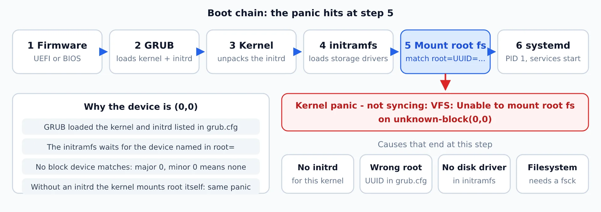
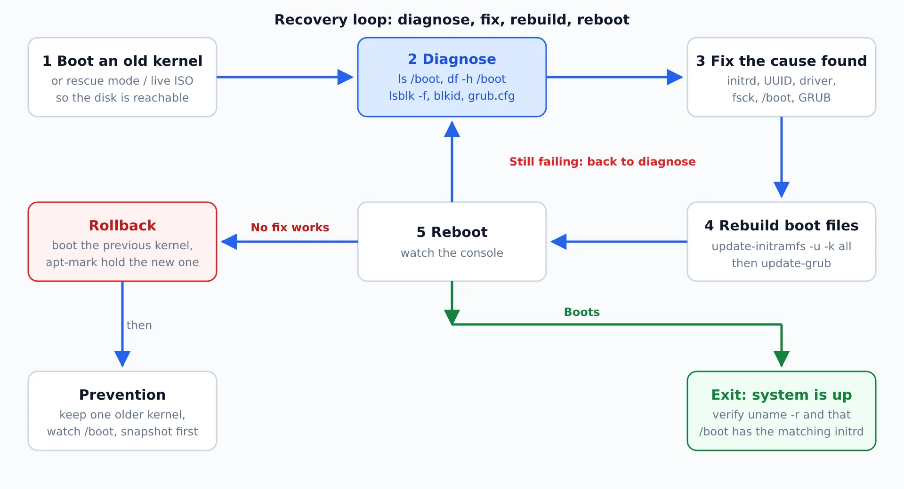

import { Picture } from "astro:assets";
import imgBootMenu from "../../assets/images/23/05/ubuntu-boot.jpeg";
import Accordion from "@components/widgets/Accordion.astro";
import ListCheck from "@components/widgets/ListCheck.astro";
import Notice from "@components/widgets/Notice.astro";

<Notice type="info" title="Affiliate Disclosure">This guide contains referral links. If you buy through them, I may earn a commission at no extra cost to you.</Notice>

This panic means the kernel found no root filesystem to mount, for example because a new kernel has no initrd. Boot an older kernel from GRUB, run `update-initramfs -c -k <version>` and `update-grub`, then reboot.

In May 2023 I ran `apt upgrade` on an Ubuntu 22.04 server hosted on a [Hetzner VPS](https://go.bitdoze.com/hetzner) (the same steps apply to my [Hostinger VPS](https://go.bitdoze.com/hostinger-vps)). The upgrade pulled in kernel **5.15.0-71-generic**. It finished, I rebooted, and the server never came back. The provider console stopped at:

```
Kernel panic - not syncing: VFS: Unable to mount root fs on unknown-block(0,0)
```

The cause in my case was an initrd that did not match the new kernel. Booting the previous kernel, chrooting into the system and running `update-initramfs` plus `update-grub` fixed it. That is one of seven causes of the same panic, so this guide covers all of them for Ubuntu and Debian. It explains what the message means, how to tell the causes apart before you change anything, the fix for each, and how to roll back.

_VPS prices jumped across the board in 2026. If you are rethinking a rented box, see [what changed and when a mini PC wins](/vps-price-increases/)._

## What does the unknown-block(0,0) kernel panic mean?

It means the kernel needed a root filesystem and had no device to mount it from. The device is called `unknown-block(0,0)` because major 0, minor 0 is not a real disk.

The panic comes at step 5 of a six-step chain. The firmware (UEFI or BIOS) starts GRUB. GRUB reads `/boot/grub/grub.cfg` and loads the kernel together with its initrd. The kernel unpacks the initrd into RAM and runs it as a small temporary root (the initramfs). The initramfs loads the storage drivers and looks for the device named in `root=` on the kernel command line. Only when that device is mounted does the handoff to systemd happen. Per the [kernel documentation](https://docs.kernel.org/filesystems/ramfs-rootfs-initramfs.html), locating and mounting the real root is the initramfs's job.



*The boot chain. The panic comes from the mount root step, so everything before it worked.*

In [init/do_mounts.c](https://github.com/torvalds/linux/blob/master/init/do_mounts.c) the kernel calls `panic("VFS: Unable to mount root fs on %s", ...)` after every filesystem type it tried has failed on the root device. When no initrd is loaded, the kernel resolves `root=` by itself and can land on this panic.

With an initrd present, initramfs-tools usually stops earlier. It waits for the `root=` device, then prints `ALERT! UUID=... does not exist. Dropping to a shell!` and leaves you at an `(initramfs)` prompt (see `scripts/local` in [initramfs-tools](https://salsa.debian.org/kernel-team/initramfs-tools/-/blob/master/scripts/local)). Treat that prompt as the same family of problems. The fixes below apply to both.

The kernel prints a longer variant of the complaint when it cannot open a named device. It reads `VFS: Cannot open root device ... Please append a correct "root=" boot option`.

Nothing in this chain writes to your root filesystem. Your data is still on the disk.

## Causes and the symptom that identifies each

| Cause | Symptom you see | Fix |
|---|---|---|
| New kernel has no matching initrd (interrupted upgrade or full `/boot`) | `vmlinuz-X` in `/boot`, no `initrd.img-X` | `update-initramfs -c -k X` or reinstall the kernel |
| `root=` no longer matches the disk UUID (disk moved, restore from image, partition change) | UUID in `grub.cfg` differs from `blkid` | Correct `fstab`, run `update-grub` |
| Storage driver missing from the initramfs (virtio, RAID, NVMe, LVM, encryption) | `lsblk -f` from rescue sees the disk, `lsinitramfs` lacks the module | Add module to `/etc/initramfs-tools/modules`, rebuild |
| Filesystem needs `fsck` | Boot drops to initramfs, `dmesg` shows ext4 errors | `fsck -f -y` from a live or rescue system |
| Full `/boot` partition | `df -h /boot` at 100%, zero-byte or truncated initrd | Remove old kernels, rebuild the initrd |
| Damaged GRUB configuration | `grub.cfg` has no `initrd` line, or a `linux` line points to a missing file | `update-grub`; `grub-install` only if GRUB itself is gone |
| Kernel package removed (manual purge or `apt autoremove`) | `dpkg -l 'linux-image*'` lists fewer kernels than before | Reinstall `linux-image-generic` (Ubuntu) or `linux-image-amd64` (Debian) |

## Diagnose before you change anything

Resist the urge to reinstall GRUB first. The same panic comes from at least seven causes, and each fix takes a couple of minutes once you know which one you have. Follow the loop below. Get in with an older kernel, collect the facts, read the table, then apply one fix.



*The recovery loop. Reboot is the test. A second failure sends you back to the diagnosis, not to a new guess.*

<ListCheck>
<ul>
  <li>Do not format or reinstall anything yet. Every cause below is repairable in place.</li>
  <li>Write down the kernel version that fails and the one that boots.</li>
  <li>Take a snapshot or backup if the provider still lets you. You want it before `fsck`.</li>
</ul>
</ListCheck>

### Boot an older kernel

On a VPS, open the provider's console (VNC in the panel) instead of SSH, because SSH is down. On BIOS, press and hold `Shift` right after the firmware screen. On UEFI, tap `Escape`. Do either until the GRUB menu appears, then pick **Advanced options for Ubuntu** (on Debian the entry is **Advanced options for Debian GNU/Linux**). Choose an entry that is not the newest kernel. Skip the `(recovery mode)` entry unless the normal entries also panic. The [Ubuntu recovery mode page](https://wiki.ubuntu.com/RecoveryMode) describes the same menu.

<Picture formats={["webp"]} fallbackFormat="webp"
  src={imgBootMenu}
  widths={[200, 400, 900]}
  sizes="(max-width: 900px) 100vw, 900px"
  alt="GRUB menu showing Advanced options for Ubuntu with several kernel versions listed"
/>

*The GRUB menu on my 2023 Hetzner VPS. Pick a kernel older than the one that panics.*

If an older kernel boots, log in over SSH or the console and continue below. If every entry panics, or there is no menu at all, jump to [No GRUB menu: rescue mode or a live ISO](#no-grub-menu-rescue-mode-or-a-live-iso) and come back here from the rescue shell.

### Collect the facts

Run these from the booted older kernel, or from the chroot later. The full reference for each command is in my [Linux commands list](/linux-commands/).

```bash
uname -r
ls -lh /boot
df -h /boot
lsblk -f
blkid
grep -E "^\s*(linux|initrd)\s" /boot/grub/grub.cfg
dpkg -l 'linux-image*' | grep '^ii'
```

Here is what to look for, as an example layout (root on `/dev/sda1`, EFI on `/dev/sda15`, as on my 2023 server):

```text
$ ls -lh /boot
initrd.img-5.15.0-56-generic
initrd.img-5.15.0-71-generic
vmlinuz-5.15.0-56-generic
vmlinuz-5.15.0-71-generic

$ blkid
/dev/sda1: UUID="11111111-2222-3333-4444-555555555555" BLOCK_SIZE="4096" TYPE="ext4" PARTUUID="0e489e3f-01"
/dev/sda15: UUID="ABCD-EFGH" BLOCK_SIZE="512" TYPE="vfat" PARTUUID="0e489e3f-0f"

$ grep -E "^\s*(linux|initrd)\s" /boot/grub/grub.cfg
linux	/vmlinuz-5.15.0-71-generic root=UUID=11111111-2222-3333-4444-555555555555 ro quiet
initrd	/initrd.img-5.15.0-71-generic
```

Each kernel needs both a `vmlinuz-` and an `initrd.img-` file. The `root=UUID=` in the `linux` line has to be the UUID that `blkid` prints for your root partition. The UUIDs above are placeholders. On LVM, GRUB writes the device path (`root=/dev/mapper/<vg>-<lv>`) instead of a UUID.

### Map the finding to its cause

| Finding | Cause |
|---|---|
| `vmlinuz-X` exists, `initrd.img-X` is missing or 0 bytes, `/boot` not full | Initrd missing: rebuild it |
| `df -h /boot` shows 0 available, or `Use%` at 100 | Full `/boot`: free it, then rebuild |
| `root=UUID=...` in `grub.cfg` is not in the `blkid` output | Wrong `root=` UUID |
| `blkid` shows the disk but the initramfs lacks the driver (`lsinitramfs /boot/initrd.img-X \| grep -i virtio`) | Driver missing from the initramfs |
| Boot log shows `EXT4-fs error` or drops to `(initramfs)` | Filesystem needs `fsck` |
| No `initrd` line under a `linux` line, or the file named does not exist | GRUB configuration damaged |
| Only the broken kernel is installed, older ones gone from `dpkg -l` | Kernel package removed |

## Fix each cause

Most fixes run inside a chroot of the installed system. Set it up once, then apply the section that matches your finding.

### Chroot into the installed system

Run this from the older kernel, from recovery mode with networking enabled, or from the rescue system. Replace `sda1` with your root partition from `lsblk -f`. If root is an LVM logical volume, the device is `/dev/mapper/<vg>-<lv>`. My [guide to adding an LVM drive](/add-new-drive-lvm/) covers the naming.

```bash
sudo mount /dev/sda1 /mnt
for d in dev dev/pts proc sys run; do sudo mount --bind /$d /mnt/$d; done
sudo mount /dev/sda15 /mnt/boot/efi   # only when lsblk shows an EFI partition
sudo chroot /mnt
```

The loop binds `/run` as well, which the [Arch Wiki chroot page](https://wiki.archlinux.org/title/Chroot) also lists among the mounts a chroot needs. Leave the chroot with `exit`, then unmount in reverse order:

```bash
exit
sudo umount /mnt/boot/efi
for d in run sys proc dev/pts dev; do sudo umount /mnt/$d; done
sudo umount /mnt
```

The `apt` commands below need network access inside the chroot. If they cannot resolve hosts, run them from the booted older kernel instead. `update-grub` detects the root device from what is mounted at `/`, so run it only inside a correct chroot or on the booted system.

<Notice type="warning" title="Device names change in rescue mode">In a rescue system your disk can be `sdb` or `vda`. Use `blkid` and `lsblk -f` there, never the name you remember from the old boot.</Notice>

### Missing initrd for the new kernel

If `/boot/initrd.img-<version>` is missing, create it. If it exists, update it. This is the fix from my 2023 case:

```bash
update-initramfs -c -k 5.15.0-71-generic   # create when the file is missing
update-initramfs -u -k 5.15.0-71-generic   # update when the file exists
```

Output when it works:

```text
update-initramfs: Generating /boot/initrd.img-5.15.0-71-generic
```

`-k` takes the version of the kernel that fails, not the one you booted. In a chroot from a live system, take it from the file names in `/boot`, because `uname -r` shows the live kernel there. With `-u`, `-k all` rebuilds every installed kernel that already has an initramfs. With `-c`, it creates one for every installed kernel (`man update-initramfs`, [Ubuntu manpage](https://manpages.ubuntu.com/manpages/noble/en/man8/update-initramfs.8.html)).

If the initrd will not build, the kernel package is probably half-configured from the interrupted upgrade. Let apt finish the job:

```bash
dpkg --configure -a
apt-get -f install
apt install --reinstall linux-image-5.15.0-71-generic
update-initramfs -c -k all
update-grub
```

### The root= argument no longer matches the disk

Compare the `root=UUID=` value in the `linux` line of `grub.cfg` with `blkid`. They differ after a restore from an image onto a new disk, a partition resize or a move between hosts. Check `/etc/fstab` too, since it mounts root by the same UUID:

```bash
cat /etc/fstab
blkid
```

Put the UUID from `blkid` into the `/` line of `/etc/fstab`, then regenerate the configuration so the `linux` lines pick it up:

```bash
update-grub
grep root=UUID /boot/grub/grub.cfg
```

The `grep` has to print the UUID from `blkid`. If the old value stays, look for a hard-coded `root=` in `GRUB_CMDLINE_LINUX` in `/etc/default/grub` or in the files under `/etc/default/grub.d/`, remove it, and run `update-grub` again.

### A storage driver is missing from the initramfs

The rescue system sees the disk but the initramfs cannot. List what the image contains and look for the driver your disk needs (`virtio_blk`, `virtio_scsi`, `nvme`, `megaraid_sas`, `dm_mod` for LVM):

```bash
lsinitramfs /boot/initrd.img-5.15.0-71-generic | grep -iE "virtio|nvme|dm-mod"
```

Ubuntu and Debian default to `MODULES=most` in `/etc/initramfs-tools/initramfs.conf`, which packs most drivers ([initramfs.conf(5)](https://manpages.ubuntu.com/manpages/noble/en/man5/initramfs.conf.5.html)). Two things break that. Someone may have set `MODULES=dep` on a small `/boot`, or the machine moved from virtio disks to an NVMe or RAID controller. Force the module in:

```bash
echo "virtio_blk" >> /etc/initramfs-tools/modules
update-initramfs -u -k all
update-grub
```

The [Debian InitramfsDebug page](https://wiki.debian.org/InitramfsDebug) has the deeper procedure. Boot with `break=premount` on the kernel line to get a busybox shell inside the initramfs, then check `cat /proc/cmdline` and `cat /proc/modules`.

### The filesystem needs a check

When the root ext4 filesystem is dirty or damaged, the mount fails and the boot drops to `(initramfs)` or panics. Never run `fsck` on a filesystem that is mounted read-write. The `e2fsck` man page allows only `-n` on a mounted filesystem, and even then its results are not valid. Use the live ISO or rescue system, with root unmounted:

```bash
fsck -N /dev/sda1        # show what would be done, change nothing
fsck -f -y /dev/sda1     # force a full check and answer yes to repairs
```

Take a snapshot before `-y`. Repairs can delete broken files.

### A full /boot partition

With a full `/boot`, the kernel package installs the `vmlinuz` and then fails to write the initrd. Check the size, then remove old kernels with apt so the package database stays consistent. Keep the running kernel and one older one:

```bash
df -h /boot
dpkg -l 'linux-image-*' | grep '^ii'
apt remove --purge linux-image-5.15.0-41-generic linux-headers-5.15.0-41-generic
apt autoremove --purge
update-initramfs -u -k all
update-grub
```

Never `rm` files in `/boot` by hand. Remove kernels with apt so the package database and the disk stay in step.

### Damaged GRUB configuration

`update-grub` is a stub for `grub-mkconfig -o /boot/grub/grub.cfg` (`man update-grub`, [Ubuntu manpage](https://manpages.ubuntu.com/manpages/noble/en/man8/update-grub.8.html)). It rescans `/boot` and rewrites every `linux` and `initrd` line. The `root=` value comes from the root device it detects (`/etc/grub.d/10_linux`), plus `GRUB_CMDLINE_LINUX` from `/etc/default/grub`. The [GRUB manual's linux page](https://www.gnu.org/software/grub/manual/grub/html_node/linux.html) says the rest of the line passes verbatim as the kernel command line, so a wrong `root=` reaches the kernel unchanged:

```bash
update-grub
```

Output on my 2023 server once the initrd was back (shortened):

```text
Sourcing file `/etc/default/grub'
Sourcing file `/etc/default/grub.d/init-select.cfg'
Generating grub configuration file ...
Found linux image: /boot/vmlinuz-5.15.0-71-generic
Found initrd image: /boot/initrd.img-5.15.0-71-generic
Found linux image: /boot/vmlinuz-5.15.0-56-generic
Found initrd image: /boot/initrd.img-5.15.0-56-generic
Warning: os-prober will not be executed to detect other bootable partitions.
done
```

Every `Found linux image` needs a matching `Found initrd image`. Reinstall the bootloader itself only when GRUB does not start at all: no menu, a `grub rescue>` prompt, or a firmware that finds no boot entry. Inside the chroot:

```bash
grub-install /dev/sda                          # BIOS
grub-install --target=x86_64-efi --efi-directory=/boot/efi /dev/sda   # UEFI
update-grub
```

The EFI flag names where the EFI partition is mounted (`man grub-install`).

### The kernel package was removed

By default `apt autoremove` keeps the running kernel and the newest one ([apt.conf(5)](https://manpages.ubuntu.com/manpages/noble/en/man5/apt.conf.5.html)). A manual `apt purge linux-image-*` or the removal of the metapackage plus a later cleanup can still leave you without a working kernel. Install the metapackage back, which brings a kernel and its initrd:

```bash
apt install linux-image-generic
apt install linux-headers-generic
update-initramfs -u -k all
update-grub
```

On Debian the metapackage is `linux-image-amd64` ([package page](https://packages.debian.org/stable/linux-image-amd64)). On a VPS image the Ubuntu metapackage may be `linux-image-virtual` or `linux-image-kvm`. Check with `dpkg -l 'linux-image-*'` and install the one that was there before.

### No GRUB menu: rescue mode or a live ISO

When there is no console, or every entry panics before the menu shows, boot a different system that can mount the disk:

1. Provider rescue system: Hetzner and OVH document a rescue mode that boots a temporary Linux over the network, as the [Hetzner rescue docs](https://docs.hetzner.com/cloud/servers/getting-started/rescue-system/) and the [OVHcloud rescue guide](https://help.ovhcloud.com/csm/en-vps-rescue) describe. On Hetzner you enable rescue in the Console, restart the server and connect over SSH as root. Run `lsblk -f`, then follow the chroot steps above.
2. Live ISO: Ubuntu or Debian live media on a physical machine or a KVM console. Choose "Try Ubuntu", open a terminal, then the same chroot steps.
3. Recovery mode entry: when the menu exists but the normal entries fail, the `(recovery mode)` entry boots the same kernel with fewer services and offers "Drop to root shell prompt". The root partition is mounted read-only there, as the Ubuntu recovery mode page notes.

My [Hetzner Cloud review](/hetzner-cloud-review/) covers the rest of the Hetzner Console.

## Verify after the reboot

<ListCheck>
<ul>
  <li>`uname -r` prints the kernel that was failing.</li>
  <li>`ls -lh /boot` shows `initrd.img-<version>` for it, larger than 0 bytes.</li>
  <li>`grep -E "^\s*(linux|initrd)\s" /boot/grub/grub.cfg` shows a `linux` line and an `initrd` line for that version, and `root=UUID=` matches `blkid`.</li>
  <li>Reboot a second time and confirm the server comes back on its own, without you picking a menu entry.</li>
  <li>`systemd-analyze blame | head` runs from the booted system, which proves systemd started.</li>
</ul>
</ListCheck>

A failed fix looks like this: the menu shows the new kernel but the boot stops again at `unknown-block(0,0)`. Go back to the findings table. You fixed a different cause than the one you have.

## Rollback: boot the previous kernel and hold the package

If the new kernel still panics after you rebuilt its initrd and checked the UUID, keep the server on the previous kernel and stop apt from pushing the new one again:

```bash
uname -r                                   # confirm you are on the older kernel
apt-mark hold linux-image-5.15.0-71-generic
apt-mark showhold
```

Hold the metapackage too (`linux-image-generic`) when you want to stop kernel upgrades altogether, and release it later with `apt-mark unhold` ([apt-mark(8)](https://manpages.ubuntu.com/manpages/noble/en/man8/apt-mark.8.html)). To delete the bad kernel so the menu has one less way to fail:

```bash
apt remove --purge linux-image-5.15.0-71-generic linux-headers-5.15.0-71-generic
update-grub
```

## Prevention

<ListCheck>
<ul>
  <li>Keep at least two kernels installed: the running one and the one before it. `apt autoremove` keeps the running and the newest kernel, so do not purge the older entry by hand.</li>
  <li>Watch `/boot`. One generic 6.8.0-149 kernel on an Ubuntu 24.04 server takes about 55 MB: 15 MB `vmlinuz`, 31 MB initrd, 9 MB `System.map` and 0.3 MB `config`. A separate `/boot` of 256 MB holds about four of them, so check `df -h /boot` before each upgrade.</li>
  <li>Snapshot the VPS or take a backup before a kernel upgrade. Restic to S3 is what I use, see [Pluton self-hosted backups](/pluton-self-hosted-backup/). On bare metal, a [dd disk image](/linux-dd-command-guide/) taken from a live system works too.</li>
  <li>Alert on disk usage. A [monitoring stack](/sever-monitoring/) only catches a filling `/boot` if it watches that mount point, so check it does.</li>
  <li>Read the upgrade output. `update-initramfs` prints a warning or error when it cannot write to `/boot`, for example `W: /boot is ro mounted`. That line is your last chance to fix it before the reboot.</li>
  <li>Never cancel `apt upgrade` or `apt full-upgrade` while a kernel package is being configured. If the SSH session drops, run `dpkg --configure -a` before rebooting.</li>
</ul>
</ListCheck>

## FAQ

<Accordion label="Is my data lost after this kernel panic?" group="faq">
No. The panic itself writes nothing to the root filesystem. The only fix here that can change your files is `fsck -y`, so take a snapshot first. Mount the disk from a rescue system with `mount /dev/sda1 /mnt` and your data is there.
</Accordion>

<Accordion label="What does unknown-block(0,0) mean?" group="faq">
It is the device the kernel tried to use as root: major number 0 and minor number 0, which means no block device was resolved. No device matched the `root=UUID=...` value on the kernel line. Run `blkid` and compare its output with the `root=` value in `/boot/grub/grub.cfg`.
</Accordion>

<Accordion label="Why does it happen right after an apt upgrade?" group="faq">
The upgrade installs a new `vmlinuz` and then builds its initrd with `update-initramfs`. If that step fails because `/boot` is full or the session was cut, the new kernel has no `initrd.img-<version>` and fails on the next boot. Boot the older kernel, run `dpkg --configure -a`, then `update-initramfs -c -k <version>` and `update-grub`.
</Accordion>

<Accordion label="Can I fix a VPS that has this error without a console?" group="faq">
Not with SSH alone, because SSH starts after root is mounted and the server never gets that far. You need either the provider's web console to pick an older kernel in GRUB, or its rescue system, which boots a separate Linux and gives you SSH again. Hetzner and OVH both document a rescue mode. A reinstall or a snapshot restore is the fallback when neither is available.
</Accordion>

<Accordion label="How do I boot an older kernel?" group="faq">
Hold `Shift` after the firmware screen on BIOS or press `Escape` on UEFI to get the GRUB menu, open **Advanced options for Ubuntu**, and pick the second entry, which is the previous kernel. It works when `ls /boot` still shows a `vmlinuz-` and `initrd.img-` pair for that version. If the menu never appears, use the provider's rescue system instead.
</Accordion>

<Accordion label="Is update-initramfs -u -k all safe to run?" group="faq">
Yes. With `-u` it only rebuilds initrds that already exist, one per installed kernel, and it does not touch the running kernel in memory. It takes longer than a single-kernel run because every image is rebuilt. If one of the installed kernels is the broken one with a missing initrd, use `-c -k <version>` for it first, because `-u` skips kernels that have no image yet.
</Accordion>

<Accordion label="How do I stop the broken kernel from coming back after a reboot?" group="faq">
Hold it with `apt-mark hold linux-image-<version>` and confirm with `apt-mark showhold`. Then make the previous kernel the default. The newest kernel always boots first in GRUB, so either purge the broken package with `apt remove --purge linux-image-<version>` followed by `update-grub`, or hold the metapackage too. Release with `apt-mark unhold` once a newer kernel fixes the problem.
</Accordion>

<Accordion label="How much space does /boot need?" group="faq">
Budget about 55 MB per kernel. On Ubuntu 24.04 the 6.8.0-149 generic kernel uses 15 MB for `vmlinuz`, 31 MB for its initrd, 9 MB for `System.map` and 0.3 MB for `config`. A separate `/boot` partition of 256 MB holds about four kernels. Check `df -h /boot` before every upgrade and remove old kernels with `apt remove --purge`, never by deleting files.
</Accordion>
