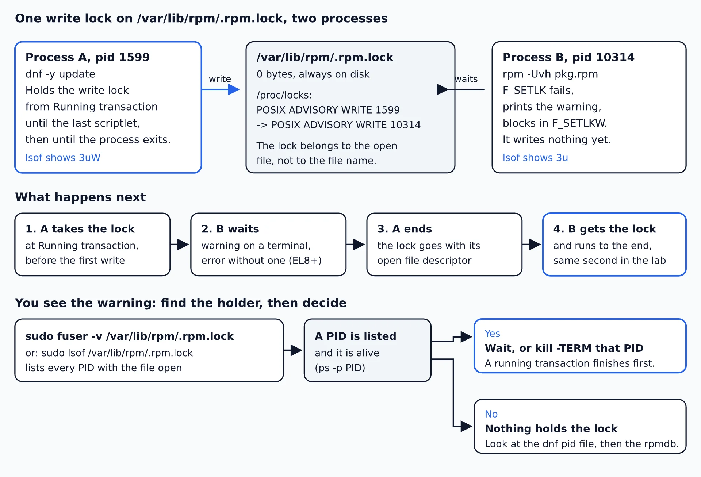

import Accordion from "@components/widgets/Accordion.astro";
import ListCheck from "@components/widgets/ListCheck.astro";
import Notice from "@components/widgets/Notice.astro";

Another process holds the lock right now. `sudo fuser -v /var/lib/rpm/.rpm.lock` names its PID. Wait for that process to finish, or stop that one PID with `kill -TERM`. The lock file is not the problem, so leave it where it is.

The warning looks like this:

```text
warning: waiting for transaction lock on /var/lib/rpm/.rpm.lock
```

Every output below is real and comes from throwaway containers run on 2026-11-27:

| System | rpm | dnf and yum | Package database |
|---|---|---|---|
| Rocky Linux 9.9 | 4.16.1.3 | 4.14.0 | sqlite in `/var/lib/rpm` |
| Rocky Linux 8.10 | 4.14.3 | 4.7.0 | Berkeley DB in `/var/lib/rpm` |
| CentOS Linux 7.9.2009 | 4.11.3 | yum 3.4.3, no dnf | Berkeley DB in `/var/lib/rpm` |
| Rocky Linux 10.3 | 4.19.1.1 | 4.20.0 | sqlite in `/usr/lib/sysimage/rpm` |

On Rocky 10 the warning names `/usr/lib/sysimage/rpm/.rpm.lock`, because `/var/lib/rpm` is a symlink to that directory there. The paths below follow Rocky 9.

## Why does rpm wait for the transaction lock?

Another process owns the write lock on that file, and rpm refuses to let two transactions change the rpm database at once. The holder is a running dnf, yum, rpm or PackageKit transaction, not a leftover file.

rpm opens the file with `O_RDWR|O_CREAT` and locks it with `fcntl`, in `lib/rpmlock.c` of the rpm source. The first attempt does not block. When it fails, rpm prints `waiting for %s lock on %s` and calls `fcntl` again with `F_SETLKW`, which waits. The file is 0 bytes and exists before any transaction runs. `ls -li` in the four containers showed:

| System | Inode | Date in the listing |
|---|---|---|
| Rocky Linux 9.9 | 5244673 | Nov 13 00:29 |
| Rocky Linux 8.10 | 5253638 | May 28 2024 |
| CentOS Linux 7.9.2009 | 5268324 | Nov 13 2020 |
| Rocky Linux 10.3 | 5290907 | Nov 13 01:28 |

The dates are older than the containers. Each container had run a transaction before the listing, and none of them changed the file. The lock belongs to the open file descriptor, and the kernel drops it when the process exits, however it exits. A crashed dnf cannot leave this lock behind. It can leave the database damaged, and that damage comes with a different error, `BDB0087 DB_RUNRECOVERY`.

These processes take the lock:

| Holder | What `ps` shows | How to end it |
|---|---|---|
| `dnf install`, `dnf update`, `yum` on EL8 and later | `/usr/bin/python3.9 /usr/bin/dnf -y install ...` on EL9, `/usr/libexec/platform-python /usr/bin/dnf ...` on EL8 | Wait, or `kill -TERM` that PID |
| `rpm -U`, `rpm -i`, `rpm -e` | `rpm -Uvh --replacepkgs ...` | Wait, or `kill -TERM` that PID |
| PackageKit, which Cockpit's Software Updates page uses to apply updates | `packagekitd` (not run in the lab) | Wait, or `sudo systemctl stop packagekit`, the unit is `packagekit.service` |
| `dnf-automatic` under its timer | `dnf-automatic` (not run in the lab) | Wait. It installs only with `apply_updates = True` in `/etc/dnf/automatic.conf`, and the default is False |
| Ansible `dnf` and `yum` tasks | the `dnf` or `yum` process the task started (not run in the lab) | Wait. The `dnf` module's `lock_timeout`, default 30, is the time to wait for the dnf lock file |

## How do I find the process that holds the rpm transaction lock?

`sudo fuser -v /var/lib/rpm/.rpm.lock` lists every PID that has the file open, and `sudo lsof /var/lib/rpm/.rpm.lock` shows which of them owns the lock. `ps -p PID -o etime,args` then tells you what it is and how long it has run.

The capture below is Rocky 9.9. The holder, the process that owns the lock, is `rpm -Uvh --replacepkgs` of two kernel packages, which runs depmod and dracut in its scriptlets. The waiter, the command that prints the warning, is `rpm -Uv --replacepkgs` of tcpdump in another terminal. It printed the warning at 18:10:04, one second after the holder took the lock:

```bash
ps -eo pid,ppid,tty,stat,etime,args | grep -E '[/ ]rpm '
```

```text
  69363   69353 ?        Rs         00:03 rpm -Uvh --replacepkgs /lab/rpms/kernel-modules-core-5.14.0-741.27.1.el9_9.x86_64.rpm /lab/rpms/kernel-modules-5.14.0-741.27.1.el9_9.x86_64.rpm
  69382   69378 pts/0    Ss+        00:02 rpm -Uv --replacepkgs /lab/rpms/tcpdump-4.99.0-9.el9.x86_64.rpm
```

The listing leaves out one helper process of the capture. Holder and waiter have the lock file open, so `fuser` names both:

```bash
sudo fuser -v /var/lib/rpm/.rpm.lock
```

```text
                     USER        PID ACCESS COMMAND
/var/lib/rpm/.rpm.lock: 69363 69382
                     root      F.... rpm
                     root      F.... rpm
```

`F` in the ACCESS column means "open file for writing" (fuser(1)). `lsof` tells the holder from the waiter:

```bash
sudo lsof /var/lib/rpm/.rpm.lock
```

```text
COMMAND   PID USER   FD   TYPE DEVICE SIZE/OFF    NODE NAME
rpm     69363 root    3uW  REG   0,90        0 5307123 /var/lib/rpm/.rpm.lock
rpm     69382 root    3u   REG   0,90        0 5307123 /var/lib/rpm/.rpm.lock
```

`3uW` is descriptor 3, open for read and write, with a write lock on the entire file (lsof(8)). The waiter has `3u` and no lock. The kernel keeps the same table in `/proc/locks`, where `5307123` is the inode from `ls -i`:

```bash
grep :5307123 /proc/locks
```

```text
3: POSIX  ADVISORY  WRITE 69363 00:5a:5307123 0 EOF
3: -> POSIX  ADVISORY  WRITE 69382 00:5a:5307123 0 EOF
```

The line that starts with `->` is the request that waits for the lock above it. The holder ended at 18:10:50, and the waiter continued in the same second:

```text
warning: waiting for transaction lock on /var/lib/rpm/.rpm.lock
Verifying packages...
Preparing packages...
tcpdump-14:4.99.0-9.el9.x86_64
tcpdump-14:4.99.0-9.el9.x86_64
```

`ps`, `fuser` and `lsof` are also in the [Linux commands reference](/linux-commands/).



## How long does rpm wait for the transaction lock?

As long as the holder lives. `F_SETLKW` has no timeout, so the waiter sits there until the lock is free or you stop it with Ctrl+C.

Ctrl+C ends the waiter, not the holder. A 2017 report from CentOS 6.8 on [Stack Overflow](https://stackoverflow.com/questions/44759376/cant-create-transaction-lock-on-var-lib-rpm-rpm-lock) shows rpm answering the Ctrl+C with `error: can't create transaction lock on /var/lib/rpm/.rpm.lock (Interrupted system call)`. The lab did not rerun that.

In one lab run the holder was `rpm -Uvh --replacepkgs` of three kernel packages with their scriptlets. The waiter printed the warning at 17:26:15 and continued at 17:31:30, a wait of 5 min 15 s. The holder spent most of that time in depmod and dracut. It was slow, not stuck.

To see what the holder does, check its age and state, then its children:

```bash
ps -o pid,stat,etime,args -p PID
ps --ppid PID -o pid,stat,etime,args
```

`ps --ppid` shows a child while a scriptlet runs, for example `/bin/sh /var/tmp/rpm-tmp.lpqyLA 1`. State `D` is uninterruptible sleep, usually I/O (ps(1)). If the holder is slow for no visible reason, the [swap usage guide](/swap-usage-linux/) shows how to check swap.

## Why does the wait follow Ctrl+C, a closed terminal or a timeout?

Because the holder is still running. Ctrl+C, a closed terminal and a job timeout each send a signal, and a signal that arrives during the transaction does not stop the transaction.

The holder below is a kernel reinstall. The lab sent each signal 3 s after the holder took the lock:

| System | Signal sent during the transaction | Holder exited after | Exit code |
|---|---|---|---|
| Rocky Linux 9.9, dnf 4.14.0 | SIGINT (Ctrl+C) | 51 s, packages installed | 0 |
| Rocky Linux 9.9, dnf 4.14.0 | SIGTERM | 51 s | 143 |
| Rocky Linux 9.9, dnf 4.14.0 | SIGHUP (closed terminal) | 52 s | 129 |
| CentOS Linux 7.9, yum 3.4.3 | SIGINT (Ctrl+C) | 23 s, package installed | 0 |
| CentOS Linux 7.9, yum 3.4.3 | SIGTERM | 21 s | 1 |
| CentOS Linux 7.9, yum 3.4.3 | SIGHUP (closed terminal) | 23 s | 1 |

Every run finished its transaction before the process exited. On Rocky 9 `/proc/PID/status` showed why:

```text
SigBlk:	fffffffe7ff3fa17
```

rpm blocks the interrupt signals for the write transaction, so SIGINT, SIGTERM and SIGHUP stay pending until it ends. `dnf history` records how the interrupted run ended. This is the SIGTERM run, with the ID from `sudo dnf history list`:

```bash
sudo dnf history info 16
```

```text
Begin time     : Fri Nov 27 18:04:08 2026
End time       : Thu Jan  1 00:00:00 1970 (-1795802648 seconds)
Return-Code    : Failure: 1
```

The packages are installed and the record has no end time.

This is the wait after an interruption. You press Ctrl+C, nothing seems to happen, you open a second terminal and run the next dnf, and that next dnf becomes the waiter. With automation the same thing happens one step later. The job times out, the runner marks it failed, and dnf on the host finishes the transaction without it. The retry lands on the lock.

Red Hat's [KCS 3330211](https://access.redhat.com/solutions/3330211) names the timeout as the usual reason for rpm trouble. In its words: "The most common reason being an automation tool timed out and abruptly ends the process without letting rpm clear the lock files." That article is about processes that die and a database that breaks. SIGTERM and SIGHUP left the transaction intact in the table above. SIGKILL does not, see the next section.

Start long updates inside tmux, so a dropped SSH session changes nothing, and pick one from the [terminal multiplexer comparison](/best-terminal-multiplexers/). On CI, give the package step more time than its transaction needs, as for any other job in a [Forgejo and Woodpecker setup](/forgejo-woodpecker-ci-cicd/).

## How do I stop the holder without breaking the rpm database?

Stop that one PID with `kill -TERM`, then wait until it is gone.

Do not run `pkill -9 -f 'dnf|yum|rpm'`. It kills every matching process on the host, the healthy update included, and a transaction cut by SIGKILL can take the database with it.

<ListCheck>
<ul>
<li>Find the PID with `sudo fuser -v /var/lib/rpm/.rpm.lock`. In `lsof`, the row with `W` is the holder.</li>
<li>Check it with `ps -o pid,stat,etime,args -p PID`. A dnf or yum that runs normally is best left alone.</li>
<li>Stop it with `kill -TERM PID`. The transaction in progress finishes first, then the process exits.</li>
<li>Confirm it with `ps -p PID`, which prints the header only. The waiter continues by itself.</li>
</ul>
</ListCheck>

A stopped holder leaves a PID file behind. After the SIGTERM run above, `/var/lib/dnf/rpmdb_lock.pid` still held the dead PID, and the next dnf replaced it without a message and removed the file on exit. On CentOS Linux 7 a yum stopped with SIGTERM leaves `/var/run/yum.pid`, and the next run prints this:

```text
There are unfinished transactions remaining. You might consider running yum-complete-transaction, or "yum-complete-transaction --cleanup-only" and "yum history redo last", first to finish them. If those don't work you'll have to try removing/installing packages by hand (maybe package-cleanup can help).
```

Use SIGKILL only when the PID ignores SIGTERM and does not exit. The kernel drops the lock at once and the waiter continues. On Rocky Linux 9.9, `kill -9` on a holder at 17:36:40 left `/proc/locks` empty for that file 3 s later, and the waiter had installed its package by then. On Rocky Linux 8.10, with Berkeley DB, one `kill -9` about 2 s into a transaction was enough:

```text
error: rpmdb: BDB0113 Thread/process 1073/132559685642112 failed: BDB1507 Thread died in Berkeley DB library
error: db5 error(-30973) from dbenv->failchk: BDB0087 DB_RUNRECOVERY: Fatal error, run database recovery
error: cannot open Packages index using db5 -  (-30973)
error: cannot open Packages database in /var/lib/rpm
```

Every later rpm command printed those four lines, and kernel-core was gone from the database. That error needs a rebuild, not a lock fix. The steps are in [how to recover the rpm database from DB_RUNRECOVERY](/fix-rpmdb-error-bdb0087-db_runrecovery/).

## Is it safe to delete /var/lib/rpm/.rpm.lock?

No. The file is never stale, the deletion frees no lock, and it lets a third command in while the holder still runs.

The lab run on Rocky 9.9 had a holder (pid 20862) with the write lock and a waiter (pid 20884) blocked on it. Then `rm -f /var/lib/rpm/.rpm.lock` at 17:40:08, and a third command, `rpm -Uvh`, started one second later. It recreated the lock file with a new inode, because rpm opens it with `O_CREAT`:

```bash
ls -li /var/lib/rpm/.rpm.lock
```

```text
5307123 -rw-r--r-- 1 root root 0 Nov 27 17:40 /var/lib/rpm/.rpm.lock
```

`readlink /proc/PID/fd/3` for each rpm process showed which file each one uses:

```text
pid 20862: /var/lib/rpm/.rpm.lock (deleted)
pid 20884: /var/lib/rpm/.rpm.lock (deleted)
pid 20905: /var/lib/rpm/.rpm.lock
```

The holder and the waiter still use the old inode 5307124, which no longer has a name. The new lock file is inode 5307123, and the third command (pid 20905) got a write lock on it at once:

```text
45: POSIX  ADVISORY  WRITE 20862 00:5a:5307124 0 EOF
45: -> POSIX  ADVISORY  WRITE 20884 00:5a:5307124 0 EOF
81: POSIX  ADVISORY  WRITE 20905 00:5a:5307123 0 EOF
```

The third command ran to the end with exit code 0. The holder was frozen with SIGSTOP during the capture, and when it resumed, its own reinstall failed:

```text
error: kernel-modules-5.14.0-741.27.1.el9_9.x86_64: erase failed
error: kernel-core-5.14.0-741.27.1.el9_9.x86_64: erase failed
error: kernel-modules-core-5.14.0-741.27.1.el9_9.x86_64: erase failed
```

The waiter stayed blocked until the holder was gone, so the deletion did nothing for it, and the holder's own transaction failed for no gain.

<Notice type="warning" title="Deleting the lock file opens the door">
`rm /var/lib/rpm/.rpm.lock` during a transaction shortens no wait. It removes the only thing that keeps the next package command out, and that command can then change the database under the running one.
</Notice>

## What are the dnf and yum lock files?

`/var/lib/rpm/.rpm.lock` belongs to rpm, and dnf and yum keep their own PID files in front of it. Only the PID files can hold a dead PID, and dnf and yum replace a dead PID themselves.

| File | Owner and use | When it goes away | After a killed process |
|---|---|---|---|
| `/var/lib/rpm/.rpm.lock` | rpm, every write transaction | Never, it stays as an empty file | Nothing to clean |
| `/var/lib/rpm/.dbenv.lock` | rpm, Berkeley DB systems (EL7, EL8) | Never | Nothing to clean |
| `/var/lib/dnf/rpmdb_lock.pid` | dnf 4, around the transaction check and run | On exit, and at boot | A dead PID, replaced by the next dnf |
| `/var/cache/dnf/metadata_lock.pid` | dnf 4, metadata download | On exit, and at boot | A dead PID, replaced by the next dnf |
| `/var/cache/dnf/download_lock.pid` | dnf 4, package download | On exit, and at boot | A dead PID, replaced by the next dnf |
| `/var/log/log_lock.pid` | dnf 4, log file | On exit, and at boot | A dead PID, replaced by the next dnf |
| `/var/run/yum.pid` | yum 3 on EL7 | On exit | A dead PID, replaced by the next yum |

dnf writes its PID into the file and checks `/proc/PID/stat` of the PID it finds there. "At boot" comes from `/usr/lib/tmpfiles.d/dnf.conf`, which removes the four dnf files at every boot. Only a file that holds something other than a number stops dnf. It prints "Malformed lock file found" and the advice to remove the file by hand or run `systemd-tmpfiles --remove dnf.conf`. Do that only after every other dnf and yum process has ended.

dnf's own lock comes before rpm's, so a second dnf waits there and never reaches the rpm warning. Two dnf commands ran at once on Rocky Linux 9.9, and the waiter waited 54 s:

```text
Running transaction check
Waiting for process with pid 1599 to finish.
```

yum 3 on CentOS Linux 7 prints the owner itself, every 2 s until the lock is free:

```text
Another app is currently holding the yum lock; waiting for it to exit...
  The other application is: yum
    Memory : 103 M RSS (319 MB VSZ)
    Started: Fri Nov 27 17:50:37 2026 - 00:13 ago
    State  : Sleeping, pid: 10787
```

## Why do scripts get "can't create transaction lock" instead of a warning?

Because their standard input is not a terminal. In rpm 4.14 and later, the code in `rpmlockAcquire` waits and prints the warning only when `isatty(STDIN_FILENO)` is true, with the comment "dont wait within scriptlets".

A cron job, an Ansible task or a CI step gets an error instead, and a plain rpm command then exits with code 1.

Against an `rpm -Uvh` holder, `dnf -y reinstall tcpdump` with `/dev/null` on stdin, on Rocky Linux 9.9:

```text
Running transaction
RPM: error: can't create transaction lock on /var/lib/rpm/.rpm.lock (Resource temporarily unavailable)
The downloaded packages were saved in cache until the next successful transaction.
You can remove cached packages by executing 'dnf clean packages'.
Error: Could not run transaction.
```

The same lines appeared on Rocky Linux 8.10 with dnf 4.7.0. A plain rpm command prints the error alone:

```text
error: can't create transaction lock on /var/lib/rpm/.rpm.lock (Resource temporarily unavailable)
```

CentOS Linux 7 has rpm 4.11.3, which has no terminal check. An rpm command with `/dev/null` on stdin there waited 6 s in the lab, printed the warning, and finished with exit code 0.

To make a dnf job fail fast instead of waiting for another dnf, set `exit_on_lock`. dnf.conf(5) documents it as "Should the dnf client exit immediately when something else has the lock. Default is False.":

```bash
dnf --setopt=exit_on_lock=True -y reinstall tcpdump < /dev/null
```

```text
Running transaction check
The downloaded packages were saved in cache until the next successful transaction.
You can remove cached packages by executing 'dnf clean packages'.
RPMDB already locked by 77524
  The application with PID 77524 is: dnf
    Memory :  91 M RSS (106 MB VSZ)
    Started: Fri Nov 27 18:11:39 2026 - 00:05 ago
    State  : Running
```

`State` is the holder's state from `ps`. The holder was `dnf -y reinstall kernel-core kernel-modules kernel-modules-core`, 4 s into its transaction.

On yum 3 the same option is `--setopt=exit_on_lock=1`:

```text
Existing lock /var/run/yum.pid: another copy is running as pid 17922.
Another app is currently holding the yum lock; exiting as configured by exit_on_lock
```

The option covers the PID files of dnf and yum only. Against an rpm holder, the same dnf command still reached the rpm lock and printed the warning.

## How do I keep two package jobs from colliding?

Run one package job per host, and make a second start exit instead of queueing. `flock` does that for scripts and cron:

```bash
flock -n /var/lock/dnf-job.lock dnf -y update
```

A second `flock -n` call in the lab exited with code 1 while the first run held the file, and went through 6 s later. Rocky Linux 9.9 also ships `dnf-makecache.timer`, which runs `dnf makecache --timer` about every hour, with up to an hour of random delay. `dnf-automatic` installs only with `apply_updates = True`, so move your own automation away from its timer when you set that. A job that waits forever looks like a job that hangs, so watch the result. The [server monitoring guide](/sever-monitoring/) covers the alerts.

## How do I check the rpm database after the wait?

Run two read commands once the holder is gone, then read the history:

```bash
rpm -qa | wc -l
rpm -q tcpdump kernel-core kernel-modules kernel-modules-core
```

```text
210
tcpdump-4.99.0-9.el9.x86_64
kernel-core-5.14.0-741.27.1.el9_9.x86_64
kernel-modules-5.14.0-741.27.1.el9_9.x86_64
kernel-modules-core-5.14.0-741.27.1.el9_9.x86_64
```

The count should match your last one, and the interrupted run's packages should be there. `sudo dnf history list` gives the ID of the last transaction, and `sudo dnf history info N` its end time and return code.

If `rpm -qa` prints `BDB0087 DB_RUNRECOVERY` instead of a count, the database is damaged and the lock is not your problem. Follow the [DB_RUNRECOVERY recovery guide](/fix-rpmdb-error-bdb0087-db_runrecovery/).

## FAQ

<Accordion label="Will removing /var/lib/rpm/.rpm.lock fix the wait?" group="faq">
No. The file is an empty anchor for a kernel lock that a running process owns, and deleting it frees nothing. In the lab a third command then ran next to the holder, and the holder failed with "erase failed". Find the PID with `sudo fuser -v /var/lib/rpm/.rpm.lock` and wait for it instead.
</Accordion>

<Accordion label="Does the rpm transaction lock ever time out?" group="faq">
No. rpm waits as long as the holder lives, because the waiting call is `F_SETLKW` and it has no timeout. One lab wait lasted 5 min 15 s while the holder ran kernel scriptlets. Ctrl+C stops the waiter, and the holder runs on.
</Accordion>

<Accordion label="Why does a script fail with can't create transaction lock?" group="faq">
Its standard input is not a terminal. rpm 4.14 and later wait and print the warning only on a terminal. Scripts and CI steps get "can't create transaction lock on /var/lib/rpm/.rpm.lock (Resource temporarily unavailable)" and exit code 1 instead.
</Accordion>

<Accordion label="What does Waiting for process with pid to finish mean?" group="faq">
A second dnf finds the first dnf's PID in `/var/lib/dnf/rpmdb_lock.pid` and waits there, before it reaches rpm's lock. That second dnf waited 54 s on Rocky Linux 9.9. The PID in the message is the dnf to wait for or stop.
</Accordion>

<Accordion label="What holds the lock besides dnf and yum?" group="faq">
Any process that runs an rpm write transaction: `rpm -U`, `rpm -i` and `rpm -e`, and PackageKit, which Cockpit's Software Updates page uses. `dnf-automatic` does so when `apply_updates = True`, and so does the dnf or yum process an Ansible task started. `sudo lsof /var/lib/rpm/.rpm.lock` shows the holder with a `W` in the FD column.
</Accordion>

<Accordion label="Does kill -9 release the rpm transaction lock?" group="faq">
Yes, at once. The lock belongs to the open file descriptor, and the kernel drops it when the process dies, so the waiter continues right after. The transaction that was cut stays cut: on Rocky Linux 8.10 one such kill left every rpm command failing with `BDB0087 DB_RUNRECOVERY`. Send SIGTERM first and let the transaction finish.
</Accordion>

<Accordion label="Where does dnf keep its PID lock files?" group="faq">
dnf 4 uses `/var/lib/dnf/rpmdb_lock.pid` for the transaction and `/var/cache/dnf/metadata_lock.pid` and `/var/cache/dnf/download_lock.pid` for downloads, plus `/var/log/log_lock.pid`. Each file holds a PID, goes away when dnf exits, and gets removed at boot by `/usr/lib/tmpfiles.d/dnf.conf`. The next dnf replaces a dead PID in it.
</Accordion>

<Accordion label="What does 3uW mean in the output of lsof?" group="faq">
File descriptor 3, open for read and write, with a write lock on the entire file. That row is the holder. A waiting process shows `3u`, the same descriptor without a lock, and `/proc/locks` lists it on a line that starts with `->`.
</Accordion>
