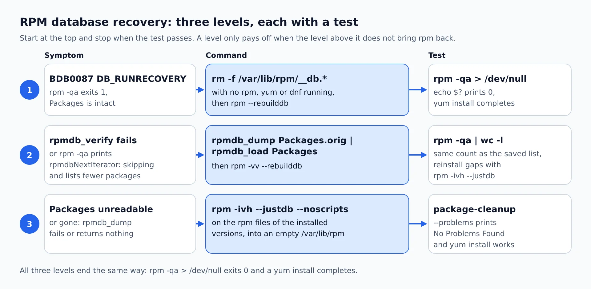

import Accordion from "@components/widgets/Accordion.astro";
import ListCheck from "@components/widgets/ListCheck.astro";
import Notice from "@components/widgets/Notice.astro";

Stop every rpm, yum and dnf process first. Then back up `/var/lib/rpm`, run `rm -f /var/lib/rpm/__db.*` and run `rpm --rebuilddb`. That fixes `DB_RUNRECOVERY` whenever the `Packages` file is intact.

Every `rpm` command on the machine prints this and exits with code 1:

```text
error: rpmdb: BDB0113 Thread/process 528/126330028189760 failed: BDB1507 Thread died in Berkeley DB library
error: db5 error(-30973) from dbenv->failchk: BDB0087 DB_RUNRECOVERY: Fatal error, run database recovery
error: cannot open Packages index using db5 -  (-30973)
error: cannot open Packages database in /var/lib/rpm
error: rpmdb: BDB0113 Thread/process 528/126330028189760 failed: BDB1507 Thread died in Berkeley DB library
error: db5 error(-30973) from dbenv->failchk: BDB0087 DB_RUNRECOVERY: Fatal error, run database recovery
error: cannot open Packages database in /var/lib/rpm
```

`yum` stops at the same place:

```text
error: rpmdb: BDB0113 Thread/process 528/126330028189760 failed: BDB1507 Thread died in Berkeley DB library
error: db5 error(-30973) from dbenv->failchk: BDB0087 DB_RUNRECOVERY: Fatal error, run database recovery
error: cannot open Packages index using db5 -  (-30973)
error: cannot open Packages database in /var/lib/rpm
CRITICAL:yum.main:
Error: rpmdb open failed
```

The rpm database (rpmdb) cannot be opened. On RHEL 6 to 8 and their clones it is a set of Berkeley DB files in `/var/lib/rpm`. `DB_RUNRECOVERY` means that a process left a busy slot in its lock table.

All output comes from throwaway containers I ran for this article. The systems were CentOS 7.9.2009 with rpm 4.11.3 and Red Hat Enterprise Linux 8.10 with rpm 4.14.3, then Rocky Linux 9.9 and Amazon Linux 2023, both with rpm 4.16.1.3.

If `yum` waits on a lock instead of failing, read [how to fix the waiting transaction lock](/fix-rpm-transaction-lock-waiting/).



## Which systems get the DB_RUNRECOVERY error?

The error needs `__db.*` files, and only the Berkeley DB backend creates them. That limits it to RHEL 6 to 8 and their clones, where rpm still uses Berkeley DB.

Red Hat moved rpm to sqlite in RHEL 9, and [the 9.0 release notes](https://docs.redhat.com/en/documentation/red_hat_enterprise_linux/9/html/9.0_release_notes/new-features) say "The rpm database is now based on the sqlite library". Fedora did the same in release 33. RHEL 10 dropped `libdb`.

| System | rpm | Backend | `rpm -E '%_db_backend'` prints |
|---|---|---|---|
| RHEL and CentOS 6 and 7 (7 run here) | 4.11.3 on 7 | Berkeley DB | `%_db_backend`, the macro does not exist |
| RHEL 8 and its clones | 4.14.3 on 8.10 | Berkeley DB, sqlite built in as an option | `bdb` |
| RHEL 9 and its clones (Rocky 9.9 run here) | 4.16.1.3 | sqlite | `sqlite` |
| Amazon Linux 2023 | 4.16.1.3 | sqlite | `sqlite` |

On Berkeley DB systems `/var/lib/rpm` holds the `Packages` file, one file per index (`Name`, `Basenames`...) and the `__db.001` to `__db.003` environment files. A sqlite system holds one database:

```bash
ls -la /var/lib/rpm
```

```text
total 6016
drwxr-xr-x 2 root root    4096 Nov 13 00:29 .
drwxr-xr-x 9 root root    4096 Nov 13 00:29 ..
-rw-r--r-- 1 root root        0 Nov 13 00:29 .rpm.lock
-rw-r--r-- 1 root root  6115328 Nov 13 00:29 rpmdb.sqlite
-rw-r--r-- 1 root root    32768 Nov 13 00:29 rpmdb.sqlite-shm
-rw-r--r-- 1 root root        0 Nov 13 00:29 rpmdb.sqlite-wal
```

## Diagnose the rpm database before deleting anything

The same error text covers a stale lock table, a damaged `Packages` file and a database that is gone. Five checks tell them apart. Run all of them as root before the first `rm`.

<ListCheck>
<ul>
<li>A root shell. The `rm`, the backup and `yum` need one.</li>
<li>Space in `/root` for a backup tarball. The lab tarball was 2,926,616 bytes for 152 packages.</li>
<li>A list of installed packages, if you have one.</li>
</ul>
</ListCheck>

**1. Does rpm fail, and how?**

```bash
rpm -qa > /dev/null; echo $?
rpm -q bash
```

```text
1
error: cannot open Packages database in /var/lib/rpm
package bash is not installed
```

The first command prints the seven error lines from the top of this page. `rpm -q` answers `package bash is not installed` because the database never opens, not because bash is gone.

**2. What is in the database directory?**

```bash
ls -la /var/lib/rpm
```

```text
total 10380
drwxr-xr-x 1 root root     4096 Nov 27 14:49 .
drwxr-xr-x 1 root root     4096 Nov 27 14:49 ..
-rw-r--r-- 1 root root        0 Nov 13  2020 .dbenv.lock
-rw-r--r-- 1 root root        0 Nov 13  2020 .rpm.lock
-rw-r--r-- 1 root root   667648 Nov 27 14:50 Basenames
-rw-r--r-- 1 root root  7872512 Nov 27 14:50 Packages
-rw-r--r-- 1 root root   352256 Nov 27 14:51 __db.001
-rw-r--r-- 1 root root    98304 Nov 27 14:51 __db.002
-rw-r--r-- 1 root root  1318912 Nov 27 14:51 __db.003
```

The listing is cut to the lines that matter. The `Packages` file holds every installed header, and it is the only file that cannot be built from another one. The `__db.00N` files are the environment files, Berkeley DB's shared memory with the lock table among them.

**3. Is the disk full?**

```bash
df -h /var
```

```text
Filesystem      Size  Used Avail Use% Mounted on
overlay         150G  136G  8.6G  95% /
```

The filesystem is called `overlay` because the line comes from a container. `rpm --rebuilddb` writes a second copy of the database into `/var/lib/rpmrebuilddb.NNN` and then replaces the old one with it, so `/var` needs room for that copy. When `/var` is short of space, [add a drive with LVM](/add-new-drive-lvm/) and [alert on disk usage](/sever-monitoring/). `df -h` and `free -h` are also the first two commands in [the Linux commands reference](/linux-commands/).

**4. Does anything have the database open?**

```bash
fuser -v /var/lib/rpm/Packages; echo $?
```

```text
1
```

No output and exit code 1 mean that nothing does. With an rpm command running it looks like this:

```text
                     USER        PID ACCESS COMMAND
/var/lib/rpm/Packages:
                     root      f.... rpm
   598
```

Red Hat's [KCS 3330211](https://access.redhat.com/solutions/3330211) uses `fuser -v /var/lib/rpm`, which printed nothing in the lab even while `rpm -Va` had every file open. `fuser` checks the named directory and not the files inside it.

**5. Which process died?**

```bash
cd /var/lib/rpm && /usr/lib/rpm/rpmdb_stat -CA | grep -A3 'Locks grouped by lockers'
```

```text
Locks grouped by lockers:
Locker   Mode      Count Status  ----------------- Object ---------------
      96 dd= 0 locks held 1    write locks 0    pid/thread 528/126330028189760 flags 0    priority 100
      96 READ          1 HELD    (4feee2 5f 72e2c494 182 0) handle        0
```

`528` is the pid from the error line. The lock belongs to a process that no longer exists, and that stale lock is what makes every later rpm command fail.

| What you see | What it means | Section |
|---|---|---|
| `BDB0087 DB_RUNRECOVERY`, and `rpmdb_verify Packages` passes | stale environment files, data intact | How do I fix rpm DB_RUNRECOVERY? |
| `rpmdb_verify` fails, or `rpmdbNextIterator: skipping h#` lines | the `Packages` file is damaged | When the Packages file itself is damaged |
| `Packages` missing, or `rpmdb_dump` fails or prints nothing | the headers have to come from the rpm files | Last resort |

## How do I fix rpm DB_RUNRECOVERY?

For the `BDB0087 DB_RUNRECOVERY` error on every rpm command, stop every rpm, yum and dnf process, then run `rm -f /var/lib/rpm/__db.*` followed by `rpm --rebuilddb`. In the lab `rpm -qa` worked again before the rebuild started, and the `rm` touched only the environment files.

<Notice type="warning" title="No rpm, yum or dnf process may be running">
Stop `yum-cron`, PackageKit and any config management agent before the `rm`. In the lab, deleting the environment files while yum was installing made yum abort 3 times out of 3 with `Rpmdb checksum is invalid`.
</Notice>

rpm opens the database with a lock table shared by every process that touches it. When a process dies between two database calls, the next rpm frees its locks and prints `BDB2053 Freeing read locks for locker 0x1: 284/139101924841536`. When it dies inside a call, its slot stays marked busy, and every later rpm command refuses to open the database until the lock table is gone. The lock table is part of the environment files.

A `kill -9` that lands inside a database call produces that state. In the lab I started `rpm -qa` and killed it with `kill -9` at random moments between 20 and 95 ms after start. The 12th attempt on CentOS 7 and the 18th on RHEL 8.10 left the database broken. 40 kills with `SIGTERM` produced no error, and neither did 6 kills of `yum` in the middle of its transaction.

**1. Back up the database.**

```bash
tar czf /root/rpmdb-backup-$(date +%F).tar.gz -C /var/lib rpm
ls -la /root/rpmdb-backup-*.tar.gz
```

```text
-rw-r--r-- 1 root root 2926616 Nov 27 14:51 /root/rpmdb-backup-2026-11-27.tar.gz
```

Keep the copy outside `/var/lib/rpm`. A `backup` directory inside it holds nothing but the broken state, and every later copy of `/var/lib/rpm` carries the stale environment files along.

**2. Remove the environment files.**

```bash
rm -f /var/lib/rpm/__db.*
```

Only these. `Packages` and the index files are the data.

**3. Verify.**

```bash
rpm -qa > /dev/null; echo $?
```

```text
0
```

The database answers before any rebuild, because the `rm` touched no data file.

**4. Rebuild the indexes.**

```bash
rpm --rebuilddb; echo $?
rpm -qa | wc -l
```

```text
0
152
```

`rpm --rebuilddb` prints nothing on success. It reads every header from the `Packages` file and writes fresh index files, which also drops the free pages the old ones carried. In the first lab container the `Packages` file went from 19,070,976 bytes to 7,790,592. It opens its own private environment, so it runs even while the shared one is broken.

**5. Prove that writes work.**

```bash
yum -y install tcpdump
```

```text
Running transaction
  Installing : 14:libpcap-1.5.3-12.el7.x86_64                               1/2
  Installing : 14:tcpdump-4.9.2-4.el7_7.1.x86_64                            2/2
  Verifying  : 14:libpcap-1.5.3-12.el7.x86_64                               1/2
  Verifying  : 14:tcpdump-4.9.2-4.el7_7.1.x86_64                            2/2
Installed:
  tcpdump.x86_64 14:4.9.2-4.el7_7.1
Dependency Installed:
  libpcap.x86_64 14:1.5.3-12.el7
Complete!
```

`package-cleanup` from the `yum-utils` package then checks that every installed package has its dependencies, and `package-cleanup --dupes` lists packages installed twice:

```bash
package-cleanup --problems
```

```text
Loaded plugins: fastestmirror, ovl
No Problems Found
```

To roll back, put the tarball back. Remove the environment files afterwards, because you took the tarball while they were stale:

```bash
rm -rf /var/lib/rpm
tar xzf /root/rpmdb-backup-2026-11-27.tar.gz -C /var/lib
rm -f /var/lib/rpm/__db.*
```

A reboot clears the environment files as well. The rpm package ships `/usr/lib/tmpfiles.d/rpm.conf` with one line, `r /var/lib/rpm/__db.*`, and `systemd-tmpfiles-setup.service` runs it at every boot. Red Hat's KCS 3330211 lists the reboot as an alternative. I would still run the three commands, because they work on a host you cannot reboot right now.

If the error comes back, something keeps killing rpm and the fix is temporary. The KCS names automation timeouts as the most common cause and Microsoft Defender for Endpoint as a known one (check with `rpm -q mdatp`). Its unsupported `rpm-deathwatch` package logs every signal sent to rpm, yum and dnf, and Oracle's [`rpm_db_snooper`](https://blogs.oracle.com/linux/oled-rpm-db-snooper) does the same on Oracle Linux. Run one of them before the next occurrence.

## When the Packages file itself is damaged

Removing the environment files cannot help when the `Packages` file is damaged. The symptom is a `rpmdbNextIterator: skipping h#` line on stderr with exit code 0, or `rpmdb_verify` exiting 1. The repair dumps the file with `rpmdb_dump`, loads the dump into a new file with `rpmdb_load` and runs `rpm --rebuilddb`. It loses the headers on the damaged pages (1 of 154 in the lab), and `rpm -ivh --justdb` writes them back. In the lab, rpm printed this line and still exited 0:

```bash
rpm -qa 2>&1 > /dev/null | head -3
rpm -qa | wc -l
```

```text
error: rpmdbNextIterator: skipping h#       2 region trailer: BAD, tag 0 type 0 offset 0 count 0
153
```

The container held 154 packages. rpm lists 153 with exit code 0, so `wc -l` on `rpm -qa` is the only thing that shows the loss. I produced this state in a container by zeroing one 4 KiB page of the `Packages` file:

```bash
dd if=/dev/zero of=/var/lib/rpm/Packages bs=4096 seek=300 count=1 conv=notrunc
```

Do not run that outside a throwaway container.

The structural check is `/usr/lib/rpm/rpmdb_verify`. Red Hat's [article 3763](https://access.redhat.com/articles/3763) documents it for RHEL 8 and earlier:

```bash
cd /var/lib/rpm
rm -f __db.*
/usr/lib/rpm/rpmdb_verify Packages; echo $?
```

```text
rpmdb_verify: BDB0682 Page 300: bad prev_pgno 0 on overflow page (should be 299)
rpmdb_verify: BDB0683 Page 300: overflow item incomplete
rpmdb_verify: Packages: BDB0090 DB_VERIFY_BAD: Database verification failed
BDB5105 Verification of Packages failed.
1
```

On an intact `Packages` file it prints `BDB5105 Verification of Packages succeeded.` and exits 0. `db_verify` from the `libdb-utils` package is the same program. That package is not part of the `core` group on CentOS 7, so use the copy that ships with rpm.

Save the list of installed packages before the repair, because the repair loses the headers that sat on the damaged pages:

```bash
rpm -qa --qf '%{NAME}-%{VERSION}-%{RELEASE}.%{ARCH}\n' | sort > /root/rpm-qa-before.txt
```

The repair is [the one on rpm.org](https://rpm.org/user_doc/db_recovery.html), which dumps the damaged file and loads the dump into a new one.

When `rpmdb_dump` refuses the `Packages` file, its usage line lists two recovery modes, `-r` and `-R`. The lab did not need them.

```bash
mv Packages Packages.orig
/usr/lib/rpm/rpmdb_dump Packages.orig | /usr/lib/rpm/rpmdb_load Packages
/usr/lib/rpm/rpmdb_verify Packages; echo $?
rpm -qa 1> /dev/null
```

```text
BDB5105 Verification of Packages succeeded.
0
error: rpmdbNextIterator: skipping h#       2 region trailer: BAD, tag 0 type 0 offset 0 count 0
```

The new `Packages` file is structurally sound, and the damaged header came along with it. `rpm -qa 1> /dev/null` throws the package names away so that only errors show. The rebuild is what drops that header. With `-vv` it prints what it does:

```bash
rpm -vv --rebuilddb 2>&1 | grep -v -E 'closed|opening|opened|effective|mdi' | head -8
```

```text
D: rebuilding database /var/lib/rpm into /var/lib/rpmrebuilddb.781
D: locked   db index       /var/lib/rpm/Packages
D: disabling fsync on database
D:  read h#       2 Header SHA1 digest: OK (8ea4fd0f464f4c0c41746be3c3bf9b5540fec576)
D: adding "popt" to Name index.
D: adding 32 entries to Basenames index.
D: adding "System Environment/Libraries" to Group index.
D: adding 13 entries to Requirename index.
```

Then find what is missing:

```bash
rpm -qa --qf '%{NAME}-%{VERSION}-%{RELEASE}.%{ARCH}\n' | sort > /root/rpm-qa-after.txt
comm -23 /root/rpm-qa-before.txt /root/rpm-qa-after.txt
```

```text
tzdata-2020d-2.el7.noarch
```

The header that sat on the zeroed page is gone. The package is still on disk (`/usr/share/zoneinfo/UTC` is there), and rpm no longer knows it. Fetch the rpm file of exactly that version, here with `yum -y install --downloadonly --downloaddir=/root/one tzdata-2020d-2.el7.noarch`, and write the header back without touching the files:

```bash
rpm -ivh --justdb --noscripts /root/one/tzdata-2020d-2.el7.noarch.rpm
```

```text
warning: /root/one/tzdata-2020d-2.el7.noarch.rpm: Header V3 RSA/SHA256 Signature, key ID f4a80eb5: NOKEY
Preparing...                          ########################################
Updating / installing...
tzdata-2020d-2.el7                    ########################################
```

The warning comes from the signature check, because the lab container had no CentOS key imported. `--justdb` updates the database only, and `--noscripts` leaves the install scripts out because the package is already installed. Afterwards `rpm -qa | wc -l` is 154 again and `diff` on the two lists prints nothing.

## Last resort: rebuild the rpm database from the package files

When the `Packages` file is unreadable or gone, the headers have to come from the rpm files of the installed versions. `yum reinstall --downloadonly` fetches those files and `rpm -ivh --justdb --noscripts` writes every header into an empty database. In the lab it took a few seconds for 154 packages. It also resets the installed state of every file. On the lab image, installed with `tsflags=nodocs`, `rpm -Va bash` then listed 90 doc, man and locale files as missing. This is [the "If all fails" procedure on rpm.org](https://rpm.org/user_doc/db_recovery.html).

**1. Keep what rpm still knows and fetch the rpm files.**

```bash
rpm -qa --qf '%{NAME}-%{VERSION}-%{RELEASE}.%{ARCH}\n' | sort > /root/rpm-qa-before.txt
mkdir -p /root/allrpms
yum -y reinstall --downloadonly --downloaddir=/root/allrpms $(rpm -qa)
```

Against a local copy of the CentOS 7.9 vault this resolved all 154 installed packages in the lab.

**2. Move the broken database out of the way.**

```bash
mv /var/lib/rpm /root/rpmdb-broken && mkdir /var/lib/rpm
rpm -qa | wc -l
```

```text
0
```

**3. Write every header back.**

```bash
rpm -ivh --justdb --noscripts /root/allrpms/*.rpm 2>&1 | head -10
```

```text
warning: /root/allrpms/acl-2.2.51-15.el7.x86_64.rpm: Header V3 RSA/SHA256 Signature, key ID f4a80eb5: NOKEY
Preparing...                          ########################################
Updating / installing...
libgcc-4.8.5-44.el7                   ########################################
centos-release-7-9.2009.0.el7.centos  ########################################
setup-2.8.71-11.el7                   ########################################
filesystem-3.2-25.el7                 ########################################
basesystem-10.0-7.el7.centos          ########################################
tzdata-2020d-2.el7                    ########################################
nss-softokn-freebl-3.53.1-6.el7_9     ########################################
```

**4. Verify.**

```bash
rpm -qa | wc -l
rpm -qa --qf '%{NAME}-%{VERSION}-%{RELEASE}.%{ARCH}\n' | sort > /root/rpm-qa-after.txt
diff /root/rpm-qa-before.txt /root/rpm-qa-after.txt; echo $?
package-cleanup --problems
```

```text
154
0
Loaded plugins: fastestmirror, ovl
No Problems Found
```

`yum -y erase tree && yum -y install tree` then ended with `Complete!` twice on the rebuilt database.

<Notice type="warning" title="Keep /root/rpmdb-broken until every check passes">
The old directory is the rollback. Move it back to `/var/lib/rpm` if the rebuilt database fails a check. Delete it only after the package lists match and a `yum install` completes.
</Notice>

## The sqlite era: RHEL 9, Rocky 9 and Amazon Linux 2023

RHEL 9, its clones and Amazon Linux 2023 store the database in one sqlite file, so there is no lock table in environment files and `DB_RUNRECOVERY` cannot occur. Damage there prints `database disk image is malformed`, and `rpm --rebuilddb` repairs it by dropping the headers it cannot read. I killed 40 installs and erases in a row on Rocky 9.9 with `kill -9`, 1 to 20 ms in, and the next `rpm -qa` printed nothing.

To produce the damage, I zeroed one 4 KiB page of a copy of `rpmdb.sqlite`, on 147 installed packages:

```bash
rpm --dbpath /root/rpmdb-copy -qa 2>&1 | tail -4
```

```text
ca-certificates-2026.2.92_v9.0.319-90.3.el9_8.noarch
openssl-fips-provider-3.5.9-1.el9_9.x86_64
openssl-libs-3.5.9-1.el9_9.x86_64
error: SELECT hnum, blob FROM 'Packages': 11: database disk image is malformed
```

The copy lists 129 of the 147 packages. In a second container, with a zeroed page in the live database, `yum -y install tree` printed the error and still ended with success:

```text
Running transaction
  Preparing        :                                                        1/1
  Installing       : tree-1.8.0-10.el9.x86_64                               1/1
error: SELECT hnum, blob FROM 'Packages' WHERE hnum=?: 11: database disk image is malformed
  Running scriptlet: tree-1.8.0-10.el9.x86_64                               1/1
  Verifying        : tree-1.8.0-10.el9.x86_64                               1/1
Installed:
  tree-1.8.0-10.el9.x86_64
Complete!
```

`sqlite3`, from the `sqlite` package, names the broken pages of the copy:

```bash
sqlite3 /root/rpmdb-copy2/rpmdb.sqlite 'PRAGMA integrity_check;' | head -4
```

```text
Error: database disk image is malformed
*** in database main ***
Page 1120: btreeInitPage() returns error code 11
Page 1106 is never used
```

In the lab `rpm --rebuilddb` exited 0, printed the same error once, and left a database of 129 packages with no error at all. That exit code hides 18 lost headers. They stay unknown to rpm until you reinstall them with `--justdb`, which needs the package list to compare against.

Inside a container the rebuild can fail at the last step:

```text
error: failed to replace old database with new database!
error: replace files in /var/lib/rpm with files from /var/lib/rpmrebuilddb.15 to recover
```

The old database is untouched. The same command succeeded in the lab as soon as `/var/lib/rpm` was a fresh directory in the container's writable layer. Do what the message says. Copy the files from the printed directory into `/var/lib/rpm`, over the old ones.

## What causes it and how to prevent it

| Cause | Evidence | What to do |
|---|---|---|
| rpm or yum killed inside a database call: automation timeout, `kill -9`, OOM killer | Red Hat [KCS 3330211](https://access.redhat.com/solutions/3330211) ("an automation tool timed out"), Oracle, the [dcrpm notes](https://github.com/facebookincubator/dcrpm/blob/main/MANUAL_RPM_CLEANUP.md). Lab: the 12th `kill -9` on CentOS 7 and the 18th on RHEL 8.10 broke the database | Let the transaction finish. Give automation a timeout above the longest `yum update`, and never `kill -9`. Add swap, see [how to identify processes using swap space](/swap-usage-linux/) |
| `yum` interrupted with Ctrl+C | Red Hat [KCS 217553](https://access.redhat.com/solutions/217553) | Let `yum update` finish and keep Ctrl+C away from it |
| Two package transactions started almost at the same time | Red Hat [KCS 3955251](https://access.redhat.com/solutions/3955251) | Run package jobs one at a time ([the transaction lock guide](/fix-rpm-transaction-lock-waiting/)) |
| Power loss, kernel crash, hard reset | rpm.org, the [dcrpm notes](https://github.com/facebookincubator/dcrpm/blob/main/MANUAL_RPM_CLEANUP.md) | A UPS for machines that update unattended |
| Environment files deleted while rpm runs | Lab: 3 of 3 yum installs aborted with `Rpmdb checksum is invalid`. `/usr/lib/tmpfiles.d/rpm.conf` deletes them at boot | Never clean `/var/lib/rpm` by hand while yum runs |
| Bugs in the Berkeley DB backend | rpm.org calls sqlite and ndb "much more stable and resilient than the traditional Berkley DB based backend" | Move to a release that uses sqlite when you can |

The one-line check is `rpm -qa > /dev/null`. It opens the database, reads every header and prints nothing. A cron line turns it into an alarm:

```bash
rpm -qa > /dev/null 2>&1 || echo "rpm database check failed on $(hostname)"
```

On Berkeley DB systems, run `/usr/lib/rpm/rpmdb_verify /var/lib/rpm/Packages` once a month, while no package manager runs. It catches the damaged page that `rpm -qa` hides behind exit code 0.

Save the package list on every host while rpm still works, and copy it off the machine together with a tarball of `/var/lib/rpm`. [Pluton, a self-hosted Restic backup UI](/pluton-self-hosted-backup/), is one way to schedule that copy:

```bash
rpm -qa --qf '%{NAME}-%{VERSION}-%{RELEASE}.%{ARCH}\n' | sort > /root/rpm-qa-$(date +%F).txt
```

On a VM, take the snapshot before `yum update` starts and not during it, because a revert then puts a half finished transaction back on disk. [The CloudPanel update guide](/safely-update-cloudpanel/) snapshots first as well.

Run the check on every RHEL 7 and 8 host this week and save the package list next to it. The first repair level took seconds in the lab, and the list is what makes the third one possible.

## FAQ

<Accordion label="Is it safe to delete the __db files in /var/lib/rpm?" group="faq">
Yes, as long as no rpm, yum or dnf process is running. rpm.org and Red Hat KCS 3330211 both use `rm /var/lib/rpm/__db*` as the first fix. Leave `Packages` and the files named after RPM tags alone, because those hold the data.
</Accordion>

<Accordion label="Why does yum print rpmdb open failed and rpm report every package as not installed?" group="faq">
Because the database never opens. `rpm -q bash` prints `package bash is not installed` while the error is present, although every package is on disk. Fix the database first; there is nothing to reinstall.
</Accordion>

<Accordion label="Does a reboot fix the DB_RUNRECOVERY error?" group="faq">
Red Hat KCS 3330211 says yes, because a reboot removes the environment files. The rpm package ships `/usr/lib/tmpfiles.d/rpm.conf` with the line `r /var/lib/rpm/__db.*`, and `systemd-tmpfiles-setup.service` runs it at every boot. The error returns as soon as another process dies inside a database call, so find the killer afterwards.
</Accordion>

<Accordion label="How long does rpm --rebuilddb take?" group="faq">
It finished in under a second in the lab, for 148 packages and a 19 MB `Packages` file. It prints nothing on success, so follow it with `rpm -qa | wc -l` and `package-cleanup --problems`.
</Accordion>

<Accordion label="Should I use rpmdb_verify or db_verify?" group="faq">
Use `/usr/lib/rpm/rpmdb_verify`, which ships with the `rpm` package and is always there. `/usr/bin/db_verify` comes from `libdb-utils`, the same Berkeley DB code in a different package, and `libdb-utils` is not part of the `core` group on CentOS 7. Red Hat's article 3763 documents `cd /var/lib/rpm` followed by `/usr/lib/rpm/rpmdb_verify Packages` for RHEL 8 and earlier.
</Accordion>

<Accordion label="Is yum clean all part of the fix?" group="faq">
No. It empties the cache under `/var/cache/yum`, and in the lab yum downloaded its metadata again right after it. The repair is `rm -f /var/lib/rpm/__db.*` followed by `rpm --rebuilddb`.
</Accordion>

<Accordion label="Does DB_RUNRECOVERY happen on RHEL 9, Rocky 9 or AlmaLinux 9?" group="faq">
No. RHEL 9, its clones and Amazon Linux 2023 keep the database in `/var/lib/rpm/rpmdb.sqlite`, and there are no environment files to go stale. The damage there prints `database disk image is malformed`, and `rpm --rebuilddb` repairs it by dropping the unreadable headers, so compare the package count afterwards.
</Accordion>

<Accordion label="rpm --rebuilddb failed to replace the old database. Now what?" group="faq">
The old database is untouched, and rpm prints the directory that holds the new one, for example `/var/lib/rpmrebuilddb.15`. Copy those files into `/var/lib/rpm` over the old ones. In the lab this happened inside a Rocky 9.9 container and the command succeeded once `/var/lib/rpm` was a fresh directory in the writable layer.
</Accordion>
