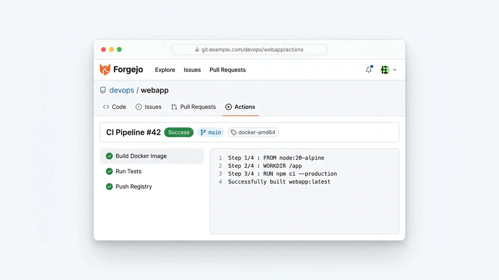
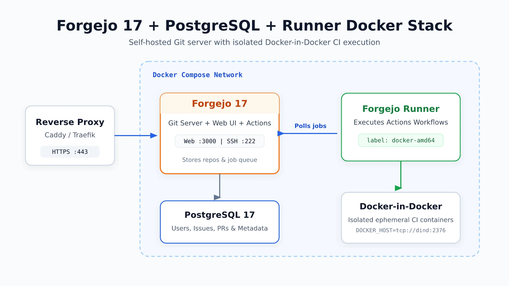

import Notice from "@components/widgets/Notice.astro";
import ListCheck from "@components/widgets/ListCheck.astro";
import Accordion from "@components/widgets/Accordion.astro";

For the first year after Forgejo forked from Gitea in late 2022, the two projects were practically interchangeable. You could swap the container image tag and barely tell the difference. That is no longer true. Since Forgejo became a hard fork in 2024, the license, version numbers, release guarantees, and upgrade paths have split cleanly apart.

Self-hosters have voted with their Compose files: in the 2026 selfh.st community survey, Forgejo passed Gitea for the first time. Still, picking the right one depends on what you actually need from a Git forge rather than forum sentiment. Below is an honest look at how Forgejo v17 and Gitea v28 compare in late 2026, followed by a tested Docker Compose setup for Forgejo 17.0.2 with a native Forgejo Actions runner (`v13.2.2`).

## Forgejo vs Gitea in late 2026



Both are single-binary Go Git forges with pull requests, issues, package/container registries, and built-in Actions CI. Both sip around 100 MB of RAM at idle (I measured `codeberg.org/forgejo/forgejo:17` at **104.5 MiB** on Docker 29.2), making either one roughly 20x lighter than GitLab. Here is where they actually diverge:

| Dimension | Forgejo | Gitea |
|---|---|---|
| Latest release (Nov 2026) | **v17.0.2** (Nov 18, 2026) | **v28.3.0** (dropped `1.` prefix at 28.0) |
| LTS branch | **Yes** (v15.0.12 supported to July 15, 2027) | No documented LTS line |
| License | **GPL-3.0-or-later** (since v9.0) | **MIT** |
| Governance | Contributor-led under non-profit Codeberg e.V. | CommitGo, Inc. (for-profit) + 6-seat TOC (3 company, 3 elected) |
| Commercial / Enterprise tier | None; every feature ships open source | Paid Enterprise plans & hosted Gitea Cloud |
| CI / Actions | Forgejo Actions + `forgejo-runner` v13 (high GitHub compatibility, prioritizes independence) | Gitea Actions + `act_runner` (targets GitHub Actions parity) |
| ActivityPub federation | Active development (experimental, federated stars working) | None documented |
| Drop-in migration from Gitea | Only up to Gitea 1.22; newer Gitea versions require API migration | N/A |

## Why are self-hosters switching from Gitea to Forgejo?

Self-hosters move to Forgejo for predictable 15-month LTS releases, permanent GPL-3.0-or-later non-profit governance with zero paywall drift, and faster security defaults.

1. **Predictable LTS releases.** Forgejo cuts a stable release every quarter and turns the first release of each year into an LTS branch backed for 15 months (currently v15.0.x through July 2027). If you run a home lab or small team forge and only want security patches without quarterly breaking changes, an LTS tag is worth a lot.
2. **Zero paywall drift.** When Gitea Ltd (now CommitGo, Inc.) took over trademarks and commercial operations in 2022, the worry was that enterprise features would slowly peel away from the community edition. Forgejo's move to GPL-3.0-or-later under a German non-profit closes that door permanently.
3. **Cleaner defaults and security posture.** Forgejo tends to ship privacy and security hardening faster (for example, v17.0.2 just tightened SSH key matching, scoped-token activity feeds, and PR secret access).

When does **Gitea** still make more sense? If your company's legal team bans GPL-3.0 software, wants a commercial vendor contract with SLA support, or relies on strict GitHub Actions compatibility where Gitea's `act_runner` tracks upstream behavior more closely, Gitea is still a fast, solid forge.

<Notice type="warning" title="Can you still swap the Gitea image straight to Forgejo?">
Only if you are still on Gitea 1.22 or older. Because both projects have diverged schema migrations since the hard fork, pointing Forgejo 17 at a Gitea 28 database will fail. For newer Gitea instances, spin up a clean Forgejo container and import your repositories (with issues and pull requests) through Forgejo's built-in Gitea migrator over the API.
</Notice>

## Deploy Forgejo 17 + PostgreSQL + Forgejo Runner in Docker



If you want external CI with a clean YAML pipeline format, my [Forgejo + Woodpecker CI guide](/forgejo-woodpecker-ci-cicd/) still works well. If you would rather keep everything inside Forgejo using GitHub-style `.forgejo/workflows/` files, here is the native **Forgejo Actions** stack tested on `codeberg.org/forgejo/forgejo:17` (17.0.2) and `data.forgejo.org/forgejo/runner:13` (v13.2.2).

One trap I hit while testing: **there is no `:latest` tag** for Forgejo Runner on `data.forgejo.org` (`data.forgejo.org/forgejo/runner:latest` returns `not found`). Always pin the major version tag (`:13`).

### Step 1: prepare the runner data directory

The runner container runs non-root (`uid 1000` by default). Create its data folder ahead of time and generate a default config:

```bash
mkdir -p forgejo-stack/runner-data/.cache
cd forgejo-stack

docker run --rm data.forgejo.org/forgejo/runner:13 \
  forgejo-runner generate-config > runner-data/config.yml

sudo chown -R 1000:1000 runner-data
```

### Step 2: create `compose.yaml`

This setup runs Forgejo 17, PostgreSQL 19 (note the `/var/lib/postgresql` mount path required on PG 18+; see my [PostgreSQL 19 guide](/postgresql-19-whats-new/)), an isolated Docker-in-Docker daemon for workflow containers, and the Forgejo Runner. Running `docker:dind` inside the stack keeps untrusted CI jobs off your host Docker socket.

```yaml
services:
  db:
    image: postgres:19-alpine
    container_name: forgejo-db
    restart: unless-stopped
    environment:
      POSTGRES_USER: forgejo
      POSTGRES_PASSWORD: change-me-strong-password
      POSTGRES_DB: forgejo
    volumes:
      - pgdata:/var/lib/postgresql
    healthcheck:
      test: ["CMD-SHELL", "pg_isready -U forgejo"]
      interval: 5s
      timeout: 5s
      retries: 5
    networks:
      - forgejo_net

  forgejo:
    image: codeberg.org/forgejo/forgejo:17
    container_name: forgejo
    restart: unless-stopped
    depends_on:
      db:
        condition: service_healthy
    environment:
      USER_UID: 1000
      USER_GID: 1000
      FORGEJO__database__DB_TYPE: postgres
      FORGEJO__database__HOST: db:5432
      FORGEJO__database__NAME: forgejo
      FORGEJO__database__USER: forgejo
      FORGEJO__database__PASSWD: change-me-strong-password
      FORGEJO__actions__ENABLED: "true"
      FORGEJO__actions__DEFAULT_ACTIONS_URL: "https://data.forgejo.org"
    volumes:
      - ./forgejo-data:/data
      - /etc/timezone:/etc/timezone:ro
      - /etc/localtime:/etc/localtime:ro
    ports:
      - "127.0.0.1:3000:3000"
      - "2222:22"
    networks:
      - forgejo_net

  docker-dind:
    image: docker:dind
    container_name: forgejo-dind
    restart: unless-stopped
    privileged: true
    command: ["dockerd", "-H", "tcp://0.0.0.0:2375", "--tls=false"]
    networks:
      - runner_net

  runner:
    image: data.forgejo.org/forgejo/runner:13
    container_name: forgejo-runner
    restart: unless-stopped
    depends_on:
      - docker-dind
      - forgejo
    user: "1000:1000"
    environment:
      DOCKER_HOST: tcp://docker-dind:2375
    volumes:
      - ./runner-data:/data
    command: ["forgejo-runner", "daemon", "--config", "/data/config.yml"]
    networks:
      - forgejo_net
      - runner_net

volumes:
  pgdata:

networks:
  forgejo_net:
  runner_net:
```

Bring Forgejo and Postgres up first (the runner needs to register before its daemon starts cleanly):

```bash
docker compose up -d db forgejo
```

Open `http://127.0.0.1:3000`, finish the one-screen installer, and create your admin account.

### Step 3: register the runner and start CI

In Forgejo, go to **Site Administration -> Actions -> Runners -> Create new runner** and copy the registration token. Register the runner once:

```bash
docker compose run --rm runner forgejo-runner register \
  --no-interactive \
  --instance http://forgejo:3000 \
  --token PASTE_YOUR_TOKEN_HERE \
  --name homelab-runner \
  --labels "docker:docker://node:22-bookworm,ubuntu-latest:docker://catthehacker/ubuntu:act-latest"
```

That writes `.runner` into `./runner-data/`. Now start the DinD sidecar and runner daemon:

```bash
docker compose up -d docker-dind runner
docker compose logs -f runner
```

You should see the runner connect and appear as **Idle** in Forgejo's runner list.

### Step 4: test a workflow

Drop this into `.forgejo/workflows/ci.yml` in any repo on your instance:

```yaml
name: Build check
on: [push, pull_request]

jobs:
  test:
    runs-on: docker
    steps:
      - uses: actions/checkout@v4
      - name: Check environment
        run: |
          node -v
          ls -la
```

Because `FORGEJO__actions__DEFAULT_ACTIONS_URL` points to `https://data.forgejo.org`, `actions/checkout@v4` pulls Forgejo's vetted mirror automatically without depending on GitHub.

## Operational notes before running this in production

<ListCheck>
<ul>
<li><b>Pin to the LTS tag if you hate upgrades.</b> Swap <code>codeberg.org/forgejo/forgejo:17</code> for <code>codeberg.org/forgejo/forgejo:15</code> (LTS) if you want security patches without quarterly breaking changes (for instance, v17 changed how absolute links resolve inside rendered repo docs and deprecated old action-run webhooks).</li>
<li><b>Keep secrets out of <code>compose.yaml</code>.</b> Move the Postgres password to a <code>.env</code> file or [Docker Compose secrets](/docker-compose-secrets/).</li>
<li><b>Back up both Postgres and <code>./forgejo-data</code>.</b> Git repositories live on disk while issues, PRs, and users live in Postgres. If you use Dokploy, automate both with [Dokploy backups to Cloudflare R2](/dokploy-backups-cloudflare-r2/).</li>
<li><b>Put Forgejo behind HTTPS.</b> Terminate TLS with [Traefik](/traefik-proxy-docker/) or Caddy and update <code>ROOT_URL</code> so clone URLs and OAuth callbacks match your domain.</li>
</ul>
</ListCheck>

## Bottom line

If you are starting a fresh self-hosted Git server for a homelab or small team in 2026, install **Forgejo**. You get the same ~100 MB Go footprint as Gitea, an actual LTS branch, GPL-3.0 protection against future rug-pulls, and native Actions CI that takes ten minutes to wire up. Stick with **Gitea** only if you specifically need an MIT license or commercial vendor support from CommitGo.

## FAQ

<Accordion label="Does Forgejo Actions run existing GitHub Actions workflows?" group="faq" expanded="true">
Most simple workflows (checkout, Node/Python/Go test runs, Docker builds) work with little or no editing. Complex workflows that depend on GitHub-specific APIs, OIDC cloud providers, or marketplace actions hosted only on github.com may need adjustments or explicit full URLs in `uses:`.
</Accordion>

<Accordion label="Should I use Forgejo Actions or Woodpecker CI?" group="faq">
Use Forgejo Actions if you already know GitHub Actions YAML and want fewer containers to manage. Use [Woodpecker CI](/forgejo-woodpecker-ci-cicd/) if you prefer cleaner pipeline YAML, dislike GitHub Actions' quirkier syntax, or want a CI engine decoupled from your Git forge.
</Accordion>

<Accordion label="Why did docker compose fail with runner:latest not found?" group="faq">
Forgejo Runner intentionally does not publish a `:latest` image tag on `data.forgejo.org` so automated pulls do not silently cross breaking runner versions. Always pin a major tag such as `data.forgejo.org/forgejo/runner:13`.
</Accordion>

<Accordion label="Can Forgejo run with SQLite instead of PostgreSQL?" group="faq">
Yes. For a solo developer with a few dozen repos, SQLite works fine and cuts one container from your stack. Once multiple people push concurrently or Actions logs grow, PostgreSQL avoids database-locked errors and scales far better.
</Accordion>
