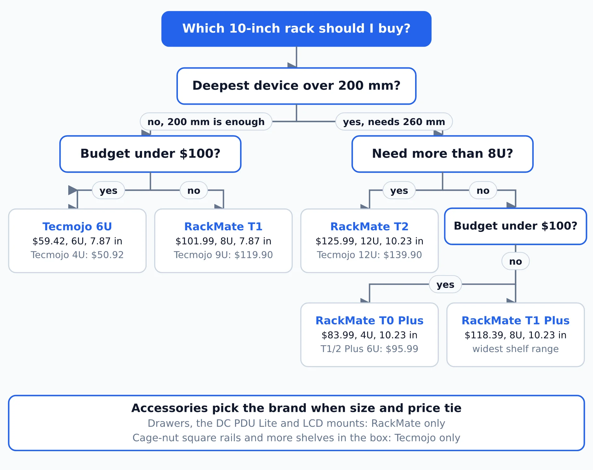
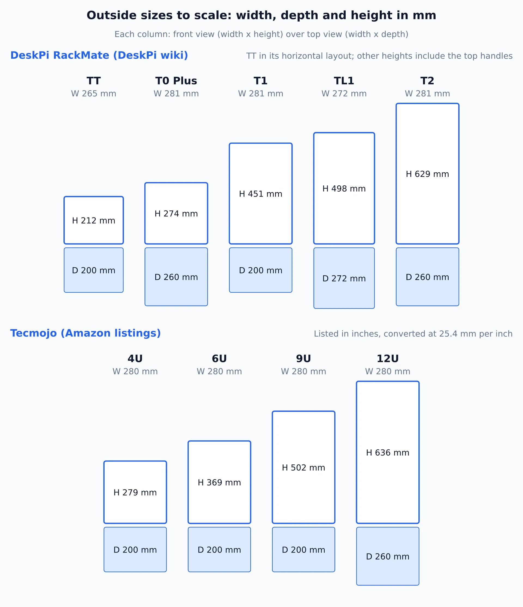
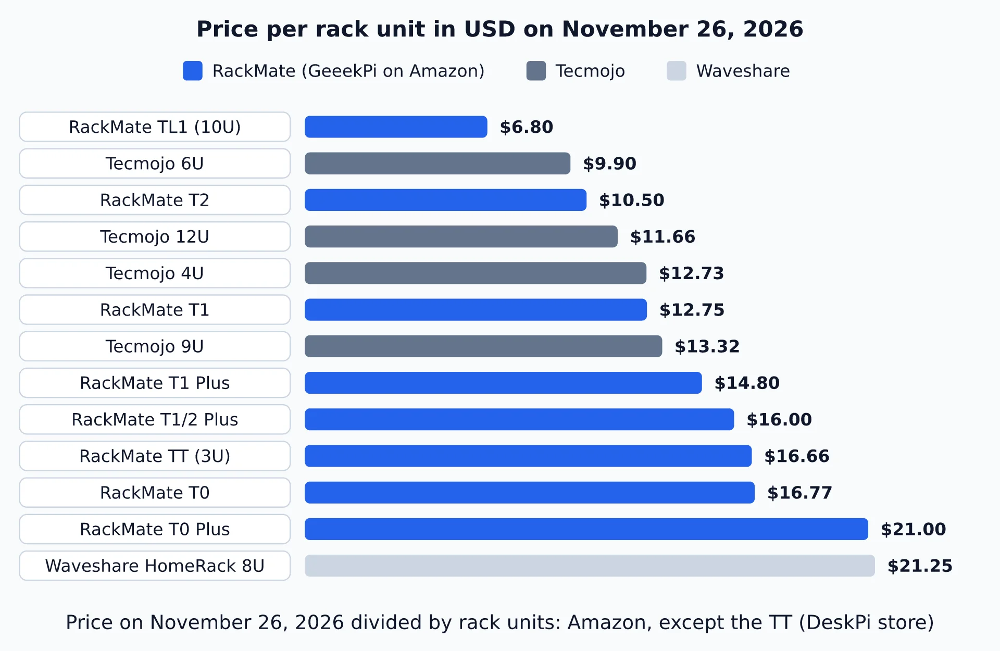

import Notice from "@components/widgets/Notice.astro";
import Accordion from "@components/widgets/Accordion.astro";
import AmazonProduct from "@components/widgets/AmazonProduct.astro";

For most homelabs the better 10-inch rack is **the [DeskPi RackMate T1 (sold as GeeekPi on Amazon)](#rackmate-t1-8u-the-default-8u)**. Its 8U frame has the widest accessory range. Tecmojo wins on budget, because its 6U costs less and ships with more shelves in the box.

<Notice type="warning" title="Affiliate disclosure">
Some links below are Amazon affiliate links, including `/go/` redirects that land on Amazon. Buying through them pays me a small commission at no extra cost to you. Prices were checked on November 26, 2026 and move constantly, so always confirm on the product page.
</Notice>

## Quick picks

| Rack | Price (Nov 26, 2026) | Size | Buy it if |
| --- | --- | --- | --- |
| [RackMate T1](/go/geeekpi-rackmate-t1-8u/) | $101.99 | 8U, 200 mm frame | You want the default 8U and the largest accessory range. |
| [Tecmojo 6U](/go/tecmojo-10in-6u-rack/) | $59.42 | 6U, 200 mm frame | The budget is tight and your gear is shallow. |
| [RackMate T1 Plus](/go/geeekpi-rackmate-t1-plus-8u/) | $118.39 | 8U, 260 mm frame | A NAS, a DAS or a deep mini PC has to fit. |
| [RackMate T2](/go/geeekpi-rackmate-t2-12u/) | $125.99 | 12U, 260 mm frame | You know the lab will grow. |
| [Tecmojo 12U](/go/tecmojo-10in-12u-rack/) | $139.90 | 12U, 260 mm frame | You want Tecmojo and depth, with three shelves in the box. |

Every GeeekPi rack listing carried a Black Friday Deal badge today, with a higher typical or list price on the page. The T1 showed a typical price of $119.99 on November 26, 2026, so plan around $119.99 and treat $101.99 as a deal.

## Is GeeekPi the same brand as DeskPi?

Yes. GeeekPi and DeskPi are one product with two badges: DeskPi designs the [RackMate line](https://wiki.deskpi.com/rackmate) and documents every model on its wiki, and the GeeekPi store sells those models on Amazon.

The Amazon titles read "GeeekPi 8U Network Rack ... DeskPi RackMate T1", and the seller of record is GeeekPi. The model numbers are DeskPi part numbers: the T1 is DP-0022, the T0 is DP-0047, the T2 is DP-0048. [DeskPi's own store](https://deskpi.com/products/deskpi-rackmate-t1-2) links to those listings and tells European buyers that Amazon is cheaper. Jeff Geerling's [Project MINI RACK](https://github.com/geerlingguy/mini-rack) lists the racks as "GeeekPi / DeskPi RackMate".

So "GeeekPi vs DeskPi" needs no comparison. The one worth making is GeeekPi vs Tecmojo.

| Name | What it means |
| --- | --- |
| T0, T1, T2 | The size tiers: 4U, 8U and 12U. |
| Plus | The same frame at 260 mm instead of 200 mm (T0 Plus, T1 Plus). |
| T1/2 Plus | A 6U frame at 260 mm, the size between the T1 and the T2. |
| TT | A mini rack that lies flat as a 10-inch 3U or stands up as a 7-inch rack. |
| TL1 | A 10U open frame, 272 mm deep, that takes the T2 trays. |
| Light | DeskPi store versions of the T1 and T2 with a different accessory bundle. |

## GeeekPi or Tecmojo: which should I pick?

Pick a RackMate if you want the largest accessory catalog or a deep frame for under $100 on November 26, 2026. Pick the Tecmojo 6U if you want the lowest price per rack unit and the fullest box at that price.

*Decision path from your deepest device to a pick, with Amazon prices checked on November 26, 2026.*

The two lines differ in five places, and the U height is not one of them:

| | RackMate (GeeekPi on Amazon) | Tecmojo mini server rack |
| --- | --- | --- |
| Frame | Aluminum with acrylic sides; the T1's die-cast frame runs up to 10 mm thick. The T0 adds steel. | Alloy steel with translucent acrylic side panels. |
| Rails | Pre-drilled holes that take #10-32 screws. | Square holes for 10-32 cage nuts, plus tapped holes. |
| Warranty on the listing | 6 months | 3 years |
| Depth options | 200 mm on the T0 and T1. 260 mm on every Plus model and the T2. | 7.87 in (200 mm) on the 4U, 6U and 9U. 10.23 in (260 mm) on the 12U only. |
| In the box | T0: one 1U tray and one blank panel, shipped assembled. The T1, T2, TT and Plus models ship flat-packed with assembly hardware. | 4U: one shelf and one blank panel. 6U adds an SBC shelf and two adapter boards. 9U and 12U ship two shelves. |

The frame and rail details come from the [DeskPi wiki](https://wiki.deskpi.com/rackmate/rackmate-t1), [DeskPi's screw listing](https://deskpi.com/products/deskpi-rackmate-accessories-10-32-5-16-screws) and the [Tecmojo 6U manual](https://manuals.plus/asin/B0F4JZ9YJW); the box contents come from the Amazon listings. All were read on November 26, 2026. Neither company publishes a plate thickness for the Tecmojo steel or for most RackMate panels.

Neither line has a door. Both are open at the front and the back, so cables can enter from the top or the bottom, and both put translucent acrylic on the sides. Both brands sell a 0.5U brush entry panel for a tidier cable run. The [r/minilab thread on the best 10-inch rack](https://www.reddit.com/r/minilab/comments/1ituupb/) has the warning worth keeping. Decide where power and network will enter before you buy, and make sure the frame is open there.

A Redditor who built both agrees with the split. "The mojo is way easier to put together. The deskpi does have a deeper option with the plus model if you need more depth," wrote one in the r/homelab thread [Tecmojo or Deskpi](https://www.reddit.com/r/homelab/comments/1xybn8q/). The short version, from the r/minilab thread [Tecmojo or Geekpi](https://www.reddit.com/r/minilab/comments/1xaap1c/tecmojo_or_geekpi_10inch_6u_mini_rack/): "The Tecmojo comes with more shelves. If you want more depth, you'll need the 12U."

## How deep is a 10-inch rack, and what fits?

Both brands sell 200 mm and 260 mm frames, but Tecmojo offers the deep one only as a 12U. Depth is the trap owners warn about: "depth is usually what bites people with these small racks", wrote one commenter in that r/homelab thread.

*Outside sizes to scale from the DeskPi wiki and Tecmojo's Amazon listings (inches converted at 25.4 mm per inch), November 26, 2026.*

Width is the same on every rack. Jeff Geerling's Project MINI RACK measures the 10-inch standard at 236.5 mm between screw holes and recommends gear within about 210 mm. The RackMate T2 and Plus models list an internal width of 212 mm, and the T0 and TL1 list 222 mm.

What that holds, from owners who posted their builds:

- A TerraMaster D6-320 DAS "fits snugly" in a T1 Plus, per the [r/homelab post](https://www.reddit.com/r/homelab/comments/1r80xvs/) that drew 1,044 upvotes.
- A MINISFORUM MS-02 Ultra goes into a GeeekPi 10-inch rack as a "tight squeeze", per [r/MINISFORUM](https://www.reddit.com/r/MINISFORUM/comments/1t43tgo/).
- Two mini PCs, a fan and a switch fit a T0, per a review quoted in Amazon's summary on November 26, 2026.

No rack-mount UPS fits either brand; the [rack-mount UPS guide](/best-rack-mount-ups-homelab/) covers the shelf-sized towers that do. Rackmount chassis need 19 inches, so the [home server rack guide](/best-home-server-rack/) is the next step once a 2U or 4U case is on the list.

## Every RackMate and Tecmojo model compared

All eight RackMate models and all four Tecmojo mini racks, priced on Amazon on November 26, 2026 (the TT at DeskPi's own store):

| Model | U | Depth | Price (Nov 26, 2026) | Price per U | Weight |
| --- | --- | --- | --- | --- | --- |
| [RackMate T0](/go/geeekpi-rackmate-t0-4u/) | 4U | 200 mm | $67.09 | $16.77 | 3.1 kg (6.9 lb) |
| [RackMate T0 Plus](/go/geeekpi-rackmate-t0-plus-260mm/) | 4U | 260 mm | $83.99 | $21.00 | 4.1 kg (9.0 lb) |
| [RackMate TT](/go/geeekpi-rackmate-tt/) | 3U | 200 mm | $49.99 at deskpi.com | $16.66 | not published |
| [RackMate T1](/go/geeekpi-rackmate-t1-8u/) | 8U | 212 mm inside | $101.99 | $12.75 | 4.5 kg (9.9 lb) |
| [RackMate T1 Plus](/go/geeekpi-rackmate-t1-plus-8u/) | 8U | 260 mm | $118.39 | $14.80 | 5.4 kg (11.8 lb) |
| [RackMate T1/2 Plus](/go/geeekpi-rackmate-t1-2-plus-6u/) | 6U | 260 mm | $95.99 | $16.00 | not published |
| [RackMate T2](/go/geeekpi-rackmate-t2-12u/) | 12U | 260 mm | $125.99 | $10.50 | not published |
| [RackMate TL1](/go/geeekpi-rackmate-tl1-10u/) | 10U | 272 mm | $67.99 | $6.80 | 2.3 kg (5.0 lb) |
| [Tecmojo 4U](/go/tecmojo-10in-4u-rack/) | 4U | 200 mm | $50.92 | $12.73 | 2.8 kg (6.1 lb) |
| [Tecmojo 6U](/go/tecmojo-10in-6u-rack/) | 6U | 200 mm | $59.42 | $9.90 | 3.5 kg (7.7 lb) |
| [Tecmojo 9U](/go/tecmojo-10in-9u-rack/) | 9U | 200 mm | $119.90 | $13.32 | 4.5 kg (10 lb) |
| [Tecmojo 12U](/go/tecmojo-10in-12u-rack/) | 12U | 260 mm | $139.90 | $11.66 | 6.2 kg (13.6 lb) |
| [Waveshare HomeRack 8U](/go/waveshare-homerack-8u/) | 8U | 260 mm claimed, 203 mm measured | $169.99 | $21.25 | not published |

Weights are the item weights on each listing. Tecmojo rates its mini racks for 132 lb (60 kg) of load; DeskPi publishes no load rating for its frames.

*Price per rack unit from the Amazon product pages on November 26, 2026; the TT uses DeskPi's store price. Bar length is dollars per U.*

Two numbers stand out. The TL1 sells 10U for $67.99 on November 26, 2026, less than half the T1 Plus per rack unit. The T0 Plus and the HomeRack are the dearest rack units here, at over $21 each on November 26, 2026.

## RackMate T1 8U: the default 8U

The T1 is the rack I'd put on most desks: $101.99 for 8U on November 26, 2026, the lowest price per U of any RackMate up to 8U.

**Best for:** a switch, a patch panel, one or two mini PCs on shelves and a small UPS, with a U or two to spare.

**Strengths:** the wiki lists 11 compatible DeskPi accessories, from a 0.5U DC PDU to a Mini-ITX shelf, and the die-cast aluminum frame goes up to 10 mm thick. Amazon showed 200+ bought in the past month on November 26, 2026.

**Trade-offs:** the frame is 200 mm, so anything deeper goes to the T1 Plus. The rails take screws only, with no square holes for cage nuts.

<AmazonProduct
  productName="GeeekPi DeskPi RackMate T1 (8U, 10-inch, 7.87 inch depth)"
  productDescription="The default 8U DeskPi RackMate: a die-cast aluminum open frame with acrylic sides, sold as GeeekPi on Amazon."
  productFeatures={["8U of 10-inch rail, 281 x 200 x 451 mm", "212 mm inside per the DeskPi wiki", "Die-cast aluminum frame up to 10 mm", "11 DeskPi accessories listed for it"]}
  productLink="/go/geeekpi-rackmate-t1-8u/"
  productImage="https://m.media-amazon.com/images/I/61aJd+USIXL._AC_SL1500_.jpg"
  productRating={4.7}
  recommendedBadge="Best Overall"
  importantConsiderations={["200 mm frame: measure your deepest device first", "Rails take #10-32 screws in pre-drilled holes, no cage nuts", "DeskPi sells the shelves and patch panel separately"]}
  pros={["Lowest price per U of any RackMate up to 8U", "Open front and back with translucent acrylic sides", "Largest 10-inch accessory range"]}
  cons={["No 260 mm version without paying for the T1 Plus", "Amazon's review summary calls it pricy at full price"]}
/>

## Tecmojo 6U: the budget pick

At $59.42 on November 26, 2026 the Tecmojo 6U has the lowest price per U in either lineup apart from the TL1, and it ships with more than any RackMate near its price.

**Best for:** a first rack for a switch, a router, a patch panel and one Pi or mini PC.

**Strengths:** the manual lists 24 10-32 screws and 24 cage nuts in the box, next to a rack shelf, an SBC shelf, a blank panel and two micro HDMI adapter boards. Amazon showed 400+ bought in the past month on November 26, 2026.

**Trade-offs:** there is no deeper 6U Tecmojo. Amazon's "Customers say" summary on the 4U and 6U listings reports misaligned screw holes.

<AmazonProduct
  productName="Tecmojo 10 inch Mini Server Rack 6U (7.87 inch deep, white)"
  productDescription="A 6U steel open-frame 10-inch rack with acrylic sides, shipped with a shelf, an SBC shelf and two adapter boards."
  productFeatures={["6U of 10-inch rail, 11.02 x 7.87 x 14.53 in", "200 mm usable depth", "Includes a rack shelf, an SBC shelf, a blank panel and 2 micro adapter boards", "Ships with 24 10-32 screws and 24 cage nuts"]}
  productLink="/go/tecmojo-10in-6u-rack/"
  productImage="https://m.media-amazon.com/images/I/71Hkz-ZBnlL._AC_SL1500_.jpg"
  productRating={4.5}
  recommendedBadge="Best Budget"
  importantConsiderations={["Shallow 200 mm frame; Tecmojo has no deeper 6U", "Amazon's review summary on the 4U and 6U reports misaligned screw holes", "6U fills fast once a shelf and a patch panel go in"]}
  pros={["Cheapest rack unit after the RackMate TL1", "More in the box than any RackMate near this price", "3-year manufacturer warranty listed"]}
  cons={["No deeper 6U option", "Alignment complaints in Amazon's review summary"]}
/>

## RackMate T1 Plus 8U: the deep 8U

The T1 Plus is the T1 stretched to 260 mm, and the only 8U frame with that depth here.

**Best for:** a 2-bay NAS, a DAS or a deep mini PC that will not fit a 200 mm rack.

**Strengths:** the wiki rates it for two 120 mm fans or four 80 mm fans, and a TerraMaster D6-320 DAS fits snugly, per the r/homelab build with 1,044 upvotes. It takes the 260 mm shelves, including the 0.5U heavy duty shelf rated for 25 kg.

**Trade-offs:** the 200 mm shelves do not fit and the mini-PC tray may be too shallow, per DeskPi's own notes. It cost $118.39 on November 26, 2026, $16.40 more than the T1.

<AmazonProduct
  productName="GeeekPi DeskPi RackMate T1 Plus (8U, 10-inch, 260mm depth, silver)"
  productDescription="The RackMate T1 frame stretched to 260 mm for NAS boxes, DAS units and mini PCs that will not fit a 200 mm rack."
  productFeatures={["8U of 10-inch rail, 281 x 260 x 418 mm", "260 mm depth, 212 mm internal width", "Room for two 120 mm or four 80 mm fans", "Takes the T2-depth shelves and the 0.5U heavy duty shelf"]}
  productLink="/go/geeekpi-rackmate-t1-plus-8u/"
  productImage="https://m.media-amazon.com/images/I/61EAP4NogtL._AC_SL1500_.jpg"
  productRating={4.8}
  recommendedBadge="Best for Deep NAS and DAS"
  importantConsiderations={["200 mm shelves do not fit and the mini-PC tray may be too shallow", "Costs more than the T1 for depth alone", "Heavier than the T1 at 5.4 kg"]}
  pros={["Only 8U frame here with 260 mm of depth", "A TerraMaster D6-320 DAS fits, per an r/homelab build", "Highest rated of the racks compared here"]}
  cons={["Needs the 260 mm shelves, a separate purchase", "No rack-mount UPS fits either"]}
/>

## RackMate T2 12U: room to grow

The T2 is the only 12U frame here with 260 mm of depth under $130. It cost $125.99 on November 26, 2026, and its $10.50 per U is third lowest here, after the TL1 and the Tecmojo 6U.

**Best for:** two mini PCs, a patch panel, a switch and whatever shows up next year.

**Strengths:** 12U of 260 mm frame, and DeskPi makes the 2U lockable drawer and the 25 kg heavy duty shelf for it. Amazon showed 400+ bought in the past month on November 26, 2026.

**Trade-offs:** it stands 629 mm tall with the handle, so measure the desk shelf first. Only the 260 mm shelves fit.

<AmazonProduct
  productName="GeeekPi DeskPi RackMate T2 (12U, 10-inch, 260mm depth)"
  productDescription="The 12U RackMate with 260 mm of depth, for labs that already plan a second mini PC and a patch panel."
  productFeatures={["12U of 10-inch rail, 281 x 260 x 596 mm", "260 mm depth, 212 mm internal width", "629 mm tall including the top handle", "Takes the 2U lockable drawer and the 25 kg heavy duty shelf"]}
  productLink="/go/geeekpi-rackmate-t2-12u/"
  productImage="https://m.media-amazon.com/images/I/61BkLo5DDwL._AC_SL1500_.jpg"
  productRating={4.7}
  recommendedBadge="Room to Grow"
  importantConsiderations={["Only 260 mm shelves fit", "629 mm tall: measure your desk shelf", "178 mm taller than the T1 with its handle"]}
  pros={["$10.50 per rack unit on November 26, 2026", "Amazon showed 400+ bought in the past month on November 26, 2026", "A MINISFORUM MS-02 Ultra fits, per r/MINISFORUM"]}
  cons={["Overkill for a switch and one mini PC", "One reviewer wants taller legs for ground clearance"]}
/>

## Tecmojo 12U: the deep Tecmojo

The 12U is the only Tecmojo with 260 mm of depth, and it arrives with the fullest box of any rack here.

**Best for:** Tecmojo buyers who need depth and 12U in one frame.

**Strengths:** the kit has three blank panels, two rack shelves, an SBC shelf and two adapter boards, and the listing carries a 3-year manufacturer warranty.

**Trade-offs:** it cost $139.90 on November 26, 2026, $13.91 more than the T2. Amazon's "Customers say" summary on the 9U and 12U listings reports screws that would not thread.

<AmazonProduct
  productName="Tecmojo 10 inch Mini Server Rack 12U (10.23 inch deep, white)"
  productDescription="The only Tecmojo with 260 mm of depth, shipped with three blank panels, two shelves and an SBC shelf."
  productFeatures={["12U of 10-inch rail, 11.02 x 10.23 x 25.03 in", "260 mm usable depth", "Includes 3 blank panels, 2 rack shelves, an SBC shelf and 2 micro adapter boards", "Alloy steel frame with acrylic sides"]}
  productLink="/go/tecmojo-10in-12u-rack/"
  productImage="https://m.media-amazon.com/images/I/71IilNmPJvL._AC_SL1500_.jpg"
  productRating={4.6}
  recommendedBadge="Best for Cage Nut Builds"
  importantConsiderations={["Costs more than the RackMate T2 on November 26, 2026", "Amazon's review summary on the 9U and 12U reports screws that would not thread", "13.6 lb, the heaviest rack compared here"]}
  pros={["Fullest box of any rack here", "Standard square holes for 10-32 cage nuts", "3-year manufacturer warranty listed"]}
  cons={["Highest price of the five picks", "Tecmojo lists four matching accessories; DeskPi's wiki lists 53"]}
/>

## The rest of the line

The [RackMate T0](/go/geeekpi-rackmate-t0-4u/) is the 4U starter, shipped assembled with a 1U tray and a 1U blank panel, at $67.09 on November 26, 2026. Watch the listing name: the one that says "DeskPi RackMate T0 Rackmount, 7.87 inch Depth" is this T0, not the T0 Plus.

The [RackMate T0 Plus](/go/geeekpi-rackmate-t0-plus-260mm/) is the same 4U at 260 mm, with room for one 120 mm fan, at $83.99 on November 26, 2026.

The [RackMate T1/2 Plus](/go/geeekpi-rackmate-t1-2-plus-6u/) is the 6U at 260 mm, at $95.99 on November 26, 2026. Amazon showed 50+ bought in the past month on the same day.

The [RackMate TT](/go/geeekpi-rackmate-tt/) lies flat as a 10-inch 3U rack or stands up as a 7-inch rack. DeskPi sells it for $49.99 on its own store on November 26, 2026. It takes its own 7-inch shelves and panels, so it is not a cheap entry into the RackMate parts bin.

The [RackMate TL1](/go/geeekpi-rackmate-tl1-10u/) is the price-per-U winner: 10U of open aluminum frame, 272 mm deep, at $67.99 on November 26, 2026. It is also the one I would hold off on. On November 26, 2026, 14 of its 54 Amazon ratings were one or two stars, the worst share of any rack here. I could not read the review text to see why.

The [Tecmojo 4U](/go/tecmojo-10in-4u-rack/) at $50.92 on November 26, 2026 is the cheapest way in, with one shelf and one blank panel. For $8.50 more on the same day the Tecmojo 6U adds two U and an SBC shelf, so the 6U is the better buy.

The [Tecmojo 9U](/go/tecmojo-10in-9u-rack/) gives 9U at 200 mm with two shelves and two blank panels, at $119.90 on November 26, 2026. It costs more per U than the Tecmojo 6U or the Tecmojo 12U.

## Do GeeekPi and Tecmojo accessories interchange?

Flat 10-inch panels do. Shelves do not: depth decides, and each brand cuts its trays for its own frame.

Threads come first, because the listings confuse them. DeskPi sells [#10-32 5/16 screws](https://deskpi.com/products/deskpi-rackmate-accessories-10-32-5-16-screws) as the rack screws for the T0, T1, T1 Plus and T2, and the RackMate rails are pre-drilled for them. Tecmojo's rails have square holes for 10-32 cage nuts. The [Tecmojo 6U manual](https://manuals.plus/asin/B0F4JZ9YJW) lists 24 10-32 screws and 24 cage nuts for gear, plus four M5 x 10 mm screws and eight M4 screws for the frame. So the M5 in these racks is a Tecmojo frame bolt, not a cage nut, and neither brand documents M5 cage nuts.

One answer in [r/minilab](https://www.reddit.com/r/minilab/comments/1xaap1c/tecmojo_or_geekpi_10inch_6u_mini_rack/) put the difference this way: "At least they use the standard square holes with cage nuts", while "GeeekPi have non-standard holes."

| Accessory | Fits | Does not fit |
| --- | --- | --- |
| 200 mm shelves: 1U shelf, 0.5U shelf, 0.5U heavy duty shelf, mini-PC tray | RackMate T0 and T1 | T2, every Plus model, the TL1 |
| 260 mm shelves: T2 1U and 0.5U shelves | T2, T0 Plus, T1 Plus, T1/2 Plus, TL1 | T0 and T1 |
| Flat panels: 12-port patch panel, blank and venting panels, brush entry panel, D-ring panel | Every RackMate except the TT | The TT, which takes 7-inch panels |
| Tecmojo's own shelf, patch panel, blank panel and brush panel | Tecmojo frames | Not verified in a RackMate |

DeskPi publishes those fit rules on [its store pages](https://deskpi.com/products/deskpi-rackmate-t1-2-plus-rackmount-6u-server-cabinet-for-10-inch-network-servers-audio-and-video-equipment). Its accessory overview lists 53 SKUs, against four on Tecmojo's listing: a shelf, a brush panel, a patch panel and a blank panel.

One trap costs real money. The [GeeekPi 1U shelf](/go/geeekpi-10in-1u-shelf/) on Amazon is the 200 mm one, for the T0 and T1 only. A T2 or Plus owner needs the 10.23 inch version, sold as a [2-pack of 1U shelves for the deep frames](/go/geeekpi-10in-1u-shelf-2pk-deep/). The [GeeekPi 12-port patch panel](/go/geeekpi-10in-patch-panel-12/) lists "10 Inch Server Rack/Network Cabinet" among its fits, so it should go into a Tecmojo with Tecmojo's cage nuts. I have not built that mix, so treat it as a thread match, not a tested fit.

## Is the Waveshare HomeRack a better third option?

Not on today's numbers. The [HomeRack 8U](/go/waveshare-homerack-8u/) costs $169.99 on November 26, 2026, about $52 more than the T1 Plus, and its Amazon listing had two ratings, too few to judge.

It is a full aluminum alloy 10-inch 8U open frame with perforated side panels, per [Waveshare's documentation](https://docs.waveshare.com/HomeRack_8U_Basic_Kit). The kit includes a 10-inch rack shelf, an SBC shelf, blank plates and Raspberry Pi adapter boards, per a [hands-on review](https://smarthomecircle.com/waveshare-homerack-8u-10-inch-server-rack-review).

Where it loses is depth. Waveshare's docs pitch it for devices around 260 mm deep. [Igor's Lab](https://igorslab.de/waveshare-homerack-im-test) reports 203 mm and says that limit stops a mini PC and a switch sharing one U from both sides. The same test ran out of the included screws before the front and back were both fitted.

## Where each rack loses

These are the complaints I could read today, from the "Customers say" summaries on the Amazon listings (November 26, 2026) and from Reddit.

| Rack | What owners report | Where I read it |
| --- | --- | --- |
| Tecmojo 4U and 6U | Misaligned holes: "the screw holes of the frames and cross bars are not perfectly aligned". One owner finds the side panels "block access so all access is from back". | Amazon summary |
| Tecmojo 9U and 12U | Screws that fail: "I went to mount my first piece of equipment and the screws wouldn't thread". | Amazon summary |
| RackMate T1 | Thin box: "doesn't come with 4 cross supports". One owner reports side panels "completely scratched over". | Amazon summary |
| RackMate T2 | Short legs: "wish the legs were taller for more ground clearance". One owner finds it "hard to find accessories matching the designated spacing". | Amazon summary |
| RackMate T0 | "mine appears to have come with the wrong screws for the bottom plate". | Amazon summary |
| RackMate TL1 | 14 of 54 ratings at one or two stars on November 26, 2026. No review text was readable. | Amazon rating histogram |
| Tecmojo 4U, 6U and 9U | "TecMojo depth is pretty shallow (200mm)". | r/minilab, same thread |

I found no shipping-damage theme. The same summaries quote "arrived well packed, no dents" for a Tecmojo and "packed very well" for the 12U.

## What I'd buy

I'd buy the [RackMate T1](/go/geeekpi-rackmate-t1-8u/) and spend the savings on a 1U shelf and the 12-port patch panel, which is what the build in the [10-inch mini rack guide](/best-10-inch-mini-rack/) does. Pick the switch before the shelf. The [2.5 and 10GbE switch guide](/best-2-5-10gbe-switch-homelab/) compares them. Buying it for someone else? The [homelab gift guide](/tech-gifts-homelab-owners/) pairs the same two parts.

Change the pick in four cases:

- Budget first: the [Tecmojo 6U](/go/tecmojo-10in-6u-rack/) at $59.42 on November 26, 2026. You give up 2U and every DeskPi-only accessory, and you get the shelves in the box.
- Depth first: the [T1 Plus](/go/geeekpi-rackmate-t1-plus-8u/) at $118.39 on November 26, 2026, or the [T0 Plus](/go/geeekpi-rackmate-t0-plus-260mm/) at $83.99 on the same day for a 4U network closet.
- Growth first: the [T2](/go/geeekpi-rackmate-t2-12u/) at $125.99 on November 26, 2026. Four more U and the same 260 mm depth as the T1 Plus for $7.60 more on the same day.
- Cage nuts first: the [Tecmojo 12U](/go/tecmojo-10in-12u-rack/) at $139.90 on November 26, 2026. It is the only Tecmojo that takes deep gear.

Measure your deepest box, add 20 mm for the cable bend, then match it against the depth column above before you click a buy button.

## FAQ

<Accordion label="Is GeeekPi the same as DeskPi?" group="faq" expanded="true">

Yes. DeskPi makes the RackMate line and documents it on wiki.deskpi.com, and the GeeekPi store sells the same part numbers on Amazon. DP-0022 is the T1, DP-0048 the T2 and DP-0072 the T0 Plus. "GeeekPi vs DeskPi" is one product with two badges.

</Accordion>

<Accordion label="Which 10-inch rack is cheapest per rack unit?" group="faq">

On November 26, 2026 the RackMate TL1 cost $6.80 per U ($67.99 for 10U) and the Tecmojo 6U $9.90 per U ($59.42 for 6U). The TL1 also had the worst rating split here, with 14 of 54 ratings at one or two stars, so price per U alone should not pick it.

</Accordion>

<Accordion label="Do GeeekPi and Tecmojo use the same screws?" group="faq">

Both use 10-32 threads, but they thread differently. DeskPi sells #10-32 5/16 screws that go into the RackMate's pre-drilled rails. Tecmojo's rails have square holes for 10-32 cage nuts, and the 6U ships with 24 of each. The four M5 x 10 mm screws in the Tecmojo box bolt the frame together; they are not cage nuts.

</Accordion>

<Accordion label="Will a GeeekPi shelf fit a Tecmojo rack or a T2?" group="faq">

Check depth before brand. DeskPi's 200 mm shelves, which include the 7.87 inch 1U shelf sold on Amazon, fit only the T0 and T1. The T2, T0 Plus, T1 Plus, T1/2 Plus and TL1 need the 260 mm shelves. Tecmojo's 6U ships with a 10 in x 8 in shelf cut for its 200 mm frame.

</Accordion>

<Accordion label="How deep is a Tecmojo 10-inch rack?" group="faq">

7.87 inches (200 mm) on the 4U, 6U and 9U, and 10.23 inches (260 mm) on the 12U only. The RackMate side offers 260 mm in the T0 Plus, T1/2 Plus, T1 Plus and T2, and the TL1 is 272 mm deep.

</Accordion>

<Accordion label="What is the difference between the RackMate T1 and T1 Plus?" group="faq">

Depth and weight. The T1 has a 200 mm frame with 212 mm inside; the T1 Plus is 260 mm deep for NAS and DAS boxes. It weighs 5.4 kg against the T1's 4.5 kg. On November 26, 2026 the T1 cost $101.99 and the T1 Plus $118.39.

</Accordion>

<Accordion label="Is the Waveshare HomeRack better than the GeeekPi racks?" group="faq">

I would wait. At $169.99 on November 26, 2026 it costs about $52 more than the RackMate T1 Plus, and its Amazon listing had two ratings. Its depth is unclear, because Waveshare's docs pitch devices around 260 mm and Igor's Lab reports 203 mm.

</Accordion>
