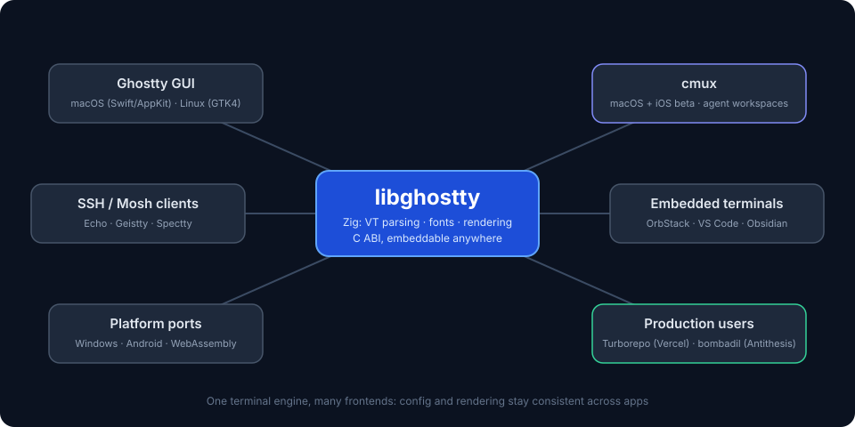
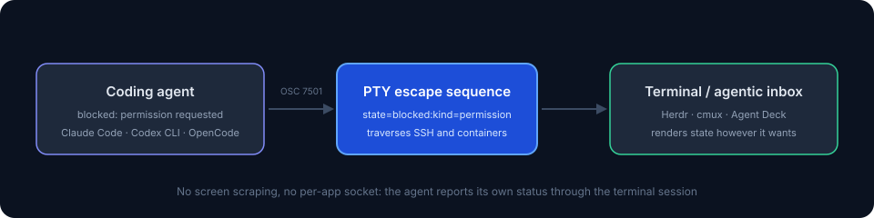

import YouTubeEmbed from "@components/widgets/YouTubeEmbed.astro";
import Notice from "@components/widgets/Notice.astro";
import ListCheck from "@components/widgets/ListCheck.astro";
import Tabs from "@components/widgets/Tabs.astro";
import Tab from "@components/widgets/Tab.astro";
import Accordion from "@components/widgets/Accordion.astro";
import Button from "@components/widgets/Button.astro";

The **Ghostty terminal** is a modern, GPU-accelerated terminal emulator that feels native on macOS, installs in one command, and is configured with a plain text file. It's also the reference implementation of **libghostty**, the rendering engine that now powers cmux and 130+ other projects. If you spend your day on a Mac in a terminal, this is the setup guide I'd hand you.

In this guide you'll:

<ListCheck>
<ul>
<li>Install Ghostty and a Nerd Font so icons render correctly</li>
<li>Set up a clean <code>~/.config/ghostty/config</code></li>
<li>Learn the standout Ghostty features: themes, inspector, shaders, image support</li>
<li>Understand the libghostty ecosystem: cmux and 130+ projects built on Ghostty's engine</li>
<li>Optionally layer in a modern prompt plus tmux and zoxide</li>
</ul>
</ListCheck>

If you specifically want **Starship + Ghostty** with presets and a complete prompt setup, see my companion guide: [Starship + Ghostty: Turbocharge Your Mac Terminal Setup](/starship-ghostty-terminal/).

**Status as of October 2026:** the current release is 1.3.1, 1.4.0 is due late October 2026, and development moved off GitHub in April 2026 (a read-only mirror stays there). Details in the status section below.

## Key features of Ghostty

### GPU acceleration

Ghostty renders using your GPU, which means fast scrolling and smooth performance. Complex terminal output stays responsive, and working with large files doesn't slow things down.

### Native UI

Ghostty doesn't try to be a one-size-fits-all UI. On macOS it uses native Swift, SwiftUI, and AppKit. On Linux it uses GTK4. It plugs into the system properly: AppleScript and Shortcuts support on the Mac, systemd integration on Linux (cgroup isolation, single instance). Ghostty feels like part of your system instead of a foreign tool.

### Simple configuration file (key-value)

Config is straightforward: `~/.config/ghostty/config` uses simple key-value pairs. No scripting language, no complex syntax. Change fonts, pick a theme, adjust opacity. Full walkthrough in the [config file setup](#ghostty-config-file-setup) section below.

### Built-in multiplexer

Ghostty has built-in multiplexing so you can split panes and manage multiple sessions without reaching for tmux. If you want to take that idea further for AI workflows with agent notifications, vertical workspaces, and a built-in browser, see my guide to [cmux Terminal: A Practical Guide for AI Coding Agents on macOS](/cmux-terminal/).

### Rich color support

Supports true color and comes with over 100 themes built-in. You can also add custom ones if you prefer something specific.

### Image support

Ghostty supports the Kitty Graphics Protocol, so you can render images directly in the terminal. Useful if you work with preview tools or want visual output inline. Animated image frames are on the 1.4 milestone, so that's coming, not shipped.

## What's new in Ghostty (October 2026 status)

The current release is **1.3.1**. Ghostty 1.3.0 shipped on March 9, 2026 after 6 months of work: **180 contributors, 2,858 commits**. Headline features from 1.3:

- Scrollback search: `Cmd+F` on macOS or `Ctrl+Shift+F` on GTK searches your terminal history. All matches are highlighted; jump between them with `Cmd+G` / `Shift+Cmd+G` or the arrow keys. On macOS the search bar can be dragged to any corner.
- Native scrollbars: they look and behave like your OS expects, appear during scrolling, and fade out when idle.
- Click to move cursor: if your shell supports OSC 133 prompt detection, you can click to position the cursor in your prompt. Works with zsh, fish, and bash with the right prompt setup.
- Key overlay for leader keys: a visual overlay appears after pressing a leader key showing available bindings. Useful if you use custom keybindings or tmux prefix keys.
- Auto-update on macOS: Ghostty can update itself without needing Homebrew or a manual download.
- Text shaping improvements: better handling of complex scripts (Arabic, Devanagari, Thai) and ligatures.

**1.3.1** (March 13, 2026) was a patch release that fixed phantom mouse, selection, and scroll events on macOS after focus changes. It also added `progress-style` (control or disable OSC 9;4 progress bars), `set_surface_title` and `set_tab_title` keybind actions, `~/` expansion in `working-directory`, and multiline handling in `jump_to_prompt:next`.

### Security fix worth acting on

CVE-2026-26982 patched an issue where control characters (such as 0x03, Ctrl+C) in pasted or drag-and-dropped text could execute arbitrary commands. Published March 10, 2026 in the [NVD](https://nvd.nist.gov/vuln/detail/CVE-2026-26982). If you are still on anything older than 1.3.1, update now:

```sh
brew upgrade --cask ghostty
```

### Ghostty 1.4.0 timeline

Ghostty 1.4.0 is due **October 23, 2026** (the milestone showed 1,220 issues closed in mid-October 2026; 1.5.0 is milestone'd for March 31, 2027). The 6-month release cadence holds; it just slipped past the original September estimate.

<Notice type="warning" title="1.4.0 candidates are not shipped">
The items below are closed issues on the 1.4.0 milestone, not released features. Do not assume any of them exist in your build. Check the release notes at ghostty.org when 1.4 lands.
</Notice>

Visible candidates on the milestone:

- Kitty Graphics **animation frames**
- Move a tab to a new window
- GTK: split **drag-and-drop reorder**
- More flexible `copy-on-select` and `middle-click-action`
- Ability to **name or rename a window**
- GTK/Wayland background blur via `ext-background-effects-v1`
- Runtime change to `max_scrollback` (the one to watch if you script against it)
- Zig 0.16 migration (internal, but it raises requirements for building from source)

### Ghostty left GitHub in April 2026

<Notice type="info" title="The GitHub repo is a mirror">
A read-only mirror remains on GitHub. Development happens on the project's own infrastructure.
</Notice>

On April 28, 2026 Hashimoto announced Ghostty is leaving GitHub over chronic outages, saying he had been unable to do PR review for hours during a GitHub Actions outage and that "this is no longer a place for serious work." The GitHub URL still works as a read-only mirror synced daily (still around 62k stars), but it is no longer where development happens.

Reader impact is small but real: don't file new GitHub issues. Report bugs through ghostty.org or the project Discord. `CONTRIBUTING.md` now includes a vouch system for first-time contributors and a strict AI usage policy ("you must understand your code... no agent-generated slop"). Good policy.

Meanwhile, Hashimoto's new company **Superlogical** (announced July 29, 2026) is building a terminal multiplexer on libghostty. Ghostty itself stays with the non-profit it was donated to in December 2025. I covered the multiplexer plans in [Superlogical Rex, Ghostty's creator's new terminal multiplexer](/superlogical-rex/). The macOS app still sees around a million downloads a week (Hashimoto, 2026).

## Performance

Ghostty is written in Zig, and it shows. The honest comparison comes from the [project README](https://github.com/ghostty-org/ghostty): Ghostty and Alacritty are usually within a few percentage points of each other, and both are roughly 100x faster than Terminal.app and iTerm on large-output workloads. That's the ceiling of what I'd claim from any benchmark.

Real-world differences are smaller than numbers suggest. Your font, shaders, opacity, and the actual workload matter more than a ms figure from a Unicode dump test. If you want a side-by-side alternative on the Mac, see my [WezTerm on Mac with tmux, zoxide, and Starship](/install-wezterm-mac/) guide.

## Unique features

### Terminal Inspector

The Terminal Inspector is one of Ghostty's best features. Open it with `Cmd+Option+I` and you get real-time debugging info: keystrokes, render timings, everything happening under the hood. Handy when you're troubleshooting a keybind or a rendering issue instead of guessing.

### Shaders

You can write custom shaders to apply visual effects: glow, CRT filters, whatever you want to try. Fun if you like tweaking things visually, and a good example of how much of the rendering pipeline is exposed.

## The libghostty ecosystem: the engine behind the apps



Everything above describes Ghostty the app. Since late 2025 there's a second, arguably bigger story: **libghostty**. It's the cross-platform, C-ABI-compatible library (written in Zig) that powers Ghostty itself: terminal emulation, font handling, and rendering. Any application can embed it. Think of it like WebKit for terminals: the Ghostty GUI is just one consumer of the engine.

Mitchell Hashimoto announced libghostty in September 2025, starting with `libghostty-vt`, a zero-dependency library that parses terminal sequences and maintains terminal state. The ecosystem grew quickly after that.

<Notice type="info" title="Mitchell Hashimoto, creator of Ghostty">
"I suspect by the middle of 2027, the number of people using Ghostty via libghostty will dwarf the number of users that actually use the Ghostty GUI."
</Notice>

The [awesome-libghostty list](https://github.com/Uzaaft/awesome-libghostty) tracks **137 projects** built on the engine. The most interesting ones:

| Project | Platform | What it adds |
| --- | --- | --- |
| **cmux** | macOS + iOS beta | Vertical tabs, notification rings when agents need input, in-app scriptable browser, remote workspaces, attach to remote tmux, subagents as native panes, CLI and Unix-socket API. 28k+ GitHub stars. Notifications fire via OSC 9/99/777 or the `cmux` CLI. |
| **blink, Zentty, Forge, in0, Supacode** | macOS | Agent-centric workspaces: live session status, worktrees, orchestration |
| **Muxy, ykmx, it-shell3** | macOS | Terminal multiplexers on the libghostty core |
| **Enso, macterm, justty** | macOS | Different takes on a lightweight native Ghostty terminal |
| **Echo, Geistty, Spectty** | iOS/iPadOS | SSH/Mosh clients with Ghostty rendering |
| **Umbra** | Android | GPU-accelerated Android terminal |
| **mightty, phantty** | Windows | Experimental Windows ports and renderers |
| **deepin-terminal-ghostty, Husk, forgetty** | Linux | GTK/Wayland terminals on the Ghostty core |
| **OrbStack** | macOS | Ghostty-powered terminal inside its Docker/Linux VM app |
| **vscode-bootty** | VS Code | libghostty terminal inside VS Code |
| **obsidian-ghostty-terminal** | Obsidian | Real terminal in your notes |
| **Godotty** | Godot Engine | Terminal emulator for the game engine |
| **ghostty-web, browstty** | Browser | Ghostty compiled to WebAssembly, running in a web page |
| **expo-libghostty** | React Native | Terminal view for Expo/React Native on iOS and Android |
| **emacs-libgterm, Ghostel** | Emacs | Terminal backends on libghostty |
| **RoyalTerminal** | .NET / Avalonia | Cross-platform terminal on .NET 10 |
| **Ghostree** | macOS | Fork with native git worktree and AI agent support |
| **Zmx, hauntty, vanish** | Any | Session persistence: attach, restore, muxing utilities |
| **vterm-mcp** | Any | MCP server that drives and tests TUI apps through a libghostty PTY |
| **mdnb, pynb** | macOS | Markdown and Jupyter apps embedding Ghostty terminals |

There are also bindings for Rust, Go, .NET, Python, TypeScript, React Native/Expo, Flutter/Dart, Elixir, Odin, C++, MoonBit, and HarmonyOS. Building a custom terminal is now a weekend project instead of a multi-year one.

<Notice type="warning" title="libghostty API is not stable">
libghostty-vt is in development and the API is not yet stable. Breaking changes are expected in future versions. Fine for experiments. Pin your versions for anything you ship.
</Notice>

That caveat hasn't stopped production adoption beyond terminals: Vercel's **Turborepo** and Antithesis's **bombadil** both embed libghostty (named by Hashimoto as impactful consumers). Those are not weekend toys.

### What this means for your setup

Your Ghostty config is portable. **cmux**, by far the most popular libghostty app (28k+ GitHub stars), reads your existing `~/.config/ghostty/config` for themes, fonts, and colors. You get a completely different app with zero reconfiguration. Full walkthrough here: [cmux Terminal: A Practical Guide for AI Coding Agents on macOS](/cmux-terminal/).

More importantly, terminals are no longer forced to be generic. Keep Ghostty as your daily driver and run a specialized app (an agent workspace, an SSH client, an embedded terminal) when the job calls for it, without relearning rendering quirks, config syntax, or fonts. Every libghostty app inherits the same correctness and performance.

**Further reading:** [ghostty.org/docs/about](https://ghostty.org/docs/about) · [libghostty announcement](https://mitchellh.com/writing/libghostty-is-coming) · [awesome-libghostty](https://github.com/Uzaaft/awesome-libghostty)

### Agent notifications are getting a protocol (OSC 7501)

If you run AI coding agents in your terminal, you know the problem: the agent blocks waiting for permission or input, and nothing tells you. You flip back to the tab, read the prompt, act, flip away. Repeat.

Today, tools detect that state in two fragile ways:

1. **Screen-scraping heuristics.** [Agentic inboxes like Herdr](/best-herdr-clients/) ship TOML detection manifests that pattern-match window titles and output. Those manifests needed 10 changes in 3 months just to keep up with Claude Code's title patterns.
2. **Per-app socket APIs.** `cmux notify` and the Herdr socket API work, but a socket doesn't traverse SSH or enter a container. The moment your agent runs on a remote box, the notification path breaks.

On October 6, 2026 Hashimoto published the **OSC 7501 Program Status Protocol** as a generic fix. Any program reports its state through the PTY using a standard escape sequence: `idle`, `working`, `blocked` (with a reason), `finished`, or `failed`. The payload shape looks like:

```
state=blocked:kind=permission:app=terraform:msg=<base64>
```

Terminals and agentic inboxes (the announcement names **Herdr, cmux, and Agent Deck**) render it however they want: a notification ring, a badge, a phone push.

<Notice type="info" title="Status as of October 2026">
The protocol is one week old. Ghostty's own support for OSC 7501 is not confirmed as of mid-October 2026. Check the release notes before assuming any terminal renders it.
</Notice>



Why it matters: a real protocol means agent status works over SSH, inside containers, and across machines. Agent tooling stops depending on prompt-title scraping. If you want to push agent notifications further today, look at [Herdr plugins that detect agent state](/best-herdr-plugins/), or [control AI agents from your phone with Moshi + Herdr](/control-ai-agents-from-phone-moshi-herdr/). Terminals and coding agents (Claude Code, Codex CLI, open-source options like [OpenCode Go](https://go.bitdoze.com/opencode-go)) are all moving in this direction.

Spec: [program-status OSC 7501](https://mitchellh.com/writing/program-status-osc7501) · [Rex docs](https://superlogical.com/rex/docs/build/program-status)

## Ghostty terminal setup: installation and configuration

<YouTubeEmbed
  url="https://www.youtube.com/embed/NR25BdXR6mE"
  label="Ghostty Terminal: A Complete Setup Guide for Modern Mac Development"
/>

> If you are interested to see some free cool Mac Apps you can check [toolhunt.net mac apps section](https://toolhunt.net/mac/).

### Prerequisites

<ListCheck>
<ul>
<li>macOS 13 (Ventura) or newer for official builds (universal binary, signed and notarized)</li>
<li>Homebrew installed</li>
<li>Admin rights (font install writes to system font dirs)</li>
<li>Around 200 MB of disk for the app and a Nerd Font</li>
<li>Linux path: Ubuntu 26.04+ or a distro with GTK 4.14 / Adwaita 1.5</li>
</ul>
</ListCheck>

Cost note: Ghostty is free and MIT-licensed. No account, no license key, no telemetry.

If you run Nix on a non-NixOS distro, note that Ghostty needs extra OpenGL driver setup or it won't launch (see the troubleshooting section).

### Quickstart (TL;DR)

Quick setup if you just want Ghostty running:

```sh
brew install --cask ghostty
brew install font-meslo-lg-nerd-font
mkdir -p ~/.config/ghostty
```

Then create `~/.config/ghostty/config` with the basic config below and restart Ghostty. Verify the version: `ghostty --version` (or Ghostty → About in the menu bar). You want **1.3.1 or newer**.

### Install Ghostty on Mac

<Tabs>
  <Tab name="Homebrew">
    ```sh
    brew install --cask ghostty
    ```
    The cask is community-maintained and merely repackages the official .dmg, so the security level is the same as a direct download. It sets `auto_updates: true`, so Ghostty can update itself in-app afterward.
  </Tab>
  <Tab name="Direct .dmg">
    Download from [ghostty.org/download](https://ghostty.org/download). Official builds are universal binaries (Apple Silicon + Intel), signed and notarized, and require macOS 13 (Ventura) or newer. Drag Ghostty into `/Applications`.
  </Tab>
  <Tab name="Nix">
    On macOS, `ghostty-bin` is the repackaged official .dmg. On Linux, the `ghostty` package is the GTK app. If you run Nix on a non-NixOS distro you will need extra GL driver setup or Ghostty won't launch. See the [install docs](https://ghostty.org/docs/install/binary) for the details.
  </Tab>
</Tabs>

**Verify the install before you blame your config:**

```sh
ghostty --version
```

You want 1.3.1 or newer (that's the release with the pasted-text CVE fix). Then open a new tab with `Cmd+T` to confirm the window renders. If the cask errors with "already an app at /Applications", see the troubleshooting section.

macOS builds also self-update in-app, so you don't need to babysit Homebrew for point releases.

### Ghostty on Linux

The official docs confirm a package repository **starting at Ubuntu 26.04**:

```sh
sudo apt install ghostty
```

Check the docs for current architectures and package details. On Linux, Ghostty needs GTK 4.14 and Adwaita 1.5 as a minimum (the project tracks Debian/Fedora/Ubuntu LTS minimums). If GPU initialization fails on old hardware, check the Linux docs for software-rendering options rather than guessing at env vars.

If you build from source, heads up: the 1.4 milestone includes a Zig 0.16 migration, which will raise the toolchain requirement when it lands.

### Install Meslo Nerd Font

Nerd Fonts include programming icons and symbols. Install Meslo LG via Homebrew:

```sh
brew install font-meslo-lg-nerd-font
```

The font installs automatically. Verify it in Font Book if needed. You may need to restart Ghostty after installation.

If icons render as boxes or question marks, Ghostty is not using the Nerd Font: your `font-family` value must match the output of `ghostty +list-fonts` exactly.

### Ghostty config file setup

Create the config file and add basic settings:

```bash
mkdir -p ~/.config/ghostty
vim ~/.config/ghostty/config
```

Add this to the config:

```
font-family = MesloLGS Nerd Font Mono
font-size = 18
background-opacity = 0.9
theme = Argonaut
```

Find available fonts and themes:

```sh
ghostty +list-fonts
ghostty +list-themes
```

<Notice type="info" title="Config changes need a reload">
Press `Cmd+Shift+,` on macOS to reload the config, or restart Ghostty. Typo'd keys silently do nothing, so if a setting seems ignored, check the key name first.
</Notice>

**Verify:** after reload, the theme and opacity should change immediately. If not, the config path is wrong (it must live at `~/.config/ghostty/config`) or a key name is misspelled.

**Tip:** Keep your Ghostty config minimal. Put heavy customization in your shell rc files or prompt setup instead. This makes it easier to sync across machines.

### More settings worth trying

The basic config gets you running. These options cover the most-requested tweaks:

| Option | Example | What it does |
| --- | --- | --- |
| `window-padding-x` / `window-padding-y` | `window-padding-x = 12` | Breathing room around your text |
| `cursor-style` | `cursor-style = bar` | Bar, block, or underline cursor |
| `copy-on-select` | `copy-on-select = true` | Copy immediately when you select text |
| `mouse-hide-while-typing` | `mouse-hide-while-typing = true` | Hide the mouse cursor while you type |
| `background-blur-radius` | `background-blur-radius = 20` | Blur behind transparency (macOS) |
| `confirm-close-surface` | `confirm-close-surface = false` | Skip the close confirmation dialog |
| `shell-integration-features` | `shell-integration-features = true` | OSC 133 marks: enables click-to-move-cursor and prompt jumping |
| `keybind` | `keybind = global:cmd+backquote=toggle_quick_terminal` | Drop-down "Quake" terminal from anywhere |
| `progress-style` | see config docs | New in 1.3.1: control or disable OSC 9;4 progress bars in window and tab titles |

### Essential shortcuts (macOS defaults)

| Action | Shortcut |
| --- | --- |
| New tab | `Cmd+T` |
| New split (right / down) | `Cmd+D` / `Cmd+Shift+D` |
| Close surface | `Cmd+W` |
| Toggle fullscreen | `Cmd+Enter` or `Cmd+Ctrl+F` |
| Scrollback search | `Cmd+F` |
| Search next / previous match | `Cmd+G` / `Shift+Cmd+G` |
| Terminal inspector | `Cmd+Option+I` |
| Increase / decrease font size | `Cmd+=` / `Cmd+-` |
| Open / reload config | `Cmd+,` / `Cmd+Shift+,` |

All of these are rebindable with `keybind` lines. Run `ghostty +list-keybinds --default` to see your current defaults.

## Prompt options (pick one)

Now you need a prompt. Pick one:

- Starship works with any shell, has ready-made themes, and is fast. I have a full guide for Starship + Ghostty: [Starship + Ghostty: Turbocharge Your Mac Terminal Setup](/starship-ghostty-terminal/).
- Powerlevel10k is built for zsh and highly configurable, which is why zsh users keep picking it.

If you go the zsh route, it's also worth picking through the [best Oh My ZSH plugins for 2026](/best-oh-my-zsh-plugins/) for completions and quality-of-life bits.

### Install powerlevel10k theme

Install Powerlevel10k:

```sh
brew install powerlevel10k
echo "source $(brew --prefix)/share/powerlevel10k/powerlevel10k.zsh-theme" >> ~/.zshrc
source ~/.zshrc
```

The first run shows a configuration wizard. Walk through it to customize your prompt: what segments to display, colors, icons, etc. You can always rerun `p10k configure` later to tweak it.

The prompt shows git status and command execution time without slowing down. Edit `~/.p10k.zsh` if you want to fine-tune it further.

### Setup zsh-autosuggestions plugin

zsh-autosuggestions suggests commands as you type, based on your history. Get it working:

```sh
brew install zsh-autosuggestions
echo "source $(brew --prefix)/share/zsh-autosuggestions/zsh-autosuggestions.zsh" >> ~/.zshrc
source ~/.zshrc
```

Now when you type, you'll see faded suggestions. Press the right arrow or End to accept them. Verify: type the start of a command you ran recently and the suggestion should appear immediately. You can customize the suggestions in `.zshrc`: change colors, tweak keybindings, etc.

See also: [Enable Command Autocomplete in Zsh](/enable-command-autocomplete-in-zsh/)

### Setup zsh-syntax-highlighting

zsh-syntax-highlighting colors your commands as you type: green for valid commands, red for errors. Install it:

```sh
brew install zsh-syntax-highlighting
echo "source $(brew --prefix)/share/zsh-syntax-highlighting/zsh-syntax-highlighting.zsh" >> ~/.zshrc
source ~/.zshrc
```

It highlights valid commands and options, underlines existing file paths, and matches bracket pairs. Catch typos before you hit enter. Verify: run `ls` (green) then `lss` (red) after `source ~/.zshrc`.

See also: [Enable Syntax Highlighting in Zsh](/enable-syntax-highlighting-zsh/)

## Enhance Ghostty with tmux and zoxide

Ghostty has built-in multiplexing, but **tmux** is worth adding if you need:
- Remote attach/detach workflows over SSH
- Session sharing across machines or teams
- A larger ecosystem and documentation

One thing to watch: Hashimoto's company Superlogical is building a first-party terminal multiplexer on libghostty, which will be the natural upgrade path for session persistence without tmux. Covered in [Superlogical Rex, Ghostty's creator's new terminal multiplexer](/superlogical-rex/). Until it ships, tmux is still the boring reliable choice.

If your workflow is more local and agent-heavy than remote, `cmux` is another route worth looking at.

**zoxide** makes jumping between directories faster.

### What is tmux and how can it help

tmux lets you manage multiple terminal sessions in one window. Useful for running background processes, sharing sessions with others, or keeping your setup across reboots.

```sh
brew install tmux
```

Then just type `tmux` to start a new session. More details: [install tmux on macOS and learn the essential commands](/tmux-basics/)

If you want a remote box to attach to, a [Hetzner Cloud VPS](https://go.bitdoze.com/hetzner) starts at a few euros a month (order of magnitude: 4-5 EUR/mo for a small VM).

### What is zoxide and how can it help

zoxide replaces `cd` with smarter navigation. It tracks your most-used directories so you can jump to them quickly with fuzzy matching.

```sh
brew install zoxide
echo 'eval "$(zoxide init zsh)"' >> ~/.zshrc
source ~/.zshrc
```

Now use `z` instead of `cd` to jump around. See: [Zoxide tutorial: smarter terminal navigation](/zoxide/)

With tmux, zoxide, and Ghostty together, you've got a solid terminal workflow: multiplexing, fast navigation, and GPU-powered rendering.

## Known Ghostty errors

### 'xterm-ghostty': unknown terminal type

On some remote Linux machines, tools may not recognize Ghostty's terminal type and you can see errors like: `'xterm-ghostty': unknown terminal type.`

Quick fix for the current session:

```sh
export TERM=xterm-256color
```

Permanent fix on that machine:

```sh
echo "export TERM=xterm-256color" >> ~/.bashrc
source ~/.bashrc
```

If it only happens over SSH, set `TERM` conditionally in your shell config instead.

### Icons render as boxes

The Nerd Font is not active. Check `font-family` in `~/.config/ghostty/config` matches `ghostty +list-fonts` output exactly, then restart Ghostty. Installing the font is not enough if the config still points at a different family name.

### Config changes don't apply

Three usual suspects: wrong path (must be `~/.config/ghostty/config`), a typo'd key name (silently ignored), or you forgot to reload with `Cmd+Shift+,`. Change something obvious like `theme` first to prove the reload path works.

### Homebrew cask conflicts

If `brew install --cask ghostty` errors with "already an app at /Applications", you have a manual copy in the way. Delete `/Applications/Ghostty.app`, then run the cask install again.

### Ghostty won't launch on Nix (non-NixOS)

You need extra OpenGL driver setup for the Nix store's libraries to find your GPU drivers. See the [official install docs](https://ghostty.org/docs/install/binary) for the current workaround.

### Rollback / undo

A terminal is low stakes to remove. Full teardown:

```sh
brew uninstall --cask ghostty
rm -rf ~/.config/ghostty
```

Then delete the Meslo Nerd Font from Font Book if you want it gone. Your shell rc changes (powerlevel10k, zsh plugins, zoxide) are independent; reverse those lines in `~/.zshrc` one by one.

## FAQ

<Accordion label="Is Ghostty free? What's the license?" group="faq" expanded="true">
Yes. Ghostty is MIT-licensed and free, with no account or license key. Since December 2025 the project has been backed by a federally recognized non-profit organization, and some maintainers are paid through it. The macOS app is a normal download (or a Homebrew cask) and the Linux builds come from the distro or the project's install docs.
</Accordion>

<Accordion label="Did Ghostty really leave GitHub?" group="faq">
Yes. In April 2026 Hashimoto announced the move after a string of GitHub outages. A read-only mirror remains at the GitHub URL and is synced daily, so old links and stars still work. Development happens on the project's own infrastructure. For bugs, use ghostty.org or the project Discord rather than filing new GitHub issues.
</Accordion>

<Accordion label="Will Ghostty 1.4.0 break my config?" group="faq">
There's no evidence of a config-format break. The visible milestone items look additive: animation frames, window naming, drag reorder, blur. The one to watch is the runtime `max_scrollback` change if you script against it. As always, skim the 1.4 release notes before upgrading a machine you depend on, and keep a copy of your `~/.config/ghostty/config`.
</Accordion>

<Accordion label="Does Ghostty support OSC 7501 agent notifications?" group="faq">
Not confirmed as of mid-October 2026. The protocol was published on October 6, 2026, so it's a week old. The announcement names Herdr, cmux, and Agent Deck as the inbox targets that will render it. Don't assume any terminal implements it yet; check the release notes when Ghostty 1.4 lands.
</Accordion>

## Conclusion

GPU rendering, native UI, and the Terminal Inspector put Ghostty ahead of most terminals on the Mac right now. The bigger shift is libghostty: specialized apps for agents, SSH, and embedded use all run on the same engine and read the same config. Ghostty 1.4.0 is due late October 2026, and Hashimoto's prediction stands that by mid-2027 more people will use Ghostty through libghostty apps than the GUI itself.

If you spend time in the terminal, install it and see how it feels. And if you run AI coding agents, keep an eye on cmux and the OSC 7501 protocol, because agent-aware terminals are about to get much less annoying.

<Button text="Download Ghostty" link="https://ghostty.org/download" variant="solid" color="blue" size="md" icon="arrow-right" />

Ghostty works great with [Fish Shell](/install-fish-shell-ubuntu/) too. If you're looking for a shell upgrade, see my [Fish Shell vs Bash vs Zsh](/fish-shell-vs-bash-vs-zsh/) comparison, the [Fish Shell on macOS setup guide](/fish-shell-macos-setup/), or [set up Starship prompt with Fish](/fish-shell-starship-prompt/).
