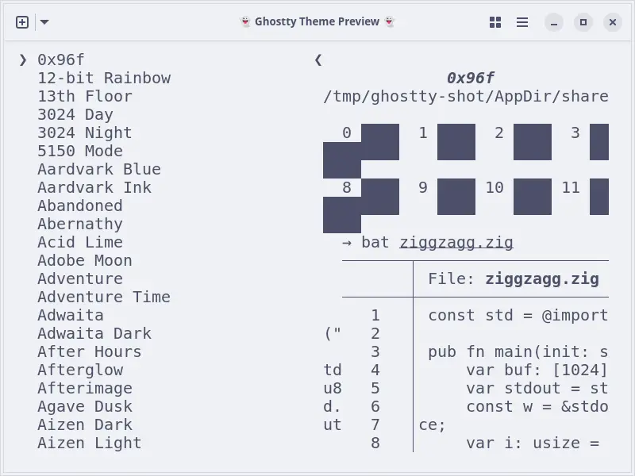
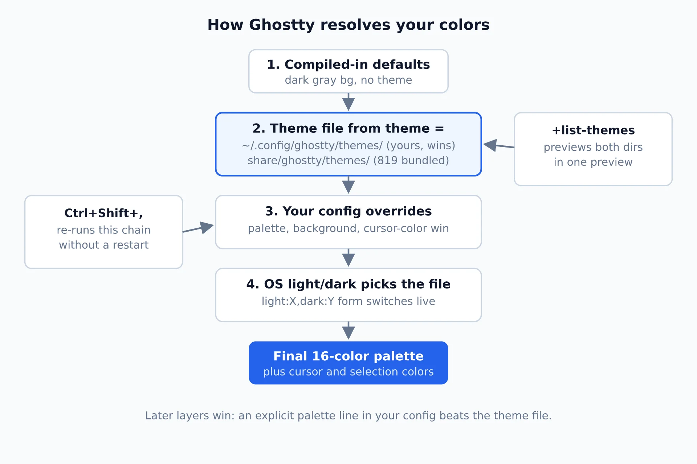
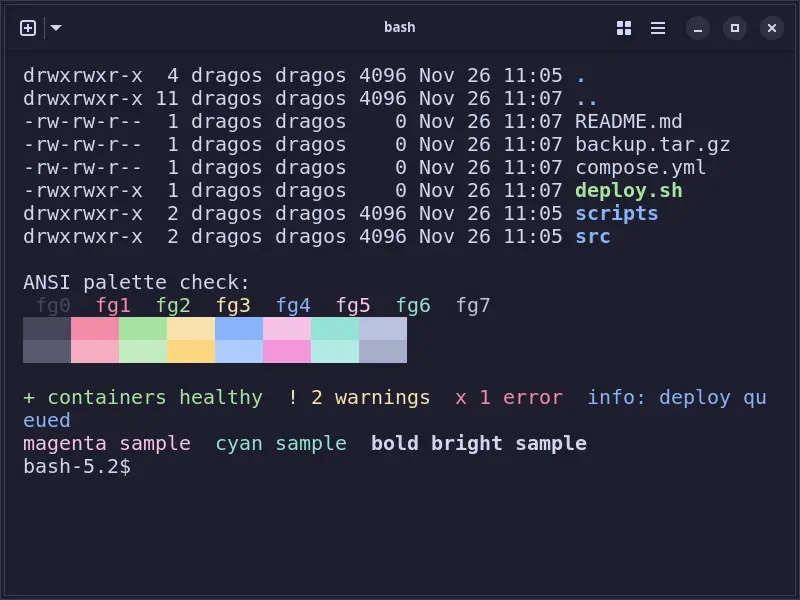
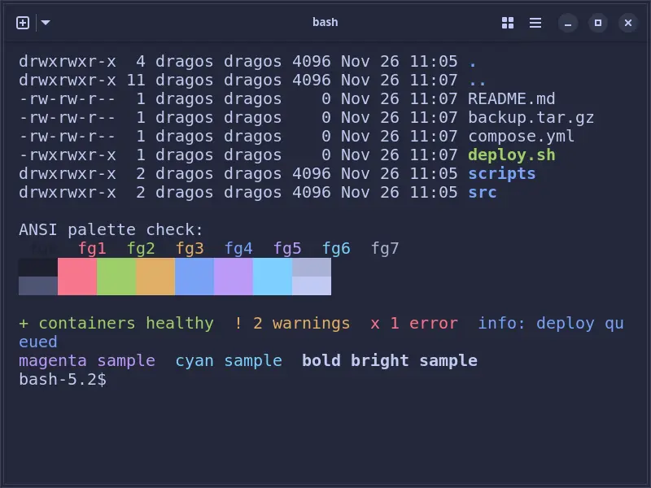
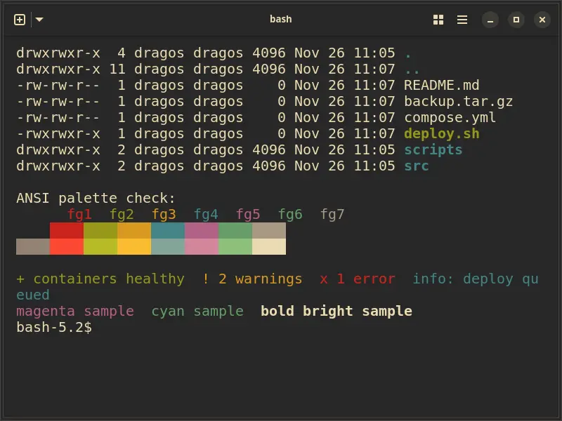
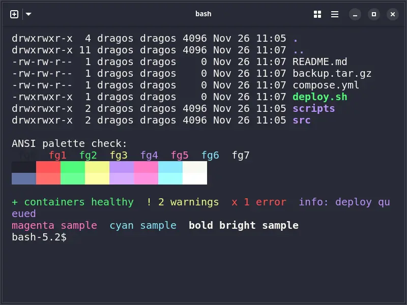
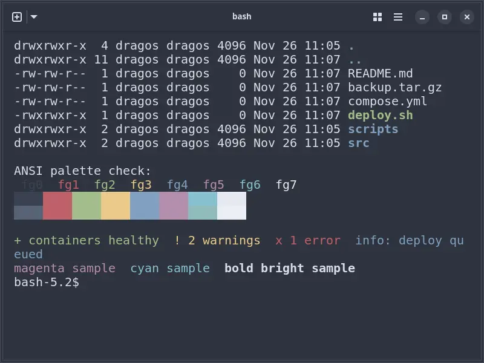
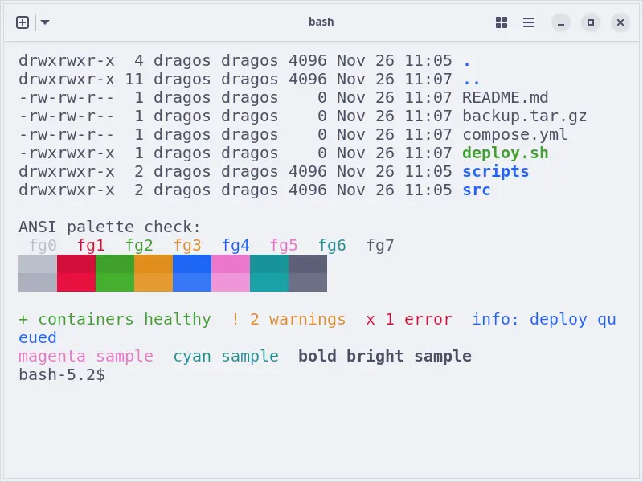
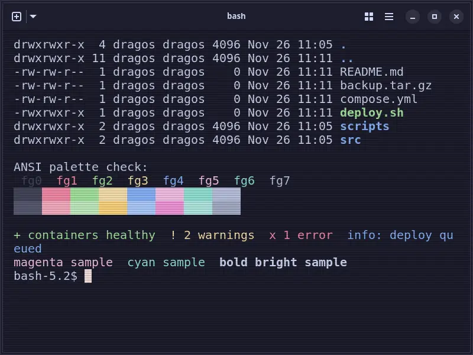

import Notice from "@components/widgets/Notice.astro";
import Tabs from "@components/widgets/Tabs.astro";
import Tab from "@components/widgets/Tab.astro";
import Accordion from "@components/widgets/Accordion.astro";

Ghostty ships 819 built-in themes, so changing your colors takes one line. Preview every theme with `ghostty +list-themes`, set `theme = TokyoNight Storm` in `~/.config/ghostty/config`, and press `ctrl+shift+,` to hot-reload without restarting. This guide walks through config paths, light/dark automatic switching, custom theme files, fonts, padding, and GLSL shaders. Everything here was verified on Ghostty 1.4.0 ([released October 27, 2026](https://ghostty.org/docs/install/release-notes/1-4-0)) and the [official config reference](https://ghostty.org/docs/config/reference). If you are still setting up the terminal, read my [Ghostty setup guide](/ghostty-terminal/) or [Ghostty vs Kitty comparison](/ghostty-vs-kitty/).

## Where the config file lives

Ghostty reads its settings from the XDG config directory on every platform, and macOS adds a second location. Per the [configuration docs](https://ghostty.org/docs/config), the canonical filename is `config.ghostty` (it was `config` before 1.2.3), and the older `config` still loads.

<Tabs>
<Tab name="Linux">

```text
$XDG_CONFIG_HOME/ghostty/config.ghostty
$XDG_CONFIG_HOME/ghostty/config
```

`XDG_CONFIG_HOME` defaults to `~/.config`. Reload with `ctrl+shift+,`.

</Tab>
<Tab name="macOS">

```text
~/.config/ghostty/config.ghostty
~/Library/Application Support/com.mitchellh.ghostty/config.ghostty
```

macOS reads the XDG files first, then the `Application Support` files, and later files override earlier ones. Reload with `cmd+shift+,`.

</Tab>
</Tabs>

If both `config.ghostty` and `config` exist, both load in the order the docs list them, with later values winning, which is rarely what you want. Keep one file. Throughout this guide I write `config` in examples because it is shorter; use `config.ghostty` if you follow the new convention.

Every line is a simple `key = value` pair. Check the file without restarting:

```bash
ghostty +validate-config
```

The full default state of every option is one command away:

```bash
ghostty +show-config --default --docs
```

That one doubles as offline documentation. It prints each key, its default and the explanation, and it matches the binary you run.

## How to apply a built-in theme

Run the theme picker:

```bash
ghostty +list-themes
```

Running it interactively opens a split TUI with a scrollable theme list on the left and a live palette and syntax preview on the right. Press `F1` for shortcuts or `ESC` to quit. Pipe the command to output a plain text list for scripting:

```bash
ghostty +list-themes --plain
ghostty +list-themes --color=dark --plain    # 637 dark themes
ghostty +list-themes --color=light --plain   # 182 light themes
```


*The built-in picker previews the palette and syntax colors before you commit.*

Once you have a name, set it in `~/.config/ghostty/config`:

```ini
theme = Catppuccin Mocha
```

Names are exact, including capitalization and spaces. `theme = catppuccin mocha` does not match anything. Press `ctrl+shift+,` (Linux) or `cmd+shift+,` (macOS) inside any Ghostty window to reload the config, or run `ghostty +validate-config` first if you suspect a typo.

Keep two loading rules in mind before picking themes. First, your main config beats the theme file. Any `palette`, `background`, `foreground`, or `cursor-color` line in `config` overrides the selected scheme because Ghostty [loads themes first](https://ghostty.org/docs/features/theme). Second, a theme file follows normal config syntax, letting it set non-color keys too.

<Notice type="warning" title="Review third-party theme files">
  The [Ghostty docs warn](https://ghostty.org/docs/features/theme) that a theme can modify any configuration option, so read a theme from an untrusted source before using it. Treat a pasted theme like a pasted shell script.
</Notice>


*Later layers win. An explicit palette line in your config beats the theme file.*

## What are the best Ghostty themes?

There is no objective answer, but a handful of community favorites cover almost everyone's taste. All six below ship with Ghostty 1.4.0; nothing extra to download. The screenshots show the same directory listing, ANSI palette blocks, and status line in each theme so you can compare them side by side.

### Catppuccin Mocha

The soft pastel dark theme that took over half the dotfiles scene. Low contrast, warm purples and blues, easy on the eyes for long sessions. Ghostty ships all four Catppuccin flavors: Latte (light), Frappe, Macchiato, and Mocha.

```ini
theme = Catppuccin Mocha
```


*Catppuccin Mocha: the directory listing, ANSI blocks, and status colors on `#1e1e2e`.*

### TokyoNight Storm

A cooler, bluer dark theme inspired by the VS Code port. Higher contrast than Catppuccin, and the blue tones work well if your editor runs Tokyo Night too. Ghostty ships the Night, Storm, Moon, and Day variants.

```ini
theme = TokyoNight Storm
```


*TokyoNight Storm: note the colder blues compared to Catppuccin.*

### Gruvbox Dark

The retro groove classic. Warm browns, muted reds and greens, very readable at small sizes. Ghostty ships Gruvbox Dark, Dark Hard, Light and Light Hard, plus Gruvbox Material variants.

```ini
theme = Gruvbox Dark
```


*Gruvbox Dark: the warmest option here, reds and yellows dominate.*

### Dracula

The most widely ported theme in existence. Purple-heavy, high saturation, decent contrast. If your whole toolchain already runs Dracula, this keeps the terminal consistent.

```ini
theme = Dracula
```


*Dracula: saturated purples and pinks on `#282a36`.*

### Nord

Cool arctic blues, deliberately muted. The least saturated dark theme here; some people find it too washed out, others swear by it for reduced eye strain.

```ini
theme = Nord
```


*Nord: muted blues, gentle on bright displays.*

### Catppuccin Latte

The light-theme representative, because you asked. Soft warm colors on a cream background. Pairs naturally with Mocha for automatic light and dark switching, which is the next section.

```ini
theme = Catppuccin Latte
```


*Catppuccin Latte: proof that light terminals can look good.*

Other names worth a preview, all present in the [bundled theme list](https://github.com/mbadolato/iTerm2-Color-Schemes/tree/master/ghostty): `Everforest Dark Med`, `Kanagawa Wave`, `Rose Pine`, `GitHub Dark Default` and `iTerm2 Solarized Dark`. Run the picker and judge with your own eyes; themes look different at your font size and display brightness than in anyone's screenshots.

## Automatic light and dark switching

Ghostty can follow your desktop's light and dark mode. Use the split syntax in the config:

```ini
theme = dark:Catppuccin Mocha,light:Catppuccin Latte
```

Both sides are required in this form. Per the [theme docs](https://ghostty.org/docs/features/theme), Ghostty switches automatically based on the OS appearance, and `ghostty +validate-config` accepted this line on 1.4.0. I did not test appearance switching on a tiling WM without an XDG desktop portal. Test on GNOME first if switching does nothing so you separate a Ghostty bug from a portal issue.

For the window chrome itself (titlebar, tabs), the companion key is [`window-theme`](https://ghostty.org/docs/config/reference). The default `auto` picks light or dark chrome from the terminal background color, and with a split light and dark `theme` it behaves like `system`. Setting `window-theme = ghostty` (Linux builds only) uses the background and foreground colors from your Ghostty config, which is what I used in the screenshots above so the titlebar blends in.

## Writing your own theme file

Custom themes live in `~/.config/ghostty/themes/` as plain files whose name is the theme name. Create `~/.config/ghostty/themes/my-theme` and fill it:

```ini
# ~/.config/ghostty/themes/my-theme
palette = 0=#1a1b26
palette = 1=#f7768e
palette = 2=#9ece6a
palette = 3=#e0af68
palette = 4=#7aa2f7
palette = 5=#bb9af7
palette = 6=#7dcfff
palette = 7=#a9b1d6
palette = 8=#414868
palette = 9=#f7768e
palette = 10=#9ece6a
palette = 11=#e0af68
palette = 12=#7aa2f7
palette = 13=#bb9af7
palette = 14=#7dcfff
palette = 15=#c0caf5
background = #16161e
foreground = #c0caf5
cursor-color = #c0caf5
cursor-text = #16161e
selection-background = #33467c
selection-foreground = #c0caf5
```

Then reference it by name exactly like a built-in:

```ini
theme = my-theme
```

The 16 palette slots map directly to ANSI colors, where 0-7 are black through white and 8-15 are bright variants. Every `ls` color, shell prompt, and TUI highlight pulls from these slots. Ghostty checks `$XDG_CONFIG_HOME/ghostty/themes` before `$PREFIX/share/ghostty/themes`, so a personal theme file shadows a bundled theme of the same name. The [theme docs](https://ghostty.org/docs/features/theme) also allow an absolute file path in `theme`.

A theme file can technically set any option, including fonts and padding, but I keep those in the main config and use theme files purely for color.

The fastest way to write a custom theme is copying an existing built-in from `share/ghostty/themes` into `~/.config/ghostty/themes/` and adjusting only the colors you dislike. Because Ghostty syncs weekly from the [iTerm2-Color-Schemes project](https://iterm2colorschemes.com/) per the theme docs, popular palettes usually ship built in already.

## Adjusting fonts, padding, cursor, and opacity

The theme only owns color. The rest of the look lives in your main config. The options that change the feel the most:

```ini
font-family = "JetBrainsMono Nerd Font"
font-size = 14
window-padding-x = 16
window-padding-y = 12
window-padding-balance = true
cursor-style = bar
background-opacity = 0.95
background-blur = true
```

A few notes on these, all from the [config reference](https://ghostty.org/docs/config/reference):

- `font-family` accepts any font fontconfig sees. List what Ghostty finds with `ghostty +list-fonts`. Nerd Fonts work fine; Ghostty also bundles JetBrains Mono and built-in nerd fonts.
- `font-thicken = true` draws a thicker stroke, but the reference says it is currently only supported on macOS, so it is not in the sample above. On macOS, add it if thin fonts look gray.
- Padding is in points and scales with DPI. `window-padding-balance = true` spreads the leftover space (when the window is not an exact multiple of the cell size) across all four edges. Padding changes at runtime only affect new windows and tabs.
- `cursor-style` accepts `block`, `bar`, `underline` or `block_hollow`. Shell integration sets a bar at the prompt regardless; disable that with `shell-integration-features = no-cursor` if you want your choice respected everywhere.
- `background-opacity` runs from 0 (transparent) to 1 (opaque) and out-of-range values clamp. On macOS, changing it requires a full restart of Ghostty.
- `background-blur` only matters when opacity is below 1. `true` means blur intensity 20; you can also give an integer. It works on macOS and on some Linux desktops, including KDE Plasma on Wayland and X11, where the exact intensity is ignored because KWin has one global blur setting. Where blur is unsupported you get plain transparency.

<Notice type="info" title="Prompt tuning pairs well with theme work">
  Once the colors are right, the shell prompt is the next layer. Starship gives you a fast, themeable prompt that inherits your terminal palette. I run the combination covered in the [Starship and Ghostty setup](/starship-ghostty-terminal/) and the [Fish and Starship guide](/fish-shell-starship-prompt/).
</Notice>

## Custom shaders for terminal effects

Ghostty supports post-processing shaders written in GLSL, compatible with the Shadertoy format. This is the same mechanism terminals like Cool Retro Term emulate with whole extra processes; here it runs on the GPU in the render pipeline. Set the path in your config:

```ini
custom-shader = ~/.config/ghostty/shaders/scanlines.glsl
```

Repeat the key to chain multiple shaders; each one receives the previous shader's output. A minimal working example, a CRT-style scanline dimmer I ran while writing this:

```glsl
// scanlines.glsl: subtle CRT scanline dimming for Ghostty
void mainImage(out vec4 fragColor, in vec2 fragCoord) {
    vec4 color = texture(iChannel0, fragCoord / iResolution.xy);
    float row = mod(fragCoord.y, 3.0);
    if (row < 1.0) {
        color.rgb *= 0.55;
    }
    fragColor = color;
}
```

Every third pixel row drops to 55 percent brightness. Raise the multiplier toward `1.0` for a subtler effect; `0.85` is barely visible and `0.55` is unmistakable. The shader contract, per the [reference](https://ghostty.org/docs/config/reference): implement `mainImage`, read the terminal screen from `iChannel0`, use `iResolution` and `iTime` for layout and animation. Ghostty adds its own `iCurrentCursor` uniform (position and size of the cursor), which is how cursor trail effects work.


*The scanline shader running at 0.55 intensity. Heavy for effect; tune it down for daily use.*

For ready-made shaders, browse the [ghostty-shaders collection](https://github.com/0xhckr/ghostty-shaders). Keep two warnings in mind when enabling custom GLSL shaders. First, shaders that fail to compile are skipped with errors printed only to the Ghostty log rather than config validation, so check the log if an effect disappears. A compiling shader with broken math can blank the window, which you reverse by commenting out `custom-shader` and reloading. Second, animated shaders cost CPU. The `custom-shader-animation` option defaults to `true` on focused windows, while `always` animates unfocused surfaces and `false` renders only on terminal updates to save battery.

## Reloading, validating, troubleshooting

The workflow that avoids almost all pain:

```bash
ghostty +validate-config          # catches typos before you reload
ghostty +show-config              # shows the merged effective config
```

Press `ctrl+shift+,` in Ghostty to reload. Since window padding and certain window attributes only affect newly opened windows and tabs, open a fresh tab before assuming a reload failed.

Common failure modes I hit or see reported constantly:

1. **Theme name typo.** Case and spaces must match exactly. `theme = catppuccin mocha` silently falls back to defaults. Check with `ghostty +validate-config` and confirm the name in `+list-themes`.
2. **Theme looks wrong after reload.** Your main config likely sets `background` or `palette` lines that override the theme file, because user config always loads last.
3. **Both `config` and `config.ghostty` exist.** Both load, later values win. Delete one.
4. **Black window after adding a shader.** Bad GLSL. Remove the `custom-shader` line, reload, iterate on the shader file.
5. **Light and dark split does nothing.** Your desktop may not report a system appearance preference. Test on GNOME or macOS first to isolate whether it is a Ghostty problem or an environment problem.

If you use a multiplexer on top, colors pass through fine in my setup. My [terminal multiplexer comparison](/best-terminal-multiplexers/) covers the current options, and [Rex](/superlogical-rex/) from the Ghostty author himself is the interesting one to watch.

## FAQ

<Accordion label="How many themes does Ghostty ship with?" group="faq">
819 themes in the 1.4.0 release: 637 dark and 182 light, counted from `ghostty +list-themes --color=dark` and `--color=light`. Most of them originate from the iTerm2-Color-Schemes community project, so the collection covers essentially every popular terminal color scheme.
</Accordion>

<Accordion label="Where do I put Ghostty theme files?" group="faq">
Custom themes go in `~/.config/ghostty/themes/` as plain files named exactly what you want to type after `theme =`. No extension. `theme = my-theme` then resolves to `~/.config/ghostty/themes/my-theme`, and it appears in the `+list-themes` picker alongside the bundled ones.
</Accordion>

<Accordion label="How do I reload the Ghostty config without restarting?" group="faq">
Press `ctrl+shift+,` on Linux or `cmd+shift+,` on macOS in any Ghostty window. Most settings apply immediately, but some window-level options like `window-padding-x` only affect new windows and tabs, so open a fresh tab if a change seems ignored. Validate first with `ghostty +validate-config` to catch syntax errors.
</Accordion>

<Accordion label="Can Ghostty switch themes with light and dark mode?" group="faq">
Yes. Use the split form `theme = dark:Catppuccin Mocha,light:Catppuccin Latte` and the terminal follows the system appearance. Both light and dark must be specified in this form. If it does nothing on a Linux window manager, check that your desktop reports a dark style preference.
</Accordion>

<Accordion label="Why does my theme have no effect?" group="faq">
Two usual causes. The theme name does not match exactly (names are case sensitive and spaces matter), which `ghostty +validate-config` reports. Or you have `background`, `foreground`, or `palette` lines in your own config, which override whatever the theme file sets because user config always wins.
</Accordion>

<Accordion label="Are Ghostty themes safe to download?" group="faq">
Treat them like shell scripts. A theme file is a full Ghostty config file and can set any valid option, not just colors, which is why the [docs warn about untrusted sources](https://ghostty.org/docs/features/theme). The bundled themes come from the iTerm2-Color-Schemes project, so third-party files are the ones to read first.
</Accordion>

<Accordion label="How do I make Ghostty transparent?" group="faq">
Set `background-opacity = 0.9` (or lower) in the config and optionally `background-blur = true` for a frosted effect (blur intensity 20). Blur works on macOS and some Linux desktops such as KDE Plasma; elsewhere you get plain transparency. The value clamps between 0 and 1, and on macOS changing it needs a full restart.
</Accordion>

<Accordion label="Can I use custom shaders in Ghostty?" group="faq">
Yes, any Shadertoy-compatible GLSL shader via `custom-shader = ~/.config/ghostty/shaders/yourfile.glsl`, repeatable to chain effects. Implement `mainImage` and read the screen from `iChannel0`. Keep `custom-shader-animation` at the default `true` or set it to `false` on battery, since `always` keeps animating unfocused windows and gets expensive with several surfaces.
</Accordion>
