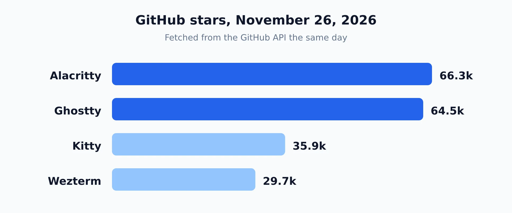
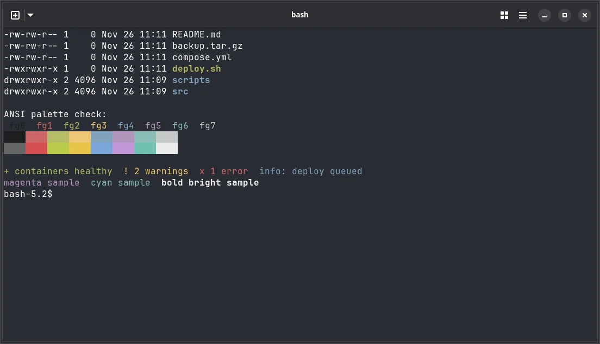
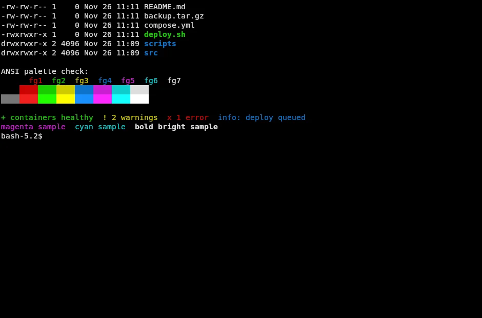
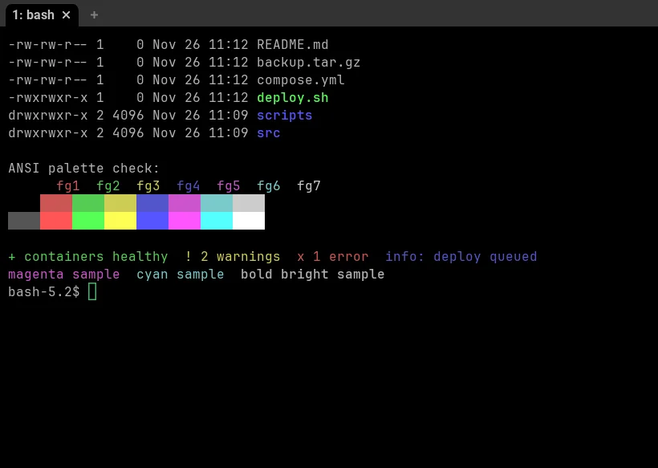
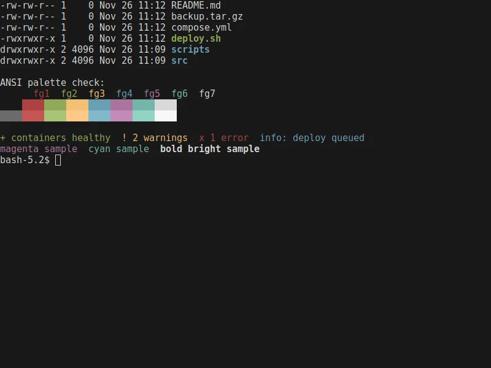
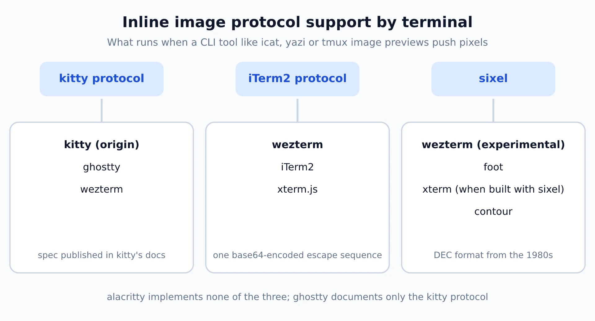

import Notice from "@components/widgets/Notice.astro";
import ListCheck from "@components/widgets/ListCheck.astro";
import Accordion from "@components/widgets/Accordion.astro";

**[Ghostty](/ghostty-terminal/) is the default terminal pick in 2026.** It combines native platform UI, a simple config file, complete kitty graphics support, and active development. Choose kitty if your workflow relies on terminal images, `kitten ssh`, or custom kittens. Choose wezterm if you want a built-in multiplexer with persistent mux-server sessions. Choose alacritty if you only want a fast terminal inside tmux.

All four are GPU-accelerated and fast enough that speed stopped being the deciding factor years ago. The real differences in 2026 are memory footprint, config format, what the terminal can display, how much it does for you, and which platforms it runs on. That is what this comparison covers.

## Ghostty vs kitty vs wezterm vs alacritty at a glance

Star and issue counts were fetched from the GitHub API on November 26, 2026. "Open issues" excludes pull requests (GitHub's own `open_issues_count` field includes them: 261 for Ghostty, 9 for kitty, 1,983 for wezterm, 346 for alacritty). Benchmark figures come from third parties, linked in the performance section, not from my own runs.

| | Ghostty | Kitty | Wezterm | Alacritty |
|---|---|---|---|---|
| Current version | [1.4.0 (Oct 27, 2026)](https://ghostty.org/docs/install/release-notes/1-4-0) | 0.51.1 (Nov 23, 2026) | nightly (stable tag Feb 2024) | 0.17.0 (Apr 2026) |
| Written in | Zig | Python, C and Go | Rust | Rust |
| GPU rendering | Metal (macOS), OpenGL (Linux) | OpenGL | OpenGL | OpenGL |
| Config format | `key = value` | `key value` | Lua script | TOML |
| Ligatures | Yes | Yes (some fonts render badly) | Yes | No |
| Inline images | Kitty protocol (complete, incl. animation) | Kitty protocol (the original) | Kitty + iTerm2 + sixel | None |
| Tabs and splits | Yes | Yes | Yes, plus mux server | No |
| Platforms | macOS, Linux | macOS, Linux, BSD | macOS, Linux, Windows, BSD | macOS, Linux, Windows, BSD |
| GitHub stars (Nov 26, 2026) | 64.5k | 35.9k | 29.7k | 66.3k |
| Open issues, PRs excluded (Nov 26, 2026) | 144 | 5 | 1,559 | 327 |

Star counts mirror momentum more than quality, and open-issue counts mirror triage policy and project age. Read them as context, not as a bug count. Ghostty's number also comes from the GitHub mirror, see the note in the Ghostty section.



*GitHub stars fetched from the API the same day. Ghostty sits about 1,800 stars behind alacritty.*

## Ghostty for native platform UI

Ghostty is Mitchell Hashimoto's GPU terminal, currently at [version 1.4.0 (October 27, 2026)](https://ghostty.org/docs/install/release-notes/1-4-0). Its [About page](https://ghostty.org/docs/about) describes a shared Zig core (libghostty) driving native UI with AppKit and SwiftUI on macOS and the GTK4 C API on Linux. Building 1.4.0 on Linux requires GTK 4.18 and libadwaita 1.7, giving it a native look on every supported platform.

I captured the screenshot below on a plain Linux X session with the same demo content I ran in the other three terminals. Look at the GTK header bar with its tab and window controls, and the padding around the text grid.



*Ghostty on Linux: look at the GTK4 header bar with native-looking window controls and the even padding around the text grid.*

Config lives in `~/.config/ghostty/config` (or `config.ghostty`, see the [config docs](https://ghostty.org/docs/config)) as plain `key = value` lines. No scripting, no INI sections, nothing to learn:

```
font-family = JetBrainsMono Nerd Font
font-size = 13
theme = Catppuccin Mocha
window-padding-x = 8
```

The 1.4.0 release notes highlight faster performance and scrollback compression that cuts memory for hidden history by 70% to 90%. Its kitty graphics engine now [covers 100% of the published specification, including animation and relative placements](https://ghostty.org/docs/install/release-notes/1-4-0), making it the first non-kitty terminal to reach full parity. It also ships hundreds of one-line built-in themes (covered in [Ghostty themes](/ghostty-themes/)) plus [shell integration](https://ghostty.org/docs/features/shell-integration) for bash, elvish, fish, nushell, and zsh. Splits, tabs, and a quick terminal bound with `toggle_quick_terminal` (unbound by default) complete the feature set.

The downsides are real. No Windows GUI build exists, and the 1.4.0 roadmap confirms the team dropped planned Windows GUI support, steering downstream projects toward `libghostty-vt`. Idle memory is also highest among the four terminals tested below, although that benchmark predates 1.4.0 scrollback compression.

<Notice type="info" title="Ghostty is leaving GitHub">
  Hashimoto [announced on April 28, 2026](https://mitchellh.com/writing/ghostty-leaving-github) that Ghostty will leave GitHub while keeping a read-only mirror at the existing URL. I have not confirmed where the canonical repository lives today, so the Ghostty issue count from the GitHub mirror may lag behind active triage.
</Notice>

For a full setup walkthrough on macOS, see my [Ghostty terminal guide](/ghostty-terminal/), and for the prompt side, [Starship + Ghostty](/starship-ghostty-terminal/).

## Kitty for SSH kittens and scripting

Kitty is Kovid Goyal's terminal, currently at version 0.51.1 (November 23, 2026). It is the reference implementation of the kitty graphics protocol and the kitty keyboard protocol, which other emulators now implement, ghostty included. If a CLI tool displays images in a terminal, odds are it was built against kitty first.



*Kitty on X11 draws no window chrome of its own: text starts almost at the window edge. On a tiling window manager this is exactly what you want.*

Config is `~/.config/kitty/kitty.conf` in a flat `key value` format, one directive per line:

```
font_family JetBrainsMono Nerd Font
font_size 13
background_opacity 0.95
map ctrl+shift+enter new_window_with_cwd
```

The standout feature is [kittens](https://sw.kovidgoyal.net/kitty/kittens_intro/), small programs bundled in kitty's Python, C, and Go codebase. The [`ssh` kitten](https://sw.kovidgoyal.net/kitty/kittens/ssh/) wraps `ssh`, sets up remote shell integration, and copies the kitty terminfo database so colors and TUI apps work on servers. You also get `kitten icat` for images, `kitten diff` for side-by-side diffs, and `kitten themes` for browsing over 300 color palettes. Built-in tabs, keyboard-driven splits, and a remote control API remove the need for tmux in single-session local work.

Kitty [renders font ligatures by default](https://sw.kovidgoyal.net/kitty/conf/), with `disable_ligatures` accepting `never`, `cursor`, or `always`. Some fonts still misbehave, such as [Monaspace having only partial ligature support](https://github.com/kovidgoyal/kitty/issues/8182), so test your font first.

## Wezterm for built-in multiplexing and Windows

Wezterm is Wez Furlong's Rust terminal, packing a GPU renderer, a tmux-style multiplexer, and a Lua runtime into one binary. Since the last stable release (`20240203-110809-5046fc22`) dates to February 2024, most users track nightly builds via the [Linux install docs](https://wezterm.org/install/linux.html). Alongside alacritty, it offers native Windows support, and it is the only terminal here with a persistent mux server.



*Wezterm draws its own tab bar even without a window manager: look at the numbered `1: bash` tab and the plus button at the top.*

Config is a Lua program at `~/.config/wezterm/wezterm.lua`:

```lua
local wezterm = require 'wezterm'
local config = wezterm.config_builder()

config.font = wezterm.font 'JetBrainsMono Nerd Font'
config.font_size = 13
config.color_scheme = 'Catppuccin Mocha'
config.keys = {
  { key = 'd', mods = 'CTRL|SHIFT', action = wezterm.action.SplitHorizontal },
}

return config
```

Because configuration is Lua code, you can write per-hostname conditionals, custom workspace switchers, dynamic tab titles, and generated keybinding loops. Whether that flexibility helps or slows you down depends on whether you like programming your config. Its [multiplexing docs](https://wezterm.org/multiplexing.html) describe local and SSH domains that keep panes alive independently of any GUI window.

That runtime comes at a measurable cost. In the benchmark below, wezterm finishes last on bulk output (1,246 ms to `cat` an 11 MB file, about triple the others). It also uses 130 MB of RAM after boot. Light command-line use hides the difference, while dumping large logs makes it obvious.

On macOS, the install path has its own quirks; I covered them in [install wezterm on Mac](/install-wezterm-mac/).

## Alacritty for minimal config and tmux users

Alacritty is the oldest of the modern GPU terminals, currently at 0.17.0 (April 2026), written in Rust, and philosophically opposed to everything kitty and wezterm stand for. No tabs. No splits. No image protocol. No ligatures ([issue #50](https://github.com/alacritty/alacritty/issues/50) has been open since January 2017). No built-in themes system. One TOML file at `~/.config/alacritty/alacritty.toml` (the [config reference](https://alacritty.org/config-alacritty.html) lists the other lookup paths).



*Alacritty draws nothing but the text grid: no tab bar, no padding by default, no chrome. The window manager owns everything outside the glyphs.*

```toml
[font]
normal = { family = "JetBrainsMono Nerd Font" }
size = 13

[window]
padding = { x = 6, y = 6 }
```

Focus is the pitch. In the benchmark below, alacritty posts the second-lowest idle memory (75 MB) and 16.7 ms average input latency while delegating everything else. Use tmux for splits and session persistence, or choose another terminal for inline images and ligatures. Its 66.3k stars reflect its years as the only mature GPU terminal on Linux.

## How do ghostty and kitty compare on performance and resource use?

**All four feel instant for everyday typing, while measurable differences appear in bulk output, frame rate, and idle RAM.** Kitty leads frame rate, alacritty and foot lead idle memory, and wezterm lags on large text dumps.

The most cited comparison I found is the [vizenc/terminal-benchmark](https://github.com/vizenc/terminal-benchmark) repo: a ThinkPad T430 running Arch under Hyprland (Wayland), default configs, five runs per cell. Foot is in the repo's table, so it is in mine:

| Metric | Alacritty | Foot | Ghostty | Kitty | Wezterm |
|---|---|---|---|---|---|
| Input latency (ms, lower is better) | 16.7 | 15.0 | 38.3 | 18.3 | 30.8 |
| cat of an 11 MB file (ms, lower is better) | 404 | 251 | 407 | 401 | 1,246 |
| DOOM-fire render (FPS, higher is better) | 164 | 199 | 135 | 273 | 64 |
| Memory after reboot (MB, lower is better) | 75 | 43 | 174 | 91 | 130 |

<Notice type="warning" title="Read these numbers with caveats">
  The repo does not explain Ghostty's 38.3 ms latency; [one write-up of the benchmark](https://grigio.org/which-is-the-best-linux-terminal-alacritty-kitty-ghostty-foot-its-not-easy) suspects a measurement artifact from GTK under XWayland, but I could not confirm that. The repo also notes that results on newer hardware may be closer. It was run against pre-1.4.0 Ghostty, before scrollback compression, and its tester measured Wayland only.
</Notice>

Other cited benchmarks show similar patterns. The same write-up notes that kitty's built-in `kitten __benchmark__` reported 134.55 MB/s throughput against 54.05 for alacritty and 48.5 for wezterm, though vendor benchmarks stay directional. On macOS, [Luke Harris measured kitty at 29.2 ms input latency](https://lkhrs.com/blog/terminal-latency), the fastest of six tested terminals ahead of Terminal.app and WezTerm.

Two practical conclusions. First, if output scrolls fast enough for the terminal to be the bottleneck, you were not reading it anyway; redirect to a file. Second, what you notice day to day is per-window memory when you open terminals dozens of times a day.

Memory scaling looks different across multiple windows. [Umar Anis measured Ghostty](https://umaranis.com/2025/12/12/foot-vs-ghostty-memory-consumption) at 229 MB for one window and 423 MB across twenty-five because one shared process serves every window. Client/server foot used 538 MB across twenty-five windows. On Ghostty 1.2.3 under Arch Linux, he noticed memory stayed allocated after closing windows and linked it to closed [issue #5491](https://github.com/ghostty-org/ghostty/issues/5491) (milestone 1.2.0). I have not re-tested that behavior on 1.4.0. The same [write-up](https://grigio.org/which-is-the-best-linux-terminal-alacritty-kitty-ghostty-foot-its-not-easy) reports typical idle usage of 40-75 MB for alacritty, 85-91 MB for kitty, and 110-130 MB for wezterm. Ghostty itself sits higher at 170-229 MB.


## Config and customization compared

The four config formats tell you what each terminal thinks you are:

- **Ghostty:** `key = value` in a single flat file. Friendly, fast to learn, discoverable through `ghostty +show-config` and the docs. Nothing programmable, by design.
- **Kitty:** flat `key value` directives, one per line, with `include` support for splitting files and a `kitten themes` interactive picker. Remote control means scripts can change settings live without restarting.
- **Wezterm:** a Lua program. Arbitrarily powerful, steep to start. If your config needs an `if`, this is the only terminal that does not make you feel dirty about it.
- **Alacritty:** TOML, declarative, small surface area because there is little to configure. `alacritty migrate` converts old YAML configs automatically.

Theme management varies widely across the four. Ghostty bundles [hundreds of built-in themes](https://ghostty.org/docs/features/theme) with automatic light/dark switching, and kitty includes a theme kitten. Wezterm ships presets via `config.color_scheme`, whereas alacritty expects pasted TOML tables or external repos. Prompt tools like [Starship](/fish-shell-starship-prompt/) run identically in all four since they render standard shell output.

## Image protocols and ligatures

Inline images are the feature that most cleanly splits the four. Alacritty implements no inline image protocol, and the [request for sixel support, issue #910](https://github.com/alacritty/alacritty/issues/910), has been open since 2017. Ghostty implements only the kitty protocol, but as of 1.4.0 implements all of it, including animation. Kitty invented its own protocol and implements all of it. Wezterm lists [kitty graphics, the iTerm2 protocol](https://wezterm.org/features.html) and experimental sixel support. The diagram also shows iTerm2 and xterm.js with the iTerm2 protocol, and foot, xterm and contour with sixel.



*Which terminals speak which inline image protocol in November 2026. Alacritty implements none of the three.*

For tools like yazi file previews, tmux thumbnails, or graphing TUIs, kitty, ghostty, and wezterm all support the kitty graphics protocol while alacritty shows nothing. Among these four, only wezterm also handles sixel.

Ligatures split them differently. Kitty renders them by default and lets you turn them off per the `disable_ligatures` option, wezterm and ghostty render them too, and alacritty does not. If you write code in a ligature font all day, that alone eliminates alacritty, and with kitty you should test your font first.

## How tabs, splits, and SSH sessions compare

All four can run multiple shells, but the ownership model differs:

- **Alacritty** owns nothing. You run tmux or zellij inside it, which is a fine, battle-tested answer. My [terminal multiplexers comparison](/best-terminal-multiplexers/) covers tmux, zellij and Rex in detail.
- **Ghostty** has native tabs and splits rendered with platform-native components. Sessions die with the window; there is no server mode. For persistence you still want tmux inside, or something like [Rex](/superlogical-rex/), Hashimoto's own multiplexer project.
- **Kitty** has tabs, splits and multiple layout modes (tall, fat, grid, stack) controlled entirely from the keyboard, plus remote control for scripting layouts from outside. No session persistence across window closes either.
- **Wezterm** stands apart because its mux server keeps panes alive outside GUI windows, letting you attach locally or over SSH. If you want tmux built straight into the terminal, wezterm is the only option here that ships it.

## Platform support in 2026

| | Linux | macOS | Windows | BSD |
|---|---|---|---|---|
| Ghostty | Yes (GTK4) | Yes (Swift, AppKit, SwiftUI) | No | Not listed |
| Kitty | Yes | Yes | No | Yes |
| Wezterm | Yes | Yes | Yes | Yes |
| Alacritty | Yes | Yes | Yes | Yes |

Windows is the decisive column. If you or your team run Windows, ghostty and kitty are out unless WSL2 covers your needs; Ghostty's 1.4.0 notes drop any Windows GUI roadmap. Wezterm is the full-featured choice on Windows, with alacritty as the minimal one. On macOS, ghostty's native Swift app with a quick terminal is the most platform-integrated option. On Linux all four run on X11 and Wayland.

## Which terminal emulator should you use?

<ListCheck>
<ul>
<li><strong>Default pick, macOS or Linux: ghostty.</strong> Native feel, simple config, complete kitty graphics support as of 1.4.0, fast-moving development. Accept the higher idle memory.</li>
<li><strong>Terminal images, SSH-heavy server work, scripting: kitty.</strong> The ssh kitten alone justifies it if you live on remote machines, and it had the best frame rate in the benchmark. Test your font's ligatures first.</li>
<li><strong>Windows, or a built-in mux server: wezterm.</strong> The only one here that replaces tmux outright, and native on Windows. Accept the slow bulk output and the nightly builds.</li>
<li><strong>Minimalism with tmux you already know: alacritty.</strong> Low memory, one TOML file. No ligatures, no images.</li>
<li><strong>Wayland tiling WM, lightest possible: foot.</strong> Outside this four-way list, it led the benchmark on latency (15.0 ms), file dumps (251 ms), and idle RAM (43 MB) on Wayland only.</li>
</ul>
</ListCheck>

If none of this convinces you to leave your current setup, that is a fine answer too. Every terminal here renders text correctly; for typical interactive use the gap between best and worst is small.

## FAQ

<Accordion label="Is Ghostty faster than Kitty?" group="faq">
Not in the one benchmark I would trust here. In [vizenc/terminal-benchmark](https://github.com/vizenc/terminal-benchmark) both dump an 11 MB file in about 400 ms, but kitty reaches 273 FPS in the render test against ghostty's 135. That run predates Ghostty 1.4.0, and for interactive typing both are well past what you can perceive.
</Accordion>

<Accordion label="Does Kitty support ligatures?" group="faq">
Yes. Kitty renders ligatures by default and offers `disable_ligatures` with `never`, `cursor` or `always` modes. Some fonts, Monaspace for one, have open rendering reports. Wezterm and ghostty render ligatures too; alacritty does not.
</Accordion>

<Accordion label="Can I use Ghostty on Windows?" group="faq">
No. Ghostty runs on macOS and Linux only, and the 1.4.0 release notes say the project dropped any roadmap for Windows support in the GUI. libghostty-vt, the embeddable core, builds for Windows, and the official stance is that downstream projects should use it. For a supported Windows terminal from this comparison, use wezterm or alacritty.
</Accordion>

<Accordion label="Which terminal uses the least memory?" group="faq">
In the vizenc benchmark, foot uses the least RAM (43 MB), followed by alacritty (75 MB), kitty (91 MB), wezterm (130 MB), and ghostty (174 MB). Across 25 windows, Umar Anis measured single-process Ghostty at 423 MB compared with 538 MB for client/server foot, though both tests predate newer releases.
</Accordion>

<Accordion label="Which terminal can display images in the shell?" group="faq">
Kitty, ghostty, and wezterm support inline images. Kitty defines the native protocol, ghostty 1.4.0 supports 100% of that spec including animation per its release notes, and wezterm adds iTerm2 graphics plus experimental sixel. Alacritty omits inline image rendering completely.
</Accordion>

<Accordion label="Do I still need tmux if I use one of these terminals?" group="faq">
For wezterm, mostly no, because its mux server keeps panes running independently of GUI windows. Ghostty, kitty, and alacritty drop sessions on disconnect, so pair them with tmux or zellij for remote persistence while using built-in tabs and splits for local layouts.
</Accordion>

<Accordion label="Why does Kitty have so few open issues on GitHub?" group="faq">
Kitty lists 5 open issues (excluding pull requests) versus wezterm's 1,559, alacritty's 327, and ghostty's 144 on its GitHub mirror. Open issue totals reflect triage policy and tracker age rather than raw software quality.
</Accordion>

<Accordion label="Which terminal is best for SSH-heavy work on remote servers?" group="faq">
Kitty leads for SSH because its [ssh kitten](https://sw.kovidgoyal.net/kitty/kittens/ssh/) wraps `ssh`, sets up remote shell integration, and copies the kitty terminfo entry so TUI colors work out of the box. For sessions that survive dropped connections, use wezterm mux domains or tmux.
</Accordion>
