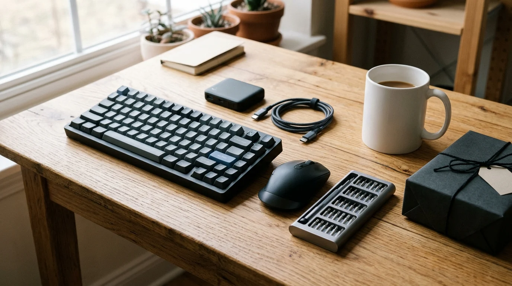

import Notice from "@components/widgets/Notice.astro";
import ListCheck from "@components/widgets/ListCheck.astro";
import AmazonProduct from "@components/widgets/AmazonProduct.astro";
import Tabs from "@components/widgets/Tabs.astro";
import Tab from "@components/widgets/Tab.astro";
import Accordion from "@components/widgets/Accordion.astro";

Most "gifts for programmers" guides read like nobody asked an actual engineer what sits in their drawer versus what stays on their desk. Novelty coffee mugs with `while(alive)` jokes, oversized desk mats covered in Vim cheatsheets, and mystery RGB gaming mice go straight into goodwill boxes by February.

The best gear for a developer or sysadmin hits a very specific target: tools that solve an annoying hardware problem or scratch a curiosity itch without dictating how they write code. Think **pocket KVM-over-IP boxes with built-in Tailscale**, **$42 ESP32 QWERTY cyberdecks**, **USB-C thermal cameras** for checking VRM hotspots, **off-grid Meshtastic LoRa radios**, **active-cooled keychain NVMe drives**, and **Wi-Fi 7 OpenWrt routers** alongside rock-solid desk and homelab workhorses.

I audited live US pricing, stock, seller authenticity, and hardware specs across Amazon on November 14, 2026 to cut dead listings and sketchy third-party knockoffs. Below are 19 genuinely interesting picks sorted from sub-$50 curiosities up to $200+ flagship labs and wearables, plus reliable crowd-pleasers where you already know their taste.

<Notice type="warning" title="Affiliate Disclosure">
This guide contains `/go/` affiliate links to Amazon. Buying through those links earns BitDoze a small commission at zero extra cost to you. Prices and stock reflect live Amazon listings verified on November 14, 2026, though early Black Friday discounts move daily.
</Notice>

## Quick Picks by Budget

Jump directly to what fits your spend (or mix an under-$50 oddity with a practical travel staple):

| Gift | Tier | Price (Nov 2026) | Why Developers Keep It | Link |
| :--- | :--- | :---: | :--- | :--- |
| **Yubico Security Key C NFC** | Under $50 | $29.00 | Phishing-proof FIDO2 & OpenSSH passkeys | [Check Price](/go/yubico-security-key-c-nfc/) |
| **GL.iNet Mango Pocket Router** | Under $50 | $29.99 | USB-powered OpenWrt box with exposed GPIOs | [Check Price](/go/glinet-mango/) |
| **SHARGE Disk 2230 NVMe Capsule** | Under $50 | $39.99 | Active-cooled keychain 10Gbps Ventoy vault | [Check Price](/go/sharge-disk-nvme/) |
| **PINECIL Smart Soldering Iron** | Under $50 | $39.99 | Open-source RISC-V IronOS USB-C iron | [Check Price](/go/pinecil-v2/) |
| **M5Stack Cardputer Adv (ESP32-S3)** | Under $50 | $41.90 | Credit-card QWERTY pocket cyberdeck | [Check Price](/go/m5stack-cardputer-adv/) |
| **Meshtastic LoRa V3 2-Pack** | Under $100 | $63.99 | Off-grid 915MHz encrypted radio texting | [Check Price](/go/meshtastic-lora-v3-2pack/) |
| **ANBERNIC RG35XXSP Clamshell** | Under $100 | $76.99 | Pocket Linux retro handheld for flights | [Check Price](/go/anbernic-rg35xxsp/) |
| **Megalodon Triple-Knob QMK Pad** | Under $100 | $79.00 | 16 mechanical keys + 3 CNC rotary knobs | [Check Price](/go/doio-megalodon-kb16/) |
| **FNIRSI 2C53T 50MHz Scope** | Under $100 | $99.99 | Dual-channel oscilloscope + TRMS meter | [Check Price](/go/fnirsi-2c53t-oscilloscope/) |
| **GL.iNet Comet (GL-RM1) KVM** | Under $100 | $99.99 | Remote BIOS control over Tailscale | [Check Price](/go/glinet-comet-kvm/) |
| **TOPDON TC001 Mini Thermal Cam** | Under $200 | $121.99 | Plug-and-play phone IR heatmap camera | [Check Price](/go/topdon-tc001-mini/) |
| **GL.iNet Beryl 7 (Wi-Fi 7)** | Under $200 | $129.99 | Dual 2.5GbE travel router (1.1Gbps WG VPN) | [Check Price](/go/glinet-beryl-7/) |
| **UGREEN 80Gbps TB5 Enclosure** | Under $200 | $159.99 | Fan-cooled 80Gbps NVMe storage ($100 off) | [Check Price](/go/ugreen-80gbps-enclosure/) |
| **DJI Neo Mini 4K Drone** | Under $200 | $169.00 | 135g palm-launch AI follow drone | [Check Price](/go/dji-neo/) |
| **Plaud NotePin S AI Recorder** | Under $200 | $179.00 | 17.4g wearable meeting & brainstorm capsule | [Check Price](/go/plaud-notepin-s/) |
| **Home Assistant Green** | Splurge ($200+) | $219.00 | Fanless turnkey local smart home hub | [Check Price](/go/home-assistant-green/) |
| **Beelink MINI S13 (N150)** | Splurge ($200+) | $349.00 | Dual-2.5GbE Proxmox & Docker starter node | [Check Price](/go/beelink-mini-s13/) |
| **XREAL 1S AR Glasses** | Splurge ($200+) | $449.00 | Hardware 3DoF private ultrawide display | [Check Price](/go/xreal-1s-ar-glasses/) |
| **Bambu Lab P1S Combo (AMS)** | Splurge ($200+) | $479.00 | Multi-color enclosed CoreXY 3D printer | [Check Price](/go/bambu-lab-p1s/) |

---

## 4 Rules Before Buying Hardware for a Developer

Run through these four quick checks before ordering anything on this list.

<ListCheck>
<ul>
<li><strong>Skip guessing keyboard switches blindly:</strong> Unless you already know whether they use tactile Browns, silent linears, or low-profile switches, buy a programmable macro pad, QMK travel board, or non-typing hardware instead.</li>
<li><strong>Watch what is missing inside the box:</strong> The PINECIL soldering iron ships without a USB-C PD wall brick, the SHARGE Disk needs an M.2 2230 NVMe SSD, and Logitech's MX Master 3S Bluetooth Edition omits a USB receiver. Check the warnings in each card so they are not stuck waiting on parts.</li>
<li><strong>Hardware beats subscription software:</strong> Avoid gifting SaaS licenses for coding tools or cloud apps they might cancel next quarter. Physical tools last for years.</li>
<li><strong>Verify USB-C DisplayPort support for visual gear:</strong> Portable external screens and AR glasses only run off a single cable on laptops whose USB-C ports carry DisplayPort Alt Mode.</li>
</ul>
</ListCheck>

---

## Tech Gifts Under $50

Stocking stuffers and unexpected sub-$50 hardware that punches way above its price tag.

### 1. Yubico Security Key C NFC — Best Security Upgrade ($29.00)

Almost every programmer knows SMS two-factor codes are weak, yet putting off ordering a spare hardware passkey is universal. At **$29**, the **Yubico Security Key C NFC** removes the excuse. It snaps into USB-C ports or taps NFC phones, carries zero batteries, and works natively with OpenSSH 8.2+ `ed25519-sk` hardware-backed SSH keys (handy alongside the steps in our [Linux SSH hardening guide](/secure-ssh-server-linux/)).

<AmazonProduct
  productName="Yubico Security Key C NFC (FIDO2 / WebAuthn)"
  productDescription="Waterproof, crush-resistant USB-C and NFC security key made in Sweden and programmed in the USA."
  productFeatures={[
    "Supports FIDO2/WebAuthn passkeys and FIDO U2F for GitHub, AWS, Google, Apple, and password managers",
    "Stores up to 100 resident passkeys with native OpenSSH sk-key authentication",
    "Works across Linux, macOS, Windows, iOS, and Android via USB-C or NFC tap",
    "Battery-free one-piece molded keychain body"
  ]}
  productLink="/go/yubico-security-key-c-nfc/"
  productImage="https://m.media-amazon.com/images/I/41DkFsG8yEL._AC_SL1000_.jpg"
  productRating={4.3}
  recommendedBadge="Best Under $30"
  importantConsiderations={[
    "Handles FIDO2/U2F passkeys ONLY (no OATH-TOTP codes, PIV smart card, or OpenPGP)",
    "Buying a spare second key is standard practice to avoid account lockouts"
  ]}
  pros={[
    "Costs half as much as flagship keys while covering 95% of developer passkey and SSH logins",
    "Zero charging or setup apps required on modern OSes"
  ]}
  cons={[
    "Need the $58 YubiKey 5C NFC if they sign Git commits using hardware GPG keys"
  ]}
/>

**Step-up note:** If they sign commits with hardware OpenPGP or store offline 6-digit TOTP codes on the key, upgrade to the **$58** [YubiKey 5C NFC](/go/yubikey-5c-nfc/).

### 2. GL.iNet GL-MT300N-V2 Mango — $30 Pocket OpenWrt Hack Box ($29.99)

Sure, it is branded as a hotel Wi-Fi repeater, but hardware hackers keep ordering the bright yellow **GL.iNet Mango** because it packs **128MB RAM, dual Ethernet ports, USB 2.0 host, UART headers, and exposed GPIOs** inside a matchbox powered off any laptop USB port. Running pre-installed **OpenWrt** for **$29.99** (13,151 reviews), it works equally well as an isolated hotel VPN bridge or a disposable weekend router lab.

<AmazonProduct
  productName="GL.iNet GL-MT300N-V2 (Mango) Mini OpenWrt Travel Router"
  productDescription="Palm-sized USB-powered OpenWrt router with dual Ethernet ports, WireGuard/OpenVPN support, and exposed DIY GPIO/UART pins."
  productFeatures={[
    "Pre-installed programmable OpenWrt firmware with OpenVPN and WireGuard client/server support",
    "Dual 10/100 Ethernet ports, USB 2.0 port, 128MB RAM, and 16MB Flash storage",
    "Internal UART and GPIO pins exposed for embedded DIY hardware hacks",
    "Draws power directly from a laptop USB port or phone power bank"
  ]}
  productLink="/go/glinet-mango/"
  productImage="https://m.media-amazon.com/images/I/41MXeeI78JL._AC_SL1080_.jpg"
  productRating={4.1}
  recommendedBadge="13K+ Reviews"
  importantConsiderations={[
    "2.4 GHz Wi-Fi and 100Mbps Ethernet only; built for tinkering and basic hotel coverage, not multi-gig speeds"
  ]}
  pros={[
    "Ridiculously cheap way to carry a root Linux router in a pocket",
    "Dual Ethernet + USB + GPIO invites creative field experiments"
  ]}
  cons={[
    "Older 2.4 GHz radio limits top speed compared to Wi-Fi 6/7 GL.iNet models"
  ]}
/>

### 3. SHARGE Disk M.2 2230 NVMe Capsule — Keychain SSD Vault ($39.99)

Most external SSD enclosures look like bland black soap bars. **SHARGE Disk** shrinks an M.2 **2230** NVMe enclosure down to 24 grams (half the size of a credit card) with a tiny **active cooling fan** spinning inside an IP54-rated sealed shell. Any programmer who upgraded a Steam Deck or ROG Ally already has a spare 2230 SSD sitting in a drawer; drop it inside this **$39.99** capsule and they have a 10Gbps Ventoy multi-boot Linux installer and Docker backup drive clipped right to their keys.

<AmazonProduct
  productName="SHARGE Disk Active-Cooled M.2 2230 NVMe Enclosure"
  productDescription="Tiny 24g IP54 rugged USB-C 10Gbps NVMe 2230 pocket enclosure with built-in micro cooling fan."
  productFeatures={[
    "Built-in active cooling fan prevents thermal throttling on sustained multi-gigabyte transfers",
    "10Gbps USB 3.2 Gen 2 interface handles ISO flashes, OS images, and backups fast (up to 2TB 2230 NVMe)",
    "Only 24 grams with IP54 water/dust resistance, 6.6 ft drop casing, and integrated lanyard USB-C cord",
    "Tool-free aluminum slider latch opens cleanly without hunting for tiny screwdrivers"
  ]}
  productLink="/go/sharge-disk-nvme/"
  productImage="https://m.media-amazon.com/images/I/619wm6U53GL._AC_SL1500_.jpg"
  productRating={4.5}
  recommendedBadge="Active Fan + IP54"
  importantConsiderations={[
    "Enclosure ONLY: requires a short M.2 2230 NVMe SSD (standard long 2280 laptop SSDs will NOT fit)"
  ]}
  pros={[
    "Actually keeps tiny 2230 drives cool during multi-ISO Ventoy or Time Machine runs",
    "Genuinely pocket- and keychain-sized instead of brick-sized"
  ]}
  cons={[
    "Strictly limited to 2230 short-form NVMe sticks",
    "Tiny micro-fan emits faint audible whir under heavy sustained writes"
  ]}
/>

### 4. PINECIL Smart Mini Soldering Iron — Open-Source Bench Staple ($39.99)

For mechanical keyboard switches, ESP32 sensors, or quick hardware fixes, the **$39.99 PINECIL** beats clunky hardware-store mains irons hands down. It runs **open-source IronOS firmware** on a RISC-V microcontroller, reads temp accurately on a tiny OLED screen, and heats to soldering temperature in roughly **12 seconds** off a standard laptop USB-C Power Delivery brick.

<AmazonProduct
  productName="PINECIL Smart Mini Portable Soldering Iron"
  productDescription="RISC-V open-source firmware portable soldering iron powered via USB-C PD/QC 3.0 or DC5525 barrel jack."
  productFeatures={[
    "Reaches soldering temperature in ~12 seconds with crisp temperature display",
    "Powered by USB-C (PD / QC 3.0) or up to 24V DC5525 barrel supply",
    "Runs customizable open-source IronOS firmware with auto-sleep safety timers",
    "Pen-sized body accepts common TS100/Pine64 short cartridge tips"
  ]}
  productLink="/go/pinecil-v2/"
  productImage="https://m.media-amazon.com/images/I/61IX8eET+dL._AC_SL1500_.jpg"
  productRating={4.6}
  recommendedBadge="Open Hardware Icon"
  importantConsiderations={[
    "Power supply and USB-C PD cable are NOT included in the box",
    "Needs a flexible silicone USB-C cable and 65W+ PD charger (like Anker's $59.99 100W GaN brick) if they lack one"
  ]}
  pros={[
    "Instant heat-up makes tiny soldering fixes painless at any desk",
    "Open firmware and huge modder community fit developer culture naturally"
  ]}
  cons={[
    "Ships with just one B2 tip and zero power adapter"
  ]}
/>

### 5. M5Stack Cardputer Adv (ESP32-S3) — $42 Pocket Cyberdeck ($41.90)

Hands down the most surprising sub-$50 hardware toy on Amazon right now. **M5Stack's Cardputer Adv** packs a dual-core 240 MHz **ESP32-S3** computer, a clickable **56-key physical QWERTY keyboard**, a 1.14-inch color screen, audio codec + mic, 6-axis IMU, infrared blaster, microSD slot, and Grove expansion bus into a shell smaller than an old iPod for **$41.90** (1,000+ bought in the past month). Developers flash it with PlatformIO, ESP-IDF, Arduino, or MicroPython to build pocket Wi-Fi/BLE scanners, IR TV remotes, LoRa communicators, or desk macro terminals.

<AmazonProduct
  productName="M5Stack Cardputer Adv Version (ESP32-S3 Pocket Computer)"
  productDescription="Credit-card sized programmable ESP32-S3 cyberdeck with physical 56-key keyboard, color screen, audio codec, IMU, and IR transmitter."
  productFeatures={[
    "ESP32-S3FN8 dual-core LX7 @ 240 MHz with 8MB flash, 1.14-inch screen, and 56-key tactile keyboard",
    "Built-in ES8311 audio codec, 65 dB MEMS mic, speaker, BMI270 6-axis IMU, and IR blaster",
    "microSD slot, HY2.0-4P Grove port, and 2.54-14P expansion header for modular LoRa/RF caps",
    "Supports ESP-IDF, PlatformIO, Arduino IDE, MicroPython, and UiFlow2"
  ]}
  productLink="/go/m5stack-cardputer-adv/"
  productImage="https://m.media-amazon.com/images/I/71QaSJCNHPL._AC_SL1500_.jpg"
  productRating={4.6}
  recommendedBadge="1K+ Bought/Month"
  importantConsiderations={[
    "Programmable dev kit, not a finished consumer smartphone; meant for flashing open-source projects and tinkering"
  ]}
  pros={[
    "Feels like a cyberpunk handheld computer out of a retro sci-fi movie for $42",
    "Massive community library of pre-compiled M5Burner utilities for instant weekend fun"
  ]}
  cons={[
    "56-key chicklet matrix is built for commands and short scripts, not writing novels"
  ]}
/>

**More sharp Under-$50 picks already verified:**
- **Desktop DevOps Pixel Dashboard:** [ULANZI TC001 Smart Pixel Clock](/go/ulanzi-tc001/) (**$49.99**) flashes cleanly to open-source **AWTRIX** MQTT firmware so developers stream Grafana alerts, Pomodoro timers, or live GitHub PR counters onto their desk.
- **Home Assistant Power Telemetry:** [THIRDREALITY Zigbee Smart Plug 4-Pack](/go/thirdreality-zigbee-plug-4pack/) (**$38.99**) gives self-hosters four local Zigbee 3.0 plugs with real-time wattage tracking (featured in our [Zigbee Home Assistant sensors guide](/best-zigbee-sensors-home-assistant/)).
- **Repair & Desk Basics:** Grab the motorized [Fanttik E1 Max Screwdriver](/go/fanttik-e1-max/) (**$37.97** early BF deal), manual lifetime-warranty [iFixit Mako 64-Bit Kit](/go/ifixit-mako-64/) (**$39.95**), glare-killing [Quntis Monitor Light Bar](/go/quntis-monitor-light-bar/) (**$39.95**), folding [ProtoArc XK01 Keyboard](/go/protoarc-xk01/) (**$39.99**), or reusable [Rocketbook Core Notebook](/go/rocketbook-core/) (**$26.99**).

---

## Tech Gifts Under $100

Off-grid radio texting, pocket oscilloscopes, KVM-over-IP servers, and CNC rotary macro decks.

### 6. Meshtastic ESP32 LoRa V3 2-Pack Kit — Off-Grid Mesh Texting ($63.99)

**Meshtastic** is taking over open-source hardware forums: long-range 915MHz LoRa radio nodes that bounce encrypted text messages and GPS pings across miles over license-free spectrum with zero cell towers or monthly fees. Because this **$63.99 Meshnology kit includes TWO complete nodes** (dual SX1262 ESP32-S3 LoRa V3 boards, 0.96" OLED screens, protective cases, 915MHz antennas, and 1100mAh batteries), they can test multi-node off-grid hops immediately at hikes, conferences, or disaster-prep labs.

<AmazonProduct
  productName="2-Pack ESP32 LoRa V3 Meshtastic Kit (915MHz + Batteries + Cases)"
  productDescription="Pair of OLED-equipped ESP32-S3 SX1262 LoRa transceivers with 1100mAh batteries and enclosures for off-grid Meshtastic networks."
  productFeatures={[
    "Includes TWO full nodes (ESP32-S3 + SX1262 LoRa + Wi-Fi/BLE + 915MHz antennas)",
    "Built-in 0.96-inch 128x64 OLED display plus onboard battery management and 1100mAh cells",
    "USB-C flashing for open-source Meshtastic, LoRaWAN, or custom Arduino firmware",
    "Paired 3D-style protective enclosures included in the kit"
  ]}
  productLink="/go/meshtastic-lora-v3-2pack/"
  productImage="https://m.media-amazon.com/images/I/61R9LQC6fhL._AC_SL1500_.jpg"
  productRating={4.0}
  recommendedBadge="2-Node Starter Pair"
  importantConsiderations={[
    "Stock fluctuates quickly (under 5 packs left at press time); check assembly guide PDFs online if new to snapping Heltec boards into cases",
    "NEVER power on a LoRa transceiver without screwing the antenna onto the SMA/IPEX connector first"
  ]}
  pros={[
    "Gives you two working nodes out of the gate instead of a lonely single radio",
    "Pairs directly with Android/iOS Meshtastic apps over Bluetooth"
  ]}
  cons={[
    "Requires minor snap-together assembly and a 5-minute USB-C firmware flash via browser"
  ]}
/>

### 7. ANBERNIC RG35XXSP Clamshell Console — Linux Retro Handheld ($76.99)

Nostalgic Game Boy Advance SP silhouette on the outside, quad-core **ARM Linux** box with dual microSD card slots on the inside. The **$76.99 ANBERNIC RG35XXSP** folds flat into any jeans pocket without scratching its crisp laminated 3.5-inch 4:3 IPS screen, and uses a magnetic Hall sensor to suspend automatically when snapped shut. Developers love it both for stress-free flight gaming and for tinkering with clean community Linux firmwares like muOS or Knulli.

<AmazonProduct
  productName="ANBERNIC RG35XXSP Flip Retro Handheld Console (64GB, Linux)"
  productDescription="Pocketable clamshell ARM Linux handheld with 3.5-inch 640x480 IPS display, Hall magnetic lid sleep switch, and dual SD slots."
  productFeatures={[
    "H700 quad-core 1.5 GHz ARM CPU running customizable Linux firmware",
    "Crisp 640x480 4:3 OCA-laminated 3.5-inch IPS screen protected inside the folding shell",
    "Hall-effect magnetic sleep trigger when closed plus dual microSD expansion up to 512GB",
    "Ships ready with 64GB card out of the box"
  ]}
  productLink="/go/anbernic-rg35xxsp/"
  productImage="https://m.media-amazon.com/images/I/71HOB4nGRUL._AC_SL1500_.jpg"
  productRating={4.0}
  recommendedBadge="Folds to Pocket Size"
  importantConsiderations={[
    "Buyer reviews mention occasional lag in heavier emulated titles on stock settings; tinkering with community CFW wakes performance up noticeably"
  ]}
  pros={[
    "Clamshell screen protection removes the need for an extra bulky carrying case",
    "Open Linux ecosystem appeals way more to developers than locked toy consoles"
  ]}
  cons={[
    "Clicky tactile dome buttons feel stiff compared to classic rubber-membrane pads",
    "Bundled generic SD cards should eventually be imaged onto a branded card"
  ]}
/>

### 8. Megalodon Triple-Knob QMK Macro Pad (KB16) — Tactile Control Deck ($79.00)

Forget buying a programmer a regular keyboard they might dislike. Give them a secondary **16-key hot-swap mechanical pad topped with THREE chunky clickable rotary knobs** and an OLED layer display. At **$79.00**, the **Megalodon KB16** accepts VIA/QMK custom mappings right out of the box: twist knobs to scroll long diff logs, scrub timelines, dim system volume, adjust terminal font sizes, or fire multi-key tmux splits across four instant switchable layers.

<AmazonProduct
  productName="KEEBMONKEY Megalodon Triple-Knob QMK Macro Pad (16 Keys)"
  productDescription="Hot-swappable 16-key programmable QMK/VIA mechanical keypad featuring three clickable rotary encoders and an OLED status screen."
  productFeatures={[
    "16 hot-swappable mechanical switches plus 3 clickable rotary control dials",
    "Four hardware layers with live layer indicator OLED screen and WS2812 RGB backlighting",
    "Full open-source QMK / VIA remapping across macOS, Linux, and Windows with no bloated background daemon",
    "Compact CNC desk footprint sits cleanly to the left of any existing 60%–TKL keyboard"
  ]}
  productLink="/go/doio-megalodon-kb16/"
  productImage="https://m.media-amazon.com/images/I/51f8Jxsx4tL._AC_SL1076_.jpg"
  productRating={4.2}
  recommendedBadge="3 Rotary Knobs + QMK"
  importantConsiderations={[
    "Hardware macro mapping uses VIA/QMK firmware rather than GUI point-and-click app plugins like Elgato Stream Deck"
  ]}
  pros={[
    "Adds physical rotary encoders without replacing the recipient's prized daily keyboard",
    "Stores layers directly in onboard memory, so it works across air-gapped Linux boxes without companion bloat"
  ]}
  cons={[
    "Keycaps ship blank/minimal; buyers have to label layers visually or remember their 4-layer map"
  ]}
/>

### 9. FNIRSI 2C53T 3-in-1 50MHz Pocket Oscilloscope — Lab in a Hoodie Pocket ($99.99)

For hardware engineers, Raspberry Pi tinkerers, and automotive/power hackers, lugging a bench oscilloscope or settling for a bare $15 continuity meter gets old fast. **FNIRSI's 2C53T** squeezes a **50 MHz dual-channel digital oscilloscope (250 MSa/s)**, a **19,999-count True-RMS multimeter**, and a **13-waveform 50 kHz DDS signal generator** into one rechargeable handheld slab for **$99.99** (958 reviews, 1,000+ bought/mo).

<AmazonProduct
  productName="FNIRSI 2C53T 3-in-1 50MHz Oscilloscope, Multimeter & Signal Generator"
  productDescription="Pocket USB-C 2-channel 50MHz digital oscilloscope combined with a 4.5-digit TRMS multimeter and 50kHz waveform generator."
  productFeatures={[
    "2-channel 50 MHz oscilloscope (250 MSa/s sampling, 1 Kpts depth, XY mode, persistence, math, cursor measurements)",
    "4.5-digit (19,999 counts) TRMS multimeter measuring AC/DC voltage up to 750V/999.9V, current, capacitance & resistance",
    "Built-in DDS signal generator outputting 13 waveforms up to 50 kHz in 1 Hz steps",
    "Upgraded firmware/hardware platform over the older 2C23T series"
  ]}
  productLink="/go/fnirsi-2c53t-oscilloscope/"
  productImage="https://m.media-amazon.com/images/I/71IJ7e2BilL._SL1500_.jpg"
  productRating={4.3}
  recommendedBadge="3-in-1 Test Bench"
  importantConsiderations={[
    "Great for MCU protocols, power-rail ripple, PWM fans, and field triage; dedicated $400+ bench scopes still win for high-frequency RF work"
  ]}
  pros={[
    "Saves massive bench space while covering 90% of hobby embedded & homelab diagnostics",
    "Math and cursor support beats toy single-channel mini scopes"
  ]}
  cons={[
    "Small handheld screen gets cramped if debugging dual signals simultaneously for hours"
  ]}
/>

### 10. GL.iNet Comet (GL-RM1) Remote KVM-over-IP — Sysadmin Lifesaver ($99.99)

Every self-hoster eventually breaks SSH or botches a kernel upgrade on a home server at the exact worst time while out of town. Instead of asking a family member to drag a monitor and USB keyboard behind the closet rack, the **$99.99 GL.iNet Comet (GL-RM1)** plugs into the server's HDMI and USB ports and puts full **4K 30Hz BIOS-level KVM control** inside a browser or desktop client, complete with **built-in Tailscale**. No agent software required on the controlled machine.

<AmazonProduct
  productName="GL.iNet Comet (GL-RM1) Remote KVM-over-IP with Tailscale"
  productDescription="Hardware KVM-over-IP gateway providing low-latency 4K30Hz BIOS access, virtual media mounting, and remote file transfers."
  productFeatures={[
    "Full OS-independent BIOS/UEFI access, OS reinstalls, and boot-log recovery up to 3840x2160 @ 30Hz",
    "Zero software agents needed on the target server; runs over Ethernet + USB-C HID + HDMI",
    "Built-in Tailscale encryption for secure zero-port-forwarding access anywhere",
    "Supports clipboard/file transfers and remote audio passthrough"
  ]}
  productLink="/go/glinet-comet-kvm/"
  productImage="https://m.media-amazon.com/images/I/51OtDmQhdoL._AC_SL1500_.jpg"
  productRating={4.4}
  recommendedBadge="Built-In Tailscale"
  importantConsiderations={[
    "Pair with an optional ATX power-control board or smart plug if you want hard physical power cycling from completely off"
  ]}
  pros={[
    "Turns any cheap Beelink mini PC or headless Linux node into an enterprise iDRAC/IPMI box for $100",
    "Clean Tailscale integration saves firewall headaches"
  ]}
  cons={[
    "30Hz capture cap is plenty for BIOS and terminal recovery, though clunky as a full gaming desktop stream"
  ]}
/>

**Upgrades & Under-$100 Staples Already Verified on BitDoze:**
- **PoE KVM Step-Up:** Want Power-over-Ethernet plus **32GB onboard eMMC** to store bootable Linux ISOs right inside the KVM? Step up to [GL.iNet Comet PoE (GL-RM1PE)](/go/glinet-comet-poe/) at **$115.99**.
- **Desktop Mini Rack Under $80:** [GeeekPi DeskPi RackMate T0 Plus (4U)](/go/geeekpi-rackmate-t0-plus-4u/) sits at **$79.99** (see our [10-inch mini rack guide](/best-10-inch-mini-rack/)), and fits dual mini PCs + a switch neatly on top of a desk.
- **Proven Everyday Drivers:** [Anker 100W Smart Display GaN Charger](/go/anker-100w-smart-charger/) (**$59.99**), [Anker MagGo 3-in-1 Qi2 Station](/go/anker-maggo-3-in-1/) (**$71.99**), [Logitech MX Master 3S Bluetooth](/go/logitech-mx-master-3s-bt/) (**$79.99**, no dongle included), [Keychron K3 V2 QMK 75%](/go/keychron-k3-v2/) (**$84**), [ARZOPA Z1C 16.1" Portable Monitor](/go/arzopa-z1c-16-monitor/) (**$89.99**), and [iFixit Pro Tech Toolkit](/go/ifixit-pro-tech-toolkit/) (**$79.95**).

---

## Tech Gifts Under $200

Thermal imaging, Wi-Fi 7 VPN routing, 80Gbps NVMe transfers, palm-launch drones, and AI wearables.

### 11. TOPDON TC001 Mini USB-C Thermal Camera — Diagnostic Superpower ($121.99)

Give an engineer **thermal vision** clipped onto the bottom of an iPhone 15/16/17, iPad, or Android phone and watch them scan everything in the house within five minutes. Down from $149 to **$121.99**, the **TOPDON TC001 Mini** uses a 96x96 infrared sensor upscaled via TISR processing to crisp **384x384** heatmaps with 40 mK sensitivity and 25 Hz refresh across `-4°F to 1,022°F`. In practice, it catches overheating PoE switches, throttled M.2 NVMe controllers, failing server fans, and window insulation leaks in seconds.

<AmazonProduct
  productName="TOPDON TC001 Mini 384x384 Thermal Imaging Camera (USB-C)"
  productDescription="Universal USB-C thermal camera compatible with iOS, Android, iPadOS, and Windows for spot-checking PCB, server, and HVAC temps."
  productFeatures={[
    "Cross-platform USB-C compatibility across modern iPhones, Android phones, iPads, and Windows PCs",
    "25 Hz smooth thermal frame rate with TISR 384x384 output and <=40 mK thermal sensitivity",
    "Wide measurement span from -4°F to 1,022°F (-20°C to 550°C) with custom spot/area/line temp alarms",
    "Tiny plug-and-play housing draws minimal power directly from your phone"
  ]}
  productLink="/go/topdon-tc001-mini/"
  productImage="https://m.media-amazon.com/images/I/71G5QB+f3NL._SL1500_.jpg"
  productRating={4.6}
  recommendedBadge="Cross-Platform USB-C"
  importantConsiderations={[
    "Requires mobile app installation (TopInfrared) on phone or TopView on Windows PC; reflective bare aluminum shields read lower than true temp unless taped"
  ]}
  pros={[
    "Rare cross-OS USB-C compatibility saves buying separate Android vs iPhone versions",
    "Immediate diagnostic value for PC builds, PCB troubleshooting, and home energy audits"
  ]}
  cons={[
    "Lacks an optical camera overlay compared to pricier dual-lens $260+ thermal cameras"
  ]}
/>

### 12. GL.iNet GL-MT3600BE Beryl 7 Travel Router — Wi-Fi 7 Speed Demon ($129.99)

The classic Beryl AX (`$98.99`) was already BitDoze's go-to travel router, and now the **Wi-Fi 7 Beryl 7** pushes throughput cleanly into desktop fiber territory. Armed with **dual 2.5GbE ports (WAN + LAN)**, Wi-Fi 7 (688 Mbps 2.4 GHz + 2,882 Mbps 5 GHz), OpenWrt 21.02, and hardware-accelerated **1,100 Mbps WireGuard / 1,000 Mbps OpenVPN-DCO**, it turns flaky hotel networks into encrypted private VLANs for **$129.99** (1,000+ bought/mo). Compare all models in our [travel router WireGuard & Tailscale guide](/best-travel-router-wireguard-tailscale/).

<AmazonProduct
  productName="GL.iNet GL-MT3600BE (Beryl 7) Dual-Band Wi-Fi 7 Travel Router"
  productDescription="Compact OpenWrt Wi-Fi 7 travel VPN router featuring dual 2.5G Ethernet ports and up to 1.1 Gbps WireGuard throughput."
  productFeatures={[
    "Dual 2.5G Ethernet ports (1x WAN + 1x LAN) paired with AX/BE dual-band Wi-Fi 7 wireless",
    "WireGuard speeds up to 1,100 Mbps and OpenVPN-DCO up to 1,000 Mbps built in",
    "OpenWrt 21.02 firmware supports Tailscale, AdGuard Home, USB tethering, and captive portal bridging",
    "Ships with US, UK, EU, and AU international plug adapters"
  ]}
  productLink="/go/glinet-beryl-7/"
  productImage="https://m.media-amazon.com/images/I/41FK8yaMfFL._AC_SL1500_.jpg"
  productRating={4.2}
  recommendedBadge="Dual 2.5GbE + Wi-Fi 7"
  importantConsiderations={[
    "Older $98.99 Beryl AX still covers 95% of casual hotel Wi-Fi trips; get Beryl 7 if they transfer multi-gigabyte backups over WireGuard"
  ]}
  pros={[
    "Over triple the WireGuard speed ceiling of older travel boxes",
    "Includes four international plug tips right in the box"
  ]}
  cons={[
    "No 6 GHz band (dual-band Wi-Fi 7 2.4/5 GHz), though the touchscreen Slate 7 at $159.99 offers another step-up option"
  ]}
/>

**Lineup note:** Want the touchscreen Wi-Fi 7 sibling? Grab [GL.iNet Slate 7](/go/glinet-slate-7/) (**$159.99**). Saving $30? Stick with the [Beryl AX](/go/glinet-beryl-ax/) (**$98.99**).

### 13. UGREEN 80Gbps Thunderbolt 5 NVMe Enclosure — Speed Freak Storage ($159.99)

Moving 70B-parameter LLM weights, local Kubernetes VM snapshots, or 4K timelines crawls over cheap 10Gbps USB enclosures. Built around Intel's JHL9480 controller with an active cooling fan and machined aluminum fins, **UGREEN's 80Gbps Thunderbolt 5 Enclosure** hits up to **6,600+ MB/s** on Thunderbolt 5 ports while remaining backward-compatible with Thunderbolt 4/3 and USB4. Marked **$100 off down to $159.99** (list $259.99), it is a killer deal from our [Thunderbolt 5 NVMe enclosure roundup](/best-tb5-nvme-enclosures/).

<AmazonProduct
  productName="UGREEN 80Gbps Thunderbolt 5 M.2 NVMe Enclosure (With Fan)"
  productDescription="Intel JHL9480 active-cooled 80Gbps portable NVMe chassis reaching over 6,600 MB/s on Thunderbolt 5 and USB4 v2 hosts."
  productFeatures={[
    "80Gbps Thunderbolt 5 / USB4 v2 interface powered by Intel JHL9480 controller (up to ~6,600-7,000 MB/s with PCIe 4.0/5.0 SSDs)",
    "Machined finned aluminum shell with built-in active fan prevents sustained transfer throttling",
    "Supports full-length M.2 2280 NVMe SSDs and backward-works on Thunderbolt 4/3 and USB-C laptops",
    "Compact external form factor avoids buying $500+ soldered internal Apple storage tiers"
  ]}
  productLink="/go/ugreen-80gbps-enclosure/"
  productImage="https://m.media-amazon.com/images/I/61AB787gOzL._AC_SL1500_.jpg"
  productRating={4.0}
  recommendedBadge="$100 Off Deal"
  importantConsiderations={[
    "Bare enclosure: you still supply your own M.2 2280 Gen4 NVMe SSD",
    "Max 80Gbps throughput requires a Thunderbolt 5 or USB4 v2 host port (caps near ~3,000-3,800 MB/s on Thunderbolt 4)"
  ]}
  pros={[
    "$100 price slash makes next-gen 80Gbps enclosures cheaper than many older TB4 models",
    "Solves internal Mac/laptop storage tax permanently"
  ]}
  cons={[
    "Chunkier and heavier than slim passive 10Gbps enclosures due to active cooling hardware"
  ]}
/>

*(Prefer Acasis? Check our tested [ACASIS TB501 Pro 80Gbps](/go/acasis-tb501-pro/) at **$169.99**.)*

### 14. DJI Neo Mini Drone (Controller-Free) — Hardware Fun Outside ($169.00)

Programmers spend way too much time staring at dual monitors inside. **DJI Neo** turns stepping outside into an effortless 135-gram autonomous computer-vision demo: press the mode button on top, hold out an open palm, and the enclosed ducted-prop mini drone hovers off your hand, locks onto you with AI subject tracking, runs orbital QuickShots, and lands right back on your palm with zero phone controller or FAA registration required. On sale at **$169** (down from $199, 4,531 reviews).

<AmazonProduct
  productName="DJI Neo Mini 4K Drone (135g, Controller-Free Palm Takeoff)"
  productDescription="Sub-250g enclosed-prop AI tracking drone with palm takeoff/landing, stabilized 4K UHD capture, and zero controller required."
  productFeatures={[
    "Ultralight 135g chassis slips past US FAA recreational drone registration thresholds",
    "Built-in palm takeoff, landing, and AI subject tracking work completely standalone without a controller",
    "Full wraparound propeller guards make indoor test flights and park launches safe",
    "Optional smartphone app Wi-Fi control and DJI RC compatibility if they want manual stick flight later"
  ]}
  productLink="/go/dji-neo/"
  productImage="https://m.media-amazon.com/images/I/61hD3rCM9oL._AC_SL1500_.jpg"
  productRating={4.4}
  recommendedBadge="$30 Off Launch Price"
  importantConsiderations={[
    "Note for Android owners: DJI Fly was pulled from Google Play, so initial activation requires grabbing the APK directly from DJI's website (iPhone App Store works normally)",
    "Light 135g frame drifts noticeably in stiff coastal wind compared to heavier Mini 4 Pro drones"
  ]}
  pros={[
    "Zero setup friction: actually gets taken on weekend hikes because there is no controller case to pack",
    "Computer-vision tracking right off an outstretched hand feels genuinely futuristic"
  ]}
  cons={[
    "Single battery limits flight runtime under 15–18 minutes before needing a USB-C top-up",
    "4K single-axis gimbal footage softens quickly after sunset"
  ]}
/>

### 15. Plaud NotePin S Wearable AI Recorder — Effortless Thought Capture ($179.00)

Whether debugging out loud on a morning walk, pacing during architecture reviews, or capturing stakeholder requirements without furiously typing notes, **Plaud NotePin S** is a sleek 17.4-gram capsule you clip onto a collar, wear on a wristband, or snap magnetically onto a lanyard. Long-press to capture up to 20 hours of clean audio from up to ~10 feet away, tap briefly to bookmark key moments, and find it via **Apple Find My** if misplaced. Verified in stock at **$179** (1,378 reviews, 3,000+ bought/mo).

<AmazonProduct
  productName="Plaud NotePin S Wearable AI Voice Recorder (With Accessories)"
  productDescription="0.61 oz magnetic wearable voice capture capsule with 20-hour battery, Find My tracking, and free Starter transcription tier."
  productFeatures={[
    "Weighs 0.61 oz (17.4g) and comes with magnetic pin, clip, lanyard, wristband, and USB-C dock",
    "Captures voices cleanly up to 9.8 ft (3m) with 20-hour continuous battery and Apple Find My tracking",
    "Includes Plaud Starter Plan out of the box plus SOC 2, HIPAA, GDPR, and EN 18031 compliance",
    "Customer audio is never used for model training unless users explicitly opt in"
  ]}
  productLink="/go/plaud-notepin-s/"
  productImage="https://m.media-amazon.com/images/I/61eNMaclH0L._AC_SL1500_.jpg"
  productRating={4.4}
  recommendedBadge="3K+ Bought/Month"
  importantConsiderations={[
    "Free Starter Plan covers basic monthly transcription minutes, while heavy users who record daily hours of meetings need a paid Pro/Unlimited cloud quota",
    "Always verify workplace/regional recording consent rules before capturing live team calls"
  ]}
  pros={[
    "Zero distraction: lets developers brainstorm on walks without unlocking phones or opening note apps",
    "Ships with every wearable mount option (pin, clip, band, lanyard) right in the box"
  ]}
  cons={[
    "Cloud AI summary features rely on synced app processing rather than 100% offline local Whisper inference"
  ]}
/>

**More Under-$200 Proven Picks Already Tested Here:**
- **Desktop Mini Rack (8U):** [GeeekPi DeskPi RackMate T1 (8U)](/go/geeekpi-rackmate-t1-8u/) (**$119.99**) doubles the height of the 4U T0 for bigger Pi clusters and UPS stacks.
- **Macro & Power Must-Haves:** [Elgato Stream Deck MK.2](/go/elgato-stream-deck-mk2/) (**$119.99**, 20% off, 15 LCD macro keys), [Anker Laptop Power Bank 25,000mAh 165W](/go/anker-laptop-power-bank/) (**$119.99**, two built-in USB-C cables) or transparent cyberpunk [Shargeek 140 Power Bank](/go/shargeek-140/) (**$89.90**), [BenQ ScreenBar Pro](/go/benq-screenbar-pro/) (**$139** curved monitor presence-sensing bar), open-ear [SHOKZ OpenRun Pro 2](/go/shokz-openrun-pro-2/) (**$179.95**), and subscription-free [RingConn Gen 2 Air Smart Ring](/go/ringconn-gen-2-air/) (**$199**, get a sizing kit first).

---

## Splurge Tech Gifts ($200+)

Flagship systems that completely transform how a developer learns, travels, prints, or automates their home.

### 16. Home Assistant Green — Turnkey Smart Home Brain ($219.00)

Plenty of programmers *want* a local, cloud-free smart home dashboard running YAML automations, yet dread spending their Sunday babysitting Docker SD card corruptions on a flaky old Raspberry Pi. **Home Assistant Green** ($219, official Nabu Casa hardware, 2,000+ bought/mo) ends that headache permanently: plug in the included power brick and Ethernet cord and you get a fanless, silent quad-core appliance pre-loaded with 32GB eMMC storage and 4GB RAM ready for local automation (check add-ons in our [Home Assistant hardware guide](/best-home-assistant-hardware/)).

<AmazonProduct
  productName="Home Assistant Green (Official Nabu Casa Smart Home Hub)"
  productDescription="Silent, fanless plug-and-play official Home Assistant appliance with pre-installed OS, 4GB RAM, and 32GB storage."
  productFeatures={[
    "Built and officially supported by Nabu Casa with Home Assistant OS pre-installed out of the box",
    "Quad-core processor, 4GB RAM, and reliable 32GB internal storage in a silent fanless case",
    "Includes Ethernet cable, HDMI debug port, microSD recovery slot, and USB 2.0 ports for Zigbee/Thread dongles",
    "Consolidates cloud vendor apps locally with fast YAML and UI automation control"
  ]}
  productLink="/go/home-assistant-green/"
  productImage="https://m.media-amazon.com/images/I/71-flrvNxdL._AC_SL1500_.jpg"
  productRating={4.4}
  recommendedBadge="Official Nabu Casa"
  importantConsiderations={[
    "Ethernet-only networking out of the box and no built-in Zigbee/Z-Wave radio: add a $30 USB coordinator dongle for raw wireless sensors"
  ]}
  pros={[
    "Replaces fragile Raspberry Pi + microSD setups with a silent appliance built to run 24/7",
    "Zero forced cloud subscriptions for automations, dashboards, or energy tracking"
  ]}
  cons={[
    "Costs more than bare budget mini PCs if they already enjoy maintaining Proxmox VMs themselves"
  ]}
/>

### 17. Beelink MINI S13 (Intel N150, 16GB / 500GB) — Dedicated Home Server ($349.00)

If a developer wants to run Proxmox VE, test Kubernetes labs, deploy Pi-hole + Immich + Jellyfin, or separate personal experiments from their work laptop, an x86 mini PC beats a dressed-up Raspberry Pi every day of the week. The **$349 Beelink MINI S13** puts Intel's low-watt N150 CPU, 16GB DDR4, a 500GB M.2 SSD (expandable up to 2TB), and **dual 2.5G Ethernet NICs** inside a quiet desk node. Compared to paying north of $350 assembling a 16GB Pi 5 with NVMe HAT, SSD, cooler, and PSU (see our [Raspberry Pi 5 vs Mini PC comparison](/raspberry-pi-5-vs-mini-pc/)), native x86 runs every Docker image hassle-free. Check more configs in our [best mini PC home server guide](/best-mini-pc-home-server/) and [Black Friday server tracker](/black-friday-home-server-deals/).

<AmazonProduct
  productName="Beelink MINI S13 Mini PC (Intel N150, 16GB DDR4, 500GB SSD)"
  productDescription="Compact, energy-saving x86 mini PC equipped with Intel N150, 16GB RAM, 500GB NVMe SSD, and dual 2.5GbE LAN."
  productFeatures={[
    "Intel N150 quad-core CPU (up to 3.6 GHz) with 16GB DDR4 RAM and 500GB M.2 SSD (supports up to 2TB upgrade)",
    "Dual 2.5G Ethernet LAN ports plus Wi-Fi 6 and Bluetooth 5.2 for OPNsense, Proxmox, or self-hosting",
    "Three USB 3.2 Gen2 (10Gbps) ports, USB 2.0, and HDMI 4K 60Hz output",
    "Quiet low-watt fan sips fractional idle electricity compared to loud used enterprise blades"
  ]}
  productLink="/go/beelink-mini-s13/"
  productImage="https://m.media-amazon.com/images/I/71122jZY2GL._AC_SL1500_.jpg"
  productRating={4.5}
  recommendedBadge="Dual 2.5GbE Node"
  importantConsiderations={[
    "Boots into Windows 11 Home by default; flashing Proxmox VE, Debian, or Ubuntu Server takes roughly 10 minutes via USB stick"
  ]}
  pros={[
    "Full x86 instruction compatibility stops ARM Docker build friction immediately",
    "Dual 2.5G ports unlock multi-WAN or firewall lab topologies without USB dongles"
  ]}
  cons={[
    "Single-channel DDR4 ceiling and modest N150 graphics aren't meant for gaming or 70B local LLMs"
  ]}
/>

### 18. XREAL 1S AR Glasses — Private Ultrawide Anywhere ($449.00)

Trying to read two code panes side by side on a 13-inch laptop tray in economy class destroys posture in 30 minutes. **XREAL 1S** ($449) beams a sharp private **21:9 or 32:9 ultrawide virtual screen** straight from a single USB-C cable at up to 120Hz. Better yet, XREAL's dedicated **X1 spatial chip** runs **hardware 3DoF display pinning directly on the glasses**, meaning locked-down corporate MacBooks or Linux laptops need zero blocked background drivers just to pin an editor in mid-air. We compared them against other standout tools in our [tech gadgets guide](/best-tech-gadgets-2027/).

<AmazonProduct
  productName="XREAL 1S AR Glasses (X1 Spatial Chip, Native 3DoF)"
  productDescription="Wearable USB-C spatial monitor projecting private 120Hz 21:9/32:9 ultrawide displays powered by built-in X1 3DoF hardware."
  productFeatures={[
    "Integrated X1 spatial chip provides native hardware 3DoF pinning with zero OS driver dependencies",
    "On-glasses toggle switches between 0DoF follow, pinned 3DoF, and 21:9 / 32:9 Ultrawide modes",
    "Up to 120Hz refresh in 3DoF (90Hz global) over standard USB-C DisplayPort Alt Mode",
    "Zero shoulder-surfing: proprietary code and production dashboards stay invisible to flight neighbors"
  ]}
  productLink="/go/xreal-1s-ar-glasses/"
  productImage="https://m.media-amazon.com/images/I/61VmcA4tVoL._AC_SL1500_.jpg"
  productRating={4.0}
  recommendedBadge="Driver-Free Hardware 3DoF"
  importantConsiderations={[
    "Strong glasses prescriptions need custom clip-on optical inserts so small code fonts stay tack-sharp at the screen edges",
    "Laptop must support video out over USB-C DisplayPort Alt Mode"
  ]}
  pros={[
    "Zero-install hardware 3DoF makes it work cleanly on corporate laptops and Steam Decks",
    "Genuinely spares neck posture on long flights and café sessions"
  ]}
  cons={[
    "1080p per eye still cannot rival a physical 4K desktop OLED monitor for all-day pixel density",
    "Outer frame edge sharpness varies slightly by nose shape and IPD"
  ]}
/>

### 19. Bambu Lab P1S Combo (With AMS) — Functional 3D Printer ($479.00)

In the 2010s, gifting someone a 3D printer meant gifting them 40 unpaid hours of bed-leveling stress. **Bambu Lab's P1S Combo** fixed that forever. Marked down **$70 to $479** (10,000+ bought in the past month), the enclosed CoreXY gantry calibrates itself automatically in 15 minutes and prints at **500 mm/s** alongside the **4-spool AMS** changer. Geeks use these constantly to pump out 10-inch DeskPi rack brackets, custom split keyboard enclosures, Gridfinity desk trays, and ABS/PETG hardware mounts that look factory-made.

<AmazonProduct
  productName="Bambu Lab P1S Combo (Enclosed CoreXY Printer + 4-Spool AMS)"
  productDescription="Turnkey enclosed high-speed CoreXY 3D printer paired with the Automatic Material System for multi-color and engineering prints."
  productFeatures={[
    "500 mm/s velocity and 20,000 mm/s² acceleration with fully automatic bed leveling",
    "Enclosed build volume stabilizes heat for tougher functional filaments (PETG, ABS, ASA, TPU)",
    "Bundled 4-slot AMS unit handles automated multi-color and dry-box spool feeds out of the box",
    "15-minute unboxing before printing real Gridfinity organizers and homelab brackets"
  ]}
  productLink="/go/bambu-lab-p1s/"
  productImage="https://m.media-amazon.com/images/I/715qq4z9yCL._AC_SL1500_.jpg"
  productRating={4.2}
  recommendedBadge="$70 Off + AMS Bundle"
  importantConsiderations={[
    "Substantial cube footprint (~15 x 15 inches plus top/side AMS space) with noticeable fan noise during high-speed prints",
    "Abrasive carbon-fiber or glass-fiber polymers require upgrading the stock nozzle and extruder gears"
  ]}
  pros={[
    "Spends hours printing real functional parts instead of calibrating failed first layers",
    "Enclosed chamber expands beyond decorative PLA toys into actual heat-tolerant homelab brackets"
  ]}
  cons={[
    "Too loud to place next to a desk microphone during live Standups",
    "Minimalist monochrome non-touch panel pushes most workflow into desktop Bambu Studio"
  ]}
/>

**Four More High-Budget Hits Already Tracked on BitDoze:**
- **Flagship Silence for Noisy Offices:** [Sony WH-1000XM6 ANC Headphones (Black)](/go/sony-wh-1000xm6/) (**$378.00**, down from $459.99) adds Sony's QN3 12-mic noise cancellation, 6-mic call beamforming, and a compact folding hinge.
- **Hands-Free AI Everyday Carry:** [Meta Ray-Ban Wayfarer (Gen 2)](/go/rayban-meta-wayfarer-gen2/) (**$409.00**) packs 8-hour battery, open-ear audio, and Meta AI translation/POV capture into classic frames.
- **Paper-Like RFC & Diagram Pad:** [Amazon Kindle Scribe (32GB)](/go/kindle-scribe/) (**$499.99**) offers an 11-inch glare-free 5.4mm slate with battery-free pen for sketching system diagrams and reading technical PDFs away from Slack alerts.
- **Money-Is-No-Object AI Lab Splurge:** If the gift budget legitimately covers dedicated Grace Blackwell desktop AI hardware, check the [NVIDIA DGX Spark (GB10)](/go/nvidia-dgx-spark/) workstation.

---

## Pick by Developer Role

Match the hardware directly to what they tinker with on Saturday afternoons.

<Tabs>
  <Tab name="Backend & Sysadmin">
    Engineers guarding production SSH keys, managing remote home servers, and troubleshooting flaky networks:
    - **Under $50:** [Yubico Security Key C NFC](/go/yubico-security-key-c-nfc/) ($29.00) + [GL.iNet Mango](/go/glinet-mango/) ($29.99)
    - **Under $100:** [GL.iNet Comet Remote KVM-over-IP](/go/glinet-comet-kvm/) ($99.99) for browser BIOS access via Tailscale
    - **Under $200:** [GL.iNet Beryl 7 Wi-Fi 7 Router](/go/glinet-beryl-7/) ($129.99) + [GeeekPi RackMate T1 (8U)](/go/geeekpi-rackmate-t1-8u/) ($119.99)
    - **Splurge:** [Beelink MINI S13 (N150)](/go/beelink-mini-s13/) ($349.00) or [Home Assistant Green](/go/home-assistant-green/) ($219.00)
  </Tab>
  <Tab name="Hardware & Makers">
    Developers building ESPHome gadgets, custom split keyboards, LoRa networks, and physical lab builds:
    - **Under $50:** [M5Stack Cardputer Adv](/go/m5stack-cardputer-adv/) ($41.90), [PINECIL Soldering Iron](/go/pinecil-v2/) ($39.99), or [Fanttik E1 Max Screwdriver](/go/fanttik-e1-max/) ($37.97)
    - **Under $100:** [Meshtastic LoRa V3 2-Pack](/go/meshtastic-lora-v3-2pack/) ($63.99) + [FNIRSI 2C53T Oscilloscope](/go/fnirsi-2c53t-oscilloscope/) ($99.99)
    - **Under $200:** [TOPDON TC001 Mini Thermal Camera](/go/topdon-tc001-mini/) ($121.99)
    - **Splurge:** [Bambu Lab P1S Combo (AMS)](/go/bambu-lab-p1s/) ($479.00)
  </Tab>
  <Tab name="Travel & Remote">
    Engineers working across coffee shops, coworking tables, trains, and long-haul flights:
    - **Under $50:** [SHARGE Disk NVMe Capsule](/go/sharge-disk-nvme/) ($39.99) + [ProtoArc XK01 Foldable Keyboard](/go/protoarc-xk01/) ($39.99)
    - **Under $100:** [ANBERNIC RG35XXSP Handheld](/go/anbernic-rg35xxsp/) ($76.99) + [ARZOPA Z1C 16.1" Monitor](/go/arzopa-z1c-16-monitor/) ($89.99)
    - **Under $200:** [Anker Laptop Power Bank 25K](/go/anker-laptop-power-bank/) ($119.99) + [DJI Neo Drone](/go/dji-neo/) ($169.00) + [Plaud NotePin S](/go/plaud-notepin-s/) ($179.00)
    - **Splurge:** [Sony WH-1000XM6](/go/sony-wh-1000xm6/) ($378.00) or [XREAL 1S AR Glasses](/go/xreal-1s-ar-glasses/) ($449.00)
  </Tab>
  <Tab name="Desk Craft">
    Coders refining lighting, audio comfort, tactile macro controls, and zero-cable desk ergonomics:
    - **Under $50:** [ULANZI TC001 AWTRIX Pixel Clock](/go/ulanzi-tc001/) ($49.99) + [Quntis Monitor Light Bar](/go/quntis-monitor-light-bar/) ($39.95)
    - **Under $100:** [Megalodon Triple-Knob QMK Pad](/go/doio-megalodon-kb16/) ($79.00) + [Logitech MX Master 3S Bluetooth](/go/logitech-mx-master-3s-bt/) ($79.99)
    - **Under $200:** [UGREEN 80Gbps TB5 Enclosure](/go/ugreen-80gbps-enclosure/) ($159.99) + [SHOKZ OpenRun Pro 2](/go/shokz-openrun-pro-2/) ($179.95)
    - **Splurge:** [Amazon Kindle Scribe (32GB)](/go/kindle-scribe/) ($499.99)
  </Tab>
</Tabs>

---

## Frequently Asked Questions

<Accordion label="What do you buy a programmer who already seems to have everything?" group="faq" expanded="true">
Go sideways instead of fighting their core setup. Almost nobody already owns a **$42 M5Stack Cardputer Adv** ESP32 cyberdeck, a **$99.99 GL.iNet Comet KVM-over-IP**, a **Meshtastic LoRa 2-pack** ($63.99), a **$121.99 TOPDON USB-C thermal camera**, or a **$39.99 SHARGE Disk** active-cooled keychain NVMe vault. Those unlock brand-new weekend experiments without clashing with their prized custom monitor or keyboard.
</Accordion>

<Accordion label="Are technical kits like the Cardputer, Meshtastic LoRa, or Comet KVM too complicated for casual programmers?" group="faq">
Most web or mobile developers handle them easily because flashing ESP32 boards (Cardputer or Meshtastic) now happens directly inside Chrome via Web Serial USB-C flashers with zero C++ compiling required, and GL.iNet Comet pairs in five minutes over Tailscale. If they prefer zero setup altogether, stick with plug-and-play gear like the DJI Neo drone ($169), Yubico Security Key ($29), or Home Assistant Green ($219).
</Accordion>

<Accordion label="What is the difference between the $29.99 GL.iNet Mango and the $129.99 Beryl 7?" group="faq">
The $29.99 Mango is a matchbox-sized 2.4 GHz USB router (100Mbps Ethernet, exposed UART/GPIO pins) built for pocket OpenWrt hacks and light hotel logins. The $129.99 Beryl 7 steps up to dual 2.5GbE ports, Wi-Fi 7 speeds, and 1,100 Mbps hardware WireGuard VPN performance for moving heavy workloads securely on the road.
</Accordion>

<Accordion label="Which items need an extra battery, SSD, or cable before Christmas morning?" group="faq">
Four items on this list ship bare: the **SHARGE Disk** ($39.99) and **UGREEN 80Gbps** ($159.99) enclosures need an M.2 NVMe SSD (2230 size for SHARGE, 2280 for UGREEN), the **PINECIL soldering iron** ($39.99) needs a 65W+ USB-C PD charger and cable, and the **Logitech MX Master 3S Bluetooth Edition** ($79.99) ships without a USB receiver or charging cable.
</Accordion>

<Accordion label="Can XREAL 1S or ARZOPA portable monitors work with an older company laptop?" group="faq">
Check for a DisplayPort symbol (or Thunderbolt lightning bolt) next to the laptop's USB-C port. The **ARZOPA Z1C** ($89.99) still works on older charge-only USB-C laptops using mini HDMI plus USB-C power, whereas the **XREAL 1S** ($449) requires native USB-C DisplayPort Alt Mode video out (or an extra powered HDMI-to-USB-C adapter).
</Accordion>

---

## Bottom Line

You never have to settle for binary joke socks to surprise an engineer. Keep the budget under $50 with an open-source [M5Stack Cardputer Adv](/go/m5stack-cardputer-adv/) or [SHARGE Disk](/go/sharge-disk-nvme/), win Secret Santa under $100 with a [GL.iNet Comet KVM-over-IP](/go/glinet-comet-kvm/) or [Meshtastic LoRa 2-pack](/go/meshtastic-lora-v3-2pack/), or splurge on the [TOPDON Thermal Camera](/go/topdon-tc001-mini/), [Home Assistant Green](/go/home-assistant-green/), or [Bambu Lab P1S Combo](/go/bambu-lab-p1s/). Every pick on this page does real work long after the holidays wrap up.
