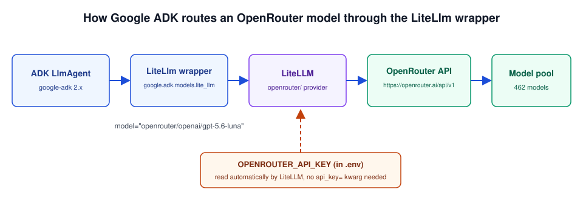

import YouTubeEmbed from "@components/widgets/YouTubeEmbed.astro";
import Button from "@components/widgets/Button.astro";
import Notice from "@components/widgets/Notice.astro";
import ListCheck from "@components/widgets/ListCheck.astro";
import Accordion from "@components/widgets/Accordion.astro";
import Tabs from "@components/widgets/Tabs.astro";
import Tab from "@components/widgets/Tab.astro";

The Google ADK OpenRouter path is a one-line change: wrap the model in `LiteLlm`, leave everything else alone. If you followed [build your first ADK agent with Tavily search and memory](https://www.bitdoze.com/google-adk-start/) and ended up on Gemini, you can point the same agent at any of the 462 OpenRouter models by rewriting the `model=` parameter. Tools, session memory, and the `Runner` stay untouched.

The Google Agent Development Kit (ADK) has moved since that first article. Python hit v1.0.0 GA in May 2025, v2.0.0 GA in May 2026 with multi-agent workflow and graph support, and v2.12.0 on 2026-10-13. There are now TypeScript, Go, Java, and Kotlin flavors alongside Python, and the repo sits at around 21.9k GitHub stars. What has not changed is the model layer: Google models take a plain model string, everything else goes through wrapper classes like `LiteLlm`, which talks to LiteLLM and its 100+ providers. The swap pattern below works the same on 2.x.

The guide covers a security pin to apply before installing anything, how the OpenRouter catalog and its `:free`/`:batch` variants price out, the env-only config, verify steps that catch dead model IDs before your agent does, and the failure modes worth knowing. One API key, 462 models, pay-per-token from about $0.02 per 1M input tokens.

## LiteLLM security: pin `litellm>=1.84` before you install

On March 24, 2026, unauthorized code was found in LiteLLM v1.82.7 and v1.82.8 published on PyPI. This is a supply-chain incident, not a config mistake. If you installed or upgraded LiteLLM during that window, that code ran on your machine with access to whatever was in your environment. Google's ADK docs now require `litellm>=1.84` and tell affected users to rotate their secrets.

<Notice type="error" title="LiteLLM supply-chain incident (March 2026)">
If you installed or upgraded LiteLLM around March 24, 2026, rotate every API key that lived on that machine: OpenRouter, Tavily, Google, anything sitting in `.env`. Then pin `litellm>=1.84` (current release as of October 2026: 1.105.1) and commit your lockfile so CI and teammates cannot drift back onto a bad version.
</Notice>

Three habits to adopt before the install steps further down:

<ListCheck>
<ul>
<li>**Pin the version.** Use `uv add "litellm>=1.84"` and never a bare `uv add litellm`. Unpinned installs will happily grab whatever is newest on PyPI, which is exactly the failure mode of this incident.</li>
<li>**Commit `uv.lock`.** The lockfile is what makes "it worked on my box" reproducible after a bad release lands.</li>
<li>**Audit dependencies in CI.** `uv audit` or `pip-audit` on every pipeline run is cheap insurance. A failing audit is easier to read at 2am than an unexpected `litellm` version bump in a diff.</li>
</ul>
</ListCheck>

Sources: the [ADK LiteLLM integration page](https://google.github.io/adk-docs/agents/models/litellm/) and [LiteLLM's March 2026 security update](https://docs.litellm.ai/blog/security-update-march-2026). Treat the pin as standing policy for this stack, not a one-time fix.

## What is OpenRouter? One API key, 462 models

[OpenRouter](https://openrouter.ai) is one OpenAI-compatible endpoint, `https://openrouter.ai/api/v1`, in front of a large model catalog: 462 models in the API as of October 2026. One API key pays for all of them, per token. You do not juggle separate SDKs, billing pages, or provider-specific auth. The count moves, so re-check the live list before you commit an agent to a specific ID.

LiteLLM is the bridge. ADK's `LiteLlm` wrapper speaks to LiteLLM, and LiteLLM speaks OpenRouter under the `openrouter/` provider prefix. That is the whole integration. Details in the next section.

### Benefits of OpenRouter for Google ADK agents

<ListCheck>
<ul>
<li>**Variety on one bill.** Fast models, reasoning models, and cheap models all behind the same key. Pick per workload instead of per vendor contract.</li>
<li>**Swap without rewriting.** Changing `model=LiteLlm(model="openrouter/...")` is the entire migration. Tools, instructions, and session code stay as they are.</li>
<li>**Pricing that undercuts some direct rates.** OpenRouter passes through provider pricing and sometimes lands below list, especially on the open-model end.</li>
<li>**One place to watch spend.** The activity dashboard and the `/api/v1/key` endpoint show usage and credits for everything the key touches.</li>
</ul>
</ListCheck>

### Free (`:free`) and batch (`:batch`) model variants

Around 15 models carry a `:free` suffix, for example `meta-llama/llama-3.3-70b-instruct:free`. They cost nothing and are rate-limited, which makes them fine for poking at the API and poor for anything you rely on. There are also `:batch` variants at a discount for async workloads where latency does not matter.

<Notice type="warning" title="Free models and tool calling">
Tool calling on `:free` models is hit or miss. An ADK agent is only as useful as its function calls, so verify a free model fires your tools before you build on it. If you want free-tier access to the bigger names instead, see [free ways to use Claude, GPT, and Gemini models](https://www.bitdoze.com/use-claude-sonnet-4-5-gpt-5-free/).
</Notice>

## How `LiteLlm` works in Google ADK



ADK's model layer is dual-path, and the split is simple. Gemini and other Google models take a plain model string such as `gemini-2.5-flash`, handled by the `google-genai` client. Everything else goes through a wrapper class. `LiteLlm` is the wrapper for OpenAI-compatible providers, and OpenRouter is one of them.

```python
from google.adk.models.lite_llm import LiteLlm

model = LiteLlm(model="openrouter/openai/gpt-5.6-luna")
```

The constructor passes its keyword arguments straight through to `litellm.completion()`. Whatever LiteLLM accepts, `LiteLlm` accepts. That is why the wrapper is thin and why the model string format is LiteLLM's, not ADK's: `openrouter/<vendor>/<model>`, where `<vendor>/<model>` is exactly the ID from OpenRouter's models API. For `openai/gpt-5.6-luna` the full string is `openrouter/openai/gpt-5.6-luna`. Copy the ID from the API response, not from blog posts, and the prefix math takes care of itself.

### Env-only config: drop `api_key` and `api_base`

LiteLLM reads `OPENROUTER_API_KEY` from the environment on its own and defaults the base URL to `https://openrouter.ai/api/v1`. Passing both as kwargs still works, it is just noise. I would keep the model string as the only argument and let the env do the rest.

<Tabs>
<Tab name="Env-only (recommended)">

```python
from google.adk.agents import Agent
from google.adk.models.lite_llm import LiteLlm

root_agent = Agent(
    name="my_adk_agent_openrouter",
    model=LiteLlm(model="openrouter/openai/gpt-5.6-luna"),
    description="A helpful assistant using an OpenRouter model, with web search and memory.",
    instruction="Answer helpfully. Use tools when they are relevant.",
    tools=[adk_tavily_tool, remember_something],
)
```

</Tab>
<Tab name="Explicit kwargs (legacy)">

```python
import os

from google.adk.agents import Agent
from google.adk.models.lite_llm import LiteLlm

root_agent = Agent(
    name="my_adk_agent_openrouter",
    model=LiteLlm(
        model="openrouter/openai/gpt-5.6-luna",
        api_key=os.getenv("OPENROUTER_API_KEY"),
        api_base="https://openrouter.ai/api/v1",
    ),
    description="A helpful assistant using an OpenRouter model, with web search and memory.",
    instruction="Answer helpfully. Use tools when they are relevant.",
    tools=[adk_tavily_tool, remember_something],
)
```

</Tab>
</Tabs>

One optional extra: OpenRouter attribution headers. LiteLLM exposes `OR_SITE_URL` and `OR_APP_NAME` as environment variables so your app can show up in OpenRouter's rankings. Header names on OpenRouter's side moved to `HTTP-Referer` and `X-OpenRouter-*`, so confirm the mapping in LiteLLM's docs if attribution matters to you.

### Use native Gemini strings for Gemini

<Notice type="info" title="Do not route Gemini through LiteLLM">
Current ADK source warns when a Gemini model goes through `LiteLlm` (`_warn_gemini_via_litellm`). Use plain model strings like `gemini-2.5-flash` for Google models and reserve `LiteLlm` for everyone else. The 1.5 generation (`gemini-1.5-flash-latest` and friends) is retired; do not copy old tutorials that still reference it.
</Notice>

Streaming is handled for you. The `LiteLlm` class and the `Runner` manage the stream internally and strip any `stream` kwarg you pass, so do not build your call site around it.

### Tool calling and Claude thinking blocks

LiteLLM forwards function calls for models that support them. That is what keeps the Tavily search tool and `remember_something` working after you swap the model. Two details worth knowing:

- Since ADK v1.28.0, `LiteLlm` preserves Anthropic thinking-block signatures across turns when you run Claude models. You get the multi-turn reasoning continuity without extra code.
- ADK now repairs malformed tool-call JSON from flaky models (`_parse_tool_call_arguments` in `lite_llm.py`). It does not make a weak model strong. If your agent produces broken calls, pick a model with solid function-calling support instead of blaming ADK.

Tool calling is also why protocols like [what is MCP (Model Context Protocol)](https://www.bitdoze.com/mcp-introduction-beginners/) matter as your agent grows: the model's ability to emit well-formed calls is the bottleneck, not your tool code.

## Switch your ADK agent to an OpenRouter model (step by step)

<YouTubeEmbed
  url="https://www.youtube.com/embed/rLSj47zkTa8"
  label="How to Build Your First Agent with Google Agent Development Kit (ADK)"
/>

The walk-through below evolves the part-1 agent, with Tavily search and the `remember_something` tool, onto an OpenRouter model. Each step has a verify line. Use it.

### Prerequisites

<ListCheck>
<ul>
<li>**Completed part-1 agent**: `Agent`, `Runner`, `InMemorySessionService`, `adk_tavily_tool`, and `remember_something` all working. If you do not have that yet, [build your first ADK agent with Tavily search and memory](https://www.bitdoze.com/google-adk-start/) first.</li>
<li>**`uv` installed** for the package work. See [Getting started with uv for Python projects](https://www.bitdoze.com/uv-get-start/) if it is new to you.</li>
<li>**A Python project with `google-adk` 2.x** and a `.env` holding `TAVILY_API_KEY` (and `GOOGLE_API_KEY` if other parts still use Gemini).</li>
<li>**An OpenRouter account** for the API key in the next step.</li>
<li>**Target versions**: `google-adk` 2.x, `litellm>=1.84`. No downgrade shims, no custom forks.</li>
</ul>
</ListCheck>

### 1. Get an OpenRouter API key and update `.env`

Create a key at [openrouter.ai/keys](https://openrouter.ai/keys). It looks like `sk-or-v1-...`. Put it in the `.env` at your project root:

```dotenv
# New line
OPENROUTER_API_KEY="sk-or-v1-PASTE_YOUR_KEY_HERE"

# Keep what you still need
TAVILY_API_KEY="YOUR_TAVILY_API_KEY"
# GOOGLE_API_KEY="YOUR_GOOGLE_API_KEY"  # drop it if nothing uses Gemini anymore
```

<Notice type="warning" title="Two cheap safety rails">
Never commit `.env`. Check `git status` before your first commit and keep the file ignored. And set a hard credit **limit** on the key at creation time, not after the first surprise bill. You can always raise it later.
</Notice>

**Verify:**

```bash
curl -s https://openrouter.ai/api/v1/key \
  -H "Authorization: Bearer $OPENROUTER_API_KEY"
```

Healthy output is a JSON object with your key label and remaining credits. If you get `401`, the key is wrong, missing, or not loaded into your shell.

### 2. Install LiteLLM with uv (pinned version)

```bash
uv add "litellm>=1.84"
```

That constraint is deliberate. LiteLLM 1.82.7/1.82.8 were the compromised releases from the March 2026 incident, and the ADK docs now require `>=1.84`. Current latest is 1.105.1 as of October 2026. Commit `uv.lock` in the same change. If `uv` is still new to your workflow, [Getting started with uv for Python projects](https://www.bitdoze.com/uv-get-start/) covers project setup and lockfiles.

**Verify:**

```bash
uv tree | grep litellm
```

You want a version at or above 1.84. Anything lower, stop and re-run the add with the pin.

### 3. Update the agent code with `LiteLlm`

Drop-in replacement for the `root_agent` definition from part 1:

```python
from google.adk.agents import Agent
from google.adk.models.lite_llm import LiteLlm

root_agent = Agent(
    name="my_adk_agent_openrouter",
    model=LiteLlm(
        model="openrouter/openai/gpt-5.6-luna",
        # No api_key/api_base needed: LiteLLM reads OPENROUTER_API_KEY from
        # the environment and defaults the base URL to
        # https://openrouter.ai/api/v1
    ),
    description="A helpful assistant using an OpenRouter model, with web search and memory.",
    instruction="""You are a friendly and helpful assistant.
1. For anything needing up-to-date info, use the 'TavilySearchResults' tool.
2. To remember something, use the 'remember_something' tool.
3. Use session state memories when relevant.
4. Otherwise answer directly.""",
    tools=[adk_tavily_tool, remember_something],
)
```

What changed and what did not:

- The `model` parameter is now a `LiteLlm` instance instead of a bare Gemini string like `"gemini-2.5-flash"`.
- The string inside is `openrouter/<vendor>/<model>`. Vendor and model come straight from OpenRouter's models API, so `openai/gpt-5.6-luna` becomes `openrouter/openai/gpt-5.6-luna`. One prefix, no doubling.
- `tools`, `instruction`, `Runner`, and `InMemorySessionService` are untouched. That is the point of the wrapper.

**Verify:** a syntax-level check first.

```bash
uv run python -c "from agent_module.agent import root_agent; print(root_agent.model)"
```

Adjust `agent_module.agent` to your actual module path. You want the `LiteLlm` object printed, not an `ImportError`.

### 4. Run the agent with `adk web`

```bash
adk web
```

or run your script directly:

```bash
uv run python -m agent_module.agent
```

**Verify:** the agent answers **and** a tool call fires. Ask "what's the latest news about the EU AI Act?" and watch the dev UI or terminal. If you only get a text answer with no Tavily invocation, the model is not calling tools. See troubleshooting below.

<Notice type="info" title="adk api_server is unauthenticated">
ADK 2.12's CLI grew well past `web`/`run`: `adk create`, `deploy`, `eval`, `eval_set`, `migrate`, `optimize`, `conformance`, `telemetry`, `test`, and `api_server`. One caveat: `adk api_server` serves its endpoints without authentication. Bind it to localhost or put it behind your own proxy. Never expose it to the internet as-is.
</Notice>

**Common run failures:** port 8000 already in use means a stale `adk web` is still running, kill it and retry. Missing keys usually mean you started the command outside the project root and the `.env` never loaded.

<Notice type="info" title="Rollback">
Undo is one line: set `model="gemini-2.5-flash"` (a native Gemini string) and the agent is back on Google's infra. Nothing else in the codebase changed during the swap. If you want the dependency gone too, `uv remove litellm`.
</Notice>

## Verify the OpenRouter model works before you celebrate

Model IDs churn weekly. Typos and retired IDs return `404`, and it is much faster to catch that in curl than inside ADK's stack trace. Run these four checks in order.

**1. Key is valid and you can see credits:**

```bash
curl -s https://openrouter.ai/api/v1/key \
  -H "Authorization: Bearer $OPENROUTER_API_KEY"
```

**2. The model ID exists:**

```bash
curl -s https://openrouter.ai/api/v1/models | jq -r '.data[].id' | grep gpt-5.6-luna
```

Empty output means the ID is wrong or the model is gone. Pick another from the full list.

**3. One cheap end-to-end completion:**

```bash
curl -s https://openrouter.ai/api/v1/chat/completions \
  -H "Authorization: Bearer $OPENROUTER_API_KEY" \
  -H "Content-Type: application/json" \
  -d '{"model":"openai/gpt-5.6-luna","messages":[{"role":"user","content":"say ok"}],"max_tokens":10}'
```

You want a short completion back. `401` is auth, `404` is model ID, `429` is rate limit or no credits.

**4. Tool-call smoke test** through `adk web`: ask a question that forces Tavily and confirm the tool invocation appears, not just the answer.

<ListCheck>
<ul>
<li>Key check returns label and credits</li>
<li>Model ID found in `/api/v1/models`</li>
<li>Cheap `/chat/completions` call returns a completion</li>
<li>`adk web` fires a real tool call</li>
</ul>
</ListCheck>

## Picking an OpenRouter model: pricing and tool support

Prices below were pulled from the OpenRouter API in October 2026. They move, sometimes weekly. Re-check before you budget around them.

| Model (OpenRouter ID) | Context | Input $/1M | Output $/1M | Tools |
|---|---|---|---|---|
| `openai/gpt-5.6-luna` | 1.05M | $0.20 | $1.20 | yes |
| `deepseek/deepseek-v4.1-flash` | 1.05M | $0.02 | $0.72 | yes |
| `z-ai/glm-5.3` | 1.05M | $0.10 | $4.80 | yes |
| `google/gemini-3.8-flash` | 1.05M | $0.75 | $3.75 | yes |
| `x-ai/grok-4.7` | 500k | $2.00 | $6.00 | yes |
| `anthropic/claude-sonnet-5.5` | 1M | $2.00 | $10.00 | yes |
| `moonshotai/kimi-k3` | 1.05M | $0.45 | $16.50 | yes |

Notes on the table: `z-ai/glm-5.3` is available through OpenRouter, or direct from [GLM 5.3 from Z.ai](https://go.bitdoze.com/glm) if you would rather skip the gateway. For the `moonshotai/kimi-k3` row, the older [Kimi K2 in 2026 and what to use now](https://www.bitdoze.com/kimi-k2-ai-model/) covers how that family evolved. And if sub-$1/M-token pricing is the whole game for you, the [cheapest AI models under $1 per million tokens](https://www.bitdoze.com/best-cheap-models-hermes-agent/) list goes deeper than one table.

Before committing an agent to a model, check function-calling support explicitly:

```bash
curl -s https://openrouter.ai/api/v1/models \
  | jq '.data[] | select(.id=="openai/gpt-5.6-luna") | .supported_parameters'
```

The output must contain `tools`. A model without it will answer questions and silently ignore your functions, which looks like an ADK bug and is not one.

<Notice type="warning" title="Do not hardcode preview or stealth model IDs">
The first version of this article used `quasar-alpha` as the demo model. It was a cloaked preview model, later widely reported as a GPT-4.1 family test, and OpenRouter retired it. Today `openrouter/quasar-alpha` returns `{"error":{"message":"Not Found","code":404}}`. Preview IDs vanish. Resolve every model ID against `https://openrouter.ai/api/v1/models` and treat anything labeled preview, stealth, or free-preview as temporary.
</Notice>

For open-weight options that hold up in agent workloads, see the [best open source LLM alternatives to Claude and GPT](https://www.bitdoze.com/best-open-source-llms-claude-alternative/).

<Button text="Browse the OpenRouter model list" link="https://openrouter.ai/models" variant="outline" color="blue" size="md" />

## Troubleshooting Google ADK OpenRouter errors

| Symptom | Cause | Fix |
|---|---|---|
| `404 Not Found` from OpenRouter | Model ID typo, or a retired/preview model | List IDs with `curl -s https://openrouter.ai/api/v1/models \| jq -r '.data[].id'` and copy from there |
| `401 Unauthorized` | Missing or wrong key, `.env` not loaded, key not `sk-or-` | Run from project root, `echo $OPENROUTER_API_KEY`, re-create the key if needed |
| Agent answers but never calls tools | Model does not support function calling | Check `supported_parameters` contains `tools`, switch models |
| `UnicodeDecodeError` on Windows with LiteLLM | Python locale encoding on cp1252 | Set `PYTHONUTF8=1` before launching (the fix ADK documents) |
| Rate limits or garbage answers on `:free` models | Free tier throttles hard and quality varies | Move to the paid variant of the same model |
| Malformed tool-call JSON in logs | Flaky open model emitting bad calls | ADK repairs what it can; a stronger model is the real fix |
| `adk web` fails to start or serves stale code | Old process on the port, wrong working directory | Kill stale `adk web` processes and re-run from the project root |

<Accordion label="Can I use free OpenRouter models with ADK?" group="faq">
Yes, for exploration. Append `:free` to the model ID and accept rate limits and unreliable tool calling. Fine for testing the wiring, bad for an agent you depend on. Verify tool calls fire before building on a free variant.
</Accordion>

<Accordion label="Why does my ADK agent return 404 on OpenRouter?" group="faq">
Almost always a model ID problem. Either a typo, or a preview/stealth model that got retired. This is what happened to `quasar-alpha`. Pull the live ID list from `https://openrouter.ai/api/v1/models` and compare. An auth failure looks different (`401`), so the status code already narrows it down.
</Accordion>

<Accordion label="Do I still need GOOGLE_API_KEY?" group="faq">
Only if something in the project still calls Google models. If you dropped native Gemini model strings entirely, the key is dead weight and you can remove it from `.env`. Keep it while any agent or tool still uses Gemini, including Gemini models routed through Vertex.
</Accordion>

<Accordion label="Which OpenRouter models support tool calling?" group="faq">
Check `supported_parameters` on each model in the `/api/v1/models` response. If `tools` is listed, function calling is supported. Most of the mainstream chat models in the pricing table above do. Test with one real tool call anyway, advertised support and reliable calls are different things.
</Accordion>

<Accordion label="Is LiteLLM 1.82 safe to use?" group="faq">
No. Versions 1.82.7 and 1.82.8 on PyPI contained unauthorized code found in March 2026. Pin `litellm>=1.84`, rotate any secrets that were on a machine which installed the bad versions, and keep your lockfile committed.
</Accordion>

## Cost control and model failover

Set a hard credit limit on each OpenRouter key when you create it. The activity dashboard and the `/api/v1/key` endpoint show spend, and both take seconds to check. For async work, `:batch` variants discount the same models when latency is irrelevant.

Cost order of magnitude: a light personal agent on `deepseek/deepseek-v4.1-flash` lands in the cents-to-a-few-dollars per month range at hobby usage. A heavy `anthropic/claude-sonnet-5.5` workflow is the one to put a limit on, because $10/1M output tokens adds up fast when an agent loops on tool calls.

In Python today, failover is LiteLLM's job, not ADK's. Pass fallbacks to the completion call and you get a defined primary-to-secondary chain instead of a dead agent when the first model 429s:

```python
from litellm import completion

resp = completion(
    model="openrouter/openai/gpt-5.6-luna",
    messages=[{"role": "user", "content": "say ok"}],
    fallbacks=[
        {"model": "openrouter/deepseek/deepseek-v4.1-flash"},
        {"model": "openrouter/anthropic/claude-sonnet-5.5"},
    ],
)
```

ADK's own answer to per-request routing is `RoutedLlm`/`RoutedAgent`, which picks a model and fails over on error. That is TypeScript-only and experimental right now, so in Python the LiteLLM router and fallbacks are the boring reliable default.

If you also live in Claude Code, Codex, or Gemini CLI, [Agent Router for multi-model routing](https://go.bitdoze.com/agentrouter) gives you the same any-model pattern for coding agents.

## Conclusion

The swap is one line: `LiteLlm(model="openrouter/<vendor>/<model>")`. Keep the pin (`litellm>=1.84`), keep your lockfile, and run the four verify checks before trusting any model ID that is new to you. Tools and session memory never change, which is what makes model churn cheap.

Next in the series: the [ADK multi-agent research team with Tavily and Crawl4AI](https://www.bitdoze.com/google-adk-multi-agent-search/), where several agents split research work instead of one doing everything.

<Button text="Build the ADK Multi-Agent Research Team" link="/google-adk-multi-agent-search/" variant="solid" color="blue" size="md" icon="arrow-right" />

The same any-model idea shows up elsewhere: [how to plug any model into the Codex app](https://www.bitdoze.com/codex-app-any-model/) covers it for coding tools. And if you want a different Python agent framework to compare against ADK, [getting started with Agno agents](https://www.bitdoze.com/agno-get-start/) is a good side trip.
