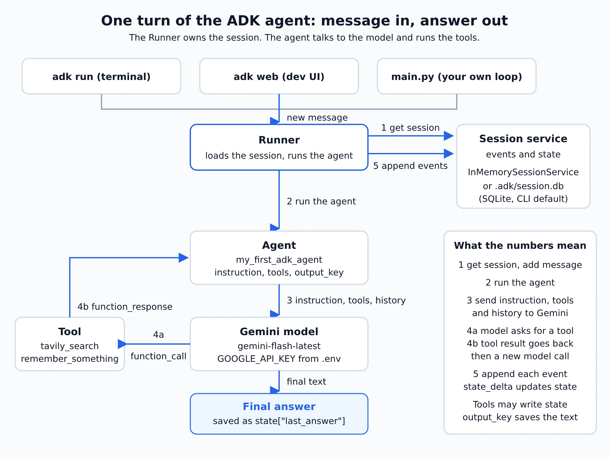
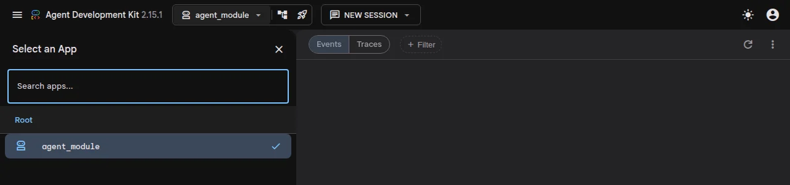
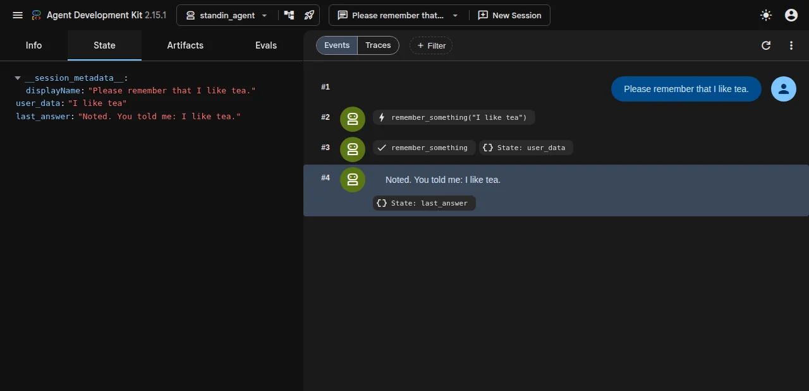
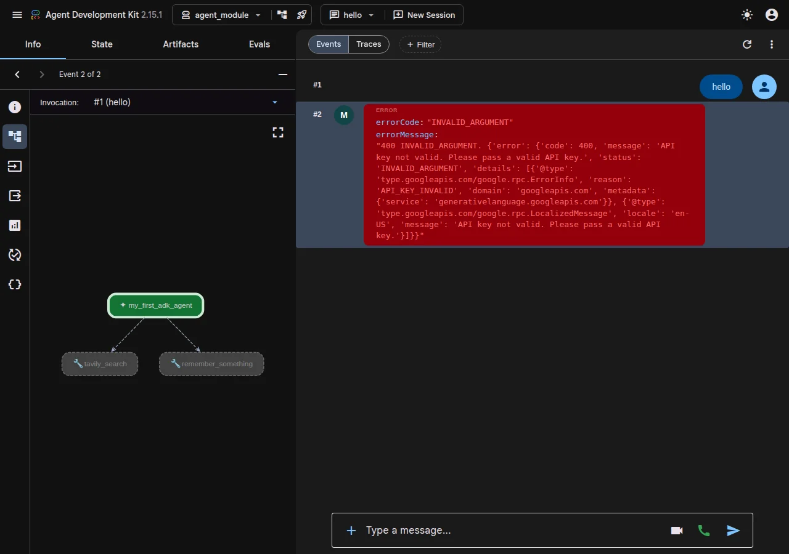

import Accordion from "@components/widgets/Accordion.astro";
import ListCheck from "@components/widgets/ListCheck.astro";
import Notice from "@components/widgets/Notice.astro";
import YouTubeEmbed from "@components/widgets/YouTubeEmbed.astro";

A first Google ADK agent is one folder with two files: `__init__.py` and an `agent.py` that defines `root_agent`. Put a Gemini API key in `.env` and `adk run agent_module` chats with it. This tutorial gives that agent session state memory and a Tavily web search tool, then runs it three ways.

Every output block below is real, from `google-adk` 2.15.1 on 2026-11-27, in a throwaway test project without a Gemini key. No model call was made. The one screenshot that shows a conversation comes from a callback that stands in for Gemini, and the text says so where it appears.

## What is the Google Agent Development Kit?

The Agent Development Kit (ADK) is Google's open-source toolkit for building, running and deploying AI agents. The Python package is `google-adk`, Apache-2.0 licensed, first released on 2025-04-09 and at version 2.15.1 on 2026-11-25 ([releases](https://github.com/google/adk-python/releases)).

Four parts appear in every project. An `Agent` (the class is `LlmAgent`) holds a name, a model, an instruction and a list of tools. A tool is a plain Python function. The `Runner` runs the agent for one message. A session service stores the conversation and its state.

[ADK 2.0](https://adk.dev/2.0/), generally available since 2026-05-19, added graph-based workflows for systems with many nodes. One agent with two tools does not need them.

<YouTubeEmbed
  url="https://www.youtube.com/embed/rLSj47zkTa8"
  label="How to Build Your First Agent with Google Agent Development Kit (ADK)"
/>

## What changed in ADK since April 2025?

Three things in tutorials from 2025 fail or warn on 2.15.1. The LangChain wrapper's import path moved, the `.env` variable that picked the backend is deprecated, and `create_session` is now a coroutine.

The imports and parameters of `Agent`, `Runner` and `InMemorySessionService` are unchanged.

| In 2025 tutorials | On 2.15.1 | What you see |
|---|---|---|
| Python 3.9 or newer | Python 3.11 or newer | `uv init` picked 3.11 in the test project |
| `GOOGLE_GENAI_USE_VERTEXAI="False"` in `.env` | `GOOGLE_API_KEY` alone | `DeprecationWarning: GOOGLE_GENAI_USE_VERTEXAI is deprecated, please use GOOGLE_GENAI_USE_ENTERPRISE instead` |
| `model="gemini-2.0-flash-exp"` | `gemini-flash-latest` or a fixed model ID | On 2026-11-27 the [Gemini models page](https://ai.google.dev/gemini-api/docs/models) marks 2.0 Flash as shut down |
| `session = session_service.create_session(...)` | `await` it, or call `create_session_sync` | `AttributeError: 'coroutine' object has no attribute 'state'` |
| `from google.adk.tools.langchain_tool import LangchainTool` | `from google.adk.integrations.langchain import LangchainTool` | `DeprecationWarning: google.adk.tools.langchain_tool is moved to google.adk.integrations.langchain` |
| `TavilySearchResults` from `langchain_community` | `tavily-python` in a plain function, or `langchain-tavily` | `DeprecationWarning: langchain-community is being sunset and is no longer actively maintained` |
| `InMemorySessionService` in your own script | `adk run` and `adk web` also write `agent_module/.adk/session.db` | a new `.adk/` folder next to `agent.py` |

The docs moved too. `google.github.io/adk-docs` now redirects to [adk.dev](https://adk.dev/).

## Set up the project with uv

<ListCheck>
<ul>
<li>Python 3.11 or newer. `uv python pin 3.12` records the version in `.python-version`.</li>
<li>uv. The [uv getting started guide](/uv-get-start/) covers the install on Windows and the shell setup.</li>
<li>A Gemini API key from the [AI Studio API keys page](https://aistudio.google.com/app/apikey).</li>
<li>A Tavily key, only for searches past the free keyless limit.</li>
</ul>
</ListCheck>

Install uv with the command on the [uv installation page](https://docs.astral.sh/uv/getting-started/installation/), then create the project:

```bash
uv --version
```

```text
uv 0.9.28
```

```bash
uv init my-adk-agent
cd my-adk-agent
uv python pin 3.12
uv add google-adk tavily-python python-dotenv
```

```text
Initialized project `my-adk-agent` at `/tmp/bitdoze-refresh-adk/uvproject/my-adk-agent`
Updated `.python-version` from `3.11` -> `3.12`
```

Read the path as your own folder. `uv init` also creates a git repository, a `README.md` and a `main.py`. `uv add` writes three lines into `pyproject.toml`:

```toml
dependencies = [
    "google-adk>=2.15.1",
    "python-dotenv>=1.2.4",
    "tavily-python>=0.8.5",
]
```

`python-dotenv` is already a dependency of google-adk. It is listed as well because `main.py` imports it directly.

The CLI ships inside the package. Check it:

```bash
uv run adk --version
```

```text
adk, version 2.15.1
```

The toolkit is free. Usage costs are noted where they start.

## How do I give an ADK agent a Gemini API key?

Put `GOOGLE_API_KEY` in a `.env` file inside the agent folder or in any parent folder, and keep it out of the code. The ADK CLI loads the first `.env` it finds on the way up from the agent folder, before it imports the agent.

`adk create` builds the agent folder in one command. The flags answer its questions up front, so the command asks nothing and no key lands on the command line. `<FILL_IN_MODEL>` is the placeholder the CLI itself offers:

```bash
uv run adk create agent_module --model "<FILL_IN_MODEL>" --type code
```

```text
Agent created in /tmp/bitdoze-refresh-adk/final/my-adk-agent/agent_module:
- .env
- .gitignore
- __init__.py
- agent.py

Next steps:
- Chat with your agent in the terminal: adk run agent_module
- Or in the browser: adk web .
- Have your coding agent evaluate and deploy it: uvx google-agents-cli setup
  (other install options: https://adk.dev/get-started/agents-cli/)
```

The command also prints a warning that secrets are stored in `.env`. Without flags it asks for the model, the backend (Google AI, Vertex AI or Login with Google), the Google AI key and the agent type (YAML config, experimental, or code).

Keep `__init__.py` and `.gitignore`, replace `agent.py` with the code from this tutorial, and delete the empty `agent_module/.env` so that one file holds the keys. The layout is then:

```text
my-adk-agent/
├── .env
├── .gitignore
├── .python-version
├── main.py
├── pyproject.toml
└── agent_module/
    ├── .gitignore
    ├── __init__.py
    └── agent.py
```

`__init__.py` must import `agent`, and the agent object must carry the name `root_agent`. `adk run` and `adk web` look in each subfolder for `agent.py`, `__init__.py` or `root_agent.yaml` and take `root_agent` from it. The generated file already does that:

```python
from . import agent as agent
```

The keys go into `my-adk-agent/.env`:

```dotenv
GOOGLE_API_KEY="PASTE_YOUR_GEMINI_API_KEY_HERE"
TAVILY_API_KEY="PASTE_YOUR_TAVILY_API_KEY_HERE"
```

`TAVILY_API_KEY` can stay a placeholder for a first run. The search section explains the keyless mode.

For Google Cloud instead of the Gemini API, the [Gemini models page](https://adk.dev/agents/models/google-gemini/) lists three other lines:

```text
GOOGLE_CLOUD_PROJECT=your-project-id
GOOGLE_CLOUD_LOCATION=location-code
GOOGLE_GENAI_USE_ENTERPRISE=True
```

<Notice type="warning" title="Keep two files out of git">
The `.gitignore` that `uv init` writes lists Python build files and `.venv`, not `.env`. Add `.env` and `.adk/` to it, as `adk create` does inside the agent folder. A variable that is already set in your shell keeps its value and wins over the `.env` file.
</Notice>

## Write the first agent

Open `agent_module/agent.py` and define the agent:

| Parameter | Type | What it does |
|---|---|---|
| `name` | str, required | Identifies the agent in events and logs |
| `model` | str or model object | The model the agent calls. `gemini-flash-latest` follows the newest Flash release |
| `description` | str, default empty | One line on what the agent does. Other agents read it when they route work |
| `instruction` | str or function | The system prompt. ADK fills in a state key written in braces before each model call |
| `tools` | list, default empty | Functions and tool objects the model may call |
| `output_key` | str or None | Saves the final answer text under this state key |

The smallest working agent:

```python
from google.adk.agents import Agent

root_agent = Agent(
    name="my_first_adk_agent",
    model="gemini-flash-latest",
    description="A helpful assistant that chats.",
    instruction="You are a friendly and helpful assistant. Answer briefly.",
)
```

The import check needs no key:

```bash
uv run python -c "from agent_module import agent; print(agent.root_agent.name, [t.__name__ for t in agent.root_agent.tools])"
```

```text
my_first_adk_agent []
```

## How does a turn work in ADK?

The Runner takes your message, asks the session service for the session, runs the agent and appends every event the agent yields back to the session. The agent loops between Gemini and its tools until Gemini answers with plain text.



1. The Runner gets the session from the session service and adds your text as an event with the author `user`.
2. It runs the agent with that session, so the agent sees the state and the history.
3. The agent sends the instruction, the tool declarations and the conversation to Gemini.
4. Gemini asks for a tool or answers. For a tool call, the agent runs the function, sends the result back, and step 3 repeats.
5. The Runner appends each event through the session service, which applies the event's `state_delta` to `session.state`.

The dev UI lists these events as numbered rows. One turn with the agent from this tutorial looks like this:

| Event | Author | Content | State it writes |
|---|---|---|---|
| #1 | user | `Please remember that I like tea.` | none |
| #2 | the agent | function call `remember_something("I like tea")` | none |
| #3 | the agent | function response from `remember_something` | `user_data` |
| #4 | the agent | the answer text | `last_answer` |

## How do I add memory with session state?

Write to `context.state` inside a tool or a callback, and read it back the same way or through a key in braces in the instruction. Every write travels in the event's `state_delta`, and the session service applies it when the Runner appends the event.

```python
def remember_something(data_to_remember: str, tool_context: ToolContext) -> dict:
    """Saves a note in the session state and reports what was stored before.

    Args:
        data_to_remember: The fact the user asks the agent to keep.
        tool_context: Injected by ADK, never seen by the model.

    Returns:
        A dict with a status and a message for the model.
    """
    previous = tool_context.state.get("user_data", "nothing")
    tool_context.state["user_data"] = data_to_remember
    return {
        "status": "success",
        "message": (
            f"I remembered '{data_to_remember}'. Before that, I knew about '{previous}'."
        ),
    }
```

- ADK finds the `tool_context` parameter by its `ToolContext` type, not by its name. It fills the parameter in and hides it from the model, whose declaration lists only `data_to_remember`.
- The return value is a dict with a `status`, the shape the [function tools page](https://adk.dev/tools-custom/function-tools/) asks for.
- The write is one string under one key. State must stay serializable, so store IDs and plain values, never objects.

A tool write is half of the memory. The other half is getting the value back to the model, which only sees text. An instruction cannot say "use the note in session state" and stop there. Name the state key in braces and ADK inserts its value before each model call:

```python
    instruction="""You are a friendly and helpful assistant.
The note stored for this user is: {user_data?}
1. If the user asks about recent events or anything you are not sure about, use the 'tavily_search' tool.
2. If the user asks you to remember something, call 'remember_something' and mention what was stored before.
3. Use the stored note when it is relevant to the question.
4. Otherwise, answer from your own knowledge.""",
```

On a new session the second line reaches the model as `The note stored for this user is: ` with nothing after it. After the tool ran once, it reads `The note stored for this user is: I like tea`. The question mark matters. Without it a missing key stops the turn:

```text
KeyError: "Context variable not found: `user_data` in agent 'my_first_adk_agent'."
```

`output_key` is the shortcut for the final answer. With `output_key="last_answer"`, the text of event #4 lands in `session.state["last_answer"]`.

A prefix on the key sets its scope:

| Prefix | Scope | Kept across restarts with a persistent service |
|---|---|---|
| none | This session | Yes |
| `user:` | Every session of this user in the app | Yes |
| `app:` | Every user and session of the app | Yes |
| `temp:` | The current turn only | No. The service discards it when the turn ends |

The service decides where state lives. The [session page](https://adk.dev/sessions/session/) lists three, and the CLI adds a default of its own:

| Service | Stores | Needs | Use when |
|---|---|---|---|
| `InMemorySessionService` | Process memory | Nothing | Learning and tests. All is lost when the process exits |
| `DatabaseSessionService` | PostgreSQL, MySQL or SQLite tables | `google-adk[db]` and a `db_url` with an async driver | Sessions must survive a restart on your own server |
| `VertexAiSessionService` | Google Cloud Agent Platform | `google-adk[gcp]`, a project and an Agent Runtime resource | The agent runs on Google Cloud |
| The CLI default | `agent_module/.adk/session.db` | Nothing | `adk run` and `adk web` keep sessions between restarts. `--in_memory` turns it off |

The database service locks per session when it appends events. `InMemorySessionService` is not safe for several threads on one session. For SQLite the URL needs the async driver. In the test project this URL stored a session and read it back through a second service instance:

```bash
uv add "google-adk[db]"
```

```python
from google.adk.sessions import DatabaseSessionService

session_service = DatabaseSessionService(db_url="sqlite+aiosqlite:///./sessions.db")
```

## Add a web search tool

The model's knowledge stops at its training data. A search tool closes that gap, and ADK offers four ways to add one:

| Option | Model | Needs | Trade-off |
|---|---|---|---|
| Built-in `google_search` | Gemini only | No extra package or key | One built-in tool per agent, unless you build it with `GoogleSearchTool(bypass_multi_tools_limit=True)`. Google meters grounding per request |
| Tavily through a plain function (this tutorial) | Any | `tavily-python` and a Tavily key, or the free keyless mode | Three more packages. A basic search costs one credit |
| Tavily through `LangchainTool` | Any | `langchain-tavily`, which brings the LangChain packages | A second framework to update. The tool fails at construction without a key |
| Tavily's MCP server through `McpToolset` | Any | `google-adk[mcp]` and a connection to `mcp.tavily.com` | The tool list comes from Tavily's server. See the [MCP beginner guide](/mcp-introduction-beginners/) |

My pick is the plain function. It adds three packages, the error path is visible in the code, and nothing in it depends on LangChain. The [multi-agent research team tutorial](/google-adk-multi-agent-search/) shows the `LangchainTool` route in a bigger build.

```python
@functools.lru_cache(maxsize=1)
def _tavily() -> TavilyClient:
    """Builds the Tavily client once, after the .env file has been loaded."""
    return TavilyClient()


def tavily_search(query: str) -> dict:
    """Searches the web with Tavily and returns the top results.

    Args:
        query: The search query.

    Returns:
        A dict with a status, an optional direct answer and a list of results.
    """
    try:
        response = _tavily().search(query, max_results=3, include_answer=True)
    except Exception as e:
        return {"status": "error", "error_message": f"Tavily search failed: {e}"}
    results = [
        {"title": r["title"], "url": r["url"], "content": r["content"]}
        for r in response.get("results", [])
    ]
    return {
        "status": "success",
        "answer": response.get("answer"),
        "results": results,
    }
```

The tool builds the Tavily client on first call, after the CLI or `load_dotenv()` has loaded `.env`, whichever way the agent starts. Tavily answers with a `results` list, where each item holds a `title`, a `url`, a `content` snippet and a `score`, plus an optional `answer` when `include_answer=True` ([SDK reference](https://docs.tavily.com/sdk/python/reference)). The function keeps the three fields the model needs. On failure it returns `status: "error"` with the reason, so the model can pass the reason on instead of the turn dying.

Without `TAVILY_API_KEY` the client does not fail. It runs in a free keyless mode with a rate limit. When you hit the limit, the SDK raises this (real text), and the tool puts it into `error_message`:

```text
TavilyKeylessLimitError: You reached the daily keyless Tavily limit. To continue immediately, pay via x402 agentic payment (https://docs.tavily.com/documentation/machine-payments/x402) or sign up at https://tavily.com for a Tavily API key. Otherwise, retry after the time given in the Retry-After response header.
```

The built-in alternative takes two lines, as long as the model is Gemini:

```python
from google.adk.tools.google_search_tool import GoogleSearchTool

tools=[GoogleSearchTool(bypass_multi_tools_limit=True), remember_something]
```

The shared `google_search` instance from `google.adk.tools` keeps the flag off, and the [tool limitations page](https://adk.dev/tools/limitations/) lists it as unsupported next to another tool.

The LangChain route, for a project that already has those packages (`uv add langchain-tavily`):

```python
from google.adk.integrations.langchain import LangchainTool
from langchain_tavily import TavilySearch

adk_tavily_tool = LangchainTool(tool=TavilySearch(max_results=3, include_answer=True))
```

It needs the key at construction time:

```text
pydantic_core._pydantic_core.ValidationError: 1 validation error for TavilySearchAPIWrapper
Value error, Did not find tavily_api_key, please add an environment variable `TAVILY_API_KEY` which contains it, or pass `tavily_api_key` as a named parameter.
```

Costs on 2026-11-27, from the [Tavily credits page](https://docs.tavily.com/documentation/api-credits) and the [Gemini pricing page](https://ai.google.dev/gemini-api/docs/pricing):

- Tavily's free plan has 1,000 credits a month and asks for no card. A basic search costs one credit, an advanced search two.
- Gemini bills per token. The pricing page has a Free Tier column per model, and it reads "Not available" for several current models, so check the row for the model you pick.
- Google meters grounding with Search per search request, apart from the tokens. One prompt can trigger several searches.

## Complete agent code

The complete `agent_module/agent.py`:

```python
import functools

from google.adk.agents import Agent
from google.adk.tools import ToolContext
from tavily import TavilyClient


@functools.lru_cache(maxsize=1)
def _tavily() -> TavilyClient:
    """Builds the Tavily client once, after the .env file has been loaded."""
    return TavilyClient()


def remember_something(data_to_remember: str, tool_context: ToolContext) -> dict:
    """Saves a note in the session state and reports what was stored before.

    Args:
        data_to_remember: The fact the user asks the agent to keep.
        tool_context: Injected by ADK, never seen by the model.

    Returns:
        A dict with a status and a message for the model.
    """
    previous = tool_context.state.get("user_data", "nothing")
    tool_context.state["user_data"] = data_to_remember
    return {
        "status": "success",
        "message": (
            f"I remembered '{data_to_remember}'. Before that, I knew about '{previous}'."
        ),
    }


def tavily_search(query: str) -> dict:
    """Searches the web with Tavily and returns the top results.

    Args:
        query: The search query.

    Returns:
        A dict with a status, an optional direct answer and a list of results.
    """
    try:
        response = _tavily().search(query, max_results=3, include_answer=True)
    except Exception as e:
        return {"status": "error", "error_message": f"Tavily search failed: {e}"}
    results = [
        {"title": r["title"], "url": r["url"], "content": r["content"]}
        for r in response.get("results", [])
    ]
    return {
        "status": "success",
        "answer": response.get("answer"),
        "results": results,
    }


root_agent = Agent(
    name="my_first_adk_agent",
    model="gemini-flash-latest",
    description="A helpful assistant that searches the web and keeps notes.",
    instruction="""You are a friendly and helpful assistant.
The note stored for this user is: {user_data?}
1. If the user asks about recent events or anything you are not sure about, use the 'tavily_search' tool.
2. If the user asks you to remember something, call 'remember_something' and mention what was stored before.
3. Use the stored note when it is relevant to the question.
4. Otherwise, answer from your own knowledge.""",
    tools=[tavily_search, remember_something],
    output_key="last_answer",
)
```

## How do I run an ADK agent?

Three commands read the same `agent_module` folder: `adk run`, `adk web` and a `Runner` in your own script. `adk run` chats in the terminal, `adk web` opens the dev UI in a browser, and the `Runner` runs the agent from code.

`adk api_server` adds an unauthenticated REST API for curl tests.

### Run in the terminal with `adk run`

```bash
uv run adk run agent_module "hello"
```

With no `.env` and no key in the shell, `adk run` creates the session and the turn fails at the model call:

```text
Log setup complete: /tmp/agents_log/agent.20261127_195337.log
To access latest log: tail -F /tmp/agents_log/agent.latest.log
Session ID: 69b41d33-f7f7-4c25-a2b2-f17e6a8a207a
Error: No API key was provided. Please pass a valid API key. Learn how to create an API key at https://ai.google.dev/gemini-api/docs/api-key.
```

Everything before the model works when you see those lines. With a valid key the same command runs one turn and exits. Leave out the message and you get a prompt, which ends with Ctrl+C or Ctrl+D. `echo "What is ADK?" | adk run agent_module` pipes one question in.

The run created `agent_module/.adk/session.db` and a log file under `/tmp/agents_log/`. Pass `--in_memory` to keep the session in memory only.

### Run in the browser with `adk web`

Start the dev UI from the project folder, the parent of `agent_module`:

```bash
uv run adk web --port 8463
```

```text
+-----------------------------------------------------------------------------+
| ADK Web Server started                                                      |
|                                                                             |
| For local testing, access at http://127.0.0.1:8463.                         |
+-----------------------------------------------------------------------------+
```

The default port is 8000. The first start asks whether to enable usage telemetry. It stays off until the answer is yes, and `adk telemetry status` shows the setting.

Open the address. The header shows the version and a dropdown with the app name. Pick `agent_module` there when it is not selected:



Type a message. The first message creates the session, so the `NEW SESSION` picker says `No sessions found for user 'user'` until then. The right column lists every event with its number, and the `State` tab shows what is in `session.state`.

The server binds to `127.0.0.1` and has no login. Its help text says to run it on a trusted network only.

### Run from your own script

`adk run` hides the Runner. A script shows the Runner, and a service would embed the same code. Replace `main.py` with:

```python
import asyncio

from dotenv import load_dotenv
from google.adk.runners import Runner
from google.adk.sessions import InMemorySessionService
from google.genai import types

from agent_module.agent import root_agent

load_dotenv()

APP_NAME = "my_first_adk_app"
USER_ID = "user_dev_1"
SESSION_ID = "session_main_1"


async def chat() -> None:
    session_service = InMemorySessionService()
    session = await session_service.create_session(
        app_name=APP_NAME, user_id=USER_ID, session_id=SESSION_ID
    )
    runner = Runner(
        agent=root_agent,
        app_name=APP_NAME,
        session_service=session_service,
    )
    print(f"Session '{session.id}' is ready for agent '{root_agent.name}'.")
    print("Type a message, or quit to exit.")
    while True:
        try:
            user_query = input("You: ")
        except EOFError:
            break
        if user_query.strip().lower() == "quit":
            break
        content = types.Content(role="user", parts=[types.Part(text=user_query)])
        try:
            async for event in runner.run_async(
                user_id=USER_ID, session_id=SESSION_ID, new_message=content
            ):
                if event.is_final_response() and event.content and event.content.parts:
                    print("Agent:", event.content.parts[0].text)
        except Exception as e:
            print(f"Error: {e}")
            continue
        state = await session_service.get_session(
            app_name=APP_NAME, user_id=USER_ID, session_id=SESSION_ID
        )
        print("State:", state.state)


if __name__ == "__main__":
    asyncio.run(chat())
```

- The script awaits `create_session`. Without `await` the variable holds a coroutine and `session.id` fails.
- `load_dotenv()` reads the project `.env` first, and the tool builds the Tavily client after that.
- The loop prints only final responses. `event.is_final_response()` is false for tool calls and tool results.

Without a key, the script prints these lines. ADK also logs its own traceback for the failed turn between the `You:` line and the `Error:` line:

```bash
printf "hello\nquit\n" | uv run python main.py
```

```text
Session 'session_main_1' is ready for agent 'my_first_adk_agent'.
Type a message, or quit to exit.
You: Error: No API key was provided. Please pass a valid API key. Learn how to create an API key at https://ai.google.dev/gemini-api/docs/api-key.
You:
```

Start the script with `uv run python main.py`, not with `python -m agent_module.agent`. The package import in `__init__.py` and the module import of `-m` load the agent file twice, and Python warns:

```text
<frozen runpy>:128: RuntimeWarning: 'agent_module.agent' found in sys.modules after import of package 'agent_module', but prior to execution of 'agent_module.agent'; this may result in unpredictable behaviour
```

## Check the whole agent without an API key

A `before_model_callback` that returns an `LlmResponse` skips the model call, and ADK uses the returned response as if the model had sent it ([callbacks](https://adk.dev/callbacks/types-of-callbacks/)). A second agent folder can use that to test the tools, the state and the event list before any key exists.

Create `standin_agent/__init__.py` with the same `from . import agent as agent` line and `standin_agent/agent.py` with:

```python
from google.adk.models import LlmResponse
from google.genai import types

from agent_module.agent import root_agent as base


def stand_in(callback_context, llm_request):
    last = llm_request.contents[-1] if llm_request.contents else None
    answered = bool(last and last.parts and any(p.function_response for p in last.parts))
    if answered:
        part = types.Part(text="Noted. You told me: I like tea.")
    else:
        part = types.Part(
            function_call=types.FunctionCall(
                name="remember_something", args={"data_to_remember": "I like tea"}
            )
        )
    return LlmResponse(content=types.Content(role="model", parts=[part]))


root_agent = base.model_copy(update={"name": "standin_agent", "before_model_callback": stand_in})
```

Start `adk web` again, pick `standin_agent` in the dropdown, and send any message. The callback asks for `remember_something` first and answers with text once the tool result is back. This capture never reached the model:



Event #3 carries `State: user_data` and event #4 carries `State: last_answer`. That is the memory mechanism of this tutorial in one screenshot, with no token spent. Delete the folder when the key arrives.

## Failure modes and fixes

The table at the start of the article covers the deprecation warnings and the coroutine errors. These are the rest:

| What you see | Cause | Fix |
|---|---|---|
| `Error: No API key was provided. Please pass a valid API key.` | No `.env` found and no `GOOGLE_API_KEY` in the shell | Put the key in `.env` in the agent folder or in a parent |
| `Error: 400 INVALID_ARGUMENT. ... 'API key not valid. Please pass a valid API key.'` | A placeholder or a revoked key | Copy the key again from AI Studio and restart the command |
| `Error: Invalid value for 'AGENT': Directory 'agent_module' does not exist.` | `adk run` started from the wrong folder | Run it from the parent of `agent_module`, or give the path |
| `SessionNotFoundError: Session not found: session_typo_123` | The Runner got a session ID that does not exist yet | Call `create_session` first, or build the Runner with `auto_create_session=True` |
| `KeyError: "Context variable not found: ..."` | An instruction names a state key that does not exist | Add `?` after the key, or pass the key in `state=` at session creation |
| `TavilyKeylessLimitError: You reached the daily keyless Tavily limit.` | Searches without a Tavily key | Add `TAVILY_API_KEY` to `.env` |

A placeholder key in `.env` shows up in the dev UI as the second event, a red card with the code from the table:



## Where to go next

- A team of agents that search, crawl and summarize: [Google ADK multi-agent research team](/google-adk-multi-agent-search/).
- Any model through LiteLLM: [Google ADK with OpenRouter models](/google-adk-openrouter-models/). The [Ollama page](https://adk.dev/agents/models/ollama/) of the docs uses the same wrapper for local models, and the [open source LLM overview](/best-open-source-llms-claude-alternative/) lists what runs on a small server.
- The same parts in another Python framework: [getting started with Agno](/agno-get-start/) and [an Agno research squad](/agno-squad/).
- Tools from any MCP server: [What is MCP](/mcp-introduction-beginners/).
- The TypeScript side: [Mastra vs Eve](/mastra-vs-eve-typescript-ai-agents/).

## FAQ

<Accordion label="Is Google ADK free to use?" group="faq">
The toolkit is free and Apache-2.0 licensed. You pay for the model and, with Tavily, for searches past the allowance of 1,000 free credits a month, where a basic search costs one credit. Without a Tavily key the search runs in a rate limited keyless mode.
</Accordion>

<Accordion label="What is the difference between adk run, adk web and adk api_server?" group="faq">
`adk run` is a chat loop in the terminal. `adk web` serves the dev UI on `http://127.0.0.1:8000` with the event list, the state and traces. `adk api_server` exposes the same agents over an unauthenticated REST API for curl tests, and its help text says to put your own authentication in front.
</Accordion>

<Accordion label="Do I need Vertex AI to use the Agent Development Kit?" group="faq">
No. `GOOGLE_API_KEY` from AI Studio is enough for the Gemini API. Google Cloud needs `GOOGLE_CLOUD_PROJECT`, `GOOGLE_CLOUD_LOCATION` and `GOOGLE_GENAI_USE_ENTERPRISE=True` in place of that key.
</Accordion>

<Accordion label="Why does create_session look like it does nothing?" group="faq">
It is a coroutine on 2.15.1. Without `await` the call returns a coroutine object, `session.state` fails with `AttributeError: 'coroutine' object has no attribute 'state'`, and Python prints `coroutine 'InMemorySessionService.create_session' was never awaited` at exit. Use `await session_service.create_session(...)` or `create_session_sync(...)`.
</Accordion>

<Accordion label="How long does ADK session state last?" group="faq">
As long as the service keeps the session. `InMemorySessionService` loses it when the process exits. `DatabaseSessionService` and the `.adk/session.db` file that `adk run` and `adk web` create keep it across restarts. The service drops keys with the `temp:` prefix at the end of each turn.
</Accordion>

<Accordion label="Can I use the built-in Google Search tool with my own tools?" group="faq">
Only when you build it yourself with `GoogleSearchTool(bypass_multi_tools_limit=True)` from `google.adk.tools.google_search_tool`. The shared `google_search` instance leaves the flag off, and the docs list it as unsupported next to another tool. The tool works with Gemini models only.
</Accordion>

<Accordion label="Does adk web start without an API key?" group="faq">
Yes. The UI opens and lists the app without a key, and the first message is where the key is needed. Without `.env` that message fails with `No API key was provided`. With a placeholder key, event 2 shows `API key not valid. Please pass a valid API key.`
</Accordion>

<Accordion label="Which Python version does google-adk need?" group="faq">
3.11 or newer, according to the PyPI metadata of 2.15.1. The Python quickstart on adk.dev still says 3.10 or later. `uv init` writes the interpreter it finds into `.python-version`, and `uv python pin 3.12` sets it to one version.
</Accordion>
