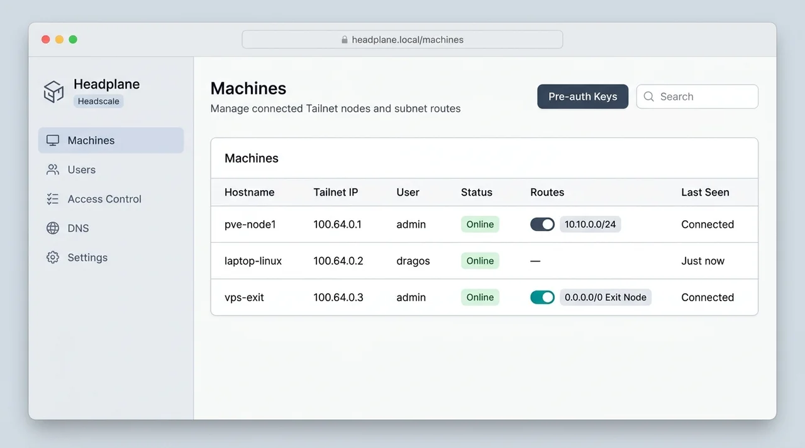
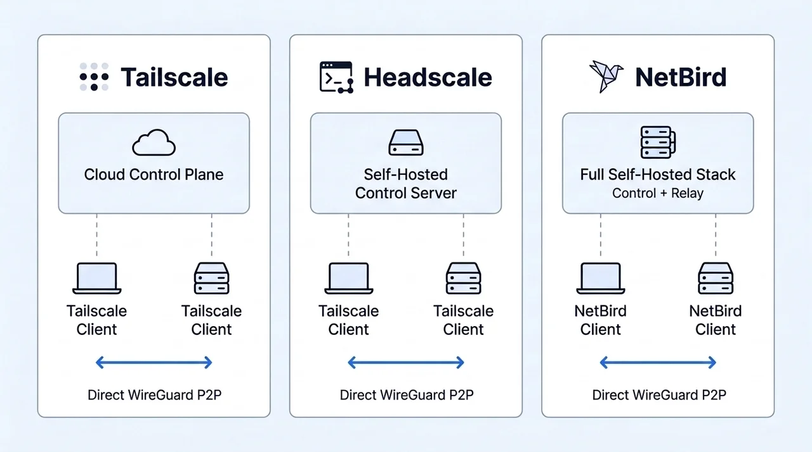

import ListCheck from "@components/widgets/ListCheck.astro";
import Notice from "@components/widgets/Notice.astro";
import Accordion from "@components/widgets/Accordion.astro";
import Tabs from "@components/widgets/Tabs.astro";
import Tab from "@components/widgets/Tab.astro";

*Disclosure: this guide contains referral links. If you buy through them, I may earn a commission at no extra cost to you.*

Tailscale makes mesh VPNs feel effortless. Install the client, log in, and every device on your account can reach every other device without port forwarding or manual WireGuard configs. If you have not tried the managed version yet, our [Tailscale setup guide](/tailscale-setup-guide/) walks through how it works out of the box.

The catch is that Tailscale's control server lives on their infrastructure. Your network topology, authentication records, and coordination plane sit on Tailscale's servers. For most homelabs that is a fair trade. But if you self-host because you want to own your infrastructure end to end, the same reason you might swap [Cloudflare Tunnels for Pangolin](/pangolin-cloudflare-tunnels-alternative/), Tailscale's control plane is the one piece you still do not own.

Headscale fixes that. It is an open-source, self-hosted implementation of the Tailscale control server. You run it on your own VPS, and standard Tailscale clients connect to it instead of Tailscale's cloud. Same WireGuard tunnels, same desktop clients, but you hold the coordination server.

I have been running Headscale with Headplane in my homelab and on a small Hetzner box. Here is the current setup that works cleanly.

## Why self-host your Tailscale control server?

People switch to Headscale for a few concrete reasons:

- **Data ownership**: Tailscale's coordination server knows every device on your network, its IP, its online status, and which peers can reach it. With Headscale, that state stays on your server.
- **No seat or tag caps**: Tailscale's Personal tier gives you 6 users and 50 tagged servers, which is generous, but Headscale has no artificial limits at all.
- **Custom authentication**: You can plug in any OIDC provider you already run, such as Authentik or Keycloak, or skip OIDC and use pre-auth keys.
- **Data residency**: If you need coordination metadata to stay in a specific country or jurisdiction (say, a Hetzner VPS in Germany or Finland), Headscale lets you enforce that.

Tailscale is still the right pick if you want zero maintenance. Headscale is for people who want Tailscale's WireGuard client ecosystem without giving up the control plane.

## Headscale vs Tailscale

| Feature | Headscale | Tailscale |
|---|---|---|
| Control server | Your VPS | Tailscale's cloud |
| Open source | Yes (BSD-3) | Server is proprietary |
| User limit | Unlimited | 6 users, 50 tagged nodes (free) |
| Client | Tailscale clients (unofficial) | Tailscale clients (official) |
| Authentication | OIDC or pre-auth keys | Tailscale identity / OIDC |
| MagicDNS | Supported (`dns.magic_dns`) | Full `.ts.net` |
| ACLs | JSON policy file | Web UI + HuJSON |
| Exit nodes & subnets | Yes | Yes |
| Public endpoints (Funnel) | No | Yes |
| DERP relays | Tailscale DERP or self-hosted | Tailscale global network |
| Web UI | Headplane | Tailscale Admin Console |
| Setup complexity | Moderate | Near-zero |

<Notice type="warning" title="Unofficial client support">
Headscale is an independent project, not built by Tailscale. Official Tailscale clients work with it, but Tailscale does not officially support this setup and could change their control protocol in future client releases. Pinning tested client versions on critical servers is good practice.
</Notice>

## What you need

<ListCheck>
- A **VPS with a public IP** (Ubuntu 24.04 or Debian 12). [Hetzner](https://go.bitdoze.com/hetzner) or [Hostinger](https://go.bitdoze.com/hostinger-vps) work well for this.
- A **domain name** pointing to your VPS (for example, `headscale.example.com`).
- **Docker and Docker Compose** installed on the VPS.
- **Port 443** (TCP) open for HTTPS, and optionally **3478** (UDP) if you enable the embedded DERP/STUN server.
- Tailscale clients installed on the devices you want to connect.
</ListCheck>

*VPS prices jumped across the board recently. If you are weighing a rented box against local hardware, see [what changed and when a mini PC wins](/vps-price-increases/).*

## Install Headscale and Headplane with Docker

Pairing Headscale (`v0.27+`) with **Headplane** gives you a clean web dashboard so you do not have to SSH into the server every time you want to approve a subnet route or check node status.



### Step 1: Create the directory structure

```bash
mkdir -p /opt/headscale/{headscale/config,headplane}
cd /opt/headscale
```

### Step 2: Create the Headscale configuration

Create `/opt/headscale/headscale/config/config.yaml`. Modern Headscale versions use the `database`, `noise`, and `dns` blocks shown below:

```yaml
server_url: https://headscale.example.com
listen_addr: 0.0.0.0:8080
metrics_listen_addr: 0.0.0.0:9090

database:
  type: sqlite
  sqlite:
    path: /var/lib/headscale/db.sqlite

private_key_path: /var/lib/headscale/private.key
noise:
  private_key_path: /var/lib/headscale/noise_private.key

prefixes:
  v4: 100.64.0.0/10
  v6: fd7a:115c:a1e0::/48

derp:
  server:
    enabled: false
    region_id: 999
    region_code: "headscale"
    region_name: "Headscale Embedded DERP"
    stun_listen_addr: "0.0.0.0:3478"
  urls:
    - https://controlplane.tailscale.com/derpmap/default
  auto_update_enabled: true
  update_frequency: 24h

dns:
  magic_dns: true
  base_domain: tailnet.internal
  nameservers:
    global:
      - 1.1.1.1
      - 9.9.9.9
```

Headscale generates `private.key` and `noise_private.key` automatically inside `/var/lib/headscale` on first boot.

### Step 3: Create the Headplane configuration

Generate a 32-character cookie secret first:

```bash
openssl rand -hex 16
```

Then create `/opt/headscale/headplane/config.yaml`:

```yaml
server:
  host: 0.0.0.0
  port: 3000
  base_path: /admin
  cookie_secret: "PASTE_YOUR_32_CHAR_SECRET_HERE"
  cookie_secure: true

headscale:
  url: http://headscale:8080
  public_url: https://headscale.example.com
  config_path: /etc/headscale/config.yaml
  config_strict: true
```

### Step 4: Create the Docker Compose file

Create `/opt/headscale/docker-compose.yml`:

```yaml
networks:
  headscale-net:
    driver: bridge

services:
  headscale:
    image: docker.io/headscale/headscale:latest
    container_name: headscale
    restart: unless-stopped
    command: serve
    volumes:
      - ./headscale/config:/etc/headscale
      - headscale-data:/var/lib/headscale
    ports:
      - "127.0.0.1:8080:8080"
      - "127.0.0.1:9090:9090"
    networks:
      - headscale-net
    healthcheck:
      test: ["CMD", "headscale", "health"]
      interval: 30s
      timeout: 5s
      start_period: 5s
      retries: 3

  headplane:
    image: ghcr.io/tale/headplane:latest
    container_name: headplane
    restart: unless-stopped
    depends_on:
      headscale:
        condition: service_healthy
    volumes:
      - ./headscale/config/config.yaml:/etc/headscale/config.yaml:ro
      - ./headplane/config.yaml:/etc/headplane/config.yaml
      - headplane-data:/var/lib/headplane
    ports:
      - "127.0.0.1:3000:3000"
    networks:
      - headscale-net
    environment:
      - NODE_ENV=production
    healthcheck:
      test: ["CMD", "/bin/hp_healthcheck"]
      interval: 30s
      timeout: 5s
      start_period: 5s
      retries: 3

volumes:
  headscale-data:
  headplane-data:
```

### Step 5: Start the stack

```bash
docker compose up -d
```

Check that both containers are healthy:

```bash
docker compose ps
docker compose exec headscale headscale health
```

### Step 6: Set up the reverse proxy

Expose Headscale at `/` and Headplane at `/admin` on the same domain over HTTPS. Caddy handles Let's Encrypt certificates automatically:

```bash
apt install caddy -y
```

Edit `/etc/caddy/Caddyfile`:

```caddy
headscale.example.com {
    reverse_proxy /admin* localhost:3000
    reverse_proxy localhost:8080
}
```

Reload Caddy:

```bash
systemctl reload caddy
```

To log into Headplane at `https://headscale.example.com/admin`, generate an API key from Headscale:

```bash
docker compose exec headscale headscale apikeys create --expiration 90d
```

Paste that API key into the Headplane login screen. If you also run Docker and UFW on the same VPS, review our [Docker and UFW firewall rules guide](/bsi-security-report-docker-ufw/) so ports stay locked down properly.

## Create your first user and register devices

Headscale groups devices under users (namespaces). Create your first user:

```bash
docker compose exec headscale headscale users create myuser
```

### Register a device

<Tabs>
<Tab name="Linux">

```bash
curl -fsSL https://tailscale.com/install.sh | sh
sudo tailscale up --login-server=https://headscale.example.com
```

Open the printed URL in your browser and follow the registration command shown on screen (or approve it in Headplane).

</Tab>
<Tab name="macOS">

Install Tailscale from the Mac App Store or Homebrew, then run:

```bash
/Applications/Tailscale.app/Contents/MacOS/Tailscale up \
  --login-server=https://headscale.example.com
```

</Tab>
<Tab name="Windows">

Install Tailscale for Windows, then run from PowerShell or Command Prompt:

```powershell
tailscale up --login-server=https://headscale.example.com
```

</Tab>
</Tabs>

For headless servers or Docker hosts, pre-auth keys are much cleaner than browser logins. Recent Headscale releases (v0.25+) expect the numeric user ID rather than the username, so check `users list` first:

```bash
# On the VPS: check the numeric user ID (usually 1 for your first user)
docker compose exec headscale headscale users list

# Create a reusable pre-auth key for user ID 1
docker compose exec headscale headscale preauthkeys create \
  --user 1 --reusable --expiration 24h

# On the server you want to join
sudo tailscale up --login-server=https://headscale.example.com --authkey=tskey-xxxxx
```

Verify connected nodes from any machine:

```bash
docker compose exec headscale headscale nodes list
tailscale status
tailscale ping other-device-name
```

## Configure ACLs (Access Control Lists)

By default, every node can talk to every other node. To restrict access, create `/opt/headscale/headscale/config/acls.json`:

```json
{
  "groups": {
    "group:admin": ["myuser@"],
    "group:servers": ["myuser@"]
  },
  "acls": [
    {
      "action": "accept",
      "src": ["group:admin"],
      "dst": ["*:*"]
    },
    {
      "action": "accept",
      "src": ["group:servers"],
      "dst": ["group:servers:*"]
    }
  ]
}
```

Point `config.yaml` to the policy file:

```yaml
policy:
  mode: file
  path: /etc/headscale/acls.json
```

Restart Headscale to apply:

```bash
docker compose restart headscale
```

## Set up exit nodes and subnet routes

To route all internet traffic through a VPS or home server, advertise it as an exit node (and optionally advertise a home LAN subnet at the same time):

```bash
sudo tailscale up \
  --login-server=https://headscale.example.com \
  --advertise-exit-node \
  --advertise-routes=192.168.1.0/24
```

Approve the routes in Headplane's web UI or via CLI (using the node's numeric ID from `headscale nodes list`):

```bash
docker compose exec headscale headscale nodes list-routes
docker compose exec headscale headscale nodes approve-routes \
  --identifier <node-id> \
  --routes 0.0.0.0/0,::/0,192.168.1.0/24
```

On client devices, use the exit node and accept advertised LAN routes:

```bash
sudo tailscale up \
  --login-server=https://headscale.example.com \
  --exit-node=<exit-node-name> \
  --accept-routes
```

Linux clients ignore subnet routes until `--accept-routes` is passed. macOS and Windows accept them automatically once approved.

## Optional: Connect an OIDC identity provider

If you run Authentik, Keycloak, or Pocket ID, add an `oidc` block to `config.yaml` so users sign in through SSO instead of manual registration keys:

```yaml
oidc:
  issuer: "https://authentik.example.com/application/o/headscale/"
  client_id: "your-client-id"
  client_secret: "your-client-secret"
  scope: ["openid", "profile", "email"]
  allowed_domains:
    - example.com
```

## Optional: Enable the embedded DERP relay

Headscale uses Tailscale's global DERP map by default, which works well for most setups. If you want zero reliance on Tailscale's relay servers, open **UDP 3478** on your VPS firewall and flip `derp.server.enabled: true` in `config.yaml`.

## Backups, updates, and quick troubleshooting

Before upgrading Headscale, back up the Docker volume containing `db.sqlite` and `noise_private.key` (along with `/opt/headscale/headscale/config`). If you lose `noise_private.key`, every connected client will fail to re-authenticate until re-registered.

```bash
# Quick backup of config and SQLite database + keys
docker compose stop headscale
docker run --rm -v headscale_headscale-data:/data -v /opt/headscale/backups:/backup alpine \
  tar czf /backup/headscale-$(date +%F).tar.gz -C /data .
docker compose up -d
```

To upgrade both containers safely, check the Headscale release notes for schema changes first, then run:

```bash
docker compose pull && docker compose up -d
```

If a client refuses to connect or falls back to slow relays, three commands tell you almost everything:

```bash
# On the VPS: check control server errors or YAML syntax issues
docker compose logs --tail=50 headscale

# On the client: verify NAT type, UDP reachability, and DERP latency
tailscale netcheck
tailscale status
```

## How Headscale compares to Tailscale and NetBird

If you are still deciding between the three main mesh VPNs, read our full [NetBird vs Headscale vs Tailscale comparison](/netbird-vs-headscale-vs-tailscale/).



In short:

- **Tailscale**: Best when you want five-minute setup and reliable iOS/Android apps. See the [Tailscale setup guide](/tailscale-setup-guide/).
- **Headscale**: Best when you want Tailscale's client ecosystem with a self-hosted control plane.
- **NetBird**: Best when you want a self-hosted mesh VPN with its own open-source clients, built-in web UI, and mobile apps that support custom servers cleanly. See the [NetBird self-hosted setup guide](/netbird-self-hosted-setup/).
- **Pangolin**: Best when you want to expose specific web services through a reverse proxy tunnel rather than joining devices to a mesh. See the [Pangolin setup guide](/pangolin-cloudflare-tunnels-alternative/).

## Performance and reliability in practice

Running Headscale on a $5/month Hetzner VPS gives you direct WireGuard speeds between peers (typically saturating a 100 Mbps to 1 Gbps link depending on your ISP). The control server handles very little traffic because data flows peer-to-peer.

The main weak spots are mobile clients and MagicDNS edge cases. Changing the login server on iOS is clunky compared to desktop, and you do not get Tailscale Funnel for public HTTPS endpoints. If you are already managing [Docker containers on a home server](/docker-containers-home-server/) and want full control over your coordination server, Headscale is solid once configured.

## FAQ

<Accordion label="Can I migrate from Tailscale to Headscale?" group="headscale-faq" expanded="true">
Yes, though there is no automatic migration. On each device, run `tailscale down` and re-register with `tailscale up --login-server=https://headscale.example.com`. Do it one machine at a time if you are working remotely so you do not lock yourself out.
</Accordion>

<Accordion label="Does Headscale work with the official Tailscale Android and iOS apps?" group="headscale-faq">
Partially. On Android you can long-press or open the debug menu in the Tailscale app to set a custom control URL. On iOS it is awkward and less reliable for non-technical users. If mobile clients are a priority for your family or team, [NetBird](/netbird-self-hosted-setup/) handles custom servers on iOS and Android much better.
</Accordion>

<Accordion label="Can I run Headscale and Tailscale at the same time?" group="headscale-faq">
Not on the same client instance, because one Tailscale daemon connects to one control server. You can keep some devices on Tailscale and others on Headscale, though they will live on separate networks.
</Accordion>

<Accordion label="What happens if my Headscale VPS goes down?" group="headscale-faq">
Existing WireGuard tunnels between already-connected peers keep working. You only lose the ability to register new nodes, rotate keys, or push ACL updates until the VPS comes back. Monitor it with [Uptime Kuma](/deploy-uptime-kuma/) or [Beszel](/beszel-uptime-kuma/) so you catch downtime early.
</Accordion>
