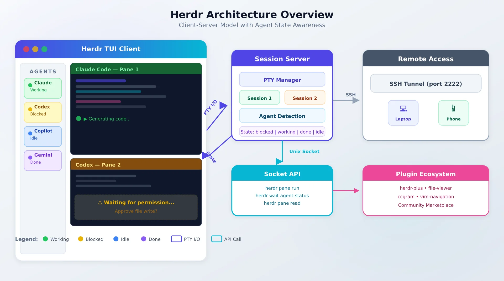
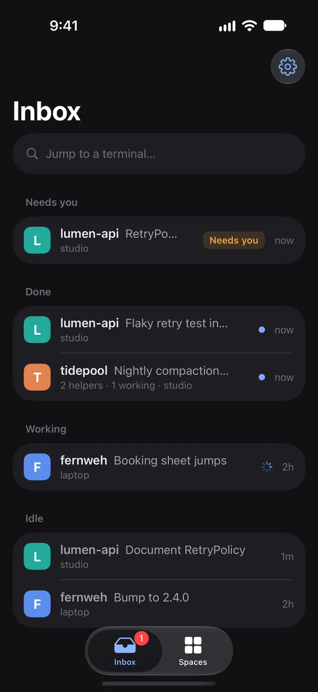
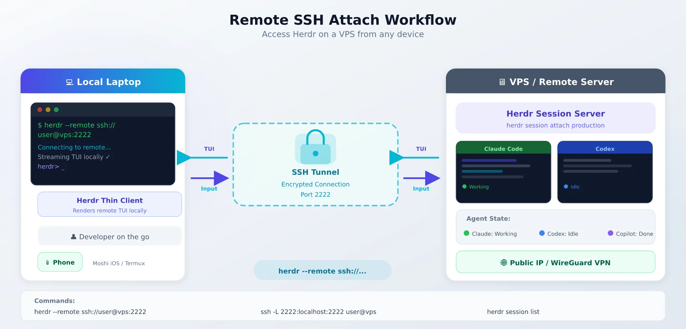
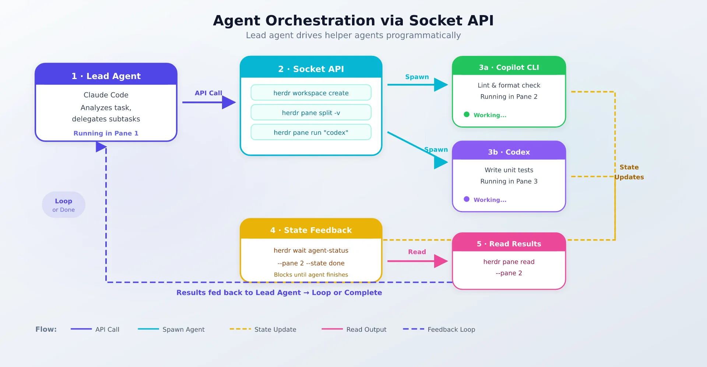

import Button from "@components/widgets/Button.astro";
import Notice from "@components/widgets/Notice.astro";
import ListCheck from "@components/widgets/ListCheck.astro";
import Accordion from "@components/widgets/Accordion.astro";
import Tabs from "@components/widgets/Tabs.astro";
import Tab from "@components/widgets/Tab.astro";
import YouTubeEmbed from "@components/widgets/YouTubeEmbed.astro";

[Herdr](https://herdr.dev/) is a free, Apache-2.0 runtime for coding agents with 52,000+ GitHub stars, now split into two official products: **Herdr TUI (`v0.9.5`)** inside your terminal and the native **Herdr Desktop (`v0.1.16`) + Mobile apps** running on `herdr-core` (`v0.1.21`).

If you run three, five, or ten AI coding agents at once (Claude Code in one pane, [Codex](/codex-app-any-model/) in another, OpenCode or Pi in a third), scattered terminal tabs turn into guesswork. You never know which agent is still churning and which one has been sitting at a permission prompt for twenty minutes. Herdr fixes that with a live status sidebar (`working`, `blocked`, `done`, `idle`), persistent background sessions, and multi-machine SSH support.

A lot changed since I first reviewed Herdr in July 2026. Back then it was a 15,000-star solo project under AGPL. Today Herdr is backed by Y Combinator and a $6M seed led by Bessemer Venture Partners, relicensed to **Apache-2.0**, and ships a full desktop app plus free iPhone, iPad, and Android apps alongside the original terminal multiplexer. Here is how the whole stack actually works as of November 2026 and which version to pick.

<Notice type="info" title="Two Herdr products now, separate daemons">
**Herdr TUI (`herdr` v0.9.5)** runs inside your existing terminal with its own server. **Herdr Desktop (`herdr-app` v0.1.16)** and **Herdr Mobile** run on **`herdr-core` (`hc` v0.1.21)**, a newer daemon that uses the open OSC 7501 status protocol. They do **not** share running agents. Panes started in `herdr` TUI will not appear in `herdr-app` or the official Herdr Mobile app.
</Notice>

## What is Herdr and how do the two versions differ?

Herdr keeps your coding agents alive in a background server so closing your terminal, dropping SSH, or sleeping your laptop never interrupts a run, while surfacing which agents need input in one sidebar across local and remote SSH machines.

<YouTubeEmbed
  url="https://www.youtube.com/embed/NKppWN1atkQ"
  label="Herdr: The Terminal Multiplexer That Actually Works"
/>

Pick the right track before you install:

| Track | Binary / repo | Latest version (Nov 2026) | Best for | Extensions | Official mobile app |
|---|---|---|---|---|---|
| **Herdr TUI** | `herdr` (`herdrdev/herdr`, 52K+ stars) | `v0.9.5` (Oct 14, 2026) | Terminal purists, SSH-only VPS work, Ghostty/Kitty/WezTerm users | TUI plugins (`herdr plugin install` + `herdr plugin update`) | No (use Moshi, ColliePWA, or SSH) |
| **Herdr App + Core** | `herdr-app` + `hc` (`herdrdev/herdr-app`, `herdrdev/herdr-core`) | `v0.1.16` / `v0.1.21` (Nov 2026) | Native GPU window, agent-rebuilt UIs, official phone control | 312+ layouts & 576+ JS mods (`herdr.dev/gallery`) | Yes (free iOS, iPadOS, Android over SSH/Tailscale) |



Both tracks share the same core idea: real PTYs owned by a local background daemon, thin clients attaching over a socket or SSH, no cloud middleman, and Apache-2.0 source code. The difference is how you interact with them. Herdr TUI stays a single ~11 MB Rust binary inside your existing terminal. Herdr App wraps `herdr-core` in a native Rust/GPUI window (with Ghostty's terminal engine) whose layouts and JavaScript mods your agent can rewrite on disk.



If you already compare [AI coding tools and assistants](/ai-coding-tools/) or wrappers like [FreeBuff](/freebuff-free-ai-coding-agent/) and [Zcode](/zcode-ai-review/), Herdr sits one layer below them. It is the runtime and workspace holding the real agent CLIs, not a wrapper around one vendor's API.

## Why terminal-native agent multiplexing still wins

Running agents in plain tabs breaks down around agent number three. You forget which window asked for a bash approval, a laptop lid closes mid-refactor, or a headless Linux VPS cannot run an Electron IDE wrapper.

Herdr keeps overhead near zero:
- **Live agent state tracking:** `working`, `blocked`, `done`, and `idle` states roll up into one sidebar. In Herdr TUI, status comes from process matching, screen detection, and optional hooks. In `herdr-core`, any program emitting **OSC 7501** (`printf '\e]7501;state=blocked:app=my-agent\e\\'`) reports status straight from the source with zero screen scraping.
- **Persistent sessions across machines:** Add a VPS over SSH (`herdr machine add` in TUI or `hc machine add` in `herdr-core`) and its agents join your local sidebar. Close your laptop; the VPS keeps working.
- **Mouse-native TUI:** Click panes, drag borders to resize, right-click for splits and context menus. You get tmux persistence without memorizing fifty key chords first.
- **Agent-to-agent orchestration:** One agent can spawn a helper, wait for it to finish, read its output, or steer it mid-task.

## How to install Herdr (TUI or Desktop + Core)

Install Herdr TUI if you live in Ghostty, WezTerm, Kitty, or plain SSH; install Herdr Desktop (`herdr-app`) if you want the native window, community gallery layouts, and the official Herdr Mobile app.

<Tabs>
<Tab name="Herdr TUI (Linux / macOS)">

```bash
curl -fsSL https://herdr.dev/install.sh | sh
# or: brew install herdr
# or: mise use -g herdr

herdr --version
```

`herdr update` keeps the binary current and warns you if any running servers are still on an older version.

</Tab>
<Tab name="Herdr TUI (Windows / Nix)">

```powershell
# Windows PowerShell
irm https://herdr.dev/install.ps1 | iex
```

For Nix users, `herdrdev/herdr-nix` publishes prebuilt release binaries on Cachix so Nix no longer compiles Rust + Zig from scratch on every install.

</Tab>
<Tab name="Herdr Desktop App + Core">

```bash
# macOS (Apple Silicon)
brew install --cask herdr-app

# Linux (x86_64 and ARM64, requires Vulkan)
curl -fsSL https://releases.herdr.dev/app/install.sh | sh

# Standalone herdr-core (hc) on a headless Linux VPS
curl -fsSL https://releases.herdr.dev/core/install.sh | sh
```

The desktop installer bundles `herdr-core` (`hc`). On a headless VPS, install `herdr-core` standalone and connect from your desktop app or Herdr Mobile over SSH or Tailscale.

</Tab>
</Tabs>

### Getting started in Herdr TUI (`v0.9.5`)

Start a named session and open panes for your agents:

```bash
herdr session attach work
```

Core prefix shortcuts (default `Ctrl+B`, or just use your mouse):
- `Ctrl+B` then `v` (vertical split) or `-` (horizontal split)
- `Ctrl+B` then arrow keys (switch panes)
- `Ctrl+B` then `q` or `d` (detach while agents keep running)

Install hooks for richer Claude Code or Copilot status, and re-run the Codex integration if you upgraded to `v0.9.5` (Herdr `v0.9.5` removed noisy Codex turn hooks and switched Codex status back to screen detection):

```bash
herdr integration install claude
herdr integration install codex
herdr integration install copilot
```

For remote Linux servers, both TUI and `herdr-core` let you pull remote workspaces into one local window without running a desktop on the VPS:



```bash
# TUI multi-machine sidebar (v0.9.0+)
herdr machine add workbox --label "Build box"
herdr --remote workbox

# herdr-core remote machine (v0.1.21+)
hc machine add box@my-server
hc run --on my-server --bg claude
hc ls
```

<Notice type="warning" title="Keep remote Linux agents alive after SSH logout">
If systemd terminates user processes on logout, enable linger on your VPS (`sudo loginctl enable-linger $USER`). Starting in `herdr-core v0.1.21`, `hc machine add` and `hc server status` check this automatically and print the exact fix.
</Notice>

## How I use Herdr day to day (video walkthrough)

<YouTubeEmbed
  url="https://www.youtube.com/embed/wwCDi3kN0ck"
  label="How I Use Herdr Day to Day: Hands-On Walkthrough"
/>

My daily setup uses a small slice of Herdr, and that slice is why it replaced tmux for me:

- **Mouse support ended my tmux friction.** I like clicking panes, dragging borders, and opening splits from a menu without fighting `.tmux.conf`.
- **Zero-config detection works.** Launch Claude Code, Codex, OpenCode, [Hermes Agent](/hermes-agent-setup-guide/), or [Oh My Pi (OMP)](https://omp.sh/) in a pane and the sidebar flags it the second it blocks for approval.
- **Closing the terminal stops nothing.** Shut the laptop, drop Wi-Fi, or reboot your local machine while your agents live on a VPS. Reattach and every pane is still ticking.
- **Agents drive panes themselves.** In the video I ask OMP to open a pane, check disk space, and spin up a second agent to handle a subtask. It reads the Herdr skill and runs the CLI directly.

## How does agent-to-agent orchestration work in Herdr?

Both Herdr TUI and `herdr-core` let one coding agent spawn helper agents, wait until they finish or block, and read their output back without you copying text between terminals.



<Tabs>
<Tab name="herdr-core (hc) orchestration">

```bash
# Start a Codex reviewer in the background and have it report back
hc run --bg --name review codex "review src/x.rs. Done: hc send $HC_TERMINAL_ID"

# Wait for completion and read the last 60 lines
hc wait review
hc read --lines 60 review

# Steer a running helper mid-task
hc send review "also check the edge-case tests"
```

Pass `hc --skill` to an agent once and it learns the whole command surface.

</Tab>
<Tab name="Herdr TUI orchestration">

```bash
herdr pane split --vertical
herdr pane run "claude --prompt 'Fix the authentication bug'"
herdr wait --pane 2 --state done
herdr pane read --pane 2 --lines 50
```

</Tab>
</Tabs>

No traditional multiplexer gives you this out of the box. In tmux or Zellij, a pane is dumb text; in Herdr, a lead agent can wait for a helper to hit `done` or `blocked` before deciding what to do next. If you are building custom agent workflows, compare this with [building an AI agent with Mastra](/build-ai-agent-mastra/) or [Hermes Kanban](/hermes-kanban-setup-guide/).

## Herdr vs tmux vs Zellij: which multiplexer should you pick?

Pick **Herdr** for multi-agent AI coding where live blocked/working status and agent orchestration save real time; keep **tmux** if you rely on decades-old scripts, custom status bars, and rock-solid server administration; pick **Zellij** if you want built-in plugin sandboxing and floating panes without AI-specific hooks.

| Feature | Herdr TUI (`v0.9.5`) | Herdr App + Core (`v0.1.16`) | tmux | Zellij |
|---|---|---|---|---|
| Agent state sidebar | Yes (hooks + screen detection) | Yes (open OSC 7501 protocol) | No | No |
| Agent-to-agent CLI (`wait`/`send`) | Yes (`herdr`) | Yes (`hc`) | Terminal scripting only | Plugin scripting only |
| Mouse-native UI | Yes | Native GPU window (GPUI) | Needs `.tmux.conf` | Yes |
| Multi-machine SSH sidebar | Yes (`herdr machine add`) | Yes (`hc machine add`) | Manual SSH per pane | Manual SSH per pane |
| Official mobile app | No (Moshi / ColliePWA / SSH) | Yes (iOS, iPadOS, Android) | No | No |
| Built-in plugin sandboxing | No (trusted code) | No (trusted JS mods) | No | Yes (WASM) |
| License | Apache-2.0 | Apache-2.0 | ISC | MIT |

For a broader look that includes [Superlogical Rex](/superlogical-rex/), [Tern](/tern-terminal/), and TuiOS, read our [six-way terminal multiplexer comparison](/best-terminal-multiplexers/).

## Plugins, layouts, and clients in the Herdr ecosystem

The Herdr ecosystem split cleanly along the two-product boundary in late 2026:

- **Herdr TUI plugins:** Over 1,000 indexed plugins at `herdr.dev/tui/plugins/`, now with built-in `herdr plugin update` (shipped in `v0.9.4`). See our vetted picks in [best Herdr plugins](/best-herdr-plugins/).
- **Herdr Desktop layouts & mods:** 312 community layouts and 576 JavaScript mods from 533 contributors at `herdr.dev/gallery/`. Tour the best ones in [Herdr app layouts and mods](/herdr-app-layouts-mods/).
- **Web UIs, desktop, and phone clients:** Between the new official Herdr Mobile app, [Moshi](/control-ai-agents-from-phone-moshi-herdr/) (which supports both Herdr TUI and `herdr-core`), ColliePWA, and `herdr-web-ui`, compare every option in [best Herdr clients](/best-herdr-clients/).

## Honest caveats before you switch

<ListCheck>
<ul>
<li><strong>Two separate daemons cause real confusion:</strong> Agents started in <code>herdr</code> TUI do not show up in <code>herdr-app</code> or Herdr Mobile. Pick one runtime per workflow.</li>
<li><strong>Pre-1.0 pace:</strong> Both <code>herdr</code> (0.9.x) and <code>herdr-app</code> (0.1.x) ship fast. Mod APIs and hooks still shift between releases.</li>
<li><strong>No sandboxing:</strong> Both TUI plugins and Desktop JS mods run as your user with full environment access. Audit code before installing from community indexes.</li>
<li><strong>Desktop app telemetry default:</strong> Herdr TUI has zero telemetry; <code>herdr-app</code> release builds enable telemetry by default (disable it in Settings &gt; Privacy).</li>
<li><strong>No process survival across machine reboots:</strong> Closing the client keeps agents alive, but rebooting the host stops running processes. Turn on <code>restore_screen = true</code> in <code>herdr-core</code> config if you want the last screen preserved above a fresh shell.</li>
</ul>
</ListCheck>

## Frequently asked questions

<Accordion label="Is Herdr free and open source?" group="faq" expanded="true">
Yes. Herdr TUI, Herdr Desktop App, and `herdr-core` are all licensed under **Apache-2.0** (relicensed from AGPL-3.0 earlier in 2026). The official Herdr Mobile app on iOS and Android is also free with no account required.
</Accordion>

<Accordion label="Should I start with Herdr TUI or the Herdr Desktop App?" group="faq">
Start with **Herdr Desktop App** (`herdr-app`) if you want a native GPU window, community layouts/mods, and the free official Herdr Mobile app out of the box. Pick **Herdr TUI** (`herdr`) if you love Ghostty, WezTerm, or Kitty and want a pure terminal multiplexer with the mature TUI plugin ecosystem.
</Accordion>

<Accordion label="Why do my Herdr TUI sessions not appear in Herdr Desktop or Mobile?" group="faq">
They run on different background servers. Herdr TUI uses its own `herdr` daemon; Herdr Desktop and Herdr Mobile connect to `herdr-core` (`hc`). Both can run on the same host, but they do not share panes.
</Accordion>

<Accordion label="Which AI coding agents work with Herdr?" group="faq">
Any CLI agent runs inside Herdr's terminals. Claude Code, Codex, Copilot CLI, Cursor Agent, Goose, oh-my-pi (`omp`), OpenCode, Pi, Gemini CLI, Grok CLI, [Hermes Agent](/hermes-agent-setup-guide/), and Amp all work. In `herdr-core`, any tool or script emitting OSC 7501 gets live status automatically.
</Accordion>

<Accordion label="Does Herdr replace tmux completely?" group="faq">
For multi-agent AI coding sessions, yes for most developers. For traditional server administration where you rely on decades of tmux plugins and `.tmux.conf` muscle memory, many people keep tmux for ops and run Herdr for coding agents.
</Accordion>

## Verdict

Herdr earned its 52,000 stars by solving the exact bottleneck of 2026 coding workflows: knowing which of your parallel agents needs you right now without hunting through ten tabs. Try `herdr-app` (plus Herdr Mobile) if you want the modern native experience on `herdr-core`, or stick with `herdr` TUI `v0.9.5` if you never want to leave your terminal emulator.

<Button text="Visit herdr.dev" link="https://herdr.dev/" variant="solid" color="blue" size="lg" icon="arrow-right" />
<Button text="Explore Herdr on GitHub" link="https://github.com/herdrdev/herdr" variant="outline" color="blue" size="md" />

Continue the series: [control AI agents from your phone with Herdr Mobile or Moshi](/control-ai-agents-from-phone-moshi-herdr/), [best Herdr clients](/best-herdr-clients/), [best Herdr plugins](/best-herdr-plugins/), and our tour of [Herdr Desktop layouts and mods](/herdr-app-layouts-mods/). For models to run inside your panes, check [cheapest AI models](/best-cheap-models-hermes-agent/) and [top AI GitHub repos](/top-ai-github-repos/).
