import Button from "@components/widgets/Button.astro";
import Notice from "@components/widgets/Notice.astro";
import ListCheck from "@components/widgets/ListCheck.astro";
import Accordion from "@components/widgets/Accordion.astro";
import Tabs from "@components/widgets/Tabs.astro";
import Tab from "@components/widgets/Tab.astro";

A few weeks ago the Herdr project shipped something new: a native desktop app for running coding agents. The app itself is good (I'll get to that), but the interesting part is what happened next. Herdr's entire interface is files on disk that your agent can read and rewrite, so people started asking their agents to rebuild the app. Then they posted the results.

The official [Herdr gallery](https://herdr.dev/gallery/) now lists 215 layouts, 435 mods, and 393 contributors as of early November 2026, and the homepage's tagline is "no two Herdrs look alike." That's not marketing. Scroll the page and you'll see a kanban board next to a Pokémon game next to a Mac OS 9 clone next to a newspaper front page. All of them are the same app.

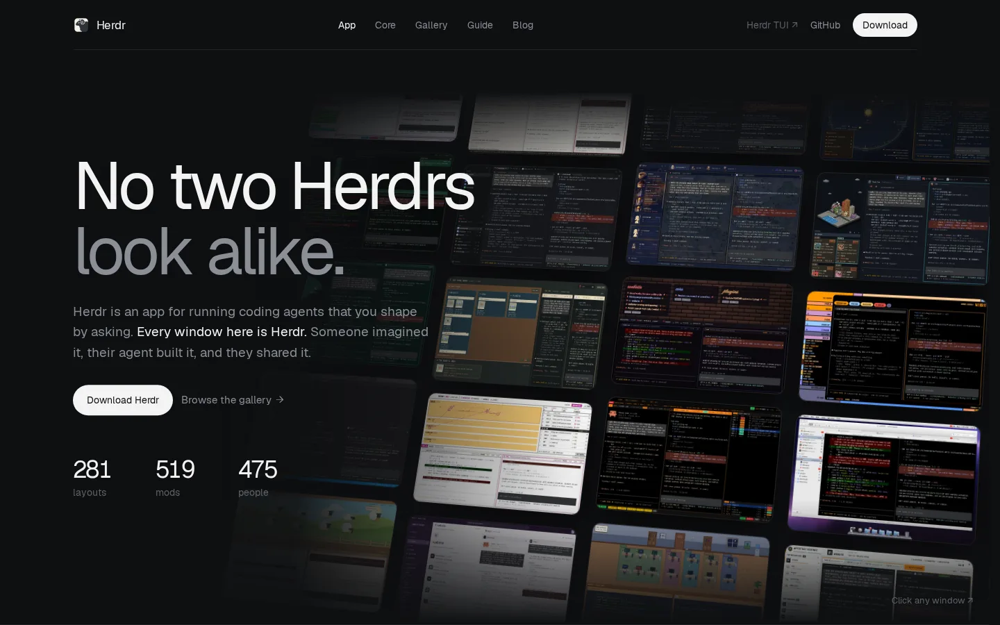

This is part 5 of our Herdr series. We covered the [original terminal multiplexer](/herdr-agent-multiplexer/), [remote control from your phone](/control-ai-agents-from-phone-moshi-herdr/), the [best Herdr clients](/best-herdr-clients/), and the [best Herdr plugins](/best-herdr-plugins/). This one is about the new app and the community that is already reshaping it.

<Notice type="info" title="What this covers">
What the Herdr app is, how its customization system works, a screenshot tour of the best community layouts and mods, exact install steps, and honest caveats (including the one about mods being trusted code). Everything below is real community work, with links to each author's repo.
</Notice>

## What the Herdr app is

Herdr is a free, open-source desktop app (Apache 2.0) for running terminals and coding agents. It's written in Rust on [GPUI](https://github.com/zed-industries/zed) (the GPU UI framework from Zed), the terminal engine comes from [Ghostty](/ghostty-terminal/), and mods run on an embedded QuickJS runtime. The window is split from the agent core: close the window and every terminal keeps running in `herdr-core`, which is the same runtime that powers the [terminal multiplexer](/herdr-agent-multiplexer/) we reviewed earlier this year.

The repo was created on October 16, 2026, the changelog starts at 0.1.4 around October 23, and it's already at 0.1.13 with weekly releases. It's young and moving fast.

The model:

- **Spaces** hold work on one machine, usually one repo. Each space has **tabs**, and tabs split into **panes** holding terminals or mod panels.
- An **agents sidebar** collects agents from all your spaces and shows state: Working, Blocked (waiting on you), Done (finished while you looked away), Idle.
- **Machines** are SSH hosts. Add one and its spaces run terminals on that machine while your window stays local. Remote agents keep working when your laptop sleeps.
- Agents can hand work to other agents and get the report back in their own input, without you copying anything between windows.

**Install** (the installer adds `herdr-core` if it's missing):

<Tabs>
<Tab name="macOS">

```sh
brew install --cask herdr-app
```

Or grab [Herdr.dmg](https://releases.herdr.dev/app/Herdr.dmg) and drag it to Applications. Apple Silicon only; Intel Macs build from source.

</Tab>
<Tab name="Linux">

```sh
curl -fsSL https://releases.herdr.dev/app/install.sh | sh
```

x86-64 and ARM64. Needs a desktop session and a working Vulkan driver.

</Tab>
<Tab name="Windows">

```powershell
irm https://releases.herdr.dev/app/install.ps1 | iex
```

x64 Windows 10 1803 or newer.

</Tab>
</Tabs>

<Button text="Get the Herdr app" link="https://herdr.dev/" variant="solid" color="blue" size="md" icon="arrow-right" />

## How customization works (this is the clever bit)

Most apps give you a settings page and a theme dropdown. Herdr gives your agent the source files.

Everything that shapes the window lives in `~/.config/herdr-app/`:

- **Layouts** (`layouts/<name>.json`) arrange the whole window: what goes where, which panels exist, how it looks. The app ships with three: Herdr, Terminals, and Herdr 98 (yes, a Windows 98 joke).
- **Mods** (`mods/<name>/*.js`) are small JavaScript programs that draw panels, menus, and dialogs. A mod can be a stock ticker, a git graph, a usage meter, or a sheep.
- **Themes** set colors, **keys.json** remaps every command, **settings.json** holds preferences.
- `AGENTS.md` in that folder is the API reference written for agents, not humans.

The workflow: you open the command palette (Ctrl+Shift+P, Cmd+Shift+P on macOS), find the action you want, or just tell your agent in plain words what to change. It edits the files, the window live-reloads on save, and a broken edit keeps the last good version and reports the error instead of crashing. `herdr-app --skill` prints the full agent guide; `herdr-app ls` and `herdr-app status` let scripts inspect the open window.

Two practical rules from the docs:

1. Duplicate a shipped layout or mod before changing it. Herdr updates the shipped ones on start and would overwrite your edits.
2. Mods are trusted code with your full environment, not sandboxed extensions. Read one before installing it blind, or have your agent audit it first (it's good at that).

## The gallery: 215 layouts, 435 mods, and counting

The [gallery](https://herdr.dev/gallery/) is where all of this lands. Every entry is a public GitHub repo tagged `herdr-layout`, `herdr-mod`, or `herdr-theme`, indexed automatically the same way the [plugin marketplace](/best-herdr-plugins/) works. Nobody curates it. That's the point and also the caveat.

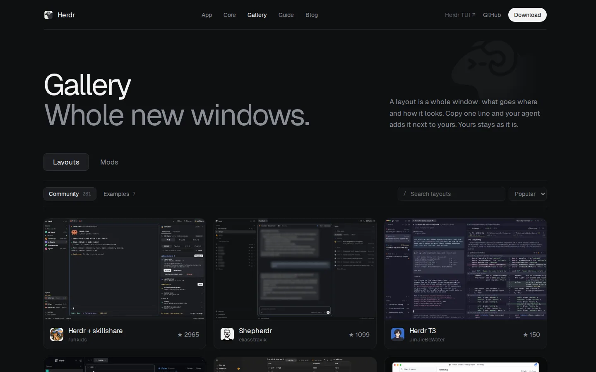

Installing anything is one line. Each entry shows a prompt like:

```
Read ~/.config/herdr-app/AGENTS.md, then add this layout: herdr.dev/layouts/isaacin42/herdr-layouts--bloomberg
```

Paste it into an agent inside Herdr. The agent fetches the recipe, writes the files, runs `herdr-app check` to verify them, and your new layout appears under Ctrl+Shift+L. Your existing layout stays untouched.

Sharing yours works the same way in reverse: a folder with `layouts/<name>.json` (or `mods/<name>/`), a `RECIPE.md` another agent could rebuild it from, a `preview.png` screenshot, pushed to a public GitHub repo with the right topic. Most of the gallery was written this way, agent-built and agent-published, which explains how it hit 650 entries in about three weeks.

## The official examples

Herdr ships example layouts that show the range. These four are worth opening first because they're maintained and they teach the mod API.

**Pasture** is the one everyone screenshots. Agents appear as sheep in a meadow: working sheep wander, idle sheep graze, finished sheep sleep, and a blocked agent jumps up and down with a bubble. Click a sheep and its terminal opens in the workspace. It's silly and genuinely useful at the same time, which is the whole thesis of this app.

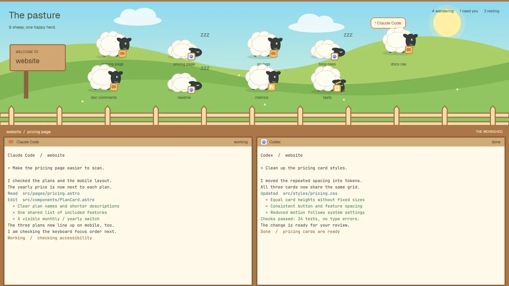

**Board** is the practical twin: agent cards in "Needs you," "Working," "Done," and "Idle" columns. If you run more than three agents at once, this is the view you'll actually use daily.

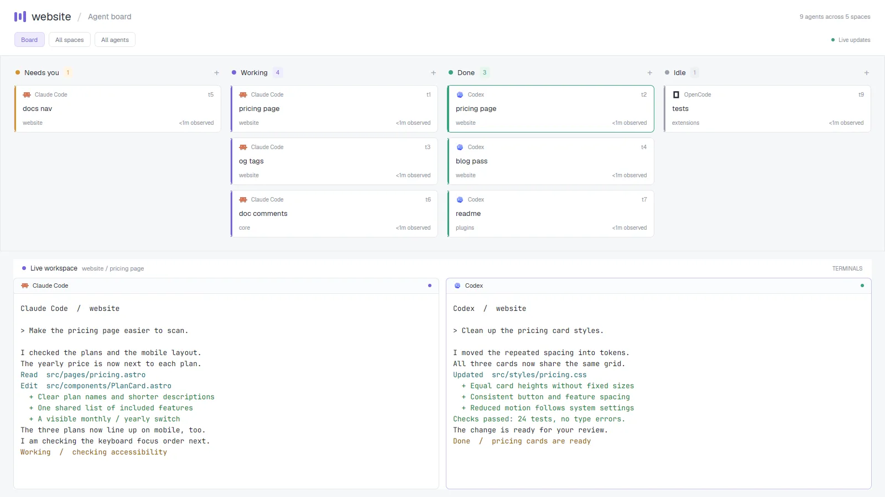

**Code** rearranges the app into an IDE: file tree, editor-sized terminal, agents as a side rail. And **Mission Control** goes full NASA, with stations, a big board, and agents on console duty. There's also Chat, Call, and Threads if you want the app to behave like a messenger.

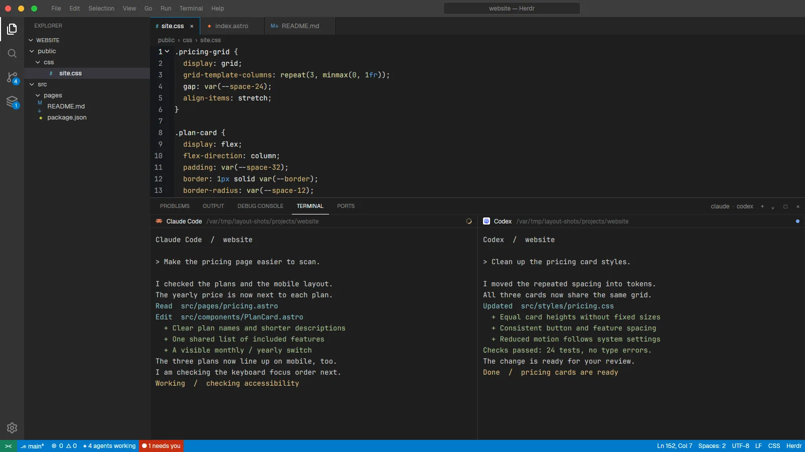

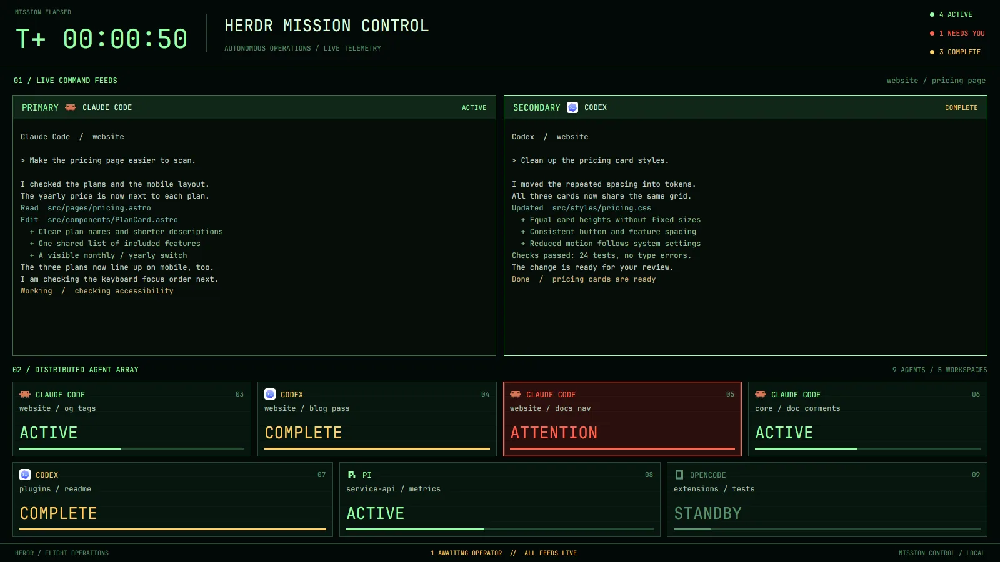

## The community's practical layouts

These are the ones I'd actually run. Sorted by GitHub stars as of November 8, 2026.

### Herdr + skillshare — 2,939 stars

The most-starred thing in the gallery is a layout from [@runkids](https://github.com/runkids) that pairs the app with a **skill manager panel**: it indexes agent skills, shows which are loaded, and lets you toggle them per space. Basically a control surface for the thing that's controlling your app.

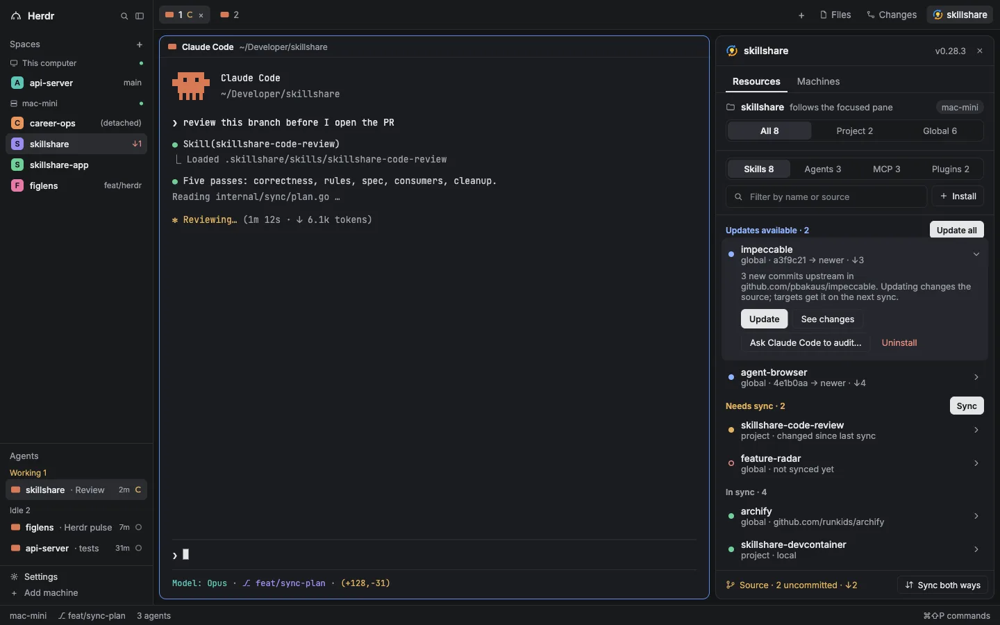

### Shepherdr — 1,082 stars

[@eliasstravik](https://github.com/eliasstravik/shepherdr)'s mission-control layout: your agents as a flock, a shepherd assistant panel that summarizes who needs you, and a task rail down the side. It's the second-most-starred entry and the one people fork most.

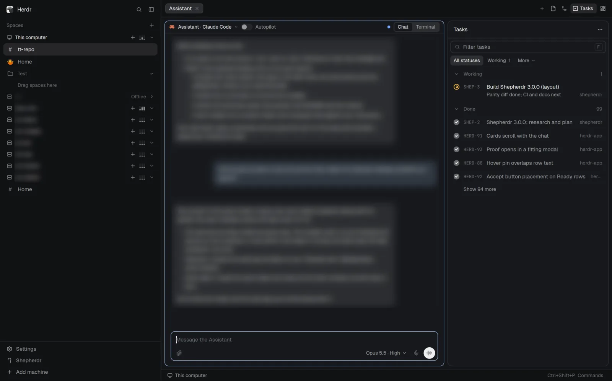

### Herdr T3 — 139 stars

[@JinJieBeWater](https://github.com/JinJieBeWater)'s three-pane review cockpit: agent output on the left, the actual terminal in the middle, diffs and checks on the right. Built for the "review what the agent did" part of the loop instead of the "watch it type" part.

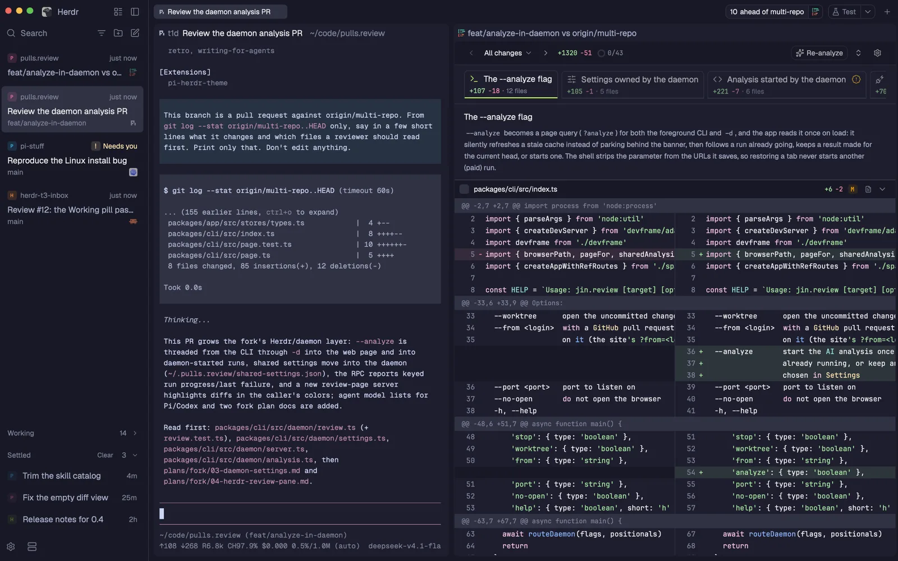

### Flockbook — 47 stars

[@minchenlee](https://github.com/minchenlee) turned it into something that looks like Linear met ChatGPT: a Needs-you inbox, workspaces with status chips, and an agent chat thread with tool-call cards you can expand. If you think of agents as conversations rather than terminals, this is your layout.

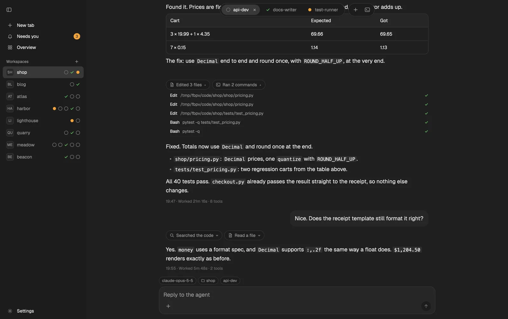

### Cockpit — 17 stars

[@quaresc](https://github.com/quaresc) went past agents entirely: Home (who's waiting), Inbox (reviews, PRs, CI), Mail, Runbooks, Meetings, Monitor, Documents, Routines, and Questions panels, plus per-agent links out to GitHub, Linear, Argo, Slack, and Datadog. It also has a Herdr TUI variant. This is less a layout and more a bet that your agent client becomes your actual work OS.

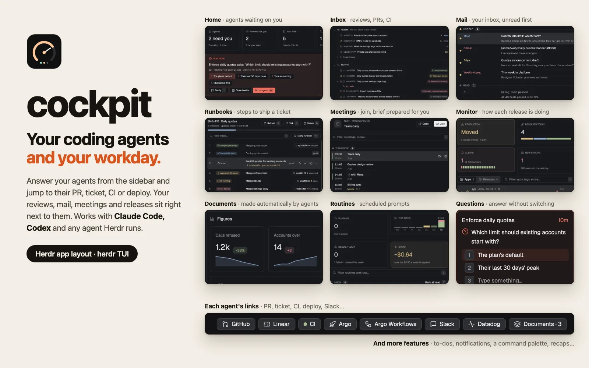

Honorable mentions from the serious end: **Space Folders** ([@jankeesvw](https://github.com/jankeesvw), 31 stars) groups spaces like project folders; **Traveler** ([@franky5440-afk](https://github.com/franky5440-afk), 29) is built for SSH machines; **Whitby** ([@shellscape](https://github.com/shellscape), 26) has the cleanest agent-state tree I've seen, with distinct states for blocked-on-approval, needs-a-question, and needs-sign-in; **Herdr Issues** (17) and **Board**, **LCARS**, and **Slate** from [@jkuepker](https://github.com/jkuepker).

## The community's unhinged layouts (affectionate)

Then there's the other half of the gallery, where people asked "what if my agent client were a different piece of software entirely" and their agents said yes.

**LCARS** ([@jkuepker](https://github.com/jkuepker)) turns the whole app into a Star Trek computer console. Elbow-shaped panels, pill buttons, the works. Your agents report in on Starfleet issue boards.

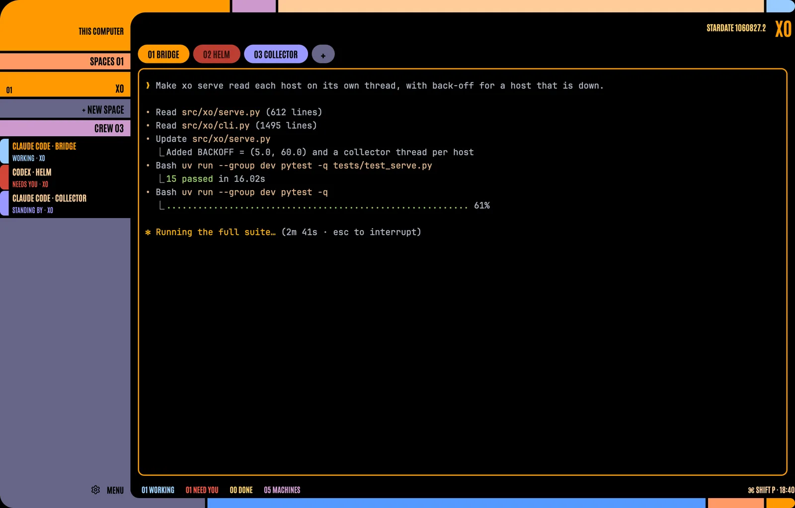

**Pokémon Sinnoh** ([@nick-datalane](https://github.com/nick-datalane)) renders your agents as a pixel Pokémon game. They wander tall grass while they work.

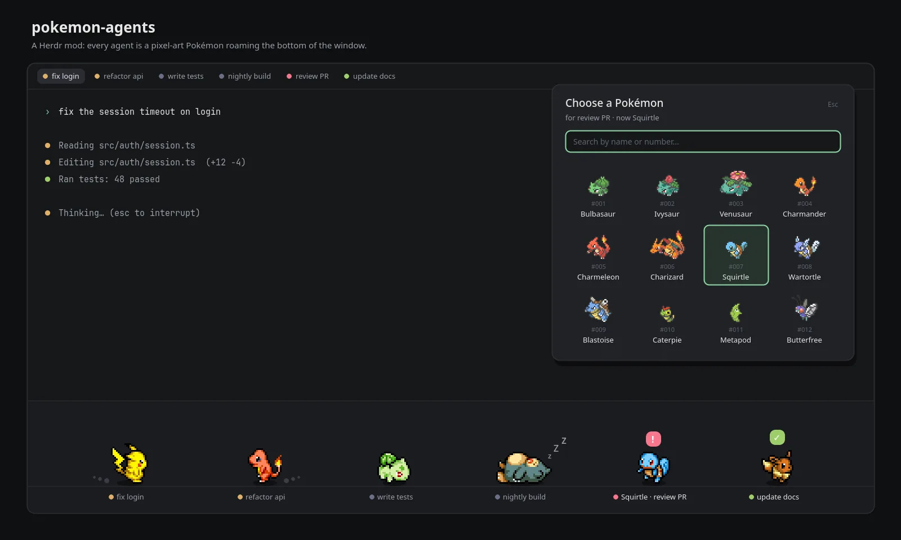

**Kaiju City** ([@Jiqize](https://github.com/Jiqize)) makes each agent a kaiju attacking a little isometric city, with dossier cards tracking what each monster is demolishing.

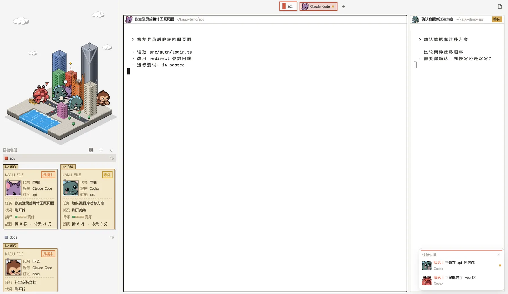

**Herdr Minecraft edition** ([@SwappyB](https://github.com/SwappyB)) reskins everything as Minecraft: spaces are worlds, agents live in the inventory, hearts drop when one needs you, and a hotbar runs along the bottom.

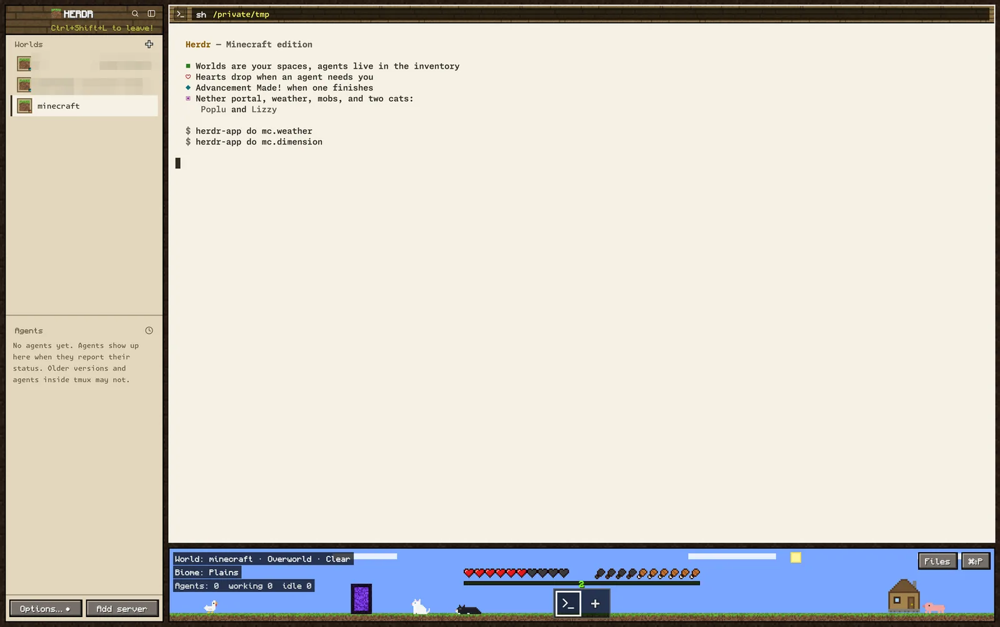

**Herdr Macintosh** ([@hawkeyedesi](https://github.com/hawkeyedesi)) is a pixel-faithful Mac OS 9 Platinum skin, menu bar, desktop icons, and all. There's also a **NeXTSTEP** build ([@cunderw](https://github.com/cunderw)) with the dock on the right edge and a proper top-left menu panel.

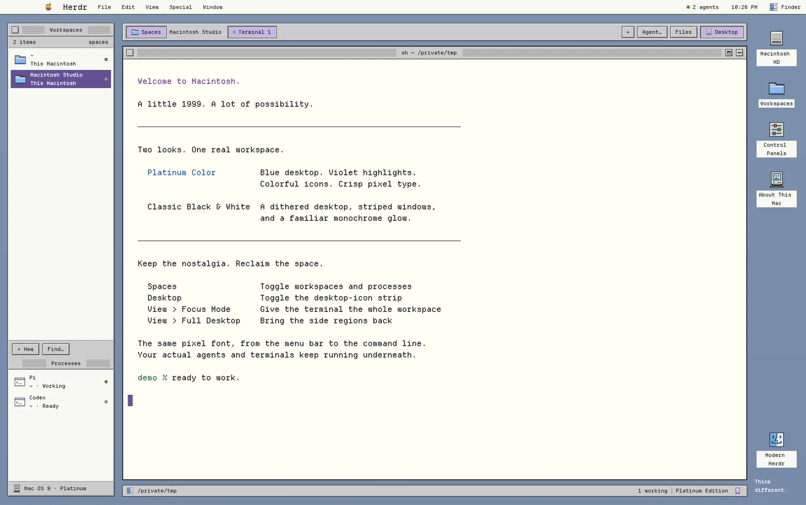

**Newsroom** ([@sushmitsarmah](https://github.com/sushmitsarmah)) is my personal favorite. It renders your agents as a newspaper, "The Daily Herd": the breaking-stories column is agents that need you ("Claude Code halts work on 'docs nav', awaits your word"), the wire is live agent output, and the right column is what's on the desk. Agents as journalism. Chef's kiss.

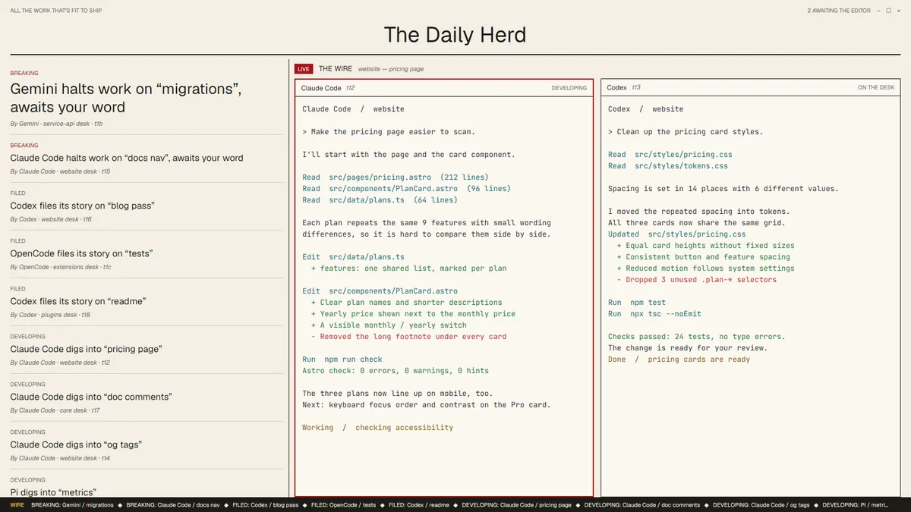

And **Internet Explorer** ([@hamza221](https://github.com/hamza221)), which puts your agents inside a pixel-perfect IE6 window, address bar and "Waiting for..." status text included. Cursed. Perfect.

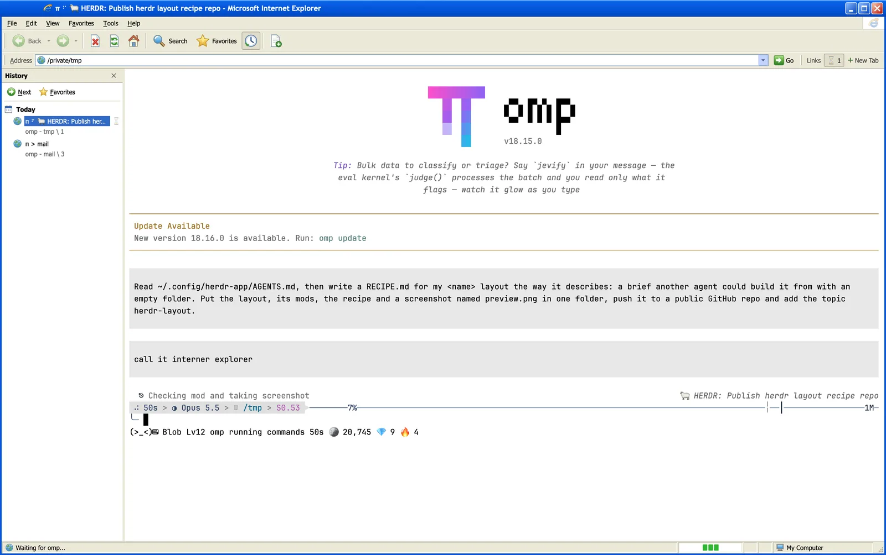

The tail is long: a Windows 98 suite (**WinBox**), a Bloomberg-style terminal, Catppuccin and Omarchy theme ports, a synthwave '84 skin, a Persona 5 skin, a maid café, a zoo, a noir detective office, and a falling-code Matrix view. Whatever UI lives in your head, someone has probably started it.

## Mods: the actually useful half

Layouts get the screenshots, but mods are where the utility is. A mod is a JS program that draws a panel or command inside the app, so it can be anything from a status dot to a full feature. The most-starred ones right now:

| Mod | Author | Stars | What it adds |
|---|---|---:|---|
| Agenttrail | [@sodiumsun](https://github.com/sodiumsun) | 986 | A live task DAG: what each agent is doing, in what order, and what's blocking what |
| Pulse | [@fatwang2](https://github.com/fatwang2) | 120 | Stock and crypto ticker panel with sparklines and auto-refresh |
| Atuin Threads | [@atuinsh](https://github.com/atuinsh) | 33 | Threaded agent sessions, from the Atuin shell-history team |
| Git Graph | [@rabeeh-ta](https://github.com/rabeeh-ta) | 29 | Branch graph panel for the current repo |
| Redline | [@iampedii](https://github.com/iampedii) | 28 | Inline review comments on agent diffs |
| Over9k suite | [@herunan](https://github.com/herunan) | ~42 total | Six mods: usage meters, sidebar, timeline, to-do, launcher, switcher |
| Blueprint | [@chappse6](https://github.com/chappse6) | 12 | Plan viewer that renders an agent's intended steps before it runs |
| Markdown panel | [@jlopezlira](https://github.com/jlopezlira) | 12 | Rendered Markdown preview pane for notes and docs |
| Recap | [@mrolafsson](https://github.com/mrolafsson) | 12 | Session summary panel; the same author also ships a Linear panel |
| Forge | [@greenflagged](https://github.com/greenflagged) | 9 | CI/release watchboard inside the app |

Agenttrail and Pulse deserve their screenshot slots — one draws the agent workflow, the other proves a mod can be anything at all:

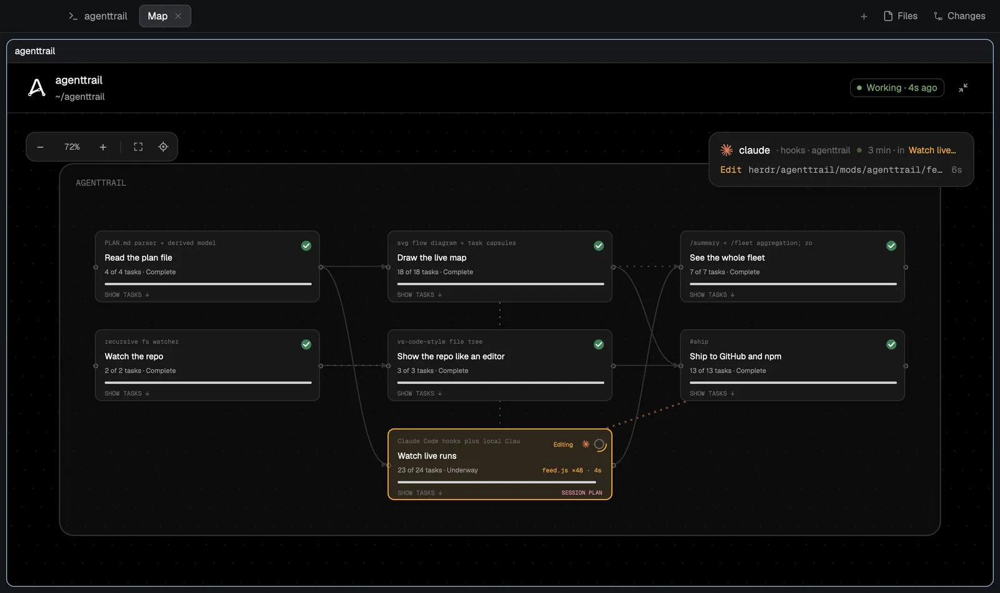

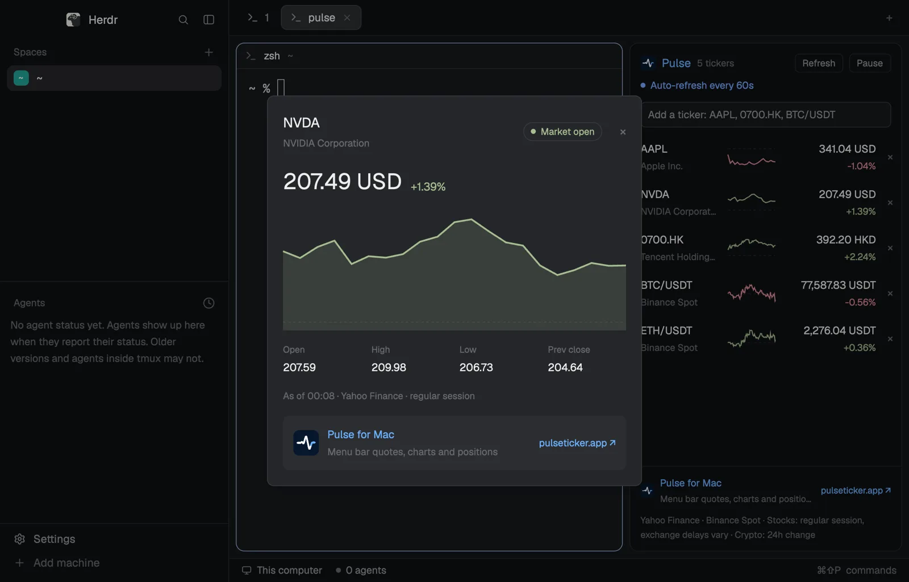

Two more I like for different reasons. **herdr-nvim** ([@ChmaraX](https://github.com/ChmaraX/herdr-nvim)) embeds a Neovim-style editing surface as a pane, which answers "can my agent client also be my editor" with "sort of, yes."

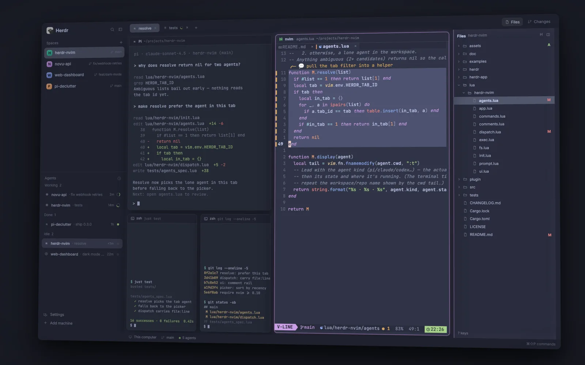

And **Blobs** ([@scott-the-programmer](https://github.com/scott-the-programmer)) draws each agent as a blob whose size tracks context usage and whose color tracks state, with lines linking sub-agents to their parents. Weird, and weirdly readable at a glance.

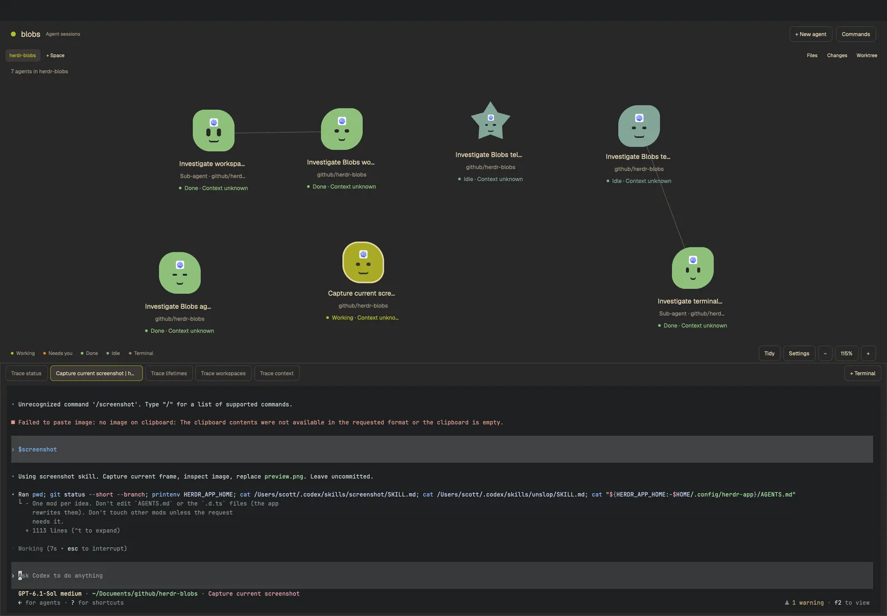

The mod list keeps going into utility-land: desktop notifications, SSH host pickers, token-usage bars, CI runs, Slack and YT Music panels, a Pomodoro timer, a Kubernetes pane, a file icon pack, a Herdr mod manager (a mod that manages mods). If you remember that each of these is one folder of JavaScript your agent can audit before installing, the sprawl makes sense.

## Try one, then make one

<ListCheck>

- Install the app and let it update to current.
- Browse the [gallery](https://herdr.dev/gallery/), sort by Popular, pick one layout and one mod.
- Paste its install line into an agent: `Read ~/.config/herdr-app/AGENTS.md, then add this layout: herdr.dev/layouts/<user>/<name>`
- Switch layouts with Ctrl+Shift+L; yours is still there.
- Ask your agent to tweak it. Then ask it to write a `RECIPE.md`, take `preview.png`, and push to GitHub tagged `herdr-layout` or `herdr-mod`. You're in the gallery.
</ListCheck>

## Honest caveats

<ListCheck>

- **The app is three weeks old.** 0.1.13 as of November 4, with weekly releases that regularly change mod APIs. A mod that worked Monday may need a touch-up Friday.
- **Mods are trusted code.** They run as you with your environment, unreviewed. The gallery is an automatic index, not a vetted store. Have your agent read a mod's JS before you install it.
- **Telemetry is on by default** in release builds. Settings → Privacy turns it off. Worth knowing up front.
- **Quality varies wildly.** Most entries were written by someone's agent in an afternoon. The starred ones are generally solid; the tail is experiments.
- **Apple Silicon macOS is the polished path.** Linux needs Vulkan and works well; Windows works but arrived latest; Intel Macs build from source.
</ListCheck>

## FAQ

<Accordion label="Do I need the old Herdr (the TUI) to use the app?" group="faq">
No. The app is standalone: the installer adds `herdr-core` automatically. But they share the core, so if you already run the [Herdr multiplexer](/herdr-agent-multiplexer/) the app sees the same sessions. Our [multiplexer comparison](/best-terminal-multiplexers/) covers where the TUI still makes sense.
</Accordion>

<Accordion label="Are layouts and mods free?" group="faq">
Yes. Everything in the gallery is a public GitHub repo; Herdr itself is Apache 2.0. Individual mod licenses vary by repo, so check before you fork someone's work.
</Accordion>

<Accordion label="Is it safe to install random gallery mods?" group="faq">
Safer than most plugin systems, but not safe by default. A mod is JavaScript running with your permissions, and gallery indexing is automatic. The good news: your agent can read the mod's source and tell you what it does in ten seconds. Do that.
</Accordion>

<Accordion label="What's the difference between a layout, a mod, and a theme?" group="faq">
A layout is a JSON file that arranges the whole window. A mod is JavaScript that draws a panel, menu, or command inside it. A theme is colors. Layouts can bundle their own mods and themes, which is why the best entries are all three at once.
</Accordion>

<Accordion label="Can my agent really build a layout from scratch?" group="faq">
That's the designed flow. `~/.config/herdr-app/AGENTS.md` is a complete API reference written for agents, `herdr-app check` validates the result, and the window live-reloads. Simple panels come out working on the first try; complex ones take a few iterations, same as any code.
</Accordion>

## Verdict

The Herdr app is a solid agent client on its own: spaces, persistent terminals, an agents sidebar, and SSH machines are a real workflow upgrade over a pile of tmux windows. But the reason to install it this month is the gallery. In three weeks the community produced 215 layouts and 435 mods, ranging from genuinely better work surfaces (Shepherdr, T3, Flockbook, Agenttrail) to a Mac OS 9 desktop with a working terminal inside it. You don't pick a Herdr. You make one, or steal someone else's.

If you're new to Herdr, start with the [multiplexer review](/herdr-agent-multiplexer/), then the [plugins roundup](/best-herdr-plugins/) for the other extension system, and [phone control](/control-ai-agents-from-phone-moshi-herdr/) if you want this whole thing in your pocket.

<Button text="Browse the Herdr gallery" link="https://herdr.dev/gallery/" variant="solid" color="blue" size="md" icon="arrow-right" />
<Button text="Herdr on GitHub" link="https://github.com/herdrdev/herdr-app" variant="outline" color="gray" size="md" icon="arrow-right" />
