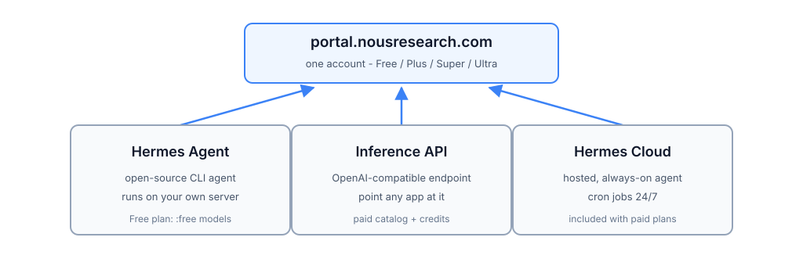
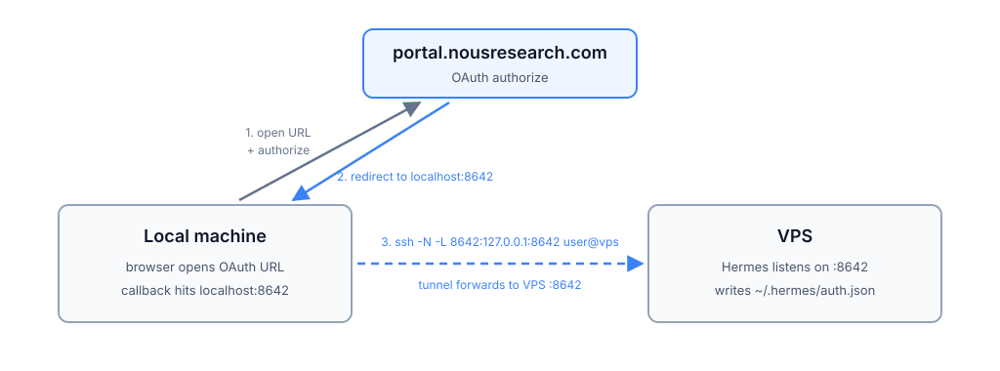

import YouTubeEmbed from "@components/widgets/YouTubeEmbed.astro";
import Button from "@components/widgets/Button.astro";
import Notice from "@components/widgets/Notice.astro";
import ListCheck from "@components/widgets/ListCheck.astro";
import Accordion from "@components/widgets/Accordion.astro";
import Tabs from "@components/widgets/Tabs.astro";
import Tab from "@components/widgets/Tab.astro";

The Nous Portal Free plan gives Hermes Agent three free models (Step 3.7 Flash, Hy4 Flash, Solar Mini 4) with no trial clock, and `hermes setup --portal` connects them in about five minutes. I've been running [Hermes Agent](/hermes-agent-setup-guide/) on my VPS since the MIMO V2 Pro promotion days, and the setup has gotten simpler since then.

The steps below cover creating a Free plan account, connecting Hermes on a VPS (including the headless OAuth headache), picking a `:free` model, verifying the setup, and deciding when the Free plan is enough versus when to spend $20/mo on Plus.

I recorded a walkthrough of the account creation, model configuration, Discord hookup, and the Hermes Workspace dashboard:

<YouTubeEmbed url="https://www.youtube.com/watch?v=t39ph8knPX0" label="How to Use Hermes Agent with Free Models on the Nous Portal" />

<Notice type="warning" title="The portal UI has changed since recording">
The video dates from the earlier promotion era. The portal layout, model list, and account flow have changed since then. Follow the steps below for the current flow and treat the video as a general orientation.
</Notice>

<Notice type="info" title="What you will learn">
<ListCheck>
<ul>
<li>What the Nous Portal Free plan gives you (and what it doesn't)</li>
<li>The current free models and how the <code>:free</code> tag works</li>
<li>Creating a Free plan account on the Nous Research portal</li>
<li>Connecting Hermes to the portal on a VPS, including headless OAuth</li>
<li>Verifying the setup with <code>hermes portal info</code></li>
<li>Pinning a free model to each Bot in Bot Mode</li>
<li>Optional Discord hookup and the Hermes Workspace dashboard</li>
<li>When to stay free vs when to upgrade to the $20/mo Plus plan</li>
</ul>
</ListCheck>
</Notice>

## What the Nous Portal gives you now

The Nous Portal used to be a model list with a free sample. Now it's one account that covers three surfaces: **Hermes Agent** (the open-source CLI agent you run on your own server), the **Inference API** (an OpenAI-compatible endpoint you can point any app at), and **Hermes Cloud** (a hosted always-on agent included with paid plans). The portal's home page puts it as "the one account that fuels all of it: the models, the tools, the cloud" (checked November 27, 2026).

Here's what's behind that login:

- **300+ models** in the catalog. The models page listed 346 on November 27, 2026, 309 of them text models, from Anthropic, Google, OpenAI, DeepSeek, and dozens of smaller labs.
- The **Tool Gateway** routes hosted tools through Nous: web search and extract, image generation (via FAL), text-to-speech (via OpenAI), cloud browser (via Browser Use), and a cloud terminal (via Modal, optional add-on).
- **Hermes Cloud** is a hosted, always-on agent that runs cron jobs 24/7. Paid plans include it.
- **Portal MCP** connects an AI client to your Portal.
- **Subscription tiers** run Free ($0), Plus ($20/mo), Super ($100/mo), Ultra ($200/mo).

There's also a useful side door: **ChatGPT plan sharing**. If you have an eligible ChatGPT subscription, you can connect it to the Nous Portal for inference without paying for a Nous subscription. Tools and Hermes Cloud hosting come on a separate bill. Worth knowing if you're already paying OpenAI.

The **Free plan gives you access to the free models only**. The paid catalog (Claude, GPT, Gemini, DeepSeek, and the rest) needs Plus included usage or credits, so "connect and get everything" is only true on paid tiers.



## Current free models on the Nous Portal

As of November 27, 2026, the Nous Portal lists three models under "Free Models" with a `:free` tag. These are the no-cost options on the Free plan:

| Display name | Model ID |
|---|---|
| StepFun: Step 3.7 Flash | `stepfun/step-3.7-flash:free` |
| Tencent: Hy4 flash | `tencent/hy4-flash:free` |
| Upstage: Solar Mini 4 | `upstage/solar-mini4:free` |

One selection rule matters: **pick the exact `:free` variant**. On the portal's models page the free ones sit under "Free Models" with a FREE chip. Hermes' curated Nous Portal list carries no free badge (the badge field is OpenRouter-only on the [model catalog page](https://hermes-agent.nousresearch.com/docs/reference/model-catalog)), so go by the full ID. The `:free` tag is what maps to the no-cost plan. If you pick the non-free variant of the same model, you're on the paid catalog.

One thing people confuse: the portal has an "Active Promos" section with discounted models (Hy4 at 80% off, for example, on November 27, 2026). Those are paid models at a discount, not free. The `:free` tag is the only thing that means $0.

<Notice type="warning" title="The free roster rotates">
The free model list changes. Confirm the current set on the [portal models page](https://portal.nousresearch.com/models) before you build a workflow around a specific model. The three listed above were live on November 27, 2026. LongCat-2.5:Free (`meituan/longcat-2.5:free`) was on the list earlier in November and is gone. The portal's compare page counted two free models on November 10 and three on November 27.
</Notice>

### Step 3.7 Flash: the fast free default

If you want one recommendation for Hermes Agent, use **Step 3.7 Flash** (`stepfun/step-3.7-flash:free`). It's the successor to Step 3.5 Flash, and it handles the usual Hermes workload well: code generation, web searches, file editing, multi-step tool use. It's fast in practice, which matters when you're driving an agent through a chain of tool calls.

The paid variant of Step 3.7 Flash lists at $0.20 input / $1.15 output per 1M tokens on the portal (November 27, 2026), so the free tag has real value. The other two free models are solid alternatives: Hy4 Flash if you want Tencent's stack, and Solar Mini 4 for lighter tasks.

### How Nous free offers work (rotating promos)

Nous runs rotating promotional partnerships on top of the standing free model list. Here's the history so far:

- **MiMo V2 Pro** (Xiaomi) was free for about two weeks, ending before April 2026.
- **Step 3.5 Flash** was free for 10 days in April 2026.
- **Nemotron 3 Ultra** (NVIDIA) was free June 4-18, 2026, via a Nebius partnership.

The pattern: limited-time promos come and go, but the three `:free` models above are the standing no-cost list. Don't build your workflow around a promo timer.

## Prerequisites

You need Hermes Agent installed on a Linux VPS before any of this works. If you haven't done that yet, the [Hermes Agent setup guide](/hermes-agent-setup-guide/) covers installation, provider config, and messaging platform setup.

<Notice type="info" title="Affiliate disclosure">
Some links below are affiliate links. They don't change what I recommend or what you pay.
</Notice>

<ListCheck>
<ul>
<li>A Linux VPS with SSH access (2 vCPU / 2 GB RAM is plenty; I run mine on <a href="https://go.bitdoze.com/hetzner">Hetzner Cloud</a>, a <a href="https://go.bitdoze.com/hostinger-vps">Hostinger VPS</a> works as a budget alternative)</li>
<li>Hermes Agent installed (v0.23.4, released November 23, 2026; install one-liner: <code>curl -fsSL https://hermes-agent.nousresearch.com/install.sh | bash</code>). Anything older than v0.23.2 misses the fix for CVE-2026-130164, so run <code>hermes update</code> first</li>
<li>A browser on your local machine (for the OAuth step)</li>
<li>A Discord server if you want the optional Discord integration</li>
</ul>
</ListCheck>

The model cost for this whole setup is $0. Your only recurring spend is the VPS itself, which runs about $5-10/mo for the class of machine you need.

<Button text="Hermes Setup / Workspace" link="https://hermes-workspace.com/" variant="solid" color="blue" size="md" icon="arrow-right" />

## Step 1: Create a Nous Portal account (Free plan)

Go to the [Nous Research Portal](https://portal.nousresearch.com/manage-subscription) and sign up. The current flow:

1. Create an account at **portal.nousresearch.com/manage-subscription**
2. Pick the **Free** plan ($0)
3. You're done

That's it. No credit card, no trial timer. The Free plan gives you access to the `:free` models with standard rate limits.

<Notice type="info" title="Free plan = free models only">
On the Free plan you get the three `:free` models. The paid catalog (Claude, GPT, Gemini, etc.) requires a Plus subscription or purchased credits. The hosted image, speech and browser tools also need a paid plan; web search is free on every plan (the portal's compare page). This detail trips up anyone who remembers the old "every model after auth" wording.
</Notice>

The billing dashboard shows your token usage once you start chatting. As a historical data point, I burned through about 11 million input tokens in my first few days of testing during the earlier promotion era, all free. The Free plan's standing models don't have a trial expiration.

To re-open the subscription page later: `hermes portal open`.

<Button text="Nous Research Portal" link="https://portal.nousresearch.com/" variant="outline" color="blue" size="md" icon="arrow-right" />

**Verify:** log into the portal dashboard and confirm your plan shows "Free." Once you start chatting through Hermes, the usage page will show token counts.

## Step 2: Connect Hermes to the Nous Portal

There are two paths depending on whether you're setting up fresh or connecting an existing install.

<Tabs>
<Tab name="Fresh install">
If you're starting from scratch (or just installed Hermes), use the one-shot setup:

```bash
hermes setup --portal
```

This walks you through OAuth, model selection, provider config, and Tool Gateway in a single flow. When it's done, your `~/.hermes/config.yaml` looks like this:

```yaml
# ~/.hermes/config.yaml
model:
  provider: nous
  default: stepfun/step-3.7-flash:free   # or whatever you picked
  base_url: https://inference-api.nousresearch.com/v1
```

The `base_url` points to the Nous Inference API. That's all you need.

Since v0.23.3 (November 19, 2026) a fresh install also has a one-question first run. On an install with no provider yet, bare `hermes setup` asks "How do you want to power Hermes?". One of the answers is "Free, start now", with no account and no API key. That claims a welcome trial on a single model, `nous/welcome`, once per OS user. It is not the Free plan. The welcome route serves only `nous/welcome`, and Hermes never offers the welcome row in a container, CI or a piped run, so a Docker install will not show it. For the three `:free` models you still need the Free plan account and `hermes setup --portal`. If you land on the trial by mistake, `hermes portal info` shows "Nous · free tier · nous/welcome", and `hermes auth upgrade` moves you to a Nous account sign-in.
</Tab>
<Tab name="Existing install">
If Hermes is already running with another provider, run:

```bash
hermes model
```

Pick **Nous Portal** from the provider list. The first time, Hermes prints a URL. Paste it into your browser, authorize the device, and the models your plan covers become available (the `:free` models on Free, the paid catalog if you upgrade).

The `hermes model` flow is still documented in the official docs and works fine on current v0.23.x. If you prefer the one-shot path, `hermes setup --portal` works on existing installs too.
</Tab>
</Tabs>

<Notice type="info" title="One credential, no API keys in .env">
The portal integration stores a single refresh token in `~/.hermes/auth.json`. Hermes mints short-lived JWTs per request. You won't have a `.env` file full of API keys to manage or leak. This matters for blast radius, which the troubleshooting section below covers.
</Notice>

### Headless VPS OAuth: SSH port forwarding and device codes

This is the failure mode that catches everyone running Hermes on a VPS. When Hermes prints the OAuth URL, it expects a callback to `localhost:8642` on the machine where Hermes is running. On a VPS, that's not your laptop. Here are the two official fixes:

<Tabs>
<Tab name="SSH port forwarding (preferred)">
From your **local machine** (not the VPS), open a tunnel:

```bash
ssh -N -L 8642:127.0.0.1:8642 user@remote-host
```

Leave that terminal running. Now on the VPS:

```bash
hermes setup --portal
```

Open the printed URL in your **local** browser. The OAuth callback hits your laptop's port 8642, which is tunneled to the VPS. Authorization completes.

Note: if you use ProxyJump, mosh, tmux, or SSH ControlMaster, the tunnel may behave differently. The official docs have a dedicated [OAuth over SSH / Remote Hosts page](https://hermes-agent.nousresearch.com/docs/guides/run-hermes-with-nous-portal) for these gotchas.
</Tab>
<Tab name="Device-code login">
For environments where SSH forwarding isn't practical (Cloud Shell, Codespaces, EC2 Instance Connect), use the device-code flow:

```bash
hermes auth add nous --type oauth
```

Then re-run `hermes setup --portal`. Hermes will show a device code to enter in your browser. Note that `hermes portal` (bare command) is an alias for `hermes auth add nous --type oauth`.
</Tab>
</Tabs>

The whole flow looks like this: your local browser connects through an SSH tunnel to port 8642 on the VPS, where Hermes is waiting for the OAuth callback from portal.nousresearch.com.



## Step 3: Select a free model

After auth, you pick your model. Hermes builds the picker from a remote catalog manifest (Hermes caches it for up to 20 minutes by default), and the free variants are the IDs with the `:free` tag.

Three ways to select:

```bash
# Option 1: Catalog picker (after auth or via hermes model)
hermes model

# Option 2: In-session picker (arrow keys or direct ID)
/model
/model stepfun/step-3.7-flash:free

# Option 3: Set directly in config
hermes config set model.default stepfun/step-3.7-flash:free
```

My default recommendation is **Step 3.7 Flash** (see the section above). Pick the exact `:free` variant, not the paid one with the same base name.

**Verify:** the next step confirms the selection is saved.

### Bot Mode: pin a free model to each Bot

Bot Mode turns Hermes profiles into a roster of named Bots, each with its own role, memory, skills and model. It ships in the desktop app and is on by default (v0.23.4, November 2026). The setting that matters here sits in New Agent, Advanced. The Model and provider pin takes any provider/model pair Hermes knows, so one Bot can run `stepfun/step-3.7-flash:free` while another runs a different model. Leave it unset and the Bot inherits the model of the profile you launched it from.

A Bot is a profile under `~/.hermes/profiles/<name>/`, so the same agent answers from a shell:

```bash
hermes -p <bot> chat
hermes profile list
```

On a VPS with no desktop app, the equivalent is a plain profile. `hermes profile create <bot>` makes one that inherits the current profile's model, so create it from the profile that runs the `:free` model.

For the login, here is what the docs say. "Copy API keys from the main profile" (on by default) copies static API keys, and the profiles page names only the Anthropic, OpenAI Codex and xAI OAuth logins as shared rather than copied. It does not mention Nous Portal. The Nous Portal guide covers the profile case. Sign in once per profile with `hermes -p <name> portal`. When a Portal session already exists on the machine, that command offers to import it without a browser round-trip, which is the path you want on a VPS.

One caveat for a headless VPS: the roster is desktop UI, and Bot-to-Bot messaging (`message_agent`) only appears in a Bot's canonical Bot Chat on an install that Bot Mode manages. On a headless box nothing writes the two markers, so the docs tell you to add them by hand:

```bash
hermes -p <bot> chat -c "Bot Chat" --create-if-missing
```

```yaml
# ~/.hermes/profiles/<any-bot>/profile.yaml: an empty block marks the install
ui_meta:
  hermes-bots: {}
```

The [Hermes Agent setup guide](/hermes-agent-setup-guide/) has the full Bot Mode walkthrough.

## Step 4: Verify with `hermes portal info`

The official docs have a real verification command. Use it:

```bash
hermes portal info
```

(`hermes portal status` runs the same check.)

Expected output:

```
Nous Portal
───────────
Auth:    ✓ logged in
Portal:  https://portal.nousresearch.com
Model:   ✓ using Nous as inference provider
Tool Gateway
────────────
Web search & extract  via Nous Portal
Image generation      via Nous Portal
Text-to-speech        via Nous Portal
Browser automation    via Nous Portal
```

For per-tool routing detail (which tool goes through Nous vs a local provider):

```bash
hermes portal tools
```

<Notice type="success" title="All checks green">
If auth shows ✓ and the model line says "using Nous as inference provider," you're connected to the Nous Portal and running on free models. The Tool Gateway lines show which hosted tools route through Nous.
</Notice>

Final human check: start a chat and look for the model name in the response.

```bash
hermes
```

The model name appears in the reply, so you can confirm which model is active.

## Troubleshooting and rollback

Three things that go wrong and how to fix them:

**1. `hermes portal info` shows "not logged in"**
The OAuth flow didn't complete. Re-run `hermes portal` to restart the auth. On a headless VPS, use the SSH port forwarding or device-code path from Step 2. The callback has to reach port 8642 on the machine where Hermes runs.

**2. "Model: currently openrouter" (provider drift)**
Hermes fell back to another provider. Fix it:

```bash
hermes config set model.provider nous
```

Then re-check with `hermes portal info`.

**3. Rate limit on a free model**
Free plan models have "Standard" rate limits, and the portal publishes no requests-per-minute figure. If you hit one, the response will surface an error or slow down. Your options: switch to another `:free` model (`/model` in-session), wait it out, or add credits. The three free models are separate catalog entries, so rotating between them is worth a try.

<Notice type="warning" title="Rate limit specifics">
I haven't found published rate-limit numbers for the Free plan. The public plan table says "Standard rate limits" and nothing more (checked November 27, 2026). If you're driving a heavy automation workload, test with your actual usage pattern before you rely on it.
</Notice>

**Rollback / blast radius:** the whole Portal integration is one credential in `~/.hermes/auth.json`. To remove it:

```bash
hermes auth logout nous   # wipes the local refresh token
```

Then revoke the session in the portal dashboard. Don't `rm` the whole `auth.json` on an install with other providers; the file holds their logins too. Provider drift is one `hermes config set` to reverse. Small blast radius. You can try this tonight without worrying about breaking anything permanent. If Hermes itself gets into a bad state, the [Hermes Agent setup guide](/hermes-agent-setup-guide/) has the reinstall path.

## Step 5: Link Hermes to Discord (optional)

I linked my Hermes agent to a Discord channel so I can message it without SSH-ing into the server. The [Hermes Agent setup guide](/hermes-agent-setup-guide/) has the full walkthrough. Short version:

1. Create a bot in the Discord Developer Portal
2. Add the bot token to your Hermes config
3. Invite the bot to your server

Messages in the linked channel go through Hermes, and whichever model you selected answers them. The model name shows up in the replies.

The messaging gateway docs list 28 platforms in their comparison table (November 2026), from Telegram, Discord and Slack to Matrix, IRC and Microsoft Teams, so Discord is just the default pick. If you want mobile access beyond Discord, there are [ways to control your AI agent from your phone](/control-ai-agents-from-phone-moshi-herdr/).

## Hermes Workspace dashboard

Hermes Workspace is a third-party Docker-based web UI for managing your agent. It calls itself "your AI agent's command center" and has 6,800+ GitHub stars (November 27, 2026). I run it on the same VPS as Hermes.

Install:

```bash
curl -fsSL https://hermes-workspace.com/install.sh | bash
```

The installer detects Node 22+, Python 3.11+, and pnpm, installs `hermes-agent` from PyPI, clones the workspace, and configures `.env`. It's re-runnable if something gets tangled.

Run it (two daemons):

```bash
hermes gateway run          # Project Agent on :8642
cd ~/hermes-workspace && pnpm dev   # Web UI on :3000
```

Or use `pnpm start:all` to launch both.

What you get: browser-based chat sessions, memory viewer, skills management, scheduled jobs, a terminal, a file browser, and a dashboard page with session counts and token tracking.

<Notice type="warning" title="Secure it before exposing to the internet">
If the workspace is reachable from outside your VPS, put it behind a reverse proxy with authentication or set a password. Don't leave port 3000 open to the world. For a full hardening walkthrough, see the [Hermes dashboard guide](/hermes-dashboard-guide/).
</Notice>

If you want to browse dashboard options beyond Hermes Workspace, the [best Hermes dashboards](/best-hermes-dashboards/) roundup covers the alternatives. If you want task boards for multi-agent workflows, the [Hermes Kanban setup guide](/hermes-kanban-setup-guide/) covers that.

For official alternatives: **Hermes Desktop** is a local GUI app (macOS 13 or later on Apple Silicon, Windows 11 22H2 or later, and Linux after a source install). In it you set up Nous Portal with one click and pick a `:free` model, without touching a terminal. **Hermes Cloud** is a hosted always-on agent included with paid plans. There's also a **Subscription Proxy** feature that turns your portal subscription into an OpenAI-compatible endpoint for other apps.

<Button text="Hermes Workspace" link="https://hermes-workspace.com/" variant="solid" color="purple" size="md" icon="arrow-right" />

## When should you upgrade from the Free plan to Plus?

Upgrade when you need a paid model or a hosted tool. The Free plan covers the three `:free` models only, and Plus at $20/mo is the entry point for the paid catalog and hosted tools.

This is the free vs paid breakdown from the portal's public plan table (November 27, 2026):

| Tier | Price | Models | Notable |
|---|---|---|---|
| Free | $0 | Free models only | Standard rate limits; $0 monthly credits |
| Plus | $20/mo | Any model | Included usage (daily/weekly/monthly resets), Tool Gateway, Cloud agent 4 GB / 25 GB |
| Super | $100/mo | Any model | Cloud agent 4 GB / 100 GB |
| Ultra | $200/mo | Any model | Cloud agent 8 GB / 100 GB |

Top-ups run $10 to $200 via Stripe. **API keys always burn credits (pay-as-you-go), not included usage.** Use the API directly with a key and you're on the meter regardless of plan.

The paid catalog keeps growing. Gemini 4 Hydrogen, Neon and Carbon landed on Nous Portal in the v0.23.4 window (release notes, November 23, 2026) and are on Hermes' curated Nous Portal list. All three are paid. On the portal's models page they list at $1.50 in / $7.50 out (Hydrogen), $3.00 / $15.00 (Neon) and $2.00 / $10.00 per 1M tokens (Carbon, half off list), checked November 27, 2026. None of them has a `:free` variant.

<Notice type="success" title="The $0 path">
Free plan = $0 to run a VPS Hermes 24/7 on three free models. The moment you want Claude/GPT-class models or the hosted tools, Plus at $20/mo is the entry point. That's the deal.
</Notice>

**ChatGPT plan sharing** is the cheap middle path: connect an eligible ChatGPT account for inference without a Nous subscription. Tools and Hermes Cloud come on a separate bill. If you already pay OpenAI, this is worth a look before subscribing to Plus.

For paid models, the [cheapest AI models for Hermes Agent](/best-cheap-models-hermes-agent/) guide covers budget options like MiniMax M3, MiMo V2.6 Pro, GLM 5.3, and DeepSeek V4 Pro. If you'd rather pay per token than subscribe, you can [run any model in your own agent via OpenRouter](/google-adk-openrouter-models/).

## FAQ

<Accordion label="Which models are free right now?" group="faq" expanded="true">
Three models carried the `:free` tag on November 27, 2026: Step 3.7 Flash (`stepfun/step-3.7-flash:free`), Hy4 Flash (`tencent/hy4-flash:free`), and Solar Mini 4 (`upstage/solar-mini4:free`). LongCat-2.5:Free was on the list earlier in November and is gone. Type the exact `:free` ID, because the roster rotates; the [live models page](https://portal.nousresearch.com/models) has the current list under "Free Models".
</Accordion>

<Accordion label="Do I need to pay anything to use Hermes Agent free models?" group="faq">
No. The Free plan is $0. You get access to the `:free` models with standard rate limits, with no credit card required and no trial expiration. The only cost is your VPS.
</Accordion>

<Accordion label="Can I still use MiMo models?" group="faq">
Yes, but not for free. [Xiaomi's MiMo models](https://go.bitdoze.com/mimo) are on the portal as regular paid catalog entries: MiMo-V2.6-Pro ($0.44 input / $0.87 output per 1M), MiMo-V2.6-Flash ($0.14/$0.28), MiMo-V2.6-Pro-UltraSpeed ($4.35/$8.70), and MiMo-V2.5-Pro (portal prices, November 27, 2026). They need Plus included usage or purchased credits. The old MiMo V2 Pro free promotion has ended. If you want to use MiMo models outside the Nous Portal, you can [use MiMo models with the Codex app](/codex-app-any-model/).
</Accordion>

<Accordion label="What are the Free plan's limits?" group="faq">
Free models only, "Standard rate limits" with no published requests-per-minute figure, and no included Cloud agent. You won't get access to the paid catalog (Claude, GPT, Gemini, etc.), and the hosted image, speech and browser tools need a paid plan (web search is free on every plan). If your workload outgrows these constraints, that's when Plus at $20/mo makes sense.
</Accordion>

<Accordion label="Can I use other models alongside the free ones?" group="faq">
Yes. Run `hermes model` to switch providers entirely (OpenRouter, Anthropic, etc.). Within the Nous Portal, use `/model` in-session to switch between available models. The paid catalog requires credits or a Plus subscription.
</Accordion>

<Accordion label="Do I need a VPS to run Hermes?" group="faq">
For an always-on agent, yes. Hermes runs on a Linux server and the [Hermes Agent setup guide](/hermes-agent-setup-guide/) covers the full install. If you just want to try it locally without a server, the Hermes Desktop app (macOS 13 or later on Apple Silicon, Windows 11 22H2 or later, Linux after a source install) runs on your own machine.
</Accordion>

<Accordion label="Is Hermes Workspace required?" group="faq">
No. It's a nice-to-have web dashboard for sessions, memory, and jobs. Hermes works fine from the terminal or through Discord and Telegram without it. For other dashboard options, see the [best Hermes dashboards](/best-hermes-dashboards/) roundup. The official alternatives are Hermes Desktop (local GUI) and Hermes Cloud (hosted, paid plans).
</Accordion>

<Accordion label="Can each Bot in Bot Mode run its own free model?" group="faq">
Yes. In the desktop app, New Agent then Advanced has a Model and provider pin that takes any provider/model pair Hermes knows, so pin `stepfun/step-3.7-flash:free` (or another `:free` ID) per Bot. Left unset, the Bot inherits the launch profile's model. A Bot is a profile under `~/.hermes/profiles/<name>/`, so on a VPS you reach it with `hermes -p <bot> chat` and sign it in once with `hermes -p <bot> portal`. Bot Mode ships in current builds (v0.23.4) and is on by default. The [Hermes Agent setup guide](/hermes-agent-setup-guide/) covers the roster, routines and group chats.
</Accordion>

---

The Nous Portal Free plan puts a real AI agent on real infrastructure for $0. You get three free models with no trial clock and no credit card needed. Set it up once with `hermes setup --portal`, verify with `hermes portal info`, and you've got a 24/7 agent at $0/mo model cost.

For affordable models when you outgrow the free tier, see the [cheapest AI models for Hermes Agent](/best-cheap-models-hermes-agent/) guide. For the full setup chain, start with the [Hermes Agent setup guide](/hermes-agent-setup-guide/), and for the built-in web dashboard, see the [Hermes dashboard guide](/hermes-dashboard-guide/).

<Button text="Hermes Setup / Workspace" link="https://hermes-workspace.com/" variant="solid" color="blue" size="md" icon="arrow-right" />
