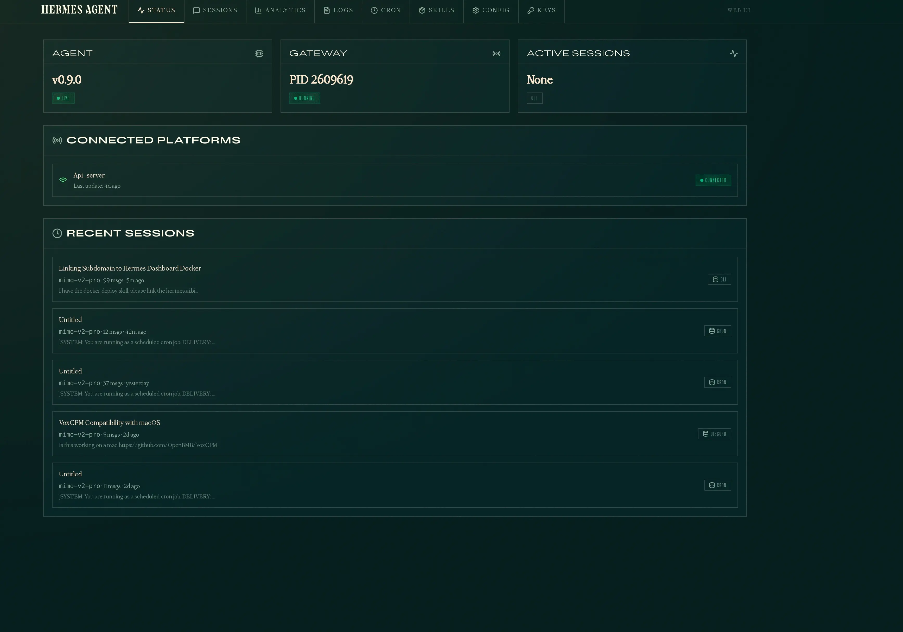
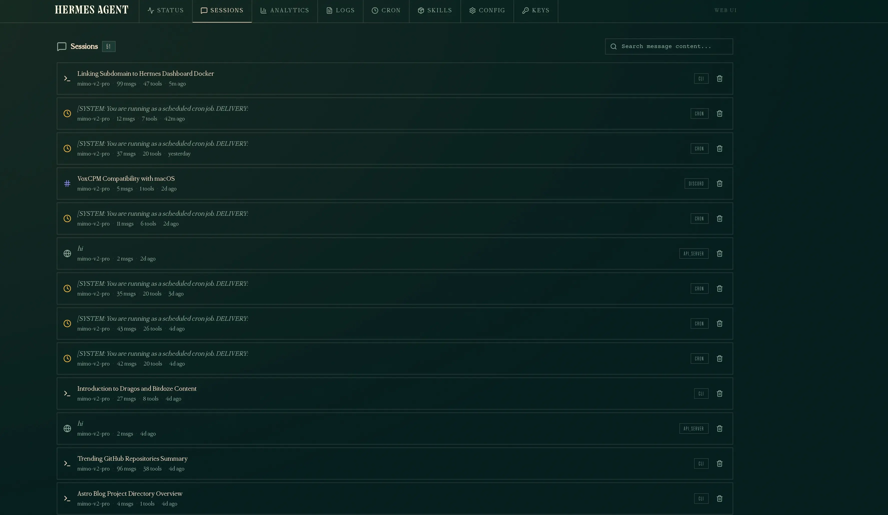
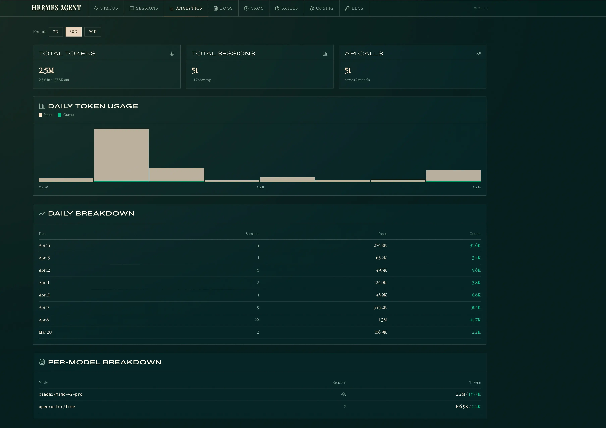
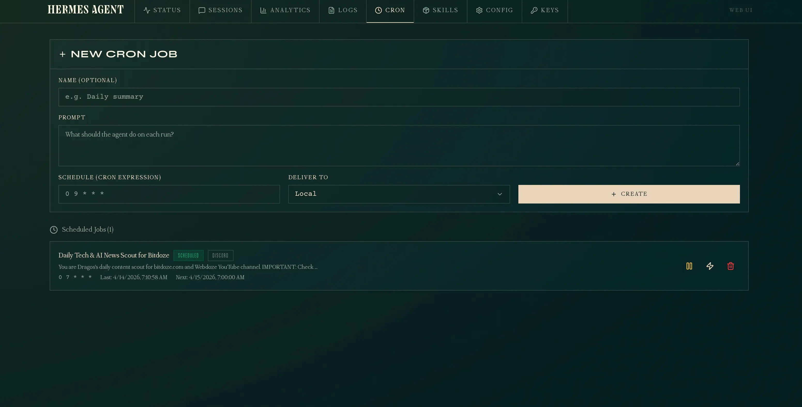
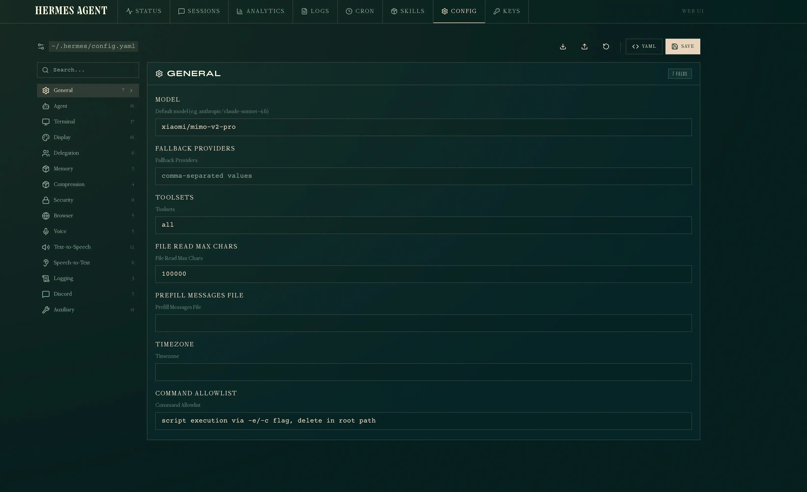
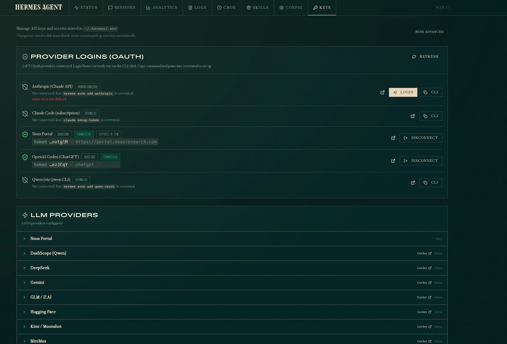

import YouTubeEmbed from "@components/widgets/YouTubeEmbed.astro";
import Button from "@components/widgets/Button.astro";
import Notice from "@components/widgets/Notice.astro";
import ListCheck from "@components/widgets/ListCheck.astro";
import Accordion from "@components/widgets/Accordion.astro";

`hermes dashboard` is Hermes Agent's built-in admin panel on port 9119. On loopback it opens with no login, and it refuses to bind to any other address without a sign-in provider. As of v0.23.4 (November 2026) it is a machine-level panel: one server covers every profile on the host. The sign-in requirement came with the June 2026 hardening, and the old `--insecure` bypass is now a no-op. This guide covers running it locally, reaching it over an SSH tunnel (my default), putting Caddy in front of it with the built-in username and password or a Nous Portal login, the Webapp, Docker, systemd, and what to do with a hand-made `hermes dashboard` service.

<Button text="Hermes Agent GitHub" link="https://github.com/NousResearch/hermes-agent" variant="solid" color="blue" size="md" icon="github" />

<Notice type="info" title="What this guide covers">
<ListCheck>
<ul>
<li>Starting the Hermes dashboard locally and on a remote server</li>
<li>Remote access via SSH port forwarding (simplest and safest)</li>
<li>The sign-in gate: a username and password for a trusted network, Nous Portal for the internet</li>
<li>Caddy in front, with the public URL and trusted proxy settings</li>
<li>The Webapp and how it differs from the dashboard</li>
<li>Moving an old `hermes dashboard` or `hermes serve` service onto the gateway</li>
<li>Running it permanently with systemd or Docker</li>
<li>Security risks you should know about</li>
</ul>
</ListCheck>
</Notice>

## What the Hermes dashboard does

<YouTubeEmbed
  url="https://www.youtube.com/embed/1WaASFqQHgg"
  label="Hermes v0.9.0 web dashboard walkthrough"
/>

The dashboard gives you a browser interface for managing your Hermes Agent installation. From it you can:

- Browse and resume chat sessions, or open a full TUI chat in the browser
- Edit `config.yaml` through forms or raw YAML
- Set, replace, and remove API keys and OAuth logins in `~/.hermes/.env`
- Track token usage and cost per day and per model
- Toggle skills and toolsets, add MCP servers, and create cron jobs
- Connect messaging platforms and approve the users who may talk to your bot
- Start, stop, and restart the gateway, and run doctor checks, backups, and updates

It is a separate server process that reads and writes the same `~/.hermes` as the gateway. A chat started in its Chat tab runs in the dashboard's own process, not in the gateway. That second copy of Hermes is why v0.23.4 can move the backend onto the gateway (see [Moving an old dashboard service onto the gateway](#moving-an-old-dashboard-service-onto-the-gateway)).

## Dashboard tour

The dashboard manages the whole machine: one server covers every profile on the host. A profile switcher in the sidebar (shown when more than one profile exists) picks the profile the management pages read and write. While another profile is selected, an amber banner names the one being managed. The selection lives in the URL as `?profile=<name>`, so a link like `http://127.0.0.1:9119/skills?profile=worker` lands with the switcher preset.

The pages are Status, Chat, Config, API Keys, Sessions, Logs, Analytics, Cron, Profiles, Skills, MCP, Webhooks, Pairing, Channels, and System. The screenshots below are from the April 2026 build and the layout has moved since.

### Status

The Status page is the landing page. It shows the agent version and release date, the gateway state (running or stopped, PID, connected platforms), the number of sessions active in the last 5 minutes, and the 20 most recent sessions with model, message count, token usage, and a preview. It refreshes every 5 seconds. When the host runs low on memory or disk, or the agent probably died of an OOM kill, a banner at the top says so.



### Chat

The Chat tab is for talking to the agent from the browser. It embeds the full Hermes TUI (the one you get from `hermes --tui`) over a WebSocket to a pseudo-terminal on the server. Slash commands, the model picker, tool-call cards, and approval prompts work as they do in the terminal. A right rail lists recent sessions and picks the workspace a new chat starts in. It needs a POSIX host (Linux, macOS, or WSL2). On native Windows the rest of the dashboard works but this tab does not.

### Sessions

The Sessions page lists past and active sessions. Each row shows the source platform (CLI, Telegram, Discord, cron, and so on), the model, message and tool-call counts, and when it was last active. The Chats, Automation, and All filters hide cron and tool runs when you only want conversations. Search is full-text across message content. From here you can rename a session, export it as JSON, prune old ones, or delete it.



### Analytics

The Analytics page totals tokens and cost from session history for a 7, 30, or 90 day window: input and output tokens, cache hit rate, session count, a daily chart, and a per-model table.



### Cron

The Cron page creates and edits scheduled jobs. You give a prompt, a cron expression, and a delivery target (local, Telegram, Discord, Slack, or email), then pause, resume, edit, trigger, or delete them. With more than one profile the page aggregates every profile's jobs and has its own filter. Bot Mode routines show up here too, named `[bot:<name>] <routine>`.



### Config

The Config page is a form editor for `~/.hermes/config.yaml`. The fields are discovered from the default config and grouped into categories such as model, terminal, display, agent, delegation, memory, and approvals. Known values render as dropdowns and booleans as toggles. Save writes the file at once, and the change applies on the next agent session or gateway restart. There are also reset to defaults and import or export as JSON.



### API Keys

The API Keys page manages `~/.hermes/.env`, grouped into LLM providers, tool API keys, messaging platform tokens, and agent settings. Each entry shows whether it is set (with a redacted preview), what it is for, a link to the provider, and a field to set or replace it. Rarely used keys sit behind a toggle.



### Logs

The Logs page shows the agent's log files live. It tails the `agent`, `errors`, and `gateway` log files with level and component filters, 50 to 500 lines, and an auto-refresh every 5 seconds.

### Profiles

The Profiles page lists every profile with its model, skill count, gateway state, and badges. You can create one (cloned or without the bundled skills), edit its model, description, and `SOUL.md`, rename or delete it, and set which profile future CLI and gateway runs use. That last button changes the CLI default, not what the dashboard manages. The sidebar switcher does that.

### Skills

The Skills page toggles installed skills and toolsets, and searches the skill hub (the same search as `hermes skills search`) with a one-click install and an "Update all" button. Changes apply on the next session.

### MCP

The MCP page edits the `mcp_servers` block of `config.yaml`: add an HTTP, SSE, or stdio server with environment variables, enable or disable it, test the connection and list its tools, or install from the Nous-approved catalog. Changes apply on the next gateway restart.

### Webhooks, Pairing, and Channels

Webhooks creates dynamic subscriptions (name, event filter, delivery target, agent prompt) and shows the route URL and a one-time HMAC secret. The gateway reloads the subscriptions file without a restart. Pairing approves and revokes messaging users without the CLI, with the same result as `hermes pairing`. Channels configures every messaging platform from the browser, tests the connection, and restarts the gateway. On a system-scope install (`hermes gateway install --system`) that restart runs under `sudo -n`, so the dashboard user needs passwordless sudo for it.

### System

The System page is the admin panel for the whole installation:

- Host: OS, kernel, CPU, memory, disk, and uptime, plus the Hermes version with an update badge. On a git install an "Update now" button runs `hermes update` in the background. Docker and Nix installs get the out-of-band command instead.
- Gateway: start, stop, and restart the messaging gateway, with live status and PID.
- Credential pool: add or remove the rotating API keys the agent cycles through per provider. The list redacts the keys.
- Memory: pick the external memory provider, or reset the built-in `MEMORY.md` and `USER.md` stores.
- Nous Portal and Skill curator: read-only status of the Portal login and the background skill maintenance job, with pause and run-now.
- Operations: run `hermes doctor`, a security audit (`hermes security audit`, a supply-chain check of the venv, plugin requirements, and pinned MCP servers), create a backup, restore from a backup archive, update skills, or generate a support dump. Each runs in the background and streams its log into the page.
- Checkpoints and Shell hooks: the size of the `/rollback` store, and the list of configured hooks. Hooks run arbitrary commands, so a new one fires only after you grant consent.
- Move to a single Hermes: appears when an older `hermes dashboard` or `hermes serve` server still serves this home, or when the last move needs reporting. It runs the same move as `hermes gateway migrate --backends --apply`, after a confirmation that lists the blockers.

## Starting the dashboard

The simplest way to start:

```bash
hermes dashboard
```

This builds the web UI on the first run, then serves it at `http://127.0.0.1:9119` and opens a browser tab. On loopback there is no login. The first build is the slow part on a small VPS: it is CPU and memory heavy, Hermes caps its heap and threads by default, and `HERMES_WEB_BUILD_LIGHT=1` tightens the caps to one thread and a 1 GB heap.

`hermes serve` is the same server, headless: it never opens a browser UI. The desktop app launches its own `hermes serve` backend. Use the command directly when you want a headless backend on a remote host.

### Available flags

| Flag | Default | Description |
|---|---|---|
| `--host` | `127.0.0.1` | Bind address. Anything other than `127.0.0.1`, `::1`, or `localhost` turns on the sign-in gate |
| `--port` | `9119` | Port to listen on |
| `--no-open` | off | Skip the browser launch |
| `--skip-build` | off | Serve the existing build instead of rebuilding |
| `--isolated` | off | Run a dedicated server for one profile instead of the machine dashboard |
| `--stop` | n/a | Stop the running `hermes dashboard` or `hermes serve` of this Hermes home |
| `--status` | n/a | List running `hermes dashboard` and `hermes serve` processes |
| `--insecure` | off | Deprecated and ignored since the June 2026 hardening |

The default `127.0.0.1` binding means only your machine can reach the dashboard. That is the safe default. If you need remote access, keep reading.

`--isolated` is a routing convenience, not a security boundary. Every profile under one OS user can read the other profiles' files. To keep people's data apart, run each tenant as a separate OS user or in a separate container.

If the port is taken, `hermes dashboard` prints `BACKEND_PORT_IN_USE port=9119` and exits with code 75. `hermes dashboard --status` shows which process holds it. Exit 78 is different: another dashboard already serves this host, and the message names its PID and port. Stop that one, or give the service its own server with `--isolated`.

## Remote access via SSH port forwarding

If you just want to open the dashboard from your laptop while it runs on a VPS, SSH port forwarding is the simplest option. No reverse proxy, no DNS, no open ports on the server. Everything goes through your existing SSH connection.

```bash
ssh -L 9119:127.0.0.1:9119 user@your-vps-ip
```

Then open `http://127.0.0.1:9119` in your browser on your laptop. The `-L` flag forwards your local port 9119 to the VPS's localhost:9119 through the SSH tunnel. The dashboard sees a loopback connection, so the gate stays off and there is no login.

This is the safest way to access the dashboard remotely because:

- The dashboard stays bound to `127.0.0.1`, so nothing else can reach it
- Traffic is encrypted inside SSH, with no TLS setup
- You already have SSH access, so there is nothing new to secure
- No open ports on the VPS beyond SSH

<Notice type="info" title="When to use SSH forwarding">
Use this if you are the only person accessing the dashboard and you always connect from a machine with SSH access. Skip the Caddy and systemd sections entirely and keep <code>hermes dashboard</code> running in a tmux or screen session.
</Notice>

The site's [SSH tunneling guide](/ssh-tunneling-linux/) has the other forwarding options, and the [ProxyJump guide](/ssh-proxyjump-jumphost/) covers hosts behind a bastion.

### Background SSH tunnel

If you want the tunnel to stay open in the background:

```bash
ssh -f -N -L 9119:127.0.0.1:9119 user@your-vps-ip
```

- `-f` forks to background after authentication
- `-N` runs no remote command, only the tunnel

To kill it later:

```bash
# Find the process
ps aux | grep "ssh -f -N -L 9119"

# Kill it
kill <PID>
```

### Keep the dashboard running on the VPS

With SSH forwarding, the dashboard still needs to be running on the VPS. Use tmux or screen so it survives SSH disconnections:

```bash
# On the VPS
tmux new -s hermes
hermes dashboard --no-open
# Ctrl+B then D to detach

# Later, reattach with
tmux attach -t hermes
```

`--no-open` stops a headless VPS from trying to launch a browser. If you want it running permanently even without SSH, use the systemd service described below.

## Why does hermes dashboard refuse to start on 0.0.0.0?

`hermes dashboard` refuses to start on `0.0.0.0` because a non-loopback bind turns on the sign-in gate, and with no provider registered the server fails closed and prints which setting is missing. Set one first with `hermes dashboard password --username admin` or `hermes dashboard register`. Since the June 2026 hardening, any bind other than `127.0.0.1`, `::1`, or `localhost` requires an auth provider, and every request must carry a verified session cookie or it is sent to `/login`. There is no unauthenticated public bind any more. `--insecure` is still accepted, logs a warning, and does nothing.

The Docker docs give the reason: in a June 2026 campaign, internet scanners reached unauthenticated public dashboards and OpenAI API servers and drove the agent into planting an SSH-key backdoor.

| Bind | Gate | Typical use |
|---|---|---|
| Default, `127.0.0.1` | off | Local work, SSH tunnel |
| `--host 0.0.0.0`, a LAN address, or a Tailscale IP | on | Username and password on a trusted network |
| `--host 0.0.0.0` on a public host | on | Nous Portal or your own OIDC |
| `127.0.0.1` with a non-loopback `dashboard.public_url` | on | Behind Caddy or another reverse proxy |

Three providers ship with Hermes:

| Provider | Where it is configured | Use it when |
|---|---|---|
| Username and password (`basic`) | `dashboard.basic_auth` in `config.yaml`, or the `HERMES_DASHBOARD_BASIC_AUTH_*` variables | The host is on a trusted LAN or reached over a VPN. One shared credential, no second factor, no per-user accounts |
| Nous Portal OAuth (`nous`) | `HERMES_DASHBOARD_OAUTH_CLIENT_ID` in `~/.hermes/.env`, written by `hermes dashboard register` | The dashboard faces the internet, or Hermes Desktop connects from anywhere |
| Self-hosted OIDC (`self-hosted`) | `dashboard.oauth.self_hosted` in `config.yaml` | You already run Keycloak, Authelia, Authentik, or another OIDC provider |

When you run `hermes dashboard --host 0.0.0.0` interactively with no provider configured, it offers to set one up on the spot. A non-interactive start (systemd, Docker, CI) skips the prompt and fails closed, so set the provider before you create the service.

## Exposing the dashboard with a username and password

Use this path when the dashboard should open on your phone, on another laptop, or for a teammate, and every device that can reach the host is one you trust. For the public internet, add the Nous Portal login from the next section.

### Step 1: Set the username and password

```bash
hermes dashboard password --username admin
```

It asks for the password twice on the terminal. It writes three things under `dashboard.basic_auth` in `~/.hermes/config.yaml`: the username, a scrypt hash of the password, and a signing secret if there is none yet. The password itself is never stored, never printed, and never accepted as an argument, so it stays out of the shell history and the process list.

On a host without a terminal, read it from a file (new in v0.23.4):

```bash
hermes dashboard password --username admin --password-stdin < /run/secrets/dashboard_password
```

Only the first line counts, at most 1024 bytes. Standard input has to be a pipe or a file: on a terminal the command exits with code 2, because typed text would show.

Run it as the user the dashboard will run as. The credentials belong to the Hermes home they were written in, and a service running as another user will not see them.

The block in `config.yaml` ends up like this:

```yaml
dashboard:
  basic_auth:
    username: admin
    password_hash: "scrypt$16384$8$1$<salt>$<hash>"
    secret: "<32 or more random bytes, base64 or hex>"
    session_ttl_seconds: 43200
```

A few things to know about it:

- `password_hash` is the setting to keep. A plaintext `password` key also works but is less safe at rest.
- `session_ttl_seconds` defaults to 43200, so a login lasts 12 hours.
- Changing the username or the password ends every session.
- The variables `HERMES_DASHBOARD_BASIC_AUTH_USERNAME`, `_PASSWORD_HASH`, `_PASSWORD`, `_SECRET`, and `_TTL_SECONDS` override `config.yaml`. If you set the password with the command while those lines sit in `~/.hermes/.env`, the command removes them and names the keys it removed, never their values.
- The login route is rate limited per client IP: 10 attempts a minute, then HTTP 429. An unknown user and a wrong password get the same generic 401.
- With named profiles, `-p <profile>` sets that profile's own sign-in, used by its `--isolated` server. The machine dashboard and a gateway that serves several profiles use the credentials of the home they were started from, so for those run `hermes -p default dashboard password`.

### Step 2: Bind to a reachable address

```bash
hermes dashboard --host 0.0.0.0 --port 9119 --no-open
```

The server now listens on every interface and the gate is on. If the provider is missing, the command refuses to start and names the missing setting. Every device that can route to the host sees the login page, so pair this with the firewall rules from [Block direct access to port 9119](#block-direct-access-to-port-9119) unless the host sits on a network you fully control.

On a tailnet, bind to the machine's Tailscale IP instead of `0.0.0.0`. Only your devices can reach that address:

```bash
hermes dashboard --host <tailscale-ip> --port 9119 --no-open
```

The bind is still not loopback, so the gate stays on and the password from step 1 is needed here too. The [Tailscale setup guide](/tailscale-setup-guide/) covers the install.

### Step 3: Check the gate

From any machine that can reach the dashboard:

```bash
curl -s http://127.0.0.1:9119/api/status | jq '.auth_required, .auth_providers'
# true
# ["basic"]
```

`auth_required: true` with `basic` in the list means the gate is on. `false` means the bind is loopback, or the gate did not engage. `true` without `basic` means the dashboard process did not load the credentials: confirm they are in the home it runs from, then restart it. In a browser, `http://<host>:9119/` now opens a login form instead of the dashboard.

### Step 4: Reverse proxy with Caddy

If you already run Caddy as a reverse proxy on your server, add a block like this to your Caddyfile:

```caddyfile
hermes.yourdomain.com {
    reverse_proxy your-server-ip:9119
    encode gzip
    header {
        Strict-Transport-Security "max-age=31536000; includeSubDomains; preload"
        X-Content-Type-Options nosniff
        X-Frame-Options SAMEORIGIN
        X-XSS-Protection "1; mode=block"
    }
}
```

If your Caddy instance runs inside Docker and the dashboard runs on the host, use `host.docker.internal` instead of the IP address:

```caddyfile
hermes.yourdomain.com {
    reverse_proxy host.docker.internal:9119
}
```

A dashboard bound to `127.0.0.1` cannot be reached from a Docker container through `host.docker.internal`. Either keep the `0.0.0.0` bind from step 2 and the firewall rules below, or run Caddy on the host directly.

Caddy passes the browser's `Host` header through, so Hermes has to know its public name. Add this to `~/.hermes/config.yaml` (or set the same key with `hermes config set dashboard.public_url https://hermes.yourdomain.com`):

```yaml
dashboard:
  public_url: "https://hermes.yourdomain.com"
  trusted_proxies:
    - "172.20.0.5"
```

Replace the proxy IP. With Caddy on the host, leave `trusted_proxies` out: loopback proxies are trusted automatically. With Caddy in a container, use the address Caddy connects from, as the host sees it (Caddy's IP on its Docker network; `docker network inspect` lists it), or a bounded CIDR for a network only the proxy uses. Hermes rejects `*`, `0.0.0.0/0`, and `::/0`.

What the two settings do:

- `public_url` is the complete address the dashboard is reached at. Its hostname is accepted as the exact HTTP `Host` and WebSocket `Origin` value, which is what the DNS-rebinding guard checks. Wildcards and suffixes are not allowed, so `hermes.yourdomain.com.evil.test` stays rejected.
- Declaring a non-loopback `public_url` always engages the gate, even when the backend binds to loopback. Configure a provider first or Hermes fails closed at startup. The docs explain why: a loopback dashboard puts a session token in every page it serves, and without the gate the proxy would turn that token into a remote login.
- `trusted_proxies` lists the peers allowed to set `X-Forwarded-Proto` and `X-Forwarded-For`. That is what makes the session cookie `Secure` behind TLS. Without an entry, everyone behind the proxy shares its password-login rate limit, and the auth log records the proxy's address instead of the client's.

If you prefer the dashboard never to leave loopback, that works too. Run `hermes dashboard --host 127.0.0.1 --port 9119 --no-open`, run Caddy on the host, point it at `http://127.0.0.1:9119`, and set the same `public_url`. Tailscale Serve is the same shape: it terminates tailnet-only HTTPS at `https://<machine>.<tailnet>.ts.net` and proxies to the loopback dashboard. Use that exact origin as `public_url`. A provider is still required, though nothing is exposed to the public internet.

Then reload Caddy:

```bash
sudo docker exec caddy caddy reload --config /etc/caddy/Caddyfile
```

Or if Caddy runs on the host:

```bash
sudo systemctl reload caddy
```

Open `https://hermes.yourdomain.com/` and you get the login form, then the dashboard. The Chat tab sends a small keepalive every 20 seconds, so Caddy's idle timeout does not drop a chat that is only waiting.

### Nous Portal login for an internet-facing host

The username and password protect one shared credential, with no second factor and no per-user accounts. The docs are clear that this provider is for a trusted network or a VPN. On a public host, register the install with your Nous Portal account instead:

```bash
hermes setup    # only if this install is not logged in to Nous Portal yet
hermes dashboard register \
  --name vps-dashboard \
  --redirect-uri https://hermes.yourdomain.com/auth/callback
```

That creates an OAuth client and writes `HERMES_DASHBOARD_OAUTH_CLIENT_ID` to `~/.hermes/.env`. With `dashboard.public_url` set to the same origin, start the dashboard as before. `/api/status` then reports `["nous"]`, and `/login` shows a "Continue with Nous Research" button. You can also register, name, and revoke self-hosted dashboards from the Portal's Local Dashboards page.

Portal access tokens last 15 minutes and the current contract has no refresh token. When one expires, the page sends you back to `/login` to sign in again. Every login start, success, and failure is a JSON line in `~/.hermes/logs/dashboard-auth.log`, with tokens and codes redacted.

If you run your own identity provider, the self-hosted OIDC provider works the same way with an issuer and a public PKCE client under `dashboard.oauth.self_hosted`. Every account that can sign in acts as you, so restrict the app to your own account in the provider.

### A second lock in Caddy (optional)

Hermes handles the login now, so Caddy's `basic_auth` is no longer required. I still put it on internet-facing hosts: scanners get a 401 before they reach the Hermes login route, and a stolen Hermes password is not enough on its own.

Generate a bcrypt hash. Without `--plaintext`, Caddy reads the password from the terminal without echoing it, which keeps it out of your shell history:

```bash
caddy hash-password
```

Or inside a Dockerized Caddy:

```bash
sudo docker exec -it caddy caddy hash-password
```

Caddy's default is bcrypt at cost 14, so the hash starts with `$2a$14$`. Add it inside the site block:

```caddyfile
hermes.yourdomain.com {
    basic_auth {
        yourusername $2a$14$...your-hash-here...
    }
    reverse_proxy host.docker.internal:9119
    encode gzip
    header {
        Strict-Transport-Security "max-age=31536000; includeSubDomains; preload"
        X-Content-Type-Options nosniff
        X-Frame-Options SAMEORIGIN
        X-XSS-Protection "1; mode=block"
    }
}
```

Replace `yourusername` and the hash with your own. You can add several username and hash pairs.

To check the first lock:

```bash
# No Caddy credentials: Caddy answers 401
curl -sk -o /dev/null -w "%{http_code}" https://hermes.yourdomain.com/
```

With the Caddy credentials the request reaches Hermes, which hands it to its own login. In a browser you get two prompts in a row: Caddy's, then the Hermes login form.

### Block direct access to port 9119

With the `0.0.0.0` bind, anyone who finds your server's IP can skip Caddy and reach port 9119 directly. The gate stops them from getting in, but they can hammer the login route, and Caddy's TLS and second lock are out of the picture. Block it with iptables:

```bash
# Allow Docker/Caddy internal traffic first
sudo iptables -A INPUT -p tcp --dport 9119 -s 172.16.0.0/12 -j ACCEPT

# Block everything else
sudo iptables -A INPUT -p tcp --dport 9119 -j DROP
```

<Notice type="warning" title="The Docker allow rule comes first">
If you only block 9119 without allowing Docker traffic first, Caddy is blocked too. Caddy connects to the dashboard through Docker's internal network (the 172.16.0.0/12 range), and iptables processes rules in order, so the ACCEPT rule has to sit above the DROP rule.
</Notice>

Verify the rules are in place:

```bash
sudo iptables -L INPUT -n | grep 9119
```

You want two lines: the ACCEPT for 172.16.0.0/12 first, the DROP second.

<Notice type="warning" title="Persist the rule across reboots">
iptables rules are lost on reboot by default. Save them with <code>sudo iptables-save | sudo tee /etc/iptables/rules.v4</code>. If the file does not exist, install <code>iptables-persistent</code> first: <code>sudo apt install iptables-persistent</code>.
</Notice>

If you use `ufw` instead of raw iptables:

```bash
sudo ufw deny 9119/tcp
```

These rules apply to a dashboard that runs on the host, as in the systemd path. A port published by Docker walks past ufw and the INPUT chain. The site's guide on [Docker bypassing the firewall](/docker-bypasses-firewall/) has the fix.

## Running permanently with systemd

The `hermes dashboard` command runs in the foreground. If you close your terminal, it stops. To keep it running permanently, create a systemd service. This unit is a system unit with a `0.0.0.0` bind, so set the username and password first, as the user the unit will run as.

### Create the service file

```bash
sudo tee /etc/systemd/system/hermes-dashboard.service << 'EOF'
[Unit]
Description=Hermes Agent Dashboard
After=network.target

[Service]
Type=simple
User=dragos
Environment=HOME=/home/dragos
ExecStart=/home/dragos/.hermes/hermes-agent/venv/bin/python -m hermes_cli.main dashboard --host 0.0.0.0 --port 9119 --no-open
Restart=on-failure
RestartSec=5
RestartPreventExitStatus=78

[Install]
WantedBy=multi-user.target
EOF
```

One line matters more than the rest: `RestartPreventExitStatus=78`. Exit 78 is a deliberate refusal (another dashboard already serves this host on another port), and parking on it beats a restart loop with nothing listening. A taken port is different: the command prints `BACKEND_PORT_IN_USE port=9119` and exits 75, which `Restart=on-failure` retries every 5 seconds until the port frees up.

Adjust `User`, `HOME`, and the Python path to match your setup. To find the exact path, run:

```bash
which hermes
# or
readlink -f $(which hermes)
```

If you set the credentials through the `HERMES_DASHBOARD_BASIC_AUTH_*` variables in `~/.hermes/.env` instead of `config.yaml`, add `EnvironmentFile=%h/.hermes/.env` under `[Service]` so the unit loads them. For a tailnet-only service, replace `0.0.0.0` with the machine's Tailscale IP.

Hermes never installs a unit like this one. If it exists on your host, someone wrote it by hand, and `hermes update` will not restart it. The gateway service is the one Hermes maintains itself, so read [Moving an old dashboard service onto the gateway](#moving-an-old-dashboard-service-onto-the-gateway) before you decide which of the two to keep.

### Enable and start

```bash
hermes dashboard --status    # anything already running on 9119?
hermes dashboard --stop      # stop it, then:
sudo systemctl daemon-reload
sudo systemctl enable hermes-dashboard
sudo systemctl start hermes-dashboard
sudo systemctl status hermes-dashboard
```

### Check logs

```bash
sudo journalctl -u hermes-dashboard -f
```

## Running in Docker

The official image already contains the dashboard, so there is no Dockerfile to write. It runs as a supervised s6 service next to the gateway in the same container and restarts on its own if it crashes. The shape to copy is the repo's own Compose file: host networking, so the dashboard can sit on the host's loopback and nothing is published.

```yaml
services:
  hermes:
    image: nousresearch/hermes-agent:stable
    container_name: hermes
    restart: unless-stopped
    network_mode: host
    command: gateway run
    volumes:
      - ~/.hermes:/opt/data
    environment:
      - HERMES_DASHBOARD=1
      - HERMES_DASHBOARD_HOST=127.0.0.1
```

With `HERMES_DASHBOARD_HOST=127.0.0.1` the dashboard is on the host's loopback at `http://127.0.0.1:9119`. The gate is off, the SSH tunnel from above works unchanged, and no login is needed.

To reach it from other machines, drop that line. Inside the container the dashboard then binds `0.0.0.0` by default (`HERMES_DASHBOARD_PORT` sets the port, 9119 unless changed). That is a non-loopback bind, so the gate is on, and without a provider the dashboard fails closed at startup. Set the password inside the container, then restart it so the dashboard reads the new credentials:

```bash
docker exec -it hermes hermes dashboard password --username admin
docker restart hermes
```

The credentials land in `/opt/data/config.yaml`, which is your mounted `~/.hermes`. The docs also show the quick path, `HERMES_DASHBOARD_BASIC_AUTH_USERNAME` and `HERMES_DASHBOARD_BASIC_AUTH_PASSWORD` as container variables. It works, but the password is then visible in `docker inspect`, so I use the hash. `HERMES_DASHBOARD_INSECURE` is a no-op here as well.

### With Caddy in another container

Caddy in Docker cannot reach a dashboard on the host's loopback. Keep the `0.0.0.0` bind inside the container and point Caddy at `host.docker.internal:9119`, then add `dashboard.public_url` and `dashboard.trusted_proxies` to `~/.hermes/config.yaml` exactly as in the systemd path. Since the dashboard is a host-network process, the iptables rules from that section apply to it as well.

### Check it is running

```bash
docker exec hermes hermes dashboard --status
curl -s http://127.0.0.1:9119/api/status | jq '.auth_required, .auth_providers'
```

Dashboard output goes to `docker logs hermes`.

<Notice type="warning" title="Host networking and security">
<code>network_mode: host</code> shares the host's network stack with the container. Keep <code>HERMES_DASHBOARD_HOST=127.0.0.1</code> unless other machines must reach the dashboard, and when they must, put the sign-in and the firewall rules, or Caddy, in front of it.
</Notice>

A published port is a different story. The `-p 9119:9119` in the docs' bridge-network example opens 9119 on every host interface, and Docker walks past ufw and the INPUT chain, so read the guide on [Docker bypassing the firewall](/docker-bypasses-firewall/) before you publish anything.

## The Webapp: the Desktop workspace in a browser

Current builds ship a second browser app, and the docs say it is not the Web Dashboard. `hermes webapp` serves the Hermes Desktop workspace from the gateway: sessions, profiles, skills, scheduled jobs, messaging setup, the host file tree, Git review, previews, and a terminal rail. Settings covers providers, models, tools, and MCP servers. It is off until you turn it on:

```bash
hermes config set webapp.enabled true
hermes gateway restart
hermes webapp
```

The gateway serves it at `http://127.0.0.1:9120`. `hermes webapp` builds the bundle when it is out of date, starts the gateway if it is not running, and opens a one-use sign-in link that works once, within 60 seconds. A bare `http://127.0.0.1:9120` in a fresh tab shows instructions instead of the app; run `hermes webapp` again for a new link. On a headless VPS, `hermes webapp --no-open` prints the link, and an SSH tunnel on port 9120 opens it from your laptop.

| | `hermes dashboard` | `hermes webapp` |
|---|---|---|
| What it is | Admin panel for the installation | The Desktop workspace in a browser |
| Served by | Its own `hermes dashboard` or `hermes serve` process | The gateway |
| Default port | 9119 | 9120 |
| Where a chat runs | In the dashboard's own process | In the gateway, with the CLI, Desktop, and messaging |
| Loopback access | No login | One-use link from `hermes webapp` |
| Sign-in gate | Non-loopback bind, or a non-loopback `dashboard.public_url` | Non-loopback `webapp.host`, or `webapp.public_url` |
| Pages the docs list | Status, Chat, Config, API Keys, Sessions, Logs, Analytics, Cron, Profiles, Skills, MCP, Webhooks, Pairing, Channels, System | Sessions, profiles, Capabilities, Messaging, Artifacts, scheduled jobs, file tree, Git review, Settings |

Both use the same sign-in settings: `hermes dashboard password` and `hermes dashboard register` work for the Webapp too.

Treat Webapp access like access to Hermes on the host. The docs say a signed-in Webapp user can run arbitrary commands as the OS account running Hermes. Behind a reverse proxy on the same machine, keep `webapp.host` on loopback and set `webapp.public_url` to the address the proxy serves; that requires the same sign-in. Plain HTTP on another machine also costs the secure-context features (microphone, clipboard, notifications), which come back over HTTPS or through an SSH tunnel. `hermes webapp --status` shows whether the gateway serves the Webapp and at which address.

## Moving an old dashboard service onto the gateway

Hermes never installs a service for `hermes dashboard` or `hermes serve`. If one runs in the background on your host, it was set up by hand: a systemd unit like the one above, a Docker dashboard slot or Compose sidecar, or a Desktop SSH backend. v0.23.4 adds a command that finds them and moves them onto the gateway.

The reason is in the Docker docs: the dashboard is a second copy of Hermes beside the gateway, and chats started in it run in its own process. After the move the gateway's Webapp serves the old address (same bind, same port), and every chat runs in the gateway, the same process the CLI, Desktop, and messaging use. You also stop maintaining a unit by hand.

```bash
# Report: supervisor, HERMES_HOME and ownership of every old backend. Changes nothing
hermes gateway migrate --backends --dry-run

# The plan and every blocker. Changes nothing
hermes gateway migrate --backends --apply --dry-run

# Do the move (asks on a terminal unless you pass --yes)
hermes gateway migrate --backends --apply

# State of the last or ongoing run
hermes gateway migrate --backends --status

# Undo a finished move
hermes gateway migrate --backends --restore
```

According to the docs, `--apply` first records the current state in `backend_migration.json` in the Hermes home, with mode-600 backups of `config.yaml` and `.env`. It then builds the Webapp bundle if it is missing and copies `HERMES_DASHBOARD_*` sign-in settings that exist only in the old unit's environment into `.env`. It installs the gateway as a user service and tries to enable lingering. Then it stops and disables the old unit (the unit file is kept), starts the gateway, and checks every address within 300 seconds. Any failure puts back what the run had changed.

| Exit code | Meaning |
|---|---|
| 0 | Done, or nothing to migrate |
| 2 | Invalid invocation |
| 3 | Blocked: a running turn, a second backend for this home, a bind or public URL the gateway would refuse. Nothing changed and no steps are printed |
| 4 | Failed and rolled back |
| 5 | Rollback incomplete; numbered manual steps are printed |
| 6 | This kind of backend cannot be migrated automatically: Nix, s6 or another container, a systemd system unit, Windows. The by-hand steps are printed |

The unit above is a system unit (`/etc/systemd/system`, with `User=`), so on v0.23.4 it exits 6. The printed steps stop the old backend first. For a system unit, only `sudo systemctl disable --now hermes-dashboard` needs root. The steps then install, start, or restart the gateway as the `hermes gateway status` line quotes, and end with `hermes webapp --status`. A gateway that has just started takes a few seconds to serve the address, so if that last command says the gateway is not running, wait and run it again.

The dashboard's System page offers the same move as a "Move to a single Hermes" card. `hermes update` also names an old backend after an update and prints the dry-run command.

What changes for clients after a move:

- An address that asked for sign-in: every browser and app signs in once more, with the same username and password or provider.
- A loopback address: no session token in the page any more. Open the Webapp with `hermes webapp`, which hands the browser a one-use link.
- A dashboard tab left open through the move still runs the old page. Reload it.
- The old `hermes dashboard` or `hermes serve` command refuses its old port with exit 78 from then on. A free port starts as before.

### Systemd unit or gateway move?

For a fresh v0.23.4 install I would skip the hand-made unit. Install the gateway service (`hermes gateway install`, then `hermes gateway start`), open the Webapp with `hermes webapp`, or point Hermes Desktop at it. That gives one process for every chat, a service Hermes maintains across updates, and sign-in built in. The updater does not restart hand-made backends either: they keep running the old code until someone does.

Keep a standalone `hermes dashboard` only if you need its admin pages: the Config form editor, Logs, Analytics, Webhooks, Pairing, and the System operations. The Webapp is the Desktop workspace, the docs say it is not the Web Dashboard, and a move replaces the dashboard at that address with the Webapp. If that is you, run the dashboard on loopback and reach it over the SSH tunnel.

If you already run the unit above, run the dry run, read the plan, and move. `--restore` undoes a finished move. It refuses when `config.yaml` or `.env` changed after the migration, since restoring would lose those edits.

In Docker the move is manual. `hermes gateway migrate --backends --apply` exits 6 in a container because the slot and the sidecar are declared by the image and the Compose file, which the command does not edit. The Docker docs list the steps: point the Webapp at the dashboard's address (`hermes config set webapp.enabled true`, then `webapp.host` and `webapp.port 9119`), copy the dashboard's public address into `webapp.public_url`, recreate the container without `HERMES_DASHBOARD`, then check with `hermes webapp --status`.

## Desktop as the remote client

Hermes Desktop can drive a backend on another machine: your VPS, a home server, or a Mini behind Tailscale. In the app it is Settings, Gateways, Remote gateway. You enter the remote URL and sign in, and the desktop shell switches onto that backend. There is no remote-only download; install the package on your laptop and connect from Settings.

The remote backend is a running `hermes serve` process (default port 9119), the same server as `hermes dashboard` without the browser UI:

```bash
hermes serve --host 0.0.0.0 --port 9119
```

A non-loopback bind engages the same gate, so set a provider first (the username and password from step 1 above). Desktop detects which provider the backend advertises: a Sign in button with a credential form for username and password, or Sign in with Nous Research for OAuth. After sign-in the session is reused for the chat socket, and it survives restarts when a signing `secret` is set. The gateway's Webapp fills the same role after a move, and the Add flow on that page also offers SSH and Hermes Cloud connections.

The docs recommend OAuth (Nous Portal) for any backend reachable beyond your own machine, and username and password for a trusted LAN or VPN. Tailscale is the clean option for a trusted network: bind to the machine's Tailscale IP and use that address as the Remote URL.

```bash
hermes serve --host <tailscale-ip> --port 9119
```

Only devices on your tailnet can reach it, and the password is the second lock.

If Desktop says the backend is ready but chat never works, check three things, in this order:

- `curl -s http://<host>:9119/api/status | jq '.auth_required, .auth_providers'` must print `true` and include the provider you set. `false` means the backend is on loopback.
- The URL you typed has to reach the dashboard by the same host it is bound to. The DNS-rebinding guard requires the `Host` header to match.
- A chat socket that closes with 4403 hit the request guard (Host or peer mismatch). 4401 means the WebSocket ticket did not authenticate. The logs are under Settings, Gateways, Open logs.

The messaging gateway (Telegram, Discord, and the rest) is a separate process from `hermes serve`. Start it on its own if you use messaging channels.

## Security risks

Exposing an AI agent dashboard is not the same as exposing a static website.

### The dashboard is a control plane

Anyone with access to the dashboard can read sessions, modify API keys, and change configuration. The Chat tab runs the real agent with its terminal tools, and the System page can start and stop the gateway and create shell hooks that run arbitrary commands. It is full administrative access to the user account that runs Hermes, not a status page. The gate fails closed for a reason.

### There is no unauthenticated public bind

Since the June 2026 hardening `--insecure` does nothing. A non-loopback bind without a provider refuses to start, and a non-loopback `dashboard.public_url` engages the gate even on a loopback bind. According to the Docker docs, unauthenticated public dashboards were the entry point for a June 2026 campaign in which internet scanners drove exposed agents into planting an SSH-key backdoor. If your install predates v0.23.2 (November 16, 2026), update first: that release fixed a High-severity issue, CVE-2026-130164, in Bot Desktop's docker and ssh terminal backends.

### Username and password is for trusted networks

The `basic` provider protects one shared credential, with no second factor and no per-user accounts. The login route is rate limited per client IP (10 attempts a minute, then 429) and gives unknown users and wrong passwords the same generic 401. That discourages guessing. It is not a defense for a public host, which is why the docs point internet-facing installs at Nous Portal or self-hosted OIDC.

### Sessions

A login lasts 12 hours by default (`dashboard.basic_auth.session_ttl_seconds`, 43200). Changing the username or the password ends every session. Set an explicit signing `secret`, which `hermes dashboard password` does for you: without one a random key is generated per process and every restart logs everybody out. Every login start, success, and failure is a JSON line in `~/.hermes/logs/dashboard-auth.log`, with tokens and codes redacted. Watch that file on a public host.

<Notice type="error" title="Do not serve the login over plain HTTP">
The password travels in the request that posts to <code>/auth/password-login</code>. Over plain HTTP, anyone who can read that traffic reads the password. Caddy's automatic HTTPS needs a real domain name; a raw IP address gets no public certificate. Otherwise stay on loopback and tunnel.
</Notice>

### A trusted proxy is part of the security setup

Behind Caddy, two settings decide whether the session cookie is marked `Secure` and whether each client gets its own rate-limit bucket: `dashboard.public_url` (the one hostname accepted as `Host` and WebSocket `Origin`) and `dashboard.trusted_proxies` (the peers allowed to set `X-Forwarded-Proto` and `X-Forwarded-For`). Hermes rejects `*`, `0.0.0.0/0`, and `::/0`, and trusting a network means every container on it can supply those headers. List the proxy's exact IP, or a CIDR for a network only the proxy uses.

### A hand-made service runs old code after updates

`hermes update` rewrites and restarts the gateway's own service definition. The updater leaves manually launched `hermes serve` and `hermes dashboard` backends running and asks their owner to restart them. Until someone does, the backend serves the previous version. Either restart it after every update or move it onto the gateway.

### IP allowlisting helps

If you always access the dashboard from the same IP (office, home), add firewall rules to restrict access:

```bash
# Allow only your IP
sudo ufw allow from YOUR_IP_ADDRESS to any port 443
sudo ufw deny 443
```

Or in Caddy, use a `@blocked` matcher:

```caddyfile
hermes.yourdomain.com {
    @blocked not remote_ip YOUR_IP_ADDRESS/32
    respond @blocked "Forbidden" 403

    reverse_proxy host.docker.internal:9119
}
```

### Summary of risks

| Risk | Severity | Mitigation |
|---|---|---|
| Dashboard exposed without HTTPS | Critical | Caddy with TLS on a real domain, or an SSH tunnel |
| Username and password on the public internet | High | Nous Portal or self-hosted OIDC |
| Port 9119 open to the internet | High | Block it with iptables or ufw; the gate is not a firewall |
| Dashboard gives agent and shell access | High | Firewall, strong sign-in, and watch `logs/dashboard-auth.log` |
| No signing secret set | Medium | `hermes dashboard password` writes one |
| Old backend still running after `hermes update` | Medium | Restart it, or move it onto the gateway |
| Shared machine with a live session | Medium | Log out from the sidebar; lower `session_ttl_seconds` |
| One rate-limit bucket behind a proxy | Low | Add the proxy to `dashboard.trusted_proxies` |

## Quick reference

```bash
# Local only (safe default)
hermes dashboard

# SSH tunnel (remote access, safest)
ssh -L 9119:127.0.0.1:9119 user@your-vps-ip
# Then open http://127.0.0.1:9119 on your laptop

# Set the sign-in before any non-loopback bind
hermes dashboard password --username admin

# Trusted network: bind, then check the gate
hermes dashboard --host 0.0.0.0 --port 9119 --no-open
curl -s http://127.0.0.1:9119/api/status | jq '.auth_required, .auth_providers'

# Public host: Nous Portal login
hermes dashboard register --redirect-uri https://hermes.yourdomain.com/auth/callback

# Which dashboard or serve process is running
hermes dashboard --status

# Webapp (Desktop workspace, port 9120)
hermes config set webapp.enabled true
hermes gateway restart
hermes webapp

# Old dashboard or serve service: report, plan, move
hermes gateway migrate --backends --dry-run
hermes gateway migrate --backends --apply --dry-run
hermes gateway migrate --backends --apply

# Headless backend for Hermes Desktop
hermes serve --host 0.0.0.0 --port 9119

# With systemd (permanent)
sudo systemctl start hermes-dashboard

# Check it is running
curl -sk -o /dev/null -w "%{http_code}" https://hermes.yourdomain.com/
```

For Hermes Agent setup, messaging, skills, and Bot Mode, see the [Hermes Agent setup guide](/hermes-agent-setup-guide/). For third-party dashboards, web UIs, desktop apps, and mobile apps beyond the built-in one, see the [best Hermes dashboards](/best-hermes-dashboards/) roundup. For affordable model recommendations, see the [best cheap models for Hermes Agent](/best-cheap-models-hermes-agent/) guide, and for the free models on Nous Portal, the [Nous Portal guide](/hermes-agent-mimo-v2-pro/). For structured multi-agent task management, the [Hermes Kanban setup guide](/hermes-kanban-setup-guide/) covers Kanban task boards, dependencies, and coordination patterns.

<Button text="More AI tool guides" link="/categories/ai/" variant="solid" color="blue" size="md" icon="arrow-right" iconPosition="right" />

## FAQ

<Accordion label="Why does hermes dashboard refuse to start on 0.0.0.0?" group="faq" expanded="true">
Since the June 2026 hardening, any bind other than `127.0.0.1`, `::1`, or `localhost` turns on the sign-in gate, and the server fails closed when no provider is registered. `--insecure` is a deprecated no-op. Run `hermes dashboard password --username admin` first, or register Nous Portal with `hermes dashboard register`. To keep it local, leave the default bind and open it through an SSH tunnel.
</Accordion>

<Accordion label="How do I set the dashboard password without a terminal?" group="faq">
Pipe it in: `hermes dashboard password --username admin --password-stdin < /run/secrets/dashboard_password`. Only the first line counts, at most 1024 bytes, and standard input has to be a pipe or a file; on a terminal the command exits 2. This arrived in v0.23.4. Each listener reads the credentials when it starts, so restart the dashboard or the gateway afterwards.
</Accordion>

<Accordion label="Does dashboard.public_url turn on sign-in even on 127.0.0.1?" group="faq">
Yes. A non-loopback `dashboard.public_url` always engages the gate, even when the backend binds to loopback. That is deliberate: a loopback dashboard puts a session token in every page it serves, and without the gate the proxy would turn that token into a remote login. The hostname in `public_url` is also the value accepted as `Host` and WebSocket `Origin`, and `dashboard.trusted_proxies` lists who may set `X-Forwarded-Proto` and `X-Forwarded-For`.
</Accordion>

<Accordion label="What is the difference between hermes webapp and hermes dashboard?" group="faq">
`hermes dashboard` is the admin panel: Config forms, API Keys, Logs, Analytics, MCP, and System. It runs as its own process on port 9119, and a chat started there runs in that process. `hermes webapp` is the Hermes Desktop workspace served by the gateway on port 9120, entered through a one-use link, and its chats run in the gateway. The docs say it plainly: the Webapp is not the Web Dashboard.
</Accordion>

<Accordion label="How do I migrate an old hermes dashboard or hermes serve service?" group="faq">
Run `hermes gateway migrate --backends --dry-run` for a report, then `hermes gateway migrate --backends --apply --dry-run` for the plan, then `hermes gateway migrate --backends --apply` to move. The old address is served by the gateway's Webapp afterwards, and `hermes gateway migrate --backends --restore` undoes it. Exit 6 means the backend cannot be moved automatically, which includes a systemd system unit; the command prints the by-hand steps.
</Accordion>

<Accordion label="Can I use Bot Mode against a VPS?" group="faq">
Yes, through Hermes Desktop. Bot Mode is built into the desktop app, so run it on your laptop and add the VPS under Settings, Gateways, Remote gateway (a `hermes serve` backend with a sign-in provider) or over SSH. Bots are profiles on the VPS, group chats owned by its gateway keep running when you close Desktop, and routines are cron jobs that show in `hermes cron list` and on the dashboard's Cron page. The [Hermes Agent setup guide](/hermes-agent-setup-guide/) has the full walkthrough.
</Accordion>
