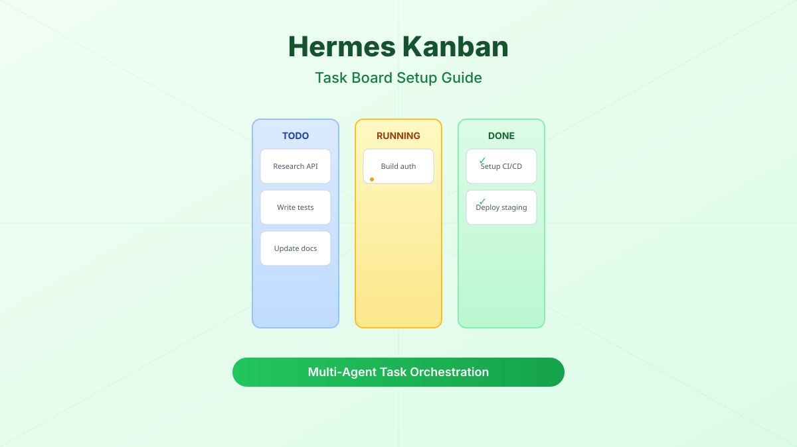
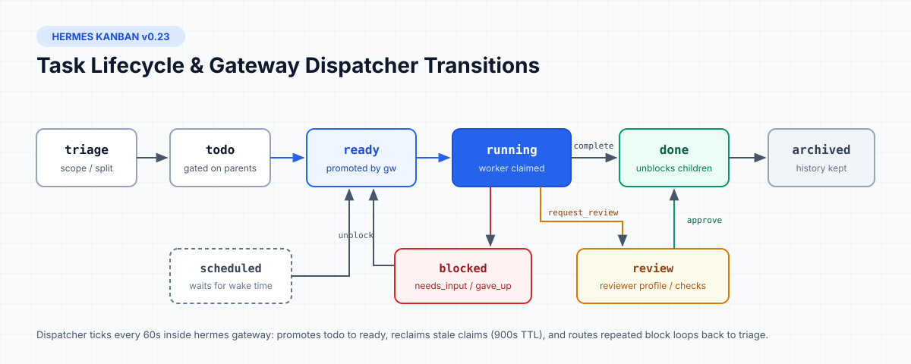

import Button from '@components/widgets/Button.astro';
import Notice from '@components/widgets/Notice.astro';
import Accordion from '@components/widgets/Accordion.astro';
import Tabs from '@components/widgets/Tabs.astro';
import Tab from '@components/widgets/Tab.astro';
import ListCheck from '@components/widgets/ListCheck.astro';

Hermes Kanban is a durable, SQLite-backed task board built into [Hermes Agent](/hermes-agent-setup-guide/) for coordinating multi-agent AI workflows. Instead of pushing everything through chat, Kanban gives you a structured board. Think Jira or Trello, but designed for AI agents working together. You plan work as cards, assign them to named agent profiles, and watch a dispatcher spawn workers that pick up, execute, and report back through a proper lifecycle. The board is visible from the built-in [dashboard](/hermes-dashboard-guide/) and third-party [Hermes dashboards and mobile apps](/best-hermes-dashboards/).

This guide covers setup against the current release (v0.23.x), the CLI command surface, the dispatcher and worker model, practical multi-agent workflow patterns, cost controls, and the troubleshooting ladder you'll need.



## What is Hermes Kanban?

Hermes Kanban is a **SQLite-backed task management system** that runs alongside the Hermes gateway. The official docs describe it as a "durable SQLite-backed task board for coordinating multiple Hermes profiles." In practice it gives you:

- **Visual task boards** with six workflow-driven columns: Triage, Todo, Ready, In progress, Blocked, Done
- **Multi-agent task handoffs**: cards are assigned to named Hermes profiles (`~/.hermes/profiles/<name>/`), each with its own memory and model config
- **Durable event history**: every state change (created, promoted, claimed, completed, blocked, …) is logged with timestamps and agent IDs in SQLite
- **Dashboard integration**: drag-and-drop, worker logs, and live updates in the bundled Kanban plugin and third-party dashboards

Under the hood, the board tracks a richer status set than the six dashboard columns: `triage | todo | scheduled | ready | running | blocked | review | done | archived`. The `review` and `scheduled` states live in the state machine and in the workflow definition as locked, non-drag columns (`review` needs a reviewer, `scheduled` needs a wake time). The v0.22.0 release notes put it as "one workflow definition drives columns": the visible set follows your workflow config.

Multi-project boards landed with the durable Kanban release. The default board lives at `~/.hermes/kanban.db`. Additional boards live at `~/.hermes/kanban/boards/<slug>/kanban.db` with their own `workspaces/` and `logs/` directories (absolute isolation between boards). Workers only see their board via the `HERMES_KANBAN_BOARD` environment variable; cross-board task links are forbidden.

<Notice type="info" title="Version history">
Kanban first appeared in v2026.4.30 but was reverted immediately. The durable reimplementation shipped in **v2026.5.7** ("Tenacity Release") and has since grown across 100+ PRs into a real multi-agent platform. The current stable release is **v0.23.3** (2026-11-20). Check your version with `hermes --version` and update with `hermes update` if you're behind.
</Notice>

## Kanban vs delegate_task: when to use which

This is the question every Hermes user hits once they discover both features. The short version: `delegate_task` is a function call, Kanban is a work queue where every handoff is a row any profile (or human) can see and edit.

<Accordion label="Quick comparison" group="comparison" expanded="true">

| | `delegate_task` | Kanban |
|---|---|---|
| **Shape** | RPC call (fork → join) | Durable message queue + state machine |
| **Parent** | Blocks until child returns | Fire-and-forget after `create` |
| **Child identity** | Anonymous subagent | Named profile with persistent memory |
| **Resumability** | None (failed = failed) | Block → unblock → re-run; crash → reclaim |
| **Human in the loop** | Not supported | Comment / unblock at any point |
| **Agents per task** | One call = one subagent | N agents over the task's life (retry, review, follow-up) |
| **Audit trail** | Lost on context compression | Durable SQLite rows |
| **Coordination** | Hierarchical | Peer (any profile reads/writes any task) |

</Accordion>

**Use Kanban when:**

- You have a project with multiple related tasks (e.g. "build a REST API" with auth, endpoints, tests, docs)
- Multiple agents need to coordinate (one writes code, another reviews, another deploys)
- You want to track progress over time and see what got done
- Tasks have dependencies and need human oversight mid-flight

**Use `delegate_task` when:**

- You need a quick answer or a single self-contained piece of work
- No follow-up or tracking is needed
- You're mid-conversation and want to keep momentum

<Notice type="info" title="They work together">
Kanban is the planning layer; `delegate_task` is one execution mechanism among several. Workers drive the board through `kanban_*` tools (`kanban_complete`, `kanban_request_review`, `kanban_block`), not through shelling out to `hermes kanban`. You can also use `delegate_task` to hand off a quick sub-piece of a Kanban card without creating a new board entry.
</Notice>

<Notice type="warning" title="Link deadlock">
A worker blocked on `t_parent` must **not** create its support card as a child of `t_parent` via `kanban_link`. The support card gets gated behind the very card it exists to unblock: `link` reports `gated: true` and nothing moves. Fix with `hermes kanban unlink <parent> <child>`. Create support cards standalone, or link them as children of the task that spawned the worker, not the blocker.
</Notice>

## How to set up Hermes Kanban

### Prerequisites

<ListCheck>
<ul>
<li>Hermes Agent v0.23.x installed. See the <a href="/hermes-agent-setup-guide/">Hermes Agent setup guide</a></li>
<li>At least one real <strong>profile</strong> per worker role (<code>~/.hermes/profiles/&lt;name&gt;/</code>); assignees must be real profiles or cards stay in <code>ready</code> forever</li>
<li>Hermes gateway installed and able to start (<code>hermes gateway start</code>)</li>
<li>Model access per worker profile. See <a href="/best-cheap-models-hermes-agent/">cheap models for Hermes Agent</a> if cost-sensitive</li>
<li>A dashboard (optional but recommended). See the <a href="/hermes-dashboard-guide/">Hermes dashboard guide</a></li>
</ul>
</ListCheck>

There is nothing to install separately. Kanban ships with the gateway-embedded dispatcher: no enable flag, no plugin to activate.

### Configure the dispatcher

The config file is `~/.hermes/config.yaml`. Not `gateway.yaml`. That file doesn't exist in the Hermes config model. All non-secret settings live in `config.yaml`; secrets go in `.env`.

```yaml
# ~/.hermes/config.yaml
kanban:
  dispatch_in_gateway: true        # default: dispatcher lives in the gateway
  dispatch_interval_seconds: 60    # default: tick interval
  review_dispatch: true            # spawn reviewer w/ bundled sdlc-review skill; false = human-only review
  max_in_progress: 2               # optional: cap concurrent workers (small VPS / local LLMs)
  failure_limit: 2                 # auto-block after N failures (gave_up)
  done_sub_retention_days: 30      # notification subscription cleanup
  reconcile_orphans: true          # reclaim orphaned claims
  # dispatch_profiles: [coder, researcher]  # optional claim allowlist (shared boards)
```

Then bootstrap and start:

```bash
hermes kanban init        # idempotent; also auto-runs on the first kanban command
hermes gateway start      # the dispatcher runs here; ready tasks idle without it
```

<Notice type="warning" title="Deprecated: hermes kanban daemon">
`hermes kanban daemon` is deprecated (only a `--force` escape hatch remains). Never run both the daemon and the gateway dispatcher against one `kanban.db`: you'll get claim races where two dispatchers spawn the same card. Use `dispatch_in_gateway: true` (the default) and a single gateway.
</Notice>

### Verify the setup

Before creating tasks, confirm the board is healthy:

<ListCheck>
<ul>
<li><code>hermes kanban stats</code> shows per-status and per-assignee counts (empty board is fine; you want no errors)</li>
<li><code>hermes kanban diagnostics</code> (board health check: flags <code>stranded_in_ready</code>, <code>stale_running</code>, <code>review_dependency_deadlock</code>; prints resolved <code>dispatch_profiles</code>)</li>
<li><code>hermes kanban dispatch --dry-run</code> shows what a dispatch pass would do and why a ready card isn't spawning (<code>Guarded(&lt;reason&gt;)</code>, <code>rate_limited</code>, <code>skipped_locked</code>, <code>memory_pressure</code>)</li>
<li><code>hermes kanban boards show</code> confirms current board and its settings</li>
<li>Open <code>hermes dashboard</code> → Kanban tab; the board renders at http://127.0.0.1:9119</li>
</ul>
</ListCheck>

If `diagnostics` is clean and `dispatch --dry-run` shows no guards blocking, you're ready to create tasks.

## Hermes Kanban commands: boards and tasks

### Managing boards

```bash
hermes kanban boards list
hermes kanban boards create rest-api --name "REST API" --icon 🧪 --switch
hermes kanban boards switch rest-api          # alias: use
hermes kanban boards show                     # current board + settings
hermes kanban boards rename rest-api "REST API (Prod)"
hermes kanban boards rm rest-api              # archive (recoverable: boards/_archived/)
hermes kanban boards rm rest-api --delete     # hard delete (rm -rf; no --confirm flag)
hermes kanban boards export rest-api -o rest-api.tar.gz   # portable backup
hermes kanban boards import backup.tar.gz     # always lands as a NEW board
hermes kanban --board default list            # operate on another board without switching
```

Board slugs are lowercase alphanumeric plus hyphen/underscore, 1-64 characters. Board resolution order: `--board` flag → `HERMES_KANBAN_BOARD` env → `~/.hermes/kanban/current` → `default`. Export strips claims, PIDs, and notification subscriptions; it's a clean portable archive.

**Verify:** `hermes kanban boards list` shows your new board; `boards show` confirms it's the current one after `switch`.

### Creating tasks

<Tabs>
<Tab name="Quick task">

```bash
hermes kanban create "Implement user authentication" \
  --assignee coder --body "POST /login, sessions, rate limiting" --priority 2
```

The title is positional. `--body` (or `--body-file PATH`) carries the description. `--priority` is an **integer tiebreaker** (default 0). There are no low/medium/high enums. `--assignee` must name a real Hermes profile.

</Tab>
<Tab name="With dependencies">

```bash
# Chained dependencies via --parent (repeatable), NOT --depends-on
SCHEMA=$(hermes kanban create "Design auth schema" --assignee coder --json | jq -r .id)
hermes kanban create "Implement auth endpoints" --assignee coder --parent "$SCHEMA"
```

`--parent` links a card as a child. The dispatcher won't promote it to `ready` until all parents are `done`. You can also link after the fact: `hermes kanban link <parent_id> <child_id>`.

</Tab>
<Tab name="Advanced flags">

```bash
# Workspaces: scratch (default, deleted on completion) | worktree | dir:<abs path>
hermes kanban create "Refactor billing" --assignee coder --workspace worktree --branch wt/billing

# Scheduling and idempotency
hermes kanban create "Nightly backup audit" --assignee ops --scheduled-at "2026-12-01T03:00:00Z"
hermes kanban create "Weekly report" --assignee ops --idempotency-key "report-$(date -u +%Y-%V)"

# Runtime caps and model pinning
hermes kanban create "Long transcode" --assignee media --max-runtime 2h --max-retries 1
hermes kanban create "Tricky migration" --assignee coder --model gpt-5.2 --provider openrouter

# Goal mode (acceptance-criteria loop)
hermes kanban create "Translate docs site to FR" --assignee linguist --goal --goal-max-turns 15
```

Other useful flags: `--triage` (park for `specify`/`decompose`), `--initial-status running|blocked`, `--skill` (repeatable), `--completion-contract OWNER/REPO`, `--created-by`, `--json`.

</Tab>
</Tabs>

<Notice type="warning" title="Scratch workspaces are ephemeral">
The default `scratch` workspace is a tmp directory **deleted on completion**. If the worker's output matters, it must call `kanban_complete(artifacts=[...])` to declare deliverables, or you must create the card with `--workspace dir:<absolute path>` or `--workspace worktree`. Relative paths in `dir:` are rejected (confused-deputy protection).
</Notice>

**Verify:** `hermes kanban list` shows your cards; `hermes kanban show <id>` reveals the full event trail for one card.

### Task lifecycle

There is no `hermes kanban move`. Task state changes through lifecycle verbs and dispatcher-driven transitions:

```bash
hermes kanban assign t_abc coder              # or 'none' to unassign
hermes kanban reassign t_abc t_def coder      # bulk reassign
hermes kanban complete t_abc --result "auth done, tests green" --summary "handoff: next card"
hermes kanban request-review t_abc --reviewer reviewer --summary "what changed + how verified"
hermes kanban request-changes t_abc "extract rate limiter, add tests"
hermes kanban reopen-review t_abc             # send back to review after changes
hermes kanban block t_abc "need prod DB creds" --kind needs_input
hermes kanban unblock t_abc
hermes kanban promote t_abc                   # todo/blocked -> ready (recovery)
hermes kanban archive t_abc t_def             # bulk verbs take multiple ids
hermes kanban comment t_abc "use the 2026 schema" --author user
hermes kanban edit t_abc --title "new title" --body "updated" --priority 5
hermes kanban schedule t_abc --at "2026-12-01T03:00:00Z"
```

The dispatcher drives the core transitions: it claims `ready` cards, spawns the assignee profile as a worker, and each run must end in exactly one lifecycle call: `kanban_complete` → `done`, `kanban_request_review` → `review`, or `kanban_block` → `blocked`. If the worker exits without one, the kernel records `crashed`/`gave_up`/`timed_out`/`protocol_violation`. Reviewers approve with `kanban_complete` or send back with `kanban_request_changes`. Dependency gating: `link` + the dispatcher's `promoted` event moves `todo → ready` when all parents are `done`. `unblock` lands on `review`/`ready`/`todo` depending on provenance, never `triage` directly.

<Notice type="info" title="Drag-and-drop counts too">
The dashboard's drag-and-drop writes `status` events directly to the board. So "moving" a card exists in the UI; the CLI just uses more precise verbs.
</Notice>



**Verify:** `hermes kanban runs <id>` shows one row per attempt; `hermes kanban show <id>` shows the full event history.

### Putting it together: a REST API pipeline

Here's an end-to-end happy path using real commands. Assume profiles `backend`, `tester`, and `devops` already exist:

```bash
SCHEMA=$(hermes kanban create "Design database schema" --assignee backend --json | jq -r .id)
MODEL=$(hermes kanban create "Implement user model" --assignee backend --parent $SCHEMA --json | jq -r .id)
AUTH=$(hermes kanban create "Implement auth endpoints" --assignee backend --parent $MODEL --json | jq -r .id)
CRUD=$(hermes kanban create "Implement CRUD endpoints" --assignee backend --parent $MODEL --json | jq -r .id)
UT=$(hermes kanban create "Write unit tests" --assignee tester --parent $AUTH --parent $CRUD --json | jq -r .id)
IT=$(hermes kanban create "Write integration tests" --assignee tester --parent $AUTH --parent $CRUD --json | jq -r .id)
hermes kanban create "Deploy to staging" --assignee devops --parent $UT --parent $IT
hermes kanban watch
```

The chained `--parent` IDs replace the old `--depends-on "A,B"` shape. Each card is promoted only when its parents complete. `hermes kanban watch` streams state changes in real time.

**Verify:** `hermes kanban list --status done` at the end shows all seven cards completed.

## The dispatcher and worker model

This is the architecture the board sits on (see the diagram above). Understanding it makes troubleshooting obvious.

The **dispatcher** lives inside the gateway (default: `dispatch_in_gateway: true`, tick every 60 seconds). Each tick it:

1. Reclaims stale claims and reaps crashed workers (PID + spawn-fingerprint matching)
2. Promotes `todo → ready` when all parent dependencies are `done`
3. Atomically claims a `ready` card
4. Spawns the assignee profile as a full OS process: `hermes -p <assignee> chat -q <prompt>`

Workers get environment variables (`HERMES_KANBAN_TASK`, `HERMES_KANBAN_DB`, `HERMES_KANBAN_BOARD`, `HERMES_KANBAN_WORKSPACES_ROOT`, `HERMES_KANBAN_WORKSPACE`, `HERMES_KANBAN_RUN_ID`, `HERMES_KANBAN_CLAIM_LOCK`, `HERMES_PROFILE`, `HERMES_TENANT`) and drive the board through a **`kanban_*` toolset**: `kanban_show`, `kanban_list`, `kanban_complete`, `kanban_request_review`, `kanban_request_changes`, `kanban_block`, `kanban_heartbeat`, `kanban_comment`, `kanban_attach`, `kanban_create`, `kanban_link`, `kanban_unblock`, `kanban_schedule`. Workers never shell out to `hermes kanban`. The tools are injected directly. Lifecycle guidance (`KANBAN_GUIDANCE`) lands in worker prompts automatically.

For chat/orchestrator profiles that need board access outside of dispatched runs, opt in: `hermes -p planner tools enable kanban` (optionally `--platform telegram`). Note: `delegate_task` children never get board-mutation rights.

Key lifecycle numbers:

- **Claim TTL: 900 s** (15 min). Live workers get claims extended automatically; only dead PIDs are reclaimed.
- **Stale timeout: 4 h.** Workers on long operations must call `kanban_heartbeat` at least hourly or they get reaped.
- **Failure limit: 2** (configurable via `kanban.failure_limit`, per-task override with `--max-retries`). Trips the breaker → card auto-blocks with `gave_up`.
- **Protocol-violation budget: 3** consecutive exits without a lifecycle call.
- **Respawn guard** prevents worker storms after quota walls (`blocker_auth`), fresh success (`recent_success`), open PR comments (`active_pr`), rate-limit cooldowns (300 s), or infrastructure cooldowns.
- **Block-loop breaker**: a block → unblock → re-block cycle for the same reason 2 times (`BLOCK_RECURRENCE_LIMIT`) routes the card to `triage` with a `block_loop_detected` event, not back to `blocked`.

One-shot manual dispatch pass: `hermes kanban dispatch [--dry-run --max N --failure-limit N]`. Multi-gateway posture: run exactly one dispatcher (`dispatch_in_gateway: true` only on the owner gateway).

<Notice type="warning" title="Single dispatcher per board">
Never run `hermes kanban daemon` and the gateway dispatcher against the same `kanban.db`. In multi-gateway setups, exactly one gateway owns dispatch. Notification delivery is profile-owned (see the multi-gateway docs).
</Notice>

If you're running many agents side-by-side across projects, the [Herdr agent multiplexer](/herdr-agent-multiplexer/) solves the adjacent problem of managing concurrent agent sessions.

## Multi-agent workflow patterns

The patterns below use named profiles, `--parent` dependency links, and the review lifecycle. If you're comparing frameworks, the [Agno workflows tutorial](/agno-workflow-writing-team/) covers the same shape in another stack.

### Code → review → deploy pipeline

Three profiles with distinct roles: `coder`, `reviewer`, `devops`.

1. Create the work cards and assign them to `coder`
2. When the coder finishes, it calls `kanban_request_review` (or you do it via `hermes kanban request-review t_abc --reviewer reviewer`)
3. The reviewer approves with `kanban_complete` or sends back with `kanban_request_changes`
4. The deploy card is `--parent`-gated on the review card; it won't promote until review passes

For code-lane work, add `--completion-contract OWNER/REPO` to gate `done` on required GitHub checks/rulesets (use `local-only` for repos without required checks). The completion gate reads checks via per-profile `gh` auth: missing or failed required checks refuse `done`.

```bash
CODE=$(hermes kanban create "Implement rate limiter" --assignee coder --json | jq -r .id)
hermes kanban create "Review rate limiter" --assignee reviewer --parent $CODE --json | jq -r .id
# ...and a deploy card parented on the review card
```

### Parallel research with aggregation

Fan out N researcher profiles; the aggregator card is `--parent`-gated on all research cards. The dispatcher won't promote the aggregator until every research card is `done`. That's dependency gating doing its job.

```bash
R1=$(hermes kanban create "Research auth best practices" --assignee researcher-1 --json | jq -r .id)
R2=$(hermes kanban create "Research DB scaling patterns" --assignee researcher-2 --json | jq -r .id)
R3=$(hermes kanban create "Research caching strategies" --assignee researcher-3 --json | jq -r .id)
hermes kanban create "Write technical design doc" --assignee architect --parent $R1 --parent $R2 --parent $R3
```

The architect won't pick up its task until all three research cards complete. A comparable pattern in another framework is the [Google ADK multi-agent research team](/google-adk-multi-agent-search/).

### One-shot swarms and goal mode

Two features replace what older guides called "board templates":

**`hermes kanban swarm`** creates a full topology in one command: root/blackboard card, parallel workers, a gated verifier, and a gated synthesizer:

```bash
hermes kanban swarm "Multi-region failover plan" \
  --worker researcher --worker architect --worker sre \
  --verifier reviewer --synthesizer writer
```

**Goal mode** (`--goal`, `--goal-max-turns N`, default 20) creates a card that loops against its own title/body as acceptance criteria (a Ralph-loop judge). If the budget is exhausted, the card goes to `blocked` for human review. Unachievable goals refuse completion. This replaces the old "run up to 3 iterations" configs. Goal mode burns turns, so set `--goal-max-turns` conservatively.

There is no `save-template` / `create-board --template`. For recurring project shapes, use workflow templates (`--workflow-template-id`/`--step-key` filters, v0.22.0+) and `boards export`/`import` to clone board structures.

## Viewing the board: CLI and dashboards

<Tabs>
<Tab name="CLI">

```bash
# Board view (NOT `show`; show is a single task)
hermes kanban list --status ready --assignee coder
hermes kanban list --mine --archived --sort priority --tenant myteam

# Single task detail + comments + event history
hermes kanban show t_abc

# Live monitoring
hermes kanban watch --kinds completed,blocked,gave_up
hermes kanban tail t_abc                # live event stream for one task

# Attempt history and logs
hermes kanban runs t_abc                # one row per attempt
hermes kanban log t_abc --tail 4000     # worker log output

# What a worker sees
hermes kanban context t_abc

# Quick stats
hermes kanban stats
hermes kanban assignees
```

`list` filters: `--mine --assignee --status --tenant --session --archived --sort --workflow-template-id --step-key`. Add `--json` to any command for scripting.

</Tab>
<Tab name="Dashboard">

The bundled Kanban plugin on `hermes dashboard` (http://127.0.0.1:9119) is the guaranteed view: it ships with the gateway and the Desktop app. Features include:

- **Board switcher** with New board / Settings / Project binding / Archive
- **Drag-and-drop** with a trash drop zone for bulk delete
- **Card drawer** with run history and worker logs
- **Lanes by profile** toggle: group In progress by assignee
- **Nudge dispatcher** button: force a dispatch pass
- **Orchestration Auto/Manual pill**: controls auto-decomposition
- Live WebSocket events for real-time updates

For third-party options like Hermes Studio (EKKOLearnAI) and Hermes WebUI (nesquena), see [the best Hermes dashboards and mobile apps](/best-hermes-dashboards/). The [Hermes dashboard guide](/hermes-dashboard-guide/) covers getting the bundled dashboard running behind a reverse proxy.

</Tab>
</Tabs>

**Verify:** `hermes kanban list --status ready` output matches what the dashboard shows. If they diverge, the dashboard WebSocket may be stale; refresh.

## Notifications from Telegram and Discord

You don't need a separate notifications config block. The real system is chat-native:

When you create a card with `/kanban create` from any gateway chat (Telegram, Discord, Slack, WhatsApp, Signal, Matrix, Mattermost, email, SMS), the chat is **auto-subscribed** to terminal events (`completed`, `blocked`, `gave_up`, `crashed`, `timed_out`). On completion, the worker's first result line is sent to the chat.

CLI subscriptions for cards created outside chat:

```bash
hermes kanban notify-subscribe t_abc \
  --platform telegram --chat-id 12345678 --chat-type group --delivery-mode notify+wake
hermes kanban notify-list
hermes kanban notify-unsubscribe t_abc --platform telegram --chat-id 12345678
```

Delivery modes: `notify` (passive ping, default), `notify+wake` (ping + agent takes a turn), `wake` (turn only). Discord threads need `--parent-chat-id`/`--guild-id` under `profile_routes`.

Subscriptions auto-remove at `done`/`archived` (`done_sub_retention_days`, default 30). Desktop app toasts work only while the app is running; use gateway subscriptions for closed-app delivery.

<Notice type="info" title="From your phone">
The `/kanban` slash command exposes every board verb from messaging platforms and bypasses the running-agent guard mid-run. You can unblock a card from your phone while a worker is mid-turn. Note that messaging output truncates at ~3800 characters. For broader mobile oversight, see [how to control AI agents from your phone](/control-ai-agents-from-phone-moshi-herdr/).
</Notice>

## Cost and ops tips

<Notice type="info" title="Affiliate Disclosure">
Some links below are affiliate links; they support the blog at no extra cost to you.
</Notice>

**Cost strategy: frontier orchestrator, cheap workers.** The orchestrator/planning profile benefits from a strong model. Workers don't need frontier models. Free options like MiMo v2 Pro on the Nous Portal ([our MiMo v2 Pro guide](/hermes-agent-mimo-v2-pro/)) or cheap providers such as [MiMo models](https://go.bitdoze.com/mimo) keep per-card cost near zero. Configure per-worker models in `~/.hermes/profiles/<name>/config.yaml`, or pin individual cards with `--model`/`--provider` or `hermes kanban set-model`. For more options, see [cheap models for Hermes Agent](/best-cheap-models-hermes-agent/).

**Protect the host.** Workers are real OS processes. On a small VPS or with local LLMs, set `max_in_progress: 2` to cap concurrent spawns. Don't run prod agents on a 1-vCPU/1 GB box. 2 vCPU / 2-4 GB is the practical floor for gateway + dashboard + 2-3 workers. The whole stack fits on an affordable [Hetzner Cloud VPS](https://go.bitdoze.com/hetzner). Entry-level class is enough for 2-3 concurrent workers.

<Notice type="warning" title="Single-host only">
Kanban is single-host by design: SQLite file + host-local PIDs. Sharing one `kanban.db` across two hosts is unsupported. If you mount one board in multiple homes, you need `dispatch_profiles` per home and unique profile names: `default` collides by construction.
</Notice>

**Ops hygiene:**

- `hermes kanban gc --event-retention-days 30 --log-retention-days 14` keeps SQLite lean
- `hermes kanban boards export <slug> -o backup.tar.gz` as a regular backup
- On system-level systemd installs, `sudo loginctl enable-linger <user>` is **mandatory**: without it, worker spawns fail with `spawn_failed` + `infrastructure: true` and cards stay in `ready` forever
- `Type=oneshot` dispatch units need `KillMode=process`

**Usage tips:**

<ListCheck>
<ul>
<li>Keep tasks small: a card a worker can finish in one session</li>
<li>Don't over-constrain dependencies: parallel beats serial when there's no real gate</li>
<li>Monitor <code>blocked</code> and <code>triage</code> columns; that's where work stalls</li>
<li>Use the dashboard for oversight; the CLI for scripting</li>
<li>Set <code>--max-runtime</code> on long jobs to avoid zombie workers</li>
</ul>
</ListCheck>

## Troubleshooting: when a card won't move

Start with `hermes kanban diagnostics` and `hermes kanban dispatch --dry-run`; they usually name the problem. Then walk this ladder:

<Accordion label="Kanban commands not found" group="faq">

You're on a version that predates the durable Kanban release. Update: `hermes update` then `hermes --version` (you want v0.23.x). The config file is `~/.hermes/config.yaml`. If you've been editing `gateway.yaml`, that file is ignored (it doesn't exist in the config model).

</Accordion>

<Accordion label="Cards stuck in ready (nothing picks them up)" group="faq">

Check in order:

1. **Is the gateway running?** The dispatcher lives there: `hermes gateway start`. Ready tasks idle forever without it.
2. **Is the assignee a real profile?** Unknown assignees stay `ready` and produce a `skipped_nonspawnable` event. Check `ls ~/.hermes/profiles/`; the assignee name must match a directory.
3. **Is a guard active?** `hermes kanban dispatch --dry-run` shows `Guarded(<reason>)`: `respawn_guarded` (`blocker_auth`, `recent_success`, `active_pr`, `rate_limit_cooldown` 300 s, `infrastructure_cooldown`), `rate_limited`, `skipped_locked`, or `memory_pressure`.
4. **Is the card stranded?** `hermes kanban diagnostics` flags `stranded_in_ready` (warn at 30 min, error at 2x, critical at 6x the threshold). The assignee profile exists but never claims.

</Accordion>

<Accordion label="Workers fail to spawn on a VPS" group="faq">

On system-level systemd installs, run `sudo loginctl enable-linger <user>`. Without linger, worker spawns fail with `spawn_failed` + `infrastructure: true` and the card stays `ready` (cooldown retries). If you use `Type=oneshot` dispatch units, add `KillMode=process` or enable linger. This is the most common VPS-specific failure.

</Accordion>

<Accordion label="A card keeps failing or bouncing back" group="faq">

- **`gave_up`**: the failure breaker tripped after `failure_limit` (default 2) or `--max-retries` attempts. Fix the root cause, then `hermes kanban promote` or `edit` and re-run.
- **`protocol_violation`**: the worker exited without a lifecycle call (`kanban_complete`/`kanban_request_review`/`kanban_block`). Budget is 3 consecutive. Check the worker log: `hermes kanban log <id> --tail`.
- **`block_loop_detected`**: the card bounced block → unblock → re-block for the same reason 2 times. It routes to **triage** (not blocked) for re-scoping. Fix via `edit` or `promote`.

</Accordion>

<Accordion label="Board not showing in the dashboard" group="faq">

Refresh the page. The bundled Kanban plugin lives on `hermes dashboard` (port 9119). Make sure the gateway is running. For third-party dashboards, see [the best Hermes dashboards and mobile apps](/best-hermes-dashboards/). Support varies by project and we don't claim specific version floors.

</Accordion>

<Accordion label="How do I delete a board?" group="faq">

`hermes kanban boards rm <slug>` archives the board to `boards/_archived/<slug>-<ts>/` (recoverable). `hermes kanban boards rm <slug> --delete` is a hard `rm -rf` with no confirmation prompt and no `--confirm` flag. Export first if you might need the data: `hermes kanban boards export <slug> -o backup.tar.gz`.

</Accordion>

## What's next

Start simple: one board, a handful of cards, one or two worker profiles. Get the dispatcher loop reliable before scaling to swarms and goal mode. The full surface is bigger than most guides show: goal mode, swarms, PR completion contracts, worktrees, and the diagnostics layer are worth exploring once the basics are solid.

For more on the Hermes ecosystem:

- [Hermes Agent setup guide](/hermes-agent-setup-guide/): install and configure Hermes
- [Hermes dashboard guide](/hermes-dashboard-guide/): get the web dashboard behind a reverse proxy
- [Best Hermes dashboards and mobile apps](/best-hermes-dashboards/): third-party UIs and mobile clients
- [Cheap models for Hermes Agent](/best-cheap-models-hermes-agent/): keep worker costs down
- [Best AI coding tools and agents](/ai-coding-tools/): where Hermes fits among coding agent options

Official docs are excellent further reading: [Kanban feature doc](https://github.com/NousResearch/hermes-agent/blob/main/website/docs/user-guide/features/kanban.md), [Kanban tutorial](https://github.com/NousResearch/hermes-agent/blob/main/website/docs/user-guide/features/kanban-tutorial.md), [Worker lanes](https://github.com/NousResearch/hermes-agent/blob/main/website/docs/user-guide/features/kanban-worker-lanes.md), [Multi-gateway deployment](https://github.com/NousResearch/hermes-agent/blob/main/website/docs/user-guide/features/kanban-multi-gateway.md).

<Button text="Explore AI coding tools" link="/ai-coding-tools/" variant="solid" color="blue" size="md" icon="arrow-right" iconPosition="right" />
