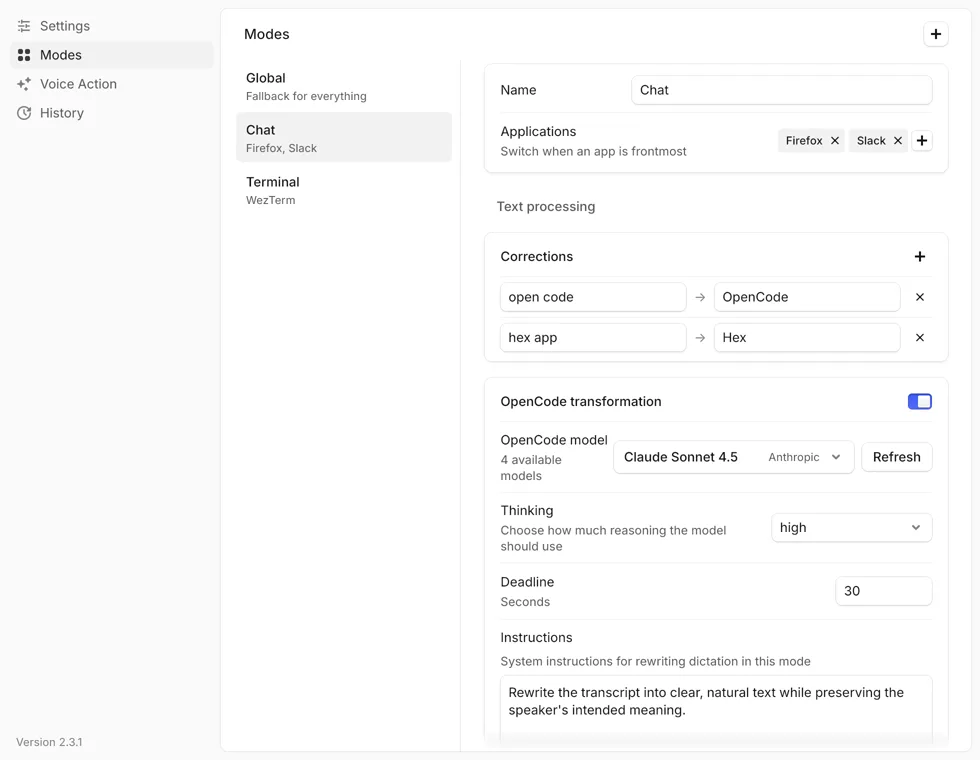

import Button from "@components/widgets/Button.astro";
import Notice from "@components/widgets/Notice.astro";
import ListCheck from "@components/widgets/ListCheck.astro";
import Accordion from "@components/widgets/Accordion.astro";
import Tabs from "@components/widgets/Tabs.astro";
import Tab from "@components/widgets/Tab.astro";

The team behind OpenCode shipped a dictation app. Hex is a free, MIT-licensed voice typing tool for macOS, Windows, and Linux: hold a key, speak, let go, and the text lands wherever your cursor is. Transcription runs entirely on your machine, and it went from zero to 5,100+ GitHub stars in about four months.

I already covered [FluidVoice](/fluidvoice-mac-dictation/), the free dictation app that made Wispr Flow's $15/month look silly on Mac. Hex comes at the same problem from a different angle. It's written in Rust, it treats voice as an interface for agents rather than just a typing replacement, and it's the only free option that ships equal builds for all three desktop platforms on day one.

<Button text="Download Hex" link="https://anoma.ly/hex/" variant="solid" color="blue" size="md" icon="arrow-right" />

<Button text="View on GitHub" link="https://github.com/anomalyco/hex" variant="outline" color="gray" size="md" />

## What is Hex?

Hex is a local voice dictation app built by Anomaly, the company behind [OpenCode](/opencode-go-plan/). The whole thing is Rust, the UI runs on their own Rune framework, and speech-to-text runs through a fork of transcribe.cpp on Metal (macOS) or Vulkan (Windows and Linux). Current release at the time of writing is v3.3.0.

The workflow has three steps:

1. Hold your shortcut (Option on macOS by default), speak, release.
2. Hex transcribes the audio on your device.
3. The text gets pasted into whatever app had focus.

The first run downloads a speech model (the recommended one is ~731 MB). After that, nothing leaves your machine for transcription. No account, no subscription, no word cap.

The repo history is worth a look if you're curious about how it's built: 1,500+ commits since July 2026, and the project doesn't accept pull requests at all. You open an issue and their coding agents turn it around. It's an app built by agents that's partly designed to talk to agents.

## How to install Hex

<Tabs>
<Tab name="macOS">

Requirements: Apple silicon and macOS 15 or later. No Intel build.

Homebrew is the cleanest install:

```bash
brew install --cask anomalyco/tap/hex
```

Or grab the DMG from [anoma.ly/hex](https://anoma.ly/hex/). The site detects your platform and shows the right download, including a "needs Apple silicon" notice if you're on Intel.

On first launch macOS will ask for microphone access and accessibility permissions (so Hex can paste into other apps). Grant both or nothing works.

Coming from the original Swift app (releases through 2.3.1, bundle id `com.kitlangton.hex2`)? Install this one manually and set it up again: settings and history don't transfer, and you should quit the old app so the two shortcuts don't fight.

</Tab>
<Tab name="Windows">

x64 and ARM64 installers are on the site and GitHub Releases. It's a per-user install, so no admin rights needed. You may get a SmartScreen prompt on a fresh download (the installer isn't code-signed yet; choose More info → Run anyway). x64 machines need a 2013-or-newer CPU with AVX2 — Intel Haswell or AMD Excavator onward — and on anything older Hex shows a message and quits. ARM64 builds transcribe on the CPU.

Side note: if Discord starts showing you "Playing HEX: Shards of Fate" while Hex runs, that's Discord matching `hex.exe` to a card game. Hide it under Discord's Settings › Registered Games.

The PowerShell one-liner:

```powershell
powershell -ExecutionPolicy Bypass -Command "iwr https://anoma.ly/hex/install-windows.ps1 -OutFile install-windows.ps1; ./install-windows.ps1"
```

<Notice type="warning" title="Check your Vulkan driver">
Windows needs a Vulkan 1.2 driver for GPU-accelerated transcription. Hex installs fine without one but falls back to CPU inference and shows a note in Settings. On a recent machine with updated GPU drivers you're fine; on older or VM'd Windows, expect slower transcription.
</Notice>

</Tab>
<Tab name="Linux">

The install script handles x64 and ARM64:

```bash
curl -fsSL https://anoma.ly/hex/install-linux.sh | sh
```

Or install a package directly:

```bash
# Debian/Ubuntu
curl -fLo /tmp/hex.deb https://anoma.ly/hex/download/linux-x64-deb && sudo apt install /tmp/hex.deb

# Fedora/openSUSE: swap -deb for -rpm in the URL

# Arch (AUR)
yay -S hex-bin

# Nix
nix profile add github:anomalyco/hex
```

X11 and native Wayland are both supported, but they paste differently. On X11, Hex uses key grabs and wtype. On GNOME/KDE Wayland it goes through the RemoteDesktop portal, which means the desktop shows a grant dialog that literally says "remote desktop" before the first paste. That's just the portal's wording. Hex only sends keystrokes; it never reads your screen.

A few Linux specifics worth knowing:

- The packages target **glibc 2.36+** (Debian 12, Ubuntu 24.04, Fedora 37 or newer), and x86_64 needs the same AVX2-era CPU as Windows.
- On Arch the AUR package is `hex-bin` — plain `hex` is a hex-dump tool that installs `hx`.
- On wlroots compositors install `wl-clipboard` and `wtype` for paste; if the paste can't be delivered the transcript stays on your clipboard for a manual Ctrl+V.
- Hyprland, Sway, and GNOME ≤46 setups without a shortcuts portal bind keys in the compositor/desktop config instead, e.g. `bindsym F9 exec hex dictation start` plus `bindsym --release F9 exec hex dictation stop`.
- Bluetooth earbuds on Linux: recording flips the headset into its hands-free profile and audio quality tanks. Hex's `avoid_bluetooth_microphone` option (on by default) helps, but a built-in or USB mic is the better input.

</Tab>
</Tabs>

Two release channels exist: **stable** (the current release) and **dev** (the newest build of the `dev` branch, which self-updates). The install scripts take `HEX_INSTALL_CHANNEL=dev` if you want to live on the edge, and the updater follows whichever channel you installed.

## First run and setup

The onboarding flow walks you through permissions, lets you practice a dictation, and downloads the recommended model in the background. One nice touch: before downloading anything, Hex scans your Hugging Face cache (`~/.cache/huggingface/hub`) for GGUF speech models that other apps already pulled down. If it finds a compatible file, it offers it as "Found on this computer" and uses it in place instead of downloading a second copy. If you've run Handy or another whisper.cpp-based tool, there's a decent chance your first run needs no download at all.

You can also import your own GGUF file through the picker's "Add model file" button. Hex checks the header (architecture, tensor types, language codes) before accepting it and keeps its own verified copy.

## What the model catalog covers

Hex doesn't lock you into one engine. The catalog pulls from several speech model families, all converted to GGUF for its transcribe.cpp fork:

- **Parakeet family** (NVIDIA): RNN-T and TDT variants, plus Underdog Bark and Nemotron 3.5 ASR. Fast, English-strong, and the only family that supports decoding-time vocabulary biasing (a Labs toggle).
- **Whisper**: multiple sizes, including community builds like ivrit.ai (Hebrew) and NB-Whisper (Norwegian). Broadest language coverage, up to 99 languages.
- **Qwen3-ASR** (incl. QwenCleo): auto-detects languages, reads vocabulary through its system prompt.
- **Cohere ASR, SenseVoice, GigaAM, Granite, Apple Speech**: supported architectures, with the caveat that some don't accept vocabulary hints.

Each model card in the picker shows languages, size, and (behind a Labs toggle) raw WER/CER benchmark numbers with the dataset and test conditions. That last bit is rare: most dictation apps just tell you a model is "fast" or "accurate" without numbers.

Two catalog models — **Parakeet Unified English** (the ~731 MB default for English systems) and **Nemotron 3.5 ASR** — stream: on a GPU they transcribe while you're still holding the key, so releasing only has to finish the last second or two. On CPU-only devices (Windows ARM64 included) every model transcribes the whole clip after release, and if a stream fails Hex silently falls back to whole-clip transcription. Each model also remembers the language you last used with it, and on macOS the menu-bar item has a model switcher so you don't need Settings to swap.

For English on Apple silicon, Parakeet Unified English is a good default. If you dictate in another language daily, check the benchmark details before picking.

## Features that matter

### Shortcuts that fit how you work

Defaults differ per platform: **Option** on macOS, **Ctrl+Space** on Windows, **Alt+Space** on Linux — except new GNOME and KDE setups, which get **Ctrl+Alt+Space** because GNOME keeps Alt+Space for the window menu and Plasma for KRunner. Beyond the defaults the system is unusually flexible. Every shortcut is a chord: modifiers alone, modifier plus key, both Option keys together (an 80 ms window), standalone Fn/Globe, plain function keys, and on Windows and Linux even mouse buttons (great for a thumb button on a gaming mouse). Mouse shortcuts on macOS sit behind a Labs toggle.

There are three dictation modes:

- **Hold**: hold to talk, release to transcribe and paste. The default — and note Escape can't abort a Hold-mode capture once it's going.
- **Double-tap lock**: tap the key twice to keep recording hands-free, tap once more to finish.
- **Toggle**: press once to start, once to stop, and it's the only mode with a real cancel (Escape by default, rebindable).

One more built-in chord: **Paste Last** (Option-Shift-V on macOS, Ctrl+Alt+V on Windows and Linux) re-pastes your most recent dictation.

### Vocabulary: teach it your names

General › Vocabulary is a shared list of terms (people, projects, products) with optional "sounds like" spellings. Add "Bitdoze" with spellings like "bit dose, bitdoze" and the transcription stops butchering it. On Parakeet-family models the biasing happens inside the decoder (behind the Labs toggle); on Whisper and Qwen3-ASR the terms go in as a context prompt. Either way it also feeds rewriting, meeting notes, and transcript search, so your custom names survive the whole pipeline. Cap: 500 terms, 64 characters each, 16 spellings per term.

This is the feature that matters if your dictation is full of proper nouns. Every dictation app mangles names; almost none let you fix it. The CLI mirrors the list too: `hex vocabulary` adds, lists, and removes terms against the running app.

### Modes and text processing

The Output tab is where Hex gets closer to FluidVoice's Write Mode. You can define modes tied to specific apps or browser hosts. Each mode has its own corrections, an optional AI rewrite step, and custom transformations. The Global mode applies everywhere; a more specific mode overrides it for its app or site — though per the docs, website-aware matching currently needs a Chromium-family browser (Brave is the one named). A mode can even carry its own vocabulary list on macOS.

The AI rewrite step routes through a running OpenCode instance, not a bundled model. That's the same pattern Meetily uses with Ollama: powerful if you already run the stack, extra setup if you don't.



### Voice Action and personal commands

Beyond pasting text, Hex can act on what you say. A dedicated Voice Action shortcut treats speech as a command instead of dictation. Then there are personal commands, defined in `~/.config/hex/hex.config.ts`:

```ts
import { defineHexConfig, openUrl } from "@hex/commands"

export default defineHexConfig({
  commands: {
    "open-repo": {
      phrases: ["open repo"],
      group: "Work",
      description: "Open the project repository",
      action: openUrl("https://github.com/anomalyco/hex"),
    },
  },
})
```

Commands run in an embedded QuickJS sandbox with no filesystem or network access. Available actions: `openUrl`, `openApplication`, `openPath`, `press`, `typeText`. You can capture arguments (`"open issue {name}"`), set custom dictation control phrases, and register text transformations that plug into modes. `hex commands init` scaffolds the config folder, and here's the fun part: the folder ships its own AGENTS.md, so you can point a coding agent at it and have the agent write your voice commands for you.

### Meetings (beta, in Labs)

Flip the Meetings switch in Labs and Hex becomes a lightweight local meeting recorder. It captures system audio and your mic as separate tracks, detects calls in Zoom, Google Meet, Teams, Slack huddles, FaceTime, WhatsApp, Gather, and Discord, and saves Markdown transcripts with `You`/`Them` turns to `~/Documents/Hex Meetings`. Summaries come from Apple Intelligence on macOS or OpenCode elsewhere.

It's beta and the diarization is two-lane (`You` vs `Them`), not real multi-speaker labeling. For serious meeting notes, [Meetily](/meetily-self-hosted-ai-meeting-assistant/) is still the more mature open-source option, but for capturing a quick call without a bot joining, this does the job.

### Annotate and the agent pipeline

Annotate records your screen while you draw on it and talk, then ships the recording to an agent. It's on by default on macOS and Linux (Option-Shift-S and F9 respectively), not on Windows yet, and while an Annotate session records, the dictation shortcut does nothing. Combined with the read-only MCP server (`hex mcp`), the local HTTP API, and the TypeScript SDK, the direction is clear: Hex wants to be the voice front-end for agent workflows. `hex dictation start`, `hex paste-last`, `hex history --search`, `hex meetings search`, and `hex model` management all work from the terminal, which also means you can bind them to whatever shortcut system your OS already has.

## Privacy and history

Dictation audio isn't saved by default. History keeps successfully pasted text for seven days (10,000 entries or 16 MiB cap, oldest entries drop first), storing the local transcript, the final pasted text, and limited app/timing metadata — no audio, no full URLs, no window titles. History › Keep: Off stops new entries; Clear all removes the ones you have.

For diagnostics there's `HEX_RETAIN_DICTATION_AUDIO`, which keeps a bounded set of WAV files, and local logs can contain transcript text and foreground app names. Logs live in `~/Library/Application Support/hex/logs/` (macOS), `%APPDATA%\hex\logs\` (Windows), or `~/.local/share/hex/logs/` (Linux), and aren't uploaded. The deliberate network exceptions: model downloads (Hugging Face), app updates, and the optional OpenCode rewrite, which sends the transcript plus foreground-app context to whatever model provider you configured. So don't dictate tokens, passwords, or `.env` contents into an agent chat — a local transcript still lands in a prompt that may go to a hosted model.

## Hex vs FluidVoice, Handy, and Wispr Flow

| | Hex | FluidVoice | Handy | Wispr Flow |
|---|---|---|---|---|
| **Price** | Free | Free | Free | Free tier (2,000 words/wk), Pro $15/mo |
| **License** | MIT | GPL-3.0 | MIT | Proprietary |
| **Platforms** | macOS, Windows, Linux | macOS (Win/iOS beta) | macOS, Windows, Linux | macOS, Windows, iOS, Android |
| **Transcription** | Local, multi-model catalog + custom GGUF | Local (Parakeet, Whisper, Nemotron, more) | Local (Whisper, Parakeet v3) | Cloud |
| **AI cleanup** | Via OpenCode (your own stack) | Fluid-1 bundled, local | Optional BYO key/Ollama | Cloud, built in |
| **Custom vocabulary** | Yes, with sounds-like spellings | Trained words (Fluid Speech Pro) | Correction list | Limited |
| **Voice commands** | Voice Action + scriptable personal commands | Command Mode | No | Yes (Pro) |
| **Meetings** | Beta in Labs | FluidMeet | No | No |
| **Agent/CLI surface** | CLI, MCP server, local API, TS SDK | Agent integrations via FluidMeet | CLI flags, Raycast | No |
| **Mobile** | No (iOS prototype in repo) | iOS TestFlight | No | iOS, Android |

The short version:

- **FluidVoice** is the most polished Mac experience and the only one with a bundled local cleanup model (Fluid-1). If you're on Apple silicon and want zero extra setup, it stays my default recommendation. Full details in the [FluidVoice guide](/fluidvoice-mac-dictation/).
- **Handy** is the minimal one. Push to talk, paste, done. MIT-licensed, ~33k stars, no AI cleanup unless you wire in your own key. If you want dictation and literally nothing else, it's hard to beat.
- **Hex** is the most extensible. Cross-platform parity, custom models, vocabulary, scriptable commands, a CLI and an MCP server. The tradeoff is that its smartest features lean on OpenCode, and big chunks are still flagged Labs.
- **Wispr Flow** is what you compare against on polish and mobile support, not price. If you dictate mostly on a phone, it's still the realistic option.

## Honest limitations

1. **Apple silicon only on Mac, macOS 15+.** Intel Macs are out completely; the site disables the download button for them.
2. **Windows needs Vulkan 1.2 for GPU inference.** It falls back to CPU, but that means slower transcription on machines with old drivers.
3. **No bundled cleanup model.** FluidVoice ships Fluid-1; Hex expects a running OpenCode for rewrites and summaries. If you don't already live in that ecosystem, the feature is effectively absent.
4. **Half the interesting stuff is Labs.** Meetings, screenshot capture, vocabulary biasing, mouse shortcuts on macOS, model benchmarks — even spoken formatting phrases like "new line" moved behind a Labs toggle in 3.1.0. Labs is on by default but everything inside is explicitly unfinished.
5. **No pull requests.** You can't contribute code, only issues. Their agents do the fixing. That keeps quality control tight but makes the project a black box to work *on*, even though the code is open to read.
6. **Wayland friction.** The RemoteDesktop portal grant shows a scary "remote desktop" dialog, and some wlroots setups need wtype installed.
7. **Two-lane diarization in meetings.** `You` and `Them` only, no real speaker separation on group calls.
8. **Young codebase.** Four months old, shipping constantly, 146 open issues. Expect churn.

<Notice type="info" title="Agent-maintained, agent-oriented">
The same property that makes Hex interesting is the risk: it's maintained largely by the team's own agents. Releases ship fast (v3.3.0 days before this writing), but if you want a slow, stable tool that changes twice a year, this isn't it.
</Notice>

## Who should use Hex

<ListCheck>

**Hex is a strong fit if you:**

- Want free, local dictation on Windows or Linux, not just Mac
- Already use OpenCode or want dictation wired into agent workflows
- Dictate technical content with names and terms that need a custom vocabulary
- Like driving things from a terminal (`hex dictation start`, `hex model use`)
- Care about open code you can read (MIT), even if you can't send PRs

</ListCheck>

**Pick something else if:**

- You're on an Intel Mac or macOS 14 and older (no build exists)
- You want the simplest possible push-to-talk with zero config (that's [Handy](https://handy.computer/))
- You want bundled AI cleanup with no external dependencies (that's [FluidVoice](/fluidvoice-mac-dictation/))
- You dictate mostly on a phone (Wispr Flow, or wait for Hex's iOS prototype)

<Accordion label="Frequently Asked Questions" group="faq">

**Is Hex really free?**
Yes. MIT license, no paid tier, no word limits, no account. The only cost is disk space for the speech model (~731 MB for the recommended one).

**Does Hex work offline?**
Fully. The model downloads once from Hugging Face on first run (or gets picked up from your existing HF cache). Everything after that is local: capture, transcription, paste. The optional OpenCode rewrite and meeting summaries also stay local if your OpenCode runs local models.

**What languages does Hex support?**
Depends on the model you pick. Whisper-based models cover up to 99 languages, Parakeet TDT v3 covers 25, Qwen3-ASR auto-detects its set. English gets the best results across the board. The app UI itself ships in English plus Portuguese, French, Russian, and Simplified/Traditional Chinese, though the translations note they haven't had native-speaker review.

**Can I use my own Whisper model?**
Yes. Any compatible GGUF file (Parakeet, Whisper, Qwen3-ASR, Cohere, SenseVoice, GigaAM architectures) imports through "Add model file," and Hex auto-detects compatible files already sitting in your Hugging Face cache.

**Does Hex record meetings?**
In Labs, yes. It captures system audio plus your mic, detects calls on Zoom/Meet/Teams/Slack/FaceTime/WhatsApp/Gather/Discord, and saves Markdown transcripts. It's beta with basic You/Them diarization. For production meeting notes, [Meetily](/meetily-self-hosted-ai-meeting-assistant/) is further along.

**How does it compare to just using built-in dictation?**
macOS and Windows both have free built-in dictation, and it works fine for a quick sentence. Hex gives you model choice, custom vocabulary, per-app modes, voice commands, and scriptability. If you dictate more than a few lines a day, the difference is obvious.

</Accordion>

## Final verdict

Hex is the most interesting free dictation app released this year. It's not the simplest (that's Handy) and not the most self-contained on Mac (that's FluidVoice), but it's the only one that's genuinely cross-platform, genuinely hackable, and built with the assumption that the thing listening to your voice might be an agent, not just a text field.

It's also four months old and moves fast. Install it, hold Option, and talk at it for a week. If the model quality holds up for your voice and languages, you've just replaced a $144/year subscription with an MIT-licensed binary.

For more options across all three platforms, check the full [free dictation apps comparison](/best-free-dictation-apps/).

<Button text="Download Hex" link="https://anoma.ly/hex/" variant="solid" color="blue" size="md" icon="arrow-right" />

<Button text="Star on GitHub" link="https://github.com/anomalyco/hex" variant="outline" color="gray" size="md" />
