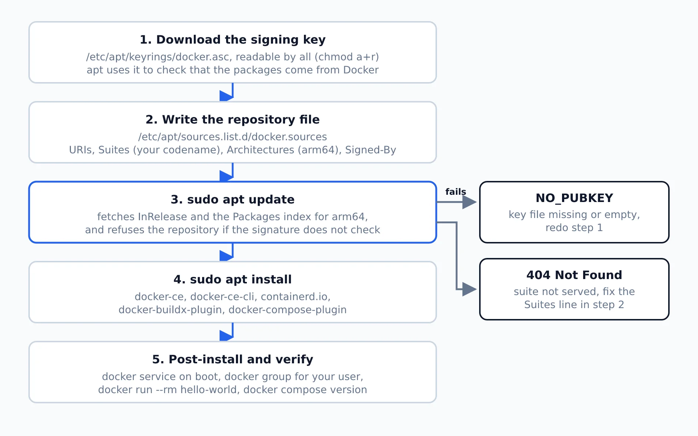

import Accordion from "@components/widgets/Accordion.astro";
import Button from "@components/widgets/Button.astro";
import ListCheck from "@components/widgets/ListCheck.astro";
import Notice from "@components/widgets/Notice.astro";
import Tab from "@components/widgets/Tab.astro";
import Tabs from "@components/widgets/Tabs.astro";

To install Docker on Ubuntu ARM, use Docker's own apt repository and five packages: `docker-ce`, `docker-ce-cli`, `containerd.io`, `docker-buildx-plugin` and `docker-compose-plugin`. The repository carries the `arm64` builds next to the amd64 ones: Docker Engine 29.10.1 and Compose v5.8.1 on 2026-11-27.

I captured every output block below on 2026-11-27 in throwaway Ubuntu 24.04 and 22.04 containers on an x86_64 host, not on an ARM machine. Buildx v0.39.1 came with the versions above. The `arm64` column of the repository comes from a URL check, and the spots that depend on it say so. The excerpts keep only the lines that count. The steps follow [Docker's documentation](https://docs.docker.com/engine/install/ubuntu/).



## How do I install Docker on Ubuntu ARM?

Download Docker's signing key to `/etc/apt/keyrings/docker.asc` and write `/etc/apt/sources.list.d/docker.sources` with your Ubuntu codename and `arm64` as the architecture. Then run `sudo apt update` and `sudo apt install docker-ce docker-ce-cli containerd.io docker-buildx-plugin docker-compose-plugin`, add your user to the `docker` group, and check the result with `docker run --rm hello-world`.

## Check the machine before you start

Two commands tell you whether these steps fit your host:

```bash
uname -m
dpkg --print-architecture
```

These steps are for hosts that answer `aarch64` and `arm64`: 64-bit Ubuntu on Oracle Ampere, AWS Graviton, Hetzner's Ampere instances or a Raspberry Pi 5. `armv7l` and `armhf` mean a 32-bit userland. Docker's repository serves that column too, but I checked nothing below on 32-bit.

Docker's docs, read on 2026-11-27, list four supported Ubuntu versions: 26.10 (`stonking`), 26.04 (`resolute`, LTS), 24.04 (`noble`, LTS) and 22.04 (`jammy`, LTS). Older suites such as focal are still in the repository, with an arm64 column, but they are outside that list.

If you are still looking for a host, the [ARM vs x86 VPS benchmarks](/arm-vs-x86-vps-server-benchmarks/) show where an ARM VPS earns its price. The [Hetzner Cloud price tables](/hetzner-cloud-cost-optimized-plans/) include the Ampere CAX line:

*Disclosure: this guide contains referral links. If you buy through them, I may earn a commission at no extra cost to you.*

<Button link="https://go.bitdoze.com/hetzner" text="Get an ARM Server" />
<Button link="https://go.bitdoze.com/hostinger-vps" text="Hostinger VPS" />

_VPS prices jumped across the board in 2026. If you're rethinking a rented box, see [what changed and when a mini PC wins](/vps-price-increases/)._

Before the first command:

<ListCheck>
<ul>
<li>Ubuntu 22.04, 24.04 or 26.04 on 64-bit ARM, with sudo access and outbound HTTPS to `download.docker.com` and Docker Hub.</li>
<li>About 380 MB of disk on amd64 or 355 MB on arm64 for the six Docker packages.</li>
<li>No `docker.io`, `docker-compose` or `podman-docker` package from Ubuntu's repository. Remove them first, as shown next.</li>
</ul>
</ListCheck>

<Notice type="warning" title="Published ports skip ufw">
Docker writes its own iptables rules, and they open a port published with `-p 8080:80` to the internet even when ufw denies it. Bind services to `127.0.0.1` or put a reverse proxy in front. [How to fix Docker bypassing the firewall](/docker-bypasses-firewall/) walks through both. The docs also say the daemon works only with the iptables-nft and iptables-legacy backends, and that Docker does not support rules created with plain nft.
</Notice>

## Add Docker's apt repository on Ubuntu

Docker's repository lives at `download.docker.com/linux/ubuntu`, and two files make apt accept it: the signing key in `/etc/apt/keyrings` and a sources file in `/etc/apt/sources.list.d`. Ubuntu ships its own `docker.io` package, and it lags. On 2026-11-27 Ubuntu's repository offered Docker 29.1.3, Compose 2.40.3 and Buildx 0.30.1 on both 22.04 and 24.04. Docker's repository had 29.10.1, 5.8.1 and 0.39.1, so the steps below add it.

### Remove conflicting packages

Docker's docs start by removing packages that clash with the official ones:

```bash
sudo apt remove $(dpkg --get-selections docker.io docker-compose docker-compose-v2 docker-doc docker-buildx podman-docker containerd runc | cut -f1)
```

On a clean host dpkg answers `no packages found matching docker.io` for each name and apt removes nothing. Images and volumes under `/var/lib/docker` survive this command and the purge at the end of the page.

### Update and add the signing key

```bash
sudo apt update
sudo apt install ca-certificates curl
```

The next command needs `curl`. Without it the key download stops at `sudo: curl: command not found`. Without `ca-certificates` on the host, apt refuses the repository with `No system certificates available. Try installing ca-certificates.`

```bash
sudo install -m 0755 -d /etc/apt/keyrings
sudo curl -fsSL https://download.docker.com/linux/ubuntu/gpg -o /etc/apt/keyrings/docker.asc
sudo chmod a+r /etc/apt/keyrings/docker.asc
```

Check what landed:

```bash
ls -l /etc/apt/keyrings/docker.asc
head -1 /etc/apt/keyrings/docker.asc
```

```text
-rw-r--r-- 1 root root 3817 Nov 27 14:26 /etc/apt/keyrings/docker.asc
-----BEGIN PGP PUBLIC KEY BLOCK-----
```

Older tutorials pipe the key through `gpg --dearmor` into a `docker.gpg` file. The current docs keep the armored file, which apt accepts in `Signed-By` as it is. The `chmod` matters because apt reads the keyring as the `_apt` user, and `sources.list(5)` asks for a file readable by everyone. With the default umask it arrives `-rw-r--r--` anyway.

### The repository file: docker.sources or docker.list

Docker's docs write the repository in the deb822 format. Older tutorials and the `get.docker.com` script use a one-line file. apt accepts both. Pick one.

<Tabs>
<Tab name="docker.sources (current docs)">

```bash
sudo tee /etc/apt/sources.list.d/docker.sources <<EOF
Types: deb
URIs: https://download.docker.com/linux/ubuntu
Suites: $(. /etc/os-release && echo "${UBUNTU_CODENAME:-$VERSION_CODENAME}")
Components: stable
Architectures: $(dpkg --print-architecture)
Signed-By: /etc/apt/keyrings/docker.asc
EOF
```

`tee` echoes the file it wrote, with both substitutions expanded:

```text
Types: deb
URIs: https://download.docker.com/linux/ubuntu
Suites: noble
Components: stable
Architectures: amd64
Signed-By: /etc/apt/keyrings/docker.asc
```

</Tab>
<Tab name="docker.list (one line)">

```bash
echo "deb [arch=$(dpkg --print-architecture) signed-by=/etc/apt/keyrings/docker.asc] https://download.docker.com/linux/ubuntu $(. /etc/os-release && echo "${UBUNTU_CODENAME:-$VERSION_CODENAME}") stable" | sudo tee /etc/apt/sources.list.d/docker.list
```

Output from a 22.04 container:

```text
deb [arch=amd64 signed-by=/etc/apt/keyrings/docker.asc] https://download.docker.com/linux/ubuntu jammy stable
```

</Tab>
</Tabs>

| Option | Verdict | Trade-off |
|---|---|---|
| `docker.sources` (deb822) | What Docker's docs use now. One field per line, so fixing the suite after an Ubuntu upgrade is a one-word edit | The file has no `deb` line, so a script that greps sources for one finds nothing |
| `docker.list` (one line) | What get.docker.com writes and what older tutorials show. On 22.04 it gave the same `apt update` result as the deb822 file | Architecture, key path, URL, suite and channel share one line |

| Line | Holds | Why it matters |
|---|---|---|
| `Suites` | your Ubuntu codename | picks the build for your release |
| `Architectures` | `arm64` on these hosts | apt downloads one column, and the `Get:` line below shows it |
| `Signed-By` | the key file | apt checks the repository signature with this key |
| `Components` | `stable` | the release channel; the repository also has `edge`, `test` and `nightly` |

The shell expands the codename when you write the file, so `Suites: noble` stays `noble` until someone edits it. After an Ubuntu release upgrade, open the file and check that line. The `${UBUNTU_CODENAME:-$VERSION_CODENAME}` form exists for derivatives: on Linux Mint 22, `VERSION_CODENAME` is `wilma` and `UBUNTU_CODENAME` is `noble`, and Docker's repository serves `noble`, not `wilma`.

| Ubuntu | Codename | `arm64` column | Newest `docker-ce` in the repository |
|---|---|---|---|
| 22.04 LTS | `jammy` | yes | `5:29.10.1-1~ubuntu.22.04~jammy` |
| 24.04 LTS | `noble` | yes | `5:29.10.1-1~ubuntu.24.04~noble` |
| 26.04 LTS | `resolute` | yes | `5:29.10.1-1~ubuntu.26.04~resolute` |
| 26.10 | `stonking` | yes | `5:29.10.1-1~ubuntu.26.10~stonking` |

I read the arm64 and amd64 indexes on 2026-11-27. The version strings are the same in both.

### Refresh the package lists

`sudo apt update` fetches the index for your architecture:

```bash
sudo apt update
```

```text
Get:1 https://download.docker.com/linux/ubuntu noble InRelease [48.5 kB]
Get:2 https://download.docker.com/linux/ubuntu noble/stable amd64 Packages [91.6 kB]
Fetched 140 kB in 1s (229 kB/s)
```

On an ARM64 host the second line reads `arm64 Packages`, and the codename is yours. Then confirm that the candidate comes from Docker and not from Ubuntu:

```bash
apt-cache policy docker-ce
```

```text
docker-ce:
  Installed: (none)
  Candidate: 5:29.10.1-1~ubuntu.24.04~noble
  Version table:
     5:29.10.1-1~ubuntu.24.04~noble 500
        500 https://download.docker.com/linux/ubuntu noble/stable amd64 Packages
```

`Candidate: (none)` here means apt did not accept the repository, and the install step then ends with `Package 'docker-ce' has no installation candidate`.

## Why does apt say NO_PUBKEY after adding the Docker repository?

The key file is missing or empty, so apt cannot check the repository signature. Run the three key commands again, then confirm that `head -1 /etc/apt/keyrings/docker.asc` prints `-----BEGIN PGP PUBLIC KEY BLOCK-----`.

With the key file deleted, `apt update` printed:

```text
Err:3 https://download.docker.com/linux/ubuntu noble InRelease
  The following signatures couldn't be verified because the public key is not available: NO_PUBKEY 7EA0A9C3F273FCD8
W: GPG error: https://download.docker.com/linux/ubuntu noble InRelease: The following signatures couldn't be verified because the public key is not available: NO_PUBKEY 7EA0A9C3F273FCD8
E: The repository 'https://download.docker.com/linux/ubuntu noble InRelease' is not signed.
```

Other failures, each produced on purpose in a test container:

| apt prints | Cause | Fix |
|---|---|---|
| `GPG: add_keyblock_resource 33587281  GPG: keydb_search 33554445` | the key file exists but is empty | redo the three key commands; `head -1` must print `-----BEGIN PGP PUBLIC KEY BLOCK-----` |
| `404  Not Found`, then `does not have a Release file` | `Suites` names a suite the repository does not serve: a derivative codename, or an old one left after an Ubuntu upgrade | set `Suites` to the Ubuntu codename |
| no error, but `apt-cache policy docker-ce` shows `22.04~jammy` on a 24.04 host | `jammy` still exists in the repository, so a stale suite installs the 22.04 build without a warning | same fix |
| `No system certificates available. Try installing ca-certificates.` | no CA bundle on the host | `sudo apt install ca-certificates` |

## Install the packages and verify

One install line pulls the engine, the CLI, the runtime and the two plugins from Docker's repository:

```bash
sudo apt install docker-ce docker-ce-cli containerd.io docker-buildx-plugin docker-compose-plugin
```

Six downloads come from Docker's repository (numbered 1 and 3 to 7 because Ubuntu's own dependencies take the other numbers):

```text
Get:1 https://download.docker.com/linux/ubuntu noble/stable amd64 containerd.io amd64 2.4.2-4~ubuntu.24.04~noble [23.3 MB]
Get:3 https://download.docker.com/linux/ubuntu noble/stable amd64 docker-ce-cli amd64 5:29.10.1-1~ubuntu.24.04~noble [8619 kB]
Get:4 https://download.docker.com/linux/ubuntu noble/stable amd64 docker-ce amd64 5:29.10.1-1~ubuntu.24.04~noble [25.0 MB]
Get:5 https://download.docker.com/linux/ubuntu noble/stable amd64 docker-buildx-plugin amd64 0.39.1-1~ubuntu.24.04~noble [18.0 MB]
Get:6 https://download.docker.com/linux/ubuntu noble/stable amd64 docker-ce-rootless-extras amd64 5:29.10.1-1~ubuntu.24.04~noble [10.7 MB]
Get:7 https://download.docker.com/linux/ubuntu noble/stable amd64 docker-compose-plugin amd64 5.8.1-1~ubuntu.24.04~noble [8497 kB]
```

During the install:

```text
Setting up containerd.io (2.4.2-4~ubuntu.24.04~noble) ...
Created symlink /etc/systemd/system/multi-user.target.wants/containerd.service → /usr/lib/systemd/system/containerd.service.
Setting up docker-ce (5:29.10.1-1~ubuntu.24.04~noble) ...
Created symlink /etc/systemd/system/multi-user.target.wants/docker.service → /usr/lib/systemd/system/docker.service.
Created symlink /etc/systemd/system/sockets.target.wants/docker.socket → /usr/lib/systemd/system/docker.socket.
```

The last two lines are the boot behavior. The package enables `docker.service` and `docker.socket`, and Docker's docs confirm that the service starts on boot by default on Debian and Ubuntu.

| Package | Gives you | Version installed here |
|---|---|---|
| `docker-ce` | the daemon, `dockerd` | 29.10.1 |
| `docker-ce-cli` | the `docker` command | 29.10.1 |
| `containerd.io` | the runtime the daemon drives | 2.4.2 |
| `docker-buildx-plugin` | `docker buildx` and `docker build` | 0.39.1 |
| `docker-compose-plugin` | `docker compose` | 5.8.1 |
| `docker-ce-rootless-extras` | scripts for rootless mode, which apt pulls in as a dependency | 29.10.1 |

The old `docker-compose` package, the Python v1 tool with a hyphen in the name, is not part of this set and is no longer in Docker's repository. On Ubuntu the name resolves to version 1.29.2 from the universe archive, and on 24.04 that one dies on start with `ModuleNotFoundError: No module named 'distutils'`. The command since v2 is `docker compose`, with a space.

### Check the versions

```bash
docker --version
docker compose version
docker buildx version
```

```text
Docker version 29.10.1, build c48360f
Docker Compose version v5.8.1
github.com/docker/buildx v0.39.1 334b63fe2bb0f0e89a8fd067704a0d113f57ec25
```

22.04 printed the same three lines. Only the package version strings differ, ending in `22.04~jammy` instead of `24.04~noble`.

For the service, the docs use `sudo systemctl status docker` and `sudo systemctl start docker` when it is not running. Neither command can run inside a container, so the two `Created symlink` lines above are the boot evidence from this session.

The first container:

```bash
sudo docker run --rm hello-world
```

```text
Hello from Docker!
This message shows that your installation appears to be working correctly.
To generate this message, Docker took the following steps:
 1. The Docker client contacted the Docker daemon.
 2. The Docker daemon pulled the "hello-world" image from the Docker Hub.
    (amd64)
 3. The Docker daemon created a new container from that image which runs the
    executable that produces the output you are currently reading.
 4. The Docker daemon streamed that output to the Docker client, which sent it
    to your terminal.
```

`hello-world` publishes an `arm64` build (its platform list is in the next section), so the pull works on ARM64 too. `--rm` deletes the test container when it exits; the docs' command leaves it behind.

## How do I run docker without sudo?

Add your user to the `docker` group with `sudo usermod -aG docker $USER`, then log out and back in. The package creates the group and leaves it empty, and membership grants root-level privileges on the host.

The group is there after the install and has no members: `docker:x:995:` on the 24.04 container, `docker:x:999:` on 22.04. Until your user joins it, every `docker` command without sudo stops with:

```text
permission denied while trying to connect to the docker API at unix:///var/run/docker.sock
```

The command:

```bash
sudo usermod -aG docker $USER
```

In the new session, `id -nG` lists `docker` among your groups: on a test user in the container the list went from `decker` to `decker docker`, and `docker run --rm hello-world` worked without sudo. In a VM a reboot is sometimes needed, and `newgrp docker` opens a shell with the group for the current session.

If you ran `docker` with sudo first, the daemon may leave `~/.docker` owned by root, and the CLI warns about `~/.docker/config.json: permission denied`. Docker's docs fix it with:

```bash
sudo chown "$USER":"$USER" /home/"$USER"/.docker -R
sudo chmod g+rwx "$HOME/.docker" -R
```

<Notice type="warning" title="The docker group is root-level access">
Docker's docs put it plainly: the docker group grants root-level privileges to the user. Any process running as that user can mount the host disk into a container and read all of it. On a host only you operate, that is the price of not typing sudo all day. Where other people have accounts, leave them out of the group or run the daemon in [rootless mode](https://docs.docker.com/engine/security/rootless/).
</Notice>

## Why does Docker say no matching manifest for linux/arm64?

The image's index has no `linux/arm64` build, and an ARM64 host asks for that platform by default. Look for a tag with an `arm64` build, build the image from an arm64 base, or run the amd64 build under emulation as a last resort.

### Three names for one CPU

`uname`, dpkg and `docker info` each print their own name for it:

| Command | x86_64 host (captured) | ARM64 host |
|---|---|---|
| `uname -m` | `x86_64` | `aarch64` |
| `dpkg --print-architecture` | `amd64` | `arm64` |
| `docker info`, `Architecture` | `x86_64` | `aarch64` |

The ARM64 column is the documented naming: [Arm's install guide](https://learn.arm.com/install-guides/docker/docker-engine) gives `aarch64` for `uname` on 64-bit, and `docker info` reports the running platform (the kernel's name) rather than Go's `arm64`. The captured line:

```bash
docker info --format 'server={{.ServerVersion}} os={{.OperatingSystem}} arch={{.Architecture}} driver={{.Driver}} live-restore={{.LiveRestoreEnabled}}'
```

```text
server=29.10.1 os=Ubuntu 24.04.5 LTS arch=x86_64 driver=overlayfs live-restore=false
```

`arch=` is the value to check. The last two fields are the storage driver and the live restore setting, which is off by default.

### The image has no arm64 build

A multi-arch image carries a list of manifests, one per platform. Check the list before you pull:

```bash
docker buildx imagetools inspect hello-world --format '{{range .Manifest.Manifests}}{{if ne .Platform.OS "unknown"}}{{.Platform.OS}}/{{.Platform.Architecture}}{{println}}{{end}}{{end}}'
```

```text
linux/amd64
linux/arm
linux/arm
linux/arm
linux/arm64
linux/386
linux/ppc64le
linux/riscv64
linux/s390x
windows/amd64
windows/amd64
```

The three `linux/arm` lines are the 32-bit builds (v5, v6 and v7). When the list has no `linux/arm64`, the daemon refuses the image before pulling a layer. `mysql:5.7` is an example: its index holds `linux/amd64` only. Asked for `linux/arm64`, it answers:

```bash
docker run --rm --platform linux/arm64 mysql:5.7 --version
```

```text
docker: Error response from daemon: no matching manifest for linux/arm64 in the manifest list entries: no match for platform in manifest: not found
```

On an ARM64 host the daemon asks for `linux/arm64` by default, so plain `docker run mysql:5.7` fails with that line. I passed the platform by hand with `--platform linux/arm64` to reproduce the error on x86_64.

### Forcing the amd64 build

`--platform linux/amd64` pulls the x86-64 variant on an ARM64 host, but it runs only when the kernel can execute x86-64 binaries, which needs QEMU registered through binfmt_misc. Without it the container dies at start. The line below comes from the reverse case, an arm64 image on this x86_64 host, which has no emulator either:

```bash
docker run --rm --platform linux/arm64 alpine uname -m
```

```text
exec /bin/uname: exec format error
```

Docker's docs give the command that registers the emulators: `docker run --privileged --rm tonistiigi/binfmt --install all`. The same page gives the reason not to lean on it. In its words: "Emulation with QEMU can be much slower than native builds, especially for compute-heavy tasks like compilation and compression or decompression." A one-off script is fine under emulation. A database or anything that runs for weeks should get a native image.

## How do I upgrade or roll back Docker Engine?

With the repository in place, `sudo apt update` and `sudo apt upgrade` move to the newest `docker-ce` in the repository. To roll back, install an older version string with `--allow-downgrades` and hold the packages with `apt-mark hold` so the next upgrade stays put.

| Option | Verdict | Trade-off |
|---|---|---|
| `sudo apt upgrade` | apt moves to the highest version in the index with no extra step | The jump can cross a major version |
| Pinned `VERSION_STRING` with `apt-mark hold` | Stays on the build you chose, and the same install command rolls back to an older one | `apt upgrade` reports the packages as kept back until you unhold them |

The upgrade takes two commands:

```bash
sudo apt update
sudo apt upgrade
```

Docker's docs treat the version as a choice. List what the repository has, then install the one you want:

```bash
apt list --all-versions docker-ce
```

```text
docker-ce/noble,now 5:29.10.1-1~ubuntu.24.04~noble amd64 [installed]
docker-ce/noble 5:29.10.0-1~ubuntu.24.04~noble amd64
docker-ce/noble 5:29.9.3-1~ubuntu.24.04~noble amd64
```

To go back one build, install a pinned version as the docs show. Going backwards is a downgrade. Under `-y` apt refuses it with `Packages were downgraded and -y was used without --allow-downgrades.`, hence the flag:

```bash
VERSION_STRING=5:29.10.0-1~ubuntu.24.04~noble
sudo apt install --allow-downgrades docker-ce=$VERSION_STRING docker-ce-cli=$VERSION_STRING containerd.io docker-buildx-plugin docker-compose-plugin
```

```text
The following packages will be DOWNGRADED:
  docker-ce docker-ce-cli
0 upgraded, 0 newly installed, 2 downgraded, 0 to remove and 2 not upgraded.
dpkg: warning: downgrading docker-ce-cli from 5:29.10.1-1~ubuntu.24.04~noble to 5:29.10.0-1~ubuntu.24.04~noble
dpkg: warning: downgrading docker-ce from 5:29.10.1-1~ubuntu.24.04~noble to 5:29.10.0-1~ubuntu.24.04~noble
Setting up docker-ce (5:29.10.0-1~ubuntu.24.04~noble) ...
```

`docker --version` then reads `Docker version 29.10.0, build fdd4b8e`. Typed by hand, apt asks `Do you want to continue? [Y/n]` before the downgrade.

Left alone, the next `apt upgrade` installs 29.10.1 again. To stay on the pinned build, hold the packages:

```bash
sudo apt-mark hold docker-ce docker-ce-cli containerd.io docker-buildx-plugin docker-compose-plugin
```

```text
docker-ce set on hold.
docker-ce-cli set on hold.
containerd.io set on hold.
docker-buildx-plugin set on hold.
docker-compose-plugin set on hold.
```

`apt upgrade` then reports `The following packages have been kept back: docker-ce docker-ce-cli`, and `sudo apt-mark unhold` with the same package names releases them (`Canceled hold on docker-ce.`).

My split: let apt upgrade a host that runs stateless containers, and hold the packages on a database host until the release notes are read.

### Keep containers running across the restart

An engine upgrade restarts the daemon, and by default that stops running containers. With `live-restore` on they keep running. Put this in `/etc/docker/daemon.json`:

```json
{
  "live-restore": true
}
```

Then reload the daemon with `sudo systemctl reload docker`. In the test daemon, `docker info --format 'live-restore={{.LiveRestoreEnabled}}'` went from `live-restore=false` to `live-restore=true` after the reload. Two test containers, one started before the setting and one after, kept their uptime across a stop and start of the daemon. The docs limit the guarantee to patch releases (29.10.x), not major version jumps, and to unchanged daemon options such as the bridge IP.

## Should you use get.docker.com or the apt repository?

The apt repository, on any host that keeps data. The script reaches the same engine but adds `docker-model-plugin` and always takes the latest release, and Docker's docs do not recommend it for production or for upgrades.

| Option | Verdict | Trade-off |
|---|---|---|
| apt repository, by hand | The method in Docker's docs. You name the five packages, and upgrades arrive through apt | You write the repository file yourself |
| `get.docker.com` script | Same repository and same engine, Docker 29.10.1 both ways on 2026-11-27, from one command | Adds `docker-model-plugin` and always installs the latest release; the docs do not recommend it for production or for upgrades |

Read the script before you run it. The dry run prints every command:

```bash
curl -fsSL https://get.docker.com -o get-docker.sh
sudo sh ./get-docker.sh --dry-run
```

```text
# Executing docker install script, commit: 8ad27bd3ac871feabe62f1d926c4067800c1732f
apt-get -qq update >/dev/null
DEBIAN_FRONTEND=noninteractive apt-get -y -qq install ca-certificates curl >/dev/null
install -m 0755 -d /etc/apt/keyrings
curl -fsSL "https://download.docker.com/linux/ubuntu/gpg" -o /etc/apt/keyrings/docker.asc
chmod a+r /etc/apt/keyrings/docker.asc
echo "deb [arch=amd64 signed-by=/etc/apt/keyrings/docker.asc] https://download.docker.com/linux/ubuntu jammy stable" > /etc/apt/sources.list.d/docker.list
apt-get -qq update >/dev/null
DEBIAN_FRONTEND=noninteractive apt-get -y -qq install docker-ce docker-ce-cli containerd.io docker-compose-plugin docker-ce-rootless-extras docker-buildx-plugin docker-model-plugin >/dev/null
```

The real run, `sudo sh get-docker.sh`, left the same Docker 29.10.1 and Compose v5.8.1 as the manual steps, and wrote the one-line `docker.list` with the codename baked in.

Upgrade with apt afterwards. My rule: fine for a Pi you reflash or a throwaway VPS; on anything with data, the manual steps install only what you named.

## How do I uninstall Docker from Ubuntu?

Run `sudo apt purge docker-ce docker-ce-cli containerd.io docker-buildx-plugin docker-compose-plugin docker-ce-rootless-extras`. The purge leaves images, containers and volumes in `/var/lib/docker`, so delete that directory only when you want them gone.

Command and output:

```bash
sudo apt purge docker-ce docker-ce-cli containerd.io docker-buildx-plugin docker-compose-plugin docker-ce-rootless-extras
```

```text
The following packages will be REMOVED:
  containerd.io* docker-buildx-plugin* docker-ce* docker-ce-cli*
  docker-ce-rootless-extras* docker-compose-plugin*
0 upgraded, 0 newly installed, 6 to remove and 2 not upgraded.
After this operation, 378 MB disk space will be freed.
Removing docker-ce (5:29.10.1-1~ubuntu.24.04~noble) ...
Removing containerd.io (2.4.2-4~ubuntu.24.04~noble) ...
Removing docker-buildx-plugin (0.39.1-1~ubuntu.24.04~noble) ...
Removing docker-ce-cli (5:29.10.1-1~ubuntu.24.04~noble) ...
Removing docker-ce-rootless-extras (5:29.10.1-1~ubuntu.24.04~noble) ...
Removing docker-compose-plugin (5.8.1-1~ubuntu.24.04~noble) ...
dpkg: warning: while removing docker-ce, directory '/etc/docker' not empty so not removed
```

After the purge above, `/var/lib/docker` still listed `containers`, `image` and `volumes` among its directories. `/etc/docker/daemon.json`, the key and the sources file were still there as well. Remove what you no longer want:

```bash
sudo rm -rf /var/lib/docker /var/lib/containerd
sudo rm /etc/apt/sources.list.d/docker.sources
sudo rm /etc/apt/keyrings/docker.asc
```

For the one-line form the `rm` line names `docker.list` instead. `/var/lib/docker` holds every volume. The [backup step of the Compose update guide](/updating-container-docker-compose/) shows the tar one-liner for a named volume. [Cleaning up Docker without uninstalling](/cleanup-all-docker-things/) covers the cases where a prune is all you need.

With the engine in place, four guides here cover the daily work:

- [Add Users to a Docker Container](/add-users-to-docker-container/)
- [Docker COPY Multiple Files in One Layer](/copy-multiple-files-in-one-layer-using-a-dockerfile/)
- [Redirect Docker Logs to a Single File](/redirect-docker-logs-to-a-single-file/)
- [Environment Variables ARG and ENV in Docker](/docker-env-vars/)

For Compose stacks, [Dockge](/dockge-install/) gives them a web UI.

If you want a panel and a reverse proxy in front of the containers, the CloudPanel setup course walks through that. [WordPress on Ubuntu ARM with CloudPanel](/install-wordpress-on-ubuntu-arm/) is a first thing to host on the new host:

<Button
  link="https://webdoze.net/courses/cloudpanel-setup/"
  text="CloudPanel Setup Course"
/>

For ideas on what to run next, [toolhunt.net's self-hosted section](https://toolhunt.net/sh/) lists open source self-hosted apps.

## FAQ

<Accordion label="How do I install Docker Compose on Ubuntu ARM?" group="faq">
Compose comes as the `docker-compose-plugin` package, included in the same install line as the engine, and `docker compose version` prints `Docker Compose version v5.8.1` after it. The command is `docker compose`, with a space. The old `docker-compose` package (v1, 1.29.2) is not in Docker's repository and crashes on Ubuntu 24.04 with `No module named 'distutils'`.
</Accordion>

<Accordion label="Do I still need to dearmor the Docker GPG key?" group="faq">
No. Docker's current docs save the armored key to `/etc/apt/keyrings/docker.asc` and run `chmod a+r` on it, and apt accepts that file in `Signed-By`. Running `gpg --show-keys --with-fingerprint` on it shows the uid `Docker Release (CE deb) <docker@docker.com>` and the fingerprint `9DC8 5822 9FC7 DD38 854A E2D8 8D81 803C 0EBF CD88`. The `7EA0A9C3F273FCD8` in a `NO_PUBKEY` line is the signing subkey of that same key, not a second key.
</Accordion>

<Accordion label="Can I install Ubuntu's docker.io package instead?" group="faq">
You can. On 2026-11-27 Ubuntu's repository offered Docker 29.1.3 with Compose 2.40.3 and Buildx 0.30.1, while Docker's repository had 29.10.1, 5.8.1 and 0.39.1. Ubuntu's separate `docker-compose` package, the v1 tool, also crashes on 24.04 with `No module named 'distutils'`.
</Accordion>

<Accordion label="How can I tell whether an image has an ARM64 build?" group="faq">
Run `docker buildx imagetools inspect` on the image and read the `Platform:` lines, or use the `--format` loop from this page to print only them. `hello-world` lists `linux/arm64`. `mysql:5.7` lists `linux/amd64` only, and asking an ARM64 host for it fails with `no matching manifest for linux/arm64`.
</Accordion>

<Accordion label="Can an ARM host run amd64 Docker images?" group="faq">
Only through emulation. `--platform linux/amd64` pulls the x86-64 build, and it starts only after you register QEMU with `docker run --privileged --rm tonistiigi/binfmt --install all`. Docker's docs call QEMU "much slower than native builds", so it suits a one-off script and not a database.
</Accordion>

<Accordion label="How do I downgrade Docker Engine with apt?" group="faq">
Set `VERSION_STRING` to a version from `apt list --all-versions docker-ce` and run the install command with `--allow-downgrades`, as in the rollback section. Without that flag apt refuses a downgrade under `-y`. Hold the packages afterwards with `sudo apt-mark hold docker-ce docker-ce-cli`, or the next upgrade puts the newer build back.
</Accordion>

<Accordion label="Is the get.docker.com script safe for a server with data?" group="faq">
The script writes the same repository and installs the same engine: Docker 29.10.1 either way on 2026-11-27. It also adds `docker-model-plugin` and always takes the latest release, and Docker's docs do not recommend it for production or as an upgrade path. Use it on a throwaway host, and the manual steps anywhere with data.
</Accordion>

<Accordion label="Is a Raspberry Pi 5 the same procedure?" group="faq">
Yes, with a 64-bit Ubuntu on the board. It reports `aarch64` from `uname -m` and `arm64` from `dpkg --print-architecture`, so the same repository column and the same five packages apply. A 32-bit OS reports `armv7l` and `armhf` and gets the `armhf` builds instead.
</Accordion>
