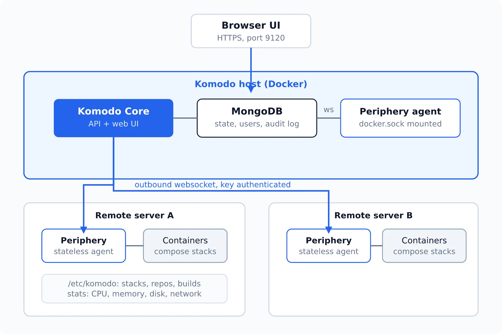
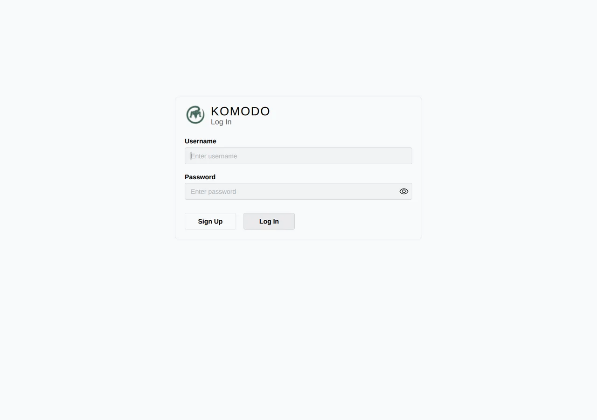
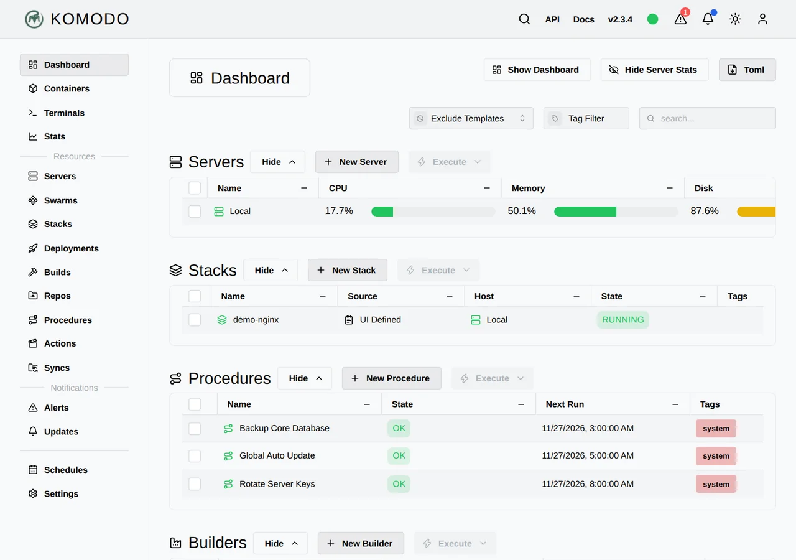
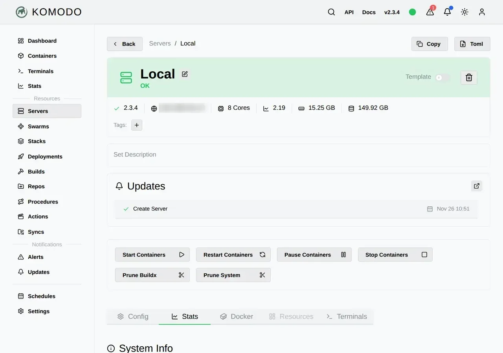
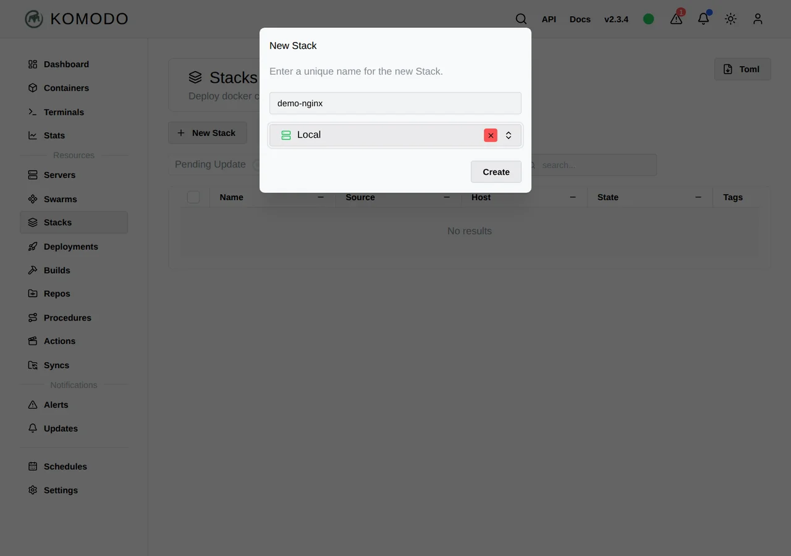
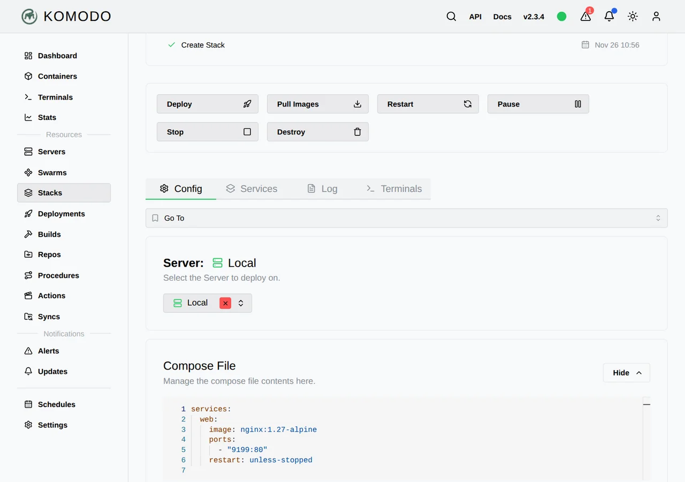
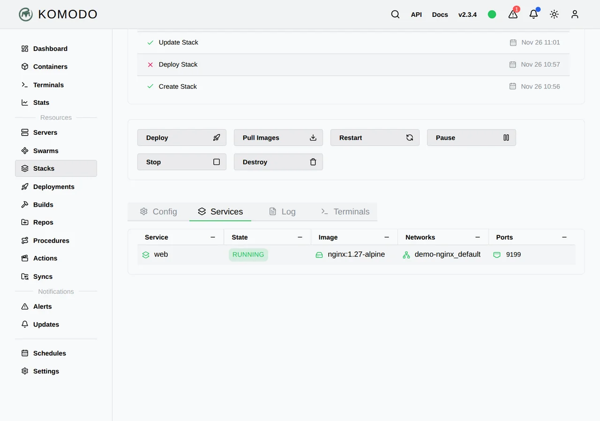

import Accordion from "@components/widgets/Accordion.astro";
import Notice from "@components/widgets/Notice.astro";
import Button from "@components/widgets/Button.astro";
import ListCheck from "@components/widgets/ListCheck.astro";
import Tabs from "@components/widgets/Tabs.astro";
import Tab from "@components/widgets/Tab.astro";

Komodo is a self-hosted Docker and server management platform built around one Core container, MongoDB, and a small Periphery agent on each host. You can manage containers, compose stacks, builds, and scheduled automation from one web UI in three containers and roughly ten minutes. This guide covers the Komodo v2.3.4 Docker Compose install (released October 22, 2026, current as of November 26, 2026), initial login, deploying a stack, and adding remote servers.

Komodo overlaps with the tools in my [Portainer alternatives](/portainer-alternatives/) roundup. Whereas Portainer, [Arcane](/arcane-docker-install/), and [Dockhand](/dockhand-docker-install/) prioritize container management, Komodo emphasizes deployment automation with multi-step procedures, git-triggered redeploys, image builds, and a full [audit trail](https://komo.do/docs/intro). It is the richest tool in this group and the heaviest, making it overkill if you only toggle containers.

## What Komodo is and who it is for

Komodo is an open-source platform written in Rust by moghtech, licensed [GPL-3.0](https://github.com/moghtech/komodo), with over 13,000 GitHub stars. The [architecture](https://komo.do/docs/intro) has two components:

- **Core**: the web server hosting the API and browser UI. Everything you click flows through Core.
- **Periphery**: a small, stateless agent that runs on each server. Core uses it to deploy containers, read logs and collect CPU, memory and disk stats.

State lives in MongoDB. [FerretDB](https://komo.do/docs/setup/ferretdb) (a MongoDB-compatible layer on Postgres) is the alternative for hosts that cannot run current MongoDB. The README says there is no limit on connected servers and there never will be.

Komodo fits you if you run several VPS or home lab machines and want one panel for compose stacks, git-driven deploys and scheduled jobs. If you want a full PaaS that builds and routes apps for you, [Dokploy](/dokploy-install/) or Coolify is a better fit. Komodo's feature list covers servers, containers, stacks, builds and automation, with no domain routing or certificate management in it.



*Komodo architecture: one Core plus MongoDB, with a Periphery agent on every managed server.*

## Is Komodo a good Portainer alternative?

For multi-server compose management, Komodo is the strongest free option available right now, though it uses more RAM and disk than minimal managers. You get unlimited servers, role-based permissions, scheduled procedures, and an audit trail with no paid tier. The catch is heavier storage (~3 GB across three images) and a steeper learning curve around resources, procedures, and syncs. Even simple compose edits take extra clicks compared with Portainer. I cover lighter single-host options in [Arcane vs Dockhand](/arcane-vs-dockhand/).

## Prerequisites

<ListCheck>
<ul>
<li>A VPS or home server running Docker. Komodo idles around 300 MB total, so a 1 GB RAM host can run it, though disk is tighter at roughly 3 GB of images. See my [Docker containers for home server](/docker-containers-home-server/) list for companion services.</li>
<li>Docker Compose v2 (the `docker compose` plugin). Check with `docker compose version`.</li>
<li>Optional: a domain and a reverse proxy such as [Traefik](/traefik-proxy-docker/) if you want HTTPS. Not required for a first run.</li>
<li>A CPU with AVX support if you use MongoDB. Hosts without it need FerretDB instead (see the FAQ).</li>
</ul>
</ListCheck>

## Install Komodo with Docker Compose

The [official MongoDB quick start](https://komo.do/docs/setup/mongo) downloads a compose file and an environment file, then starts MongoDB, Core, and a local Periphery agent.

```bash
mkdir -p ~/komodo && cd ~/komodo
wget https://raw.githubusercontent.com/moghtech/komodo/main/compose/mongo.compose.yaml
wget https://raw.githubusercontent.com/moghtech/komodo/main/compose/compose.env
```

Now edit `compose.env` before starting anything. The file ships with placeholder credentials (`KOMODO_DATABASE_PASSWORD=admin`, `KOMODO_INIT_ADMIN_PASSWORD=changeme`), so replace them. These are the values that matter:

```ini
## Pin a version instead of tracking the rolling "2" tag
COMPOSE_KOMODO_IMAGE_TAG="2.3.4"

## MongoDB credentials
KOMODO_DATABASE_USERNAME=admin
KOMODO_DATABASE_PASSWORD=use-a-long-random-string

## Web UI basics
KOMODO_HOST=https://komodo.example.com
KOMODO_LOCAL_AUTH=true
KOMODO_INIT_ADMIN_USERNAME=admin
KOMODO_INIT_ADMIN_PASSWORD=use-another-long-random-string

## Name of the first server (the host Komodo itself runs on)
KOMODO_FIRST_SERVER_NAME=Local

## Secrets for webhooks and sessions
KOMODO_WEBHOOK_SECRET=a_random_secret
KOMODO_JWT_SECRET=a_random_jwt_secret

## Where database backups land on the host
COMPOSE_KOMODO_BACKUPS_PATH=/etc/komodo/backups
```

Two things worth understanding before you run it:

1. **The secrets are real secrets.** Generate each value with `openssl rand -hex 24`. `KOMODO_DATABASE_PASSWORD` protects MongoDB, `KOMODO_INIT_ADMIN_PASSWORD` sets your UI password, `KOMODO_WEBHOOK_SECRET` verifies git deploy webhooks, and `KOMODO_JWT_SECRET` signs login tokens. Every secret variable also accepts a `_FILE` variant for Docker secrets per the [env file](https://raw.githubusercontent.com/moghtech/komodo/main/compose/compose.env).
2. **The compose file also starts a Periphery container** on the same host, with the Docker socket and `/proc` mounted. That is how Core manages its own machine. Core and Periphery share a `keys` volume that holds their public keys, and the env file points each side at the other's key file (`PERIPHERY_CORE_PUBLIC_KEYS=file:/config/keys/core.pub`).

Also note that `mongo.compose.yaml` uses `image: mongo` with no tag, so MongoDB follows whatever `latest` is when you pull. Pin it yourself if you care about major version jumps.

Start the stack:

```bash
docker compose -p komodo -f mongo.compose.yaml --env-file compose.env up -d
```

Verify with `docker compose -p komodo ps` and `docker logs komodo-core-1 | tail`. You want the Core line `Server starting on http://[::]:9120` and, in `docker logs komodo-periphery-1`, `Logged in to Komodo Core core:9120 websocket as Server Local`. In my run with the images already pulled, the login page answered about 6 seconds after `up -d`, and Core logged that line about 4 seconds after it started.

<Notice type="info" title="Image size">
The three images are fairly large. Running `docker images` showed `komodo-core` at 997 MB, `komodo-periphery` at 630 MB, and `mongo` at 1.54 GB, totaling around 3.2 GB before MongoDB data. Idle RAM stays modest at roughly 60 MB for Core, 103 MB for Periphery, and 120 MB for MongoDB.
</Notice>

## First login and the dashboard

Open `http://<server-ip>:9120` and log in with the admin credentials from your env file.



*The Komodo login screen. Sign-up is enabled by default; set `KOMODO_DISABLE_USER_REGISTRATION=true` once your users exist.*

The dashboard shows your servers, stacks and the system procedures Komodo creates on first boot. Three of them matter, and I read the schedules from Core's [startup code](https://raw.githubusercontent.com/moghtech/komodo/main/bin/core/src/startup.rs):

- `Backup Core Database` runs daily at 01:00.
- `Global Auto Update` runs daily at 03:00 and redeploys stacks and deployments that have auto update turned on (the [stack config](https://komo.do/docs/deploy/compose) default is off).
- `Rotate Server Keys` runs daily at 06:00 and rotates the Periphery key pairs for servers that have `auto_rotate_keys` on, which is the default.

The `Local` server appears in the server table within a minute, with CPU, memory and disk usage. The `TZ` setting in `compose.env` is the time zone for schedules (the default is `Etc/UTC`). In the screenshot below the backup shows its next run as 3:00 AM, which is 01:00 UTC displayed in my local time zone (UTC+2).



*The dashboard after first login: the Local server is online and the default maintenance procedures are scheduled.*

Click a server to open its detail view. The header reports status, Komodo version, CPU cores, load, RAM, and disk space alongside Updates history. Next to those sit quick actions (Start, Restart, Pause and Stop Containers, Prune Buildx, Prune System) and tabs for Config, Stats, Docker, Resources, and Terminals.



*The top of the server page: header facts, container and prune actions, and the tab bar.*

Per the [Komodo docs](https://komo.do/docs/intro), a connected server gets CPU, memory and disk monitoring with alerts and shell sessions, and the server config is where you set the alerting thresholds. The [backup docs](https://komo.do/docs/setup/backup) also mention a historical stats collection that records server CPU, memory and disk usage over time.

## Deploy your first stack

Stacks are Komodo's compose unit. Go to Stacks, click **New Stack**, give it a name and pick the server.



*Creating a stack: a name and a target server is all you need.*

The config screen then asks where the compose file comes from. The [compose docs](https://komo.do/docs/deploy/compose) list three modes:

<Tabs>
<Tab name="UI Defined">

Paste the compose file into the editor. Komodo writes the files to the host at deploy time. This is the simplest mode for quick services, and the one I used for a minimal nginx test:

```yaml
services:
  web:
    image: nginx:1.27-alpine
    ports:
      - "9199:80"
    restart: unless-stopped
```

</Tab>
<Tab name="Files on Server">

Point at compose files that already exist on the managed host. Periphery can only see files under its root directory (`PERIPHERY_ROOT_DIRECTORY`, default `/etc/komodo`), so keep them there. The layout from `compose.env` is `/etc/komodo/stacks/<stack-name>/`. This is the mode to use when you are adopting stacks you already run (see the migration notice below).

</Tab>
<Tab name="Git Repo">

Komodo clones the repository onto the host to deploy. Pick the branch and compose path, then paste the stack Config page's webhook URL into your git provider. Per the [webhook docs](https://komo.do/docs/automate/webhooks), set content type to `application/json`, add `KOMODO_WEBHOOK_SECRET` as the secret, and trigger on push events.

GitHub and GitLab authentication types are supported, which also covers Gitea and Forgejo. Komodo only acts when the push matches the branch configured on the stack. Public repos need no credentials; for private repos you add a git provider account to Komodo. This is the mode worth using for anything you maintain long term.

</Tab>
</Tabs>



*The stack config in UI Defined mode: the Deploy, Pull Images, Restart, Pause, Stop and Destroy actions, the target server and the compose file editor.*

<Notice type="warning" title="Save before you deploy">
In my own test run, Deploy before Save failed with `Must either input compose file contents directly, or use files on host / git repo options`. Click **Save** first, then **Deploy**. The failed "Deploy Stack" row is visible in the Updates list in the screenshot below.
</Notice>

Click **Save**, then **Deploy**. Komodo writes the compose file into `/etc/komodo/stacks/demo-nginx/` on the host through Periphery, runs `docker compose up` and reports the result in the Updates panel.



*The Services tab after deploy: the container is up, with state, image, networks and ports in one row.*

<Notice type="info" title="Migrating existing compose projects">
Komodo has no auto-import tool for existing `docker compose` projects. In [GitHub discussion 161](https://github.com/moghtech/komodo/discussions/161), the maintainer recommends running Komodo alongside Portainer and migrating incrementally. Create a Stack matching the existing compose project from `docker compose ls`, then provide its compose file via UI Defined, Files on Server, or Git Repo. Per the [compose docs](https://komo.do/docs/deploy/compose), set `project_name` if the running project name differs, or use a Resource Sync TOML file for bulk migrations.
</Notice>

## Connect more servers with Periphery

Every additional machine needs the Periphery agent. The [connect servers docs](https://komo.do/docs/setup/connect-servers) give three steps:

1. In the Komodo UI, create an **onboarding key**. In the v2 UI this lives under Settings, in the Onboarding tab. Per a user comment in [issue 1360](https://github.com/moghtech/komodo/issues/1360), the tab bar hides that tab on narrow browser windows, so widen the window if you cannot find it. That issue is open and asks for the docs to say where the key is.
2. On the remote machine, run the official installer as root:

```bash
curl -sSL https://raw.githubusercontent.com/moghtech/komodo/main/scripts/setup-periphery.py | python3 - \
  --core-address "https://komodo.example.com" \
  --connect-as "$(hostname)" \
  --onboarding-key "O-..."
```

3. Confirm the server shows status OK in the UI. Enable the service with `sudo systemctl enable periphery` so it survives reboots.

The docs recommend installing Periphery with systemd because it avoids container path quirks. If you still run Periphery in Docker, keep `PERIPHERY_ROOT_DIRECTORY` (default `/etc/komodo`) identical inside and outside the container. Otherwise Docker gets confused over bind paths, as noted in [discussion 180](https://github.com/moghtech/komodo/discussions/180), and all compose files and repos must reside inside that directory.

With `--core-address` set, Periphery opens the connection to Core, so the remote server needs no open inbound port and only Core has to be reachable. Per the installer's own help text, leaving `--core-address` blank enables the inbound mode instead, where Core connects to Periphery (default port 8120).

## Updates and backups

**Updating Komodo** is the standard compose cycle. Bump `COMPOSE_KOMODO_IMAGE_TAG` in `compose.env` to the new version, then:

```bash
cd ~/komodo
docker compose -p komodo -f mongo.compose.yaml --env-file compose.env pull
docker compose -p komodo -f mongo.compose.yaml --env-file compose.env up -d
```

For remote agents, re-run the `setup-periphery.py` installer after a release. The docs say it can run multiple times without issue, does not change existing config after the first run, and updates the Periphery version. If a Periphery falls behind Core, the UI shows a "Version Mismatch" status on the server, as in [this issue](https://github.com/moghtech/komodo/issues/1081). Since v2, Komodo [does not publish a `latest` tag](https://github.com/moghtech/komodo/blob/main/docsite/docs/releases/v2.0.0.md), so pin a version or use the rolling `2` tag.

**Backups** are semi-automatic. Per the [backup docs](https://komo.do/docs/setup/backup), `Backup Core Database` exports database collections as gzipped files inside timestamped folders under your host `COMPOSE_KOMODO_BACKUPS_PATH` mount (`/backups`). It retains the 14 newest backups by default, tunable via `KOMODO_CLI_MAX_BACKUPS`. Keep two caveats in mind. Dated dumps exclude the historical `Stats` collection and ship unencrypted despite containing all instance secrets, so lock down host permissions on the backup directory.

Copy that directory off-box with whatever you already use for the rest of your volumes. Also keep a copy of your `compose.env` file somewhere safe, since the secrets in it are what keep logins and webhooks working after a rebuild.

## Where Komodo falls short

Komodo is the tool I reach for when a fleet grows past two or three machines, but it has real costs:

- **Disk and image weight.** About 3 GB of images (as listed by `docker images`) plus MongoDB's data directory. On a 20 GB VPS that is a noticeable chunk.
- **MongoDB as a hard dependency.** FerretDB exists for CPUs without AVX support, adding Postgres and FerretDB containers. An [open issue](https://github.com/moghtech/komodo/issues/1642) from September 2026 even questions FerretDB's long-term support, so stick to MongoDB where possible.
- **A steeper mental model.** Juggling servers, stacks, deployments, repos, builders, procedures, actions, and syncs in the [resource model](https://komo.do/docs/resources) feels dense at first. Open docs issue [#1367](https://github.com/moghtech/komodo/issues/1367) specifically requests a concepts-first guide for this reason.
- **No built-in reverse proxy.** Unlike Dokploy or Coolify, Komodo does not route domains or issue certificates. You pair it with [Traefik](/traefik-proxy-docker/) or Nginx Proxy Manager yourself.
- **Deploy results can mislead.** Issue [#1509](https://github.com/moghtech/komodo/issues/1509) (open on v2.2.0) notes that `DeployStack` reports `success: false` if `docker compose pull` fails on a local image even when the container starts. Check update logs rather than status icons alone.
- **Volume path constraints.** Because Periphery runs compose directly on the host, all projects must sit inside the Periphery root directory with identical paths inside and outside containerized agents.

If those trade-offs sound like too much, look at [Arcane](/arcane-docker-install/) or [Dockhand](/dockhand-docker-install/) for single-host management, or keep the CLI and add [Tugtainer](/tugtainer-docker-autoupdate/) for image updates.

## Should you run Komodo?

Run Komodo if you manage three or more machines and want stacks, git-driven deploys, and scheduled automation in one interface. Skip it for a single host where you only start and stop containers. To try it beside your existing manager for a week, all you need is port 9120 and a few hundred MB of RAM. Running `docker compose -p komodo -f mongo.compose.yaml --env-file compose.env down -v` removes everything cleanly, including the MongoDB and keys volumes.

<Button text="Komodo on GitHub" link="https://github.com/moghtech/komodo" variant="solid" color="blue" size="md" icon="arrow-right" />

## FAQ

<Accordion label="Is Komodo free and open source?" group="faq">
Yes. Komodo is GPL-3.0 licensed, and the repository README says there is no limit on connected servers and never will be. I found no paid tier or feature gate in the docs. The repository has over 13,000 stars and v2.3.4 (October 22, 2026) is the latest release as of November 26, 2026.
</Accordion>

<Accordion label="Does Komodo replace Portainer?" group="faq">
For multi-server Docker Compose fleets, yes. It covers container control, logs, and shells while adding procedures, schedules, and git webhooks. Docs cover Docker, Swarm, and Podman (via alias), without Kubernetes support; compare alternatives in my [Portainer alternatives](/portainer-alternatives/) roundup.
</Accordion>

<Accordion label="Can Komodo manage compose stacks I already deployed from the CLI?" group="faq">
Not automatically. You create a Stack in the UI, give Komodo the same compose file (UI Defined, Files on Server or Git Repo) and attach the correct server. Komodo matches projects by compose project name, so set `project_name` to your existing project name if it differs from the stack name. Run `docker compose ls` on the host to find it. This is how the [compose docs](https://komo.do/docs/deploy/compose) describe importing a running project.
</Accordion>

<Accordion label="MongoDB or FerretDB, which should I use?" group="faq">
Use MongoDB unless your CPU lacks AVX support (older or low-power chips, some VPS types). [Komodo issue 59](https://github.com/moghtech/komodo/issues/59) says hosts without AVX cannot run MongoDB and should use FerretDB, and the [setup page](https://komo.do/docs/setup) says the same for systems that cannot run the latest MongoDB. The repo ships a separate `ferretdb.compose.yaml` that starts Postgres, FerretDB, Core and Periphery. You download it instead of `mongo.compose.yaml` and use the same `compose.env`.
</Accordion>

<Accordion label="How much RAM does Komodo use?" group="faq">
In an idle test install, Core took 60 MB, Periphery took 103 MB, and MongoDB used 120 MB, totaling roughly 300 MB before workloads. Disk is the bigger cost, around 3 GB of container images as listed by `docker images`. A 1 GB RAM VPS runs it alongside a few small services, though I did not load-test that.
</Accordion>

<Accordion label="How do I put Komodo behind HTTPS?" group="faq">
Put a reverse proxy in front of port 9120 and set `KOMODO_HOST` in `compose.env` to your public URL for OAuth and webhook generation. Enable websocket upgrades because Periphery relies on websockets. While I did not test a reverse proxy here, the [webhook docs](https://komo.do/docs/automate/webhooks) note that `/listener` must stay publicly reachable for git providers.
</Accordion>

<Accordion label="Does auto-deploy on git push actually work?" group="faq">
Yes, it is built in. Each stack's Config page provides a webhook URL that git providers hit on push using `KOMODO_WEBHOOK_SECRET`. I did not test webhooks end to end here, and open [issue 1493](https://github.com/moghtech/komodo/issues/1493) (v2.2.0) reports valid webhooks failing with `request branch does not match expected`, so test with a dummy commit first.
</Accordion>

<Accordion label="What happens if MongoDB dies or I lose the database?" group="faq">
Core cannot boot without its database because every stack, user, and setting lives there. To restore from daily dumps per the [backup docs](https://komo.do/docs/setup/backup), run `km database restore -y` using `ghcr.io/moghtech/komodo-cli` with the same `/backups` mount. Because it will not wipe existing data first, restore into an empty database and test once early.
</Accordion>
