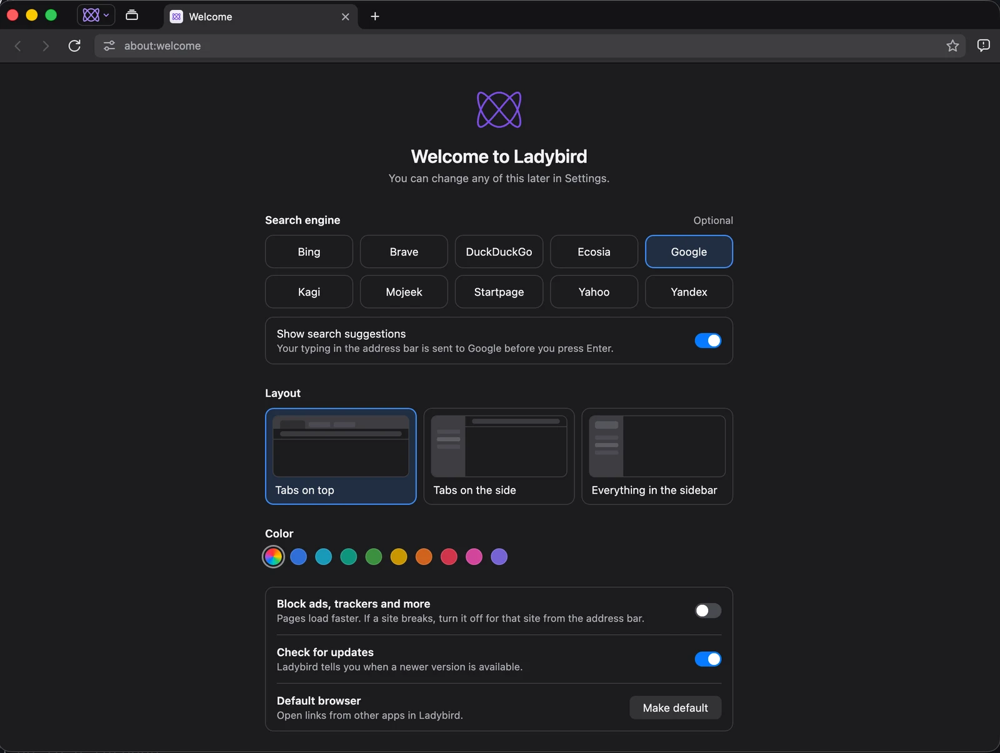
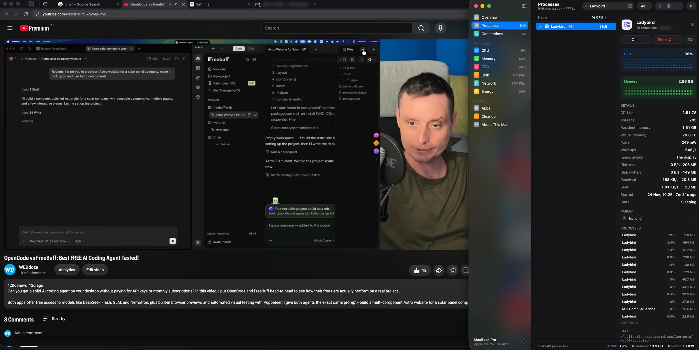
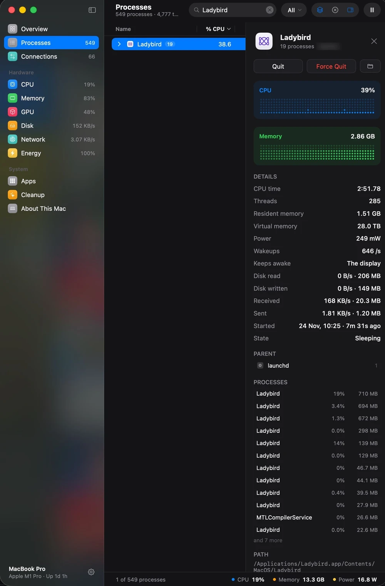
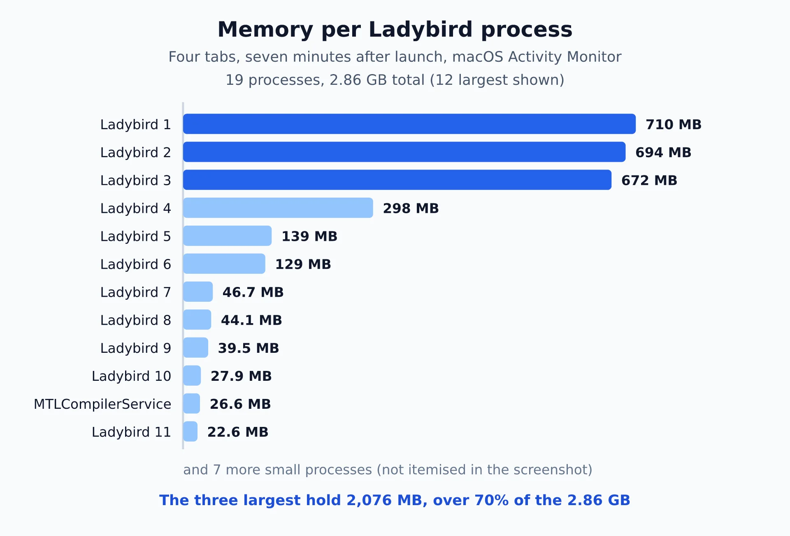
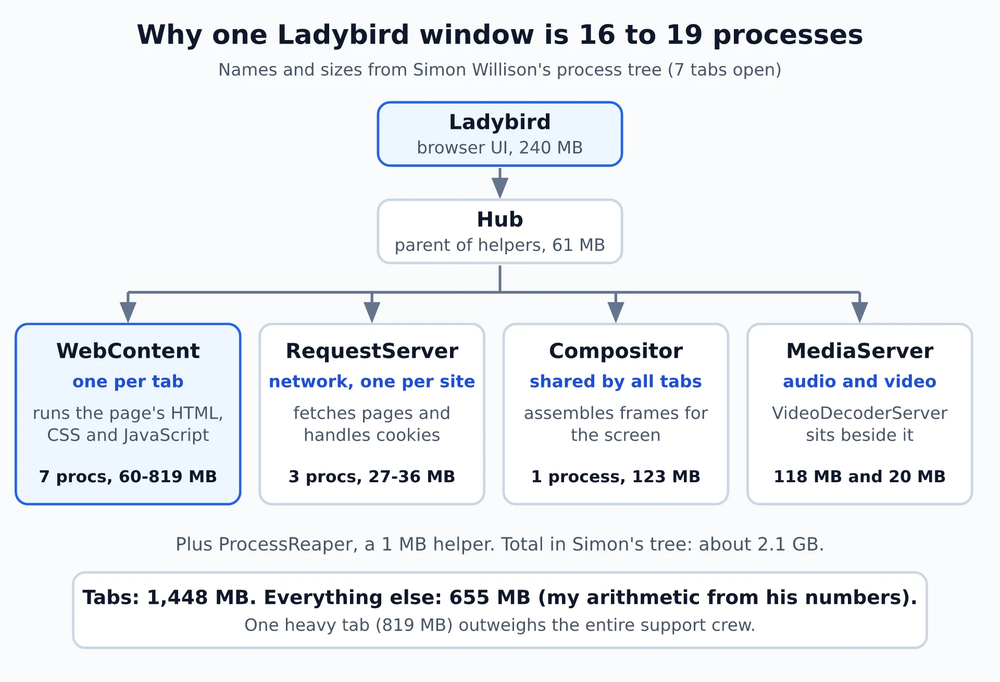

import Notice from "@components/widgets/Notice.astro";
import Tabs from "@components/widgets/Tabs.astro";
import Tab from "@components/widgets/Tab.astro";
import Accordion from "@components/widgets/Accordion.astro";
import ListCheck from "@components/widgets/ListCheck.astro";

Ladybird shipped its first alpha on November 23, 2026. It is the first downloadable browser in years that runs on an engine nobody else wrote: no Blink, no WebKit, no Gecko. I installed it on my MacBook Pro, opened four tabs, and looked at Activity Monitor seven minutes later. The answer was 19 processes and 2.86 GB.

That number is the reason for this article. My conclusion after one session is that the engine does not decide how much memory a browser uses. Chrome, Safari's WebKit and a clean-sheet engine like Ladybird all end up heavy once you open the web as it exists today. Below: what the alpha is, what other people found, the numbers from my screen, and the reasons I think memory stays high whatever you install.

<Notice type="info" title="How I tested">
One MacBook Pro (Apple M1 Pro), the Ladybird alpha from the download page, four tabs open (a Google search, a YouTube video playing, Ladybird's settings and Gmail), read in macOS Activity Monitor 7 minutes 31 seconds after launch. I did not run Chrome or Safari side by side, so nothing here is a head-to-head benchmark. Everything about other people's results is linked to its source.
</Notice>

## What Ladybird is

Ladybird is a browser with its own engine. HTML, CSS, the DOM, layout, JavaScript and WebAssembly are implemented from scratch, according to the [release notes](https://github.com/LadybirdBrowser/ladybird/releases/tag/2026.47.7). It started as the browser of the hobby operating system SerenityOS and is now developed by a US non-profit, funded by sponsors and donations instead of search deals ([OMG! Ubuntu](https://www.omgubuntu.co.uk/2026/11/ladybird-browser-enters-alpha)).

It still borrows some parts. Simon Willison lists [HarfBuzz for text shaping, Skia for 2D graphics, ffmpeg for video and SQLite](https://simonwillison.net/2026/Nov/23/ladybird) as external components. "From scratch" means the engine, not every library.

| | Ladybird alpha |
|---|---|
| Platforms | Apple silicon Macs (macOS 14.4 or later), Linux x86-64 and Arm64 |
| Not included | Windows, Intel Macs, phones |
| Updates | Rolling channel with automatic updates |
| Engine languages | C++, moving to Rust (the JavaScript engine and style computation are already Rust) |
| Developer tools | WebDriver and the Firefox DevTools protocol |
| Roadmap | Beta in 2027, stable in 2028 (per the project FAQ, as [summarized by Sulat](https://news.sulat.com/2026/11/24/ladybird-browser)) |

The team is open about the state of it. Andreas Kling's [announcement](https://ladybird.org/posts/alpha/) says some sites will not work, it will crash, and there are no promises on security.

<Notice type="warning" title="Do not sign in to anything important">
The project asks security researchers to hack it and makes "no promises about security today". Simon Willison keeps it for anonymous browsing only and does not use it for GitHub or Gmail. My test had Gmail open, which I would skip on a machine you care about. Use a throwaway account or a VM.
</Notice>

## Install it

<Tabs>
<Tab name="macOS">
Download the disk image from [ladybird.org/download](https://ladybird.org/download/), open it and drag Ladybird into Applications. The build is Apple silicon only.
</Tab>
<Tab name="Linux (Flatpak)">
The project recommends the Flatpak. These two commands are from [Linux und Ich](https://linuxundich.de/en/ladybird-alpha-browser-engine-linux), who ran them on TUXEDO OS. I did not run them myself.

```bash
flatpak install --from https://flatpak.ladybird.org/ladybird.flatpakref
flatpak run org.ladybird.Ladybird
```
</Tab>
<Tab name="Ubuntu (apt)">
Ubuntu 24.04 and 26.04 have an apt repository, with updates through the normal Software Updater. These commands are from [OMG! Ubuntu](https://www.omgubuntu.co.uk/2026/11/ladybird-browser-enters-alpha); I did not run them.

```bash
sudo wget -qO /etc/apt/keyrings/ladybird.asc 'https://apt.ladybird.org/ladybird.asc'

# Ubuntu 26.04 LTS
sudo wget -qO /etc/apt/sources.list.d/ladybird.sources 'https://apt.ladybird.org/ladybird-resolute.sources'

# Ubuntu 24.04 LTS (or Linux Mint 22.x)
sudo wget -qO /etc/apt/sources.list.d/ladybird.sources 'https://apt.ladybird.org/ladybird-noble.sources'

sudo apt update && sudo apt install ladybird
```
</Tab>
</Tabs>

## First launch



*The welcome page. The ad and tracker blocker is off by default.*

There is no default search engine, so the welcome page asks you to pick one. The list covers Bing, Brave, DuckDuckGo, Ecosia, Google, Kagi, Mojeek, Startpage, Yahoo and Yandex. You also choose where the tabs go (top, side, or everything in a sidebar) and an accent color. The content blocker is a toggle on this page and ships off. If you want to know how that fits with Chrome removing the old extension model, I covered it in [Manifest V3 and ad blocking with NextDNS](/block-ads-manifest-v3-nextdns/).

## What other people found

I am not the only one who tried it on day one. The early reports:

| Source | What they found |
|---|---|
| [Simon Willison](https://simonwillison.net/2026/Nov/23/ladybird) | Feels fast, UI is lightweight, most sites worked. His WebAssembly ffmpeg and Pyodide tools ran. Datasette Lite failed on a missing service worker function. |
| [Linux und Ich](https://linuxundich.de/en/ladybird-alpha-browser-engine-linux) | His own blog, Google and YouTube worked. Speedometer 3.1 scored 10.5 against 29.9 for Firefox and 34.3 for Chrome on the same laptop. A killed Flatpak left a lock file that blocked the next start. |
| [OMG! Ubuntu](https://www.omgubuntu.co.uk/2026/11/ladybird-browser-enters-alpha) | No extension system and no import from other browsers. Even 480p YouTube was choppy. |
| [Hacker News thread](http://news.ycombinator.com/item?id=50614249) | Mostly impressed that real sites render. Complaints about jerky scrolling, blurry fonts and a content blocker that does not stop YouTube ads on Linux. |
| [Dev.to hands-on](https://dev.to/frankchu/67377-stars-and-zero-chromium-i-ran-ladybird-alpha-118i) | Verified the download checksum, rendered Hacker News and a test page without a crash. Three pages is a sample, not a verdict. |

The pattern is consistent. Rendering is good, and speed is the gap. Features around the page (extensions, import, polish) are not there yet.

## How it scores

Ladybird tracks itself against the Web Platform Tests, the shared suite that browser makers use to check standards support. These are the end of October numbers from its [October newsletter](https://ladybird.org/newsletter/2026-10-31):

| Browser | Subtests passed | Share of Chrome |
|---|---|---|
| Chrome | 2,244,397 | 100% |
| Firefox | 2,189,315 | 97.5% |
| Ladybird | 2,184,722 | 97.3% |
| Safari Technology Preview | 2,172,990 | 96.8% |

The percentages are my arithmetic. This measures standards coverage, not how many real sites work, and most of the October jump came in five days after the team pointed AI coding agents at the suite. Kling has also used Claude Code and Codex to port parts of the JavaScript engine from C++ to Rust, as he describes in [Ladybird adopts Rust, with help from AI](https://ladybird.org/posts/adopting-rust/). If you want to see how those agents compare for your own work, my [AI coding tools comparison](/ai-coding-tools/) and the [Freebuff review](/freebuff-free-ai-coding-agent/) cover the free options.

Speed is where the numbers are weakest. Ladybird's August newsletter calls its benchmark scores "still modest numbers next to the mature engines", as [Sulat quotes it](https://news.sulat.com/2026/11/24/ladybird-browser), and the Speedometer result above is one laptop on one day.

## My memory numbers

Here is the full screen from my run. The Ladybird window on the left has four tabs. Activity Monitor on the right groups everything under one "Ladybird" entry.



*Four tabs, one video playing, seven minutes after launch. I blurred the Gmail address and my macOS account name.*



*The detail panel. The Mac showed 13.3 GB of memory in use and 83% on its Memory row, which points to a 16 GB machine (my arithmetic).*

What the panel says:

- 19 processes and 285 threads for four tabs.
- Memory 2.86 GB, and a separate Resident memory line of 1.51 GB. Activity Monitor shows both and I did not dig into the difference, so I quote the 2.86 GB headline figure throughout.
- CPU 39% for the group at the moment of the screenshot.
- Three processes hold 710, 694 and 672 MB. The next is 298 MB, then 139 and 129 MB, and the rest are small.



*Itemised processes from the screenshot. Seven more were collapsed under "and 7 more". I cannot tell from Activity Monitor which process belongs to which tab.*

The three biggest processes add up to 2,076 MB, over 70% of the group. A single number like "Ladybird uses 53 MB" only makes sense if you look at one row.

### Why a single process number lies

Several Hacker News commenters posted low figures. One reported "53mb of memory with multiple tabs open" and another "less than 100 mb of RAM". A third replied to a similar claim with the missing piece: Ladybird opens tabs as separate processes, so the main browser process is not the total, and a YouTube tab alone took 300 MB in its own WebContent process.

Simon Willison's process tree shows the same thing for seven tabs:



*Process names and sizes from [Simon Willison's tree](https://simonwillison.net/2026/Nov/23/ladybird) (16 processes, about 2.1 GB). Roles come from Ladybird's [September](https://ladybird.org/newsletter/2026-09-30) and [October](https://ladybird.org/newsletter/2026-10-31) newsletters. The tab and support totals are my arithmetic.*

His seven tabs held 1,448 MB, and one of them held 819 MB. The support processes (UI, hub, network, compositor, media) added another 655 MB. So the "heavy" part is a few tabs, and the "overhead" part is real but smaller.

## Why memory stays high on every engine

My read, after seeing my own numbers next to everyone else's, is that four things drive browser memory and none of them depend on who wrote the engine.

**1. Every modern browser pays for isolation.** Engadget's [explainer on Chrome and RAM](https://www.engadget.com/2294261/why-google-chrome-using-so-much-ram/) says browser makers pick between sharing processes across tabs to save memory or giving each site its own process, and Chrome picks the second. A crash stays in one tab and a hostile page cannot easily read your banking tab. Ladybird made the same choice, and went further in October: separate processes for the network, image decoding, audio and video, plus separate renderers for cross-site iframes. More walls, more memory. That is the cost of the security model, not a sign of bad code.

**2. The web is made of apps now.** Gmail plus a YouTube player is not a small workload. One vendor article puts heavy web apps at [200 to 500 MB per tab](https://supasidebar.com/blog/reduce-chrome-memory-usage-tabs-2026). Treat that as a rough guide, since the source sells a tab manager. My three largest processes (710, 694 and 672 MB) sit above that range, and I cannot say which tabs they were.

**3. Memory gets held, not released.** Ladybird's September newsletter describes pages that reload themselves on a timer. Background tabs on Politico reached 11 GB after four hours, and El País reached 15 GB after twenty, because every replaced document stayed alive. That was fixed in September, and October listed a similar Gmail fix. A brand new engine with a modern garbage collector still hit this, because the web includes pages that misbehave.

**4. Unused RAM is wasted RAM.** Engadget's argument is that a browser filling free memory with prepared tabs is doing its job. On my Mac, 83% of memory was in use with 549 processes running, and the browser was one of many. When a user raised Ladybird's memory use in early November, Kling replied that the team still has work to do, according to [PiunikaWeb](https://piunikaweb.com/2026/11/05/ladybird-update-makes-scrolling-and-text-selection-much-smoother/).

Two caveats, because this is one session. First, an alpha is the worst case for memory, since optimization comes after features. Second, I did not run Chrome or Safari alongside, so I am not claiming Ladybird is equal to them. My claim is narrower: a from-scratch engine built in 2026 with none of Chrome's history did not escape the problem, so I would not expect switching engines to fix it.

The same pressure shows up outside browsers. Desktop apps built on Electron bundle their own Chromium, and my [Orca vs T3 Code](/orca-vs-t3-code/) comparison puts an Electron app next to a server with web clients. On a Mac, containers have the same problem, which is why I compared [Docker Desktop alternatives](/best-docker-desktop-alternatives/) on RAM and idle use.

## What to do about browser memory

- **Sum the whole group.** In Activity Monitor, search for the browser name and read the group panel, not one row. Ladybird's September newsletter also describes a native Task Manager with a process tree and sortable memory column, but I did not open it.
- **Close the heavy tabs, not the light ones.** Three processes were over 70% of my total. Finding them is faster than closing everything.
- **Turn the content blocker on.** It is off by default. The September newsletter traces one runaway CPU case to an ad script that a blocker had removed. I did not measure whether it lowers memory.
- **Use a browser that unloads tabs.** Per Engadget, Chrome has Memory Saver and Firefox unloads tabs when your system runs low on memory.
- **Buy memory for your actual work.** If you run local models or many agents, browser overhead is the smaller bill. My [Mac mini for OpenClaw guide](/best-mac-mini-for-openclaw/) works through that sizing.

## Should you use it?

<ListCheck>
- Use it to test your own site in a fourth engine. WebDriver and the Firefox DevTools protocol are in the alpha. My [Modern Web Guidance review](/modern-web-guidance-legacy-scan/) covers audits that pair well with an extra engine.
- Use it for anonymous browsing on a machine where a crash costs you nothing.
- Use it if you want to support a non-profit engine. Sponsors include Cloudflare, Proton and Shopify, according to [OMG! Ubuntu](https://www.omgubuntu.co.uk/2026/11/ladybird-browser-enters-alpha) and Sulat.
- Skip it as your daily browser. No extensions, no import, choppy video and no security promises.
- Skip it if you need Windows or an Intel Mac. Neither is in the alpha.
</ListCheck>

If you automate browsers, an independent engine matters less today than a stable one. Tools like [Pinchtab](/pinchtab-browser-ai-agents/) drive Chrome or Chromium because that is what sites are tested against. Ladybird's WebDriver support is worth watching, not betting on.

## My verdict

Ladybird is impressive for an alpha. Real sites render, the team ships fast, and the engine passes about 97% of Chrome's Web Platform Tests subtests. It is slower than Chrome and Firefox on the one benchmark I found, and it needs more polish.

On memory, I came away unconvinced that any engine will give me a light browser. Four tabs cost 2.86 GB on a clean-sheet engine, and the explanation (isolation, app-sized pages, memory that gets held, a Mac already near 83%) applies to Chrome and WebKit as well. That is my read from one session, not a measurement. The part I will check again is the November newsletter, which should carry the first post-alpha numbers.

## FAQ

<Accordion label="Is Ladybird a fork of Chromium or Firefox?" group="faq" expanded="true">
No. The release notes say HTML, CSS, the DOM, layout, JavaScript and WebAssembly are all implemented from scratch. It does use libraries such as Skia, HarfBuzz, ffmpeg and SQLite, per Simon Willison.
</Accordion>

<Accordion label="Can I use Ladybird as my daily browser?" group="faq">
Not yet. The project says some sites will not work and it will crash, and it makes no promises on security. There is no extension system and no import from other browsers.
</Accordion>

<Accordion label="Does Ladybird use less memory than Chrome?" group="faq">
I did not measure that. My four-tab session used 2.86 GB across 19 processes. Hacker News commenters posted lower figures, but at least one of those was a single process, not the group, so compare totals only.
</Accordion>

<Accordion label="Does Ladybird have extensions or an ad blocker?" group="faq">
There is no extension system. There is a built-in content blocker that uses filter lists such as EasyList, and it is off until you enable it on the welcome page or in settings.
</Accordion>

<Accordion label="Is there a Windows version?" group="faq">
Not in the alpha. The project says Windows comes at a later stage. HWBusters reports that the guidance for now is to build the Linux version inside WSL2.
</Accordion>

<Accordion label="Can I use Ladybird to test my website?" group="faq">
Yes, that is the clearest use today. It supports WebDriver for automated tests and the Firefox DevTools protocol. Expect gaps: Simon Willison hit a service worker error on Datasette Lite and filed an issue.
</Accordion>

<Accordion label="Who pays for Ladybird?" group="faq">
A US non-profit funded by donations and sponsors. The project says it takes no default search deals, and sponsors have no say in the technical roadmap.
</Accordion>
