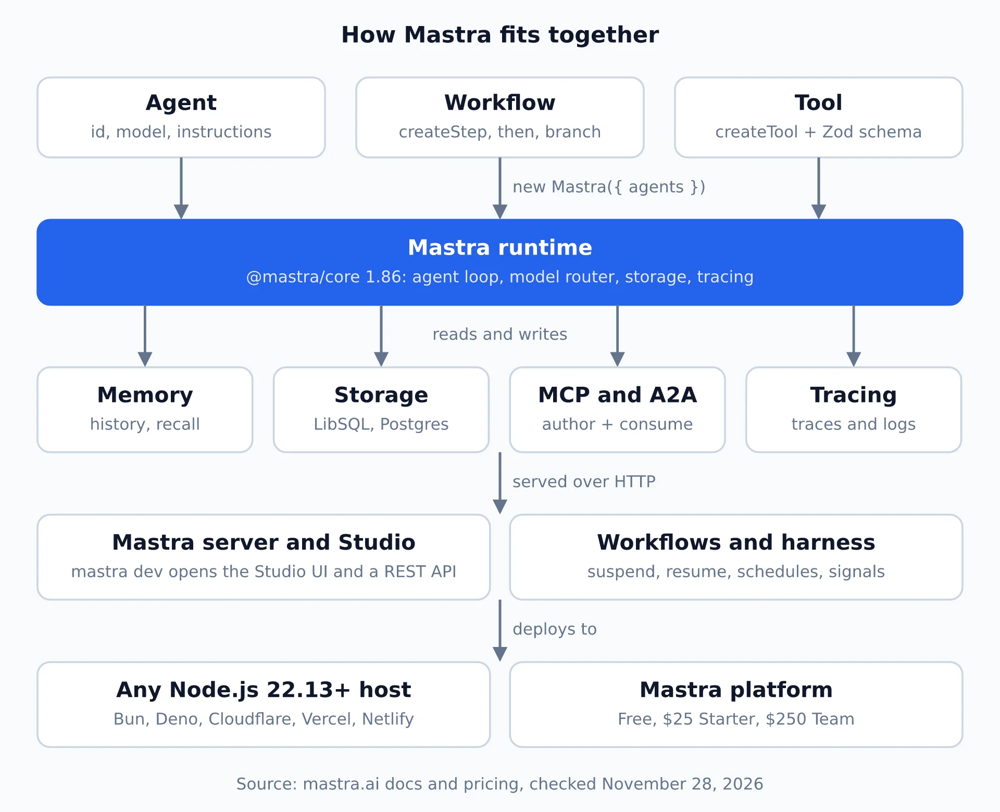
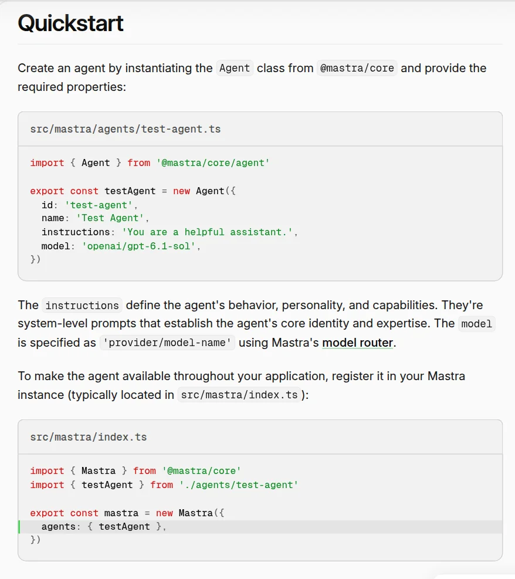
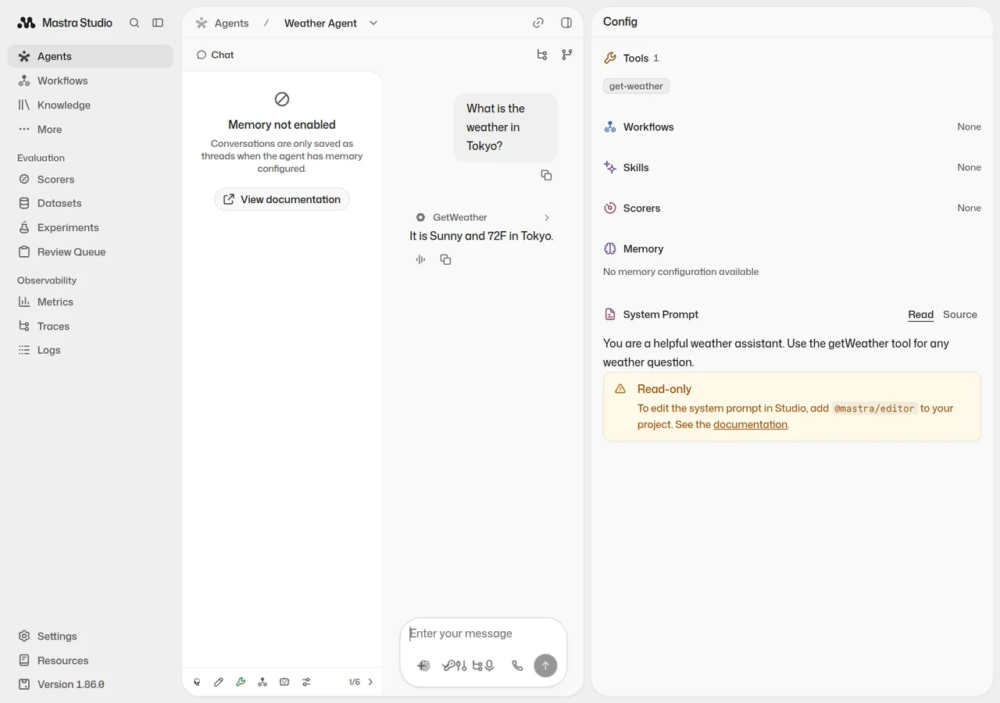
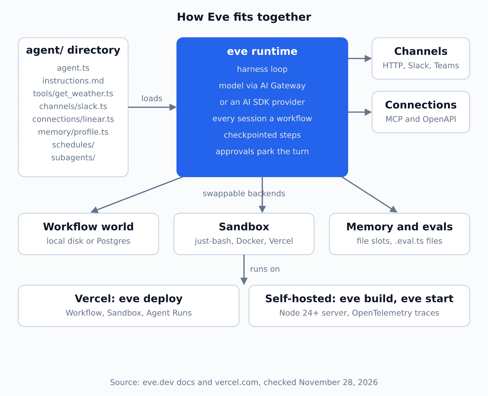
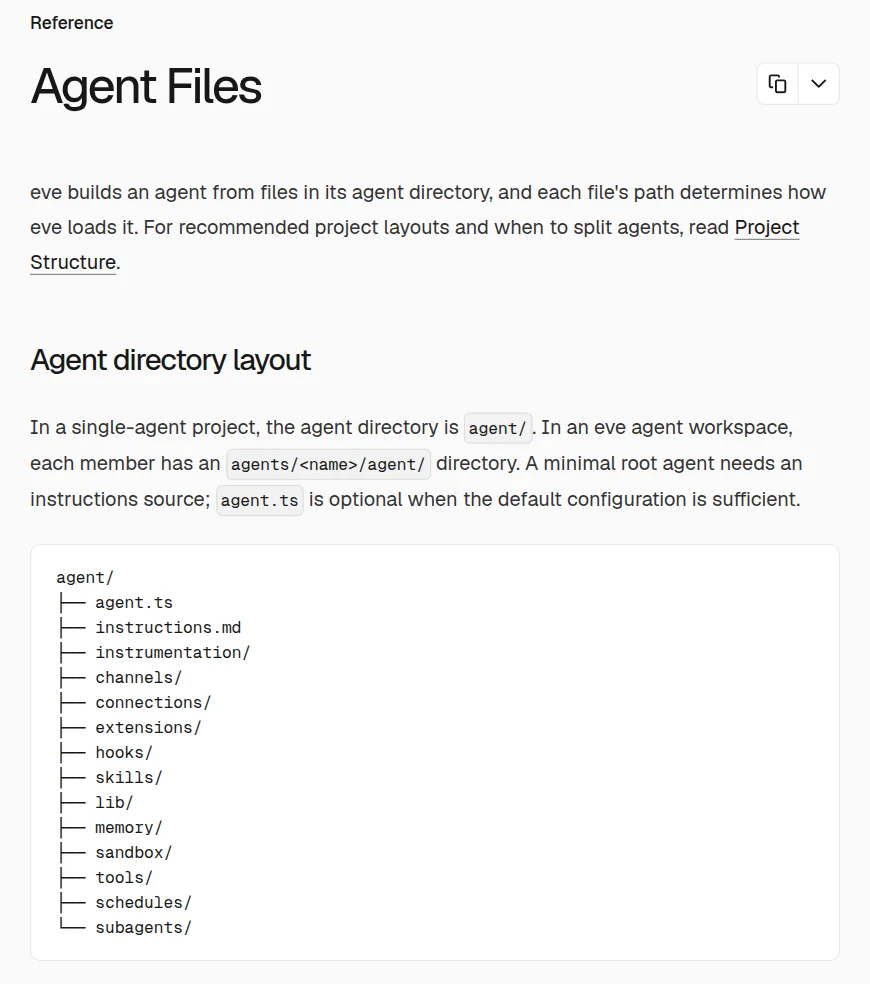
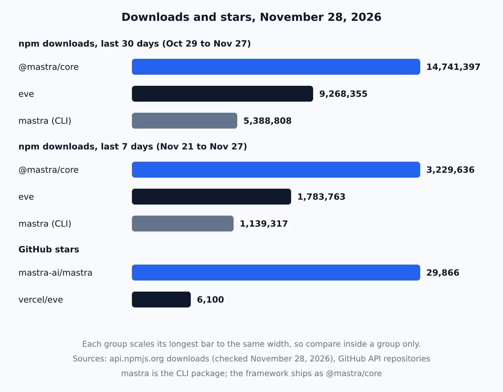
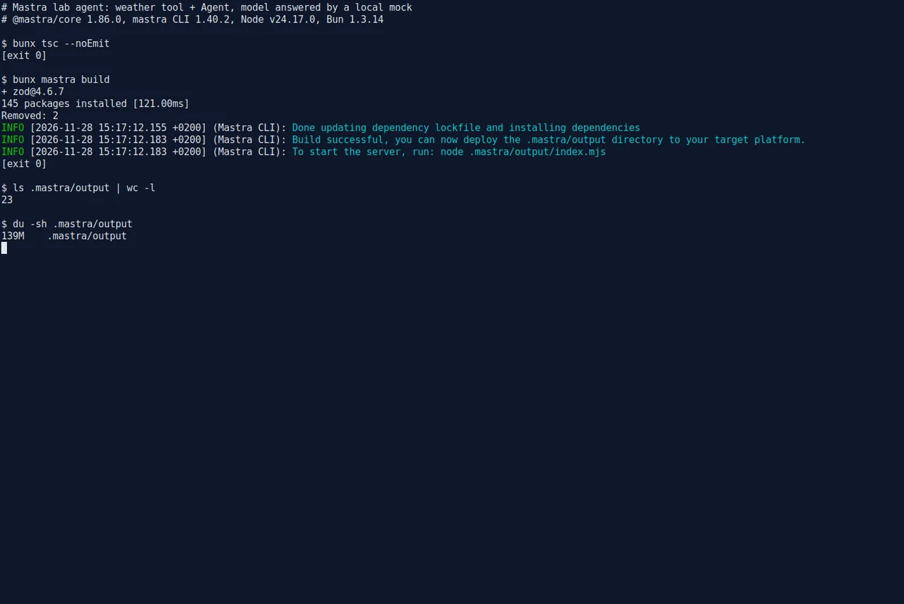
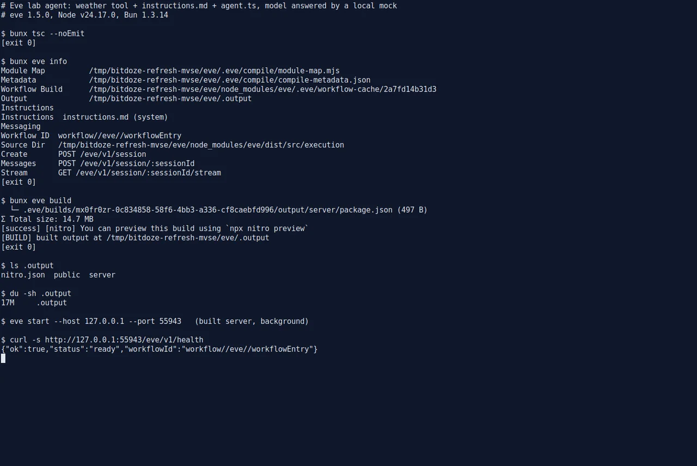
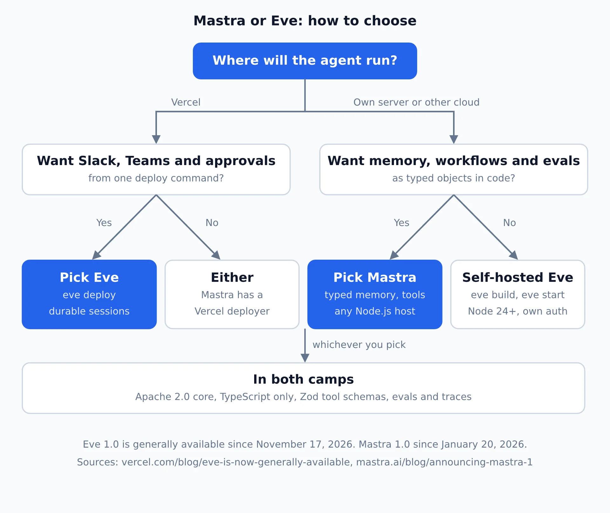

import Button from "@components/widgets/Button.astro";
import Notice from "@components/widgets/Notice.astro";
import ListCheck from "@components/widgets/ListCheck.astro";
import Accordion from "@components/widgets/Accordion.astro";
import Tabs from "@components/widgets/Tabs.astro";
import Tab from "@components/widgets/Tab.astro";

*Disclosure: this guide contains referral links. If you buy through them, I may earn a commission at no extra cost to you.*

Mastra and Eve are both stable in November 2026: Mastra ships `@mastra/core` 1.86.0 and Eve 1.5.0 went generally available on November 17. Choose Mastra for typed code and any runtime, Eve for files and durable sessions.

Every claim here was checked against both projects' docs on November 28, 2026, and the same weather agent was built and run in both frameworks on Node 24.17. Numbers carry the date they were checked.

If you're building AI agents in TypeScript, two frameworks own the conversation in late 2026: **Mastra** and **Vercel Eve**.

I already ship real work on Mastra. I built a full assistant with file tools, shell, web search, browser automation, and persistent memory, and wrote a [step-by-step Mastra guide](/build-ai-agent-mastra/) with the [code on GitHub](https://github.com/bitdoze/mastra-assistant). So this comparison is not theoretical on the Mastra side. Eve is the new option I wanted to evaluate honestly against that experience.

Mastra is the mature option. v1.0 shipped on January 20, 2026. On November 28, 2026 it had 29,866 GitHub stars and 14.7M monthly npm downloads for `@mastra/core`. Replit, PayPal and Marsh McLennan run it in production, and Replit reports 96% workflow success, up from 80%. It's code-based, portable, and deploys anywhere Node.js runs.

Eve is the newer framework from Vercel. Launched June 17, 2026 at the Vercel Ship conference, it takes a filesystem-first approach: your agent is a directory. Vercel runs 100+ agents internally on Eve, including a data-analysis agent handling 30K+ Slack queries per month. Eve 1.0 went generally available on November 17, 2026, and it now runs on Vercel or on your own Node server.

The decision is now: **typed objects in code with your pick of runtime, or a directory of files with durable sessions built in?**

This is a head-to-head on pricing, lock-in, maturity, and DX. If you already know Mastra from the [build guide](/build-ai-agent-mastra/), skip to the [head-to-head comparison](#mastra-vs-eve-head-to-head-on-key-decision-factors).

<Notice type="info" title="Who this guide is for">
TypeScript developers evaluating AI agent frameworks. Both Mastra and Eve are TypeScript-only. If you need Python, look at LangGraph, CrewAI, or Pydantic AI.
</Notice>

<Button text="Build a Mastra Agent (Tutorial)" link="/build-ai-agent-mastra/" variant="solid" color="purple" size="md" icon="arrow-right" />
<Button text="View My Mastra Assistant on GitHub" link="https://github.com/bitdoze/mastra-assistant" variant="outline" color="purple" size="md" icon="github" />

## At a glance: Mastra vs Eve comparison table

| Dimension | Mastra | Eve |
|---|---|---|
| **GitHub stars** | 29,866 | 6,100 |
| **Maturity** | Stable since v1.0 (January 20, 2026); `@mastra/core` 1.86.0 | Generally available since 1.0 (November 17, 2026); `eve` 1.5.0 |
| **Deployment** | Node.js 22.13+, Bun, Deno or Cloudflare; 14 deploy guides; Mastra platform | Vercel with `eve deploy`, or a self-hosted Node 24+ server with `eve build` and `eve start` |
| **Lock-in** | None in the framework; the platform is optional | Low in the core; `eve deploy`, Vercel Connect and Agent Runs are Vercel-only |
| **Agent definition** | `new Agent({ id, name, instructions, model, tools })` in TypeScript | A directory: `instructions.md`, `agent.ts`, `tools/`, `channels/` |
| **Workflows** | `createWorkflow()` with `.then()`, `.branch()`, `.parallel()`, suspend and resume | Every session is a Workflow SDK run with checkpointed steps |
| **Memory** | Message history, working memory, semantic recall, observational memory | Memory slots in `agent/memory/` with file memory or a provider |
| **Sandbox** | `LocalSandbox` plus container or remote sandbox integrations | Built in: Vercel Sandbox, Docker, just-bash, host |
| **Multi-agent** | Subagents on the `agents` property (supervisor pattern) | `agent/subagents/` directories with an isolation boundary |
| **Evals** | `@mastra/evals` scorers, datasets, experiments | `evals/*.eval.ts` files run with `eve eval` |
| **Observability** | Studio, traces, logs and metrics; platform Observability | OpenTelemetry traces; Agent Runs on Vercel |
| **Channels** | Slack, Teams, Discord, Telegram, WhatsApp, GitHub, Linear, iMessage (since core 1.22.0) | HTTP, Slack, Discord, Teams, Telegram, Twilio, GitHub, Linear, iMessage, Web Chat |
| **MCP** | Author and consume MCP servers | Consume MCP and OpenAPI connections; MCP and A2A channels |
| **Model routing** | Own router: 9,322 models from 315 providers | Vercel AI Gateway or any AI SDK provider |
| **Frontend** | AI SDK UI, CopilotKit, Assistant UI | `eve add channel/web`; React, Vue and Svelte bindings |
| **Pricing model** | Framework free; platform Free, $25 Starter, $250 Team, Enterprise | Framework free; Vercel Pro at $20/month plus usage |
| **License** | Apache 2.0, with `ee/` folders under the Mastra Enterprise Edition License | Apache 2.0 |
| **Best for** | TypeScript teams building agent products; need portability | Teams that want a deployed agent with durable sessions and channels |

The rows that matter most are now **agent definition** and **what ships built in**. Eve 1.0 removed the old deal breakers: it is stable, it self-hosts, and it has memory and evals. Mastra still leads on deployment targets and model choice.

Figures in the table were checked on November 28, 2026 against the [Mastra docs](https://mastra.ai/docs) and [pricing page](https://mastra.ai/pricing), the [Eve docs](https://eve.dev/docs), npm and the GitHub API.

<Notice type="info" title="Both Frameworks Are Past 1.0">
Eve 1.0 went generally available on November 17, 2026 and follows semantic versioning. The current npm release is 1.5.0. Mastra has been stable since January 20, 2026. Beta warnings in older reviews no longer apply.
</Notice>

## What is Mastra?

Mastra is a TypeScript framework for agents, workflows, tools and memory, created by Sam Bhagwat and the Gatsby founding team. It has been stable since version 1.0 on January 20, 2026.



*How Mastra fits together: typed objects in code, one runtime, and any Node.js host or the Mastra platform. Sources: [Mastra docs](https://mastra.ai/docs) and [pricing](https://mastra.ai/pricing).*

The philosophy is code-based composition. Think ORM or database client mental model: you define agents, tools, and workflows as typed objects in code. Configuration is explicit. You see everything in front of you.

A $13M seed round in October 2025 listed YC, pg, Gradient, Amjad, Guillermo and 120+ other investors, and the [about page](https://mastra.ai/about) now reports $35M raised. Guillermo Rauch is the Vercel CEO, which is an interesting detail given the competition.

### Mastra features: agents, workflows, memory, and evals

**Agents** are the core primitive. You create an `Agent` class with instructions, tools, memory, and a model, then call `generate()` or `stream()`:

```typescript
import { Agent } from '@mastra/core/agent';
import { createTool } from '@mastra/core/tools';
import { z } from 'zod';

const getWeather = createTool({
  id: 'get-weather',
  description: 'Return weather data for a city.',
  inputSchema: z.object({ city: z.string() }),
  execute: async ({ city }) => {
    return { city, condition: 'Sunny', temperatureF: 72 };
  },
});

export const weatherAgent = new Agent({
  id: 'weather-agent',
  name: 'Weather Agent',
  instructions: 'You are a helpful weather assistant.',
  model: 'openai/gpt-4o-mini',
  tools: { getWeather },
});

const response = await weatherAgent.generate('What is the weather in Tokyo?');
```

The model is a `provider/model` string. Mastra's router resolves it from an environment variable such as `OPENAI_API_KEY`, so no provider package is needed. Register the agent in a `Mastra` instance to share storage, logging and tracing.



*The agent definition in the Mastra docs: one `Agent` object, registered in a `Mastra` instance. Source: [mastra.ai/docs/agents/overview](https://mastra.ai/docs/agents/overview).*

**Workflows** use a graph-based builder pattern with `.then()`, `.branch()`, and `.parallel()`. They support suspend/resume for human-in-the-loop scenarios:

```typescript
import { createStep, createWorkflow } from '@mastra/core/workflows';
import { z } from 'zod';

const account = z.object({ accountId: z.string() });
const verified = account.extend({ verified: z.boolean() });

const verify = createStep({
  id: 'verify',
  inputSchema: account,
  outputSchema: verified,
  execute: async ({ inputData }) => ({ accountId: inputData.accountId, verified: true }),
});

const sendWelcome = createStep({
  id: 'send_welcome',
  inputSchema: verified,
  outputSchema: account,
  execute: async ({ inputData }) => ({ accountId: inputData.accountId }),
});

// scheduleCall follows the same shape with id 'schedule_call'
export const onboardingWorkflow = createWorkflow({
  id: 'onboarding',
  inputSchema: account,
  outputSchema: z.object({ send_welcome: account, schedule_call: account }),
})
  .then(verify)
  .parallel([sendWelcome, scheduleCall])
  .commit();
```

On November 28, 2026 this workflow ran in about 10 ms through `createRun()` and `start()`. It returned one result object with a key per step id.

**Memory** has four parts: message history, working memory, semantic recall and observational memory. Mastra reports 94.87% on LongMemEval for observational memory with GPT-5 mini. Memory processors trim the context when it fills, and observational memory runs background model calls that add cost. The hosted [Memory Gateway](https://mastra.ai/blog/announcing-mastra-platform) offers the same memory to agents built on other frameworks. If you care about agent memory, read our comparison of [agent memory systems](/cognee-vs-hindsight/).

**Evals** let you score agent performance with model-graded, rule-based, and statistical scorers:

```typescript
import { Agent } from '@mastra/core/agent';
import { createAnswerRelevancyScorer } from '@mastra/evals/scorers/prebuilt';

export const refundAgent = new Agent({
  id: 'refund-agent',
  name: 'Refund Agent',
  instructions: 'You handle refund requests by the policy document.',
  model: 'openai/gpt-4o-mini',
  scorers: {
    relevancy: {
      scorer: createAnswerRelevancyScorer({ model: 'openai/gpt-4o-mini' }),
      sampling: { type: 'ratio', rate: 0.5 },
    },
  },
});
```

Scorers run in the background on a share of live outputs. Datasets keep versioned test cases, and experiments replay them against a new prompt, model or tool setup.

**MCP support** lets you both author and consume MCP servers. If you're unfamiliar with the protocol, see [what MCP is and how it works](/mcp-introduction-beginners/). For when native Mastra tools beat always-on MCP (and the RAM cost of stdio servers), see [Mastra tools vs MCP](/mastra-tools-vs-mcp/).

**Observability** includes a local Studio browser UI, a cloud platform, and full logs/traces/metrics. In my own assistant, Studio is what I use day to day for chat and traces while developing. Studio starts with `mastra dev` on port 4111; set the `PORT` environment variable to move it.



*Studio running a lab agent on November 28, 2026: one tool step, then the reply from a local mock model.*

<Notice type="info">
Mastra's model router lists 9,322 models from 315 providers. Eve routes string model IDs through Vercel AI Gateway, or calls any AI SDK provider directly.
</Notice>

### Mastra pricing: free tier to enterprise

| Plan | Cost | What you get |
|---|---|---|
| **Free** | $0/month | Unlimited agents, users and deployments; 100K observability events; 40 vCPU-hours; 10 GB egress; 5 connections |
| **Starter** | $25/month | 1 small dedicated project; 250K events; 100 vCPU-hours; 25 GB egress; 10 connections |
| **Team** | $250/month | 3 projects (1 small, 2 medium); 10M events; 400 vCPU-hours; 50 GB egress; 50 connections; SOC 2 report |
| **Enterprise** | Custom | RBAC, SSO, audit logs, custom connections, static IP, OIDC, dedicated support |

Prices are per workspace, per month, from the [Mastra pricing page](https://mastra.ai/pricing) on November 28, 2026. Beyond the allowance Mastra bills $0.25 per vCPU-hour, $0.25 per GB-hour of memory, $10 per 100K events, $0.10 per GB of egress and $0.50 per connection.

Mastra Gateway bills prepaid credit at each model's published price plus a 3% processing fee. Mastra waives the fee through December 31, 2026.

The core framework is Apache 2.0. You can self-host Mastra for free. The paid tiers are for the cloud platform (Studio, Memory Gateway, observability). If you want full control, pair it with an affordable VPS provider like [Hetzner](https://go.bitdoze.com/hetzner) and you'll spend under $10/month on infrastructure.

_VPS prices jumped across the board in 2026. If you're rethinking a rented box, see [what changed and when a mini PC wins](/vps-price-increases/)._

### Mastra pros and cons

**Pros:**

<ListCheck>
<ul>
<li>Zero platform lock-in. Deploys anywhere (Vercel, Netlify, Cloudflare, self-hosted Hono/Express/Next.js)</li>
<li>Production-proven: Replit (96% workflow success, up from 80%), PayPal, Marsh McLennan (95,000 employees per Fortune), SoftBank</li>
<li>SOC 2 Type II report since October 2025</li>
<li>Four memory types, from message history to observational memory</li>
<li>29,866 GitHub stars and 14.7M monthly npm downloads for `@mastra/core`</li>
</ul>
</ListCheck>

**Cons:**

- Documentation lags behind rapid code velocity. Documented patterns can be outdated
- TypeScript-only. No Python support
- Opinionated patterns can feel restrictive when your use case diverges
- June 2026 supply-chain incident (dormant contributor account hijacked, 140+ malicious packages)
- Memory compression runs background LLM calls at additional cost
- Integration ecosystem still growing vs LangGraph

## What is Vercel Eve?

Eve launched June 17, 2026 at the Vercel Ship conference. It's built by Vercel, the team behind Next.js.

The philosophy is filesystem-first, convention over configuration. Your agent is a directory. Drop files in the right folders and the framework figures out the rest. No registration, no boilerplate wiring. The filename becomes the tool name.

Vercel is running Eve in production. 100+ internal agents power everything from data analysis to sales automation.

Eve 1.0 went generally available on November 17, 2026, after more than 230 releases since the June preview. Vercel's 1.0 post names Rillet and Clay among the businesses running it. For a first project, this site's [Eve beginner guide](/vercel-eve-ai-agent/) walks through a durable agent step by step.

### Eve's filesystem-first architecture

An Eve agent is a directory with a specific structure:

```text
my-agent/
├── agent/
│   ├── agent.ts            # model and runtime config (optional)
│   ├── instructions.md     # the always-on system prompt (required)
│   ├── tools/              # typed functions the model can call
│   │   └── get_weather.ts
│   ├── skills/             # procedures loaded on demand
│   ├── channels/           # HTTP, Slack, Discord, Teams and more
│   ├── connections/        # MCP and OpenAPI services
│   ├── memory/             # cross-session memory slots
│   ├── schedules/          # recurring cron jobs
│   └── subagents/          # specialist child agents
└── evals/                  # *.eval.ts files run with eve eval
```



*How Eve fits together: files in a directory, one runtime, swappable backends, and Vercel or your own Node server. Source: [eve.dev docs](https://eve.dev/docs).*

Each path has one job, and `eve info` prints what Eve discovered from it. On the lab agent it listed the tool, the instructions and the messaging routes, with 0 errors.

A tool is just a file in `tools/`:

```typescript
import { defineTool } from 'eve/tools';
import { z } from 'zod';

export default defineTool({
  description: 'Return mock weather data for a city.',
  inputSchema: z.object({ city: z.string().min(1) }),
  async execute({ city }) {
    return { city, condition: 'Sunny', temperatureF: 72 };
  },
});
```

Agent configuration is minimal:

```typescript
import { defineAgent } from 'eve';

export default defineAgent({
  model: 'anthropic/claude-sonnet-5.5',
});
```

And your system prompt is just a markdown file:

```markdown
# Identity
You are an expert weather assistant.
You can fetch the weather for any city in the world.
```



*The agent directory in the Eve docs: one slot per concern, names derived from file paths. Source: [eve.dev/docs/reference/agent-files](https://eve.dev/docs/reference/agent-files).*

Other built-in features:

- **Durable execution**: every session is a run on the open-source [Workflow SDK](https://workflow-sdk.dev). A crash or redeploy resumes from the last checkpoint, and an approval parks the turn without holding compute.
- **Sandboxed compute**: Vercel Sandbox in production, Docker when it is reachable, and a pure-JavaScript shell (just-bash) in development. If you're interested in [running AI tools in isolated containers](/docker-podman-ai-cli-tools-safe-environment/), Eve's sandbox approach is worth studying.
- **Human-in-the-loop**: Add a `needsApproval` rule to any tool. The session parks until someone approves.
- **Multi-channel**: Slack, Discord, Teams, Telegram, Twilio, GitHub, Linear, iMessage, Web Chat and the HTTP API. Same agent, all channels.
- **Connections**: one file per MCP server or OpenAPI API. The model never sees the URL or the credentials. [Vercel Connect](https://vercel.com/connect) handles the OAuth, or `defineInteractiveAuthorization` does it on your own host.
- **Memory and evals**: memory slots live in `agent/memory/`, and `evals/*.eval.ts` files score the agent with `eve eval`.

The local dev UI is a terminal: `eve dev` starts the server and opens it on port 2000 by default.


*The `eve dev` terminal UI running the lab agent on November 28, 2026, with the tool call, its output and the reply.*

Vercel's internal production examples show what Eve can do:

| Agent | Role | Scale |
|---|---|---|
| **d0** | Data analysis | 30K+ Slack queries/month, enforces data permissions |
| **Lead Agent** | Autonomous SDR | ~$5K/year cost, 32x ROI, 1 part-time engineer |
| **Vertex** | Support agent | 92% auto-resolve rate |
| **Athena** | Sales cockpit | Built by RevOps in 6 weeks without engineering |

These figures come from Vercel's June 17, 2026 launch post. The 1.0 post adds that Rillet tripled its shipping rate in three months with an Eve software factory.

<Notice type="info" title="Filesystem-First Is a Growing Pattern">
Eve isn't alone in this approach. Flue also uses a filesystem-as-API pattern. It's a broader trend in 2026 agent frameworks.
</Notice>

### Eve pricing: Vercel infrastructure costs

Eve itself is free (Apache 2.0). The costs come from Vercel infrastructure:

- **Vercel Pro plan:** $20/month platform fee with a $20 monthly usage credit
- **Workflows:** $0.02 per 1K events, $0.50 per GB written, $0.50 per GB-month retained
- **Sandbox:** $0.128 per hour of active CPU and $0.0212 per GB-hour of provisioned memory
- **Functions:** Vercel Functions rates for agent routes and tool execution
- **AI Gateway:** the provider's list price with no markup on tokens; payment processing fees may apply
- **Blob:** a private store for file memory, with 1 GB/month included on Hobby

Hobby covers small tests with quotas: 5 sandbox CPU hours and 420 GB-hours of memory a month, plus 50K workflow events and 1 GB written. Cron jobs run once a day, and Hobby stores no retained workflow data. Rates come from the [Sandbox](https://vercel.com/docs/sandbox/pricing), [Workflows](https://vercel.com/docs/workflows/pricing) and [AI Gateway](https://vercel.com/docs/ai-gateway/pricing) pricing pages checked on November 28, 2026.

There's no separate "Eve" line item on your bill. Everything is billed against your Vercel plan resources.

The catch: cost predictability. Mastra's platform is a fixed plan with published overage rates. Eve on Vercel is usage-based. Vercel bills active CPU, not wall-clock time, so an always-on sandbox costs less than the raw $0.128/hr suggests. A sandbox on 2 vCPUs at 10% average CPU, up for 730 hours, costs $18.69 in CPU plus $61.90 for 4 GB of memory, about $81/month. That 10% assumption matches Vercel's own examples, which account for time spent waiting on model calls.

Self-hosted Eve has no Vercel bill: you pay for your own server, storage and model tokens. On Vercel, the 1.0 release also cut the workflow part of a long session. Vercel estimates the Workflows cost of a 50-turn session fell from 5.4 cents to 1.3 cents.

### Eve pros and cons

**Pros:**

<ListCheck>
<ul>
<li>Fastest path from zero to deployed agent on Vercel</li>
<li>Filesystem-first DX is intuitive if you know Next.js conventions</li>
<li>Multi-channel out of the box (Slack, Discord, Teams, etc.). No custom integration needed</li>
<li>Built-in sandboxed compute. No separate sandboxing setup</li>
<li>Vercel's internal production usage (100+ agents) and a 1.0 release with semantic versioning</li>
<li>Durable execution handles crashes and cold starts automatically</li>
<li>Self-hosts as a Node server since the 1.0 docs: disk or Postgres state, Docker or just-bash sandbox, OpenTelemetry traces</li>
</ul>
</ListCheck>

**Cons:**

These notes come from the v0.11 preview in July 2026. Eve 1.0 replaced the tracing layer after more than 230 releases, so re-test each one on a current release.

- The smoothest path is still Vercel: `eve deploy`, Vercel Connect and Agent Runs are Vercel services
- Self-hosting means writing your own route auth and running your own telemetry backend
- Younger codebase: five months from preview to GA, with 1,005 open issues and pull requests on November 28, 2026 (Mastra: 921)
- Dependency drift: pre-release packages (`@ai-sdk`, `@vercel/connect`) can break. Must pin versions
- Thin observability for pre-run failures (webhook misconfiguration etc.)
- Silent trigger-path gotcha: Slack integration requires a specific flag or it fails silently
- Vercel Hobby runs cron jobs once per day; anything more frequent needs Pro
- No Python support

<Notice type="warning" title="Lock-In Warning">
Eve's core now runs outside Vercel: the Workflow SDK is open source, the default world stores state on disk, and the sandbox can be Docker or just-bash. `eve deploy`, Vercel Connect, Agent Runs and hosted Sandbox still need Vercel. Moving away from Vercel means replacing those with your own auth, storage and tracing.
</Notice>

## Mastra vs Eve: head-to-head on key decision factors

Features are similar on paper. The real differences emerge when you look at deployment, maturity, cost, and developer experience under real conditions.

### Deployment flexibility and vendor lock-in

**Mastra** deploys anywhere: Vercel, Netlify, Cloudflare Workers, standalone Hono/Express/Next.js, your own VPS. Zero platform lock-in. The core is Apache 2.0. If you want to self-host on a $5/month Hetzner box, go ahead. That is exactly how I run my [Mastra assistant](/build-ai-agent-mastra/) in practice. If you want something even leaner for self-hosted agents, see the [Hermes agent setup guide](/hermes-agent-setup-guide/). The documented runtimes are Node.js 22.13 or later, Bun, Deno and Cloudflare, with 14 deploy guides from Vercel and Netlify to Kubernetes and Temporal. For sandbox options, see [self-hosted AI agent sandboxes with p9m and Mastra Factory](/p7y-mastra-factory-self-hosted-agent-sandboxes/).

**Eve** has two documented targets. `eve deploy` ships to Vercel, and `eve build` plus `eve start` run the agent as a Node server on your own infrastructure. Self-hosted defaults store workflow state on disk and use Docker for the sandbox when it is reachable. Postgres state and a pure-JavaScript sandbox are one config change away.

The real-world impact is smaller than it was in June 2026. Moving an Eve agent off Vercel no longer means rewriting the agent directory. You do replace Vercel Connect OAuth, Agent Runs and hosted Sandbox with your own auth, OpenTelemetry backend and Docker. Community sentiment on Reddit still treats Eve as Vercel-first. Developers burned by Next.js coupling are skeptical of another Vercel product.

<Notice type="warning">
If platform independence matters, Mastra documents more targets: four runtimes and 14 deploy guides. Eve has two targets, and one of them is any Node 24+ host you operate yourself.
</Notice>

If you're self-hosting, affordable VPS providers like [Hetzner](https://go.bitdoze.com/hetzner) make Mastra deployments cost-effective.

### Maturity and production readiness

**Mastra:** v1.0 since January 20, 2026, `@mastra/core` 1.86.0 on November 25, 2026. 29,866 GitHub stars and 14.7M monthly npm downloads for `@mastra/core`. SOC 2 Type II report since October 2025. Production users include Replit (96% workflow success, up from 80%), PayPal, Marsh McLennan (95,000 employees per Fortune), and SoftBank. [AgentMail's 2026 roundup](https://www.agentmail.to/blog/best-ai-agent-frameworks-2026) built the same agent in 10 frameworks with 100 live runs and put Mastra first and Eve second.



*npm downloads and GitHub stars on November 28, 2026. `mastra` is the CLI package; the framework ships as `@mastra/core`.*

**Eve:** 1.0 generally available since November 17, 2026, `eve` 1.5.0 on November 25, 2026. 6,100 GitHub stars and 9.3M monthly npm downloads. Vercel runs 100+ agents internally, and the 1.0 post names Rillet and Clay as external users.

The remaining risk is pace. Eve shipped 230+ releases between June and November 2026, more than one a day on average. Eve follows semantic versioning, so stable APIs break only in major releases, while experimental and internal APIs can change between majors. Mastra went from 1.0.0 to 1.86.0 in the ten months after its stable release.

### Developer experience and learning curve

**Mastra** is code-based. It's familiar if you've used ORMs, SDK clients, or typed APIs. Configuration is explicit. Steeper initial setup but more predictable. You define everything in code and see it all in front of you.

**Eve** is filesystem-first. It's familiar if you know Next.js App Router conventions. Drop files in directories and things work. Lower ceremony for simple agents. But it can be confusing when conventions aren't documented yet.

Scaffolding commands tell the story:

<Tabs>
<Tab name="Mastra DX">
```bash
# Create project
npm create mastra@latest

# Start Studio on port 4111 and the API
npm run dev
```

```typescript
// Define the agent in code: src/mastra/agents/my-agent.ts
const agent = new Agent({
  id: 'my-agent',
  name: 'My Agent',
  instructions: 'You are helpful.',
  model: 'openai/gpt-4o-mini',
  tools: { myTool },
});
```
</Tab>
<Tab name="Eve DX">
```bash
# Create project, install, and open the terminal UI
npx eve@latest init my-agent

# Back in the terminal UI later
npx eve dev
```

```text
# Agent is a directory:
# agent/instructions.md    system prompt
# agent/tools/my_tool.ts   just a file
# agent/agent.ts           model config
```
</Tab>
</Tabs>

Documentation quality is a concern for both. Mastra docs lag behind code velocity. Documented patterns can be dead in current versions. Eve docs are new, but Vercel's documentation infrastructure is generally strong. Both doc sets are machine-readable: [mastra.ai/llms.txt](https://mastra.ai/llms.txt) serves every page as markdown, and the `eve` package ships its docs in `node_modules/eve/docs` for coding agents.

### Pricing at scale: what you will pay

**Mastra** has predictable tiers. Free for self-hosted. Starter is $25/month and Team is $250/month on the platform, with published overage rates. Gateway credit carries a 3% processing fee, waived through December 31, 2026.

**Eve** is pay-as-you-go via Vercel. Pro is $20/month with a $20 usage credit. Workflows, Sandbox, Functions, Blob storage and model tokens add cost as traffic grows, so spend is harder to predict.

Here's what the math looks like at different scales:

| Scenario | Mastra | Eve |
|---|---|---|
| **Solo dev, 1 agent, low traffic** | Free (self-hosted) or the Free platform plan | Hobby quotas: 5 sandbox CPU hours, 50K workflow events, cron once a day |
| **Small team, 5 agents, moderate traffic** | $25 Starter or $250 Team plan | $20/month Pro plus usage |
| **Production fleet, 20+ agents, high traffic** | Enterprise (custom) | Scales with compute, potentially significant |

<Notice type="info" title="Cost Tip">
For cost-conscious teams, Mastra's self-hosted option (Apache 2.0) gives you full control over infrastructure spend. Pair it with an affordable VPS provider like [Hetzner](https://go.bitdoze.com/hetzner) to keep costs minimal and predictable.
</Notice>

Mastra's platform is more predictable. Eve can be cheaper for bursty workloads; for always-on agents, sandbox memory is the line to watch.

### Memory, state, and durable execution

**Mastra** has four memory parts: message history, working memory, semantic recall and observational memory. Mastra reports 94.87% on LongMemEval for observational memory with GPT-5 mini. Memory processors trim the context when it fills, and observational memory runs background model calls that add cost. For a deeper look at agent memory approaches, see [Cognee vs Hindsight](/cognee-vs-hindsight/).

**Eve** runs every session as a workflow on the open-source Workflow SDK, so checkpoints survive crashes, redeploys, and cold starts on Vercel or on your own server. Since 1.0 it also has cross-session memory: each slot is a file under `agent/memory/`, backed by file memory or a provider. One provider is Hindsight, covered in this [Hindsight Docker deployment guide](/hindsight-docker-deploy/).

The practical difference is smaller than it was in June 2026. Mastra has the longer track record and more memory types, including multi-user threads. Eve pairs a younger memory system with session durability that needs no configuration.

Both offer durable execution. Mastra does it through workflow suspend/resume and the harness (durable agents, background tasks, schedules). Eve checkpoints every session step. Its docs warn that recovery does not make external effects exactly-once, so give tools with irreversible effects a stable operation ID.

## What does the same agent look like in Mastra and Eve?

The same weather agent is one TypeScript file in Mastra and three small files in Eve. Mastra puts the tool and the agent next to each other; Eve splits them into `instructions.md`, `tools/get_weather.ts` and `agent.ts`.

On November 28, 2026, both versions below ran on Node 24.17 with Bun 1.3.14 against one local mock of an OpenAI-compatible endpoint, with no API keys. The only change was the model line, pointed at the mock instead of a real provider.

<Tabs>
<Tab name="Mastra">
```bash
# Create the project, then start Studio and the API on port 4111
npm create mastra@latest
npm run dev
```

```typescript
// src/mastra/tools/weather-tool.ts and src/mastra/agents/weather-agent.ts
import { Agent } from '@mastra/core/agent';
import { createTool } from '@mastra/core/tools';
import { z } from 'zod';

export const getWeather = createTool({
  id: 'get-weather',
  description: 'Return weather data for a city.',
  inputSchema: z.object({ city: z.string() }),
  execute: async ({ city }) => {
    return { city, condition: 'Sunny', temperatureF: 72 };
  },
});

export const weatherAgent = new Agent({
  id: 'weather-agent',
  name: 'Weather Agent',
  instructions: 'You are a helpful weather assistant.',
  model: 'openai/gpt-4o-mini',
  tools: { getWeather },
});

// run.mjs, after new Mastra({ agents: { weatherAgent } }) in src/mastra/index.ts
const response = await mastra.getAgentById('weather-agent').generate('What is the weather in Tokyo?');
```

One file. Everything explicit. You see the agent, tools, model, and usage in one place.
</Tab>
<Tab name="Eve">
```bash
# Create the project, install dependencies, and open the terminal UI
npx eve@latest init my-agent
```

```markdown
<!-- agent/instructions.md -->
# Identity
You are an expert weather assistant.
You can fetch the weather for any city in the world.
```

```typescript
// agent/tools/get_weather.ts
import { defineTool } from 'eve/tools';
import { z } from 'zod';

export default defineTool({
  description: 'Return mock weather data for a city.',
  inputSchema: z.object({ city: z.string().min(1) }),
  async execute({ city }) {
    return { city, condition: 'Sunny', temperatureF: 72 };
  },
});
```

```typescript
// agent/agent.ts
import { defineAgent } from 'eve';

export default defineAgent({
  model: 'anthropic/claude-sonnet-5.5',
});
```

Three files. Each is small and focused. The filename becomes the tool name. No registration needed.
</Tab>
</Tabs>

### Lab results for both builds

The two builds behave differently in one way that matters to operators. Mastra's `.mastra/output` includes its production dependencies, so it is large but self-contained. Eve's `.output` is a small Nitro server that needs `node_modules` beside it at runtime.

| Step | Mastra | Eve |
|---|---|---|
| Install with Bun | `bun add @mastra/core zod mastra`: 366 packages | `bun add eve zod ai @ai-sdk/openai-compatible just-bash`: 75 packages |
| Typecheck | `tsc --noEmit`: exit 0 | `tsc --noEmit`: exit 0 |
| Build | `mastra build`: exit 0 in 11 s, 139 MB in `.mastra/output` | `eve build`: exit 0 in 6 s, 14.7 MB in `.output` |
| Dev UI | `mastra dev`: Studio in the browser | `eve dev`: terminal UI |
| One turn | 2 model calls, 84 input and 18 output tokens | 2 model calls, 113 ms from `turn.started` to `turn.settled` |
| Built server | `node .mastra/output/index.mjs` (not started in the lab) | `eve start`: health returns `ready`, a session POST without auth returns 401 |

`mastra build` refuses to run while `mastra dev` is open in the same folder. Stop the dev server first, or pass `--force`.



*Mastra lab build on November 28, 2026: typecheck and `mastra build` both exit 0.*



*Eve lab build on the same day: `eve info`, `eve build` and the built server's health route.*

The tradeoff: Mastra is more explicit and self-contained, good for quick iteration and seeing everything at once. Eve spreads logic across files, better when different people own tools vs instructions vs channels, but more cognitive overhead for a simple agent.

Want the full walkthrough I used for my own assistant? See the [complete Mastra tutorial](/build-ai-agent-mastra/) or clone the [mastra-assistant repo](https://github.com/bitdoze/mastra-assistant).

<Button text="Full Mastra Tutorial" link="/build-ai-agent-mastra/" variant="solid" color="blue" size="md" icon="arrow-right" />
<Button text="Try Eve Docs" link="https://vercel.com/eve" variant="outline" color="blue" size="md" icon="arrow-right" />

## Decision framework: when to pick Mastra vs Eve

No universal winner. Infrastructure, team, and risk tolerance decide it.



*Decision flowchart for Mastra or Eve, with both release dates as of November 28, 2026.*

### Pick Mastra if...

<ListCheck>
<ul>
<li>You need to deploy outside Vercel (AWS, GCP, self-hosted, Cloudflare, Netlify)</li>
<li>Platform independence is a requirement (enterprise, regulated industries)</li>
<li>You need a mature, proven framework with SOC 2 compliance</li>
<li>Your agents need memory across sessions (four memory types, from message history to observational memory)</li>
<li>You want predictable pricing (fixed tiers vs usage-based)</li>
<li>You're building agent products and need portability</li>
<li>You want to self-host everything, including observability</li>
</ul>
</ListCheck>

### Pick Eve if...

<ListCheck>
<ul>
<li>Your infrastructure is already on Vercel (Next.js app, Vercel Functions, etc.)</li>
<li>You want the fastest path from idea to deployed agent</li>
<li>Multi-channel support (Slack, Discord, Teams) out of the box matters</li>
<li>You prefer convention over configuration (filesystem-first DX)</li>
<li>Your team knows Next.js conventions and wants a similar mental model</li>
<li>You need built-in sandboxed compute for code execution</li>
<li>You accept a younger framework: five months from preview to GA</li>
<li>You want to run it on your own Node server with Docker or just-bash for the sandbox</li>
</ul>
</ListCheck>

### Consider alternatives if...

<ListCheck>
<ul>
<li>You need Python. Look at LangGraph, CrewAI, or Pydantic AI</li>
<li>You only need streaming UI and basic tool calls. Vercel AI SDK alone may be enough</li>
<li>You want maximum ecosystem maturity. LangGraph (Python) still leads on integrations</li>
<li>You like filesystem-first DX but not Vercel lock-in. Watch Flue (platform-agnostic)</li>
</ul>
</ListCheck>

<Accordion label="What about Vercel AI SDK vs Eve?" group="faq" expanded="false">
Vercel AI SDK is the UI/model-routing layer. Eve is the agent framework built on top of it. If you just need streaming UI and model calls, AI SDK is enough. If you need agents with tools, memory, workflows, and channels, you need Eve (or Mastra).
</Accordion>

## Alternatives worth considering

Beyond Mastra and Eve, a few options are worth knowing:

**Vercel AI SDK** is for simpler use cases. Streaming UI, model routing, basic tool calls. No agent abstractions, no memory, no workflows. If that is all you need, skip a full agent framework.

**LangGraph.js** is the TypeScript port of LangGraph. Heavier, but a better fit if your team also runs Python LangGraph and wants the same mental model.

**Flue** is new, filesystem-first like Eve but platform-agnostic. Worth watching if you like Eve's DX without Vercel lock-in.

The "agent as a directory" pattern is common in 2026. Eve and Flue both use it. It is a reaction against the boilerplate-heavy style of earlier frameworks.

For a similar style of framework comparison, see [Astro vs Next.js vs TanStack Start](/astro-vs-nextjs-vs-tanstack-start-which-wins/).

If you want an AI coding agent rather than a framework to build agents, [OpenCode Go](https://go.bitdoze.com/opencode-go) is a different path. For multi-model routing without a full agent framework, [Agent Router](https://go.bitdoze.com/agentrouter) unifies Claude Code, OpenAI Codex, and Gemini CLI.

## Final verdict: Mastra vs Eve in 2026

The tradeoff is now **typed objects and a free choice of runtime, against a directory of files with durable sessions built in**.

For most TypeScript teams shipping production agents today, **Mastra is the safer bet**. It is mature, portable, SOC 2 compliant, and proven at scale. Its memory system covers message history, working memory, semantic recall and observational memory. You can deploy anywhere and move infrastructure without rewriting agents. That is why I built my own [files/web/browser assistant on Mastra](/build-ai-agent-mastra/) and keep improving it in the open.

For teams that want an agent in Slack or Teams this week, **Eve is the faster start**. Filesystem-first keeps each concern in one file. Multi-channel and durable sessions ship out of the box. Since 1.0 it is no longer a beta bet, and Vercel's internal use (100+ agents) suggests it will keep maturing.

Eve may close the maturity gap now that 1.0 is out. Mastra's docs and ecosystem still need work. Competition here is good for both.

<Notice type="success" title="Bottom Line">
Mastra for typed code, deployment choice and the longer production record. Eve for files, durable sessions and channels out of the box. Both are Apache 2.0, both are TypeScript-only, and both are past 1.0.
</Notice>

<Button text="Build with Mastra (Tutorial)" link="/build-ai-agent-mastra/" variant="solid" color="blue" size="lg" icon="arrow-right" />
<Button text="Clone My Mastra Assistant" link="https://github.com/bitdoze/mastra-assistant" variant="solid" color="purple" size="lg" icon="github" />
<Button text="Try Eve" link="https://vercel.com/eve" variant="outline" color="blue" size="lg" icon="arrow-right" />

## FAQ

<Accordion label="Is Mastra free to use?" group="faq" expanded="true">
Yes. Mastra's core is Apache 2.0 and can be self-hosted at no cost. The Mastra Platform has a Free plan with 100K observability events and 40 vCPU-hours. Starter costs $25/month and Team $250/month per workspace.
</Accordion>

<Accordion label="Can I use Eve without Vercel?" group="faq" expanded="false">
Yes, since the 1.0 release. `eve build` writes a Node server to `.output/` and `eve start` runs it on Node 24 or newer. You provide a model credential, persistent storage for the workflow state, a route auth policy, and a reverse proxy for `/eve/` and `/.well-known/workflow/`. On the lab run, `GET /eve/v1/health` returned `ready` and an unauthenticated session request returned 401.
</Accordion>

<Accordion label="Which framework has better TypeScript support?" group="faq" expanded="false">
Both are TypeScript-only. Mastra provides more explicit type definitions through its Agent/Workflow/Step classes. Eve uses Zod schemas for tool input validation and relies on convention. Both have good IDE support.
</Accordion>

<Accordion label="Is Eve's lock-in as bad as Next.js?" group="faq" expanded="false">
Less than it was in June 2026. The core is Apache 2.0 and every session runs on the open-source Workflow SDK, on Vercel or on your own server. The Vercel-only parts are `eve deploy`, Vercel Connect, Agent Runs and hosted Sandbox. Self-hosting replaces them with your own auth, disk or Postgres state, and OpenTelemetry.
</Accordion>

<Accordion label="What about the Mastra supply-chain incident?" group="faq" expanded="false">
In June 2026, a dormant Mastra contributor account was hijacked. About 144 packages in the `@mastra` scope were republished with a malicious dependency, as [The Hacker News reported](https://thehackernews.com/2026/06/144-mastra-npm-packages-compromised-via.html). npm pulled the malicious versions. Pin dependencies and audit packages; that advice applies to any npm project.
</Accordion>

<Accordion label="How many downloads and stars does each framework have?" group="faq" expanded="false">
On November 28, 2026, `@mastra/core` had 14,741,397 npm downloads in the previous 30 days and `eve` had 9,268,355. GitHub showed 29,866 stars for mastra-ai/mastra and 6,100 for vercel/eve. Source: api.npmjs.org and the GitHub API.
</Accordion>

<Accordion label="Which local dev UI does each framework ship?" group="faq" expanded="false">
Mastra starts Studio, a browser UI, with `mastra dev` on port 4111; set the `PORT` environment variable to change it. Eve opens a terminal UI with `eve dev`, where `/traces` shows local traces and `--no-ui` runs headless.
</Accordion>
