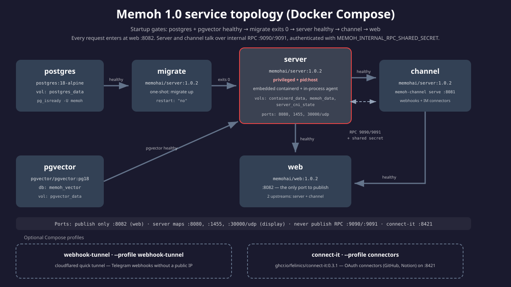

import Button from "@components/widgets/Button.astro";
import Notice from "@components/widgets/Notice.astro";
import ListCheck from "@components/widgets/ListCheck.astro";
import Accordion from "@components/widgets/Accordion.astro";
import Tabs from "@components/widgets/Tabs.astro";
import Tab from "@components/widgets/Tab.astro";

*Disclosure: this guide contains referral links. If you buy through them, I may earn a commission at no extra cost to you.*

**Updated for Memoh 1.0 (November 2026).** The service layout, config schema, and images all changed a lot since this guide first ran in March. If you deployed back then, your stack is obsolete. Everything below is rebuilt against v1.0.2.

Memoh is a self-hosted, multi-agent AI platform: several AI agents in one Docker Compose stack, each in its own containerd workspace, with persistent memory, MCP tool access, and messaging channels like Telegram, Slack, and Discord. I walk through three ways to deploy Memoh (one-click installer, Dokploy, plain Docker Compose), then verify the deployment, back it up, and lock it down. The project sits at 2.8k stars on GitHub under AGPL-3.0, so you can read every line that runs on your box.

## What is Memoh?

[Memoh](https://github.com/felinics/Memoh) is an open-source multi-agent platform built with Go and Vue 3. You create agents (the UI calls them bots), each running in its own isolated containerd workspace with a separate filesystem, network, and process tree. Agents keep persistent memory across sessions, reach external tools through MCP (Model Context Protocol), and recognize individual users in group chats, tracking context per person. They can talk on Telegram, Slack, Discord, Feishu (Lark), DingTalk, WeCom, WeChat, QQ, and LINE, plus the built-in web UI and a desktop app that can remote-connect to your server. If you would rather not run the stack at all, [Memoh Cloud](https://app.memoh.net) is the hosted option.

<Notice type="info" title="Privileged container">
The Memoh server container runs with `privileged: true` and `pid: host` because it embeds containerd to manage agent workspaces. Only deploy this on servers you trust and control, and don't colocate it with anything sensitive. A compromised agent workspace is a host-level incident.
</Notice>

### What changed in Memoh 1.0

Readers of the original March guide: the stack you built is not the current one. The short version of what moved between v0.3 and v1.0.2 (released 2026-11-08):

- **pgvector replaces Qdrant.** Memory embeddings now live in a second Postgres container (`pgvector/pgvector:pg18`, database `memoh_vector`). The `qdrant` service is gone.
- **The agent is in-process.** The standalone `memohai/agent` service is gone; the AI agent loop runs inside the `server` container. The old `memohai/agent` and `memohai/mcp` images are frozen at March 2026.
- **A new `channel` service** owns Telegram/Discord/webhook connections and talks to the server over internal RPC, protected by a mandatory `MEMOH_INTERNAL_RPC_SHARED_SECRET`. Compose refuses to start without it.
- **Channels moved.** Built-in email support was removed in v0.21.0. Slack, DingTalk, WeCom, WeChat, QQ, and LINE joined Telegram, Discord, and Feishu.
- **A one-click installer exists** (`curl -fsSL https://memoh.sh | sh`) and is the upstream-recommended path. The repo moved to [felinics/Memoh](https://github.com/felinics/Memoh).
- **ACP support** lets you host real coding agents (Claude Code, Codex, OpenCode) inside agent workspaces.

<Notice type="warning" title="Upgrading from the old stack?">
As of November 2026 there is no documented in-place migration from the old Qdrant-based layout to pgvector. Export anything you want to keep (chat history, configs) and reinstall fresh. Don't point v1.0.2 images at March-era volumes and hope.
</Notice>

### Key features

| Feature | What it does |
| --- | --- |
| Per-agent workspaces | Each agent gets its own containerd sandbox with a separate filesystem, network, and process tree |
| Persistent memory | Hybrid retrieval: pgvector embeddings for semantics, Postgres for structure and keyword search |
| Nine messaging channels | Telegram, Slack, Discord, Feishu (Lark), DingTalk, WeCom, WeChat, QQ, LINE |
| MCP tool connections | HTTP, SSE, and Stdio servers: browsers, web search, file systems, app APIs |
| ACP coding agents | Run Claude Code, Codex, OpenCode, or Hermes inside an agent workspace |
| Plugin marketplace | Supermarket apps, Skills, Hooks, scheduled tasks with per-run sessions |
| Web UI and desktop app | Vue 3 dashboard with streaming, a file manager, and visual config; native desktop client |

<ListCheck>
- Create and manage multiple AI agents from a single dashboard
- Container-level isolation per agent using containerd
- Hybrid memory: pgvector embeddings plus Postgres structure and keyword retrieval
- MCP support for connecting external tools (HTTP, SSE, Stdio)
- Host real coding agents through ACP (Claude Code, Codex, OpenCode)
- Scheduled tasks and heartbeat-based autonomous actions
- Works with any OpenAI-compatible, Anthropic, or Google AI provider
- Role-based access control with ownership transfer
- Cross-platform identity binding across all channels
</ListCheck>

MCP is the tool layer. Connect a search API, a browser, or an app gateway and every agent on the box can use it. For app integrations I like [Composio MCP, which connects agents to 1,500+ apps](/composio-mcp-guide/). For raw web access, an API like [TinyFish](https://go.bitdoze.com/tinyfish) (web search, fetch, and browser endpoints under one key) saves you writing a scraper.

## Memoh architecture overview



Memoh runs six core services under Docker Compose, plus two optional ones you can enable with Compose profiles:

| Service | Image | Role |
| --- | --- | --- |
| `postgres` | `postgres:18-alpine` | System of record: users, agents, channels, configuration |
| `pgvector` | `pgvector/pgvector:pg18` | Memory embeddings (database `memoh_vector`) |
| `migrate` | `memohai/server:1.0.2` | One-shot: runs `memoh-server migrate up`, then exits |
| `server` | `memohai/server:1.0.2` | Go API, in-process AI agent, embedded containerd (privileged) |
| `channel` | `memohai/server:1.0.2` | Channel worker: `memoh-channel serve`, webhooks and IM connectors |
| `web` | `memohai/web:1.0.2` | Vue 3 UI behind Nginx, with two upstreams (server and channel) |
| `webhook-tunnel` (optional) | `cloudflare/cloudflared:latest` | Quick tunnel for channel webhooks (`--profile webhook-tunnel`) |
| `connect-it` (optional) | `ghcr.io/felinics/connect-it:0.3.1` | OAuth connector gateway for GitHub, Notion, and friends (`--profile connectors`) |

Startup order is enforced by health checks, not luck. PostgreSQL and pgvector pass their `pg_isready` checks first. The `migrate` service then applies database migrations and exits 0, which gates the server start (`condition: service_completed_successfully`). Once the server passes its own health check, `channel` starts, and `web` comes up last waiting on both `server` and `channel`. That `migrate` gate is why schema updates apply automatically when you pull new images. It also means a bad migration stops the stack at the gate: `server` never starts on a non-zero migrate exit, which is exactly what you want. When that happens, `docker compose logs migrate` is the only log that matters.

The `channel` split deserves one paragraph because it is the biggest structural change in 1.0. The server owns state, the API, and the agent runtime. The channel worker owns long-lived webhook and IM connections and calls back into the server over internal RPC on ports 9090/9091. That RPC is authenticated with `MEMOH_INTERNAL_RPC_SHARED_SECRET`, which both processes must share. No secret or mismatched secret means the channel worker never registers, and your Telegram bot goes quiet.

### Why two Postgres containers?

One database holds the system of record (users, agents, config). The other is a stock Postgres image with the pgvector extension (`memoh_vector` database) holding embedding vectors. Keeping them apart means vector index churn does not bloat your main database, and you can back up, restore, or resize them independently. The volume is `pgvector_data`, and the health check is a plain `pg_isready -U memoh -d memoh_vector` (the fragile Qdrant TCP hack from the old stack is gone). If you want to poke at pgvector directly, [deploy pgvector and pgAdmin on Docker](/deploy-pgvector-pgadmin-docker/) and point pgAdmin at the container.

## Prerequisites

Check the tooling first:

```bash
docker --version          # 24+ is fine
docker compose version    # must be Compose v2 (the docker compose plugin)
```

If `docker compose version` fails, you have the old `docker-compose` Python binary or no compose plugin at all. Install the Docker Engine's compose plugin from your distro's package (`docker-compose-plugin` on Debian/Ubuntu) before continuing. Everything in this guide assumes Compose v2 semantics: `depends_on` with `condition:`, `:?` interpolation guards, and Compose profiles.

<ListCheck>
- A Linux VPS or dedicated server with Docker and Docker Compose v2 installed
- 8 GB RAM realistically (upstream sets `mem_limit: 8g` and `GOMEMLIMIT: 7GiB` on the server container)
- Root or sudo access (required for privileged container mode)
- An API key from an OpenAI-compatible, Anthropic, or Google AI provider
- A domain name if you want HTTPS through a reverse proxy
</ListCheck>

You can squeeze the stack into 4 GB by lowering `MEMOH_SERVER_MEMORY_LIMIT` and setting `GOMEMLIMIT` to roughly 85% of it, but that is a lab setup, not a comfortable floor. Each agent workspace adds overhead on top of the base stack, and I would not state an idle RSS number without measuring it on your own box first.

That 8 GB reality pushes you from a CX32-class Hetzner box to a CX42 or CPX31-class machine, on the order of 8 to 15 EUR/mo. Not bad for a fleet of always-on agents with real workspaces.

<Button text="Try Hetzner Cloud Now" link="https://go.bitdoze.com/hetzner" variant="solid" color="blue" size="lg" external={true} icon="rocket-launch" />
<Button text="Try Hostinger VPS" link="https://go.bitdoze.com/hostinger-vps" variant="solid" color="green" size="lg" external={true} icon="rocket-launch" />

_VPS prices jumped across the board in 2026. If you're rethinking a rented box, see [what changed and when a mini PC wins](/vps-price-increases/)._

## Option 1: Install Memoh with the one-click installer

This is the fastest path and the one upstream recommends. On a clean box with Docker installed:

```bash
curl -fsSL https://memoh.sh | sh
```

The installer handles config generation, `.env` secrets (including the RPC secret), Connect-It provisioning, and upgrade/reinstall modes. It also pins image tags to the release it installs, unlike the `:latest` tags in hand-rolled compose files. In practice it writes `config.toml` and an `.env` with the generated secrets, then brings the compose stack up under Docker. When it finishes you get a login prompt in the terminal and a stack you can inspect with `docker compose ps` like any other.

Useful variants:

```bash
# Silent install (no prompts)
curl -fsSL https://memoh.sh | sh -s -- -y

# Pin a specific version
curl -fsSL https://memoh.sh | sh -s -- --version v1.0.2

# Slow network or China mirror
curl -fsSL https://memoh.sh | USE_CN_MIRROR=true sh
```

<Notice type="warning" title="Silent mode defaults">
Silent mode (`-y`) ships with admin login `admin`/`admin123` and PostgreSQL password `memoh123`. Change both before you put the box anywhere reachable. The interactive mode at least makes you look at them.
</Notice>

<Notice type="info" title="CN mirror for manual installs too">
If image pulls time out, the installer flag above is the easy fix. For manual compose runs, set `registry = "memoh.cn"` under `[container]` in `config.toml` and add the `docker/docker-compose.cn.yml` overlay from the repo. Slow networks in general benefit from this.
</Notice>

Whatever path you pick, run the smoke tests in [Verify your Memoh deployment](#verify-your-memoh-deployment) before you call it done.

## Option 2: Deploy Memoh with Dokploy

Dokploy takes care of domains and SSL for you and is what I use when the stack sits behind a real domain. If you don't have it set up yet, follow the [Dokploy install guide](/dokploy-install/) first.

### Step 1: Create the config file

SSH into your server and grab the config template from the repo:

```bash
mkdir -p /opt/memoh && cd /opt/memoh
git clone --depth 1 --recurse-submodules --shallow-submodules https://github.com/felinics/Memoh.git upstream
cp upstream/conf/app.docker.toml config.toml
mkdir -p conf/providers
cp -r upstream/conf/providers/. conf/providers/
```

Copy the template instead of hand-rolling a config file. The schema changed completely in 1.0 (new `[channel]`, `[internal_rpc]`, `[container]`, `[pgvector]` sections; the old `[mcp]`, `[qdrant]`, `[agent_gateway]` blocks no longer exist), and the template is the only thing guaranteed to match the images. Two footguns while cloning: plain `git clone` misses the submodules, and GitHub's auto-generated source archives are not buildable. If you only want the config template the submodules matter less, but keep the habit.

Now generate real secrets and edit `config.toml`:

```bash
openssl rand -base64 32   # -> [auth] jwt_secret
openssl rand -base64 16   # -> [postgres] password
```

Three things must change before first boot:

1. `[admin]`: username, `password`, and email. The default password is `admin123`.
2. `[auth]`: `jwt_secret`. Paste the `openssl rand -base64 32` output.
3. `[postgres]`: `password`. Paste the `openssl rand -base64 16` output. This must match `POSTGRES_PASSWORD` in the next steps.

Worth knowing about while you are in the file: `[container]` has a `registry` knob (`"memoh.cn"` for the CN mirror) and the workspace image (`memohai/workspace:debian-latest`); `[internal_rpc]` and `[webhook_tunnel]` configure the channel worker and the optional Cloudflare tunnel; `[pgvector]` only matters if you run the vector database on a separate password. For patterns on keeping these secrets out of version control, see [handling secrets in Docker Compose](/docker-compose-secrets/).

### Step 2: Create the Dokploy service

1. Open your Dokploy project
2. Click **Add Service** and choose **Compose**
3. Name it `memoh`

### Step 3: Paste the compose file and set the environment

Paste this into the Dokploy compose editor. It is the upstream 1.0.2 service layout adapted for Dokploy: no published ports (the proxy handles routing) and an external `dokploy-network`:

```yaml
name: "memoh"
services:
  postgres:
    image: postgres:18-alpine
    container_name: memoh-postgres
    environment:
      POSTGRES_DB: memoh
      POSTGRES_USER: memoh
      POSTGRES_PASSWORD: ${POSTGRES_PASSWORD:?POSTGRES_PASSWORD is required}
    volumes:
      - postgres_data:/var/lib/postgresql
      - /etc/localtime:/etc/localtime:ro
    expose:
      - "5432"
    healthcheck:
      test: ["CMD-SHELL", "pg_isready -U memoh"]
      interval: 10s
      timeout: 5s
      retries: 5
    restart: unless-stopped
    networks:
      - dokploy-network

  pgvector:
    image: pgvector/pgvector:pg18
    container_name: memoh-pgvector
    environment:
      POSTGRES_DB: memoh_vector
      POSTGRES_USER: memoh
      POSTGRES_PASSWORD: ${POSTGRES_PASSWORD:?POSTGRES_PASSWORD is required}
    volumes:
      - pgvector_data:/var/lib/postgresql
      - /etc/localtime:/etc/localtime:ro
    expose:
      - "5432"
    healthcheck:
      test: ["CMD-SHELL", "pg_isready -U memoh -d memoh_vector"]
      interval: 10s
      timeout: 5s
      retries: 5
    restart: unless-stopped
    networks:
      - dokploy-network

  migrate:
    image: memohai/server:1.0.2
    container_name: memoh-migrate
    entrypoint: ["/app/memoh-server", "migrate", "up"]
    volumes:
      - /opt/memoh/config.toml:/app/config.toml:ro
      - memoh_data:/opt/memoh/data
      - /etc/localtime:/etc/localtime:ro
    depends_on:
      postgres:
        condition: service_healthy
      pgvector:
        condition: service_healthy
    restart: "no"
    networks:
      - dokploy-network

  server:
    image: memohai/server:1.0.2
    container_name: memoh-server
    privileged: true
    pid: host
    mem_limit: 8g
    environment:
      MEMOH_INTERNAL_RPC_SHARED_SECRET: ${MEMOH_INTERNAL_RPC_SHARED_SECRET:?MEMOH_INTERNAL_RPC_SHARED_SECRET is required}
      GOMEMLIMIT: 7GiB
    extra_hosts:
      - "host.docker.internal:host-gateway"
    volumes:
      - /opt/memoh/config.toml:/app/config.toml:ro
      - /opt/memoh/conf/providers:/app/conf/providers:ro
      - containerd_data:/var/lib/containerd
      - server_cni_state:/var/lib/cni
      - memoh_data:/opt/memoh/data
      - /etc/localtime:/etc/localtime:ro
    expose:
      - "8080"
      - "1455"
      - "9090"
    depends_on:
      migrate:
        condition: service_completed_successfully
      pgvector:
        condition: service_healthy
    healthcheck:
      test: ["CMD-SHELL", "wget --spider -q http://127.0.0.1:8080/health || exit 1"]
      interval: 30s
      timeout: 5s
      retries: 5
    stop_grace_period: 45s
    restart: unless-stopped
    networks:
      - dokploy-network

  channel:
    image: memohai/server:1.0.2
    container_name: memoh-channel
    entrypoint: ["/app/memoh-channel", "serve"]
    environment:
      MEMOH_INTERNAL_RPC_SHARED_SECRET: ${MEMOH_INTERNAL_RPC_SHARED_SECRET:?MEMOH_INTERNAL_RPC_SHARED_SECRET is required}
    volumes:
      - /opt/memoh/config.toml:/app/config.toml:ro
      - /etc/localtime:/etc/localtime:ro
    expose:
      - "8081"
      - "9091"
    depends_on:
      server:
        condition: service_healthy
    healthcheck:
      test: ["CMD-SHELL", "wget --spider -q http://127.0.0.1:8081/health || exit 1"]
      interval: 30s
      timeout: 5s
      retries: 5
    restart: unless-stopped
    networks:
      - dokploy-network

  web:
    image: memohai/web:1.0.2
    container_name: memoh-web
    environment:
      MEMOH_SERVER_UPSTREAM: memoh-server:8080
      MEMOH_CHANNEL_UPSTREAM: memoh-channel:8081
    expose:
      - "8082"
    depends_on:
      server:
        condition: service_healthy
      channel:
        condition: service_healthy
    restart: unless-stopped
    networks:
      - dokploy-network

networks:
  dokploy-network:
    external: true

volumes:
  postgres_data:
  pgvector_data:
  containerd_data:
  memoh_data:
  server_cni_state:
```

Then generate the shared secret and set the environment values in the Dokploy service's Environment tab (Dokploy writes them to an `.env` next to the compose file, which is what the `${...}` placeholders resolve against):

```bash
openssl rand -hex 32   # -> MEMOH_INTERNAL_RPC_SHARED_SECRET
openssl rand -base64 16   # -> POSTGRES_PASSWORD (same value as [postgres] password in config.toml)
```

| Variable | Value |
| --- | --- |
| `MEMOH_INTERNAL_RPC_SHARED_SECRET` | output of `openssl rand -hex 32` |
| `POSTGRES_PASSWORD` | same as `[postgres] password` in `config.toml` |

<Notice type="error" title="Required: RPC secret">
The compose file refuses to start without `MEMOH_INTERNAL_RPC_SHARED_SECRET`. Both `server` and `channel` use the `:?` guard, so a missing variable aborts with `MEMOH_INTERNAL_RPC_SHARED_SECRET is required` instead of booting a half-paired stack. This is the single most common deploy failure since 1.0. Persist the secret and reuse it across recreates: it authenticates the server-channel RPC, and rotating it breaks the pairing.
</Notice>

**Notes about the Dokploy setup**

- All services use `expose` instead of `ports`; Dokploy's proxy handles external routing. See [how to deploy a Docker Compose app in Dokploy](/dokploy-docker-compose-app/) if the workflow is new to you.
- `config.toml` is mounted from `/opt/memoh/config.toml` on the host. The database password must match in both the config file and `POSTGRES_PASSWORD`. If you set a separate `PGVECTOR_PASSWORD`, make the `[pgvector]` section match it too.
- The server container needs `privileged: true` and `pid: host` for containerd to manage agent workspaces.
- `mem_limit: 8g` and `GOMEMLIMIT: 7GiB` are the upstream defaults. If you lower the limit, keep `GOMEMLIMIT` at roughly 85% of it.

### Step 4: Domain and port

Create a domain in Dokploy and map it to the `web` service on port **8082**. After deploying, open `https://your-domain.com` and log in.

Do not expose the other ports. The full default port list so you know what to keep closed: `8082` (web, the only one you publish), `8080` and `1455` (server API and display), `30000/udp` (WebRTC remote display), `8421` (Connect-It admin, only if enabled), and `9090`/`9091` (internal RPC, never publish). On firewall behavior with published ports, note that [Docker bypasses your firewall](/docker-bypasses-firewall/) by default, so control exposure at the compose level.

<Notice type="warning" title="Security">
Change all default passwords before deploying. The admin default is `admin`/`admin123`, and the one-click installer's silent mode adds postgres password `memoh123`. Rotate the JWT secret and protect `.env`. If you need a reverse proxy other than Dokploy, [Traefik in Docker](/traefik-proxy-docker/) works well.
</Notice>

<Notice type="info" title="SSE and HTTP/2">
Memoh streams a lot of server-sent events. If your reverse proxy downgrades to HTTP/1.1, the browser's roughly six connections per origin can be exhausted by SSE long-pins and the UI starts stalling (upstream issue #822). The web container ships a commented-out HTTPS/HTTP2 listener on 8443 for exactly this reason. Either serve HTTP/2 from the proxy or enable that listener, and turn off proxy buffering for SSE routes.
</Notice>

## Option 3: Deploy Memoh with Docker Compose (standalone)

This is the path where you own every line. It works on any Linux box with Docker.

### Step 1: Project directory and config

```bash
mkdir -p /opt/memoh && cd /opt/memoh
git clone --depth 1 --recurse-submodules --shallow-submodules https://github.com/felinics/Memoh.git upstream
cp upstream/conf/app.docker.toml config.toml
mkdir -p conf/providers
cp -r upstream/conf/providers/. conf/providers/
```

Edit `config.toml` and change the same three keys as in the Dokploy path: `[admin]` credentials, `[auth] jwt_secret`, and `[postgres] password`.

### Step 2: Generate secrets and the .env file

You need three secrets:

```bash
openssl rand -base64 32   # jwt_secret -> config.toml [auth]
openssl rand -hex 32      # MEMOH_INTERNAL_RPC_SHARED_SECRET -> .env
openssl rand -base64 16   # postgres password -> config.toml [postgres] + .env
```

Write the `.env` next to your compose file:

```bash
cat > .env << 'EOF'
POSTGRES_PASSWORD=YOUR_DB_PASSWORD
MEMOH_INTERNAL_RPC_SHARED_SECRET=YOUR_RPC_SECRET
EOF
```

`POSTGRES_PASSWORD` must match `[postgres] password` in `config.toml`. The RPC secret authenticates the server-channel pair: persist it, and reuse it across recreates. Rotating it mid-flight breaks the pairing until both services restart with the new value.

<Notice type="info" title="Secrets on disk">
`.env` and `config.toml` contain live credentials. Keep both out of version control and restrict permissions (`chmod 600 .env config.toml`). If you need the bigger picture on compose secret handling, see [Docker Compose secrets: what works and secure alternatives](/docker-compose-secrets/).
</Notice>

### Step 3: Create the compose file

```yaml
name: "memoh"
services:
  postgres:
    image: postgres:18-alpine
    container_name: memoh-postgres
    environment:
      POSTGRES_DB: memoh
      POSTGRES_USER: memoh
      POSTGRES_PASSWORD: ${POSTGRES_PASSWORD:?POSTGRES_PASSWORD is required}
    volumes:
      - postgres_data:/var/lib/postgresql
      - /etc/localtime:/etc/localtime:ro
    expose:
      - "5432"
    healthcheck:
      test: ["CMD-SHELL", "pg_isready -U memoh"]
      interval: 10s
      timeout: 5s
      retries: 5
    restart: unless-stopped
    networks:
      - memoh-network

  pgvector:
    image: pgvector/pgvector:pg18
    container_name: memoh-pgvector
    environment:
      POSTGRES_DB: memoh_vector
      POSTGRES_USER: memoh
      POSTGRES_PASSWORD: ${POSTGRES_PASSWORD:?POSTGRES_PASSWORD is required}
    volumes:
      - pgvector_data:/var/lib/postgresql
      - /etc/localtime:/etc/localtime:ro
    expose:
      - "5432"
    healthcheck:
      test: ["CMD-SHELL", "pg_isready -U memoh -d memoh_vector"]
      interval: 10s
      timeout: 5s
      retries: 5
    restart: unless-stopped
    networks:
      - memoh-network

  migrate:
    image: memohai/server:1.0.2
    container_name: memoh-migrate
    entrypoint: ["/app/memoh-server", "migrate", "up"]
    volumes:
      - ./config.toml:/app/config.toml:ro
      - memoh_data:/opt/memoh/data
      - /etc/localtime:/etc/localtime:ro
    depends_on:
      postgres:
        condition: service_healthy
      pgvector:
        condition: service_healthy
    restart: "no"
    networks:
      - memoh-network

  server:
    image: memohai/server:1.0.2
    container_name: memoh-server
    privileged: true
    pid: host
    mem_limit: ${MEMOH_SERVER_MEMORY_LIMIT:-8g}
    environment:
      MEMOH_INTERNAL_RPC_SHARED_SECRET: ${MEMOH_INTERNAL_RPC_SHARED_SECRET:?MEMOH_INTERNAL_RPC_SHARED_SECRET is required}
      GOMEMLIMIT: ${MEMOH_GOMEMLIMIT:-7GiB}
    extra_hosts:
      - "host.docker.internal:host-gateway"
    volumes:
      - ./config.toml:/app/config.toml:ro
      - ./conf/providers:/app/conf/providers:ro
      - containerd_data:/var/lib/containerd
      - server_cni_state:/var/lib/cni
      - memoh_data:/opt/memoh/data
      - /etc/localtime:/etc/localtime:ro
    ports:
      - "8080:8080"
      - "1455:8080"
      - "30000:30000/udp"
    depends_on:
      migrate:
        condition: service_completed_successfully
      pgvector:
        condition: service_healthy
    healthcheck:
      test: ["CMD-SHELL", "wget --spider -q http://127.0.0.1:8080/health || exit 1"]
      interval: 30s
      timeout: 5s
      retries: 5
    stop_grace_period: 45s
    restart: unless-stopped
    networks:
      - memoh-network

  channel:
    image: memohai/server:1.0.2
    container_name: memoh-channel
    entrypoint: ["/app/memoh-channel", "serve"]
    environment:
      MEMOH_INTERNAL_RPC_SHARED_SECRET: ${MEMOH_INTERNAL_RPC_SHARED_SECRET:?MEMOH_INTERNAL_RPC_SHARED_SECRET is required}
    volumes:
      - ./config.toml:/app/config.toml:ro
      - /etc/localtime:/etc/localtime:ro
    expose:
      - "8081"
      - "9091"
    depends_on:
      server:
        condition: service_healthy
    healthcheck:
      test: ["CMD-SHELL", "wget --spider -q http://127.0.0.1:8081/health || exit 1"]
      interval: 30s
      timeout: 5s
      retries: 5
    restart: unless-stopped
    networks:
      - memoh-network

  web:
    image: memohai/web:1.0.2
    container_name: memoh-web
    environment:
      MEMOH_SERVER_UPSTREAM: memoh-server:8080
      MEMOH_CHANNEL_UPSTREAM: memoh-channel:8081
    ports:
      - "8082:8082"
    depends_on:
      server:
        condition: service_healthy
      channel:
        condition: service_healthy
    restart: unless-stopped
    networks:
      - memoh-network

volumes:
  postgres_data:
  pgvector_data:
  containerd_data:
  memoh_data:
  server_cni_state:

networks:
  memoh-network:
    driver: bridge
```

A few operator notes baked into that file: `stop_grace_period: 45s` on the server gives workspaces time to checkpoint, and v0.21+ resumes interrupted sessions after a graceful shutdown. `mem_limit` is tunable via `MEMOH_SERVER_MEMORY_LIMIT`, with `GOMEMLIMIT` at roughly 85% of it (keep that ratio if you change one). The GPU CDI mounts (`/etc/cdi`, `/var/run/cdi`) are commented out in upstream; add them if you pass a GPU into workspaces. If you only need the web UI behind a proxy, delete the server `ports` block entirely and publish nothing but `8082`.

### Step 4: Start the stack

```bash
sudo docker compose up -d
```

First startup takes a couple of minutes while images pull (the server image is the big one). Watch it:

```bash
sudo docker compose logs -f
```

Healthy first boot in the logs, in order: Postgres and pgvector ready, `migrate` applying schema and exiting, `server` starting its API, `channel` registering over RPC, and `web` serving. Any deviation from that order is your first clue.

Once the logs settle, open `http://your-server-ip:8082` and log in with the admin credentials from `config.toml`. The `migrate` service runs on every startup, so database schema updates apply automatically when you pull new images. Then run the [smoke tests](#verify-your-memoh-deployment) before you wire up anything real.

## Verify your Memoh deployment

Don't trust `up -d` alone. Run the smoke tests in order:

<ListCheck>
- `docker compose ps` shows all six core services running, with `memoh-migrate` at `Exited (0)`
- `docker compose logs migrate --tail 50` shows applied migrations and no errors
- `docker compose logs channel | tail` shows the channel worker registered
- Health endpoints respond (see the curl commands below)
- You can log in as admin in the web UI
- One test message gets a reply in the web UI
- One external channel (for example Telegram) delivers a message end to end
</ListCheck>

```bash
sudo docker compose ps
sudo docker compose logs migrate --tail 50
sudo docker compose logs channel | tail

curl -s http://localhost:8080/health
curl -s http://localhost:8081/health
```

A healthy `docker compose ps` shows `memoh-postgres` and `memoh-pgvector` as `healthy`, `memoh-migrate` as `Exited (0)`, and `memoh-server`, `memoh-channel`, `memoh-web` as `running` (server and channel with a `(healthy)` marker once their checks pass). The migrate log should read like applied schema versions, not a stack trace. The channel log should show it registered against the server, not retry loops.

The compose health checks call `/health` on 8080 and 8081, so those paths are the working assumption. If a curl returns 404, don't panic: check `docker compose logs server` and `channel` instead, since exact endpoint paths can move between releases.

What "broken" looks like: `memoh-migrate` stuck restarting usually means a database password mismatch. `memoh-channel` running but silent usually means a bad RPC secret. No reply from a new agent usually means no provider is configured yet. Fixes are in [Troubleshooting Memoh deployment problems](#troubleshooting-memoh-deployment-problems).

## After deployment

### Add an AI provider

After logging in, go to **Settings > Providers** and add your API key for OpenAI, Anthropic, Google, or any compatible endpoint. Agents won't do anything useful without a provider. An OpenAI-compatible setup needs three things: a base URL, an API key, and at least one model name (for example `gpt-4o-mini`, or whatever your endpoint exposes). That is also the escape hatch for local models behind an OpenAI-compatible gateway like LiteLLM or Ollama's OpenAI shim. For non-standard endpoints, custom provider definitions live in the `./conf/providers` directory mounted read-only into the server.

### Create your first agent

1. Click **Bots** in the sidebar
2. Click **Create Bot**
3. Give it a name and select a model from your configured provider
4. The agent gets its own containerd workspace automatically (image `memohai/workspace:debian-latest`)

The workspace is the important part: a real container with its own filesystem and network, not a prompt window. Files the agent writes persist there, MCP servers it runs stay sandboxed, and one agent blowing up does not take the others with it. You can chat with it from the web UI right away. Connecting external channels is the next step if you want it answering on Telegram or Discord.

### Connect messaging channels

Memoh 1.0 supports nine external channels. Configure them from **Settings > Channels**:

| Channel | What you need |
| --- | --- |
| Telegram | A bot token from @BotFather |
| Slack | Bot token and app token from the Slack API |
| Discord | A bot application token from the Discord Developer Portal |
| Feishu (Lark) | App ID and App Secret |
| DingTalk | App credentials from the DingTalk console |
| WeCom | Corp ID and app secret |
| WeChat | Service account credentials |
| QQ | Bot credentials from the QQ open platform |
| LINE | Channel token and channel secret |

Each channel has its own walkthrough under [docs.memoh.ai/integrations/channels](https://docs.memoh.ai/integrations/channels.md). Built-in email support was removed in v0.21.0, so don't look for an SMTP row. Wire up one channel at a time and send a test message before moving to the next: channel credentials and webhook URLs fail in quiet ways, and the [verify checklist](#verify-your-memoh-deployment) above catches them faster than a user complaining three days later.

<Notice type="info" title="No public IP? Use the webhook tunnel">
The optional `webhook-tunnel` profile (`--profile webhook-tunnel`) runs a cloudflared quick tunnel so Telegram and friends can reach your channel worker without port forwarding or a public IP. Perfect for a home box or a NAT-ed VPS.
</Notice>

### Run coding agents in Memoh (ACP)

This is the feature that makes Memoh 1.0 interesting beyond chatbots. Through ACP (Agent Client Protocol), you can run real coding agents inside an agent workspace: Claude Code, Codex, OpenCode, or Hermes. The workspace is a proper container with its own filesystem, so repo work stays inside the sandbox instead of on your host.

What it is good for:

- Repo work: clone, edit, run tests, and report diffs from inside the workspace
- Scheduled tasks with per-run sessions, so each run starts clean instead of inheriting a long chat
- An approvals/trust model for anything destructive before it executes
- Talking to a coding agent from Telegram while it works in a container on your server

If you're comparing the underlying tools, see the [best AI coding tools and agents in 2026](/ai-coding-tools/) and how to [use the Codex app with any model](/codex-app-any-model/). If you route between models, [Agent Router](https://go.bitdoze.com/agentrouter) unifies access to Claude Code, Codex, and Gemini CLI under one key, and [OpenCode](https://go.bitdoze.com/opencode-go) is an open-source coding agent you can host inside the workspace. The ACP flows are documented at [docs.memoh.ai/guides/acp](https://docs.memoh.ai/guides/acp.md), and the desktop app can remote-connect to the server as of v0.16.

<Notice type="info" title="Resource note">
Coding agents burn RAM and CPU per workspace, on top of the 8 GB base stack. If you plan to run several of them at once, size the box up and set per-workspace resource limits in Memoh's settings.
</Notice>

### How agent memory works

Memoh pairs pgvector for embeddings with Postgres as the source of truth for structured data, using hybrid vector and keyword retrieval to pull context back. Since March the engine gained semantic memory compaction (v0.13), typed conversation history and compaction (v0.17 and v0.18), and a configurable memory model with usage tracking (v0.21), so what gets remembered and what gets compacted is now tunable rather than fixed. Compaction is the piece that keeps long-running agents from drowning in their own history: old turns get summarized into facts and the raw transcript rolls off the hot path. You can trigger memory compaction and rebuild from the agent settings, and usage tracking tells you how much of the context budget each agent is burning. If you want a different memory backend for other projects, [self-host Cognee for agent memory](/cognee-self-host/) is worth a look.

## Managing data, updates, and backups

All persistent data lives in Docker named volumes:

| Volume | Contents |
| --- | --- |
| `postgres_data` | PostgreSQL database files (users, agents, config) |
| `pgvector_data` | pgvector embeddings (memory) |
| `containerd_data` | Agent workspace images and snapshots |
| `memoh_data` | Agent workspace data |
| `server_cni_state` | CNI network state for workspace networking |

These volumes survive `docker compose down`. Back up both databases plus the two secret files (`config.toml` and `.env`):

```bash
sudo docker compose exec postgres pg_dump -U memoh memoh > memoh-$(date +%F).sql
sudo docker compose exec pgvector pg_dump -U memoh memoh_vector > memoh_vector-$(date +%F).sql
cp config.toml .env /some/backup/location/
```

Restoring is the reverse, into a running stack:

```bash
cat memoh-2026-11-16.sql | sudo docker compose exec -T postgres psql -U memoh memoh
cat memoh_vector-2026-11-16.sql | sudo docker compose exec -T pgvector psql -U memoh memoh_vector
```

Take both dumps on a schedule (nightly cron is plenty for a personal fleet) and keep the secret files next to them. A backup without `config.toml` and `.env` is half a backup: you'll have the data and no way to authenticate the restored stack. For the Dokploy path, [back up Dokploy deployments to Cloudflare R2](/dokploy-backups-cloudflare-r2/) and add these dumps to that pipeline.

<Notice type="error" title="down -v wipes everything">
`docker compose down -v` deletes the named volumes: both databases, all workspace images, all agent data. There is no undo. Keep it out of your muscle memory.
</Notice>

To update Memoh, pick your path:

<Tabs>
<Tab name="One-click installer">

Re-run the installer; it detects an existing install and offers upgrade or reinstall modes, and it pins image tags to the release it installs:

```bash
curl -fsSL https://memoh.sh | sh
```

</Tab>
<Tab name="Docker Compose">

Pull the latest images and recreate. The `migrate` service runs automatically on startup to apply schema changes:

```bash
sudo docker compose pull && sudo docker compose up -d
```

</Tab>
</Tabs>

In production, pin the image tags in your compose file (`memohai/server:1.0.2` and friends, as in the files above) and bump them deliberately. `:latest` floats, and a routine `up -d` can pull a major version you haven't read about.

Useful day-two commands:

```bash
# Check service status
sudo docker compose ps

# View logs for a specific service
sudo docker compose logs -f server

# Restart the stack
sudo docker compose restart

# See where the disk went (workspace images add up)
sudo docker system df
```

Disk is the resource that creeps up on you. Every agent workspace is a `memohai/workspace:debian-latest` instance plus containerd snapshots, every conversation adds rows to both databases, and `containerd_data` keeps old image layers until pruned. Check `docker system df` monthly. Prune unused workspace images after you delete agents. If the box runs out of disk, Postgres is the first thing to fall over, and a full disk turns a routine restart into a recovery job.

## Production checklist and security

<ListCheck>
- Replace all default passwords (`admin123`, the installer's `memoh123`, plus PostgreSQL and the JWT secret)
- Generate `MEMOH_INTERNAL_RPC_SHARED_SECRET` with `openssl rand -hex 32`, store it in `.env`, and never commit it
- Set up HTTPS through a reverse proxy (Dokploy handles this, or Caddy/Traefik/Nginx), and keep HTTP/2 in the path for SSE
- Firewall the box down: publish `8082` only; `8080`/`1455` and `30000/udp` only if you use the remote display; `8421` only if Connect-It is enabled; never `9090`/`9091`
- Remember that Docker publishes ports around your firewall rules by default
- Set memory and CPU limits (`MEMOH_SERVER_MEMORY_LIMIT`, `GOMEMLIMIT` at ~85%, per-workspace limits)
- Back up both Postgres instances plus `config.toml` and `.env`
- Monitor disk usage; workspace images, containerd snapshots, and vector data grow over time
- Pin image tags (`1.0.2`) instead of `:latest`
</ListCheck>

<Notice type="warning" title="Privileged mode">
The server container runs with `privileged: true` and `pid: host`. This gives it broad access to the host kernel and filesystems. Treat a compromised agent workspace as a compromised host: keep Memoh on its own box, away from customer data and other production services, and [harden SSH on the host](/secure-ssh-server-linux/). For monitoring, [Beszel and Uptime Kuma](/beszel-uptime-kuma/) cover the usual bases.
</Notice>

What runs 24/7 is the six core services. Per-agent cost is the workspace container plus its image, so a handful of mostly-idle agents is cheap and a fleet of coding agents is not. Budget disk accordingly.

On updates: pin the tags, read the release notes for the version you're jumping to (v0.21.0 broke email, 1.0 broke the whole service layout), and take a database dump before every upgrade. Memoh moves fast for a project this young, and "pull and pray" works right up until it doesn't. If an upgrade goes bad, the rollback story is the pinned old images plus your dumps: `docker compose down`, edit the tags back, restore both databases, `docker compose up -d`.

<Notice type="info" title="License">
Memoh is AGPL-3.0. Fine for personal and internal use; read the license before you offer it as part of a commercial service.
</Notice>

## Troubleshooting Memoh deployment problems

<Notice type="error" title="Most common failure">
Missing `MEMOH_INTERNAL_RPC_SHARED_SECRET`. Compose aborts with `MEMOH_INTERNAL_RPC_SHARED_SECRET is required` (the `:?` guard) or the channel worker starts and never pairs. Generate it with `openssl rand -hex 32`, put it in `.env` or the Dokploy Environment tab, and restart.
</Notice>

| Symptom | Fix |
| --- | --- |
| Compose aborts: `MEMOH_INTERNAL_RPC_SHARED_SECRET is required` | Generate with `openssl rand -hex 32`, add to `.env` / Dokploy Environment, redeploy |
| Containers fail immediately on start with a mount error | `config.toml` is missing or misspelled at the mounted path; running without it is documented to fail |
| `memoh-migrate` exits non-zero or loops | `POSTGRES_PASSWORD` does not match `[postgres] password` in `config.toml`. If you set `PGVECTOR_PASSWORD`, make `[pgvector]` match too |
| `memoh-channel` runs but bots never answer on Telegram/Discord | Usually an RPC secret mismatch (check both services got the same `MEMOH_INTERNAL_RPC_SHARED_SECRET`) or the channel config under **Settings > Channels** is incomplete. Check `docker compose logs channel` for registration errors |
| Agent creation fails or the workspace never becomes ready | The workspace image (`memohai/workspace:debian-latest`) failed to pull, or the server lacks room for containerd snapshots. Check `docker compose logs server` and `docker system df` |
| Image pull timeouts or slow downloads | Use the CN mirror: `USE_CN_MIRROR=true` with the installer, or `[container] registry = "memoh.cn"` plus the `docker/docker-compose.cn.yml` overlay |
| Web UI stalls, chat stops streaming behind a proxy | SSE over HTTP/1.1 exhausts browser connections. Serve HTTP/2 (or the container's 8443 h2 listener) and disable proxy buffering for SSE routes |
| `port is already allocated` on 8080/8082/1455/30000/8421 | Another process owns the port. Remap the left side of the `ports` entries or stop the conflicting service |
| Disk fills up over a few weeks | Workspace images (`memohai/workspace:debian-latest` per agent) and containerd snapshots add up. Check `docker system df`, prune old workspace images, and watch `pgvector_data` |
| Upgrading from the March (Qdrant) stack | There is no documented in-place Qdrant-to-pgvector migration as of November 2026. Export what you need and reinstall fresh |

## FAQ

<Accordion label="Why does the server container need privileged mode?" group="faq" expanded="true">
Memoh embeds containerd inside the server container to give each agent its own sandbox. Containerd needs access to Linux kernel features (namespaces, cgroups) that require elevated privileges. There is no way around this if you want per-agent container isolation. That is also why this stack belongs on a box you fully control.
</Accordion>

<Accordion label="Can I use Memoh without an AI provider API key?" group="faq">
You can deploy it and poke around the UI, but agents won't generate any responses until you add at least one provider. Any OpenAI-compatible, Anthropic, or Google endpoint works.
</Accordion>

<Accordion label="How much RAM does Memoh need?" group="faq">
Plan for 8 GB. Upstream sets `mem_limit: 8g` and `GOMEMLIMIT: 7GiB` on the server container by default. If you must run on a smaller box, lower `MEMOH_SERVER_MEMORY_LIMIT` and set `GOMEMLIMIT` to roughly 85% of the new limit. Each agent workspace adds overhead on top, and coding agents add a lot more. I would not quote an idle number without measuring your own install.
</Accordion>

<Accordion label="Can I expose only the web UI and keep the API internal?" group="faq">
Yes, and you should. Since 1.0 the web UI talks to two upstreams (server and channel), so keep both internal: publish nothing but `8082` (or route through a reverse proxy and publish nothing at all). Never expose the RPC ports `9090`/`9091`, and leave `1455` and `30000/udp` closed unless you use the remote display feature. Remove the `ports` blocks for `server` and `channel` in the standalone compose file.
</Accordion>

<Accordion label="What is the channel service and the RPC secret?" group="faq">
The `channel` container is a worker that owns webhook and messaging connections (Telegram, Discord, and so on). It talks to the `server` over internal RPC on ports 9090/9091. `MEMOH_INTERNAL_RPC_SHARED_SECRET` authenticates that link: both processes must have the same value or the channel never registers. Generate it once, store it in `.env`, and reuse it across recreates.
</Accordion>

<Accordion label="Why are there two Postgres containers?" group="faq">
`postgres` is the system of record. `pgvector/pgvector:pg18` holds memory embeddings in the `memoh_vector` database. Splitting them keeps vector index churn out of your main database and lets you back up or tune each independently. Both need backups.
</Accordion>

<Accordion label="How do I run Claude Code inside Memoh?" group="faq">
Use the ACP integration: create an agent, attach Claude Code (or Codex, OpenCode, Hermes) as its ACP runtime, and the coding agent runs inside the agent's workspace container. Setup details live at [docs.memoh.ai/guides/acp](https://docs.memoh.ai/guides/acp.md); see also the ACP section above.
</Accordion>

<Accordion label="How do I update Memoh?" group="faq">
Installer path: re-run `curl -fsSL https://memoh.sh | sh` and pick upgrade. Compose path: `sudo docker compose pull && sudo docker compose up -d`. The `migrate` service applies schema changes on every startup. Pin image tags in production so updates happen when you decide. The update commands are also in [Managing data, updates, and backups](#managing-data-updates-and-backups).
</Accordion>

## Wrapping up

Memoh 1.0 is a genuinely different stack from the March version: pgvector memory, in-process agents, a dedicated channel worker, and ACP hosting for real coding agents. It is still one Compose file or one curl away on hardware you control. The operator bottom line: 8 GB RAM, a trusted host only (privileged mode is not theater), pin your image tags, and keep backups of both databases plus your secrets. Start with the one-click installer if you just want it running tonight; use the Dokploy path if it needs a real domain; use the standalone compose path if you want to know every line first. Either way, run the smoke tests before you trust it with anything real.

If you only need a single chat assistant instead of a multi-agent fleet, a lighter setup like [OpenClaw](/clawdbot-setup-guide/) is the better fit. For other memory backends, the [Cognee self-host guide](/cognee-self-host/) follows the same deploy pattern.

<Button text="View Memoh on GitHub" link="https://github.com/felinics/Memoh" variant="solid" color="blue" size="md" icon="arrow-right" />
