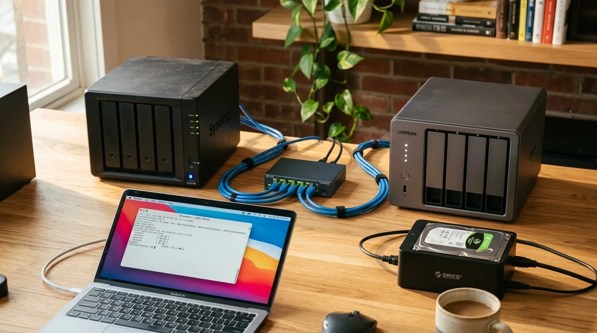

import Notice from "@components/widgets/Notice.astro";
import Accordion from "@components/widgets/Accordion.astro";
import Button from "@components/widgets/Button.astro";

If you're reading this, you probably already made the call. Maybe it was the drive compatibility lock-in on the 2025 `x25+` models, maybe you got tired of paying $700+ for gigabit ports and a CPU without an iGPU, or maybe you just saw what UGREEN packs into the [DXP4800 Plus](/best-nas-homelab-docker-proxmox/) for $619.99. On raw hardware per dollar, the gap between a Ryzen V1500B DiskStation and an Intel 10GbE UGREEN box isn't subtle anymore.

Here is the part that catches first-time switchers off guard: **you cannot pull your drives out of a Synology and slide them into a UGREEN NAS.**

Synology's SHR layers `mdadm` and LVM across three partitions per disk (DSM system root, swap, and data pool). UGREEN's UGOS Pro expects its own partition table and `mdadm` + Btrfs layout. Drop a healthy four-drive SHR array into a DXP4800 Plus and UGOS will greet you with a prompt offering to wipe all four disks to create a new storage pool. Every gigabyte has to travel off the old pool over the network (or through a staging drive) onto freshly formatted disks. Plan around that constraint and the switch takes a quiet weekend. Discover it with your drives sitting on the desk and you're in for a long night.

<Notice type="warning" title="Affiliate disclosure">
Some links below use `/go/` affiliate redirects to Amazon. Buying through them earns a small commission at no extra cost to you and helps fund the hardware we test.
</Notice>

<Notice type="warning" title="Verify your external backup before starting">
A storage migration is the worst possible time to find out your backup job silently failed two months ago. Before changing a single setting on your Synology, make sure your irreplaceable folders (family photos, tax documents, password vaults, container databases) exist on an independent disk unplugged from both NAS boxes. A [4-bay USB-C DAS](/best-das-enclosure-homelab/) or a single large external USB drive is cheap insurance.
</Notice>

## What actually transfers (and what you have to rebuild)

| Moves cleanly | Needs manual adjustment | Stays behind on DSM |
| --- | --- | --- |
| Shared folders, media libraries, raw photo files | User accounts, group ACLs, and SMB permissions | SHR / DSM volumes (slated for wipe if you reuse disks) |
| Docker containers using bind-mounted folders | LinuxServer `PUID`/`PGID` ownership (`1026` → `1000`) | Synology Photos face tags, virtual albums & share links |
| Docker Compose stacks (`docker-compose.yml`) | Named Docker volumes (require `.tar.gz` export/import) | Active Backup for Business tasks & client agents |
| VMs exported as `.ova` or raw `.vmdk`/`.qcow2` | Scheduled cron scripts & webhook paths | Hyper Backup `.hbk` vault schedules |
| Home Assistant backups (`.tar` snapshot restore) | Plex watch history & server GUID (if not copying full DB) | Surveillance Station camera licenses & timeline |

The short rule: **files travel, DSM packages don't.** If your stack already lives inside Docker Compose, moving to UGOS Pro feels like moving between any two Debian-based Linux hosts. If your workflow leans heavily on Synology's first-party suite (Active Backup, Synology Drive, Synology Photos, Surveillance Station), you are switching ecosystems, not just hardware.



## Step 0: Take inventory and pick your drive strategy

Spend 30 minutes on the Synology before you unbox anything. SSH into DSM or open Control Panel and jot down four things:

1. **Real share sizes (excluding snapshots):** Run `du -sh /volume1/*/ | sort -h` over SSH. It's common to uncover a 1.5TB `homes` recycle folder or an old Time Machine sparsebundle you no longer need to copy across the LAN.
2. **Users, UIDs, and shared folder permissions:** Take screenshots of **Control Panel → Shared Folder** and **User & Group**. Trying to reconstruct read/write rules from memory for family accounts always breaks someone's mapped network drive.
3. **Container mounts and ports:** Run `docker ps --format 'table {{.Names}}\t{{.Image}}\t{{.Ports}}'` and export your `docker-compose.yml` files from Container Manager. Check whether any container hides state inside a named volume (`/volume1/@docker/volumes/`) instead of a visible bind mount (`/volume1/docker/...`).
4. **Your cutover priority list:** Copy the shares your household notices first (`docker`, `photos`, `homes`), then leave the 20TB `media` archive churning overnight.

Next, pick one of two physical disk paths:

- **Path A: Populate the UGREEN with new drives (safest and fastest).** Even with [2026 NAS hard drive prices sitting near ~$38–44/TB](/best-hard-drives-for-nas/), starting the UGREEN on two fresh disks in RAID 1 (or four in RAID 5/6) lets both NAS appliances run side by side on your switch. You copy directly NAS-to-NAS at wire speed, test the new setup for two weeks while the Synology sits powered off on a shelf untouched, and only then wipe or sell the old unit.
- **Path B: Reuse your existing Synology drives (cheaper, slower, higher risk).** Because UGOS wipes every drive you insert, you need a temporary staging disk big enough to hold your entire dataset. Copy everything from the Synology to an external USB drive or desktop PC, verify the files, pull the drives from the Synology, install and format them in the UGREEN, and copy everything back. Every terabyte moves twice, and during the middle phase your staging disk is the single copy of your pool.

<Notice type="info" title="Can you pull one drive from a 2-bay SHR mirror to seed the UGREEN?">
Technically yes, if you enjoy living without a seatbelt. You can pull Disk 2 from a healthy 2-bay Synology SHR mirror (leaving the Synology in a degraded, beeping state on Disk 1), put Disk 2 into the UGREEN as a single Basic/RAID-migrable volume, copy the data over the network, and later move Disk 1 over. Only attempt this if you already have a complete offline backup—if Disk 1 throws a bad sector during the full-disk read while degraded, that copy fails.
</Notice>

## Step 1: Initialize UGOS Pro and mirror your share names

Install the drives into the UGREEN, walk through the UGOS Pro setup wizard, and apply any pending firmware updates before creating your shares. UGREEN ships monthly UGOS Pro updates right now, and updating first ensures you have the current Samba, Docker, and fan-curve patches.

Create your storage pool (Btrfs is the sensible choice for snapshots and bit-rot checks) and notices where UGOS mounts it: `/volume1/`, matching Synology's path convention. Now create shared folders with the **exact same lowercase/uppercase names** you used on DSM (`media`, `docker`, `photos`, `backups`). Keeping `/volume1/docker` and `/volume1/media` identical on both appliances means 90% of your Docker Compose bind paths won't need editing later.

## Step 2: Copy the data (rsync over SSH vs Remote Folder mount)

Dragging 12TB across Finder or Windows Explorer over SMB routes every packet through your desktop PC, chokes on deep folder trees, and stalls on permission prompts. Use a direct NAS-to-NAS transfer instead. You have two clean ways to do it.

### Option A: `rsync` over SSH (best for permissions and resume support)

Enable SSH on both boxes:
- **Synology DSM:** Control Panel → Terminal & SNMP → Enable SSH service (port 22).
- **UGREEN UGOS Pro:** Control Panel → Terminal → Enable SSH.

Do **not** run a 10-hour `rsync` inside a normal SSH window from your laptop without protection; the moment your laptop goes to sleep, the SIGHUP kills the transfer. Either run it inside `tmux`, wrap it in `nohup`, or trigger it as a one-off User-defined Script inside DSM's Task Scheduler.

From the Synology, push each share to the UGREEN:

```bash
# Test the flags first with --dry-run (-n), then remove -n for the real transfer
rsync -avhP \
  --exclude='@eaDir' \
  --exclude='#recycle' \
  --exclude='#snapshot' \
  --exclude='.SynologyWorkingDirectory' \
  --exclude='@SynoResource' \
  /volume1/media/ admin@192.168.1.50:/volume1/media/
```

Why those five exclusions matter:

- `--exclude='@eaDir'`: DSM scatters hidden `@eaDir` directories next to every photo and video to store thumbnails and indexing metadata. UGOS ignores them, and transferring 150,000 tiny thumbnail files can drop your throughput from 250MB/s to 8MB/s.
- `--exclude='#snapshot'`: If you ever checked "Make snapshot visible" in DSM Snapshot Replication, `#snapshot` contains full read-only trees of past snapshots. Forgetting to exclude it tells `rsync` to copy every historical snapshot as a separate full copy, blowing out your UGREEN pool before the share finishes.
- `--exclude='#recycle'`: Skips DSM's per-share trash bin.
- `--exclude='.SynologyWorkingDirectory'` and `--exclude='@SynoResource'`: Skips Synology Drive and extended-attribute scratch files.

On a 1GbE switch, expect 110–115MB/s (~3 hours per terabyte). If your Synology has a 2.5GbE USB dongle or 10GbE card talking to the UGREEN's 2.5GbE/10GbE port across a [2.5GbE homelab switch](/best-2-5-10gbe-switch-homelab/), sustained transfers will saturate the hard drives at 220–275MB/s (~1.2 hours per terabyte). If a transfer gets interrupted, run the exact same command again and `rsync` will pick up on the file where it stopped.

### Option B: UGOS File Manager Remote Mount (GUI alternative)

If you don't want to touch SSH keys or terminal flags, open **Files** inside UGOS Pro, click **Network / Remote Mount**, and mount your Synology's SMB share directly inside the UGREEN UI. Then start the copy inside UGOS File Manager. Because the copy job runs on the UGREEN backend rather than in your browser tab, you can close your laptop and let the two NAS boxes talk directly. Just remember to empty DSM's `#recycle` bins and hide `#snapshot` directories in DSM Control Panel before starting.

## Step 3: Fix the UID/GID mismatch (`1026` vs `1000`)

Once the files land on `/volume1/`, recreate your user accounts in UGOS Control Panel. Here is the subtle Linux detail that trips up almost everyone moving Docker stacks from DSM to UGOS:

- On **Synology DSM**, the first admin user created gets UID `1026` and group `users` (`100`).
- On **UGREEN UGOS Pro**, the first admin user starts at UID `1000` (group `10` or `1000`).

When `rsync -a` preserves numeric ownership from DSM, your copied folders on the UGREEN are owned by UID `1026`. For regular SMB file shares, fixing this is a one-liner over SSH on the UGREEN (or via folder permissions in the UGOS GUI):

```bash
# Run on the UGREEN NAS after verifying your UGOS admin user's id (run `id` first)
sudo chown -R 1000:10 /volume1/media /volume1/photos /volume1/docker
```

## Step 4: Move Docker containers and named volumes

If you organized your Synology containers around bind mounts (`/volume1/docker/<app>/config`), moving them to UGOS Pro is surprisingly pleasant. UGOS Pro's **Docker** app includes a native **Project** tab that reads standard `docker-compose.yml` files—very similar to DSM 7.2's Container Manager.

Before deploying your compose files on the UGREEN, check two things inside each `docker-compose.yml`:

1. **`PUID` and `PGID` environment variables:** If your LinuxServer.io containers (Plex, Jellyfin, Sonarr, Radarr, Prowlarr, Bazarr, Overseerr) specify `PUID=1026` and `PGID=100`, update them to match the `id` of your UGREEN user (after running `chown -R` on `/volume1/docker/<app>`), or leave the folder owned by `1026:100` so SQLite databases don't throw read-only errors on startup.
2. **Hardware transcoding device path:** If you're moving from an older Intel Synology (like a DS920+) or adding hardware transcoding for the first time on an Intel UGREEN (DXP2800, DXP4800 Plus, DXP6800 Pro), pass `/dev/dri:/dev/dri` into Plex, Jellyfin, or Frigate so Intel QuickSync handles 4K HEVC/AV1 streams.

If any of your containers used **named Docker volumes** instead of bind mounts, export each volume on the Synology before shutting it down:

```bash
# Export a named Docker volume on the Synology to a tar archive
docker run --rm \
  -v my_named_volume:/source:ro \
  -v /volume1/docker:/backup \
  alpine tar czf /backup/my_named_volume.tar.gz -C /source .
```

When you unpack that archive on the UGREEN, do your future self a favor: extract it into a regular bind-mounted directory (`/volume1/docker/<app>/data`) and reference that folder path in your compose file so you never have to tar-export a hidden volume again.

## Step 5: Replacing the DSM-only apps

Files and Docker stacks take an afternoon. Replacing Synology's proprietary apps is where the real decisions happen:

- **Synology Photos → Immich:** Your raw `.jpg`, `.heic`, and `.mp4` files copy straight out of `/volume1/photo` or `/volume1/homes/<user>/Photos`. What does *not* transfer is Synology's Postgres database of virtual albums, face clusters, and public share links. [Self-hosting Immich in Docker](/immich-self-hosted-jpeg-xl/) is the clear replacement in 2026—and on an Intel-powered UGREEN NAS, Immich's machine-learning facial recognition and smart search chew through 100,000 photos in a few hours.
- **Hyper Backup → Kopia, Duplicati, or Restic:** UGOS has a built-in Sync & Backup tool that handles basic local and rsync tasks, plus cloud sync, but it is not as battle-tested as Hyper Backup's versioned `.hbk` vaults. If you back up to Backblaze B2, Wasabi, or an external USB drive, run **Kopia** or **Restic** (or **Backrest**, a clean web UI wrapper around Restic) inside Docker on the UGREEN.Bonus: you can turn your old Synology into an off-site rsync/SFTP backup target for Kopia or Restic.
- **Active Backup for Business → UrBackup or Proxmox Backup Server:** There is no 1:1 equivalent to ABB inside UGOS for bare-metal Windows PC imaging. For Windows/Mac endpoints, **UrBackup** in Docker or native Veeam Agent pointing at an SMB share on the UGREEN covers bare-metal recovery. For VMs, run Proxmox Backup Server (PBS) in a lightweight VM or container.
- **Synology Drive → Nextcloud, OwnCloud Infinite Scale (oCIS), or Syncthing:** If you used Synology Drive strictly to keep a folder synced across two laptops, **Syncthing** in Docker is lighter and faster. If you need web sharing links and office docs, deploy Nextcloud or Seafile.
- **Surveillance Station → Frigate NVR:** Camera licenses bought for DSM stay with the Synology. Switch your [PoE ONVIF/RTSP cameras](/best-cameras-frigate-home-assistant/) over to **Frigate** running in Docker on the UGREEN, paired with [Home Assistant](/best-home-assistant-hardware/).

## Step 6: Final delta sync, cutover, and the 14-day rule

Because the initial multi-terabyte copy takes hours or days, small files (photos uploaded from phones, database writes) may have changed on the Synology while `rsync` was running. Execute the cutover in four steps:

1. **Stop all writes on the Synology:** Stop your Docker containers in DSM Container Manager and temporarily disable SMB/NFS or switch shares to read-only.
2. **Run a final delta `rsync`:** Run the exact same `rsync -avhP --exclude=...` command from Step 2. Because 99.9% of the files are already on the UGREEN, this pass finishes in a couple of minutes and copies only the files modified since the initial pass.
3. **Swap the IP address (or update DNS):** If your TVs, Kodi boxes, Proxmox mounts, and family laptops point to `192.168.1.10`, change the Synology to `.11` and assign `.10` to the UGREEN (or update your local DNS / DHCP reservation). Every client reconnects without realizing the box under the desk changed.
4. **Follow the two-week shelf rule:** Power the Synology down cleanly and set it on a shelf with its drives still inside. Do **not** wipe it on Sunday night. Live on the UGREEN for two full weeks. If you suddenly realize next Thursday that an old container had a config file buried in `/usr/local/etc` or a family member forgot a folder in their DSM home directory, you just boot the Synology for ten minutes and grab it. Once two weeks pass with zero surprises, wipe the old box or repurpose it as an off-site backup vault.

## FAQ

<Accordion label="Can I put my Synology drives straight into a UGREEN NAS?" group="faq" expanded="true">
No. Synology formats every drive with DSM's system partition, swap partition, and an `mdadm` + LVM (SHR) or Btrfs storage pool that UGREEN's UGOS Pro will not import. If you slide Synology disks into a UGREEN NAS, UGOS treats them as foreign drives and asks to format them before creating a pool. You must copy your data off over the network (or onto a temporary staging disk) first.
</Accordion>

<Accordion label="How long does a Synology to UGREEN migration take?" group="faq">
Network transfer speed sets the floor: over standard 1GbE (~112MB/s), 10TB takes roughly 25 hours. Over 2.5GbE (~260MB/s, limited by mechanical hard drive read speeds), 10TB finishes in about 11 hours. Add one evening to recreate users, shares, and Docker Compose projects, plus another evening if you are indexing a photo library in Immich to replace Synology Photos.
</Accordion>

<Accordion label="Will I lose my Plex watch history or Synology Photos albums?" group="faq">
You will keep your Plex watch history, custom posters, and collections if you copy the entire `Plex Media Server` application support folder (specifically `Plug-in Support/Databases/com.plexapp.plugins.library.db`) into the new container's bind mount before pointing Plex at the new media paths. Synology Photos virtual albums and facial recognition metadata, however, live inside a proprietary DSM database that does not export cleanly—your image files transfer intact, and tools like Immich will re-detect faces automatically, but manual virtual albums must be recreated.
</Accordion>

<Accordion label="Can I install TrueNAS SCALE or Unraid on the UGREEN instead of UGOS?" group="faq">
Yes, and that is one of UGREEN's biggest advantages over Synology. The x86 UGREEN NASync models (DXP2800, DXP4800 Plus, DXP6800 Pro) have standard HDMI outputs, unlocked BIOS access (press `Ctrl+F12` at boot), and an internal boot SSD/eMMC you can either replace or disable in BIOS to boot TrueNAS SCALE, Unraid, or Proxmox VE from an NVMe stick or USB drive—without voiding the hardware warranty. If you're undecided between an appliance and building your own box, compare our [$500 DIY NAS build](/nas-build-under-500/) and [UGREEN vs Synology breakdown](/ugreen-vs-synology/).
</Accordion>

## Bottom line

Moving from Synology to UGREEN is a file and container migration, not a disk swap. Populate the UGREEN first (even if you start with two drives and expand later), run `rsync` over SSH with `@eaDir` and `#snapshot` excluded, fix the `1026` → `1000` UID ownership on your Docker bind mounts, and keep the old Synology powered off on a shelf for two weeks before touching its disks.

If you haven't picked the box yet, the 2-bay [UGREEN DXP2800](/go/ugreen-dxp2800/) ($379.98) covers starter Docker and media setups, the 4-bay [UGREEN DXP4800 Plus](/go/ugreen-dxp4800-plus/) ($619.99) is the 10GbE sweet spot with Intel QuickSync transcoding, and the 6-bay [UGREEN DXP6800 Pro](/go/ugreen-dxp6800-pro/) ($1,099.99) replaces an entire small home server.
