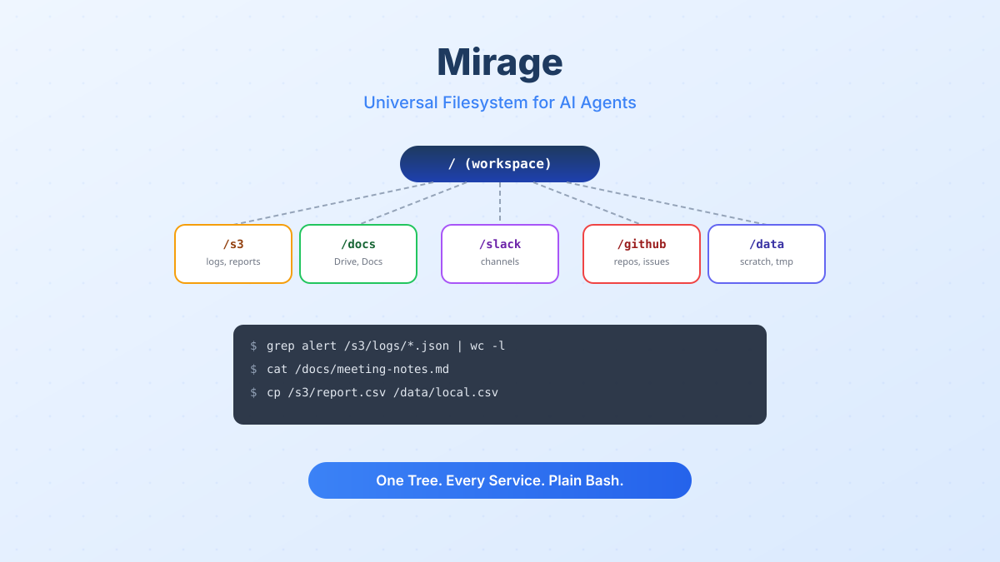
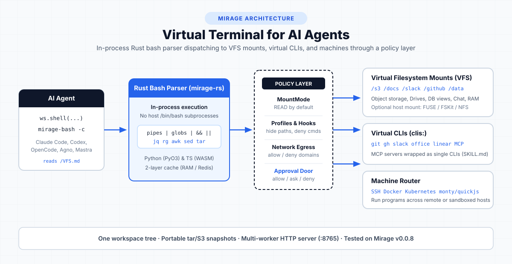
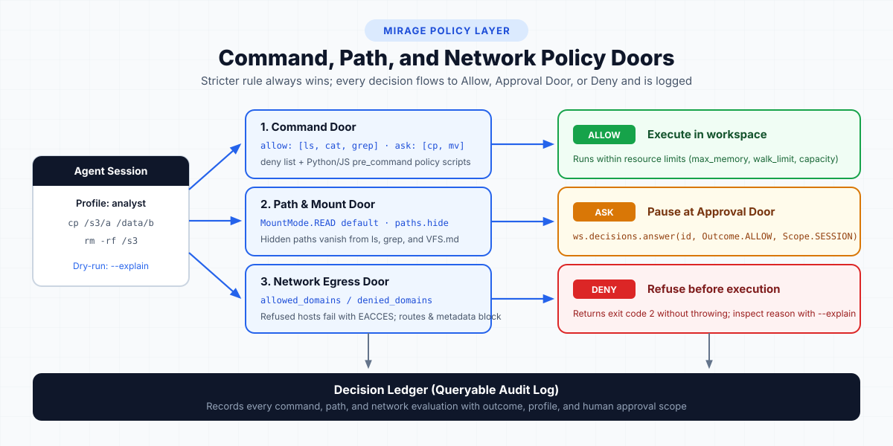

import Button from '@components/widgets/Button.astro';
import Notice from '@components/widgets/Notice.astro';
import Accordion from '@components/widgets/Accordion.astro';
import Tabs from '@components/widgets/Tabs.astro';
import Tab from '@components/widgets/Tab.astro';
import ListCheck from '@components/widgets/ListCheck.astro';

If you've built anything with AI agents that talks to more than one service, you've felt the pain. Your agent needs to read a file from S3, check a Slack thread, pull a Google Doc, and query a GitHub repo. Each one needs its own SDK, its own authentication flow, its own set of method calls. Your prompt engineering turns into a juggling act of API instructions.

[Mirage](https://github.com/strukto-ai/mirage) takes a different approach. It mounts all those services as branches of a single virtual filesystem for AI agents: S3, Google Drive, Slack, GitHub, Redis, Gmail, whatever you need. Your agent navigates them with `ls`, `cat`, `grep`, and pipes.

The reason this works well is simple: LLMs are post-trained in terminal environments, so the Unix filesystem is probably the interface they have the most training data for. Mirage leans on that existing knowledge instead of asking models to learn yet another API surface.

Since this guide first ran, Mirage has grown from a virtual filesystem into a virtual terminal for AI agents: same tree-and-bash core, plus virtual CLIs, virtual machines, and a policy layer. This guide has been updated for v0.0.8.

This walkthrough covers setting up Mirage, mounting your first backends, wiring it into an agent framework, and locking the agent down. You'll have a working setup in about 10 minutes.

<Notice type="warning" title="Tested against Mirage v0.0.8">
Version-tested: v0.0.8 (released 2026-11-03). The project is marked experimental (0.0.x) and has shipped breaking changes in every minor so far. Pin <code>mirage-ai==0.0.8</code> in production and read the release notes before upgrading.
</Notice>



## What Mirage actually does

Mirage gives you a `Workspace` object. You mount services onto paths in that workspace, then run shell commands against the combined tree. If you've used FUSE-based tools like ZeroFS or JuiceFS to [mount an S3 bucket as a filesystem on a VPS](/s3-bucket-filesystem-vps/), the mental model is similar, but Mirage runs the tree in-process for your agent, not as a host mount.

```python
import asyncio
from mirage import MountMode, Workspace
from mirage.vfs.ram import RAMVFS
from mirage.vfs.s3 import S3Config, S3VFS
from mirage.vfs.slack import SlackConfig, SlackVFS

async def main() -> None:
    ws = Workspace(
        {
            "/data":  RAMVFS(),
            "/s3":    S3VFS(S3Config(bucket="my-logs-bucket")),
            "/slack": SlackVFS(SlackConfig(token="xoxb-...")),
        },
        mode=MountMode.WRITE,
    )
    result = await ws.shell("ls /s3/logs/")
    print(await result.stdout_str())
    await ws.close()

asyncio.run(main())
```

The shell isn't a real `/bin/bash`. Mirage runs the workspace in-process with its own bash parser (written in Rust, shared via PyO3 for Python and WebAssembly for TypeScript; tree-sitter was removed in v0.0.8) and a dispatcher that routes commands to per-mount handlers. No subprocesses. Pipes, globs, `&&`, `||`, and GNU-grade bash semantics all work across mounts. The command kernels (`jq`, `awk`, `sed`, `grep`, `rg`, `sort`, `tar`, `patch`, and more) live in a single Rust crate called `mirage-rs`.

Since v0.0.5, Mirage has also virtualized CLIs and machines behind the same shell. You can install `git`, `gh`, `slack`, or `office` (Excel/Word/PowerPoint) as virtual commands, and run programs on remote machines (SSH, Docker, Kubernetes) via a machine router. The filesystem is where most agent workflows start, which is the focus of this guide.

One thing to internalize before you write any code: **mounts are read-only by default**. You opt in to writes with `MountMode.WRITE` (and execution with `MountMode.EXEC`), either globally or per mount. The old article examples silently assumed writable mounts. Don't.



### Supported backends

Mirage covers a wide range of services. The list has expanded a lot since v0.0.1. Here's the current picture:

| Category | Backends | Mode |
|---|---|---|
| **Object storage** | S3, Cloudflare R2, GCS, OCI, MinIO, B2, Spaces, Wasabi, Ceph, SeaweedFS, and more | Read/write |
| **Files / drives** | Google Workspace (Drive, Docs, Sheets, Slides), OneDrive, SharePoint, Dropbox, Box, WebDAV, SSH (SFTP) | Read/write |
| **Databases** | Postgres, MongoDB, Redis, SQL, Airtable | Mostly read-only views |
| **AI / vector / observability** | Chroma, Qdrant, HF Datasets/Models, Weights & Biases, Langfuse, Jaeger | Read-only |
| **Chat / productivity** | Slack, Discord, Email (IMAP), Notion, Trello, Linear, Google Calendar | Mostly read-only |
| **Source control** | GitHub (repo at branch/tag/commit) | Read-only |
| **Scratch** | RAM, Disk | Read/write |

A few things to know about how the mounts behave:

- **Search push-down**: on some backends, `grep` is answered by the service's own search API rather than by downloading every file. Faster, but results can differ from local `grep`.
- **Walk limits**: on S3, `grep -r`, `find`, and `du` stop after 1000 files. A glob matching more than that, or `tar -c` / `cp -r` / `rm -r` past that limit, gets refused. You can tune this with `command_limits` / `walk_limit` in the workspace config.
- **Not everything writes**: GitHub repo views, Slack, Discord, Notion, Postgres views, and several others are read-only. Greps and reads work fine; writes are rejected.

<Notice type="info" title="Not every backend does everything">
Run <code>mirage workspace vfs-md</code> or <code>mirage workspace vfs</code> to see exactly what operations each mount supports. The per-backend setup guides at <a href="https://docs.mirage.strukto.ai/home/setup/s3">docs.mirage.strukto.ai</a> have the details for each VFS.
</Notice>

### Mirage vs per-service MCP servers

<Accordion label="How does this compare to MCP?" group="comparison" expanded="true">

If you're coming from [what MCP (Model Context Protocol) is](/mcp-introduction-beginners/) and wondering whether you need both, here's the breakdown:

| Aspect | Mirage | Per-service MCP servers |
|---|---|---|
| **Setup** | One workspace, mount config per service | One server per service |
| **Agent vocabulary** | Standard bash (`ls`, `cat`, `grep`, pipes) | Custom tool schemas per server |
| **Cross-service pipelines** | Native (pipes across mounts) | Manual orchestration in code |
| **Caching** | Built-in two-layer cache (index + file) | Varies by server |
| **Portability** | Snapshot and clone workspaces | State scattered across servers |
| **Framework support** | OpenAI Agents SDK, Vercel AI SDK, Agno, LangChain, Pydantic AI, Mastra | Depends on MCP client |

MCP servers are still useful for services that need structured tool calls, like "create a calendar event" or "send a Slack message." For a comparison of when to use native tools vs MCP in an agent framework, see [Mastra tools vs MCP](/mastra-tools-vs-mcp/). Mirage works best when the interaction pattern is read/write/search, which covers a large chunk of what agents actually do.

They're also complementary now. Mirage's **"From MCP"** feature (v0.0.8) can install an MCP server's tools as a single CLI inside the Mirage shell, so you can keep an existing MCP server and give the agent one `git`-like binary to talk to it. If you've already invested in MCP connectors (say via the [Composio MCP guide](/composio-mcp-guide/)), you don't have to throw that away. And if you're building Agno agents that use MCP, [Context7 MCP with Agno](/agno-mcp-tools-context7/) covers that angle.

</Accordion>

## Prerequisites

<ListCheck>
<ul>
<li>Python 3.12+ (PyPI requires it) or Node.js 22.20+ (Node 22) / 24.12+ (Node 24) / 25+</li>
<li>macOS or Linux for FUSE-based mounts (Windows wheels exist since v0.0.8 for the library itself, but FUSE mounts are platform-dependent)</li>
<li>Credentials for at least one backend (S3 keys, Slack token, GitHub token, etc.)</li>
<li>Optional: Redis for shared caching in production</li>
<li>Optional: Docker if you plan to run the Mirage production server</li>
</ul>
</ListCheck>

## Step 1: Install Mirage

<Tabs>
<Tab name="Python">

```bash
uv add mirage-ai
```

This installs both the `mirage` library and the `mirage` CLI binary. Framework adapters are extras:

```bash
uv add 'mirage-ai[openai]'           # OpenAI Agents SDK adapter
uv add 'mirage-ai[agno]'             # Agno adapter
uv add 'mirage-ai[claude-agent-sdk]' # Claude Agent SDK adapter
uv add 'mirage-ai[pydantic-ai]'      # Pydantic AI adapter
uv add 'mirage-ai[monty,quickjs]'    # in-process runtimes for machines
```

</Tab>
<Tab name="TypeScript (Node)">

```bash
npm install @struktoai/mirage-node
```

For browser or edge runtimes, use `@struktoai/mirage-browser` instead. Each framework gets its own adapter package since v0.0.8:

```bash
npm install @struktoai/mirage-vercel        # Vercel AI SDK
npm install @struktoai/mirage-mastra        # Mastra
npm install @struktoai/mirage-openai-agents # OpenAI Agents
```

</Tab>
<Tab name="CLI only">

```bash
curl -fsSL https://strukto.ai/mirage/install.sh | sh
```

Or via npm/npx:

```bash
npm install -g @struktoai/mirage-cli
# or
npx @struktoai/mirage-cli
# or
uvx --from mirage-ai mirage
```

</Tab>
</Tabs>

<Notice type="info" title="No FUSE required">
Mirage runs the workspace in-process. You don't need FUSE support unless you want host tools (editors, language servers, <code>rg</code>) to also see the mounted filesystem. Optional host-mount backends: <code>fuse</code>, <code>fskit</code> (macOS 15.4+), and <code>nfs</code>.
</Notice>

**Verify it installed:**

```bash
uv run mirage --version
# or
npx @struktoai/mirage-cli --version
```

Expect `0.0.8`. If you see a different version, check your lockfile or global install.

## Step 2: Create a workspace and mount services

The workspace is the central object. You define it with a dictionary mapping mount paths to VFS instances. Mounts are **read-only by default**: you must opt in to writes.

<Tabs>
<Tab name="Python">

```python
import asyncio
from mirage import MountMode, Workspace
from mirage.vfs.ram import RAMVFS
from mirage.vfs.s3 import S3Config, S3VFS
from mirage.vfs.slack import SlackConfig, SlackVFS

async def main() -> None:
    ws = Workspace(
        {
            "/data":  RAMVFS(),
            "/s3":    S3VFS(S3Config(bucket="my-logs-bucket")),
            "/slack": SlackVFS(SlackConfig(token="xoxb-...")),
        },
        mode=MountMode.WRITE,  # global default
    )
    # Per-mount override: make /slack read-only even though global mode is WRITE
    # ws = Workspace({
    #     "/data":  (RAMVFS(), MountMode.WRITE),
    #     "/s3":    (S3VFS(S3Config(bucket="my-logs-bucket")), MountMode.WRITE),
    #     "/slack": (SlackVFS(SlackConfig(token="xoxb-...")), MountMode.READ),
    # })
    await ws.close()

asyncio.run(main())
```

</Tab>
<Tab name="TypeScript">

```ts
import { MountMode, S3VFS, Workspace } from '@struktoai/mirage-node'

const ws = new Workspace(
  {
    '/s3': new S3VFS({
      bucket: 'my-logs-bucket',
      region: 'us-east-1',
      accessKeyId: process.env.AWS_ACCESS_KEY_ID,
      secretAccessKey: process.env.AWS_SECRET_ACCESS_KEY,
    }),
  },
  { mode: MountMode.READ },
)
await ws.close()
```

</Tab>
<Tab name="CLI (workspace.yaml)">

For CLI-driven setups, define the workspace in YAML. `${VAR}` references resolve from environment variables at load time. A config never holds a secret, only a pointer to one.

```yaml
# workspace.yaml
mode: read
mounts:
  /data:
    vfs: s3
    config:
      bucket: my-bucket
      region: us-east-1
      aws_access_key_id: ${AWS_ACCESS_KEY_ID}
      aws_secret_access_key: ${AWS_SECRET_ACCESS_KEY}
  /repo:
    vfs: github
    config:
      owner: my-org
      repo: my-app
      token: ${GITHUB_TOKEN}
  /scratch:
    vfs: ram
    mode: write
command_limits:
  "@all": { walk_limit: 2000 }
```

Load it:

```bash
mirage workspace create workspace.yaml --id my-agent
```

</Tab>
</Tabs>

<Notice type="warning" title="Read-only by default">
Mounts reject writes unless you set <code>MountMode.WRITE</code>. This is a least-privilege control: only the mounts you explicitly mark writable accept writes. Start read-only and widen deliberately.
</Notice>

Each VFS reads its credentials from environment variables or explicit config objects. Mirage supports env vars, dotenv files, 1Password service accounts, and AWS Secrets Manager for credential resolution. Check the [S3 setup guide](https://docs.mirage.strukto.ai/home/setup/s3) and the [workspace configuration docs](https://docs.mirage.strukto.ai/home/configuration/workspace) for per-backend details.

Note that `/` is now a real virtual root (the old `/_default` path was removed in v0.0.3). You can mount over it or leave it as the default scratch space.

## Step 3: Run commands against the combined tree

Once the workspace is set up, every command goes through `ws.shell()`:

```python
# List files in S3
result = await ws.shell("ls /s3/logs/2026/05/")
print(await result.stdout_str())

# Search across Slack messages (read-only mount, grep works fine)
result = await ws.shell("grep 'incident' /slack/incidents/*.json")
print(await result.stdout_str())

# Pipe data between backends
result = await ws.shell("cat /s3/report.csv | head -20 > /data/preview.txt")

# Check for failures: ws.shell does NOT raise on error
print(result.exit_code)  # 0 = ok, non-zero = failure
if result.exit_code != 0:
    print(await result.stderr_str())
```

The agent uses the same commands it would use on a local filesystem. No new vocabulary to learn, no SDK method calls to memorize.

<Notice type="warning" title="ws.shell() does not throw">
<code>ws.shell</code> returns a result object even when a command fails. Always check <code>result.exit_code</code> and read the error with <code>await result.stderr_str()</code>. Exit codes: 0 = ok, 1 = tool/VFS/server failure, 2 = usage or policy refusal, 130 = Ctrl-C, 141 = broken pipe.
</Notice>

### Verify it works

Right after setup, run these through the CLI or Python to confirm the workspace is healthy:

```bash
# CLI: write and read back through the RAM scratch mount
mirage shell -w demo -c 'echo ok > /data/x && cat /data/x'

# Scriptable check with JSON output
mirage shell -w demo -c 'ls /s3' --json | jq .stdout
```

In Python, the equivalent check is:

```python
result = await ws.shell("echo ok > /data/x && cat /data/x")
assert result.exit_code == 0
assert "ok" in await result.stdout_str()
```

If the first command returns empty output but exit code 0, the mount exists but credentials may be wrong (see Troubleshooting). If exit code is 2, a policy rule blocked the command.

### Virtual CLIs

The old `ws.command()` custom-command API is gone. Since v0.0.5, custom behavior lives in **virtual CLIs**: real command-line programs installed into the Mirage shell via `clis:` config:

```yaml
clis:
  git: {}
  gh: {}
  slack: {}
  office: {}       # Excel/Word/PowerPoint, credential-free
  pdftotext: {}
  my-script:
    script: scripts/summarize.py
```

Agents discover these via `man` and `which` like any other program. SKILL.md documents them alongside VFS.md. Available CLIs include `git`, `gh`, `slack`, `discord`, `himalaya` (email), `linear`, `ntn` (Notion), `gws` (Google Workspace), `hf` (Hugging Face), `office`, `pdftotext`, `ast-grep`, and more. Custom CLIs can be written as Python or JavaScript scripts.

This extends the "no per-service SDKs" thesis from files to full command-line tools. Instead of teaching the agent a Slack SDK, you install `slack` as a CLI and the agent runs `slack search "incident"` like it would on any Unix box. See the [CLI setup docs](https://docs.mirage.strukto.ai/home/setup/clis) for the full list.

## Step 4: Wire into your agent framework

Mirage ships adapters for the major agent frameworks. The pattern is the same everywhere: pass the workspace, get tools back. Here's what's available:

| Framework | Install | Hand it | Agent gets |
|---|---|---|---|
| Agno | `mirage-ai[agno]` | `MirageToolkit(ws)` | Seven session tools |
| OpenAI Agents | `mirage-ai[openai]` | `MirageShellExecutor(ws)`, `MirageEditor(ws)`, `MirageSandboxClient(ws)` | Shell/patch/sandbox tools |
| Claude Agent SDK | `mirage-ai[claude-agent-sdk]` | `MirageServer(ws)` | Seven session tools |
| Pydantic AI | `mirage-ai[pydantic-ai]` | `MirageWorkspace(ws)` | File + shell tools |
| LangChain Deep Agents | `mirage-ai[deepagents]` | `LangchainWorkspace(ws)` | File + shell tools |
| Vercel AI SDK | `@struktoai/mirage-vercel` | per-package | Tools for `generateText` |
| Mastra | `@struktoai/mirage-mastra` | per-package | Mastra tools |

"Seven session tools" = `shell`, `read`, `write`, `edit`, `ls`, `grep`, `glob` (profile-gated: an agent is never offered a tool whose every call would be refused).

<Notice type="info" title="VFS.md replaces file_prompt">
The old <code>ws.file_prompt</code> property is gone. Generate a filesystem map with <code>vfs_md = await ws.vfs_md(session_id="agent")</code>. The agent reads it by running <code>cat /VFS.md</code>. The format follows the <a href="https://agentvfs.org/vfs">AgentVFS spec</a>. Denied commands and hidden paths are never mentioned in VFS.md. Virtual CLIs are documented separately in SKILL.md.
</Notice>

<Tabs>
<Tab name="Agno">

If you're [getting started with Agno agents](/agno-get-start/), the Mirage toolkit slots right in:

```python
from agno.agent import Agent
from mirage.agents.agno import MirageToolkit  # verify exact import path

toolkit = MirageToolkit(ws)
agent = Agent(
    name="Log Analyst",
    model="claude-sonnet-4-5",
    tools=[toolkit],
    instructions="You have access to a virtual filesystem. Read /VFS.md first.",
)
```

The agent receives the seven session tools and can immediately run `ls`, `grep`, `cat`, and pipes across all mounts.

</Tab>
<Tab name="OpenAI Agents">

```python
from mirage.agents.openai_agents import (
    MirageShellExecutor,
    MirageEditor,
    MirageSandboxClient,
)

# The newer primary surface is MirageShellExecutor + MirageEditor.
# MirageSandboxClient is still available for sandbox-style runs.
shell_executor = MirageShellExecutor(ws)
editor = MirageEditor(ws)
# sandbox_client = MirageSandboxClient(ws)
```

Pass these to your agent's tool list or run config. The exact wiring depends on which `openai-agents` SDK version you're on. Check the [Mirage Python agents docs](https://docs.mirage.strukto.ai/python/agents/index) for current examples.

</Tab>
<Tab name="Vercel AI SDK (TS)">

```bash
npm install @struktoai/mirage-vercel
```

```ts
import { generateText } from 'ai'
import { openai } from '@ai-sdk/openai'
// Import tools from the per-framework package
import { /* tool exports */ } from '@struktoai/mirage-vercel'
```

Each framework now gets its own npm package (`@struktoai/mirage-vercel`, `-mastra`, `-openai-agents`, `-langchain`, `-pi`, `-opencode`, `-claude-agent-sdk`). Check the package README for the exact export names, which may shift between 0.0.x releases.

</Tab>
</Tabs>

If you're building a [Mastra AI agent tutorial](/build-ai-agent-mastra/) project, use `@struktoai/mirage-mastra` for the adapter.

### CLI with Claude Code, Codex & coding agents

The Mirage CLI plugs directly into shell-based coding agents. The big addition in v0.0.8 is **`mirage-bash`**, a drop-in replacement for Claude Code's Bash tool. The agent runs `mirage-bash -c "grep alert /s3/logs/*.json"` and gets routed through the Mirage workspace instead of the host shell.

The current integration picture:

| Agent | Connects through |
|---|---|
| **Claude Code** | `mirage-bash` as its shell tool, MCP, or a FUSE folder |
| **Codex** | SSH, MCP, FUSE folder, or exec-server forward |
| **Grok Build** | MCP or FUSE folder |
| **OpenCode** | Native plugin with stale-write protection |
| **Pi** | Native UI integration with stale-write protection |

<Notice type="info" title="Affiliate Disclosure">
This section contains affiliate links; we may earn a commission at no extra cost to you.
</Notice>

This works with [Hermes Agent](/hermes-agent-setup-guide/), [OpenCode](https://go.bitdoze.com/opencode-go), [Pi Agent](/pi-coding-agent-setup-guide/), and any tool that exposes a shell interface. For terminal tooling built around this exact use case, see the [cmux terminal for AI coding agents](/cmux-terminal/). If you're comparing agent options generally, [best AI coding tools and agents](/ai-coding-tools/) compares the main options.

CLI basics:

```bash
# Create a workspace from YAML
mirage workspace create workspace.yaml --id my-agent

# Run a command (replaces the old mirage execute --workspace_id)
mirage shell -w my-agent -c "grep alert /s3/logs/*.json"

# JSON output for scripting
mirage shell -w my-agent -c 'ls /s3' --json | jq .stdout

# Dry-run through policy (nothing executes)
mirage shell -w my-agent -c 'rm -rf /s3' --explain

# Snapshot for reuse
mirage workspace snapshot my-agent my-agent.tar
```

CLI exit codes: 0 = ok, 1 = tool/VFS/server failure, 2 = usage or policy refusal, 130 = Ctrl-C, 141 = broken pipe. Use `--json` in scripts and `--explain` when debugging refusals.

## Step 5: Configure caching

Every workspace ships with a two-layer cache so repeated reads don't hit the network:

- **Index cache** caches directory listings and metadata. First `ls` hits the API; subsequent ones serve from cache until TTL expires.
- **File cache** stores object bytes. First `cat` streams from origin; later reads come from cache.

The defaults changed in recent releases. The RAM file cache is now **32 MB** (with a `max_drain_bytes` of 8 MiB). For production setups with multiple workers or processes, switch to Redis:

```python
from mirage import Workspace
from mirage.cache.file.config import CacheConfig, RedisCacheConfig

# RAM cache (default: 32 MB)
ws = Workspace(mounts, cache=CacheConfig(limit="2GB"))

# Redis cache for multi-process / multi-worker setups
ws = Workspace(
    mounts,
    workspace_id="agent",
    cache=RedisCacheConfig(url="redis://localhost:6379/0"),
)
```

YAML equivalent:

```yaml
cache:
  type: redis
  url: redis://localhost:6379/0
index:
  type: redis
  url: redis://localhost:6379/0
```

Sessions and jobs can share state via `RedisWorkspaceStateStore` from `mirage.workspace.store.redis`.

<Notice type="warning" title="Redis limit does not evict">
On Redis, the <code>limit</code> setting does <strong>not</strong> evict old entries. Cap the Redis server's memory with <code>maxmemory</code> in your Redis config instead. The default Redis cache limit is 512 MB.
</Notice>

If you're running Mirage inside a container, pair it with a [Redis Docker setup](/multiple-postgres-databases-docker/) for a self-contained stack.

## Locking the agent down

Mirage has a real security layer: profiles, path hiding, command policies, network egress rules, and an approval door. If you're running agents against production data, use it.



### MountMode: least privilege per mount

Recap from Step 2: mounts are read-only unless you say otherwise. Set `MountMode.READ`, `WRITE`, or `EXEC` globally or per mount. The stricter setting always wins.

### Profiles: hide paths, deny commands

Profiles define what an agent role can see and do. A hidden file is not merely unreadable; it is absent from the filesystem the agent sees:

```yaml
profiles:
  analyst:
    paths:
      hide: ["/s3/secrets", "/data/credentials"]
    commands:
      deny: ["slack send-message", "curl", "rm -rf"]
      allow: ["ls", "cat", "grep", "sort", "wc", "head", "tail"]
      ask: ["cp", "mv"]
network:
  allowed_domains: ["api.github.com:443", "*.slack.com"]
  denied_domains: ["*:22"]
```

One role per session. Per-session permissions can narrow a profile further ("the stricter of the two wins").

### Network policy

Control egress at the workspace level. Refused connections fail with `EACCES` (a `curl` call exits 7). You can also map `host:port` to another destination with `network.routes` and refuse cloud metadata addresses at the server level.

### Approval door and decision ledger

Commands marked `ask` in a profile pause and wait for a human decision:

```python
from mirage import Outcome, Scope

pending = await ws.decisions.pending()
for d in pending:
    await ws.decisions.answer(d.id, Outcome.ALLOW, scope=Scope.SESSION)
```

Every decision is logged in a queryable ledger. Use `--explain` on the CLI to dry-run any line through the policy layer. It says what the line would do and runs nothing:

```bash
mirage shell -w my-agent -c 'rm -rf /s3' --explain
```

Expect a refusal or dry-run output. This is your "why was this blocked?" debugging tool.

### Policy scripts

For logic that YAML rules can't express, write policy scripts in Python or JavaScript. They run at command, operation, and session doors, and can only restrict, never grant:

```python
# pre_command hook: deny rm and any python that deletes files
def pre_command(ctx):
    if ctx.line.startswith("rm "):
        return Outcome.DENY
    return Outcome.ALLOW
```

See the [policy documentation](https://docs.mirage.strukto.ai/home/policy/overview) for the full hook reference.

<Notice type="warning" title="Denied paths are invisible, not just blocked">
A hidden path never appears in VFS.md, in <code>ls</code> output, or in grep results. The agent doesn't know it exists. This is stronger than permission-denied errors, which leak the existence of a path.
</Notice>

### Resource limits

Know your defaults before an agent surprises you:

| Limit | Default | What happens past it |
|---|---|---|
| `max_memory` | Tens of MB (configurable) | `EDQUOT` (RAM files and command memory bounded) |
| Mount `capacity` | Unset | Caps bytes a mount stores |
| `walk_limit` | 1000 files (S3) | `grep -r`/`find`/`du` stop; `tar -c`/`cp -r`/`rm -r` refused |
| File cache (RAM) | 32 MB | Bounded by `max_drain_bytes` |
| File cache (Redis) | 512 MB | No eviction; use Redis `maxmemory` |
| `max_env` | 2 MB | Per-session variables/functions/aliases |
| `max_body_bytes` | 64 MB | Largest API reply read whole |
| `processes` | 128 per workspace | Hard cap on concurrent processes |

## Run Mirage on a VPS (production)

v0.0.8 is a hosting release. Mirage ships a multi-worker HTTP server (default `http://127.0.0.1:8765`, authenticated via `MIRAGE_TOKEN`) with rate limits, trusted proxies, session caps, graceful drain, readiness endpoints, and OpenTelemetry. One process serves many agents; each workspace takes only KBs of memory, bounded by `max_memory`.

Deployment options: systemd unit or Docker. The sandbox image is `ghcr.io/strukto-ai/mirage-sandbox:0.0.8` (amd64 + arm64). For state, use Redis or S3 stores (not RAM) in multi-worker setups. If you want a container-based deployment, [deploy a Docker Compose app with Dokploy](/dokploy-docker-compose-app/) to keep the ops overhead low. For server prep, the [VPS setup for AI coding agents](/vps-ai-coding-setup/) covers the base.

Cost order of magnitude: a [Hetzner Cloud](https://go.bitdoze.com/hetzner) CX22 or CX32 is enough for the Mirage server plus Redis, or a budget [Hostinger VPS](https://go.bitdoze.com/hostinger-vps) with NVMe storage. The library itself is free (Apache-2.0, no per-seat pricing). Your costs are infrastructure plus backend API quotas.

<ListCheck>
<ul>
<li>Pin the version: <code>mirage-ai==0.0.8</code> (or the npm equivalent)</li>
<li>Set <code>MIRAGE_TOKEN</code> and don't expose <code>:8765</code> to the internet</li>
<li>Set Redis <code>maxmemory</code> before running out of RAM</li>
<li>Firewall <code>:8765</code> to trusted IPs only</li>
<li>Back up your workspace YAML and state store</li>
<li>Use Redis or S3 state stores for multi-worker, not RAM</li>
</ul>
</ListCheck>

Verify the server is up:

```bash
curl -s http://127.0.0.1:8765/healthz   # readiness endpoint
systemctl status mirage                  # if running under systemd
docker ps | grep mirage                  # if running in Docker
```

## Portable workspaces

Workspaces are portable. You can snapshot, clone, and version them. The API is now async and supports S3 targets:

```python
# Save workspace state (returns tar size in bytes)
size = await ws.snapshot("run.tar")

# Snapshot directly to S3
await ws.snapshot("snapshots/run.tar", s3={"bucket": "my-backups"})

# Load it elsewhere (no id= parameter in current signatures)
restored = await Workspace.load("run.tar")

# Deep copy without writing a tar
clone = await ws.copy()
```

CLI equivalent:

```bash
mirage workspace snapshot my-agent my-agent.tar
mirage workspace load my-agent.tar
```

During snapshot capture, new writes wait and running lines get 30 seconds before an `OSError(EBUSY)`. Plan accordingly.

You can save an agent's working environment and restore it on another machine, version workspace configs alongside your code, or reproduce agent runs by restoring the exact same filesystem state.

## Real-world example: multi-service log analysis

Here's a concrete workflow that pulls data from three services to produce a report. Note that the Slack and GitHub mounts are read-only; this example only greps them, which is correct:

```python
from mirage import MountMode, Workspace
from mirage.vfs.ram import RAMVFS
from mirage.vfs.s3 import S3Config, S3VFS
from mirage.vfs.slack import SlackConfig, SlackVFS
from mirage.vfs.github import GitHubConfig, GitHubVFS

ws = Workspace(
    {
        "/data":   RAMVFS(),
        "/s3":     S3VFS(S3Config(bucket="app-logs")),
        "/slack":  SlackVFS(SlackConfig(token="xoxb-...")),   # read-only
        "/github": GitHubVFS(GitHubConfig(owner="my-org", repo="my-app", token="ghp-...")),  # read-only
    },
    mode=MountMode.WRITE,
)

# Find errors in S3 logs
r = await ws.shell("grep -i 'error' /s3/production/2026-05-*.log > /data/errors.txt")
assert r.exit_code == 0, await r.stderr_str()

# Count by frequency
await ws.shell("sort /data/errors.txt | uniq -c | sort -rn > /data/top-errors.txt")

# Check if these were reported in Slack (grep against read-only mount)
await ws.shell("grep -i 'error' /slack/incidents/*.json > /data/slack-matches.txt")

# Cross-reference with GitHub issues
await ws.shell("grep -i 'error' /github/issues/ > /data/github-issues.txt")

# Combine into a report
await ws.shell("cat /data/top-errors.txt /data/slack-matches.txt /data/github-issues.txt > /data/report.txt")

# Verify the output exists
r = await ws.shell("wc -l /data/report.txt")
print(await r.stdout_str())
print("exit:", r.exit_code)
```

CLI verification of the same:

```bash
mirage shell -w my-agent -c 'wc -l /data/report.txt' --json | jq .stdout
```

The agent handles this the same way a developer would on a local machine: `grep`, `sort`, `uniq`, pipes. The data lives across S3, Slack, and GitHub, and the agent doesn't need to know that.

## Tips for working with Mirage

<ListCheck>
<ul>
<li>Use <code>RAMVFS</code> as a scratch pad (mount it at <code>/data</code> or similar), like <code>/tmp</code> for intermediate results</li>
<li>Name mount paths clearly: <code>/s3</code>, <code>/slack</code>, <code>/github</code> are easier for agents to reason about than <code>/m1</code>, <code>/m2</code></li>
<li>Start mounts read-only and widen to <code>WRITE</code> deliberately. Don't give write access you don't need</li>
<li>Switch to Redis cache for production; the default 32 MB RAM cache doesn't survive restarts or share across processes</li>
<li>Snapshot workspace state before long-running agent tasks so you can restore if something goes sideways</li>
<li>Use <code>--explain</code> whenever a command is unexpectedly refused: it tells you which policy rule blocked it</li>
<li>Check per-VFS setup guides before building. Not every backend supports every operation (run <code>mirage workspace vfs-md</code> for a quick summary)</li>
<li>Keep walk limits in mind on big S3 trees: <code>grep -r</code> stops at 1000 files by default</li>
<li>Pin <code>mirage-ai==0.0.8</code> in production. The project is experimental and ships breaking changes</li>
<li>Combine Mirage with shell-native coding agents like <a href="/opencode-setup-guide/">OpenCode</a> or <a href="/hermes-agent-setup-guide/">Hermes Agent</a></li>
</ul>
</ListCheck>

## Troubleshooting

<Accordion label="Commands return empty results" group="faq">
Check that your credentials are set correctly. Mirage reads service credentials from environment variables by default. Verify with:

```python
# Check what's mounted
r = await ws.shell("ls /")
print(await r.stdout_str())

# Check a specific mount
r = await ws.shell("ls /s3/")
print(await r.stdout_str())
```

If the mount is empty but shouldn't be, verify the bucket/token/credential configuration for that specific VFS. Check the per-backend setup guide at [docs.mirage.strukto.ai](https://docs.mirage.strukto.ai/home/setup/s3) for the exact environment variable names.
</Accordion>

<Accordion label="Pipe commands fail or big-tree commands are refused" group="faq">
Most pipes work across mounts. Two common failure modes:

1. **Walk limits**: on S3, `grep -r`, `find`, and `du` stop after 1000 files. `tar -c`, `cp -r`, and `rm -r` are refused past that limit. Fix: raise `command_limits` / `walk_limit` in your workspace config, or split the work.

2. **Resource-specific behavior**: if a pipe fails, split it into separate steps using a RAM mount as intermediate storage:

```python
await ws.shell("cat /s3/data.json > /data/temp.json")
r = await ws.shell("jq '.items[]' /data/temp.json > /data/filtered.json")
print("exit:", r.exit_code)
```
</Accordion>

<Accordion label="Command was refused (exit code 2) or nothing happened" group="faq">
<code>ws.shell</code> does not raise when a command fails. Symptoms of a silent failure: empty output, unexpected exit code, or no visible effect.

1. Check <code>result.exit_code</code> and <code>await result.stderr_str()</code>
2. Run the same command through the CLI with <code>--explain</code> to see which policy rule refused it:
   ```bash
   mirage shell -w my-agent -c 'rm -rf /s3' --explain
   ```
3. Exit codes: 0 = ok, 1 = tool/VFS/server failure, 2 = usage or policy refusal, 130 = Ctrl-C, 141 = broken pipe
</Accordion>

<Accordion label="Performance feels slow" group="faq">
First reads always hit the network. Subsequent reads use the cache. If you're doing heavy I/O:

1. Switch to Redis cache for shared caching across processes (the default is 32 MB RAM, which is small)
2. Use `mirage provision` (CLI) to pre-warm the cache before agent runs
3. Check if your backend has rate limits (especially Slack and Google APIs)
4. On Redis, set `maxmemory` on the server. The Mirage `limit` setting doesn't evict
</Accordion>

<Accordion label="Big tree commands hit EDQUOT or capacity errors" group="faq">
If writes start failing with <code>EDQUOT</code>, you've hit <code>max_memory</code> (bounds RAM files + command memory) or a mount's <code>capacity</code> limit. Fixes:

- Clean up the RAM scratch mount (<code>rm /data/*</code>)
- Raise <code>max_memory</code> in the workspace config
- Set <code>capacity</code> on specific mounts to bound them individually
- Check the file cache limit (32 MB RAM / 512 MB Redis by default)
</Accordion>

<Accordion label="Which model works best with Mirage?" group="faq">
Any model that handles bash well works. Models trained heavily on code and shell commands tend to perform best. If you're looking for affordable options, check [best open source LLMs for coding](/best-open-source-llms-claude-alternative/) or [cheapest AI models for Hermes Agent](/best-cheap-models-hermes-agent/). You can run Mirage with free models through [Hermes Agent with free models on the Nous Portal](/hermes-agent-mimo-v2-pro/) or a [LiteLLM Docker Compose install](/litellm-docker-install/) as well.
</Accordion>

## What's next

Mirage solves a real problem in agent development: connecting agents to multiple services without drowning in SDK boilerplate. The filesystem abstraction is familiar to both developers and LLMs, which makes it a practical foundation for multi-service agent workflows. The addition of virtual CLIs, machines, and a policy layer turns it from a clever trick into something you can run against real data.

Set expectations before you commit: Mirage is at 0.0.x, carries an "experimental" badge, and has shipped seven releases in six months, each with breaking changes. Pin your version and read the release notes before upgrading. That said, the core idea (one tree, bash commands, no per-service SDKs) has been stable across every release.

- [Mirage GitHub Repository](https://github.com/strukto-ai/mirage) (3,800 stars, Apache-2.0) for source code and issues
- [Mirage Documentation](https://docs.mirage.strukto.ai) for the full API reference, per-VFS setup guides, and the policy layer
- [AgentVFS spec](https://agentvfs.org): the vendor-neutral virtual filesystem interface Mirage's VFS.md format follows
- [Mirage Discord](https://discord.gg/u8BPQ65KsS) for community support
- [Hermes Agent Setup Guide](/hermes-agent-setup-guide/) to pair Mirage with a self-hosted AI agent
- [VPS Setup for AI Coding Agents](/vps-ai-coding-setup/) to get a server ready for agent workloads
- [Best Open Source LLMs for Coding](/best-open-source-llms-claude-alternative/) for affordable models that handle bash well

If your agent also needs the live web (search, fetch, browser), [TinyFish](https://go.bitdoze.com/tinyfish) exposes those as APIs with one key, complementing Mirage's filesystem layer.

If your agents touch more than one service, try Mirage on a scratch project first. Mount one backend you already have credentials for and run a few commands. The 10-minute setup claim holds up: once credentials exist, mounting is a single line of config. The library is free (Apache-2.0); your costs are infrastructure (a small VPS plus Redis) and backend API quotas.

<Button text="More AI tool guides" link="/categories/ai/" variant="solid" color="blue" size="md" icon="arrow-right" iconPosition="right" />
