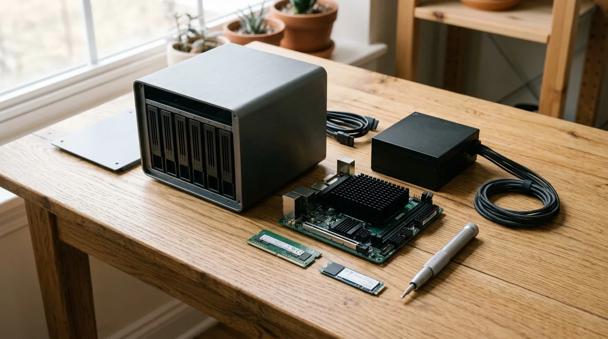

import Notice from "@components/widgets/Notice.astro";
import Accordion from "@components/widgets/Accordion.astro";
import Button from "@components/widgets/Button.astro";
import AmazonProduct from "@components/widgets/AmazonProduct.astro";

Most "NAS build under $500" guides still floating around search results are 2023 parts lists that haven't looked at current storage prices. Over the last 18 months, median NAS hard drive pricing jumped from roughly $21/TB to nearly $50/TB as datacenter orders soaked up 3.5-inch platter production. Anyone promising you a complete $500 NAS with 16TB of fresh drives in late 2026 is either quoting dead listings or stuffing used desktop SMR disks into a cardboard box.

<Notice type="warning" title="Affiliate disclosure">
Some links below use `/go/` affiliate redirects to Amazon. Buying through them earns a small commission at no extra cost to you and helps pay for the test hardware.
</Notice>

So let's set the ground rules honestly. **This build costs ~$478 diskless**, chassis, hot-swap backplane, 6-SATA Intel N100 motherboard, DDR5 memory, SFX power supply, and NVMe boot drive. That puts it head-to-head against commercial diskless NAS enclosures (which also ship without drives), except you walk away with **eight hot-swap 3.5-inch bays**, standard mini-ITX parts you can upgrade individually, and unrestricted TrueNAS SCALE or Unraid support.

At the end of the guide, I also compare this build directly against buying a 2-bay [UGREEN DXP2800](/go/ugreen-dxp2800/) for $379.98, because if you never plan to grow past two drives, the prebuilt box genuinely makes more sense.

## The ~$478 diskless parts list (checked Nov 18, 2026)

| Component | Recommended Pick | Price (Nov 18) | Why this specific part |
| --- | --- | --- | --- |
| **Chassis** | [JONSBO N3 (8-Bay Mini-ITX)](/go/jonsbo-n3/) | $142.49 | Split-chamber aluminum cube with 8×3.5" hot-swap bays + 1×2.5" mount |
| **Motherboard + CPU** | Intel N100 6-SATA NAS Mini-ITX (ASM1166) | ~$185.00 | Passive N100 (6W TDP), 6×SATA 6Gb/s, dual 2.5GbE (i226-V), 2×M.2 NVMe |
| **Memory** | 16GB DDR5-4800 SODIMM (single stick) | ~$48.00 | N100 is single-channel (1 SODIMM slot); 16GB is the sweet spot for ZFS ARC |
| **Power Supply** | 300W-450W SFX 80+ Bronze/Gold PSU | ~$75.00 | Jonsbo N3 takes standard SFX (≤105mm length); handles 8-drive spin-up surge |
| **Boot / App SSD** | 256GB M.2 PCIe 3.0 NVMe SSD (choices in the [best SSD for NAS guide](/best-ssd-for-nas/)) | ~$28.00 | TrueNAS/Unraid boot + Docker appdata volume so spinning disks can sleep |
| **Total (diskless)** | | **~$478.49** | Complete 8-bay x86 system before hard drives |

### Two buyer warnings on the N100 NAS motherboard

If you shop for the popular Chinese N100 six-SATA mini-ITX boards (sold under CWWK, Topton, KingNovy, and Maxsun storefronts on Amazon and AliExpress), keep two hardware details in mind:

1. **Stock rotates weekly across seller listings.** The exact Amazon listing I bookmarked the week before writing this went out of stock by November 18, while two identical CWWK-manufactured boards popped up under different seller names in the $175-199 bracket. Don't fixate on the badge silkscreened onto the box; check the PCB layout and port cluster instead.
2. **Pick an ASM1166 SATA controller over JMB585, and remember N100 is single-channel RAM.** Almost all of these boards break out six SATA ports using an onboard PCIe-to-SATA bridge chip. Boards built around the **ASMedia ASM1166** controller support PCIe ASPM properly, letting the CPU drop into deep package C-states (C6/C8) and saving 6-8W at idle. Boards with the older **JMicron JMB585** block deep C-states unless you flash custom controller firmware. Also remember Intel's Alder Lake-N architecture only supports **one memory channel**, so these boards have **a single DDR5 SODIMM slot**. Buy one 16GB (or 32GB Crucial 4800MHz) stick, not a 2×8GB kit.

<AmazonProduct
  productName="JONSBO N3 Mini-ITX 8-Bay NAS Case"
  productDescription="Dual-chamber brushed aluminum mini-ITX NAS enclosure with an 8-bay 3.5-inch hot-swap SATA backplane, SFX power supply mount, and two pre-installed 100mm cooling fans in the lower drive cage."
  productFeatures={[
    "8× 3.5-inch hot-swap SATA bays + 1× internal 2.5-inch mount",
    "Split thermal chambers: motherboard on top, drives + dual 100mm fans below",
    "Fits standard Mini-ITX motherboards (170×170mm) and SFX PSUs (≤105mm)",
    "2.0mm anodized aluminum exterior shell (~233 × 262 × 298mm)"
  ]}
  productLink="/go/jonsbo-n3/"
  productImage="https://m.media-amazon.com/images/I/71DDZmACXSL._AC_SL1500_.jpg"
  productRating={4.5}
  recommendedBadge="Best Budget 8-Bay Chassis"
  importantConsiderations={[
    "The 8-bay backplane requires TWO 4-pin Molex power connectors plus one SATA power plug, confirm your SFX PSU includes a Molex cable",
    "Uses tool-less rubber pull-straps instead of bulky server caddies; pull evenly when removing drives",
    "6-SATA N100 boards wire up 6 bays directly; add a $20 M.2-to-SATA ASM1166 card later when you fill bays 7 and 8"
  ]}
  pros={[
    "Eight hot-swap 3.5-inch bays for $142.49 is unbeatable in the mini-ITX form factor",
    "Fixed many of the thermal complaints from the older 5-bay Jonsbo N2",
    "Looks like a clean living-room appliance rather than a beige desktop tower"
  ]}
  cons={[
    "Working around the 8 SATA data cables in the lower chamber takes patience",
    "Stock 100mm rear fans are audible at 12V; a PWM curve or fan swap helps"
  ]}
/>

## Assembly tips that save an hour of knuckle-scraping

I've built in enough compact NAS cubes to know where the headaches hide. Follow this assembly order on the Jonsbo N3:

- **Wire all six (or eight) right-angle SATA data cables to the backplane *before* sliding the SFX power supply into place.** Once the SFX PSU sits in the top corner, reaching the top row of SATA ports on the backplane requires tweezers and a flashlight.
- **Check your Molex leads.** The N3 backplane takes **two 4-pin Molex plugs** for 12V/5V drive motor power and **one SATA power plug** for status LEDs and 3.3V rails. Connect both Molex plugs so spinning up six 7200RPM drives at boot doesn't overload a single connector.
- **Put the OS and Docker containers on NVMe.** Most N100 NAS ITX boards carry two M.2 slots (usually PCIe 3.0 x1 or x2). At ~800-1,600MB/s, even a single-lane PCIe 3.0 slot is five times faster than a hard drive pool and keeps container SQLite databases off your spinning disks.

## Picking the OS: TrueNAS SCALE vs Unraid vs OpenMediaVault

- **TrueNAS SCALE (Free):** My default choice for this hardware. ZFS gives you bit-rot protection, instant snapshots, and clean pool portability if you ever move the disks into a rackmount chassis later. TrueNAS SCALE's current Electric Eel release switched its app backend from Kubernetes to native Docker Compose, which slashes idle CPU and RAM usage on a 4-core N100.
- **Unraid (Paid, starts at $49 for 6 attached devices):** The best option if you want to mix random drive sizes (say, two 12TB disks you bought this month plus an old 8TB and 4TB disk sitting in a drawer) and expand one disk at a time without rebuilding a vdev.
- **OpenMediaVault 7 (Free):** Lightweight Debian + mdadm/MergerFS/SnapRAID. Great if you want minimal RAM overhead and manage all your containers through a single Portainer or Dockge stack.

## Real-world power draw, noise, and throughput

- **Idle and load power draw:** With an ASM1166-based N100 board, one 16GB DDR5 stick, one NVMe SSD, and `powertop --auto-tune` enabled, the base system idles at **12-15W** when the hard drives spin down. With four 7200RPM NAS drives spinning idle, expect **32-36W**, peaking around **50-55W** during heavy parity scrubs. At the US average of $0.17/kWh, a 34W continuous draw costs about **$50/year** ($4.15/month) on your electric bill.
- **Network and ZFS speed:** The Intel i226-V 2.5GbE NICs push a steady **280MB/s** over SMB or NFS, which matches the outer-track sequential speed of a single 7200RPM drive and easily saturates a 4-drive RAIDZ1/RAIDZ2 pool over a single client link.
- **Plex, Jellyfin, and Docker headroom:** Don't let the 6W TDP fool you. The N100 shares the same 12th-gen Intel UHD QuickSync media engine as desktop Alder Lake chips. It hardware-transcodes multiple 4K HEVC 10-bit HDR streams to 1080p simultaneously at under 20% CPU load while running twenty [homelab Docker containers](/docker-containers-home-server/) (Immich, Jellyfin, Sonarr/Radarr, Paperless-ngx, AdGuard Home, Vaultwarden) in the background.

## Adding drives without blowing your budget in 2026

Since drives immediately push the total past $500, don't try to fill all eight bays on day one. That's the entire advantage of an 8-bay chassis over a 2-bay appliance:

1. **Start with a 2-drive mirror (or 3-drive RAIDZ1 / Unraid parity).** Two [Seagate IronWolf 12TB](/go/seagate-ironwolf-12tb/) drives in a ZFS mirror give you 12TB of redundant, living-room-quiet storage right now, leaving six empty hot-swap bays for future expansion as ZFS RAIDZ expansion or additional mirrored vdevs.
2. **Use renewed enterprise drives if the box lives in a closet.** If your Jonsbo N3 sits in a utility closet where seek noise doesn't matter, [renewed 24TB Seagate Exos X24 drives at $798.99 ($33.29/TB)](/go/seagate-exos-x24-24tb/) or new 18TB Exos X18 disks (~$38.89/TB) deliver the lowest cost per terabyte on the market. Check our full [NAS hard drive price-per-TB and Backblaze AFR guide](/best-hard-drives-for-nas/) before ordering.

## Build vs Buy: DIY Jonsbo N3 (~$478) vs UGREEN DXP2800 ($379.98)

Before ordering five separate boxes of parts, look honestly at the prebuilt alternative. For **$379.98**, the [UGREEN NASync DXP2800](/go/ugreen-dxp2800/) gives you the **exact same Intel N100 CPU**, 8GB of DDR5, two M.2 NVMe slots, 2.5GbE, and a CNC aluminum chassis, for **$100 less** than our DIY build.

| Spec / Trade-Off | DIY Jonsbo N3 + N100 (~$478) | UGREEN NASync DXP2800 ($379.98) |
| --- | --- | --- |
| **3.5-inch HDD bays** | **8 hot-swap bays** | 2 tool-less bays |
| **M.2 NVMe slots** | 2-4 (board dependent) | 2 |
| **RAM included / max** | 16GB DDR5 (upgradable to 32GB) | 8GB DDR5 (upgradable to 16GB) |
| **Network** | Dual 2.5GbE (Intel i226-V) | Single 2.5GbE |
| **Operating system** | TrueNAS SCALE, Unraid, OMV, Proxmox | UGOS Pro (or boot TrueNAS/Unraid via BIOS) |
| **Build & setup time** | 3-4 hours | 20 minutes |
| **Warranty** | Per-component (1-5 years) | 2-year single-vendor appliance warranty |

Here is the decision rule I give friends:

- **Buy the [UGREEN DXP2800 ($379.98)](/go/ugreen-dxp2800/) if** you only need 12-24TB of usable storage (two drives in RAID 1), want a tiny quiet cube that boots out of the box in twenty minutes, and don't consider cable-routing an SFX power supply a fun Saturday afternoon.
- **Build the Jonsbo N3 (~$478) if** you already know two bays will feel cramped within a year, want 16-32GB of RAM for ZFS caching and heavy Docker stacks, or simply enjoy building and owning every replaceable part in your server.

## FAQ

<Accordion label="Is an Intel N100 powerful enough for ZFS on TrueNAS SCALE?" group="faq" expanded="true">
Yes, for home and homelab workloads over 1GbE or 2.5GbE. The 4-core N100 supports AES-NI hardware encryption and easily saturates 2.5GbE (~280MB/s) during ZFS scrubs, SMB transfers, and snapshots. Keep ZFS deduplication turned off (nobody at home needs it), give the board a 16GB or 32GB DDR5 SODIMM so ZFS ARC has breathing room, and the N100 won't break a sweat.
</Accordion>

<Accordion label="How do I connect all 8 bays in the Jonsbo N3 if my N100 board only has 6 SATA ports?" group="faq">
Most N100 NAS mini-ITX boards expose 6 SATA ports onboard, which gets you through your first six hard drives. When you eventually buy drives 7 and 8, plug a $20 M.2-to-5x-SATA adapter (look for one based on the ASMedia ASM1166 controller, not a JMicron port multiplier) into the secondary M.2 NVMe slot to light up the remaining two bays.
</Accordion>

<Accordion label="Why not buy a used Dell PowerEdge or HP ProLiant enterprise server for $300?" group="faq">
Power bill and ear drums. A used 12-bay Dell R730xd is great hardware if you have a detached garage and cheap power, but it idles around 110-140W before drives and sounds like a hairdryer under load. Moving from a 15W idle N100 cube to a 130W idle rack server adds roughly $170/year to your electric bill at $0.17/kWh, wiping out the upfront savings in eighteen months.
</Accordion>

<Accordion label="What about a Raspberry Pi 5 or ARM SBC NAS build?" group="faq">
Skip ARM SBCs for serious multi-drive storage. Once you buy a Raspberry Pi 5, a PCIe SATA HAT, a power brick stout enough to spin up four 3.5-inch drives simultaneously, and a 3D-printed or acrylic cage, you've spent nearly $250 for a setup with exposed wiring, no Intel QuickSync video transcoding, and ARM64 container limits. An x86 N100 setup is faster, cleaner, and far more reliable.
</Accordion>

## What should you know about bottom line?

With 2026 hard drive prices sitting near ~$40/TB, the smartest way to build a budget NAS is to separate the chassis investment from the storage investment. Spend **~$478** on the [JONSBO N3](/go/jonsbo-n3/) + N100 6-SATA platform today, drop in two CMR NAS drives to get your pool online, and slide additional drives into the remaining six hot-swap bays whenever deals hit. And if you'd rather skip the screwdriver entirely, grab the 2-bay [UGREEN DXP2800](/go/ugreen-dxp2800/) at $379.98 or compare the 4-bay 10GbE options in our [best NAS for Docker and Proxmox guide](/best-nas-homelab-docker-proxmox/).
