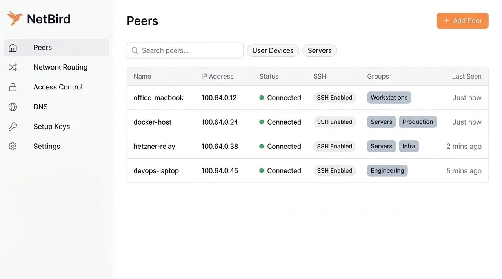
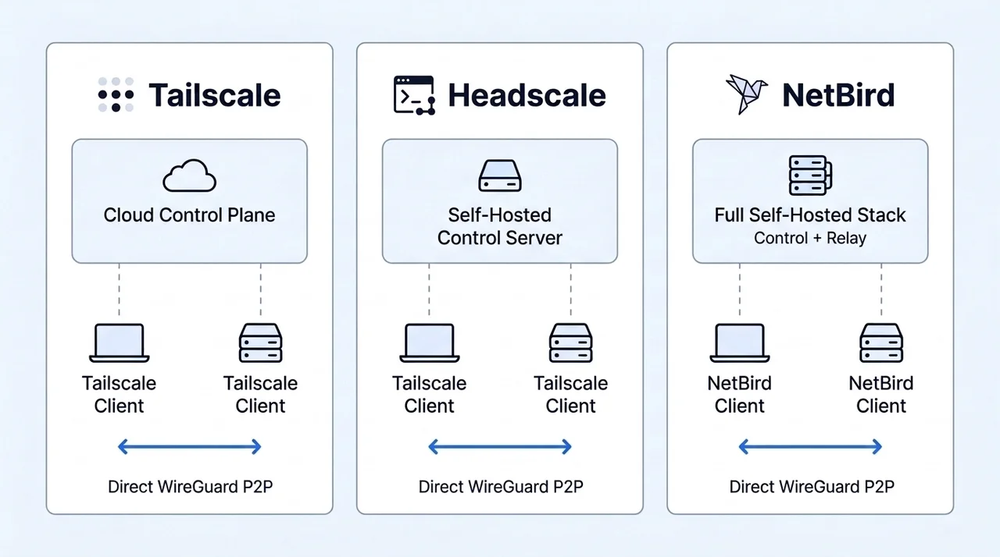

import ListCheck from "@components/widgets/ListCheck.astro";
import Notice from "@components/widgets/Notice.astro";
import Accordion from "@components/widgets/Accordion.astro";
import Tabs from "@components/widgets/Tabs.astro";
import Tab from "@components/widgets/Tab.astro";

*Disclosure: this guide contains referral links. If you buy through them, I may earn a commission at no extra cost to you.*

If you like the idea of Tailscale but want to own every piece of the stack, **NetBird** is the cleanest open-source alternative available. Unlike [Headscale](/headscale-self-hosted-tailscale-setup/), which relies on Tailscale's proprietary control protocol and desktop/mobile apps, NetBird ships its own open-source clients, control server, relay, and web dashboard.

Self-hosting NetBird used to be notoriously fiddly. You had to wire up separate management, signal, relay, and coturn containers alongside an external identity provider like Zitadel or Keycloak. That architecture is gone. NetBird now ships a unified `netbird-server` container with a single `config.yaml`, an **embedded identity provider** out of the box, and automatic Traefik TLS.

I switched a test cluster over to the new unified stack, and the install went from an afternoon project to about 15 minutes. Here is how to deploy it.



## What makes NetBird different

Before jumping into commands, here is why people pick NetBird over Tailscale or Headscale:

- **Zero vendor lock-in**: Both the server and every client (Linux, macOS, Windows, iOS, Android, Docker) are open source.
- **Real mobile support**: Unlike Headscale, NetBird's official iOS and Android apps let you type in your self-hosted domain cleanly during login.
- **Polished web dashboard**: Peers are split with quick-filter toggles for **User Devices** and **Servers**, and you manage groups, ACLs, DNS, and routing in the UI rather than editing JSON files over SSH.
- **Built-in extras**: Modern NetBird includes identity-aware SSH and **NetBird Proxy** for exposing internal web services over TLS without opening ports on your home router.

For a side-by-side breakdown of all three options, see our [NetBird vs Headscale vs Tailscale comparison](/netbird-vs-headscale-vs-tailscale/).

## Prerequisites

<ListCheck>
- A **Linux VPS** with at least 1 vCPU and 2 GB RAM (Ubuntu 24.04 or Debian 12). [Hetzner](https://go.bitdoze.com/hetzner) or [Hostinger](https://go.bitdoze.com/hostinger-vps) are solid choices.
- A **domain name** with an `A` record pointing to your VPS IP (for example, `netbird.example.com`).
- **Docker** with the Compose v2 plugin, `curl`, and `jq` installed.
- Firewall ports **443/TCP**, **80/TCP** (for Let's Encrypt), and **3478/UDP** (for STUN/relay) open.
</ListCheck>

<Notice type="warning" title="Keep NetBird at v0.76.0 or newer">
Earlier NetBird client releases (v0.5.0 through v0.75.1) had a local gRPC privilege issue (GHSA-qcpp-8vwj-hhwr). Make sure both your `netbird-server` container and all connected client binaries are on v0.76.0 or newer.
</Notice>

## Step 1: Deploy NetBird with the unified quickstart

NetBird provides an official `getting-started.sh` script that generates `docker-compose.yml`, `config.yaml`, and `dashboard.env`, configures Traefik for HTTPS, and sets up the embedded identity provider.

Create a directory for your deployment and run the script:

```bash
mkdir -p /opt/netbird && cd /opt/netbird
curl -fsSL https://github.com/netbirdio/netbird/releases/latest/download/getting-started.sh | bash
```

The installer will ask for your domain name (for example `netbird.example.com`) and your admin email/password for the embedded IdP. Once it finishes, it brings up three core pieces:

1. **`netbird-server`**: The unified backend (management, signal, embedded IdP, and relay) driven by `config.yaml`.
2. **`dashboard`**: The web UI configured through `dashboard.env`.
3. **`traefik`**: Automatic Let's Encrypt TLS termination on ports 80 and 443.

Verify that all containers are running and healthy:

```bash
docker compose ps
docker compose logs -f netbird-server
```

If you also use UFW on your VPS, remember that Docker manipulates `iptables` directly. Check our [Docker and UFW firewall rules guide](/bsi-security-report-docker-ufw/) to make sure only 80/TCP, 443/TCP, and 3478/UDP are exposed publicly.

## Step 2: Log into the NetBird dashboard

Open `https://netbird.example.com` in your browser and sign in with the admin credentials you created during setup.

Inside the dashboard you will see:

- **Peers**: All connected devices, with quick-filter buttons for **User Devices** and **Servers** plus chip-based filtering by group or OS.
- **Network Routing**: Subnet routes and exit nodes for reaching local LANs or routing internet traffic through a specific peer.
- **Access Control**: Group-based firewall policies (for example, letting `devops` reach `prod-servers` on port 22 and 443 only).
- **DNS**: Custom internal domains and nameservers pushed to clients.
- **Settings**: Setup keys, OIDC/SSO settings, and authentication controls.

If you already run an external OIDC provider like Authentik or Keycloak, you can point `config.yaml` to it later. For most homelabs and small teams, the embedded IdP works fine on its own.

## Step 3: Connect your devices

<Tabs>
<Tab name="Linux">

Install the NetBird client and point it to your self-hosted management URL:

```bash
curl -fsSL https://pkgs.netbird.io/install.sh | sh
sudo netbird up --management-url https://netbird.example.com
```

This prints an authentication link. Open it in your browser, sign in, and the machine joins your mesh immediately.

</Tab>
<Tab name="macOS & Windows">

1. Download the NetBird desktop client from `netbird.io/download` (or `brew install --cask netbird-ui` on macOS).
2. Open the NetBird tray/menu-bar app, go to **Settings**, and change the **Management URL** to `https://netbird.example.com`.
3. Click **Connect** and log in through your browser.

</Tab>
<Tab name="Docker / Headless Servers">

For headless servers or containers, create a **Setup Key** in **Settings > Setup Keys** inside the web dashboard (choose reusable if you want to enroll multiple servers with one key), then run:

```bash
sudo netbird up \
  --management-url https://netbird.example.com \
  --setup-key YOUR-SETUP-KEY
```

For a Docker container running alongside your [home server containers](/docker-containers-home-server/):

```yaml
services:
  netbird:
    image: netbirdio/netbird:latest
    container_name: netbird
    hostname: docker-node
    network_mode: host
    restart: unless-stopped
    cap_add:
      - NET_ADMIN
      - SYS_MODULE
    environment:
      - NB_MANAGEMENT_URL=https://netbird.example.com
      - NB_SETUP_KEY=YOUR-SETUP-KEY
    volumes:
      - ./netbird-client:/etc/netbird
```

</Tab>
<Tab name="iOS & Android">

Install the **NetBird** app from the App Store or Google Play. Tap the settings icon on the welcome screen, enter `https://netbird.example.com` as the Management URL, and sign in.

</Tab>
</Tabs>

Verify peer connectivity and inspect NAT/relay status from any connected device:

```bash
netbird status -d
```

The `-d` (detailed) flag shows `Management: Connected`, `Signal: Connected`, your STUN/ICE candidates, and whether each peer is running `P2P` (direct WireGuard) or `Relayed` through your VPS.

### Already running Nginx, Caddy, or Traefik on port 443?

If your VPS already hosts websites or panels like Coolify on ports 80 and 443, the bundled Traefik container will collide with your existing reverse proxy. When running `getting-started.sh`, choose the external/manual reverse proxy option so the script omits Traefik and exposes `netbird-server` and `dashboard` internally instead.

Two details matter when wiring up your own proxy:

- Enable **HTTP/2 and gRPC** proxying (`application/grpc` with buffering off) for NetBird's management and signal paths.
- Keep **UDP 3478** forwarded directly on the VPS firewall so STUN and relay discovery still work.

## Backups and custom internal DNS

Inside **DNS** in the NetBird dashboard, you can assign a custom private domain (such as `lab.internal`) and push upstream resolvers like NextDNS or Pi-hole to specific peer groups.

Before updating your stack, back up `/opt/netbird` (`config.yaml`, `dashboard.env`, `docker-compose.yml`) and the `netbird-data` Docker volume so you can restore your peers and policies cleanly if an upgrade goes sideways:

```bash
cd /opt/netbird
docker compose stop
docker run --rm -v netbird_netbird-data:/data -v /opt/netbird/backups:/backup alpine \
  tar czf /backup/netbird-$(date +%F).tar.gz -C /data .
docker compose up -d
```

## Step 4: Set up groups, ACLs, and subnet routing

By default, NetBird places peers in an `All` group. Before adding servers or teammates, tighten your policies:

1. Create groups in the dashboard, such as `laptops`, `homelab-servers`, and `exit-nodes`.
2. Assign each peer to its group from the **Peers** table.
3. Under **Access Control > Policies**, replace the wide-open default rule with explicit rules (for example, `laptops -> homelab-servers` on TCP `22, 80, 443`).

To reach devices on your home LAN that cannot run NetBird (like a printer, IPMI interface, or NAS), enable **Network Routing**:

1. Ensure IP forwarding is enabled on your home Linux peer (`net.ipv4.ip_forward = 1`).
2. In the dashboard under **Network Routing**, click **Add Route**, enter your LAN subnet (such as `192.168.1.0/24`), and pick your home server as the routing peer.

To use a peer as an **Exit Node** for safe browsing on hotel Wi-Fi, add a route for `0.0.0.0/0` assigned to that peer.

## Identity-aware SSH and NetBird Proxy

Two newer features make NetBird much more useful than a plain WireGuard wrapper:

- **NetBird SSH**: Enable the built-in SSH server on a Linux peer (`sudo netbird up --allow-server-ssh`) and toggle SSH access in the dashboard. NetBird authenticates SSH sessions through your IdP identity, so you don't need to distribute SSH keys across servers.
- **NetBird Proxy**: Lets you expose internal web apps running behind your mesh via HTTPS with automatic TLS certificates, similar to [Pangolin](/pangolin-cloudflare-tunnels-alternative/) or [Tailscale Serve/Funnel](/tailscale-setup-guide/).

## NetBird vs Headscale vs Tailscale



If you are still weighing your options:

- Pick **Tailscale** if you want zero server maintenance and five-minute setup ([Tailscale setup guide](/tailscale-setup-guide/)).
- Pick **Headscale** if you already have Tailscale clients everywhere and only want to self-host the control plane ([Headscale setup guide](/headscale-self-hosted-tailscale-setup/)).
- Pick **NetBird** if you want a unified, 100% open-source self-hosted mesh VPN with a clean web dashboard and proper mobile apps.

For the full feature and cost breakdown, read [NetBird vs Headscale vs Tailscale](/netbird-vs-headscale-vs-tailscale/).

## FAQ

<Accordion label="How much RAM and CPU does self-hosted NetBird need?" group="netbird-faq" expanded="true">
A 1 vCPU, 2 GB RAM VPS is plenty for a homelab or small team of 10 to 50 peers. Most traffic flows peer-to-peer over WireGuard, so the VPS only handles signaling, auth, and relayed traffic when direct NAT traversal fails.
</Accordion>

<Accordion label="Can I run NetBird on a mini PC at home instead of a VPS?" group="netbird-faq">
You can, provided your home connection has a public IP (not behind CGNAT) and you can forward ports 443/TCP and 3478/UDP to it. Otherwise, a cheap $5/month VPS is much more reliable as a coordination and relay point. See our [VPS price increases](/vps-price-increases/) breakdown if you are comparing VPS vs local hardware costs.
</Accordion>

<Accordion label="Do I need Keycloak or Zitadel to self-host NetBird anymore?" group="netbird-faq">
No. Current versions of `netbird-server` include an embedded identity provider configured automatically by `getting-started.sh`. You only need external OIDC if you want to tie NetBird into an existing corporate SSO setup.
</Accordion>

<Accordion label="How do I update my self-hosted NetBird server?" group="netbird-faq">
Run `docker compose pull && docker compose up -d` inside `/opt/netbird`, and keep your desktop/server clients updated with your OS package manager or `netbird update`.
</Accordion>
