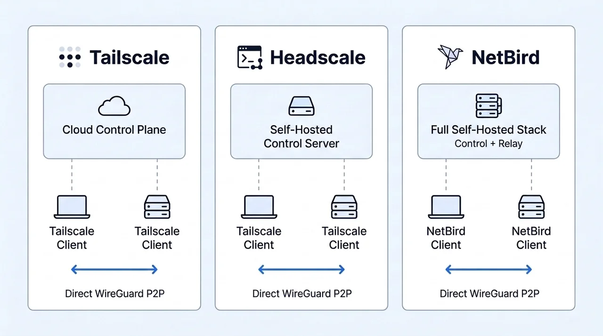
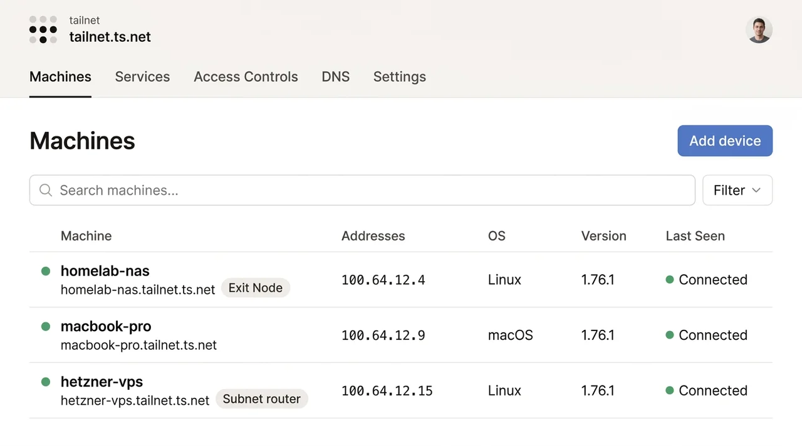
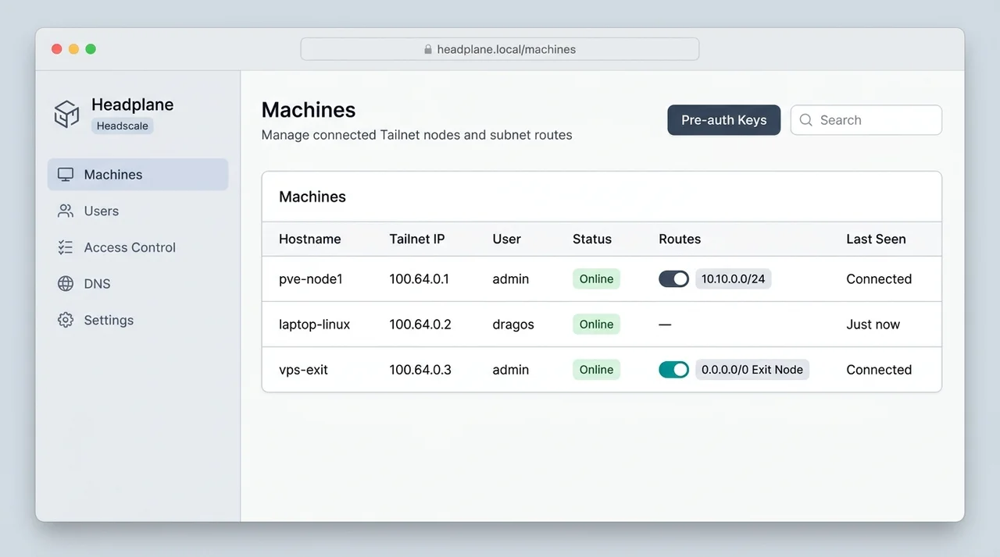
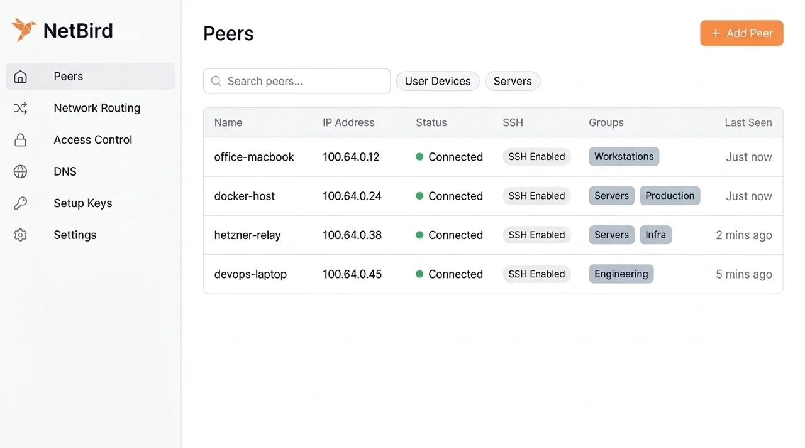

import Notice from "@components/widgets/Notice.astro";
import Tabs from "@components/widgets/Tabs.astro";
import Tab from "@components/widgets/Tab.astro";

Mesh VPNs replaced traditional hub-and-spoke VPNs for connecting devices across networks. Instead of hauling every packet through one central gateway, peers build direct encrypted WireGuard tunnels to each other. Traffic only touches a relay when both sides sit behind stubborn NAT or CGNAT.

Three tools cover almost every use case right now: **Tailscale** (cloud-managed, zero-config default), **Headscale** (self-hosted control server for Tailscale clients), and **NetBird** (fully self-hosted mesh VPN stack with its own clients and dashboard).

I have run all three across my homelab and rented VPS nodes. On paper they all give you `100.x.y.z` WireGuard tunnels, so it is easy to assume they feel the same. In day-to-day use, they don't. Here is how they actually compare.



## What each tool is

### Tailscale

Tailscale is a cloud-managed mesh VPN built on WireGuard. You install the client on each machine, sign in through Google, GitHub, Microsoft, or email, and every device gets a private IP in your tailnet. Tailscale runs the coordination server, key rotation, MagicDNS, and global DERP relays.

It is by far the fastest one to get working. The catch is that Tailscale's control plane knows every node, IP, and ACL rule in your network. If you want zero maintenance, that tradeoff is worth it. If you want full infrastructure ownership, see our [Tailscale setup guide](/tailscale-setup-guide/) to understand what it stores and how to lock it down.

### Headscale

Headscale is an open-source, self-hosted reimplementation of Tailscale's control server. You run it on your own VPS, and regular Tailscale clients point to your domain with `--login-server`. Same WireGuard data plane, same desktop clients, but you own the coordination server.

Because Headscale is CLI and YAML first, most people pair it with **Headplane** for a web dashboard. You get the Tailscale client experience without paying per seat or handing your network map to a third party. Check our [Headscale setup guide](/headscale-self-hosted-tailscale-setup/) for the Docker Compose walkthrough.

### NetBird

NetBird is a complete open-source mesh VPN platform. Unlike Headscale, it does not piggyback on Tailscale's clients. It ships its own client, its own control server, its own relay, and a polished web dashboard.

NetBird used to be painful to self-host because you had to wire together four or five containers plus an external identity provider like Zitadel or Keycloak. That changed. Current NetBird releases ship a unified `netbird-server` container with a single `config.yaml`, an embedded identity provider, and automatic Traefik TLS. It also includes **NetBird Proxy** for exposing internal web apps and identity-aware SSH. See our [NetBird self-hosted setup guide](/netbird-self-hosted-setup/) for the full install.

## Feature comparison

| Feature | NetBird | Headscale | Tailscale |
|---|---|---|---|
| **Open source** | Yes (client + server) | Yes (server only) | Client yes, server no |
| **Self-hostable** | Fully | Control server only | No |
| **Client** | Own client | Tailscale clients (unofficial) | Tailscale clients (official) |
| **WireGuard** | Yes | Yes | Yes |
| **Authentication** | Embedded IdP or any OIDC/SSO/MFA | Any OIDC or pre-auth keys | Tailscale identity / OIDC |
| **ACLs** | Web UI + API | JSON policy file | Web UI + HuJSON |
| **MagicDNS** | Built-in DNS management | Basic | Full `.ts.net` |
| **Exit nodes** | Yes | Yes | Yes |
| **Public endpoints** | NetBird Proxy (built-in) | No | Tailscale Funnel |
| **Relays** | Self-hosted Relay / STUN / TURN | Tailscale DERP or custom DERP | Global DERP network |
| **Web management UI** | Built-in dashboard | Headplane (3rd party) | Tailscale Admin Console |
| **Mobile clients** | Android, iOS | Android (debug), iOS limited | Android, iOS |
| **Free tier / limits** | Unlimited (self-hosted), 5 peers (cloud) | Unlimited (self-hosted) | 6 users, unlimited user devices, 50 tagged nodes |
| **Setup complexity** | Low-Moderate (unified script) | Moderate | Near-zero |
| **Data ownership** | Full | Full | Held by Tailscale |

## Interface and day-to-day management

This is where your daily experience differs the most.

**Tailscale** gives you the cleanest web console out of the box. Machines, MagicDNS names, exit nodes, Tailscale SSH, and ACLs all live in one place.



**Headscale** on its own is terminal-only (`headscale nodes list`, `headscale preauthkeys create`). Adding **Headplane** gives you a clean web view for approving routes, managing users, and inspecting nodes, though advanced policy rules still live in JSON files on the server.



**NetBird** has the strongest self-hosted UI of the three. Peers are split cleanly with quick filters for User Devices and Servers, setup keys live right in Settings, and you can toggle SSH, DNS, routing peers, and NetBird Proxy services without touching YAML every time you add a machine.



## Setup and maintenance

<Tabs>
<Tab name="Tailscale">

**Setup time: 5 minutes**

```bash
curl -fsSL https://tailscale.com/install.sh | sh
sudo tailscale up
```

Open the login URL in your browser and you are on the mesh. No VPS, no reverse proxy, no TLS certificates to renew. Our [Tailscale setup guide](/tailscale-setup-guide/) covers MagicDNS, exit nodes, subnet routers, and Tailscale SSH in detail.

**Maintenance: zero.** Tailscale handles key rotation, DERP relays, and control plane uptime. The only real risk is vendor dependency: if Tailscale changes pricing or has a control-plane outage, new handshakes wait on them (existing direct WireGuard tunnels keep running).

</Tab>
<Tab name="Headscale">

**Setup time: 30 to 45 minutes**

You need a VPS with a public IP, Docker, a domain name, and a reverse proxy like Caddy or Traefik. Follow our [Headscale setup guide](/headscale-self-hosted-tailscale-setup/) for the full `docker-compose.yml` with Headplane.

```bash
# Start Headscale + Headplane on your VPS
docker compose up -d

# Connect a client
tailscale up --login-server=https://headscale.example.com
```

**Maintenance: moderate.** You handle Headscale upgrades, YAML config changes, and optional custom DERP relays. Because Tailscale's mobile apps do not make changing the login server easy, iOS and Android are noticeably clunkier on Headscale than on Tailscale or NetBird.

</Tab>
<Tab name="NetBird">

**Setup time: 15 to 25 minutes**

With NetBird's unified stack, getting a self-hosted server running is much simpler than it used to be:

```bash
curl -fsSL https://github.com/netbirdio/netbird/releases/latest/download/getting-started.sh | bash
```

That script generates a `docker-compose.yml` with `netbird-server`, the dashboard, and Traefik for automatic HTTPS. See our [NetBird self-hosted setup guide](/netbird-self-hosted-setup/) for the exact ports, `config.yaml` layout, and client enrollment.

**Maintenance: low to moderate.** You still own a VPS and need to keep both `netbird-server` and your clients updated (important for security patches like the v0.76+ gRPC fix), but day-to-day work happens in the web UI.

</Tab>
</Tabs>

## Authentication and access control

**Tailscale** relies on external identity providers (Google, GitHub, Microsoft, or custom OIDC on paid plans) and manages policies in HuJSON inside the admin console. Very easy to read, easy to audit.

**Headscale** plugs into any OIDC provider like Authentik or Keycloak, or works without OIDC using pre-auth keys. ACLs live in a JSON file on your server. If you like keeping network rules in Git, Headscale fits nicely. If you want click-to-allow toggles, it feels bare.

**NetBird** now includes an embedded IdP by default for quick self-hosting, and still supports any OIDC provider with MFA for teams. Access policies are managed in the web UI or via API using groups, which is much faster to adjust when you are adding servers or contractors.

## Performance and reliability

All three move packets over WireGuard, so direct peer-to-peer throughput is identical. On a gigabit fiber link or local LAN, all three saturate the connection at roughly the same CPU cost.

Where they differ is fallback relays when direct NAT traversal fails:

- **Tailscale** runs a large global DERP network. If you are on hotel Wi-Fi behind symmetric NAT talking to a home server behind CGNAT, Tailscale usually finds a low-latency relay nearby.
- **Headscale** defaults to Tailscale's public DERP map, so relay reachability is just as good unless you explicitly disable it and host your own DERP nodes.
- **NetBird** runs its own relay on your VPS. For one region (say Europe or US East), a single Hetzner or DigitalOcean box is plenty. If your team spans continents, you will want to deploy extra NetBird relay nodes.

## Cost comparison

| Setup | Monthly cost | Notes |
|---|---|---|
| Tailscale Personal (free) | $0 | 6 users, unlimited user devices, 50 tagged servers |
| Tailscale Standard | $8/user | Team management, more ACL groups, audit logs |
| Headscale on Hetzner VPS | ~$5 | Unlimited users and devices, your VPS |
| NetBird self-hosted on Hetzner | ~$5 | Unlimited users and devices, your VPS |
| NetBird Cloud (free) | $0 | Up to 5 peers, paid plans beyond that |

If you are debating whether a rented VPS is still worth it after recent hosting hikes, read our breakdown on [VPS price increases and when a mini PC wins](/vps-price-increases/).

## Quick picks by scenario

| Scenario | Best pick | Why |
|---|---|---|
| Home server behind CGNAT, just works | **Tailscale** | 5-minute setup, global DERP relays, zero VPS to maintain |
| Family NAS access on iPhones & iPads | **Tailscale** or **NetBird** | Both have clean iOS apps; Headscale is clunky on iOS |
| Existing Tailscale fleet, want EU/local control plane | **Headscale** | Keep existing desktop/server clients, swap only `--login-server` |
| Small DevOps team wanting 100% OSS self-hosted | **NetBird** | Single `netbird-server` container, embedded IdP, group ACL UI |
| Exposing public web apps without a VPN client | **Pangolin** | Tunnel reverse proxy rather than a full mesh VPN |

## Migration and lock-in

Moving from **Tailscale to Headscale** is painless on desktops and Linux servers because the client stays the same: run `tailscale down` and `tailscale up --login-server=https://headscale.example.com`. You do have to re-approve routes and translate ACL rules, and iOS devices are the friction point.

Moving from **Tailscale or Headscale to NetBird** means replacing the client binary on every peer. On a 5-node homelab that takes ten minutes. On a 50-server fleet, pick carefully up front or roll out NetBird with a reusable Setup Key via Ansible.

## When to choose each one

### Choose Tailscale if:

- You want your devices talking in five minutes with zero server upkeep
- The Personal tier (6 users, unlimited personal devices, 50 tagged nodes) covers your homelab
- You rely heavily on iOS/Android clients, MagicDNS, or Tailscale Funnel
- You do not mind Tailscale hosting the coordination server

### Choose Headscale if:

- You already use Tailscale clients everywhere and only want to replace the control plane
- You need unlimited users or strict jurisdiction control (for example, keeping coordination data on an EU VPS)
- You prefer managing ACLs as JSON files and don't need polished iOS support

### Choose NetBird if:

- You want a 100% open-source, self-hosted mesh VPN with zero dependency on Tailscale
- You want a modern web UI for peers, groups, ACLs, DNS, and built-in reverse proxying
- You want clean Android and iOS clients that point to your self-hosted domain out of the box

<Notice type="info" title="Related networking guides">
Ready to deploy one? Follow our [Tailscale setup guide](/tailscale-setup-guide/), [Headscale self-hosted guide](/headscale-self-hosted-tailscale-setup/), or [NetBird self-hosted guide](/netbird-self-hosted-setup/). If you mainly want to expose web apps through a reverse proxy tunnel instead of joining a full mesh, check our [Pangolin setup guide](/pangolin-cloudflare-tunnels-alternative/). For hotel Wi-Fi and remote work, pair your mesh with a hardware router from our [best travel router for WireGuard and Tailscale](/best-travel-router-wireguard-tailscale/) roundup, or learn manual port forwarding in our [Linux SSH tunneling guide](/ssh-tunneling-linux/).
</Notice>

## Bottom line

**Tailscale** is still the right default for most individuals and small homelabs. You cannot beat five-minute setup and rock-solid mobile apps for $0.

**Headscale** makes sense when you want Tailscale's ecosystem without Tailscale's cloud. Pairing it with Headplane fixes most of the CLI friction, though mobile support remains its weak spot.

**NetBird** has quietly become the cleanest all-in-one self-hosted option. Moving to a single `netbird-server` container with an embedded IdP removed the biggest barrier to entry, and its web dashboard is genuinely pleasant to use. If I were building a self-hosted mesh VPN from scratch today for a team or a multi-server lab, I would pick NetBird.
