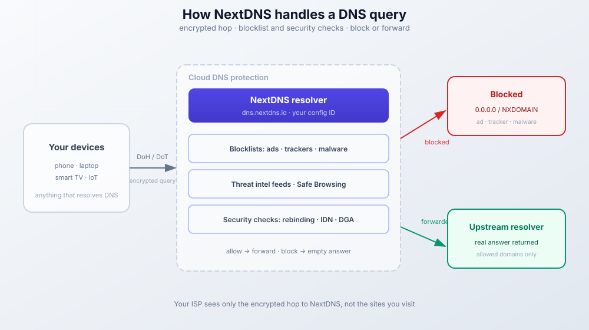

import Button from "@components/widgets/Button.astro";
import Notice from "@components/widgets/Notice.astro";
import ListCheck from "@components/widgets/ListCheck.astro";
import Tabs from "@components/widgets/Tabs.astro";
import Tab from "@components/widgets/Tab.astro";
import Accordion from "@components/widgets/Accordion.astro";

*Disclosure: this guide contains referral links. If you buy through them, I may earn a commission at no extra cost to you.*

[NextDNS](https://go.bitdoze.com/nextdns) is the best low-cost managed DNS filter in 2026: $1.99/month (EUR 1.99/month in the EU) buys unlimited encrypted DNS filtering across every phone, laptop, smart TV, and router you own, with EU or Swiss log residency.

After two years of running NextDNS across my whole network, mobile app ads stay gone, background trackers get dropped before they load, and my ISP sees only encrypted traffic to NextDNS servers. This late-2026 update covers what shipped in 2025 and 2026 (CLI v1.50.2, the iOS 3.x rewrite, Bypass Age Verification, and log residency), exact pricing, day-to-day operational gotchas, and how it stacks up against Control D, AdGuard Home v1.0, and Pi-hole v6 + Unbound.

<Button text="Try NextDNS Free" link="https://go.bitdoze.com/nextdns" variant="solid" color="blue" size="lg" external={true} icon="rocket-launch" />

## What does NextDNS actually do?

NextDNS replaces your ISP's plaintext DNS resolver with an encrypted DoH, DoT, or DoQ resolver that checks every domain lookup against your chosen security feeds and ad blocklists before answering. Blocked ad, tracker, and malware domains return an empty answer so the payload never loads.

Because filtering happens at the DNS layer, every device on your network receives the same protection. Smart TVs, game consoles, printers, and IoT sensors that cannot run a browser extension get the exact same blocklists as your laptop.



<Notice type="info" title="Want the full cloud vs self-hosted DNS guide?">

For step-by-step setup of both cloud and self-hosted resolvers (NextDNS, Control D, AdGuard Home v1.0, and Pi-hole v6 + Unbound), read the full DNS guide.

<Button text="Read the Complete DNS Protection Guide" link="/block-ads-malware-dns-protection/" variant="outline" color="blue" size="md" icon="book-open" />

</Notice>

<Notice type="warning" title="Chrome removed classic Manifest V2 ad blockers">

Chrome dropped Manifest V2 extensions across consumer and enterprise policies, leaving browser users on MV3 extensions like uBlock Origin Lite. NextDNS runs below the browser layer, so it keeps blocking ads and trackers in every browser and pairs cleanly with uBlock Origin Lite.

<Button text="Block Ads After Manifest V3 with NextDNS" link="/block-ads-manifest-v3-nextdns/" variant="outline" color="green" size="md" icon="arrow-right" />

</Notice>

## What changed in NextDNS in 2025 and 2026?

NextDNS shipped its biggest client updates in years during 2026: the open-source CLI reached v1.50.2 in November 2026, the iOS app received its first major rewrite since 2021 (v3.0 to v3.2.x), and the dashboard added log data residency, Tracker Insights, Bypass Age Verification, and new security categories without raising prices.

- **NextDNS CLI v1.50.2 (November 2026):** Added UniFi Network 11 client discovery (`v1.50.1`), automatic recovery from blackholed DoH connections (`v1.49.0`), OpenWrt IPv6 relay fixes, and user-specific conditional profiles on Linux and Windows (`v1.47.1`).
- **NextDNS iOS app 3.x (April to July 2026):** Replaced the 2021 v2 client with lower latency, a native dashboard view, one-tap temporary pause, and quick domain unblocking.
- **Bypass Age Verification (August 2025, all plans):** Uses DNS-level geo-routing on a preset list of domains to bypass ID or selfie age-verification walls (such as UK Online Safety Act checks). Results vary by site, and family admins should leave it off on kid profiles at `my.nextdns.io/$id/settings`.
- **Log data residency:** You choose where filtered query logs live: United States, European Union, United Kingdom, or Switzerland.
- **Tracker Insights and expanded Security tab:** Analytics added a Tracker Insights view showing which companies track your devices, while the Security tab grew to 11+ toggles (adding Parked Domains, Top-Level Domains blocking, CSAM protection, and September 2026 security categories).

One legal trade-off to watch with any hosted DNS provider: a December 2025 Paris court order required NextDNS to block specific football-piracy domains for French users, and regional court fines also pushed Quad9 to end French resolution on November 24, 2026. If you want zero third-party jurisdiction risk, run a local recursive resolver with [Pi-hole v6 + Unbound or AdGuard Home v1.0](/pihole-vs-adguard-home-docker/).

<Notice type="info" title="Keeping your privacy stack in the EU?">

Log residency covers your DNS layer. If you are moving more tools onto infrastructure you control, you can also [self-host a private chat server with Chatto](/chatto-self-hosted/).

</Notice>

## Which NextDNS features matter most?

NextDNS groups its controls into four practical tabs: Security (11+ threat-protection toggles), Privacy (84 curated blocklists plus OS telemetry blocking), Parental Control (category filters and schedules), and Settings (log residency, Rewrites, and EDNS anonymization).

### Security features

| Feature | What it blocks or prevents |
|---|---|
| Threat Intelligence Feeds | Domains flagged for malware, phishing, or command-and-control traffic |
| Google Safe Browsing | Malicious sites from Google's threat database |
| Cryptojacking Protection | Browser-based cryptocurrency mining scripts |
| DNS Rebinding Protection | External domains trying to resolve private LAN IP addresses |
| IDN Homograph Protection | Lookalike domains using spoofed Unicode characters |
| Typosquatting Protection | Common misspellings of popular domains registered by scammers |
| DGA Protection | Algorithmically generated domains used by botnets |
| Newly Registered Domains (NRD) | Domains registered in the last 30 days (optional; higher false-positive rate) |
| Parked Domains | Ad-only and malware-prone parked domains |
| Top-Level Domains Blocking | Whole high-abuse TLDs such as `.xyz` or `.top` |
| CSAM Protection | Domains on CSAM blocklists |

### Privacy features and blocklists

The Privacy tab exposes 84 maintained lists from [nextdns/blocklists](https://github.com/nextdns/blocklists), Native Tracking Protection (Apple, Windows, Samsung, Xiaomi, Huawei, Amazon, Roku), Affiliate and Tracking Link blocking, and CNAME-cloaked Disguised Trackers detection.

Two or three overlapping lists beat ten aggressive lists that break legitimate apps. Start from safest to strictest:

- **NextDNS Recommended:** Curated vendor baseline with minimal breakage.
- **OISD:** Community default that blocks ads and trackers without breaking banking or shopping sites.
- **AdGuard DNS filter:** Well-maintained balanced list.
- **Steven Black's Unified Hosts:** Classic unified ad and malware host list.
- **HaGeZi Multi (Normal, Pro, Pro Plus, Ultimate):** Step up one tier at a time if you want stricter blocking and are willing to allowlist edge cases.

### Parental controls, analytics, and settings

- **Parental controls:** Block website categories (adult, gambling, social media, piracy), set Recreation Time schedules, enforce SafeSearch and YouTube Restricted Mode, and toggle Block Bypass Methods to stop kids from switching to alternative VPNs or DoH servers.
- **Analytics and logs:** View total queries, block rate, top blocked domains, per-device traffic, GAFAM share, and Tracker Insights. Set log retention from 1 hour to 2 years, or turn logging off. Even with logs off, the live dashboard stream displays queries while you keep the tab open.
- **Power-user settings:** Automatic **DNSSEC** validation, per-profile **Rewrites** (point `home.example.com` at `192.168.1.10` for homelab split-horizon DNS), **Anonymized EDNS Client Subnet**, **Cache Boost**, and mandatory **Query Name Minimisation**. Keep **Block Page** off to avoid TLS certificate warnings.

## How do you set up NextDNS in ten minutes?

Sign up for a free NextDNS profile, enable six core Security toggles plus OISD or HaGeZi Multi PRO, and point your router, Android Private DNS, or NextDNS CLI at your 6-character Configuration ID.

<ListCheck>
<ul>
<li>A free NextDNS account and your 6-character Configuration ID</li>
<li>Admin access to your router, phone, or computer DNS settings</li>
<li>Ten minutes plus one device to verify at <code>test.nextdns.io</code></li>
</ul>
</ListCheck>

### Step 1: Create your profile and enable security toggles

1. Open [NextDNS](https://go.bitdoze.com/nextdns), click **Try it now**, and register with your email to save your Configuration ID (for example `abc123`).
2. In the **Security** tab, enable **Threat Intelligence Feeds**, **Google Safe Browsing**, **Cryptojacking Protection**, **DNS Rebinding Protection**, **IDN Homograph Protection**, **Typosquatting Protection**, and **Parked Domains**.
3. Leave **NRD** and whole-TLD blocking off at first so newly launched legitimate sites do not break.

### Step 2: Add lean blocklists and native telemetry blocking

1. In the **Privacy** tab, enable **OISD** (or **NextDNS Recommended**) plus **AdGuard DNS filter**. Add **HaGeZi Multi PRO** if you want tighter tracker blocking.
2. Under **Native Tracking Protection**, toggle on the operating systems and TV platforms you own.
3. In **Settings**, set log retention to `1 hour` (or off), pick your storage region (EU, Switzerland, UK, or US), and leave **Anonymized EDNS** and **Cache Boost** enabled.

### Step 3: Connect your router or devices

<Tabs>
<Tab name="Router (whole network)">

Enter your NextDNS endpoint in your router's DNS settings (DoH/DoT on OpenWrt, OPNsense, pfSense, or UniFi, or linked IPv4 addresses on basic ISP routers):

```text
# DNS-over-HTTPS
https://dns.nextdns.io/YOUR_CONFIG_ID

# DNS-over-TLS
YOUR_CONFIG_ID.dns.nextdns.io
```

On Linux routers and UniFi gateways (including UniFi Network 11), install the open-source NextDNS CLI (`v1.50.2`) for local caching and per-device client discovery:

```bash
sh https://nextdns.io/install
```

</Tab>
<Tab name="Android Private DNS (DoT)">

Android's built-in **Private DNS** covers browsers and apps without installing a client. Open **Settings > Network & internet > Private DNS > Private DNS provider hostname** and enter:

```text
YOUR_CONFIG_ID.dns.nextdns.io
```

Enter the hostname only. Pasting `https://dns.nextdns.io/...` into Android Private DNS triggers a connection error.

</Tab>
<Tab name="iOS, macOS, and Windows">

- **iOS:** Install the official NextDNS 3.x app from the App Store (adds native dashboard, pause, and quick unblocking) or install the signed `.mobileconfig` profile from the Setup tab.
- **macOS and Windows:** Install the official NextDNS app or run the NextDNS CLI (`v1.50.2`).

</Tab>
<Tab name="Browser only">

- **Firefox:** Settings > Privacy & Security > DNS over HTTPS > Custom > `https://dns.nextdns.io/YOUR_CONFIG_ID`
- **Chrome:** Settings > Privacy and security > Security > Use secure DNS > Custom > same URL

Browser DoH filters browser tabs only. System apps keep using your OS DNS.

</Tab>
</Tabs>

### Step 4: Verify your setup

Open [test.nextdns.io](https://test.nextdns.io/) or run a terminal check:

```bash
curl -s https://test.nextdns.io
```

A working configuration returns `"status":"ok"` along with your protocol (`DOH`, `DOT`, or `DOQ`) and profile ID. If `"status":"unconfigured"` appears, check whether a VPN is overriding system DNS or your ISP hijacks plaintext port 53.

## What breaks in day-to-day NextDNS operations?

Three operational issues matter once NextDNS runs your whole network: the free tier silently drops filtering after 300,000 queries, NextDNS has no public status page during outages, and aggressive lists occasionally block legitimate links.

- **Silent 300,000-query free-tier cliff:** A household with phones, a smart TV, and IoT gear burns through 300,000 queries in roughly two weeks. Past the cap, NextDNS stops blocking and resolves everything normally with zero warning banner. Poll the [NextDNS public API](https://nextdns.github.io/api/) weekly or upgrade to Pro.
- **No public status page:** There is no `status.nextdns.io`. If your network points exclusively at NextDNS and an outage hits, resolution stops until you switch. Run the NextDNS CLI (`v1.50.2`) locally for caching, or keep a fallback resolver configured.
- **YouTube ads and occasional false positives:** DNS cannot block in-stream YouTube video ads because YouTube serves them from video hostnames. Pair NextDNS with uBlock Origin Lite, Brave, or Firefox, and check the Logs tab to allowlist any legitimate service caught by strict lists.

<Notice type="warning" title="Plan a fallback resolver">

Do not leave a critical home or office network dependent on a single remote DNS endpoint without a fallback. Running the NextDNS CLI locally caches records in RAM and recovers automatically from stalled DoH sockets in `v1.49.0+`.

</Notice>

## How much does NextDNS cost in 2026?

NextDNS costs $0/month for up to 300,000 queries, $1.99/month ($19.90/year) for unlimited Pro personal and family use, and $19.90/month per 50 employees on Business. Pricing stayed unchanged throughout 2026 (EU visitors see the same numerals in EUR).

| Plan | Monthly queries | Price (USD / EUR) | Best for |
|---|---|---|---|
| Free | 300,000 (silent non-blocking fallback past cap) | $0 / EUR 0 | Testing or one light device |
| Pro (personal + close family) | Unlimited | $1.99/mo or $19.90/yr (EUR 1.99/mo or EUR 19.90/yr) | Households and multi-device users |
| Business | Unlimited | $19.90/mo per 50 employees ($199/yr) | Small and medium teams |
| Education | Unlimited | $19.90/mo per 250 students ($199/yr) | Schools and universities |

Cards, PayPal, and cryptocurrency are accepted. At $19.90/year (17% off monthly), Pro costs less than two months of most commercial VPNs and protects every device on your network.

<Button text="Try NextDNS Free" link="https://go.bitdoze.com/nextdns" variant="solid" color="blue" size="lg" external={true} icon="rocket-launch" />

## My NextDNS configuration (2026)

Here is the exact setup running on my daily network:

- **Security tab:** Threat Intelligence Feeds, Google Safe Browsing, Cryptojacking, DNS Rebinding, IDN Homographs, Typosquatting, and Parked Domains enabled. NRD and whole-TLD blocking disabled.
- **Privacy tab:** OISD, AdGuard DNS filter, and Steven Black's Unified Hosts on the main profile; HaGeZi Multi PRO on a secondary test profile; Native Tracking Protection enabled for Apple and Windows.
- **Settings tab:** 1-hour log retention, EU log storage, Block Page disabled, Anonymized EDNS enabled, Cache Boost enabled.

## How does NextDNS compare to Control D, AdGuard Home v1.0, and Pi-hole v6?

NextDNS wins on managed price ($1.99/month unlimited), Control D wins when you want geo-location traffic redirection or no-account free filtered endpoints, AdGuard Home v1.0 wins for self-hosted Docker setups with built-in DoH/DoT, and Pi-hole v6 + Unbound wins for zero-third-party recursive resolution.

### 1. NextDNS (best low-cost managed DNS for families and mobile users)

**Verdict:** Lowest-priced unlimited cloud DNS filter with strong blocklist choice, EU/Swiss log residency, and active CLI/iOS clients.

- **Best for:** Households and mobile users who want set-and-forget filtering without managing a server.
- **Strengths:** 84 blocklists, 11+ security toggles, per-profile Rewrites, official Tailscale integration, CLI v1.50.2, iOS 3.x app.
- **Trade-offs:** 300k free cap degrades silently; no public status page; support tickets can be slow.
- **Pricing:** Free (300k/mo); Pro `$1.99/month` (`$19.90/year`).

### 2. Control D (best cloud alternative for geo-routing and free public resolvers)

**Verdict:** More flexible policy and geo-redirection engine than NextDNS, at a higher personal subscription price.

- **Best for:** Users who want per-service country routing (Full Control) or free no-log public resolvers (`https://freedns.controld.com/p2`) with zero account signup.
- **Strengths:** 1,000+ blockable or redirectable services, 3-tier ML malware filter, 10,000 custom rules, 14-day no-card free trial, and free public OISD/HaGeZi endpoints.
- **Trade-offs:** No permanent free customizable dashboard; Some Control costs 50% more than NextDNS Pro.
- **Pricing:** Free public endpoints (`$0`); Some Control `$3/month` (`$30/year`); Full Control `$6/month` (`$60/year`); SMB `$2/endpoint/month`.

### 3. AdGuard Home v1.0 and Pi-hole v6 + Unbound (best self-hosted alternatives)

**Verdict:** Full local data ownership with zero monthly query limits, running in 11.2 MiB (AdGuard Home v1.0.0) or 15.5 MiB (Pi-hole v6.6) of idle Docker RAM.

- **Best for:** Homelab owners with a mini PC, NAS, or VPS who want complete control over logs, uptime, and recursive DNS.
- **Strengths:** AdGuard Home v1.0.0 (November 2026) adds a fast reactive mobile UI and native DoH/DoT/DoQ; Pi-hole v6 + Unbound removes every third-party DNS provider from your lookups.
- **Trade-offs:** You handle host uptime, container updates, and Tailscale or TLS setup for mobile devices.
- **Pricing:** Free and open source; runs on a [Hetzner VPS](https://go.bitdoze.com/hetzner), a [home server mini PC](/best-mini-pc-home-server/) like the [ASUS DC510](https://go.bitdoze.com/asus-dc510), or a [NAS/Proxmox homelab box](/best-nas-homelab-docker-proxmox/).

Note that EU-focused free resolver DNS0.EU shut down in October 2025 due to funding constraints, so do not plan around it. For full Docker Compose setups and RAM tests, read [Pi-hole v6 vs AdGuard Home on Docker (+ Unbound setup)](/pihole-vs-adguard-home-docker/).

<Button text="Compare NextDNS, Control D & AdGuard Home" link="/block-ads-malware-dns-protection/" variant="outline" color="green" size="md" icon="arrow-right" />

## Frequently asked questions

<Accordion label="Does NextDNS block YouTube ads?" group="faq" expanded="true">
No. YouTube delivers ads from the same hostnames as video streams, so blocking them at the DNS level breaks playback. Pair NextDNS with uBlock Origin Lite on Chrome, or use Brave or Firefox for YouTube.
</Accordion>

<Accordion label="Is the NextDNS free tier enough for a household?" group="faq">
Usually not. A household with smartphones, a smart TV, and IoT devices hits 300,000 queries in about two weeks. Past the cap, NextDNS stops blocking silently while keeping DNS resolution alive. Pro ($1.99/month) removes the limit.
</Accordion>

<Accordion label="Where are NextDNS logs stored?" group="faq">
You pick the jurisdiction in the profile Settings tab: United States, European Union, United Kingdom, or Switzerland. Retention ranges from 1 hour to 2 years, or you can disable stored logs completely.
</Accordion>

<Accordion label="Does NextDNS work with Tailscale or a VPN?" group="faq">
Yes. Tailscale has a built-in NextDNS integration in its admin console so your devices use NextDNS everywhere Tailscale runs. For a standard VPN that overrides system DNS, enter your NextDNS profile inside the VPN app's custom DNS setting. If you self-host your mesh VPN, see [self-hosting Headscale](/headscale-self-hosted-tailscale-setup/) or compare [NetBird vs Headscale vs Tailscale](/netbird-vs-headscale-vs-tailscale/).
</Accordion>

<Accordion label="What is Bypass Age Verification in NextDNS?" group="faq">
It is a per-profile setting launched in August 2025 on all plans (including Free) that uses DNS geo-routing on a preset list of domains to bypass ID and selfie age checks. Toggle it at `my.nextdns.io/$id/settings`, and leave it off on child profiles.
</Accordion>

## Final verdict

After two years, NextDNS remains the easiest DNS protection layer to recommend at $1.99/month. The 2025 and 2026 updates (CLI v1.50.2, iOS 3.x, log residency, Tracker Insights, and Bypass Age Verification) keep it competitive without price hikes.

Its three real caveats stay the same: YouTube ads need a browser blocker, strict blocklists occasionally need allowlisting, and there is no public status page. If you want encrypted ad and malware blocking on every device without running containers, start with the free tier and upgrade to Pro once you pass 300,000 queries.

<Button text="Get Started with NextDNS" link="https://go.bitdoze.com/nextdns" variant="solid" color="blue" size="lg" external={true} icon="rocket-launch" />

---

**Related articles:**
- [How to Block Ads, Malware, and ISP Tracking with Encrypted DNS](/block-ads-malware-dns-protection/)
- [Pi-hole v6 vs AdGuard Home on Docker (+ Unbound Setup)](/pihole-vs-adguard-home-docker/)
- [Manifest V3 Broke Your Ad Blocker? Block Ads Everywhere with NextDNS](/block-ads-manifest-v3-nextdns/)
- [Best Docker Containers for Home Server](/docker-containers-home-server/)
- [How to Self-Host SearXNG: Privacy-Focused Metasearch Engine](/searxng-self-host-privacy-search/)
