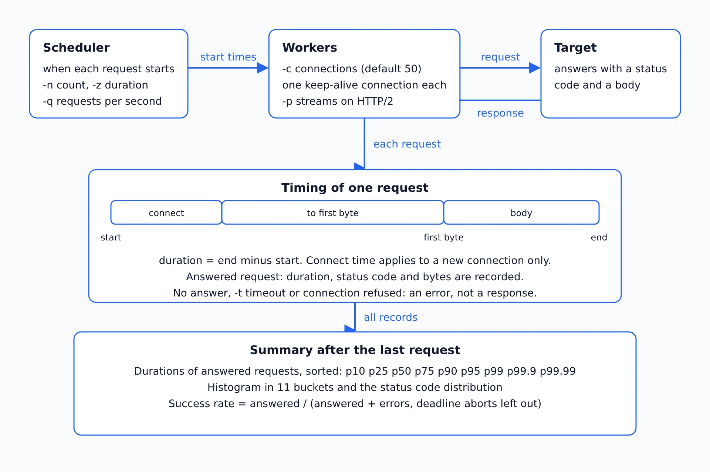

import Accordion from "@components/widgets/Accordion.astro";
import ListCheck from "@components/widgets/ListCheck.astro";
import Notice from "@components/widgets/Notice.astro";
import YouTubeEmbed from "@components/widgets/YouTubeEmbed.astro";

oha load testing starts with one command: `oha https://example.com` sends 200 requests over 50 connections and prints a summary with latency percentiles. Its `Success rate` line does not drop on 500 responses, so a pipeline needs a check of its own.

Every output below is real. oha is 1.17.0, the current release since 2026-11-14, run from the GitHub release binary on a Linux workstation. The two targets ran on the same machine. An nginx container on 127.0.0.1:2251 served a static page, and a Python server on 127.0.0.1:2252 answered `/slow` after a sleep of 100 to 300 ms. Read the addresses as your own host.

| You want | Command |
|---|---|
| A quick number for one page | `oha --no-tui https://example.com` |
| A run at a fixed rate | `oha -q 20 -z 30s --latency-correction --no-tui https://example.com` |
| A POST with a JSON body | `oha -m POST -T application/json -d '{"key":"value"}' https://example.com/api` |
| A result a pipeline can check | `oha -z 30s --output-format json -o run.json https://example.com` |

## What is oha?

oha is an HTTP load generator written in Rust and published under the MIT license by hatoo. It opens several connections and sends requests as fast as they allow, or at a fixed rate.

While it runs it draws a terminal dashboard, and at the end it prints a summary. The repository had 10,758 stars on 2026-11-27, and its latest release is [1.17.0](https://github.com/hatoo/oha/releases/tag/v1.17.0). The name is the Japanese greeting "ohayou".

oha speaks HTTP and nothing else. Version 1.17.0 has no scripting, WebSocket mode or browser, and `--http-version 3` needs a build with the `http3` feature.



<YouTubeEmbed
  url="https://www.youtube.com/embed/iVcvbmY0pk8"
  label="Unleash the Power of oha: Website Performance Testing Made Simple"
/>

## How do I install oha?

Install oha from its GitHub release binary, with Homebrew (`brew install oha`), with `winget install hatoo.oha` on Windows, with Cargo, or through Docker. Every route ends with the same `oha` command.

| Route | Command | Note |
|---|---|---|
| Release binary | download `oha-linux-amd64` from the [release page](https://github.com/hatoo/oha/releases), `chmod +x`, put it on `PATH` | arm64, macOS and Windows files are next to it |
| Homebrew | `brew install oha` | the formula was at 1.17.0 on 2026-11-27 |
| Windows | `winget install hatoo.oha` | from the README |
| Cargo | `cargo install oha` | needs `make` and `cmake` |
| Docker | `docker run --rm --network=host ghcr.io/hatoo/oha:1.17.0 --no-tui URL` | tags `1.17.0` and `latest` |

Check the version first:

```bash
oha --version
```

```text
oha 1.17.0
```

A Homebrew copy installed earlier can lag. The one on the workstation reported 1.16.0. `--network=host` lets the container reach a target on the host's `127.0.0.1`; in the lab the image fetched the nginx page 20 times with status 200.

## How do I run a basic oha load test?

`oha https://example.com` runs 200 requests over 50 connections and prints a summary at the end. Add `--no-tui` when you pipe or save the output.

oha also turns the dashboard off by itself when stdout is not a terminal. The lab against the static page:

```bash
oha --no-tui http://127.0.0.1:2251/
```

```text
Summary:
  Success rate: 100.00%
  Total:        23.6586 ms
  Slowest:      16.8842 ms
  Fastest:      0.1925 ms
  Average:      3.9593 ms
  Requests/sec: 8453.5713

  Total data:   2.24 MiB
  Size/request: 11.46 KiB
  Size/sec:     94.57 MiB

Response time histogram:
   0.192 ms [1]  |
   1.862 ms [67] |■■■■■■■■■■■■■■■■■■■■■■■■■■■■■■■■
   3.531 ms [38] |■■■■■■■■■■■■■■■■■■
   5.200 ms [25] |■■■■■■■■■■■
   6.869 ms [22] |■■■■■■■■■■
   8.538 ms [33] |■■■■■■■■■■■■■■■
  10.208 ms [7]  |■■■
  11.877 ms [3]  |■
  13.546 ms [2]  |
  15.215 ms [0]  |
  16.884 ms [2]  |

Response time distribution:
  10.00% in 0.5788 ms
  25.00% in 0.9531 ms
  50.00% in 3.1149 ms
  75.00% in 6.5259 ms
  90.00% in 7.6339 ms
  95.00% in 10.1680 ms
  99.00% in 15.5769 ms
  99.90% in 16.8842 ms
  99.99% in 16.8842 ms


Details (average, fastest, slowest):
  DNS+dialup:   1.1329 ms, 0.0826 ms, 5.9401 ms
  DNS-lookup:   0.0119 ms, 0.0017 ms, 0.1004 ms
  First byte:   3.9371 ms, 0.1923 ms, 16.7975 ms

Status code distribution:
  [200] 200 responses
```

### What each line of the summary means

| Line | What it holds |
|---|---|
| `Success rate` | answered requests divided by answered plus errored requests. The status code plays no part (see the failures section) |
| `Total` | wall-clock time of the whole run, from just before the first worker starts until the last one ends |
| `Slowest`, `Fastest`, `Average` | the longest, shortest and mean duration of the answered requests |
| `Requests/sec` | all requests, errors included, divided by `Total` |
| `Total data`, `Size/request`, `Size/sec` | body bytes of the answered requests, summed, averaged per request, and per second |
| `Response time histogram` | 11 buckets between the fastest and the slowest answered request |
| `Response time distribution` | the percentiles: `90.00% in 7.6339 ms` means 90% of answered requests finished within 7.6339 ms. The time unit follows the slowest request, milliseconds up to one second and seconds above, and `-u` pins it |
| `Details` | average, fastest and slowest of `DNS+dialup`, `DNS-lookup` and `First byte`, in that order. oha measures `DNS+dialup` only on a new connection, so with keep-alive it covers the first request of each connection |
| `Status code distribution` | how many responses came back with each status |
| `Error distribution` | requests that got no response; oha counts them per error message |

### What the dashboard shows

Without `--no-tui`, oha draws six panels and refreshes them 16 times per second by default (`--fps`). This screen comes from a run of `-z 30s -c 10` against the slow endpoint, two seconds in:

```text
┌Progress──────────────────────────────────────────────────────────────────────┐
│██████                             2s / 30s                                   │
└──────────────────────────────────────────────────────────────────────────────┘
┌Stats for last sec────────────────────┐┌Status code distribution──────────────┐
│Requests : 57                         ││[200] 123 responses                   │
│Slowest: 0.2985 secs                  ││                                      │
│Fastest: 0.1040 secs                  ││                                      │
│Average: 0.1818 secs                  ││                                      │
│Data: 2.62 KiB                        ││                                      │
│Number of open files: 23 / 1048576    ││                                      │
└──────────────────────────────────────┘└──────────────────────────────────────┘
┌Error distribution────────────────────────────────────────────────────────────┐
└──────────────────────────────────────────────────────────────────────────────┘
┌Requests / past sec (auto). press -/+/┐┌Response time histogram───────────────┐
│      █████                           ││        ███████                       │
│      █████ ▆▆▆▆▆                     ││        ███████                       │
│      █████ █████                     ││        ███████                       │
│      █████ █████                     ││        ███████                       │
│▆▆▆▆▆ █████ █████                     ││        ███████ ▇▇▇▇▇▇▇               │
│█████ █████ █████                     ││        ███████ ███████ ▆▆▆▆▆▆▆       │
│█████ █████ █████                     ││        ███████ ███████ ███████       │
│█████ █████ █████                     ││        ███████ ███████ ███████       │
│█████ █████ █████                     ││        ███████ ███████ ███████       │
│█29██ █50██ █44██                     ││▂▂▂1▂▂▂ ██27███ ██16███ ██13███       │
│ 0s    1s    2s    3s    4s    5s     ││0.1040  0.1689  0.2337  0.2985        │
└──────────────────────────────────────┘└──────────────────────────────────────┘
```

`Progress` shows elapsed and total time. `Stats for last sec` covers the previous second, and its open files line counts against the process limit. `Requests / past sec` plots the throughput; `-`, `+` and `a` change its time scale.

## How do I read the latency percentiles?

Read `50.00% in 203.4916 ms` as: half of the answered requests finished within 203.4916 ms. Put the budget on p99 or p95, and use the average only as a sanity check.

In the first output the average is 3.9593 ms and the p99 is 15.5769 ms, nearly four times as much. The slow endpoint gives a spread-out distribution:

```bash
oha --no-tui -n 200 -c 10 http://127.0.0.1:2252/slow
```

```text
Response time histogram:
  101.374 ms [1]  |■
  121.552 ms [16] |■■■■■■■■■■■■■■■■■■■■■
  141.729 ms [17] |■■■■■■■■■■■■■■■■■■■■■■
  161.907 ms [21] |■■■■■■■■■■■■■■■■■■■■■■■■■■■■
  182.085 ms [19] |■■■■■■■■■■■■■■■■■■■■■■■■■
  202.263 ms [24] |■■■■■■■■■■■■■■■■■■■■■■■■■■■■■■■■
  222.441 ms [23] |■■■■■■■■■■■■■■■■■■■■■■■■■■■■■■
  242.619 ms [18] |■■■■■■■■■■■■■■■■■■■■■■■■
  262.796 ms [23] |■■■■■■■■■■■■■■■■■■■■■■■■■■■■■■
  282.974 ms [18] |■■■■■■■■■■■■■■■■■■■■■■■■
  303.152 ms [20] |■■■■■■■■■■■■■■■■■■■■■■■■■■

Response time distribution:
  10.00% in 126.0879 ms
  25.00% in 154.3503 ms
  50.00% in 203.4916 ms
  75.00% in 254.0489 ms
  90.00% in 285.3383 ms
  95.00% in 293.8587 ms
  99.00% in 299.6960 ms
  99.90% in 303.1521 ms
  99.99% in 303.1521 ms
```

The server sleeps between 100 and 300 ms, and the percentiles follow: 126 ms at p10, 203 ms at the median, 300 ms at p99.

Percentiles come from the answered durations, sorted. oha takes the value at index `p / 100 * n`, with `n` the number of answered requests. In a 200-request run the p99 is the value at index 198, so the two slowest requests decide it. Raise `-n`, or use `-z`, before you quote a tail number.

| Percentile | The question it answers |
|---|---|
| p50 | what a typical visitor waits |
| p90 | what one visitor in ten waits |
| p99 | what one visitor in a hundred waits. Put the budget here, with enough requests behind it: 5,000 requests put 50 of them behind the p99 |
| p99.9 and p99.99 | one stall in a thousand and one in ten thousand. 10,000 requests put 10 behind the p99.9 and 1 behind the p99.99 |

## What does the concurrency number mean?

`-c 50` opens 50 connections, the workers in the diagram above, and each sends the next request the moment the previous response ends. There is no think time, so fifty connections hit a page harder than fifty people in a browser would.

Requests in flight equal the rate times the seconds per request (Little's law). The duration run below delivered 49.9750 requests per second at an average of 0.2029 seconds. The product, 10.1, is the number of connections. To turn real traffic into a number, start from visitors per hour and set `-q`, the rate for the whole run:

| `-q` | Requests per hour | Requests per day |
|---|---|---|
| 1 | 3,600 | 86,400 |
| 10 | 36,000 | 864,000 |
| 100 | 360,000 | 8,640,000 |

With `-q`, `-c` becomes a ceiling. Once every connection is busy, due requests wait for a free one (see latency correction below). Keep-alive stays on by default. `--disable-keepalive` makes every request open a new TCP connection and, on HTTPS, run a new TLS handshake.

## How long should an oha run be?

Long enough for several thousand requests. I recommend `-z 30s` after one warm-up run that you discard, and `-n` only for smoke checks.

`-n` counts requests. `-z` runs for a duration such as `10s` or `3m`. When it ends on HTTP/1, oha aborts the requests still in flight and counts them on their own:

```bash
oha --no-tui -z 5s -c 10 http://127.0.0.1:2252/slow
```

```text
Status code distribution:
  [200] 240 responses

Error distribution:
  [10] aborted due to deadline
```

The success rate leaves the 10 aborted requests out, because the deadline and not the server cut them off. `-w` makes oha wait for them instead.

Warm-up matters at both ends. oha resolves the name once and caches it, and each connection pays its setup on its first request. In the first output `DNS+dialup` averages 1.1329 ms, and only the first request on each of the 50 connections paid it. The server has first-use costs of its own, which the lab did not measure. Run once, discard, then measure.

`-t` limits each request and defaults to infinite. Set it, or a stuck endpoint hangs the run.

## When does latency correction matter?

Only with `-q` or `--burst-delay`, and only when every connection is busy. A due request then waits for a free connection, and its uncorrected duration starts when it is finally sent.

The wait disappears from the latency numbers, so the result looks better than what a client at that rate would see. This is the coordinated omission problem.

The lab asked for 50 requests per second over 5 connections to the 200 ms endpoint. Five connections carry about 25 per second, so half of the schedule waited:

```bash
oha --no-tui -q 50 -c 5 -z 5s http://127.0.0.1:2252/slow
```

```text
Summary:
  Success rate: 100.00%
  Total:        5002.2816 ms
  Slowest:      300.5832 ms
  Fastest:      102.3770 ms
  Average:      200.2119 ms
  Requests/sec: 25.1885
```

The average of 200 ms looks healthy. Only `Requests/sec` shows that 50 were requested and 25 arrived. The same run with `--latency-correction`:

```bash
oha --no-tui -q 50 -c 5 -z 5s --latency-correction http://127.0.0.1:2252/slow
```

```text
Summary:
  Success rate: 100.00%
  Total:        5.0018 sec
  Slowest:      2.6309 sec
  Fastest:      0.1110 sec
  Average:      1.3881 sec
  Requests/sec: 24.7910
```

The median of that run is 1.3886 seconds and the p99 is 2.6129 seconds. The `First byte` line of the same output stays near 200 ms:

```text
Details (average, fastest, slowest):
  DNS+dialup:   0.0002 sec, 0.0002 sec, 0.0003 sec
  DNS-lookup:   0.0000 sec, 0.0000 sec, 0.0001 sec
  First byte:   0.2041 sec, 0.1012 sec, 0.2986 sec
```

The server still answers at its usual speed; the extra second is queue time inside oha. A real client always waits, so the corrected number is the honest one. Raise `-c` until corrected and uncorrected medians agree; the [README](https://github.com/hatoo/oha#stress-test-in-more-realistic-condition) recommends `--latency-correction` together with `-q`.

## How do I test a POST endpoint with a body and headers?

`-m` sets the method, `-T` the content type, `-d` the body and `-H` an extra header:

```bash
oha --no-tui -n 20 -c 5 -m POST -T application/json -d '{"key":"value"}' -H 'X-Api-Key: test-key' http://127.0.0.1:2252/api/echo
```

```text
Summary:
  Success rate: 100.00%
  Total:        11.3191 ms
  Slowest:      7.1894 ms
  Fastest:      0.3436 ms
  Average:      2.2999 ms
  Requests/sec: 1766.9320
```

All 20 responses had status 200. Before a long run, check what leaves the machine: `--debug` performs a single request and dumps it with the response.

```bash
oha --no-tui --debug -m POST -T application/json -d '{"key":"value"}' -H 'X-Api-Key: test-key' http://127.0.0.1:2252/api/echo
```

```text
Request {
    method: POST,
    uri: /api/echo,
    version: HTTP/1.1,
    headers: {
        "accept": "*/*",
        "accept-encoding": "gzip, compress, deflate, br",
        "user-agent": "oha/1.17.0",
        "content-type": "application/json",
        "x-api-key": "test-key",
        "host": "127.0.0.1:2252",
    },
    body: Full {
        data: Some(
            b"{\"key\":\"value\"}",
        ),
    },
}
```

The dump shows the body, the `x-api-key` header and the defaults oha adds. The response part carried the same header and body back.

| Flag | Job | Default |
|---|---|---|
| `-m` | method | GET |
| `-H` | extra header, repeat for each one | none beyond `accept`, `accept-encoding` and `user-agent` |
| `-T` | `Content-Type` header | none |
| `-d` | body as a string | none |
| `-D` | body from a file | none |
| `-Z` | a random line of a file per request, as the body | none |
| `-F` | multipart form data in curl syntax, for example `-F 'file=@path'` | none |
| `-A` | `Accept` header | `*/*` |
| `-a` | Basic auth as `user:password`, or AWS keys with `--aws-sigv4` | none |
| `--host` | `Host` header | the host from the URL |
| `--disable-compression` | drop `Accept-Encoding` | compression accepted |

`-d`, `-D`, `-Z` and `-F` exclude each other. With Basic auth, five requests to the protected endpoint gave `[401] 5 responses`, and the same five with `-a labuser:labpass` gave `[200] 5 responses`.

## What do 429, 5xx and timeouts look like in oha?

They show up as status codes under `Status code distribution`, not as failures. oha counts every answered request as a success, and only a request with no response lowers the success rate.

<Notice type="warning" title="A 100% success rate does not mean the page works">
A run in which every request returns 500 prints `Success rate: 100.00%`. Read the status code distribution of every run, or gate on it in the next section.
</Notice>

Four cases from the lab:

| Case | Command | What oha printed |
|---|---|---|
| 20 requests to an endpoint that returns 500 | `oha --no-tui -n 20 http://127.0.0.1:2252/error` | `Success rate: 100.00%` and `[500] 20 responses` |
| Default run against nginx with `limit_req` at 100 requests per second | `oha --no-tui http://127.0.0.1:2251/limited` | `Success rate: 100.00%`, `[503] 198 responses`, `[200] 2 responses` |
| 10 requests to an endpoint that sleeps 10 s, with `-t 500ms` | `oha --no-tui -n 10 -c 5 -t 500ms http://127.0.0.1:2252/hang` | `Success rate: 0.00%` and `[10] timeout` |
| 5 requests to a closed port | `oha --no-tui -n 5 http://127.0.0.1:2259/` | `Success rate: 0.00%` and `[5] Connection refused (os error 111)` |

The first case reports `Success rate: 100.00%` and ends with:

```bash
oha --no-tui -n 20 http://127.0.0.1:2252/error
```

```text
Status code distribution:
  [500] 20 responses
```

What each case means:

- A 429 or a 503 from a rate limiter says the limiter answered, not the application. nginx `limit_req` rejects with 503 by default ([nginx docs](https://nginx.org/en/docs/http/ngx_http_limit_req_module.html)). Raise the limit for the test address, or keep `-q` under it.
- A 5xx from the application means the application failed on that request. The lab endpoint returned 500 by design, so its errors say nothing about load.
- `timeout` means the request did not complete within `-t`. In the lab the server accepted the connection and slept for 10 s.
- `Connection refused` means nothing listens on that port, or a firewall rule answered with a reset.

A tool that blocks addresses at the firewall adds its own errors to that distribution. The [CrowdSec guide](/crowdsec-secure-server/) shows where CrowdSec lists the addresses it bans.

Every answered status, 500 included, flows into the percentiles. `--stats-success-breakdown` adds one histogram and distribution for 2xx responses and another for 4xx and 5xx, so a lab run with `[500] 26 responses`, `[200] 17 responses` and `[429] 17 responses` showed each class on its own.

## How do I save oha results for CI?

`--output-format json` with `-o` writes the result to a file and prints nothing. The `metrics` block holds the numbers a pipeline can check:

```bash
oha --no-tui -z 3s -c 10 --output-format json -o result.json http://127.0.0.1:2252/slow
jq '.summary, .metrics' result.json
```

```text
{
  "successRate": 1.0,
  "total": 3.002474259,
  "slowest": 0.309801484,
  "fastest": 0.101180544,
  "average": 0.19977403839455787,
  "requestsPerSec": 52.29020682838101,
  "totalData": 6909,
  "sizePerRequest": 47,
  "sizePerSec": 2301.102159090983
}
{
  "success_rate": 1.0,
  "requests_per_sec": 52.29020682838101,
  "latency_ms": {
    "min": 101.181,
    "mean": 199.774,
    "p50": 199.645,
    "p95": 288.622,
    "p99": 297.394,
    "max": 309.801
  }
}
```

jq's `-e` turns the last value into an exit code, 0 for true and 1 for false or null:

```bash
jq -e '.summary.successRate == 1 and (.statusCodeDistribution | keys | map(tonumber) | all(. < 400)) and (.metrics.latency_ms.p99 < 350)' result.json
```

```text
true
```

The same check on the JSON of the endpoint that returns 500 fails, because the status codes are part of it:

```bash
jq -e '.summary.successRate == 1 and (.statusCodeDistribution | keys | map(tonumber) | all(. < 400))' error.json
```

```text
false
```

jq exits with 1 there, so a CI step stops. On `successRate` alone it would have passed. oha itself exits with 0 even when every request fails, so its exit code cannot gate anything.

`--output-format csv` prints one line per answered request, for a spreadsheet:

```bash
oha --no-tui -n 5 -c 2 --output-format csv http://127.0.0.1:2252/slow
```

```text
request-start,DNS,DNS+dialup,Response-delay,request-duration,bytes,status
0.000393439,0.000057979,0.000308406,0.128793321,0.128794254,47,200
0.000545889,0.00004218,0.000330469,0.215330953,0.215331654,47,200
0.129203713,0,0,0.113442759,0.113443269,47,200
0.215891158,0,0,0.266726464,0.266727415,47,200
0.242658704,0,0,0.174209588,0.174210119,47,200
```

## Where should I run oha?

On a second machine, not on the server under test. On the same host the generator and the server share CPU, and loopback traffic skips the network card and often the reverse proxy.

The lab workstation pushed 23,063 requests per second of the static page with `-n 1k -c 50`, on the same host as nginx. A second machine puts the network card and the reverse proxy back into the measurement. For a rented generator, the [Hetzner and Oracle ARM benchmarks](/hetzner-oracle-arm-performance/) compare the small ARM plans. When the server has to grow instead, the [VPS benchmarking guide](/benchmark-cloud-servers/) shows how to measure a plan. The [ARM vs x86 VPS benchmarks](/arm-vs-x86-vps-server-benchmarks/) compare two server classes for a WordPress site.

Point oha at the path users take. A number from port 8080 on the server says nothing about the reverse proxy or the tunnel in front of it. For a site published through a tunnel such as Pangolin, test the public hostname too ([Pangolin guide](/pangolin-cloudflare-tunnels-alternative/)).

A large `-c` can exhaust the file descriptors of the shell that runs oha. The lab run with `-c 500` under a soft limit of 256 failed more than half of its requests:

```bash
ulimit -n 256
oha --no-tui -c 500 -n 500 http://127.0.0.1:2251/
```

```text
Status code distribution:
  [200] 219 responses

Error distribution:
  [281] No file descriptors available (os error 24)
```

Raise the soft limit with `ulimit -n 4096` or lower `-c`. The server's listen backlog must hold the same number of connections.

Watch the target during the run; the [server and Docker resource monitoring guide](/sever-monitoring/) shows the setup. After the run, confirm from outside that the site came back ([Beszel and Uptime Kuma guide](/beszel-uptime-kuma/)).

If you start a container as the target, publish its port on 127.0.0.1 only, as the lab did with `-p 127.0.0.1:2251:80`. A bare `-p 2251:80` opens it on every interface, because [Docker bypasses UFW](/docker-bypasses-firewall/) for published ports.

## What is allowed when load testing?

Test what you own, or what the owner allowed in writing; the provider's own endpoints and sites you do not run are off limits without that permission. A rented VPS is yours up to the provider's acceptable use policy.

AWS puts the line in writing. Its [EC2 Testing Policy](https://aws.amazon.com/ec2/testing/) calls a test that sends "a large volume of legitimate or test traffic to a specific intended target application" a network stress test. A test that tries to overwhelm a target is a DDoS test, which the same page calls "explicitly prohibited from the Amazon EC2 platform". Its [security testing policy](https://aws.amazon.com/security/penetration-testing/) lists "Request flooding" as prohibited (both checked 2026-11-27).

<ListCheck>
<ul>
<li>A staging copy, or a production window the owner agreed to in writing</li>
<li>A request rate and a duration written down before the start</li>
<li>`-t` set, so a stuck endpoint cannot hang the run</li>
<li>GET requests only on production, or a test account for writes, because a POST run creates real rows</li>
<li>Someone watching the server, with a stop condition such as an error rate above 1%</li>
</ul>
</ListCheck>

## oha or k6: which one should you use?

Use oha when the test is one URL and the answer is a number. Use k6 when the test is a script: several requests in a row, a login, a check on a response body, or a threshold that fails the run by itself.

| | oha 1.17.0 | k6 2.4.0 |
|---|---|---|
| What you write | oha takes one command line | k6 takes a JavaScript script |
| Pass or fail in CI | oha writes JSON, and you add the jq check | k6 takes thresholds in the script. A failed threshold ends the test with a non-zero exit code |
| Protocols | oha speaks HTTP/0.9, 1.0, 1.1 and 2, and 3 only in a self-built binary | k6 speaks HTTP/1.1, HTTP/2, WebSockets and gRPC built in, and runs browser tests through its browser API |
| License | oha is MIT | k6 is AGPL-3.0 |
| Best for | oha for a quick number, a rate-limited run or a smoke gate on one endpoint | k6 for user journeys with think time and checks on the response |
| Trade-off | oha has no scripting, think time or body checks | k6 has a runtime and a script to maintain |

k6 2.4.0 was released on 2026-11-12. Its columns follow the k6 [protocols](https://grafana.com/docs/k6/latest/using-k6/protocols/) and [thresholds](https://grafana.com/docs/k6/latest/using-k6/thresholds/) documentation, checked 2026-11-27.

## Flag reference for oha 1.17.0

Every flag of `oha --help` in 1.17.0, grouped by job. The HTTPS and proxy flags come from the help text alone; the lab ran plain HTTP.

| Job | Flags | Default |
|---|---|---|
| How many, how long | `-n`, `-z`, `-w`, `--burst-delay`, `--burst-rate` | 200 requests. `-q` overrides the burst flags |
| How hard | `-c`, `-p`, `-q` | 50 connections, 1 stream per HTTP/2 connection (`-c` times `-p` workers in total), no rate limit (`-q 0` also means none) |
| Request | `-m`, `-H`, `-A`, `-T`, `-d`, `-D`, `-Z`, `-F`, `--host`, `--disable-compression` | GET, no body, compression accepted |
| Auth | `-a`, `--aws-session`, `--aws-sigv4` | none |
| Targets | `--urls-from-file`, `--rand-regex-url`, `--max-repeat`, `--dump-urls` | the URL on the command line. With a file, oha picks a line at random for each request |
| Transport | `--http-version`, `--http2`, `--disable-keepalive`, `-r`, `--connect-timeout`, `-t`, `--ipv4`, `--ipv6`, `--no-pre-lookup`, `--connect-to`, `--unix-socket`, `--vsock-addr` | HTTP/1.1, keep-alive on, oha follows no redirects (`-r 0`), 5s connect timeout, no request timeout, oha resolves the name once at start |
| Proxy | `-x`, `--proxy-http-version`, `--proxy-http2`, `--proxy-header` | none |
| TLS | `--cacert`, `--cert`, `--key`, `--insecure` | system store, verification on, no client certificate |
| Measurement | `--latency-correction`, `--stats-success-breakdown`, `-u` | all off. The unit follows the slowest request |
| Output | `--no-tui`, `--fps`, `--no-color`, `--output-format`, `-o`, `--db-url`, `--debug` | dashboard on at 16 frames per second, text to stdout. Without `-q` or `--burst-delay`, `--no-tui` also switches oha to a faster implementation that skips collecting data for the live view ([README](https://github.com/hatoo/oha#performance)). `--db-url` stores each succeeded request in an SQLite table named `oha`, and later runs append. `quiet` prints nothing |
| Runtime | `--worker-threads` | one thread per physical core |

The redirect default became 0 in 1.15.0. A default run against an endpoint that answers 302 reports `[302] 200 responses`, and the same run with `-r 3` reports `[200] 200 responses`.

`--urls-from-file` takes one URL per line, for example the paths from an access log, and picks one at random for each request ([README](https://github.com/hatoo/oha#urls-from-file-feature)). Keep one host in that file:

<Notice type="info" title="Keep one host per URLs file when keep-alive is on">
With `--urls-from-file`, a worker sends its next request through the connection it already has, even when the URL names another host. In the lab, a file with three URLs on two servers returned 78 to 106 responses with status 404 in 15 of 16 runs. The `/slow` path had reached nginx, which has no such path. With `--disable-keepalive` the same file returned `[200] 300 responses` in each of three runs.
</Notice>

## FAQ

<Accordion label="What does a bare oha command send?" group="faq">
`oha https://example.com` sends 200 requests over 50 connections with keep-alive on and follows no redirects, the defaults of `-n`, `-c` and `-r` in 1.17.0. Add `-z 30s` to run for a duration instead of a request count.
</Accordion>

<Accordion label="Why does oha report a 100% success rate next to 500 responses?" group="faq">
oha counts every answered request as a success; only a request without a response is an error. Read `Status code distribution`, or gate on it with `jq -e '(.statusCodeDistribution | keys | map(tonumber) | all(. < 400))' run.json`, which exits with 1 on a 500.
</Accordion>

<Accordion label="Does oha support WebSocket or HTTP/3?" group="faq">
There is no WebSocket mode in 1.17.0. HTTP/3 needs a build with the `http3` feature; the release binary answers `Error: Your Oha instance has not been built with HTTP/3 support.` k6 speaks WebSockets out of the box.
</Accordion>

<Accordion label="Does oha follow redirects?" group="faq">
Not by default. The redirect limit has been 0 since 1.15.0, so oha records a 302 as `[302] 200 responses`. `-r 3` follows up to three redirects, and the lab then reported `[200] 200 responses`. oha does not follow redirects on HTTP/2.
</Accordion>

<Accordion label="How many requests give a usable p99?" group="faq">
oha takes the p99 at index `99 / 100 * n` of the sorted durations, so in a 200-request run two requests decide it. Use `-n 5000` or `-z 30s`, which puts 50 requests behind the p99.
</Accordion>

<Accordion label="How do I stop oha from running out of file descriptors?" group="faq">
Each connection uses one descriptor. A lab run with `-c 500` under `ulimit -n 256` failed 281 of 500 requests with `No file descriptors available (os error 24)`. Raise the soft limit with `ulimit -n 4096` or lower `-c`.
</Accordion>

<Accordion label="What is the difference between -n and -z?" group="faq">
`-n` stops after a request count and defaults to 200. `-z` stops after a duration such as `5s` or `3m`. On HTTP/1, oha aborts the requests in flight at the deadline and lists them as `aborted due to deadline`, which the success rate leaves out.
</Accordion>

<Accordion label="Can I load test a site I do not own?" group="faq">
Only with the owner's written permission. AWS, for one, forbids tests of its own infrastructure and lists "Request flooding" among prohibited activities, while its EC2 Testing Policy allows stress tests of a customer's own target application. Test a staging copy first.
</Accordion>
