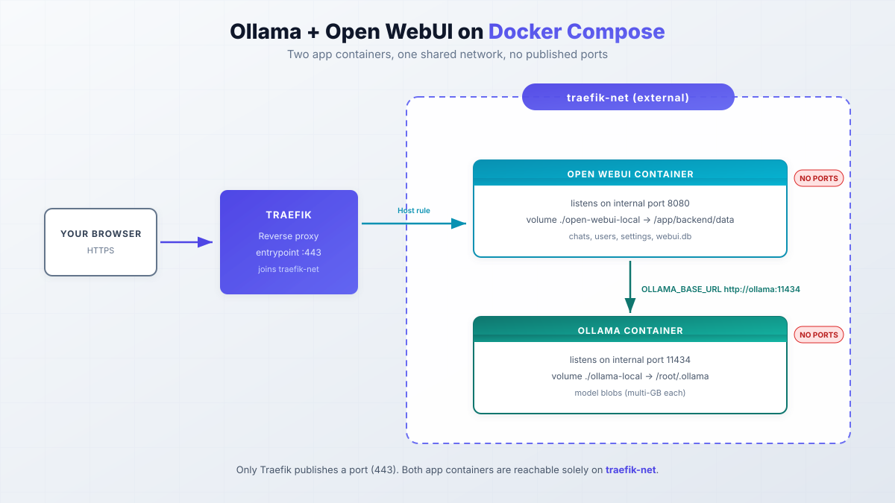

import Button from "@components/widgets/Button.astro";
import Notice from "@components/widgets/Notice.astro";
import ListCheck from "@components/widgets/ListCheck.astro";
import Accordion from "@components/widgets/Accordion.astro";
import Tabs from "@components/widgets/Tabs.astro";
import Tab from "@components/widgets/Tab.astro";
import YouTubeEmbed from "@components/widgets/YouTubeEmbed.astro";
import { Picture } from "astro:assets";
import imag1 from "../../assets/images/24/08/openwebui-pull-model.png";
import imag2 from "../../assets/images/24/08/openweb-ui-use.png";

Running Ollama with Docker Compose is the cleanest way to self-host a local AI stack: two containers, one file, and your data never leaves your machine. This guide pairs Ollama (v0.40.3 as of Oct 2026) with Open WebUI (v0.12.0) behind Traefik, with ready-to-use Compose files for CPU, NVIDIA GPU, and AMD ROCm setups.

You get three hardware variants of the same stack, a verify step after each stage, a rollback path for updates, and honest notes on the hardware you need. CPU-only is fine for tinkering. If you want to daily-drive bigger models, plan on a GPU box or a mini PC.

## What is Ollama?

[Ollama](https://ollama.com/) is the tool most people reach for when they want large language models running on their own hardware. It downloads and serves models behind a small REST API, and it keeps model files on disk instead of in someone else's cloud. Library models come pre-quantized, so there is no quantize step in the download path. As of Oct 2026 the current release is v0.40.3.

- Models run on your machine, so prompts and documents stay private.
- `ollama pull`, `ollama list`, and `ollama rm` cover day-to-day model management.
- Everything the CLI does is also on the REST API at `http://localhost:11434`, which is what Open WebUI talks to.
- It runs on Linux, macOS, and Windows, with official Docker images (`ollama/ollama`, ~3.8 GB, ~185M pulls on Docker Hub).
- GPU support covers NVIDIA CUDA and AMD ROCm, plus a bundled Vulkan runtime for cards without official ROCm support.

The project is still moving fast. v0.30 rebuilt the engine on a new llama.cpp compatibility layer, and since v0.32 the `ollama` CLI can drop you into an interactive coding agent, with `ollama launch` driving external agents. For a Docker deployment none of that changes the compose file, but it is a good sign the base layer is not stagnant.

## What is Open WebUI?

Ollama is happy on the command line. Most people are not. [Open WebUI](https://openwebui.com/) is the browser interface I put in front of it: a chat app that talks to Ollama and to other providers (OpenAI, Anthropic, anything OpenAI-compatible) from one screen. As of Oct 2026 the current release is v0.12.0.

- Point it at local Ollama and remote APIs side by side, and enable or disable each connection.
- The chat workspace has conversation history, prompt templates, export, and model switching per message.
- Users and auth cover local accounts, OAuth, and admin roles. The first account created becomes the admin.
- Since v0.9 there is a packaged desktop app for Mac/Windows/Linux if you want out of the browser.
- Since v0.10 you can share chats and knowledge per user or group.
- The v0.11 admin panel redesign is why older screenshots and menus in other guides look wrong now.
- Since v0.12 there is realtime voice on an OpenAI Realtime backend, plus personal MCP/tool-server integrations behind the `ENABLE_DIRECT_INTEGRATIONS` admin switch (off by default).

One detail that matters here: Open WebUI stores everything (users, chats, settings) in a SQLite database inside its data volume. That volume is the thing you back up. Ollama's model blobs are disposable; `webui.db` is not.

## How to set up Ollama and Open WebUI with Docker Compose

What we are building: one Compose file with two services. Open WebUI gets Traefik labels so it is reachable on your domain over HTTPS. Ollama stays internal. Neither container publishes a port to the host, so nothing is exposed to the internet except Traefik on 443.



> If you are interested to see some free cool open source self hosted apps you can check [toolhunt.net self hosted section](https://toolhunt.net/sh/).

<YouTubeEmbed
  url="https://www.youtube.com/embed/FHTYrMtLkmQ"
  label="How to Set Up Ollama with Open WebUI using Docker Compose"
/>

### 1. Prerequisites

Before you start, this must already exist on the host:

<ListCheck>
<ul>
<li>Linux host with Docker Engine and Docker Compose v2 (`docker compose version` prints something). New to Docker? Keep the <a href="/docker-commands/">essential Docker commands cheat sheet</a> open.</li>
<li>Traefik running as a reverse proxy and attached to an external network named `traefik-net`. See <a href="/traefik-proxy-docker/">Traefik as a reverse proxy in Docker</a> and <a href="/traefik-wildcard-certificate/">Traefik wildcard certificate with Cloudflare</a> if that is not set up yet.</li>
<li>DNS A record for your chosen hostname (examples below use `openwebui.domain.com`) pointing at the server.</li>
<li>~20 GB free disk for the base image plus one mid-size model. The `ollama/ollama:latest` image is ~3.8 GB (`:rocm` is ~1.4 GB) and model blobs in `./ollama-local` run multi-GB each.</li>
<li>GPU and driver stack if you plan to use one: NVIDIA driver >= 550 (>= 570 for older cards) or AMD ROCm v7 (`amdgpu-install`).</li>
<li>Optional: <a href="/dockge-install/">Dockge</a> if you prefer deploying the Compose file from a UI.</li>
</ul>
</ListCheck>

<Notice type="info" title="Affiliate disclosure">
Some links below are affiliate links, including `/go/` redirects that land on Amazon. If you buy through them, I earn a small commission at no extra cost to you.
</Notice>

Hardware reality check, because this is where most local AI projects stall. A CPU-only VPS is for tinkering. An 8 vCPU / 16 GB box with no GPU will crawl on anything past the small models. If you want responsive daily use, get a GPU box, or run it at home on a mini PC: the <a href="/best-mini-pc-home-server/">mini PC as home server</a> picks and the <a href="/best-mini-pc-local-llm/">local LLM mini PC guide</a> (for hardware that can hold a 70B model) both cover that. For rented hardware I use [Hetzner](https://go.bitdoze.com/hetzner) and [Hostinger](https://go.bitdoze.com/hostinger-vps); for home hardware, a compact mini PC like the [ASUS DC510](https://go.bitdoze.com/asus-dc510) is the right form factor.

If you are buying hardware specifically for this stack, these are the two shapes that make sense:

| Box | Price (Oct 23, 2026) | What it runs in Ollama |
|---|---|---|
| A desktop with an [RTX 5060 Ti 16GB](/go/rtx-5060-ti-16gb/) | $765.99 for the card | 8B-14B models fast on CUDA. Use the NVIDIA compose variant below |
| [GMKtec EVO-X2 128GB](/go/gmktec-evo-x2-128gb/) | $3,649.99 | 70B dense (slowly) and 120B-class MoE models that no 16GB card can load |

GPU prices are well above launch right now, so read the [GPU box section](/best-mini-pc-local-llm/#need-cuda-build-a-gpu-box-instead) of the local LLM guide before you buy a card. One trap on a Mac: Docker on macOS can't reach the Apple GPU, so Ollama in a container there is CPU-only. On a Mac, install Ollama natively and point Open WebUI at it with `OLLAMA_BASE_URL: http://host.docker.internal:11434`.

<Notice type="warning" title="Budget disk before you pull models">
One mid-size model plus the base image will eat ~15-20 GB. Do not back up model blobs; you can always re-pull them. Do back up `./open-webui-local`, which holds `webui.db`. If the disk fills up, Docker gets weird fast: see how to <a href="/clean-docker-overlay2-dir/">reclaim Docker disk space safely</a>.
</Notice>

_VPS prices jumped across the board in 2026. If you are rethinking a rented box, see [what changed and when a mini PC wins](/vps-price-increases/)._

### 2. Docker Compose

One compose file, three hardware variants. Pick the one that matches your box. A few settings apply to all three:

- `restart: unless-stopped` on **both** services. The official snippets sometimes skip it on Ollama; add it unless you enjoy re-running `docker compose up` after every host reboot.
- `OLLAMA_BASE_URL: http://ollama:11434` on the Open WebUI service. This is the single-backend variable.

<Notice type="info" title="OLLAMA_BASE_URL vs OLLAMA_BASE_URLS">
`OLLAMA_BASE_URL` points Open WebUI at one Ollama instance. `OLLAMA_BASE_URLS` is the semicolon-separated, load-balanced multi-backend variable and it takes precedence when both are set. With a single container, use `OLLAMA_BASE_URL`.
</Notice>

<Notice type="warning" title="Generate WEBUI_SECRET_KEY">
Generate a real key before first boot: `openssl rand -hex 32`. It signs session cookies and internal tokens. Rotating it after users exist logs everyone out. If you would rather keep it out of the YAML entirely, <a href="/docker-compose-secrets/">manage `WEBUI_SECRET_KEY` with Docker Compose secrets</a> or an env file on disk with tight permissions.
</Notice>

If you are behind a corporate proxy, set `HTTPS_PROXY` on the ollama service only. The Ollama docs explicitly warn that `HTTP_PROXY` can break model pulls.

#### CPU only

```yml
services:
  open-webui:
    image: ghcr.io/open-webui/open-webui:main   # pin ghcr.io/open-webui/open-webui:v0.12.0 for shared/prod
    container_name: openwebui
    hostname: openwebui
    restart: unless-stopped
    networks:
      - traefik-net
    volumes:
      - ./open-webui-local:/app/backend/data
    environment:
      OLLAMA_BASE_URL: http://ollama:11434
      WEBUI_SECRET_KEY: change-me-openssl-rand-hex-32
    labels:
      - "traefik.enable=true"
      - "traefik.http.routers.openwebui.rule=Host(`openwebui.domain.com`)"
      - "traefik.http.routers.openwebui.entrypoints=https"
      - "traefik.http.services.openwebui.loadbalancer.server.port=8080"

  ollama:
    image: ollama/ollama:latest                 # or pin ollama/ollama:0.40.3
    container_name: ollama
    hostname: ollama
    restart: unless-stopped
    volumes:
      - ./ollama-local:/root/.ollama
    environment:
      OLLAMA_CONTEXT_LENGTH: "8192"             # small-RAM box; server default is VRAM-tiered (4k/32k/256k)

networks:
  traefik-net:
    external: true
```

What the Traefik labels do:

- `traefik.enable=true`: lets Traefik route to this container.
- ``traefik.http.routers.openwebui.rule=Host(`openwebui.domain.com`)``: matches traffic for that hostname. Replace with your own DNS name.
- `traefik.http.routers.openwebui.entrypoints=https`: serves it on the HTTPS entrypoint only.
- `traefik.http.services.openwebui.loadbalancer.server.port=8080`: Open WebUI listens on 8080 inside the container. This is still correct in v0.12.

No `ports:` section anywhere. That is deliberate. Ollama is only reachable as `http://ollama:11434` from inside `traefik-net`.

On `OLLAMA_CONTEXT_LENGTH`: Ollama picks a default context by available VRAM (4k under 24 GiB, 32k for 24-48 GiB, 256k above). Setting 8192 is a sane floor for small boxes and keeps memory use predictable.

<Notice type="warning" title="The num_ctx trap">
Open WebUI has its own per-model `num_ctx` setting and it overrides `OLLAMA_CONTEXT_LENGTH`. It can pre-fill a tiny value like 2048, which shows up as blank or cut-off answers with no obvious error anywhere. If responses die after a few paragraphs, open the model's settings in Open WebUI and raise `num_ctx` before you start debugging the GPU.
</Notice>

#### Docker Compose NVIDIA GPU

First install the NVIDIA Container Toolkit. This is what lets containers see the GPU at all. Without it, `--gpus` and the `deploy` block below do nothing.

<Tabs>
<Tab name="Debian/Ubuntu (apt)">

```sh
curl -fsSL https://nvidia.github.io/libnvidia-container/gpgkey | sudo gpg --dearmor -o /usr/share/keyrings/nvidia-container-toolkit-keyring.gpg \
 && curl -s -L https://nvidia.github.io/libnvidia-container/stable/deb/nvidia-container-toolkit.list | \
sed 's#deb https://#deb [signed-by=/usr/share/keyrings/nvidia-container-toolkit-keyring.gpg] https://#g' | \
sudo tee /etc/apt/sources.list.d/nvidia-container-toolkit.list
sudo apt-get update
sudo apt-get install -y nvidia-container-toolkit

# Configure NVIDIA Container Toolkit
sudo nvidia-ctk runtime configure --runtime=docker
sudo systemctl restart docker
```

</Tab>
<Tab name="RHEL/Rocky (dnf/yum)">

```sh
curl -s -L https://nvidia.github.io/libnvidia-container/stable/rpm/nvidia-container-toolkit.repo | \
  sudo tee /etc/yum.repos.d/nvidia-container-toolkit.repo
sudo yum install -y nvidia-container-toolkit

# Configure NVIDIA Container Toolkit
sudo nvidia-ctk runtime configure --runtime=docker
sudo systemctl restart docker
```

</Tab>
</Tabs>

Smoke-test the GPU integration before touching Compose. This is verify step 1; if it fails, nothing after it will work.

```sh
docker run --rm --gpus all nvidia/cuda:12.4.1-base-ubuntu22.04 nvidia-smi
```

You want the usual GPU table (driver version, CUDA version, device list). If you get "could not select device driver", the toolkit is not configured with Docker or the driver is missing.

Support floor as of Oct 2026: NVIDIA compute capability 5.0+ (Maxwell and newer), driver >= 550. Older cards in the 5.0-6.2 range need driver >= 570. RTX 50xx cards (compute capability 12.0) are supported.

The Compose file is the CPU one plus this block on the ollama service:

```yml
  ollama:
    image: ollama/ollama:latest
    container_name: ollama
    hostname: ollama
    restart: unless-stopped
    deploy:
      resources:
        reservations:
          devices:
            - driver: nvidia
              capabilities: ["gpu"]
              count: all
    networks:
      - traefik-net
    volumes:
      - ./ollama-local:/root/.ollama
```

This hands every visible GPU to the Ollama container. On a multi-GPU box, pin specific devices with `CUDA_VISIBLE_DEVICES` (UUIDs from `nvidia-smi -L` are the reliable handle). On Jetson hardware, pass `JETSON_JETPACK=5` (or `=6`) to the container instead.

GPU acceleration versus CPU is a big difference on most models. Exact numbers depend on the model and quantization, so run `ollama ps` on your own hardware before you trust any figure you read online. CPU-only is for tinkering, not daily driving.

One clarification worth having in writing: `ghcr.io/open-webui/open-webui:cuda` only accelerates Open WebUI's own local models (embeddings, reranking, Whisper). Models served by Ollama use the GPU only if the **ollama** container has GPU access. The `deploy` block above is what matters.

Known failure mode: after a Linux suspend/resume cycle Ollama silently drops to CPU. Fix is `sudo rmmod nvidia_uvm && sudo modprobe nvidia_uvm`, then restart the ollama container.

#### Docker Compose AMD GPU

Two paths here, and the right one depends on whether your card is in AMD's official ROCm support list.

<Tabs>
<Tab name="ROCm (supported cards)">

Host prerequisite: the AMD ROCm v7 driver (`amdgpu-install`). Supported cards as of Oct 2026 include RX 9070 XT / 9070 / 9060 XT, 7900 XTX/XT/GRE, the 7800/7700/7600 series, Radeon AI PRO R9700/R9600D, Ryzen AI Max+ 395 / Max 390 / 385 and Ryzen AI 9 HX mobile chips, plus Instinct MI350X/MI300X/MI250/MI210/MI100.

Use the `:rocm` image **and** pass the device nodes. Swapping the tag alone does not work:

```yml
  ollama:
    image: ollama/ollama:rocm
    container_name: ollama
    hostname: ollama
    restart: unless-stopped
    devices:
      - /dev/kfd
      - /dev/dri
    networks:
      - traefik-net
    volumes:
      - ./ollama-local:/root/.ollama
```

The `:rocm` image is also smaller than the main one (~1.4 GB vs ~3.8 GB), since it does not bundle every runtime.

</Tab>
<Tab name="Vulkan fallback (everything else)">

Cards without official ROCm support can often still run on GPU. The standard `ollama/ollama` image ships with a Vulkan runtime that auto-enables when GPU device nodes are visible:

```yml
  ollama:
    image: ollama/ollama:latest
    container_name: ollama
    hostname: ollama
    restart: unless-stopped
    devices:
      - /dev/kfd
      - /dev/dri
    networks:
      - traefik-net
    volumes:
      - ./ollama-local:/root/.ollama
```

Controls: `OLLAMA_VULKAN=0` disables it, `GGML_VK_VISIBLE_DEVICES` selects which cards to use. Performance is below ROCm on supported cards, but it beats CPU.

</Tab>
</Tabs>

<Notice type="info" title="How to tell which path you are on">
Start the stack and run `docker exec -it ollama ollama ps` while a model is loaded. `PROCESSOR` reading `100% GPU` means you are on GPU regardless of Vulkan or ROCm. CPU-only reads `100% CPU`. Then check the container logs with `docker compose logs ollama` for the runtime name that loaded.
</Notice>

### 3. Start the Docker Compose file

```sh
docker compose up -d
```

Then confirm both containers are up:

```sh
docker compose ps
docker compose logs -f --tail=50
```

You want `openwebui` and `ollama` in `Up` state. The first boot of Open WebUI takes 30-60 seconds while it creates `webui.db`; you are ready when the login page renders in the browser. You can deploy the same file from Dockge if you prefer a UI; see the [Dockge install guide](/dockge-install/).

If `compose ps` exits with a network error, check that the external network exists: `docker network ls | grep traefik`.

### 4. Access Open WebUI and create the admin account

Open the domain you set in the Traefik label (the example uses `openwebui.domain.com`). You will be prompted to create a user and password. The **first account created becomes the admin**, so do not hand this URL to anyone else before you have signed up.

Once the account exists, lock the door: set signups to closed by adding this to the open-webui service environment and recreating the container.

```yml
    environment:
      ENABLE_SIGNUP: false
```

```sh
docker compose up -d --force-recreate
```

That recreate matters on first boot only. See the gotcha below.

<Notice type="warning" title="ENABLE_SIGNUP is persisted in the database">
`ENABLE_SIGNUP` is a ConfigVar. On first launch its value is written into `webui.db`, and from then on the database value wins over the environment variable. If you set it later and "nothing happens", this is why. The reliable fix is toggling it in **Admin -> Settings**. Alternatives: set `ENABLE_PERSISTENT_CONFIG=False` so env vars keep winning, or update the row directly:

```sh
docker exec -it openwebui sqlite3 /app/backend/data/webui.db "UPDATE config SET data = json_set(data, '$.ENABLE_SIGNUP', json('false'));"
```
</Notice>

Cleaner option for a solo operator: skip the signup dance entirely. Set `WEBUI_ADMIN_EMAIL` and `WEBUI_ADMIN_PASSWORD` on the open-webui service before first boot. Open WebUI creates the admin account headlessly at startup and disables signup for you. No second recreate.

### 5. Pulling a model

With the admin account in place, pull a model. The menu moved in the v0.11 admin redesign, so older guides will send you to the wrong screen.

Current path (v0.12): **Settings -> Admin -> Connections**, find your instance under **Manage Ollama API Connections**, click **Manage** (the download icon), and download models from there. The same dialog has an **Update All Models** button and **Create a model** if you want a variant with a fixed system prompt.

Faster path: type the model name directly in the **model selector** at the top of the chat and accept the download prompt.

<Picture formats={["webp"]} fallbackFormat="webp" src={imag1} alt="Open WebUI Manage dialog pulling an Ollama model from Ollama.com" />

CLI alternative, which is what I use on servers:

```sh
docker exec -it ollama ollama pull qwen3:0.6b
docker exec -it ollama ollama list
```

Ollama also pulls GGUF straight from Hugging Face with the `hf.co/{username}/{repository}:{quantization}` pattern, for example `hf.co/ggml-org/gemma-3-270m-it-GGUF:Q8_0`. Useful when a model is not in the Ollama library yet.

Once a model answers in chat, the stack is serving. If you want to point a coding agent at it next, you can [run the OpenClaw coding agent against your local Ollama models](/openclaw-ollama-local-models/).

<Picture formats={["webp"]} fallbackFormat="webp" src={imag2} alt="Open WebUI chat window answering a prompt from a locally running Ollama model" />

### 6. Recommended Ollama models

Picking a model is mostly a VRAM/RAM question. Download sizes track parameter count and quantization; what matters at runtime is whether the weights plus KV cache fit in memory. A few picks as of Oct 2026, with the hardware tier they belong on:

<ListCheck>
<ul>
<li>Smallest that works on CPU with 2-4 GB RAM: `qwen3:0.6b` or `gemma3:1b` for chat, `llama3.2` for tiny boxes. These are the only sensible choices on a CPU VPS.</li>
<li>Daily driver with 12-24 GB VRAM/RAM: `gpt-oss` or `gemma4` as general-purpose models. Check each model's library page for current size and quantization tags before pulling.</li>
<li>Coding: `qwen3-coder`. Point an IDE agent or OpenClaw at it over the local API.</li>
<li>Vision: `qwen3-vl` when you need image input.</li>
<li>Reasoning tier, GPU recommended: `deepseek-v4.1-flash` for speed, `deepseek-v4-pro` when you want depth.</li>
<li>Efficient middle ground: `nemotron-3.5-lightning`, a 30B MoE that punches above its memory cost.</li>
</ul>
</ListCheck>

Two practical notes. First, always prefer a smaller quantization of a good model over a big model that swaps to disk; swapping destroys latency. Second, verify the exact tag names on [ollama.com/library](https://ollama.com/library) before you script pulls; tags change and I would rather you check than trust a list that ages. For a longer comparison of open weights, see [our comparison of the best open source LLMs](/best-open-source-llms-claude-alternative/).

### 7. Verify the setup

This is the section most tutorials skip. Five minutes here saves an evening of guessing.

```sh
# GPU in use? (PROCESSOR should read 100% GPU; note the CONTEXT column)
docker exec -it ollama ollama ps

# API up inside the compose network?
docker exec -it ollama curl -s http://localhost:11434/api/version

# Same check from the Open WebUI container
docker exec -it openwebui curl -s http://ollama:11434/api/version
```

If `curl` is missing inside a container, the fallback is `docker compose logs ollama` and looking for the "listening on" line.

<ListCheck>
<ul>
<li>`/api/version` returns a JSON blob with a version string</li>
<li>`ollama ps` shows `100% GPU` (or `100% CPU` if that is what you expect)</li>
<li>The `CONTEXT` column is not a surprise value like 2048</li>
<li>A model answers in the Open WebUI chat</li>
<li>Signup is closed (browse to the register URL in a private window)</li>
</ul>
</ListCheck>

End-to-end, you can also [expose your models to any app through an OpenAI-compatible gateway with LiteLLM on Docker Compose](/litellm-docker-install/) and point other tools at the gateway instead of at Ollama directly.

### 8. How to update Ollama and Open WebUI

Both projects release often. The update itself is two commands; the backup is the part people skip and regret.

<Notice type="warning" title="Back up before you pull">
Open WebUI DB schema migrations move the database forward only. Since v0.9 the docs are explicit that rolling updates across schema changes are not supported. A bad upgrade with no backup is an unrecoverable `webui.db`.
</Notice>

```sh
# backup first
tar czf webui-backup-$(date +%F).tgz ./open-webui-local

# pull new images and recreate
docker compose pull && docker compose up -d

# then hard-refresh the browser (Ctrl+F5) so cached UI assets do not lie to you
```

After updating, hit `/api/version` again and check the version string in the logs. Do the same for Open WebUI in **Admin -> Settings -> About**.

Tag strategy:

For a homelab or a single user, keep `:main` / `:latest` and pull manually when you feel like it. Read the release notes first. For shared or production use, pin the tags (`ghcr.io/open-webui/open-webui:v0.12.0`, `ollama/ollama:0.40.3` in the Compose file) and bump them deliberately. Never point a real data volume at `:dev`. A dev database migration can leave the volume unreadable by release builds; the docs say to use a separate volume entirely.

Rollback: untar the backup over `./open-webui-local`, put the previous pinned tags back in the Compose file, `docker compose up -d`, then hard-refresh. Model blobs in `./ollama-local` do not need backing up; delete and re-pull them if anything is corrupt. That is also why the backup tar stays small.

### 9. Troubleshooting common failures

<Notice type="error" title="Start with the logs">
`docker compose logs -f --tail=100 openwebui ollama` solves more of these than any guesswork will. Fix the first error, not the last line.
</Notice>

<Accordion label="ENABLE_SIGNUP: false is ignored" group="faq">
The value is a ConfigVar persisted into `webui.db` at first boot, and the database wins over the environment from then on. Change it in Admin -> Settings (recommended), set `ENABLE_PERSISTENT_CONFIG=False` to make env vars win again, or run the `sqlite3` `UPDATE config` one-liner from step 4. Setting the env var before the very first launch does work; changing it afterward silently does nothing.
</Accordion>

<Accordion label="GPU invisible after suspend/resume (NVIDIA)" group="faq">
Symptom: `ollama ps` reads `100% CPU` after the host slept. The `nvidia_uvm` module is wedged. Run `sudo rmmod nvidia_uvm && sudo modprobe nvidia_uvm`, then `docker compose restart ollama`. Check `docker run --rm --gpus all nvidia/cuda:12.4.1-base-ubuntu22.04 nvidia-smi` afterwards.
</Accordion>

<Accordion label="AMD card not in the ROCm support list" group="faq">
Do not force the `:rocm` image. Run the standard `ollama/ollama:latest` image with `devices: [/dev/kfd, /dev/dri]` and let the bundled Vulkan runtime engage. Confirm with `docker exec -it ollama ollama ps` (`100% GPU`). `OLLAMA_VULKAN=0` disables Vulkan if it misbehaves; `GGML_VK_VISIBLE_DEVICES` selects cards.
</Accordion>

<Accordion label="Blank or truncated answers" group="faq">
Almost always context length. Open WebUI's per-model `num_ctx` overrides `OLLAMA_CONTEXT_LENGTH` and can pre-fill 2048, which starves long prompts and cuts answers off with no error. Open the model's settings in Open WebUI, raise `num_ctx`, and retry. For agent and coding workloads you want >= 64k if the hardware allows it.
</Accordion>

<Accordion label="Container fails to start: network not found" group="faq">
`network traefik-net declared as external, but could not be found` means the external network name does not match your Traefik stack. Run `docker network ls | grep traefik`, fix the `networks:` block or create the network, and check you are in the right compose project directory. Also confirm nothing else already binds the name: `docker compose ps` from other folders on the same host.
</Accordion>

A few shorter questions that come up:

<Accordion label="Can I run this without Traefik?" group="faq">
Yes. Add `ports: - "3000:8080"` to the open-webui service and delete the Traefik labels. Fine for a LAN-only box. On a public VPS you then own TLS and access control; I would not expose port 3000 to the internet without both.
</Accordion>

<Accordion label="How much disk does one model need?" group="faq">
The base image is ~3.8 GB (`:rocm` is ~1.4 GB). A 7B model at a common quantization is 4-5 GB on disk; 30B-class runs 15-25 GB; 70B-class is 35 GB+. Budget ~20 GB free for the image plus one mid-size model. The `ollama-local` volume is where they land.
</Accordion>

<Accordion label="Do the images support ARM?" group="faq">
Yes, both `ollama/ollama` and `ghcr.io/open-webui/open-webui` publish multi-arch manifests. ARM boards and Apple Silicon run this stack; just calibrate model size to the RAM and keep expectations for CPU inference honest.
</Accordion>

## Conclusions

That is the whole setup: Ollama and Open WebUI on Docker Compose, two containers behind Traefik, with CPU, NVIDIA, and AMD variants of the same file. Your prompts, chats, and model traffic stay on hardware you control. The verify step and the backup-before-update habit are the two things that make this stack boring to run instead of fragile.

GPU box for daily driving, CPU VPS for tinkering. Do not skip `ollama ps` after first boot and do not skip the `webui.db` tar before upgrades.

For more things to run next to it, see [Best 100+ Docker Containers for Home Server](/docker-containers-home-server/) and [another AI workspace you can self-host with Docker](/buzz-block-docker-setup/). For the wider local AI and agent catalog on GitHub, see [top AI GitHub repos](/top-ai-github-repos/).

<Button text="Best Mini PCs for Local LLMs" link="/best-mini-pc-local-llm/" variant="solid" color="blue" size="md" icon="arrow-right" />
<Button text="100+ Docker Containers for Home Server" link="/docker-containers-home-server/" variant="outline" color="blue" size="md" />
