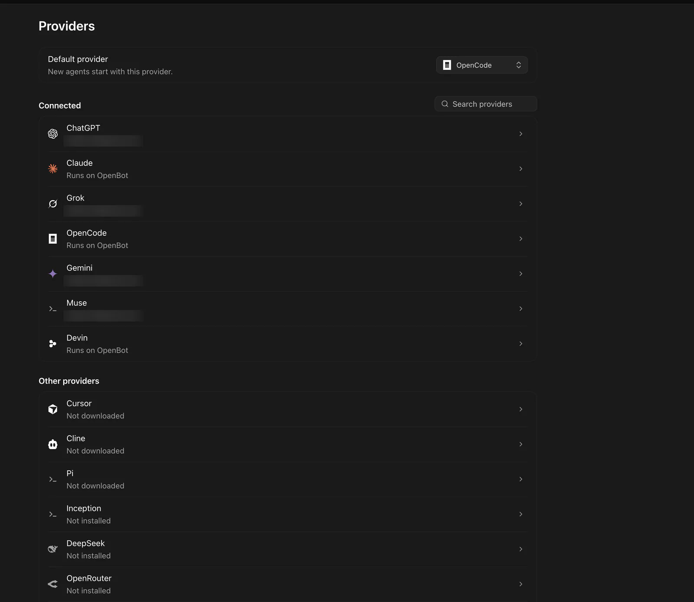
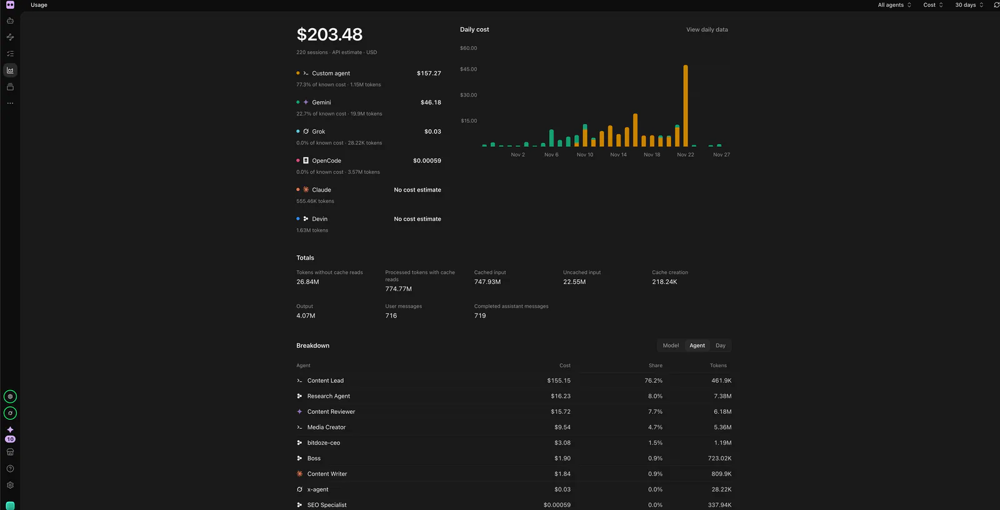
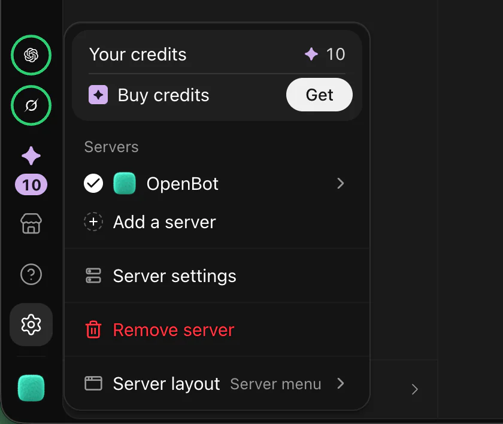

import Button from "@components/widgets/Button.astro";
import Notice from "@components/widgets/Notice.astro";
import ListCheck from "@components/widgets/ListCheck.astro";
import Accordion from "@components/widgets/Accordion.astro";
import YouTubeEmbed from "@components/widgets/YouTubeEmbed.astro";

OpenBot is a desktop app that runs a team of AI agents on the ChatGPT, Claude, Gemini or Grok plan you already pay for, on your own computer. After more than a month on an M4 Pro Mac, I recommend it. My agents work in it, I reach them from a browser, from the phone app and from other computers, and my team shares the same workspace.

The reasons I stayed are plain. It runs ChatGPT, Claude, Gemini, Grok and OpenCode on the sign-ins I already had. I can move an agent to another model without losing its files or its history. It pairs with a large app Marketplace, with Composio, and with any MCP server I point it at. It is free for personal use. The Library shows every file my agents produced in one place, and I plugged in Hindsight so they keep a memory that outlives a chat.

What I like least is the resource use. OpenBot is an Electron app, and every agent adds its own CLI process and browser tabs, so RAM and CPU go up with the size of the team. That section has what the app offers for it, and the one setting I would change first.

<Notice type="warning" title="Affiliate disclosure">

The links that open openbot.run, the download buttons included, are my invite links. If you sign up through one and later pay OpenBot for a server or a license, OpenBot credits me for it. The app itself is free for personal use either way.

</Notice>

<Button text="Download OpenBot" link="https://go.bitdoze.com/openbot" variant="solid" color="blue" size="md" icon="arrow-right" />

<Notice type="info" title="Where this comes from">

My own use covers the desktop app on macOS, seven connected providers, the web client, the phone apps, MCP servers, Composio, Hindsight and the Library. Everything else here, from hosted servers to the chat app connectors, comes from OpenBot's README, docs and changelog, checked on November 27, 2026. I did not measure RAM or CPU, so the resource section quotes the changelog. The screenshots are from my workspace on November 27, with the account lines blurred.

</Notice>

## What is OpenBot?

OpenBot is a free desktop app that runs a team of AI agents on your computer, with the subscriptions you already have. Synthetify Labs, a company in Poland, makes it, and its own description is "a free, source-available, local-first alternative to Grok Bot".

It is not a model, and it sells no tokens. It starts the agent CLIs you already use, each signed in with your own account: Codex, Claude Code, the Antigravity CLI for Gemini, the Grok CLI, OpenCode, the Cursor CLI, Cline and Pi. On top of them it gives every agent a workspace folder, a conversation and a queue. People run it for research and monitoring, coding, content and marketing, and recurring work.

The source is on [GitHub](https://github.com/nightly-labs/openbot) under the PolyForm Noncommercial License 1.0.0. Personal and other noncommercial use is free, with no locked features, and work use needs a paid license. Versions up to 0.1.11 stay under Apache-2.0.

On November 27, 2026 the repository showed 11,491 stars, 1,112 forks and 5,221 open issues. It has had 135 releases, from 0.1.0 on August 13 to 0.80.0 on November 26. A new version ships close to daily, and the installed app checks GitHub for updates by itself.

Two projects are called OpenBot, so clear this up first. This one lives at [openbot.run](https://go.bitdoze.com/openbot). The other is CopilotKit's OpenBot at open.bot, an MIT-licensed template for a company bot roster, which I covered in [the Grok Bot alternatives](/best-open-source-grok-bot-alternatives/). Different teams, different licenses. Everything below is about the desktop app from openbot.run.


That is my workspace. The left sidebar is a chat list, the way Slack is. It has tabs for All and Unread. A folder holds the agents I keep around (Content Lead, SEO Specialist, Media Creator, Content Reviewer), and a Channels section has one channel per project. The main pane is the thread. In the screenshot an agent reports that a Pinterest pin is live and that a video is ready but not published, because I asked for exactly that.

Prefer video? This walkthrough covers building an agent team in OpenBot.

<YouTubeEmbed
  url="https://youtu.be/ICs8J7Nl3Zg"
  label="How to Build Your Own AI Agent Team Using OpenBot"
/>

## How much does OpenBot cost?

Personal and other noncommercial use is free, with every feature and no server to buy. You pay only the AI provider, through a plan or an API key you already have. Three things cost money. Synthetify Labs sells a commercial license for work use, per seat. OpenBot rents hosted servers. And credits inside the app pay for image and video generation. Each new account starts with 10 free credits.

## ChatGPT, Claude, Gemini and Grok on the plans you already pay for

OpenBot signs in to each provider with your own account. It downloads and pins the provider CLI, keeps that copy up to date without touching the one on your PATH, and never copies your credentials.

You bring your own account to each one:

| Provider | You sign in with |
|---|---|
| Codex | Your ChatGPT plan |
| Claude Code | Your Claude plan |
| Gemini | A Google AI Pro or Ultra plan |
| Grok | Your Grok account or an xAI API key |
| OpenCode | Nothing for the free models, or an OpenCode Go key |
| Cursor | A Cursor plan or API key |
| Cline | A Cline account; the free models have limits |
| Muse Code | A Meta account or API key |
| Pi | Any provider, with `/login` inside Pi |
| Devin, GitHub Copilot, Kimi Code, Mistral Vibe | That account |
| Hermes Agent | Your own Hermes setup, run through ACP |

Beyond the table, any agent that speaks the Agent Client Protocol runs as a custom agent, any OpenAI-compatible endpoint works, and OpenBot detects Ollama and LM Studio for local models.



My Providers page. I have seven connected, and OpenCode is the default, so a new agent starts there until I pick something else.

The Usage page is the receipt for the month. It counts sessions, messages and tokens, separates cached input from fresh input, and estimates what the same tokens would have cost at API prices, per model and per agent. In the 30 days to November 27 that was 220 sessions and 716 messages from me, against 719 completed replies.



Two things to know before you point a subscription at it.

1. Each provider's terms apply, and OpenBot does not police them. Its docs say it "does not check that your use agrees with a provider's terms, and a provider can limit or close an account that breaks them".
2. Anthropic's [legal page](https://code.claude.com/docs/en/legal-and-compliance) is the one worth reading. It says OAuth sign-in is for subscribers using Claude Code and other native Anthropic apps, and that Anthropic "does not permit third-party developers to offer Claude.ai login into their own applications, or to route requests through Free, Pro, Max, or Ultra plan credentials on behalf of their users". The same page adds that this does not prevent an end user from signing in to the unmodified Claude Code binary with their own subscription. OpenBot's own notes rate the risk: unclear for your own work on your own computer, and high when teammates use Claude agents on your host, because other people's requests then run on one person's plan.

So keep subscription sign-ins on agents only you use, and put shared team agents on an API key.

## Change the model, keep the agent

Most chat apps tie the history to the model. OpenBot separates them. An agent owns three things that outlive any provider: a workspace folder on disk, its conversation, and its name and instructions. The provider session sits underneath and can be swapped.

Pick another model in the agent's settings or in the model picker, and the same agent continues in the same folder with the same history. OpenBot hands the new session the relevant part of the conversation. The old provider's internal state does not move with it, and the full history is not resent on every request.

That makes it cheap to run a small model for routine work and move the same agent up when a task gets hard, then back down. Three settings cover the moments when you are not watching:

- Backup models move the agent to another provider when a plan hits its limit, or when a provider is overloaded or down. The chat and workspace stay, and a note in the chat shows the switch. You can allow the switch without asking, or approve it on a card each time.
- Pool accounts hold more than one sign-in for ChatGPT, Claude or Grok. Fill first, the default, fills the accounts in order. Spread puts agents on the accounts with the most usage left.
- Plan limit bars show how much of each window is left, with a pace mark for even use until the reset.

Skills are the one thing that may not follow a switch. Codex, Grok, OpenCode and others read `.agents/skills/`, while Claude Code reads `.claude/skills/`. OpenBot writes the skills it installs to both folders, so Marketplace skills survive. A skill you dropped into one folder by hand might not.

## Use OpenBot from the web, the desktop app, iPhone or Android

One computer runs OpenBot. Everything else is a client:

- The desktop app on another computer, signed in to the same account.
- The web client at `openbot.run/app`, with the same sidebar, chats, agent settings and Library.
- The iPhone app (iOS 16.4 or later) and the Android app (7.0 or later, from Google Play or as an APK), for chatting, following progress, approving actions and sending files.
- A Chrome extension that puts the phone app's screens in the browser's side panel.
- An Apple Watch app that talks to the server directly.

Pairing a phone takes one QR code. On the computer, open Settings, then Mobile Connect, and generate it. The code expires after two minutes and works once. The same screen lists the phones you want to disconnect.

You set up no VPN and no tunnel. A client connects to your computer with WebRTC, directly when it can and through an encrypted relay when it cannot. OpenBot's signaling service only passes connection setup, and its account service on Cloudflare holds your profile, memberships, invitations and the state that lets devices find each other. Chats, files, commands and remote desktop streams never pass through OpenBot's servers. Remote access does need an OpenBot account: an email address and a one-time code.

If you want the traffic to stay inside your own network, Mobile Connect has a Private network mode. Phones, other computers and teammates then connect only over Tailscale or the same Wi-Fi. Our [Tailscale setup guide](/tailscale-setup-guide/) covers the network side.



The server menu is the switchboard. Mine lists one server, the Mac that runs everything. On a phone or in a browser I pick it and get the same agents, chats and files. Add a server is where a VPS, a Docker container or a hosted server shows up later.

The catch is the one every self-hosted setup has. The computer that runs OpenBot has to be on and awake. A sleeping Mac is a team that cannot reach its agents. Settings, General has Keep this computer awake, which stops idle sleep while the computer is on power. It is off by default, a closed lid still sleeps, and a separate option allows it on battery.

If your agents live in a terminal instead, my [phone control setup with Moshi and Herdr](/control-ai-agents-from-phone-moshi-herdr/) solves the same problem for shell sessions.

## Work with your team in the same workspace

OpenBot calls it multiplayer. You invite people to your server, they sign in from the desktop app, the web client or a phone, and they get the agents and channels you open to them. People and agents write in the same channels. An agent can hand a task to another agent there, and each task has one owner, so you can see who is doing what and stop, resume or reassign it.

Roles set the limits: owner, admin or member, plus per-agent rights to view, chat or manage.

Four things catch teams early:

- The host is a single point of failure. If the Mac sleeps or loses power, the whole team is offline.
- Teammates spend your plan. A message a teammate sends to a Claude agent on your computer runs on your Claude sign-in.
- Cursor and Cline agents stay private to the host. Teammates do not see them.
- Work use is not free. The license covers personal and noncommercial use. For a company, Synthetify Labs sells a commercial license per seat on the [pricing page](https://openbot.run/pricing).

## Self-host OpenBot on a VPS or home server

OpenBot ships as a headless Linux build for exactly this. Your laptop and your phone become clients, and the agents keep working with the lid closed.

An always-on host has three routes:

| Route | What it is | Fits |
|---|---|---|
| Keep the Mac on | The Keep this computer awake setting | One or two teammates and a trial |
| Self-hosted server | The Linux build on a VPS or home server (Ubuntu 24.04 or 26.04 with systemd), a Docker container, an Umbrel app or a Nix flake | Anyone who already runs a server |
| Hosted server | OpenBot rents the machine, in Amsterdam or near Washington, D.C. Starter fits one person, Standard up to 5 members, Pro up to 10. OpenBot also runs a dedicated Mac mini for you on request | Teams that do not want to maintain a machine |

### OpenBot on a VPS with the install script

The first route is the install script from OpenBot's VPS guide. I did not run it.

```bash
# Ubuntu 24.04 or 26.04
curl -fsSL https://raw.githubusercontent.com/nightly-labs/openbot/main/scripts/install-server.sh | sudo bash
sudo openbot login --name "OpenBot VPS"
sudo openbot status
```

### OpenBot with Docker Compose

The second route is the official Compose file. Keep its security profile and shared-memory setting, because they let the Electron sandbox stay on inside the container.

```bash
mkdir openbot-vps && cd openbot-vps
curl -fsSLO https://raw.githubusercontent.com/nightly-labs/openbot/main/docker/compose.yaml
curl -fsSLO https://raw.githubusercontent.com/nightly-labs/openbot/main/docker/seccomp.json
sudo docker compose up -d
sudo docker compose exec openbot openbot login --name "OpenBot VPS"
```

Pick a VPS with room for browser sessions. OpenBot's guide sets no minimum size. My [Hetzner Cloud review](/hetzner-cloud-review/) covers the one I use for self-hosted services.

Server settings, Transfer, moves your agents to the new host in one export and import, with their skills, routines, memories, files and MCP servers.

## Connect apps, MCP servers and Composio

Apps connect to agents as MCP servers. The Marketplace has three tabs: Agents, Skills and Apps. The Apps tab listed 257 connections when I checked: Notion, Linear, Sentry, Vercel, Cloudflare, Stripe, Postiz, Ahrefs, Hugging Face, Context7, Firecrawl, TinyFish, Zapier, WordPress.com and more.

There are three ways to add one:

1. Pick an app and select Connect. Most use a browser sign-in, where OpenBot is the OAuth client and keeps the token in encrypted storage. Some take an API key, and a few have steps you do on the computer itself.
2. Add your own. The Apps row in an agent's settings opens the Marketplace, and its Add custom button takes any MCP server over HTTP or stdio. One computer keeps up to 100.
3. Write a skill. A skill is a folder with a `SKILL.md` file, as the Agent Skills specification defines it. Agents can create one from a workflow you describe, and share it through a local skill library.

Two details worth knowing. An agent never holds the OAuth token. Calls to a signed-in MCP server go through a small proxy on `127.0.0.1`, with a bearer that opens one route for one agent. The route closes when the sign-in ends. You can also scope a server to named agents, and set what teammates may do with it: nothing, use, or manage.

My agents also run [TinyFish](/tinyfish-free-search-coding-agents/) as an MCP server for web search, the same way it runs in T3 Code. It is in the Apps tab, and it is the tool I described in my [free AI tools](/stop-wasting-time-free-ai-tools/) roundup.

### Composio for many apps at once

Composio is the shortcut when you want many apps under one connection. It gives an agent Gmail, Slack, GitHub and more than 1,000 other apps. It does not work like a normal MCP server that lists every tool. It hands the agent seven meta-tools. The agent searches for the tool a task needs and reads the inputs that tool wants. It runs one or more tools across your connected apps in a single call, and opens an OAuth link in your browser the first time an app needs your sign-in. It can also run Python or bash in a remote sandbox to reshape the data it gets back.

To connect it, open Apps, choose Composio, and sign in with your Composio account in the browser, or paste the consumer API key from Composio's Settings, Sessions & API Key page. Accounts you connected in Composio's developer dashboard do not carry over, so connect them again through this flow. Composio's own plan limits apply.

OpenBot supports the chat apps too: Slack, Discord, Telegram and WhatsApp. In Slack, people mention @OpenBot or send it a direct message, and an orchestrator agent that OpenBot adds picks the right agent to answer. A routine can also start from a webhook. Stripe or Shopify posts a signed request to a URL OpenBot generates, and the host has to be online to receive it.

## OpenBot memory: what is built in, and what Hindsight adds

Every agent has a memory of its own. In the background, the provider that runs the agent reviews the new part of a conversation. It adds, updates or forgets memories after every 20 turns, after 15 minutes with no new turn, when you clear a chat and when you close a side thread. The chat shows each change, so you can see what the agent decided to keep. Starting a new chat or deleting the history leaves the memories alone.

That covers preferences and facts about how you work. Each agent's memory stays with that agent, on your computer. For long-term memory that other tools can share, I pair OpenBot with Hindsight.

Hindsight is Vectorize's open-source memory service. It has three calls: retain stores what happened, recall searches it back by meaning, by keyword, by entity links and by time, and reflect reasons over a memory bank to answer a question. A bank is an isolated memory for one user, agent or project, and a background worker merges overlapping facts into observations.

In OpenBot it is an app in the Marketplace. Select Connect and sign in to Hindsight Cloud in the browser, or paste an API key, which starts with `hsk_`. The agent then gets retain, recall and reflect, tools to list, read and clear memories, the mental model tools, and the bank tools.

One instruction saves trouble. Tell each agent which bank to use, for example one bank per project, in its instructions. An agent that names no bank writes to a bank called default, and nothing in default shows up in other banks.

Hindsight Cloud bills by token for retain and recall, by call for reflect, and charges storage for memories kept longer than 30 days. Hindsight itself is open source, and its self-hosted server serves the same MCP tools at `http://localhost:8888/mcp`. Add that address under MCP servers instead, and the memories stay on your machine. Mem0, Honcho and Cobrain are in the Marketplace too, if you already use one of them.

## The Library shows every file in one place

Agents hand over work as files: a draft, an image, a CSV, a ZIP. They arrive inside chats, and a chat scrolls. The Library is one page in the app's rail that shows every picture and file from all the chats on a server, newest first. You can search, filter by type, open a file in a viewer, and jump to the message it came from.

Each agent has its own folders in the side panel. Folders nest, files move by drag and drop, and Recent, Not in a folder, Favorites and a group for deleted agents sit beside All files. There are three views, a mosaic, a grid and a list, and you can select many files to download or delete. The web client has the same page.

The part that makes it work is that agents file their own output. Tell one "save reports in Reports/2026", in a message or in its instructions, and it creates the folder and puts the file there. You can also ask for a cleanup: "Put the reports of last week in a folder".

On a shared server, a teammate sees only the files of the agents they can see.

With agents across several projects, this is where I look to see what they produced, instead of opening each chat.

## Routines, channels and workflows

| Feature | What it does | Watch out for |
|---|---|---|
| Routine | One instruction on a schedule, run by one agent in its own thread. Each run starts a fresh provider session with recent history. | It is not a job scheduler. There are no retries and no dependencies, and the host must be on at run time. |
| Channel | One conversation that several agents read and write, with one owner per task. | It does not merge the agents into one memory. Give each a different job, or you get several answers to one vague question. |
| Workflow | A canvas of steps: a trigger, agent steps, text, image and video steps, and approval steps. Templates include Morning brief, Weekly report and Price watch. | The server has to be recent enough for every step in it. |

Webhooks and the chat apps can start a routine, and a routine can post its answer back to Slack, Discord or Telegram.

## OpenBot vs Hermes, Grok Bot, Rakazo and OpenClaw

OpenBot gets compared with four tools. They solve different problems:

| Tool | What it is | Where agents run | Models and license | Pick it when |
|---|---|---|---|---|
| OpenBot | Desktop workspace for a team of agents, with web and phone clients | Your computer, or a server you run | Your subscriptions, OpenCode and local models; PolyForm Noncommercial, free for personal use | You want one app for several agents and their files |
| Hermes Agent | One agent that learns skills, with gateways to your chat apps | Local, Docker, SSH or a cloud sandbox | Any OpenAI-compatible model; MIT | You want a single agent that runs for months on a VPS |
| Grok Bot | xAI's hosted roster of bots | One cloud computer per account, run by Cursor | Grok only; bundled with Cursor plans or SuperGrok | You want no computer of your own |
| Rakazo | Self-hosted Grok Bot clone with a web app and phone apps | A shared team computer, or a private one per bot | Any, through Pi; Apache-2.0 | You want the Grok Bot layout on your own server |
| OpenClaw | Agents that live inside your chat apps | Your server | Any; MIT | You want to message agents where you already chat |

### OpenBot vs Hermes Agent

Hermes Agent is one agent, not a team. It writes its own skills after it solves a problem, keeps a memory across sessions, runs jobs on cron, and answers in Telegram, Discord, Slack, WhatsApp, Signal and email. You install it from a terminal and watch it on a web dashboard.

OpenBot has the opposite shape, a desktop app first and a roster of agents second. The two also work together. OpenBot runs Hermes as a provider through ACP, with your own `~/.hermes`, so its memories, skills and sign-ins carry over. Pick Hermes for one agent that runs for months on a VPS, and pick OpenBot when you want several agents side by side. The [Hermes Agent setup guide](/hermes-agent-setup-guide/) has the install.

### OpenBot vs Grok Bot

Grok Bot keeps every bot on one cloud computer that Cursor hosts, runs Grok models only, and lets you neither self-host nor export your skills and routines. OpenBot keeps everything on a computer you control and runs the CLIs you already pay for. Pick Grok Bot when you want no computer of your own, and pick OpenBot when your data and your choice of model matter more than a managed machine.

### OpenBot vs Rakazo and OpenMausBot

Rakazo is the closest open source clone of Grok Bot, with bots in a sidebar, a web app with desktop and phone clients, and a private computer per bot. OpenMausBot is a desktop app where every chat is a bot on the Claude, Codex or Grok CLI. It gives each bot a cloud box, a local VM or your own machine. OpenBot sits between the two. It signs in with your subscriptions like OpenMausBot, and it has phone apps and shared channels like Rakazo. Pick Rakazo for one isolated computer per bot, OpenMausBot for a Telegram-style desktop app, and OpenBot for one workspace that also collects the files. The [Grok Bot alternatives](/best-open-source-grok-bot-alternatives/) article compares all ten with install steps.

### OpenBot vs OpenClaw

OpenClaw lives inside WhatsApp, Telegram, Slack, Discord and iMessage, with a Control UI in the browser, and it works with any model on your own server. Pick OpenClaw when you want to message agents where you already chat, and pick OpenBot when you want their files, usage and browser work in one window. The [OpenClaw alternatives](/openclaw-alternatives/) roundup covers it and the rest.

Claude Code, OpenCode and the other CLIs are not rivals. OpenBot runs them as providers.

## What I don't like: Electron and the resource use

OpenBot is an Electron app and it does not pretend otherwise. The window is Chromium. Under it, every agent has its own provider CLI process, every local MCP server is another process, and the embedded browser keeps real tabs per agent. The more agents run at once, the more processes there are. RAM and CPU go up with the size of the team, which is why I would not run it on an old laptop.

The developers measure it in public. OpenBot writes one line a minute to `logs/resources.ndjson` in its data folder, with the memory and CPU of each process group, and never sends that file anywhere. The Usage page shows live CPU and memory in its header. And the changelog lists memory fixes in many releases. Three from the weeks before this article:

- 0.80.0: a chat with 30 large images loaded every image at full size, even in a small tile, and "used about 600 MB more memory in the window". Tiles now show small copies.
- 0.76.0: a chat opened from a notification kept the previous chat in memory, and "after a day, the window could use more than 1 GB and become slow until a restart".
- 0.74.0: on a hosted server with less than 7 GB of memory, each chat could hold up to 25 browser tabs, "which used too much memory". The limit is now 5.

The team fixed all three. Memory has been the moving target, and the fixes arrive as fast as the releases.

I have no numbers from my own machine, because I did not write any down. What the app offers, in the order I would set it:

1. Cap the threads. Server Settings, General, Threads at the same time has no limit by default on a desktop computer. On a server the automatic default is 2, 8 or 16, picked by memory. Pick a number that fits your RAM.
2. Let it unload tabs. Since 0.79.0, when a message waits because the host is low on memory, OpenBot unloads the idle browser tabs of chats that are not working, and a tab loads again when someone uses it.
3. Read the log when you want the culprit. `resources.ndjson` breaks memory and CPU down by process group and provider, so you can tell the app window from a provider CLI.
4. Move the host. On a VPS, in Docker or on a hosted server, the CLIs and the tabs run there, and your computer is only a client.
5. Expect restarts. The updater waits for the agents to go idle and then restarts the app. Settings, Updates has Restart now and Cancel restart for when a routine keeps it waiting.

If a small footprint is at the top of your list, OpenBot is not the tool. If the agents earn their keep, the footprint is the fee.

## Is OpenBot safe? Four settings to change on day one

For your data, yes. Chats, files and browser data stay in a database on your computer, and OpenBot holds no copy. For your files, only after you change one setting, because agents run with full access by default.

A warning box in the README spells it out. Agents run with full access and without per-action approval once you accept the first-launch consent. They can read and change files, run commands, use the network and drive the embedded browser. An agent with Full access can read anything your macOS account can read, keys you stored "somewhere safe" included.

<ListCheck>

- Set a permission level per agent. Workspace only limits file changes to the agent's workspace, the shared folder, temporary folders and folders you allow. Ask first keeps approvals on. Full access does what it says. Workspace only does not block file reads or network access, and what each level enforces depends on the provider and the OS.
- Keep Computer Use off until you need it. It lets an agent capture the screen and post mouse and keyboard input, through a small driver that ships with the app. It has its own switch and is not limited to the workspace.
- Back up the data folder. OpenBot uploads nothing and restores nothing for you. The database is `openbot.db` in OpenBot's data folder, and the workspaces are in `~/OpenBot`.
- Decide on analytics. Production builds send product events to a self-hosted OpenPanel: counts, timing, provider, model, reasoning effort, app version and OS, never message text. After sign-in the events carry your account ID and email, and the Link analytics to my account switch makes them anonymous.

</ListCheck>

Local-first describes storage, not the network. Codex still talks to OpenAI, Claude to Anthropic, pages in the embedded browser load from the internet, and plugins call their own services.

## How to install and use OpenBot

The installers are on the site and on [GitHub Releases](https://github.com/nightly-labs/openbot/releases).

<Button text="Download OpenBot" link="https://go.bitdoze.com/openbot" variant="solid" color="blue" size="md" icon="arrow-right" />

1. Run the installer. macOS 13 or later on Apple silicon or Intel, Windows 10 or later, or a Linux AppImage for x64 and arm64. On macOS, drag OpenBot to Applications.
2. Connect a provider, in onboarding or under Settings, Providers. Press Download if OpenBot needs to fetch its CLI, then sign in. OpenCode's free models need no account, so they are the fastest first run. The [OpenCode setup guide](/opencode-setup-guide/) covers the rest of that CLI.
3. Create one agent. Describe the job in one prompt, read the instructions it drafts, and pick the permission level.
4. Give it a small task with a result you can open, then read the activity under the answer. The thread lists the files it touched and the commands it ran.
5. Pair your phone. Settings, Mobile Connect, QR code.

On Ubuntu 23.10 or newer and on Debian 13, AppArmor stops the Linux AppImage from starting until you install the profile that ships inside it. The [troubleshooting guide](https://github.com/nightly-labs/openbot/blob/main/docs/TROUBLESHOOTING.md) has the two commands. Do not work around it with `--no-sandbox`. That flag removes the boundary between the renderer and the rest of your computer, and OpenBot's agents run with full access on the other side. I did not test the Linux build.

On Windows the installer is code-signed, but SmartScreen can still warn about a fresh release. Check the checksum on the release page before you run it.

## Who should run OpenBot, and when to pick an alternative

Pick OpenBot if:

- You already pay for ChatGPT, Claude, Gemini or Grok and want agents that run on that plan.
- Your agents produce files, and you want one place to find them.
- You want to check on agents from a phone or a browser while they keep working on one machine.
- You have people who should see the same agents and channels as you.

Look elsewhere if:

- You do not want to keep a computer on. A cloud product such as Grok Bot, or a hosted OpenBot server, fits better. The [Grok Bot alternatives](/best-open-source-grok-bot-alternatives/) article explains the trade.
- You live in diffs and worktrees. Orca and T3 Code are built for code review, and [my comparison](/orca-vs-t3-code/) covers both.
- You want one agent in a terminal. The [Hermes Agent setup guide](/hermes-agent-setup-guide/) is the better start, and OpenBot can run Hermes as a provider later.
- You need a permissive license for company use. The MIT and Apache-licensed tools in the alternatives list are the ones to read.

## Pros and cons

| Pros | Cons |
|---|---|
| Signs in to the plans you already pay for, and OpenCode's free models need no account | Electron: RAM and CPU grow with agents, browser tabs and MCP servers |
| One workspace from the desktop app, a browser, a phone or a watch | The host has to be on and awake, or the team is offline |
| Changing the model keeps the agent's files, history and name | Agents run with full access until you change the setting |
| 257 apps in the Marketplace, Composio, and any MCP server | Work use needs a license, and each provider's terms apply to subscription sign-ins |
| Library with every file in one view and a folder per agent | Daily releases mean regular restarts |
| Built-in memory, plus Hindsight, Mem0 or Honcho | Chats live in one SQLite file that only you back up |

Start small. Install it, connect OpenCode so the first agent costs nothing, set that agent to Ask first, and give it one task with a file you can open. When the Library shows that file in the right folder, add your subscriptions, the phone and the team, in that order.

## FAQ

<Accordion label="Is OpenBot open source?" group="faq" expanded="true">

It is source-available. All of the code is public on GitHub under the PolyForm Noncommercial License 1.0.0, so you can read it, change it and run it for noncommercial use. The license is not OSI-approved, because commercial use needs a separate one. Versions up to 0.1.11 remain Apache-2.0.

</Accordion>

<Accordion label="Is this the same OpenBot as the one from CopilotKit?" group="faq">

No. CopilotKit's OpenBot, at open.bot, is an MIT-licensed template for a roster of company bots behind a policy gateway. OpenBot at openbot.run is a desktop app by Synthetify Labs. Different teams, different licenses, same name.

</Accordion>

<Accordion label="Is OpenBot safe?" group="faq">

Yes for your data. Chats and files stay on your computer, and OpenBot holds no copy. Agents run with full access by default. Set each one to Workspace only or Ask first before the first real task, keep backups, and give agents only work you trust.

</Accordion>

<Accordion label="Can I use my ChatGPT, Claude or Gemini subscription with OpenBot?" group="faq">

Yes. Codex signs in with your ChatGPT plan, Claude Code with your Claude plan, and Gemini needs a Google AI Pro or Ultra plan. Each provider's terms apply, and OpenBot does not check them for you. Anthropic has not confirmed that it allows subscription sign-in through OpenBot, so keep those agents for your own work and give shared ones an API key.

</Accordion>

<Accordion label="Does my computer have to stay on?" group="faq">

The computer or server that runs OpenBot has to be on and awake while agents work. Turn on Keep this computer awake on a desktop, or move the host to a VPS, a Docker container or a hosted server. Clients such as your laptop and your phone can sleep.

</Accordion>

<Accordion label="Can I run OpenBot on my own server?" group="faq">

Yes. Ubuntu 24.04 or 26.04 with systemd, Docker Compose, an Umbrel home server or a Nix flake. The server signs in to your account with an email code and then shows up in the server list of the desktop app, the phone app and the web client.

</Accordion>

<Accordion label="Does OpenBot work with local models like Ollama?" group="faq">

Yes. OpenBot finds Ollama and LM Studio on their default local ports and lists them as providers, and any OpenAI-compatible server works too. OpenCode then runs the agent on that model, so the requests stay on your computer. Check that the model handles tool calls well before you trust it with files.

</Accordion>

<Accordion label="Is there an OpenBot CLI or API?" group="faq">

The server build has an `openbot` command for sign-in, status, logs, restart and update. Other systems reach agents through signed webhooks, which start routines, and through the chat app connectors. The API that OpenBot's own clients use stays on localhost.

</Accordion>
