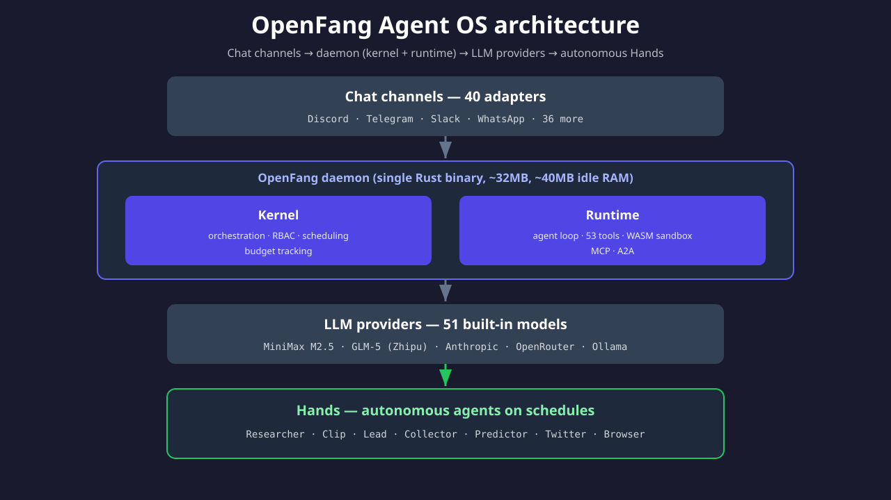
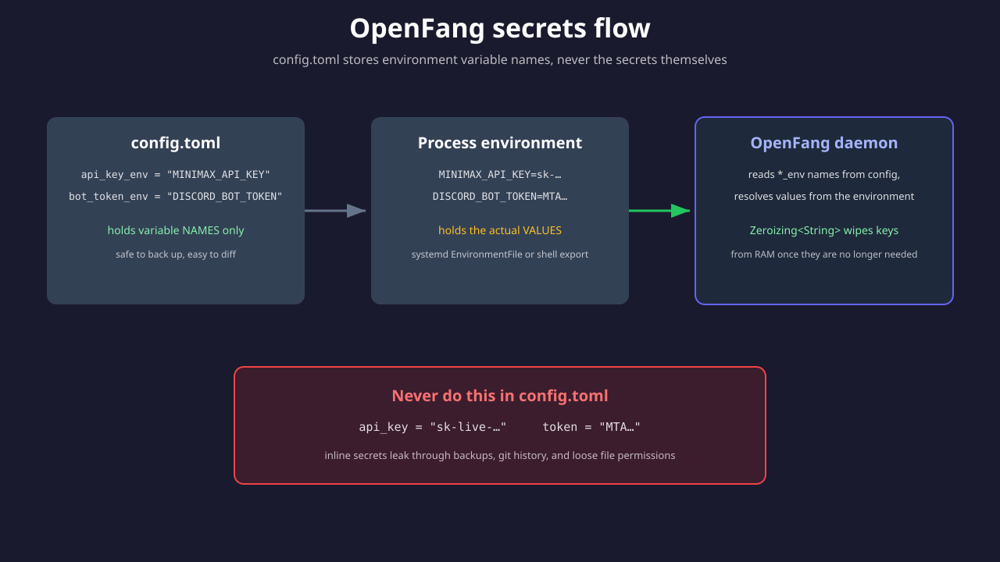

import YouTubeEmbed from "@components/widgets/YouTubeEmbed.astro";
import Button from "@components/widgets/Button.astro";
import Notice from "@components/widgets/Notice.astro";
import ListCheck from "@components/widgets/ListCheck.astro";
import Accordion from "@components/widgets/Accordion.astro";
import Tabs from "@components/widgets/Tabs.astro";
import Tab from "@components/widgets/Tab.astro";

<Notice type="info" title="Affiliate disclosure">
This guide contains referral links. If you buy through them, I may earn a commission at no extra cost to you.
</Notice>

I've been running [OpenFang](https://github.com/RightNow-AI/openfang) for about two weeks now, side by side with my [OpenClaw setup](/clawdbot-setup-guide/) and [nanobot instance](/nanobot-setup-guide/). OpenFang is different from everything else I've tested. It calls itself an "Agent Operating System," and after using it I think that label fits. It ships autonomous agents called Hands that run on schedules without you having to prompt them, backed by 16 security layers and 40 chat channel adapters, all in a single Rust binary.

This OpenFang setup guide walks through getting OpenFang running on a VPS with GLM-5 and MiniMax M2.5 as your LLM providers, Discord as the chat channel, and the Researcher Hand activated. It is updated for v0.6.9 (May 2026), which is 30+ releases past the v0.1.0 this guide originally covered. Ports, config formats, and install commands all changed along the way.

<Button text="OpenFang GitHub" link="https://github.com/RightNow-AI/openfang" variant="solid" color="blue" size="md" icon="github" />

<Notice type="info" title="What this guide covers">
<ListCheck>
<ul>
<li>Installing OpenFang via the install script, Docker, or from source</li>
<li>Configuring GLM-5 (Zhipu) and MiniMax M2.5 as LLM providers</li>
<li>Setting up an OpenFang Discord bot</li>
<li>Activating the Researcher Hand for autonomous tasks</li>
<li>Verify steps, failure modes, and troubleshooting</li>
<li>Production hardening: secrets, firewall, systemd, backups</li>
</ul>
</ListCheck>
</Notice>

If you want to compare OpenFang against other self-hosted bots, our [OpenClaw alternatives](/openclaw-alternatives/) roundup covers NanoClaw, nanobot, PicoClaw, ZeroClaw, NullClaw, and now OpenFang. For MCP basics, check the [MCP introduction for beginners](/mcp-introduction-beginners/).

## What OpenFang actually is


<YouTubeEmbed
  url="https://www.youtube.com/embed/JX-MbP0qMCk"
  label="Meet OpenFang: Best Open-Source OpenClaw Alternative"
/>

OpenFang is an open-source project from [RightNow AI](https://www.rightnowai.co/), built entirely in Rust. It's structured as a 14-crate workspace totaling 137,728 lines of code with 2,696+ tests and zero clippy warnings. The whole thing compiles down to a single ~32MB binary that idles at about 40MB of RAM (README benchmark numbers; a real VPS footprint can differ, so measure before you plan around it). It had 18,250 GitHub stars and 2,282 forks as of June 2026, so it is past the "weekend project with three users" stage.

The architecture looks like this:



Messages come in from your chat app and get routed to whichever LLM you configured. Agents can use 53 built-in tools, connect to MCP servers, and run inside a WASM sandbox. The part I keep coming back to is Hands. These are autonomous agents that wake up on a schedule, do their job, and report back to your dashboard without you ever sending a message.

## Why GLM-5 and MiniMax M2.5

Both models work well with OpenFang's provider system and keep costs low for always-on agent setups. That second part matters more than leaderboard placement: Hands burn tokens every day whether you are watching or not, so cheap per-token pricing beats bragging rights when an agent runs on a cron schedule.

### GLM-5

GLM-5 from Zhipu AI is a 744B MoE model with about 40-44B active parameters. It ranks first among open-source models on BrowseComp, which measures web search and research tasks, a good match for OpenFang's Researcher Hand.

| Spec | Value |
|------|-------|
| Architecture | 744B MoE, ~40B active |
| Context window | 200K tokens |
| SWE-Bench Verified | 77.8% |
| BrowseComp | #1 open-source |
| License | MIT |

The 200K context window handles long research tasks without running into limits.

### MiniMax M2.5

MiniMax M2.5 is a 230B MoE model with only 10B active parameters per pass. It's faster and cheaper than GLM-5, and the 1M token context window is hard to ignore:

| Spec | Value |
|------|-------|
| Architecture | 230B MoE, 10B active |
| Context window | 1M tokens |
| Speed (Lightning) | 100 tokens/sec |
| Cost (Lightning) | $0.30/M input, $2.40/M output |
| SWE-Bench Verified | 80.2% |
| License | Modified MIT (open-source) |

MiniMax M2.5 scores 80.2% on SWE-Bench Verified, which puts it alongside frontier models at a fraction of the price. The 1M context is overkill for chat but helpful when Hands are processing large amounts of research data. For how it compares against other cheap models for always-on bots, see our [best open source models for OpenClaw](/best-opensource-models-for-openclaw/) breakdown.

Both models are available through their direct APIs and through OpenRouter.

One honesty note before we configure anything: these specs and prices were checked when this guide was written, and the model lineup moves fast. Newer names (GLM-5.3, MiniMax M2.7, MiniMax M3.1) already show up in 2026 listings. This guide keeps GLM-5 and MiniMax M2.5 as the tested configuration because that is what the configs below use, and both are still available direct.

## Prerequisites

What needs to exist before you touch step 1:

<ListCheck>
<ul>
<li>A Linux VPS or local machine. 1 vCPU and 1-2GB RAM is enough (OpenFang idles at about 40MB)</li>
<li>SSH access and a terminal editor you can drive (nano is fine)</li>
<li>An API key from Z.AI (GLM-5), MiniMax (M2.5), or both</li>
<li>A Discord application with a bot token, if you want the Discord channel</li>
<li>Port 4200 for the API and dashboard, kept on 127.0.0.1</li>
<li>A secrets plan: keys live in environment variables, never in config.toml</li>
</ul>
</ListCheck>

<Notice type="info" title="You don't need all three accounts">
GLM-5 or MiniMax M2.5 alone is a working setup. Discord is optional too; the daemon runs fine with just an API and the built-in TUI dashboard.
</Notice>

Budget 30-45 minutes end to end on a fresh VPS, mostly spent waiting on key approvals and picking through Discord's developer portal.

## Install OpenFang

Three paths to get the binary, plus a desktop app for non-server use.

<Tabs>
<Tab name="Install script (recommended)">

The fastest way. Works on macOS and Linux.

```bash
curl -sSf https://openfang.sh | sh
```

This downloads the prebuilt binary for your platform and puts it in your PATH.

</Tab>
<Tab name="From source">

If you want the latest code or plan to contribute:

```bash
# Install Rust if you don't have it
curl --proto '=https' --tlsv1.2 -sSf https://sh.rustup.rs | sh
source $HOME/.cargo/env

# Clone and build
git clone https://github.com/RightNow-AI/openfang.git
cd openfang
cargo build --workspace --release

# The binary is at target/release/openfang
sudo cp target/release/openfang /usr/local/bin/
```

</Tab>
<Tab name="Windows">

PowerShell:

```powershell
irm https://openfang.sh/install.ps1 | iex
```

</Tab>
</Tabs>

<Notice type="info" title="Desktop app">
OpenFang also ships a native desktop app built with Tauri 2.0: Windows .msi, macOS .dmg, Linux .AppImage and .deb, with a system tray and auto-updates. Nice for a desktop machine. On a VPS, stick with the binary or Docker.
</Notice>

After installing, initialize the workspace and config:

```bash
openfang init
```

This creates the `~/.openfang/` directory with a default `config.toml`, sets up the local workspace, and walks you through picking an LLM provider. For unattended installs (scripts, CI), `openfang init --quick` skips the interactive prompts. Once a config exists, `openfang config edit` opens it in `$EDITOR`.

### Verify it works

```bash
# Runs diagnostics: config, API keys, DB, ports, tool dependencies
openfang doctor

# Confirms what the daemon sees
openfang status
```

`openfang doctor` is the command to run before you blame your config. It tells you which env vars it can see, whether the DB initialized, and which ports are free.

Failure modes at this stage:

- **Installer shows a black screen on Arch/CachyOS with fish.** A bug in installers older than v0.6.4. Upgrade past v0.6.4 or build from source.
- **`openfang: command not found` after install.** Re-source your shell (`source ~/.bashrc`) or copy the binary into `/usr/local/bin/`.

## Configuring GLM-5 (Zhipu)

OpenFang uses a `config.toml` file at `~/.openfang/config.toml` (`/data/config.toml` in Docker). In practice, the cleanest setup is to define the selected model in `[default_model]`, then keep provider-specific credentials and API endpoints in the matching `[providers.<name>]` block.

### Get an API key

1. Go to [z.ai](https://z.ai/manage-apikey/apikey-list)
2. Register and create an API key

<Notice type="success" title="Z.AI GLM coding plan: 10% off">
Z.AI offers [GLM coding plans](https://go.bitdoze.com/glm) designed for continuous developer workloads. Use our link for 10% off.
</Notice>

<Notice type="info" title="Zhipu coding plan endpoint">
If you're on Zhipu's coding plan, set `api_base = "https://api.z.ai/api/coding/paas/v4"` in your zhipu provider config. This routes through their coding-optimized endpoint.
</Notice>

### Add to config

```toml
[default_model]
provider = "openai"
model = "glm-5"
api_key_env = "ZHIPU_API_KEY"
base_url = "https://api.z.ai/api/coding/paas/v4"
```

Zhipu is configured through OpenFang's `openai` provider because the GLM endpoint is OpenAI-compatible. GLM-5 is not in OpenFang's detailed provider catalog, so the custom `base_url` is what makes this work.

<Notice type="warning" title="Secrets never go in config.toml">
Since the early releases, the docs are explicit: fields like `api_key_env` and `bot_token_env` hold the **name** of an environment variable, never the secret itself. Export it before starting the daemon: `export ZHIPU_API_KEY="your-key-here"`. We'll wire this properly through systemd shortly.
</Notice>

### Test it

```bash
openfang chat
> What's 42 * 17?
```

If you get a response, GLM-5 is wired up correctly. Type `exit` to leave the chat. `openfang doctor` should also report the key as detected.

## Configuring MiniMax M2.5

### Get an API key

1. Go to [platform.minimax.io](https://platform.minimax.io) (global) or [minimaxi.com](https://www.minimaxi.com) (mainland China)
2. Create an account and generate an API key
3. Note which platform you're on since the API base URL differs

<Notice type="success" title="MiniMax coding plan: 10% off">
MiniMax offers coding plans priced for developer workloads. [Get 10% off with our referral link](https://go.bitdoze.com/minimax). For details on how GLM-5 and MiniMax M2.5 compare for always-on bots, see our [best open source models for OpenClaw](/best-opensource-models-for-openclaw/) breakdown.
</Notice>

### Add to config

MiniMax is a registered provider in OpenFang's official providers docs, so `provider = "minimax"` with `MINIMAX_API_KEY` is the documented path. The API base differs per region:

<Tabs>
<Tab name="Global platform">

```toml
[default_model]
provider = "minimax"
model = "MiniMax-M2.5"

[memory]
decay_rate = 0.05

[providers.minimax]
api_key_env = "MINIMAX_API_KEY"
api_base = "https://api.minimax.io/v1"

[agents.defaults]
model = "MiniMax-M2.5"
```

</Tab>
<Tab name="Mainland China platform">

```toml
[default_model]
provider = "minimax"
model = "MiniMax-M2.5"

[memory]
decay_rate = 0.05

[providers.minimax]
api_key_env = "MINIMAX_API_KEY"
api_base = "https://api.minimaxi.com/v1"

[agents.defaults]
model = "MiniMax-M2.5"
```

</Tab>
</Tabs>

This keeps the provider declaration explicit: `default_model` selects MiniMax, `[providers.minimax]` holds the API settings, and `[agents.defaults]` keeps the default agent model aligned with the provider. `decay_rate = 0.05` is a custom value that keeps memories around longer; the documented default is 0.1.

If `provider = "minimax"` isn't recognized on your build (the provider catalog is still evolving pre-1.0), fall back to the OpenAI-compatible driver:

```toml
[default_model]
provider = "openai"
model = "MiniMax-M2.5"
api_key_env = "MINIMAX_API_KEY"
base_url = "https://api.minimax.io/v1"
```

Same API, different routing. `openfang doctor` tells you what your build actually recognizes.

### Configuring both providers

If you want both providers available in the same config, keep each one in its own provider block and point your default model at the one you want to use first:

```toml
[default_model]
provider = "openai"
model = "glm-5"
base_url = "https://api.z.ai/api/coding/paas/v4"

[providers.openai]
api_key_env = "ZHIPU_API_KEY"

[providers.minimax]
api_key_env = "MINIMAX_API_KEY"
api_base = "https://api.minimax.io/v1"

[agents.defaults]
model = "glm-5"
```

To switch over to MiniMax, change `default_model.provider` to `"minimax"`, remove the `base_url` line, and set `agents.defaults.model` to `"MiniMax-M2.5"`.

Verify with `openfang chat` (the response should come from the model you expect) and `openfang doctor` (both keys should show as detected).

## OpenFang Discord bot setup

Discord is straightforward with OpenFang since it's one of 40 supported channel adapters. The Discord-side steps haven't changed since this guide was first published; the OpenFang-side config has.

### Create a Discord bot

1. Go to [discord.com/developers/applications](https://discord.com/developers/applications)
2. Click **New Application**, give it a name
3. Go to **Bot** in the left sidebar, click **Add Bot**
4. Copy the bot token

### Enable intents

Still in the Bot settings page:

1. Scroll down to **Privileged Gateway Intents**
2. Enable **MESSAGE CONTENT INTENT** (required for the bot to read messages)
3. Optionally enable **SERVER MEMBERS INTENT** if you plan to use allow lists

<Notice type="warning" title="This is the #1 failure mode">
Without MESSAGE CONTENT INTENT, the bot joins your server and silently reads nothing. No error, no log line, just no replies. Check this before you debug anything else.
</Notice>

### Get your user ID

1. Open Discord Settings → **Advanced** → enable **Developer Mode**
2. Right-click your avatar anywhere in Discord
3. Click **Copy User ID**

### Configure OpenFang

The current config format uses env var names for the token. There is no `enabled = true` key; including the section turns the adapter on:

```toml
[channels.discord]
bot_token_env = "DISCORD_BOT_TOKEN"
allowed_users = ["YOUR_USER_ID"]
# allowed_guilds = []      # restrict to specific server IDs
# intents = 33280          # default gateway intent bitmask
```

Then export the token before starting the daemon:

```bash
export DISCORD_BOT_TOKEN="your-bot-token"
```

`allowed_users` restricts who can talk to the bot. Leave it empty to let anyone in the server use the bot, or add specific user IDs for a private bot. `allowed_guilds` limits which servers the bot will sit in.

### Invite the bot to your server

1. In the Discord developer portal, go to **OAuth2** → **URL Generator**
2. Under **Scopes**, check `bot`
3. Under **Bot Permissions**, check `Send Messages` and `Read Message History`
4. Copy the generated URL and open it in your browser
5. Select the server you want to add the bot to

### Start the daemon

```bash
openfang start
```

**Verify:** send a message in Discord and the bot should reply. `curl http://127.0.0.1:4200/api/health` should return OK, and `openfang status` shows the Discord adapter connected. The dashboard is at `http://127.0.0.1:4200`.

Common failures here:

- **Bot silent:** MESSAGE CONTENT INTENT is off (see above), or the token got pasted into config.toml instead of the `DISCORD_BOT_TOKEN` env var. The new docs warn at startup when they find inline tokens.
- **Bot joins but can't post:** the invite was generated without `Send Messages` permission.

If you'd rather build a custom bot from scratch than run an agent OS, see [build a custom Discord AI bot](/create-your-own-ai-agent/).

## OpenFang config.toml example

Here's what a complete `~/.openfang/config.toml` (or `/data/config.toml` for Docker) looks like with MiniMax M2.5, Discord, and the API exposed with a password:

```toml
api_listen = "0.0.0.0:4200"
api_key = "change-this-long-random-password"

[default_model]
provider = "minimax"
model = "MiniMax-M2.5"
max_tokens = 8192
temperature = 0.7

[memory]
decay_rate = 0.05

[providers.minimax]
api_key_env = "MINIMAX_API_KEY"
api_base = "https://api.minimax.io/v1"

[agents.defaults]
model = "MiniMax-M2.5"

[channels.discord]
bot_token_env = "DISCORD_BOT_TOKEN"
allowed_users = ["YOUR_USER_ID"]
```

<Notice type="warning" title="Export every env var before you start">
`MINIMAX_API_KEY`, `DISCORD_BOT_TOKEN`, and (if used) `ZHIPU_API_KEY` must exist in the daemon's environment. Missing vars show up as provider auth errors or a silent Discord adapter. `openfang doctor` lists which ones it can see.
</Notice>

A quick word on ports, because the docs disagree with each other. The CLI reference, README, and getting-started guide all use port **4200** for both the API and the web dashboard. The configuration reference still lists `api_listen = "127.0.0.1:50051"` as the documented default. This guide uses 4200 throughout. On a live install, `openfang doctor` or `ss -tlnp` tells you what's actually bound.



### Config settings explained

| Setting | Default | What it does |
|---------|---------|-------------|
| `api_listen` | `127.0.0.1:4200` (docs say 50051, see above) | Address the API and dashboard bind to |
| `api_key` | none (unauthenticated) | Bearer token required for API access |
| `default_model.provider` | n/a | Which provider OpenFang uses first |
| `default_model.model` | n/a | Model name sent to that provider |
| `memory.decay_rate` | 0.1 | How quickly stored memory fades over time |
| `providers.minimax.api_key_env` | n/a | Env var **name** holding the MiniMax key |
| `providers.minimax.api_base` | provider default | MiniMax API endpoint for your region |
| `agents.defaults.model` | n/a | Default model used by spawned agents and Hands |
| `channels.discord.bot_token_env` | n/a | Env var **name** holding the bot token |
| `channels.discord.allowed_users` | empty | Restricts who can talk to the bot |
| `channels.discord.allowed_guilds` | empty | Restricts which servers the bot sits in |
| `channels.discord.intents` | 33280 | Gateway intent bitmask |

### MiniMax M2.5 external API example

If you want to run OpenFang with MiniMax M2.5 only and let external clients connect through the API, this is the cleanest pattern:

```toml
api_listen = "0.0.0.0:4200"
api_key = "replace-with-a-long-random-api-password"

[default_model]
provider = "minimax"
model = "MiniMax-M2.5"

[memory]
decay_rate = 0.05

[providers.minimax]
api_key_env = "MINIMAX_API_KEY"
api_base = "https://api.minimax.io/v1"

[agents.defaults]
model = "MiniMax-M2.5"
temperature = 0.7
max_tokens = 8192

[channels.discord]
bot_token_env = "DISCORD_BOT_TOKEN"
allowed_users = ["YOUR_USER_ID"]
```

This keeps the port at 4200 and only changes the bind address so it's reachable remotely. Two things to know: an empty `api_key` means an unauthenticated API, so always set one when binding to `0.0.0.0`. And the web dashboard shares this port, so anything you expose for API clients is exposed together. Firewall the port to trusted IPs, or don't bind it publicly at all.

## Run OpenFang on a VPS

OpenFang uses about 40MB of RAM at idle, far less than OpenClaw's 394MB (README benchmark figures from Feb 2026, not measurements I took of each project on the same box). I'm running it on a [Hetzner CX22](/hetzner-cloud-review/) (2 vCPU, 4GB RAM) at €4.35/month alongside nanobot with no issues.

<Notice type="success" title="Hetzner discount">
Sign up through our referral link for [€20 Hetzner credit](https://go.bitdoze.com/hetzner), which covers around 4 months of a CX22. If you prefer another provider, [Hostinger VPS](https://go.bitdoze.com/hostinger-vps) is a solid budget pick. For US regions, [Vultr](https://go.bitdoze.com/vultr) or [DigitalOcean](https://go.bitdoze.com/do) work fine too.
</Notice>

_VPS prices jumped across the board in 2026. If you're rethinking a rented box, see [what changed and when a mini PC wins](/vps-price-increases/). An [ASUS mini PC](https://go.bitdoze.com/asus-dc510) pays for itself after a few months of VPS bills._

Quick setup on a fresh Ubuntu 24.04 VPS:

```bash
ssh root@YOUR_SERVER_IP

# Update system
apt update && apt upgrade -y

# Install OpenFang
curl -sSf https://openfang.sh | sh

# Initialize
openfang init

# Edit config
nano ~/.openfang/config.toml
```

For a proper daemon setup, keep secrets out of your shell history with an env file and a systemd unit:

```bash
sudo mkdir -p /etc/openfang
sudo nano /etc/openfang/env
# Add lines like: MINIMAX_API_KEY=... and DISCORD_BOT_TOKEN=...
sudo chmod 600 /etc/openfang/env
```

```ini
[Unit]
Description=OpenFang Agent OS
After=network.target

[Service]
Type=simple
EnvironmentFile=/etc/openfang/env
ExecStart=/usr/local/bin/openfang start
Restart=always
RestartSec=10

[Install]
WantedBy=multi-user.target
```

Save that to `/etc/systemd/system/openfang.service`, then:

```bash
systemctl daemon-reload
systemctl enable --now openfang
```

**Verify:**

```bash
systemctl status openfang
curl http://127.0.0.1:4200/api/health
journalctl -u openfang -f
```

**Rollback:** `systemctl disable --now openfang` stops everything cleanly. Your state stays in `~/.openfang/` until you delete it, so a restart later doesn't lose Hand history.

### Hardening notes

- Set `api_key` in config.toml. An empty key means an unauthenticated API.
- Keep the dashboard on `127.0.0.1` and reach it through an SSH tunnel (`ssh -L 4200:127.0.0.1:4200 user@your-server`) or a reverse proxy. Don't expose 4200 publicly.
- Firewall the box so only SSH (and your reverse proxy, if any) is reachable from outside.
- Before you expose anything: [secure your SSH server](/secure-ssh-server-linux/). Key-only auth and no root login is the baseline.
- Run the daemon as a non-root user for anything beyond a throwaway demo. Create an `openfang` user and add `User=openfang` to the unit.
- Pin a version (see the Docker section for the pattern) if this is anything you depend on.

Cost-wise this stays boring: about $5/month for the VPS plus $5-25/month of API usage for personal use, depending on how chatty your Hands are.

## OpenFang Docker deployment

OpenFang publishes container images. Note the capitalized org name in the image path: `ghcr.io/RightNow-AI/openfang:latest`. The image sets `OPENFANG_HOME=/data`, so config lives at `/data/config.toml` and state lives in the same directory.

<Tabs>
<Tab name="Docker Compose (recommended)">

```yaml
# docker-compose.yml
services:
  openfang:
    image: ghcr.io/RightNow-AI/openfang:latest
    container_name: openfang
    restart: unless-stopped
    ports:
      - "127.0.0.1:4200:4200"
    environment:
      MINIMAX_API_KEY: ${MINIMAX_API_KEY}
      DISCORD_BOT_TOKEN: ${DISCORD_BOT_TOKEN}
    volumes:
      - openfang-data:/data
      - ./config.toml:/data/config.toml
    extra_hosts:
      - "host.docker.internal:host-gateway"

volumes:
  openfang-data:
```

```bash
# Create the config first (if the file is missing, Docker creates a
# directory named config.toml and the container won't start)
nano config.toml    # paste the full config from the section above

docker compose up -d
```

The bind-mounted `./config.toml` makes edits a `docker compose restart` away. The named `openfang-data` volume keeps state (database, Hand history) across `compose down` and image upgrades. If you'd rather manage config inside the volume too, drop the bind mount and push files in with `docker compose cp config.toml openfang:/data/config.toml`.

</Tab>
<Tab name="docker run">

```bash
docker run -d \
  --name openfang \
  --restart unless-stopped \
  -p 127.0.0.1:4200:4200 \
  -e MINIMAX_API_KEY \
  -e DISCORD_BOT_TOKEN \
  -v openfang-data:/data \
  --add-host=host.docker.internal:host-gateway \
  ghcr.io/RightNow-AI/openfang:latest
```

You still need a `config.toml` at `/data/config.toml` inside the volume. Either seed it with `docker run --rm -v openfang-data:/data ghcr.io/RightNow-AI/openfang:latest init` or copy one in with `docker cp`.

</Tab>
</Tabs>

<Notice type="warning" title="Reaching the host from Docker">
If you run Ollama, vLLM, or an MCP server on the same host, the container can't reach it on `localhost`. The `--add-host=host.docker.internal:host-gateway` flag (already in the snippets above) gives you a stable hostname; point provider `base_url` at `http://host.docker.internal:11434/v1` for Ollama.
</Notice>

**Verify:**

```bash
docker compose logs -f
curl http://127.0.0.1:4200/api/health
```

**Failure modes:**

- **Image pull fails with a lowercase name.** Use `ghcr.io/RightNow-AI/openfang:latest` with capitals as documented.
- **`config.toml` is a directory.** You started Compose before creating the file. Remove the directory, create the file, start again.
- **Old `~/.openfang` bind mount from the previous version of this guide.** Config now lives at `/data/config.toml`. Move your config into the volume or the bind mount.
- **Container can't reach host Ollama.** Missing host-gateway, see the notice above.

**Rollback:** `docker compose down` stops the container and keeps the `openfang-data` volume. `docker compose down -v` destroys that volume, Hand history included. Only use `-v` when you mean it.

## OpenFang Hands: autonomous agents

Hands are the reason I keep running OpenFang alongside my other bots. They're pre-built autonomous agents that run on schedules without you sending messages. You activate a Hand, it goes to work, and you check its progress on the dashboard.

Each Hand comes bundled in the binary with:

<ListCheck>
<ul>
<li><strong>HAND.toml</strong>: manifest declaring required tools and settings</li>
<li><strong>System prompt</strong>: a multi-phase operational playbook (500+ words, not a one-liner)</li>
<li><strong>SKILL.md</strong>: domain expertise loaded into context at runtime</li>
<li><strong>Guardrails</strong>: approval gates for sensitive actions</li>
</ul>
</ListCheck>

### The 7 bundled Hands

| Hand | What it does |
|------|-------------|
| **Clip** | Takes YouTube URLs, cuts them into vertical shorts with captions and thumbnails, publishes to Telegram/WhatsApp |
| **Lead** | Daily lead generation: discovers, enriches, scores, and deduplicates qualified prospects |
| **Collector** | OSINT intelligence: monitors targets with change detection, sentiment tracking, knowledge graphs |
| **Predictor** | Superforecasting: collects signals, builds reasoning chains, tracks accuracy with Brier scores |
| **Researcher** | Deep research: cross-references sources, CRAAP fact-checking, cited reports in multiple languages |
| **Twitter** | X/Twitter management: 7 content formats, scheduling, engagement tracking, approval queue |
| **Browser** | Web automation: navigates sites, fills forms, handles workflows (mandatory purchase approval gate) |

### Activating a Hand

```bash
# Activate the Researcher Hand
openfang hand activate researcher

# Check progress
openfang hand status researcher

# List all available Hands
openfang hand list

# Pause without losing state
openfang hand pause researcher
```

I'd start with the Researcher Hand. It runs on its own, cross-references sources, evaluates credibility using CRAAP criteria, and generates cited reports. Pair it with GLM-5 (which ranks #1 on BrowseComp) and the research output is genuinely useful without any babysitting.

**Verify:** `openfang hand status researcher` shows scheduled or running output, and the dashboard shows the Hand's reports.

Hands run on schedules, so token spend compounds quietly. Per-Hand model overrides let you point cheap Hands at MiniMax M2.5 and keep the Researcher on GLM-5.

Since v0.1.0 the agent surface has grown. There are now 30 agent templates across 4 performance tiers (`openfang agent spawn`), 60 bundled skills in the SKILL.md format OpenFang shares with ClawHub, and a workflow engine that chains agents into sequential, parallel, conditional, or loop pipelines. v0.5.7 added multi-instance Hands (run two copies of the same Hand), and v0.6.0 added fan-out cron delivery, so a scheduled job can push results to channels, webhooks, files, or email.

## OpenFang security model

OpenFang has 16 security systems, each running independently. Here are the ones that matter for a personal setup:

### WASM sandbox

Every tool runs inside a WebAssembly sandbox with fuel metering. If a tool tries to run forever, the watchdog kills it.

This is enabled by default. Unlike application-level permission checks, the tool physically cannot escape its sandbox.

### Audit trail

Every action gets added to a Merkle hash-chain. Tamper with one entry and the entire chain breaks.

### Channel allowlists

Same concept as in the nanobot setup: restrict who can interact with the bot.

```toml
[channels.discord]
allowed_users = ["123456789"]
```

### Secret zeroization

API keys are automatically wiped from memory the moment they're no longer needed. OpenFang uses `Zeroizing<String>` throughout the codebase, so secrets don't linger in RAM.

One more thing on this layer: OpenFang loads SKILL.md skills at runtime, and the ecosystem is growing. For a deeper look at malicious skills and what to lock down in agent platforms, the [OpenClaw security guide](/openclaw-security-guide/) covers the failure modes I'd worry about here too. v0.6.7 added Ed25519 skill signature verification.

Production checklist before this touches anything you care about:

<ListCheck>
<ul>
<li><code>api_key</code> set (an empty key means an unauthenticated API)</li>
<li>Dashboard on 127.0.0.1, reached via SSH tunnel or reverse proxy</li>
<li>Firewall rules: only SSH (and your proxy) reachable from outside</li>
<li>SSH hardened (key auth, no root password login)</li>
<li>Version pinned, not just <code>:latest</code></li>
<li>Secrets in an env file or systemd EnvironmentFile, not shell history</li>
</ul>
</ListCheck>

## MCP and A2A support

OpenFang supports both [Model Context Protocol](/mcp-introduction-beginners/) for tool servers and Agent-to-Agent (A2A) communication. It ships with 25 MCP templates and an AES-256-GCM credential vault for storing MCP server credentials.

### Adding an MCP server

The current format wraps the launch command in a `[mcp_servers.transport]` sub-table:

```toml
[[mcp_servers]]
name = "filesystem"
timeout_secs = 30
env = []
[mcp_servers.transport]
type = "stdio"
command = "npx"
args = ["-y", "@modelcontextprotocol/server-filesystem", "/home/user/documents"]

[[mcp_servers]]
name = "remote_server"
[mcp_servers.transport]
type = "sse"
url = "https://mcp.example.com/sse"
```

MCP tools get discovered automatically when OpenFang starts. The LLM can use them alongside the 53 built-in tools.

## OpenFang LLM providers

OpenFang ships with 3 native LLM drivers (Anthropic, Gemini, OpenAI-compatible). The README claims 27 providers; the detailed provider docs currently catalog 20 providers covering 51 built-in models plus 23 aliases. Both numbers are true of different snapshots, so I quote both rather than pretend precision. When you set a model name, OpenFang:

1. Matches keywords in the name against its provider registry
2. Checks that the matched provider has an API key
3. Routes through the correct native driver
4. Handles authentication, rate limiting, and cost tracking

The documented catalog:

| Provider | What it covers |
|----------|---------------|
| Anthropic | Claude models (native driver) |
| OpenAI | GPT models and OpenAI-compatible endpoints (native driver) |
| Gemini | Google Gemini (native driver) |
| DeepSeek | DeepSeek models |
| Groq | Fast inference |
| OpenRouter | Gateway to hundreds of models |
| Mistral | Mistral models |
| Together | Open-source model hosting |
| Fireworks | Fast inference |
| Cohere | Command models |
| Perplexity | Search-augmented models |
| xAI | Grok models |
| Ollama | Local models |
| vLLM | Local model serving |
| LM Studio | Local models |
| AI21 | AI21 models |
| Cerebras | Fast inference |
| SambaNova | Fast inference |
| HuggingFace | Inference endpoints |
| Replicate | Hosted open-source models |

Two rows this guide depends on specifically: **MiniMax** is a registered provider in the official providers docs (`provider = "minimax"` with `MINIMAX_API_KEY` and model `MiniMax-M2.5`). **Zhipu / GLM** is not in the detailed catalog, so GLM-5 runs through the OpenAI-compatible driver with a custom `base_url`. If either behaves differently on your build, `openfang doctor` is the ground truth.

Three newer pieces of this system worth knowing about:

- **Fallback providers.** A `[[fallback_providers]]` block lists backup models that take over when the primary provider fails. Useful when one API is down and your Hands still need to run:

```toml
[[fallback_providers]]
provider = "openrouter"
model = "deepseek/deepseek-chat"
```

- **Cost tracking and quotas.** Per-model costs show up in the dashboard, and per-agent budget quotas live in the `[agents.resources]` section of the config docs. For always-on Hands, set a ceiling and let the kernel enforce it.
- **Web search tools.** A `[web]` config section wires up search backends (Brave, Tavily, Perplexity, DuckDuckGo) for the Researcher Hand. If you want a dedicated web search and fetch API for agents, [TinyFish](https://go.bitdoze.com/tinyfish) bundles web search, fetch, and browser calls behind one key.

Since v0.6.9, OpenFang also exposes an OpenAI-compatible API at `/v1/chat/completions`, so tools that speak the OpenAI protocol can point at your daemon as a drop-in replacement.

## Troubleshooting OpenFang

Start with the official diagnostic trio:

```bash
openfang doctor                     # config, keys, DB, ports, tool deps
curl http://127.0.0.1:4200/api/health
RUST_LOG=debug openfang start       # verbose foreground run
```

| Symptom | Likely cause | Fix |
|---------|-------------|-----|
| "Address already in use" on start | 4200 (or 50051) taken | Check listeners with `ss -tlnp`, stop the other service or change `api_listen` |
| Provider auth errors | Env vars not exported | `openfang doctor` lists visible keys; export them before `openfang start` |
| Discord bot silent | Intent off, or token in config.toml | Enable MESSAGE CONTENT INTENT; move the token to `DISCORD_BOT_TOKEN` |
| Config not picked up | Wrong path | Bare metal: `~/.openfang/config.toml`. Docker: `/data/config.toml` |
| Installer black screen | fish/Arch bug in old installers | Use an installer newer than v0.6.4 or build from source |
| Container can't reach host Ollama | Missing host-gateway | Add `--add-host=host.docker.internal:host-gateway` |
| `openfang: command not found` | PATH not refreshed | Re-source the shell or copy the binary to `/usr/local/bin/` |
| OOM or permission denied | Tiny box or wrong user | Check `free -h`; make sure the service user owns `~/.openfang/` |

Logs live in the usual places: `journalctl -u openfang -f` for systemd, `docker compose logs -f` for Docker, and `RUST_LOG=debug` when you need more.

Updates are simple: re-run the installer or `docker compose pull && docker compose up -d`. For production, pin a version tag (`ghcr.io/RightNow-AI/openfang:v0.6.9`) and upgrade deliberately.

**Rollback/undo:** `systemctl stop openfang` or `docker compose down` keeps your data. `~/.openfang/` on bare metal and the `openfang-data` volume in Docker are the state worth backing up. Nothing else is precious.

## OpenFang CLI reference

| Command | What it does |
|---------|-------------|
| `openfang` | Launch the TUI dashboard (no subcommand) |
| `openfang init` | Initialize config and workspace |
| `openfang init --quick` | Non-interactive init for scripts and CI |
| `openfang start` | Start the daemon (dashboard + channels) |
| `openfang stop` | Stop the daemon |
| `openfang status` | Show current status |
| `openfang doctor` | Diagnose config, API keys, DB, ports, tool deps |
| `openfang chat` | Interactive chat mode |
| `openfang chat researcher` | Chat with a specific agent |
| `openfang config edit` | Edit config.toml in $EDITOR |
| `openfang agent spawn coder` | Spawn a pre-built agent template |
| `openfang hand list` | List available Hands |
| `openfang hand activate <name>` | Activate a Hand |
| `openfang hand status <name>` | Check Hand progress |
| `openfang hand pause <name>` | Pause a Hand |
| `openfang migrate --from openclaw` | Migrate from OpenClaw, LangChain, or AutoGPT |

Since v0.6.0 there's also a unified registry of 32 slash commands you can fire from chat channels. The full list is in the [CLI reference docs](https://github.com/RightNow-AI/openfang/blob/main/docs/cli-reference.md).

## Migrating from OpenClaw

If you're already running OpenClaw, OpenFang has a built-in migration tool. It now also reads LangChain and AutoGPT projects:

```bash
# Dry run to see what would change
openfang migrate --from openclaw --dry-run

# Run the migration
openfang migrate --from openclaw

# Or specify a custom path
openfang migrate --from openclaw --path ~/.openclaw
```

This imports your agents, conversation history, skills, and configuration. OpenFang reads SKILL.md natively and is compatible with ClawHub skills.

## What should you know about openFang vs nanobot vs OpenClaw?

I run all three, so here's a direct comparison:

| Aspect | OpenFang | nanobot | OpenClaw |
|--------|----------|---------|----------|
| Language | Rust | Python | TypeScript |
| Codebase | 137,728 LOC | ~3,700 lines | 430k+ lines |
| Tests | 2,696+ | n/a | n/a |
| Install method | `curl` one-liner | `pip install` | Custom installer |
| Binary size | ~32MB | N/A (Python) | ~500MB |
| RAM (idle) | ~40MB | ~100MB | >394MB |
| Cold start | under 200ms | >30s | ~6s |
| Chat channels | 40 | 9 | 13 |
| LLM providers | 27 (README) / 20 (docs) | 13+ | 10 |
| Security layers | 16 | Basic | 3 |
| Autonomous agents | 7 Hands | No | No |
| Dashboard | Built-in (Tauri) | No | Community |
| MCP support | Yes + A2A | Yes | Not yet |

_RAM and cold-start numbers are README benchmarks from Feb 2026, not measurements I took of each project on identical hardware._

OpenClaw has the biggest community and the most documentation. nanobot installs faster and covers more chat platforms per line of code. OpenFang has the Hands system, more security layers than anything else here, and 40 channel adapters. The catch: it is still pre-1.0 even though it is feature complete, so pin a specific version if you run it for anything critical. For a sibling setup with the newer model lineup, the [ZeroClaw setup guide](/zeroclaw-setup-guide/) covers MiniMax M3 and GLM-5.3 on the same kind of VPS.

<Accordion label="Frequently asked questions" group="faq" expanded="true">

**How much does it cost to run OpenFang?**

VPS: about $5/month at Hetzner. Models: GLM-5 through Z.AI's coding plan or MiniMax M2.5 Lightning at roughly $0.30/M input tokens (check current platform pricing, it moves). Expect $5-25/month for personal use depending on how active your Hands are and how much you chat.

**Can I run OpenFang without API costs?**

Yes. Configure the Ollama or vLLM provider and point it at a local model server. You need hardware that can run inference, but there are no API bills. For model picks, see the [best local models for Ollama](/openclaw-ollama-local-models/). OpenFang's 40MB idle footprint leaves plenty of room for a local model server on the same machine.

**Does OpenFang work on a Raspberry Pi or weak hardware?**

The ~32MB binary and 40MB idle RAM mean it runs fine on a Pi 4 with 4GB RAM when using remote API providers. Running local models on a Pi is a different situation; if you want local inference, look at the [best mini PCs for local LLMs](/best-mini-pc-local-llm/) instead.

**Can multiple people use one OpenFang instance?**

Yes. OpenFang has per-channel allowlists, DM/group policies, and role-based access control. There are now per-user roles (owner, admin, user, viewer) with channel bindings in the `[[users]]` config section.

**How stable is OpenFang for production use?**

It's v0.6.9, feature complete but still pre-1.0. The test suite has 2,696+ tests and the project has shipped 30+ releases, which beats a weekend project, but breaking changes can still land between minor versions. Pin a specific version for production and watch the GitHub releases.

**Can Hands work with any LLM provider?**

Yes. Hands use whichever model you configure as the default, or you can set per-Hand model overrides. The Researcher Hand works well with GLM-5 given its BrowseComp scores, while Clip and Lead work fine with MiniMax M2.5.

**Which port does OpenFang use, 4200 or 50051?**

Both show up in the docs. The CLI reference, README, and getting-started guide use port 4200 for the API and dashboard. The configuration reference still lists `api_listen = "127.0.0.1:50051"` as the documented default. This guide uses 4200. On a live install, `openfang doctor` or `ss -tlnp` tells you what's actually bound.

</Accordion>

For other self-hosted bot options, check our [OpenClaw alternatives](/openclaw-alternatives/) roundup. If you want a lighter option, the [nanobot setup guide](/nanobot-setup-guide/) covers a 3,700-line Python alternative. For container-isolated agents, see the [NanoClaw deploy guide](/nanoclaw-deploy-guide/). For the smallest possible binary, the [NullClaw deploy guide](/nullclaw-deploy-guide/) covers a 678KB Zig option. If all you have is $10 of hardware, the [PicoClaw setup guide](/picoclaw-setup-guide/) runs a Go binary on exactly that. And for a self-improving assistant with voice mode and built-in OpenClaw migration, see the [Hermes Agent setup guide](/hermes-agent-setup-guide/).

<Button text="OpenFang on GitHub" link="https://github.com/RightNow-AI/openfang" variant="solid" color="blue" size="md" icon="github" />
