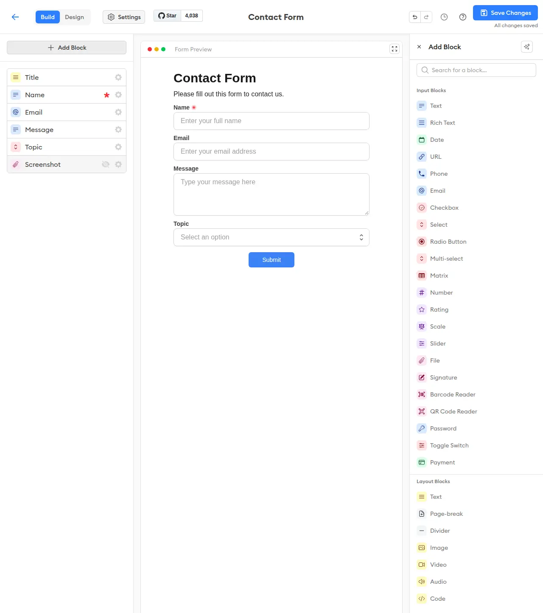
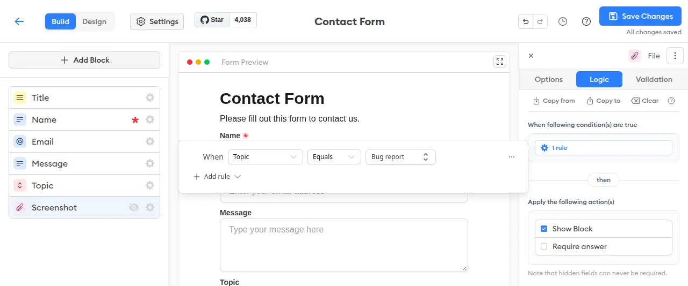
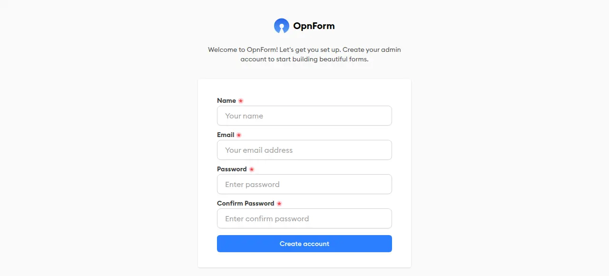
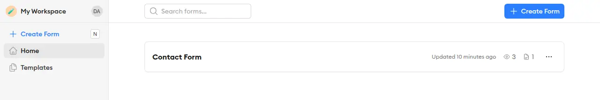
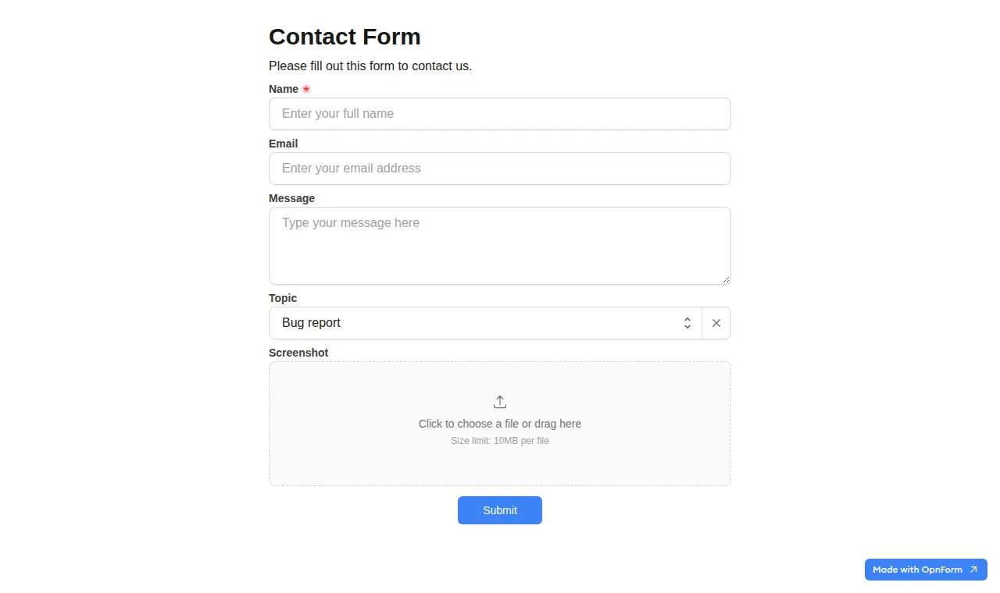

import YouTubeEmbed from "../../components/widgets/YouTubeEmbed.astro";
import Button from "../../components/widgets/Button.astro";
import Accordion from "@components/widgets/Accordion.astro";
import Notice from "@components/widgets/Notice.astro";

OpnForm is an open source form builder under AGPLv3 that you can self-host with Docker Compose or use as a hosted service at opnform.com. Self-hosting is free, capped at 2 users per instance unless you buy an Enterprise license. Self-host when the answers must stay on your own disk, and take the hosted Free plan for a solo contact form.

For this OpnForm review I ran v2.8.7, the latest release on 2026-11-27, in a throwaway Compose project on this machine (Docker 29.2.1, Compose v5.0.2). The repository at [github.com/OpnForm/OpnForm](https://github.com/OpnForm/OpnForm), moved from JhumanJ/OpnForm, counted 4,038 GitHub stars that day. The project name was `rf-opn`, so every container name below starts with it. I built a form, submitted it as a visitor, attached an email notification, pointed a webhook at a listener, and ran a backup with a test restore.

## What you get in the builder

The editor first asks for a style, Classic (questions on one or more pages) or Focused (one question at a time). Then it asks for a starting point: a contact form, a template, or an import from Typeform, Tally or Fillout.



Form logic lives in each block's settings, under Logic: one or more conditions, then the actions. In my test form a hidden File block named Screenshot appears only when the Topic select equals Bug report. The published page showed the upload box only after I picked that option.



The rest, by job:

| Job | What you get | Where it lives |
|---|---|---|
| Inputs and layout | 22 input blocks, from text, date and email to file, signature, matrix, barcode and QR readers and Stripe payment, plus 7 layout blocks | Add Block panel |
| Logic and validation | Conditions that show, hide, require or unrequire a block, rule groups, date conditions, custom validation | Block settings, Logic and Validation tabs |
| Personalization | URL pre-fill, hidden fields, auto-incremented or UUID IDs, computed variables, answers mentioned in emails and redirects | Share tab, block settings, Settings then Variables |
| Access | Password, closing date, submission limit, visibility published, draft or closed, indexable by Google | Settings, Security & Access |
| Respondent flow | Auto-save (on by default), partial and editable submissions, re-fillable form, update an existing record, retention rules, redirect after submit | Settings, Submission Settings |
| Notifications | Email to owners, confirmation to respondents, Slack, Discord, Telegram, each with conditions | Integrations tab |
| Automation | Webhook with HMAC-SHA256 signature and custom headers, n8n, Activepieces, Make, Pabbly, Albato, Google Sheets, Zapier | Integrations tab |
| Data | CSV and XLSX export, REST API with scoped tokens, JavaScript SDK, iframe embed, PDF templates | Submissions tab, Settings, Share tab |
| Analytics | Views, submissions, completion rate, GA4, GTM, Meta Pixel | Analytics and Summary tabs |
| AI | Generates a form or extra blocks from a text prompt, needs an OpenAI key | Create Form and the Add Block panel |

A fresh instance listed Email, Slack, Discord, Webhook, n8n, Activepieces, Make, Pabbly and Albato under Integrations. A webhook POSTs each submission to an HTTPS URL, for example a self-hosted [n8n](/n8n-self-host-workflow-automation/) behind a proxy. Custom code and custom CSS stay off until a license is active and `CUSTOM_CODE_ENABLE_SELF_HOSTED=true` is set.

## Should you self-host OpnForm or use the hosted service?

Self-hosting costs no license fee and includes passwords, closing dates, analytics, editable submissions and instance-wide SMTP, all Pro features on the hosted side. OpnForm caps it at 2 users per instance, so take the hosted service when more people must work in the account.

Everything outside `api/app/Enterprise` is AGPLv3, and that directory has its own license. The [self-hosted license page](https://docs.opnform.com/deployment/self-hosted-license) says it in one table: personal use yes, commercial use yes, modifying and redistributing the core under AGPLv3 yes. Section 13 of the AGPL is the part to read before you build on it. Change the core and offer it over a network, and those users can ask for your modified source.

Without a license, a self-hosted instance is the Community edition, and all of those features were on my test instance.

Prices and limits from [the pricing page](https://opnform.com/pricing) on 2026-11-27, verdicts mine:

| Option | Price | Verdict | Includes or adds |
|---|---|---|---|
| OpnForm Free, hosted | $0 | Enough for a solo contact form. Branding stays, 1 workspace | Unlimited forms and submissions, 10 MB uploads, logic, API, basic integrations |
| OpnForm Pro, hosted | $25 a month billed yearly, $29 billed monthly | Branding gone, own domain | Custom domains and SEO, custom SMTP, Slack, Discord, Telegram, captcha, analytics, AI generation, editable submissions |
| OpnForm Business, hosted | $67 a month billed yearly, $79 billed monthly | Roles and larger uploads | Roles and permissions, advanced branding, 1 GB uploads, priority support, partial submissions, versioning |
| OpnForm Enterprise, hosted | $220 a month billed yearly, $250 billed monthly | SSO and audit logs | SAML and LDAP SSO, audit logs, external storage, white label, SLA |
| OpnForm Community, self-hosted | $0 | Answers on your own disk, branding stays, you run the stack | Passwords, closing dates, analytics, editable submissions, webhooks, instance-wide SMTP, S3 storage, OIDC SSO |
| OpnForm Enterprise license, self-hosted | $1,999 a year per instance | More than 2 users on your own servers | More users, several workspaces with roles, branding removal, per-workspace SMTP, audit logs, custom code |

<Button link="https://opnform.com/" text="Check OpnForm" />

## How do I self-host OpnForm with Docker Compose?

Clone the repository, change the ingress port in the Compose file, and run `./scripts/docker-setup.sh --public-url https://forms.example.com`. The script writes both env files and starts eight containers.

You need git, openssl, Docker with the Compose v2 plugin, about 2 GB of disk for the images and a port you can spare.

Clone the repository and stop before the first start:

```bash
git clone https://github.com/OpnForm/OpnForm.git
cd OpnForm
```

The setup script writes `api/.env` and `client/.env` from the Docker templates. It generates `APP_KEY`, `JWT_SECRET` and the shared secret that `FRONT_API_SECRET` and `NUXT_API_SECRET` must both hold, and it sets the four URL variables. It also ends with `docker compose up -d`, so two edits to `docker-compose.yml` come first.

The ingress publishes `80:80` on every interface. That collides with whatever already owns port 80 and puts the container past your firewall, a problem [Docker bypassing the firewall](/docker-bypasses-firewall/) goes into. Bind it to loopback and leave the public port to your reverse proxy:

```yaml
  ingress:
    ports:
      - "127.0.0.1:8431:80"
```

The database password also defaults to `forge` (`${DB_PASSWORD:-forge}`). Put a real one in a `.env` file next to the Compose file, where Compose resolves those placeholders. A value in `api/.env` loses against the `environment:` block. [Docker Compose secrets](/docker-compose-secrets/) has stronger options.

Now run the script:

```bash
chmod +x scripts/docker-setup.sh
./scripts/docker-setup.sh --public-url https://forms.example.com
```

For a trial on your own machine, pass `--public-url http://localhost:8431` instead, the URL my test instance ran on.


On my first start Compose stopped after creating the database and cache containers:

```text
 Container rf-opn-api-country-worker-1 Error response from daemon: failed to mkdir /var/lib/docker/volumes/rf-opn_opnform_storage/_data/logs: mkdir /var/lib/docker/volumes/rf-opn_opnform_storage/_data/logs: file exists
```

Four containers mount the same fresh `opnform_storage` volume, and Docker fills a new volume from the image on first mount. They raced each other (that is my reading of the error, on Docker 29.2.1). A second `docker compose up -d` created the rest and started everything.

Give it half a minute, then look at the state:

```bash
docker compose ps --format 'table {{.Name}}\t{{.Status}}\t{{.Ports}}'
```

```text
NAME                          STATUS                             PORTS
rf-opn-api-1                  Up 35 seconds (healthy)            9000/tcp
rf-opn-api-country-worker-1   Up 35 seconds (healthy)            9000/tcp
rf-opn-api-scheduler-1        Up 35 seconds (health: starting)   9000/tcp
rf-opn-api-worker-1           Up 35 seconds (healthy)            9000/tcp
rf-opn-db-1                   Up About a minute (healthy)        5432/tcp
rf-opn-ingress-1              Up 29 seconds (healthy)            127.0.0.1:8431->80/tcp
rf-opn-redis-1                Up About a minute (healthy)        6379/tcp
rf-opn-ui-1                   Up 29 seconds (healthy)
```

The scheduler reports `health: starting` for its first 70 seconds, the length of its `start_period`, and turns healthy on its own. There is no health URL on the API (`/api/health` is 404). Before the admin account exists the root path answers 302 and points at `/setup`; after it, the login page is the one to watch:

```bash
curl -s -o /dev/null -w '%{http_code}\n' http://127.0.0.1:8431/login
```

```text
200
```

Open the instance in a browser and create the admin account:



Public registration closes after that, so the admin invites the second user. Create Form opens the editor on a default contact form, and Publish Form lands on the Share page behind a dialog that asks for a GitHub star.



The same Compose file runs under [Dokploy as a Compose app](/dokploy-docker-compose-app/) or [Dockge behind CloudPanel](/cloudpanel-setup-dockge/). At idle, with one form in it, the stack used about 480 MiB:

```bash
docker compose ps -q | xargs docker stats --no-stream --format 'table {{.Name}}\t{{.CPUPerc}}\t{{.MemUsage}}'
```

```text
NAME                          CPU %     MEM USAGE / LIMIT
rf-opn-api-1                  0.01%     75.13MiB / 15.25GiB
rf-opn-api-country-worker-1   0.00%     48.24MiB / 15.25GiB
rf-opn-api-scheduler-1        0.12%     51.87MiB / 15.25GiB
rf-opn-api-worker-1           0.00%     64.86MiB / 15.25GiB
rf-opn-db-1                   0.00%     49.97MiB / 15.25GiB
rf-opn-ingress-1              0.00%     18.05MiB / 15.25GiB
rf-opn-redis-1                0.57%     4.996MiB / 15.25GiB
rf-opn-ui-1                   0.00%     167.4MiB / 15.25GiB
```

## Settings to change before real traffic

Docker reads environment values when it creates a container. After any edit to `api/.env` or `client/.env`, run `docker compose down && docker compose up -d`. A restart keeps the old values.

<Notice type="warning" title="No mail leaves a new instance">
The Docker template ships `MAIL_MAILER=log`. Until the `MAIL_*` variables point at an SMTP server, every email integration ends as an error event with the reason "The configured mail transport does not deliver email."
</Notice>

I attached an email notification to the test form and submitted a response. The message went to the `api-worker` log and the integration event took the status `error`. A second message to the admin, "Integration issue with your form", followed it into the log. The block that fixes it, in `api/.env`:

```ini
MAIL_MAILER=smtp
MAIL_HOST=smtp.example.com
MAIL_PORT=587
MAIL_USERNAME=forms@example.com
MAIL_PASSWORD=change-me
MAIL_ENCRYPTION=tls
MAIL_FROM_ADDRESS=forms@example.com
MAIL_FROM_NAME=Forms
```

The [ZeptoMail SMTP relay setup](/how-to-setup-smtp-relay-email-on-zeptomail/) shows one way to get such a relay with Postfix on a VPS.

Uploads land on local disk inside the `opnform_storage` volume, under `storage/app/forms/<form id>/submissions/`. For object storage instead, point four variables in `api/.env` at a bucket: `AWS_ACCESS_KEY_ID`, `AWS_SECRET_ACCESS_KEY`, `AWS_DEFAULT_REGION` and `AWS_BUCKET`. [RustFS](/rustfs-self-host/) or any S3-compatible service works. The docs' CORS example allows any origin; narrow it to your form's domain. In my instance the File block took a per-field limit from 1 MB to 10 MB.

Put Caddy, Traefik or whatever you run in front of the ingress. Make it send `X-Forwarded-Proto: https` and overwrite whatever the client sent. Then set `TRUSTED_PROXIES` in `api/.env` to the address or CIDR the proxy connects from. Without that variable OpnForm trusts the protocol header from any caller, which is enough for HTTPS detection but drops the real client IP from rate limits. An explicit empty `TRUSTED_PROXIES=` turns proxy trust off.

Three outbound calls happen by default. Instance telemetry reports usage counts, an instance ID and your hostname to the vendor; `OPNFORM_TELEMETRY_DISABLED=true` stops it. Since v2.8.7, analytics looks up each visitor's country through InternetData when `IPINFO_TOKEN` is unset, which sends public visitor IPs to that service; `IP_LOCATION_PROVIDER=none` records Unknown instead. The admin editor also loads icons from api.iconify.design in the browser, a problem for an air-gapped install.

Plan around one rule. Webhook URLs must be HTTPS. A listener on the Compose network, `http://hook:8080/hook`, came back with a 422:

```text
{"message":"The webhook URL must use HTTPS.","errors":{"data.webhook_url":["The webhook URL must use HTTPS."]}}
```

The code behind it (`api/app/Service/Security/PublicWebhookUrl.php`) also wants the host to resolve to public addresses unless `WEBHOOKS_ALLOW_PRIVATE_URLS=true`. That variable is in the v2.8.7 source and in neither the docs nor the env templates. Private addresses still need HTTPS, and I did not test that path.

AI form generation needs `OPEN_AI_API_KEY` in `api/.env`. Without it the generate button accepts the prompt and the job fails a few seconds later with "You didn't provide an API key".

## Where the data lives, and backups

Two volumes hold state. `postgres-data` has forms, submissions, users and workspace settings. `opnform_storage` has the uploaded files and the `oauth-private.key` that the API entrypoint generates at first start for OAuth. Lose that volume and the entrypoint generates a new key, and tokens signed with the old one stop working. Redis keeps cache, sessions and the queue, so it needs no backup.

Dump the database through the db container and copy the storage volume with a throwaway container:

```bash
mkdir -p backup
docker compose exec -T db pg_dump -U forge -d forge | gzip > backup/opnform-db.sql.gz
docker run --rm -v opnform_storage:/data:ro -v "$PWD/backup:/backup" alpine tar czf /backup/opnform-storage.tgz -C /data .
ls -l backup
```

```text
total 72
-rw-rw-r-- 1 dragos dragos 16046 Nov 27 16:57 opnform-db.sql.gz
-rw-r--r--  1 root   root   54733 Nov 27 16:57 opnform-storage.tgz
```

Replace `forge` twice if you changed the database name and user, and the volume name if your project is not named `OpnForm`. The tar has to run as root, so the archive belongs to root. The key file is mode 600 and owned by www-data, and the same command with `--user $(id -u)` failed with `tar: can't open './oauth-private.key': Permission denied`. Chown it afterwards.

I loaded the dump into a scratch database on the same server and counted 44 tables, 1 form and 1 submission.

The submit call answers 200 with "Form submission saved" while the row is still a job in Redis; `api-worker` writes it and fires the integrations a moment later. So `docker compose down` is fine for a recreate, and `docker compose down -v` is not, because jobs waiting in Redis leave with the volume.

## Upgrades

The Compose file tracks `latest`. Pin both application images to a release, `jhumanj/opnform-api:2.8.7` and `jhumanj/opnform-client:2.8.7`, so you choose when to move. Move them together, because the client and the API ship as a pair. An upgrade is then:

```bash
git pull origin main
docker compose pull
docker compose up -d
docker compose logs api | grep -A2 "Running DB Migrations"
```

```text
api-1  | Running DB Migrations
api-1  |
api-1  |    INFO  Preparing database.
```

The API container's entrypoint runs `php artisan migrate --force` on every start. A release with migrations applies them whether you planned for it or not (v2.7.0 shipped four, v2.8.0 and v2.8.7 none). The `git pull` matters too. Since v2.8.7 the Compose file carries a third worker, `api-country-worker`. Rolling the images back works until a migration has changed the schema. Past that point the restore comes from the dump. [How to update Docker Compose containers](/updating-container-docker-compose/) has the rollback sequence.

## Embedding a form

Every form has a link you can send as it is, and the Share tab also writes the embed code. For my test form it was:

```html
<iframe style="border:none;width:100%;" id="contact-form-1vvcs8" src="http://localhost:8431/forms/contact-form-1vvcs8"></iframe><script src="http://localhost:8431/widgets/opnform-sdk.min.js"></script>
```

Your own instance serves the script, which resizes the iframe to the form. Since v2.7.0 the embedded form no longer hands the answers to the parent page; the switch for that sits in Settings, Security & Access.



The iframe steps for an Astro site are in [add a contact form to Astro](/add-contact-form-astro/), and [the static website version](/add-contact-form-static-websites/) covers plain HTML. The video shows the hosted builder as it looked in August 2023.

<YouTubeEmbed
  url="https://www.youtube.com/embed/EhE6H9nCm8U"
  label="OpnForm: Add A Contact Form To Astro Free"
/>

## FAQ

<Accordion label="Is OpnForm really free and open source?" group="faq">
Yes. The core is AGPLv3 and free for personal and commercial use, and the hosted Free plan has unlimited forms and submissions with branding. The code under `api/app/Enterprise` ships under a separate license.
</Accordion>

<Accordion label="How many users can a self-hosted OpnForm instance have?" group="faq">
Two, in total across the instance. Public registration closes after the first admin account, so the admin invites the second user. More users need a self-hosted Enterprise license, $1,999 per year per instance on 2026-11-27.
</Accordion>

<Accordion label="How much RAM does self-hosted OpnForm need?" group="faq">
The eight containers used about 480 MiB at idle in my test run, 167 MiB of it in the Nuxt client. A 1 GB VPS fits the stack and a reverse proxy with little left, so I would start at 2 GB.
</Accordion>

<Accordion label="Why are no OpnForm emails arriving after a submission?" group="faq">
The Docker template sets `MAIL_MAILER=log`, so mail goes to the `api-worker` log and the integration event fails with "The configured mail transport does not deliver email." Set `MAIL_MAILER=smtp` with the `MAIL_HOST`, `MAIL_PORT`, `MAIL_USERNAME`, `MAIL_PASSWORD` and `MAIL_FROM_ADDRESS` values, then run `docker compose down && docker compose up -d`.
</Accordion>

<Accordion label="Why does OpnForm reject my webhook URL?" group="faq">
Webhook URLs have to be HTTPS, so an `http://` address on the Compose network returns 422 with "The webhook URL must use HTTPS." The host must also resolve to public addresses unless `WEBHOOKS_ALLOW_PRIVATE_URLS=true` is set, a variable the v2.8.7 source has and the docs do not. Check the `X-Webhook-Signature` header when you set a secret.
</Accordion>

<Accordion label="How do I upgrade OpnForm with Docker Compose?" group="faq">
Take a `pg_dump` first, run `git pull origin main` for the Compose file, then `docker compose pull && docker compose up -d`. The API container runs `php artisan migrate --force` at start, so check `docker compose logs api` for the migration lines.
</Accordion>
