import Notice from "@components/widgets/Notice.astro";
import Tabs from "@components/widgets/Tabs.astro";
import Tab from "@components/widgets/Tab.astro";
import Accordion from "@components/widgets/Accordion.astro";

Orca vs T3 Code comes down to one question: a desktop IDE or a control plane. Pick Orca if you live in one desktop window with many agents, many repos, and now bots that take work from Slack. Pick T3 Code if you want one server that you drive from a laptop, a browser and a phone. I ran both on Linux on November 24, 2026, gave each a small task on the same repository, and changed nothing else.

Both are free and MIT licensed. Neither sells tokens. Each one sits on top of the agent CLIs you already pay for (Claude Code, Codex, OpenCode, Pi and the rest) and gives you a place to run several at once without losing track of them. Orca is an IDE that grew a chat layer and a bot layer. T3 Code is a control plane with clients.

<Notice type="info" title="How I tested">
Both tools ran on one Linux machine: Orca 1.4.272 from the AppImage, and T3 Code 0.1.11 through its `t3` server and web app. Each got one task on the same static site repository, and every screenshot below comes from those sessions. I did not test the phone apps, Orca Bots end to end (the Slack, GitHub and Linear connectors need an Orca account), T3 Connect, or remote hosts. One run per tool is an observation, not a benchmark.
</Notice>

## What each one is

Orca calls itself "a desktop IDE for running multiple AI coding agents side by side" ([docs](https://orca.dev/docs)). It is an Electron app from Stably AI, backed by Y Combinator, and its homepage now leads with bots: "hand them jobs from Slack, Linear, or GitHub, and step in when they need you." Every task gets its own git worktree, its own agent chat or terminal, and its own browser tab.

T3 Code calls itself "the open-source control plane for coding agents" ([README](https://github.com/pingdotgg/t3code)). It is a server that runs on the machine holding your code, plus a desktop app, a hosted web app, and iOS and Android apps that are all clients of that server. The desktop app bundles the server. The web app and the phones connect to it.

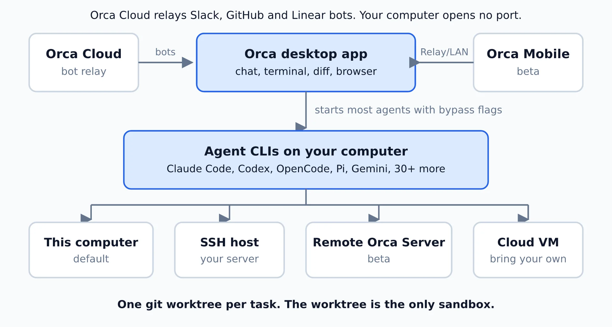

*How Orca fits together. Sources: the [worktree](https://orca.dev/docs/model/worktrees), [agent](https://orca.dev/docs/agents/supported) and [ways to run](https://orca.dev/docs/ways-to-run) docs.*

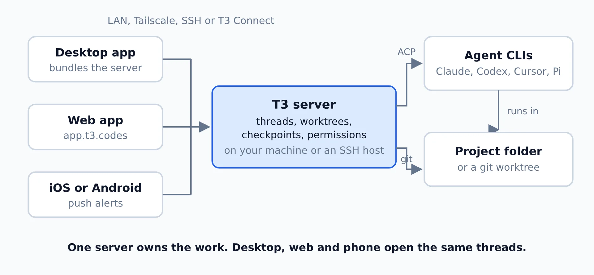

*How T3 Code fits together. Sources: the [architecture](https://github.com/pingdotgg/t3code/blob/main/docs/internals/01_architecture.md) and [remote access](https://github.com/pingdotgg/t3code/blob/main/docs/user/remote-access.md) docs.*

## Quick comparison

| | Orca 1.4.272 | T3 Code 0.1.11 |
|---|---|---|
| Maker | Stably AI (Y Combinator) | T3 Tools |
| License | MIT | MIT for the source; the name and logos are trademarked |
| Shape | Desktop app (Electron) plus a mobile companion | One server, with desktop, web and mobile clients |
| Install | macOS 13.4+, Windows 10/11, Linux (AppImage, deb, rpm) | macOS, Windows, Linux (dmg, exe, deb, AppImage) and the `t3` CLI |
| Agents | 34 named in the README, plus any CLI agent | 10 built in, plus agents from the ACP Registry |
| Agent wiring | Launches the CLI in a terminal or a structured chat | Runs each built-in provider behind an adapter; other agents speak ACP |
| Isolation | One git worktree per task | A worktree per thread, optional |
| Default permissions | Full access, with most CLIs' bypass flag | Full access for new threads |
| Phone | Orca Mobile (beta) over Orca Relay or your LAN | iOS and Android apps; push alerts need T3 Connect |
| Remote hosts | SSH hosts, Remote Orca Server (beta), cloud VM (experimental) | SSH environments, Tailscale, T3 Connect (3 machines free) |
| Async work | Orca Bots (beta), automations, schedules and triggers | Scheduled tasks, an MCP server for outside agents, thread links |
| Built-in browser | Yes, with Design Mode | Yes; the first tab downloads about 120 MB of headless Chrome |
| Price | Free; cloud VMs are billed by your own provider | Free; T3 Connect is free for up to 3 machines |

Two rows deserve a sentence each. "Agents" is where the gap is widest: Orca will launch anything that runs in a terminal, while T3 Code adds outside agents through the ACP Registry or a local ACP command. "Async work" is where Orca pulls ahead, and it gets its own section below.

## The repo numbers

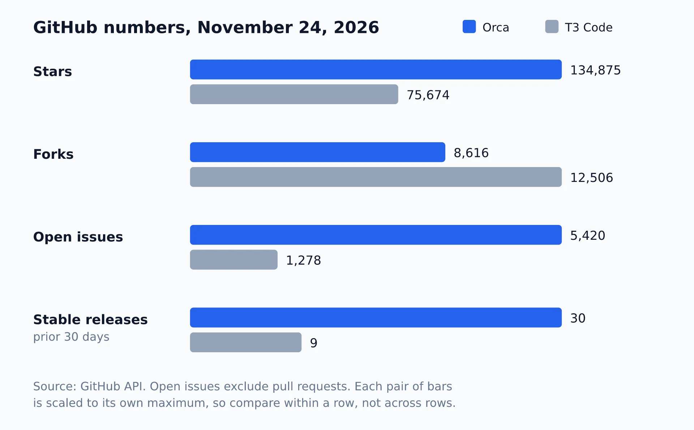

*From the GitHub API on November 24, 2026. Open issues exclude pull requests.*

Orca has the larger audience (134,875 stars against 75,674) and the longer open-issue list (5,420 against 1,278). T3 Code has more forks (12,506 against 8,616). Both ship fast, in different ways: Orca published 30 stable releases in the prior 30 days, and T3 Code published 9 stable releases plus 133 nightlies and previews. Expect both tools to change under you weekly.

## Install both

<Tabs>
<Tab name="Orca">
```bash
# macOS (use the full name: bare "orca" is an unrelated cask)
brew install --cask stablyai/orca/orca

# Arch Linux
yay -S stably-orca-bin

# Any other Linux: AppImage, .deb and .rpm are on the releases page
chmod +x orca-linux.AppImage && ./orca-linux.AppImage
```

On Linux the command line binary is named `orca-ide`, so it does not clash with the GNOME Orca screen reader. First launch runs five onboarding steps: chat or terminal, default agent, appearance, GitHub tasks, and notifications. On my machine it found 16 agent CLIs on `PATH` without help.
</Tab>
<Tab name="T3 Code">
```bash
# Desktop app
brew install --cask t3-code        # macOS
winget install T3Tools.T3Code      # Windows
sudo apt install ./T3-Code-*.deb   # Debian, Ubuntu

# The t3 command: starts the server and opens the web app
curl -fsSL https://t3.codes/install.sh | sh

# Or try it once without installing
npx t3@latest
```

The server listens on `127.0.0.1` (port 3773 in the docs' example). Flags I confirmed with `t3 --help`: `--port`, `--host`, `--no-browser`, `--lan`, `--tailscale-serve`, and `--base-dir` for a second, independent server. The welcome screen shows which agents are signed in and offers to import projects from your Claude Code, Codex and Pi history. Add a folder by hand with `t3 project add ./my-project`.
</Tab>
</Tabs>

One thing Orca does that you should know about: it edits the agent CLIs' own config. On a fresh profile, 1.4.272 wrote hook entries for `SessionStart`, `PreToolUse`, `PermissionRequest`, `Stop` and more into `~/.claude/settings.json`, added a status line, and wrote `~/.codex/hooks.json`. The scripts live in `~/.orca/agent-hooks/`. That is how it shows working, waiting and done states. Settings, Agents, "Agent status hooks" turns it off and removes the hooks.

## Running one task in each

### Orca: a worktree first, then a chat

Click the plus button next to a project and you get the Create worktree dialog: project, where it runs, the ref it starts from, a name, a new or existing branch, and an optional agent. Advanced hides a parent worktree, a note and sparse checkout.

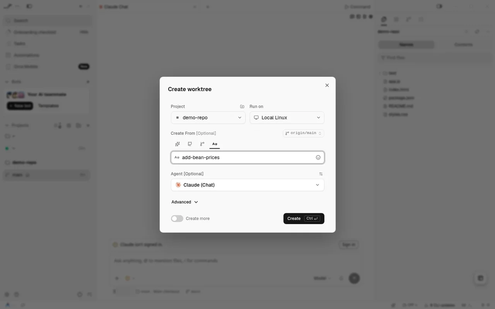

*The Create worktree dialog in Orca 1.4.272 on Linux.*

Worktrees land in `~/orca/workspaces/<project>/<name>` when you keep the default folders. I started Pi on the free Beam model and asked it to add prices to the bean list. It finished in 23 seconds with three files changed, and the chat shows the result as a card.

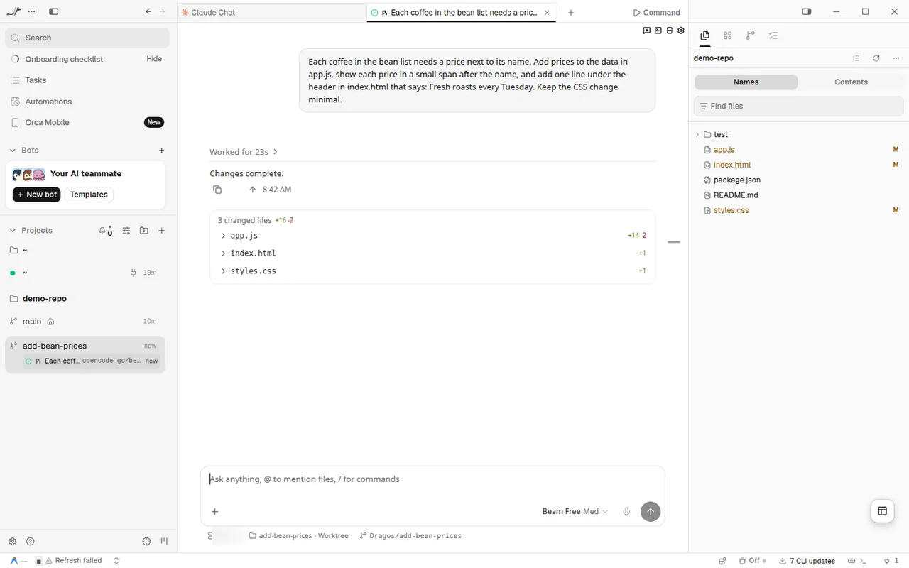

*A finished turn in Orca's Chat UI: the reply, the changed files, and the worktree in the sidebar.*

Expand the "Worked for" row and you get the full timeline: the commands, the file reads and the edits of that turn.

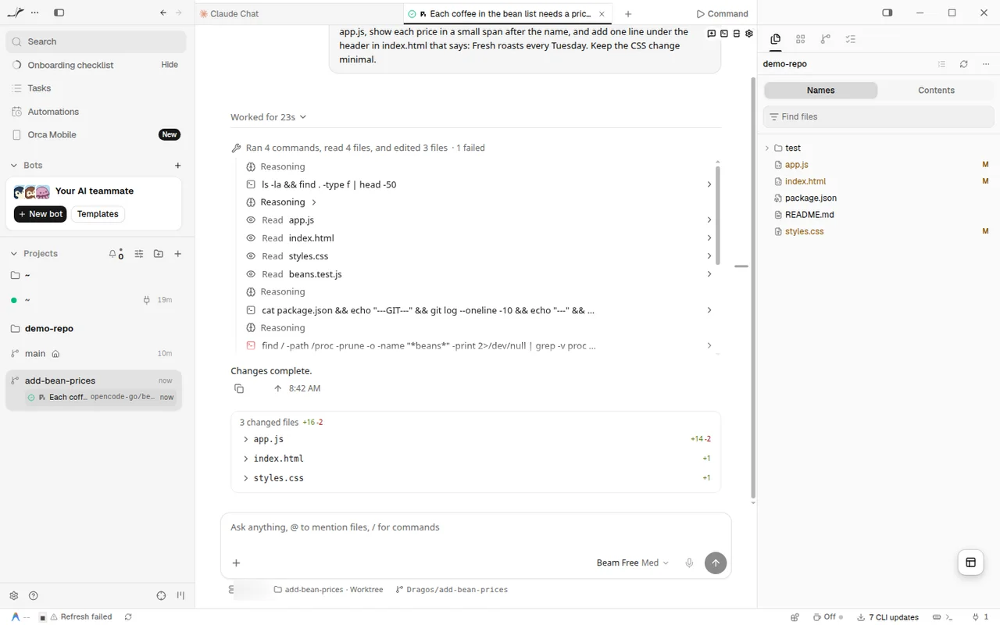

*The same turn with the activity expanded. No approval prompt appeared.*

Read that timeline closely. One command was `find / -path /proc -prune -o -name "*beans*" ...`, a search across the whole filesystem, not only the worktree. The worktree keeps the git state clean. It does not keep the agent inside the folder.

### T3 Code: a thread, with a worktree if you want one

A new thread starts from a composer: the message box, a model picker, then three small controls under it for Workspace (current checkout or new worktree), Branch, and Permissions.

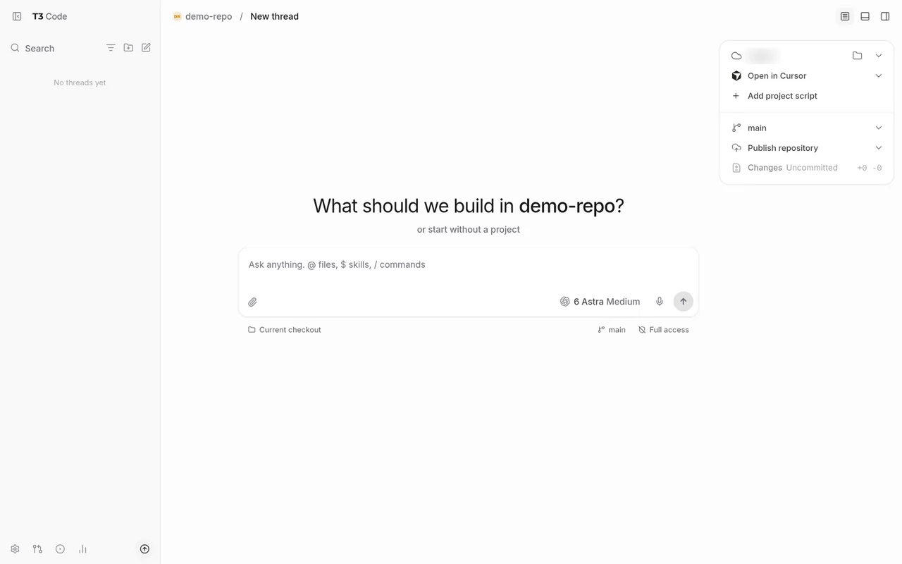

*A new thread in T3 Code 0.1.11. The right panel lists the run context, the editor, and git actions.*

I picked Codex on GPT-6 Astra, switched Permissions to Supervised, and sent the task again, worded for Codex. T3 Code stopped three times: to run `cat app.js index.html styles.css`, to update `styles.css`, and to run `git diff --check && node --check app.js && git diff --stat`. The turn took 1 minute 25 seconds and changed three files. Do not compare that with Orca's 23 seconds. Different agent, different model.

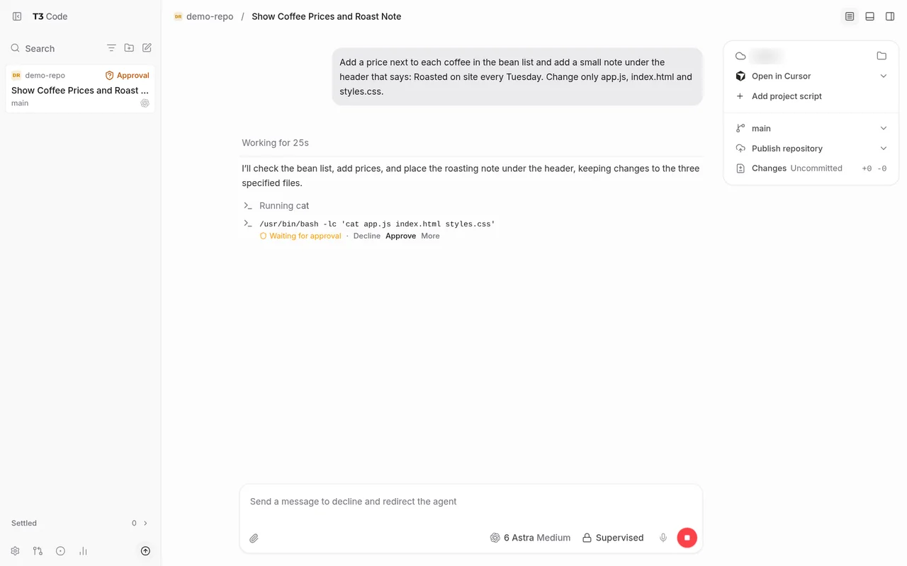

*Supervised mode in action: the command, Decline and Approve, and an Approval badge on the thread in the sidebar.*

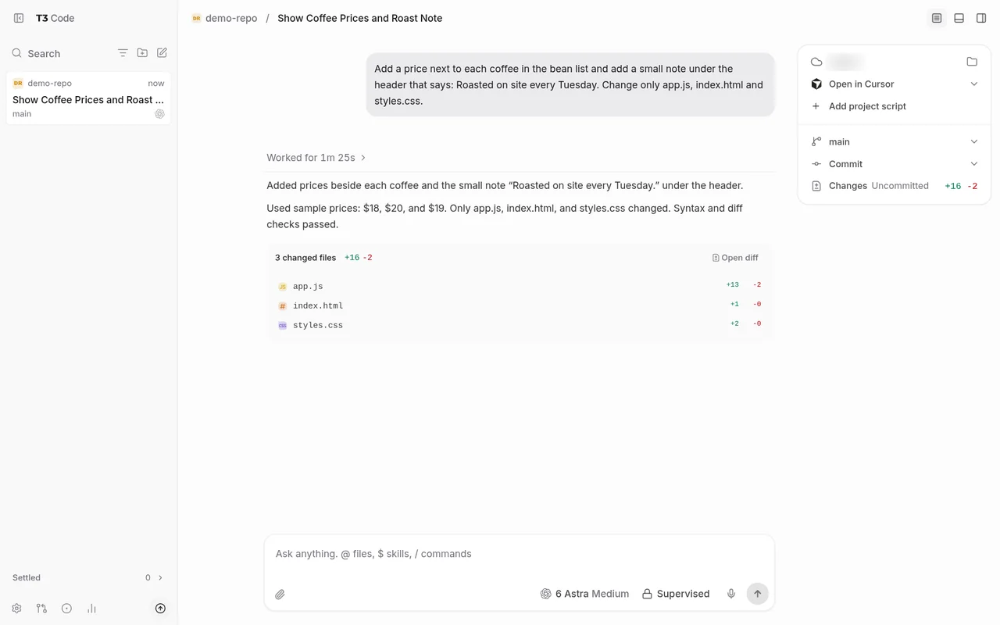

*The finished turn in T3 Code: the reply and the changed files, with the thread still in Supervised mode.*

Ignore the times, since the agents and models differ. What matters is that T3 Code offered a Supervised mode I could pick in one click, while Orca's default let the agent search outside the project without asking.

## Agents and models

Orca's rule is "any CLI agent": the picker only launches a process. The README names 34, the docs table lists 43, and my install showed 16 detected plus 29 more available to install from Settings. 21 of them have a structured Chat UI instead of a raw terminal, and you choose per agent. You can also right-click a tab to move a live session between the chat and the CLI, or hand a conversation to a different agent ([docs](https://orca.dev/docs/agents/native-chat)).

T3 Code starts with Claude Code, Codex, Cursor, OpenCode, Grok Build, Antigravity, Kiro, Pi, Muse Code and fx, then adds anything from the ACP Registry under Settings, Providers, "Show more". Each provider gets its own binary path, launch arguments, environment variables and model list. Two things T3 Code does in one step:

- Change the model in the middle of a thread. T3 Code transfers the conversation context when you switch, with a default history allowance of 16,000 tokens.
- Shift-click several models in the picker to send one prompt to all of them. Each selection starts its own thread and worktree.

If you are still setting up the agents themselves, the [Pi setup guide](/pi-coding-agent-setup-guide/) and the [OpenCode setup guide](/opencode-setup-guide/) cover that part, and [OpenCode vs Pi](/opencode-vs-pi-agent/) explains how the two differ.

## Permissions: change this before the first prompt

Both tools ship with the brakes off. This is the first setting to touch in either one.

In Orca, "Permissions" for new agents reads **Full access** on a fresh install. It works by flag: most supported CLIs are launched with their own permission bypass. Pi and OpenCode start without one.

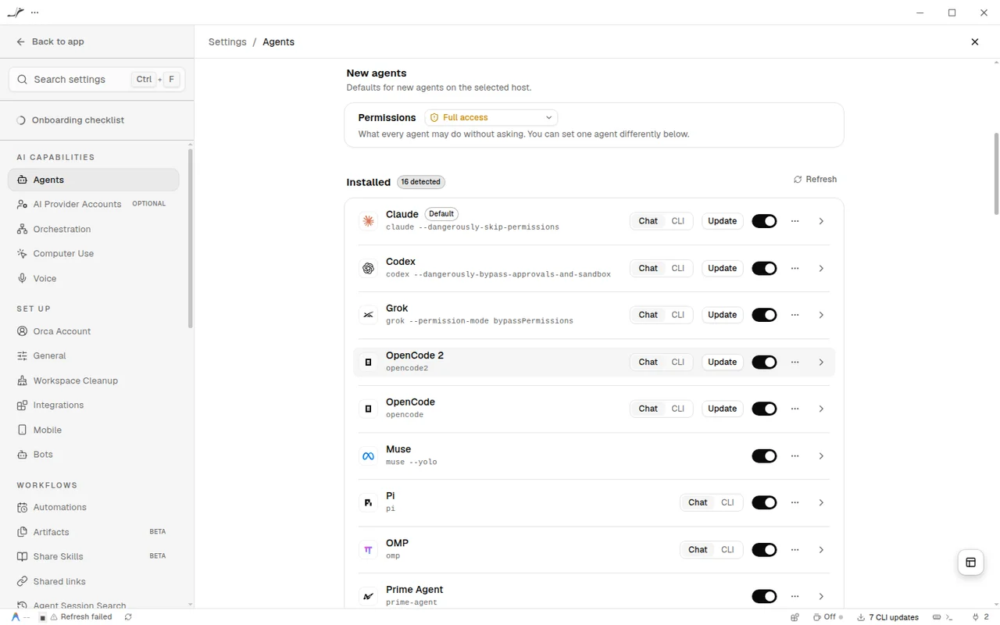

*Settings, Agents in Orca 1.4.272: the command each agent is launched with.*

Claude gets `--dangerously-skip-permissions`, Codex gets `--dangerously-bypass-approvals-and-sandbox`, Grok gets `--permission-mode bypassPermissions`, and Gemini, Cursor and Hermes get `--yolo`. The docs say why: "The intent is that the worktree itself is the sandbox: agents can do their thing without per-tool approval prompts breaking the flow." You can switch each agent, or all of them, to Manual or Auto under Settings, Agents.

In T3 Code there are four modes, and the initial default for new threads is Full access as well:

| Mode | What it does |
|---|---|
| Supervised | Requests approval for commands and file changes |
| Auto-accept edits | Approves file edits automatically; other actions can still require approval |
| Auto | Uses the provider's automatic review to approve routine actions and ask about others |
| Full access | Allows commands and edits without approval prompts |

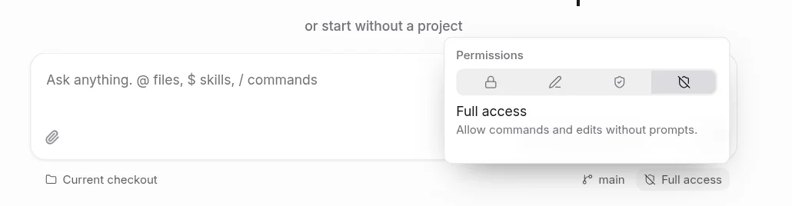

*The Permissions control under the T3 Code composer. Full access is selected, as it is on every new thread.*

Change it per thread from that control, or once for everything under Settings, Threads, New threads, Permissions. Projects can override the environment default, and an administrator can cap the modes with a managed policy ([docs](https://github.com/pingdotgg/t3code/blob/main/docs/user/permission-modes.md)). Note the edge: in Full access, "commands that Codex's dangerous-command check would ask about run without asking."

Neither tool documents an operating-system sandbox for agents. A request for Docker sandboxes has 62 reactions on Orca's tracker and is still open. In T3 Code, only Registry agents bring "their own sandbox and approval rules". Run both only with agents you already trust.

## Review, commits and pull requests

Orca goes deeper here. The Changes tab shows one combined diff against the ref the worktree started from, with side-by-side mode, word wrap and staging by hunk or line.

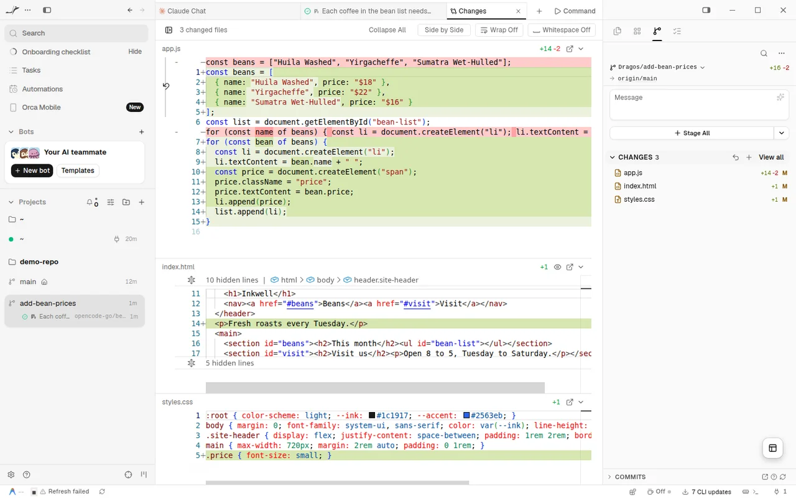

*The Changes tab in Orca, opened from the 3 changed files card.*

Three features save a round trip:

- Comment on a changed line and "Send to agent" delivers all comments as one prompt. The comments follow the line across later edits ([docs](https://orca.dev/docs/review/annotate-ai-diff)).
- Commit messages and pull request details can be generated from the diff. A failed pre-commit hook gets a "Fix with AI" button that hands the output to an agent with a repair-only prompt ([docs](https://orca.dev/docs/review/commit-push)).
- On a GitHub pull request with failing checks, "Fix broken checks" sends the check names and links to an agent.

T3 Code keeps review inside the thread. "Open diff" opens a panel scoped to the latest turn; a branch comparison covers everything against the base, and a Commits view lists the newest 100 local commits.

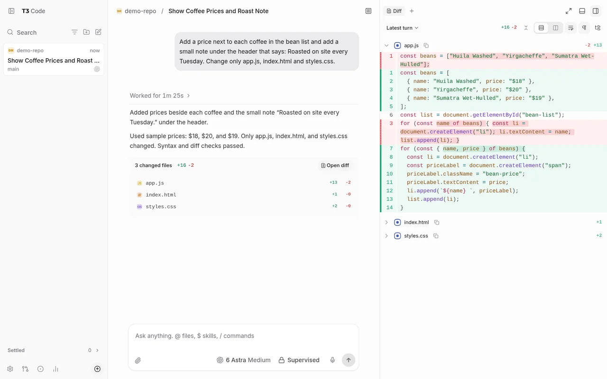

*The Diff panel in T3 Code, opened from the thread's changes card.*

From the thread's git actions you commit, push and open a pull request, with generated commit messages and descriptions. The Pull requests view handles comments, reviewers and merges. Hosts: GitHub, GitLab, Forgejo, Gitea, Bitbucket, Azure DevOps, GitCafe and Cursor Origin. Snapshots are stored as hidden git refs, so a checkpoint never adds a commit to your branch ([docs](https://github.com/pingdotgg/t3code/blob/main/docs/user/source-control.md)).

## Orca Bots: agents that take work from Slack, Linear and GitHub

Bots are the new part of Orca, still marked beta, and T3 Code has nothing with the same shape. The docs define one like this: "A bot takes jobs from its chat, Slack, Linear, GitHub or a schedule. It works on your computer with your own Claude Code or Codex, or another supported agent, and reports back where you asked."

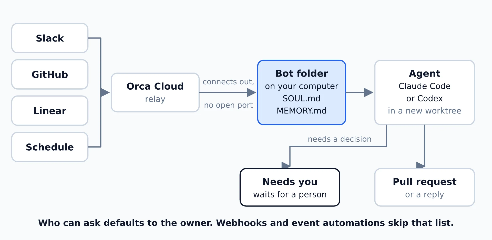

*How a job reaches an Orca bot and comes back as a pull request. Source: the [bots](https://orca.dev/docs/bots) and [security](https://orca.dev/docs/bots/security) docs.*

Four facts decide whether bots fit you:

- A bot lives in a folder on one computer, this one or a paired server, and it works only while that computer is awake and online. Its soul and memory are plain Markdown files (`SOUL.md`, `MEMORY.md`) you can read and edit.
- Slack, GitHub, Linear and webhooks connect through Orca Cloud. Your computer connects out to pick up requests, so it needs no open port. Requests wait up to a day.
- Schedules run hourly, daily, on weekdays, weekly, or on cron. Triggers fire on GitHub events (pull requests, pushes, failing checks, merges, security alerts), Linear events, new mail and webhooks.
- Two jobs run on their own: "Look around", a read-only pass every 4 hours between 8 AM and 8 PM on weekdays, and "Memory upkeep", a nightly tidy-up with no tools.

You do not have to write one from scratch. The template gallery ships 24 bots in six groups: coding (pull request review, bug investigation, dependency updates, security check), releases and CI, support and triage, planning and docs, ops (incident notes, on-call handoff), and a personal assistant group (replies you owe, daily standup notes, email digest, meeting prep).

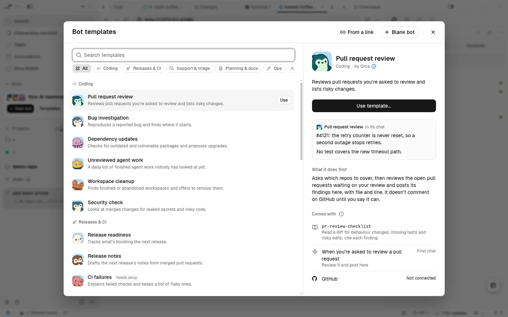

*The bot template gallery in Orca 1.4.272. A few templates, such as CI failures, ask for extra setup.*

"Use template" opens a short dialog: the computer, the agent, and what the bot comes with. The pull request review bot is one skill and one automation, and it will not comment on GitHub until you allow it.

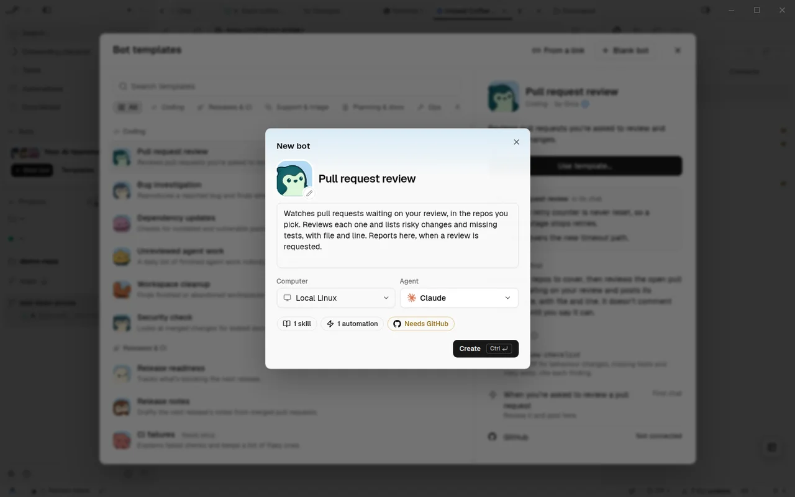

*Creating a bot from the Pull request review template.*

Know the limits before you point one at a shared channel. The docs split them for you ([security](https://orca.dev/docs/bots/security)):

| Enforced by Orca | Only instructed |
|---|---|
| Only people on "Who can ask" can talk to the bot, and the list starts with the owner | Approving or merging pull requests only when asked |
| "Look around" is read-only | Drafting mail instead of sending it |
| "Memory upkeep" has no tools | Treating inbound messages as information, not orders |
| Importing a bot skips keys, logins and databases | Never asking for a token |
| A person must press Create bot, answer questions under "Needs you", and add people to the list | Automations that arrive with an imported bot start paused |

The docs' own words for the right column: "None of these settings is a guarantee." Two more caveats from the same page: people you add "use your access, not their own", and event automations and webhooks bypass the Who can ask list. A new bot also starts with Orca's default chat permission, Full access. Switch it to Ask for approval for any bot other people can reach.

Release pace here is fast. v1.4.268 to v1.4.271 (November 21 to 22) brought bots to Cursor, GitHub Copilot, Hermes, Kiro, Kimi Code, Gemini CLI, Goose and others, added bot groups across paired computers, and let you edit a bot's automations and memory from the phone. v1.4.272 (November 23) made bots resume after usage-limit pauses, crashes and restarts ([changelog](https://orca.dev/changelog)). Slack, GitHub and Linear need an Orca account. If you want bots without a cloud relay in the path, the [open source Grok Bot alternatives](/best-open-source-grok-bot-alternatives/) I compared earlier are built to run on your own stack.

## Remote work and the phone

Orca treats the phone as a remote control. "The mobile app is intentionally not a full editor", the docs say, and "Desktop still owns the agent." You pair with a one-time code over Orca Relay (beta, needs a sign-in) or over LAN or Tailscale. From the phone you get agents across hosts, worktree status, files, chat or raw terminal, source control, push notifications, and since v1.4.271 the bot settings. For machines, Orca has three routes: SSH hosts (it installs a managed server on the host), Remote Orca Server (beta, `orca serve`, with a systemd user unit via `orca serve service install`), and an experimental per-worktree cloud VM where you bring the provider ([docs](https://orca.dev/docs/ways-to-run)).

T3 Code is built the other way round: the server is the product and everything else is a client. That shows in the options for reaching it ([docs](https://github.com/pingdotgg/t3code/blob/main/docs/user/remote-access.md)):

| Route | What you get |
|---|---|
| Local network | `t3 up --lan` or `t3 serve --lan`; a pairing code is the only protection |
| Tailscale | `t3 serve --tailscale-serve`, over HTTPS with MagicDNS |
| SSH | Add an environment in Settings; the server downloads to `~/.t3/runtime` on the host |
| T3 Connect | No port forwarding; 3 machines per account, free for now; optional device approval codes |
| Web app | `app.t3.codes` is a hosted client that connects straight to your server |

The trade: push alerts on the phone require T3 Connect. "A direct or Tailscale connection alone does not enable push notifications." When they work, you get an alert when an agent finishes, fails, needs approval, or asks for input, and tapping it opens the thread.

Two T3 Code extras I did not find in Orca's docs. Thread links (`app.t3.codes/threads/<environment>/<thread>`) drop a live thread into a Slack message or a GitHub comment. And an MCP server lets agents that T3 Code did not start, such as Claude Code in your own terminal or ChatGPT, read projects and start or message threads, with `t3 thread start` and `t3 thread send` for scripts ([docs](https://github.com/pingdotgg/t3code/blob/main/docs/user/outside-agents.md)). For a different take on phone control, I covered [Herdr Mobile and Moshi](/control-ai-agents-from-phone-moshi-herdr/) earlier.

## Day to day differences

These are the ones I noticed or found in the docs.

| Orca | T3 Code |
|---|---|
| Design Mode: click any element in the built-in browser and send its HTML, styles and selector to the agent | The Working section folds running threads away and returns them to the top when they need you |
| The browser's new tab page lists servers already running in the workspace | Resume a stopped Claude, Codex, OpenCode or Cursor turn without a new message |
| Agents keep running when you quit the app or it updates (a background daemon owns the terminals); a reboot kills them | Keeps the computer awake while agents work (v0.1.10) |
| Monaco editor, but no language server: "editor-first, not IDE-first" | A Usage view that pools subscription windows across providers |
| Plugins for themes, icons and editors (since October 30) | An agent can restyle the whole app if the thread runs in Full access |
| Automations: `orca automations create --name review --trigger daily --time 09:00 --prompt "..."` | Suggest next prompt (Labs), voice input, guest links and linked environments (beta) |

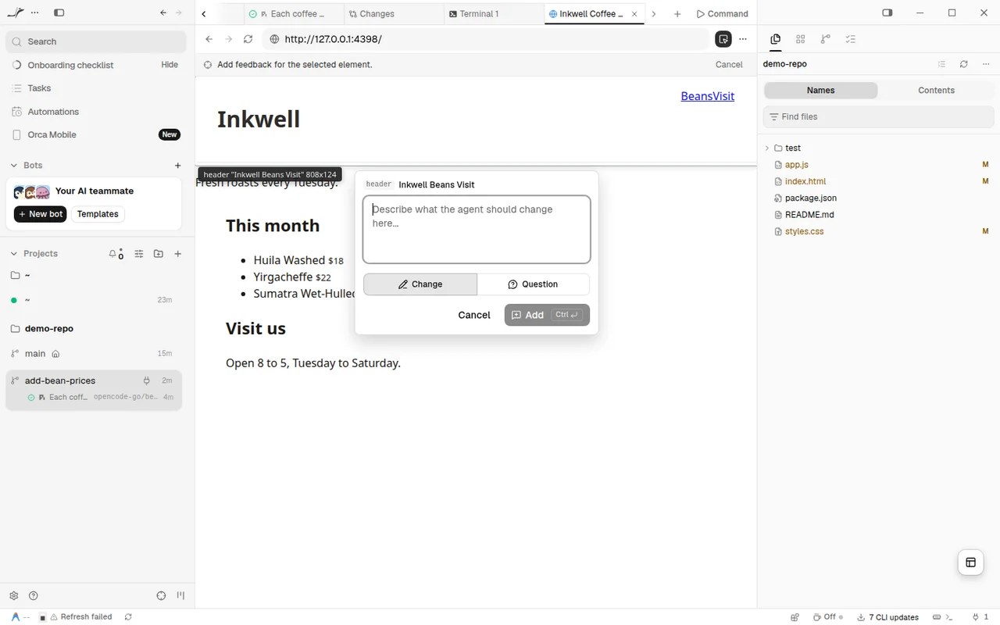

*Design Mode in Orca's built-in browser, with an annotation ready for the agent.*

The editor row matters if you treat this window as your IDE. "Have LSP support" is one of the most-reacted open requests on Orca's tracker. T3 Code hands editing to an outside editor: its thread panel has "Open in Cursor" and "Choose editor" buttons.

## Price and telemetry

Neither tool has a price. "T3 Code doesn't resell tokens," its site says, and the FAQ answers "How much does T3 Code cost?" with "Nothing." Orca's homepage says "Free and open source", and `orca.dev/pricing` returned a 404 when I checked. Your cost is the agent plans you already have. For cheaper models behind either tool, see [OpenCode Go vs ClinePass](/opencode-go-vs-clinepass-cheap-models/).

Two paid edges exist. T3 Connect is free "for now" for 3 machines; a paid T3 Chat plan raises that to 10 or 100, and the FAQ adds, "We don't want to charge for this, but if the bill gets unacceptable we may have to change course." On the Orca side, the docs do not say what Orca Cloud costs or whether its server code is published, and cloud VMs are billed by the provider you bring.

Telemetry exists in both, and both let you turn it off:

| | Orca | T3 Code |
|---|---|---|
| Sent | Version, OS, feature events, agent kind, token-usage summaries | Provider, model, reasoning effort, permission mode, turn results, token counts, hashed account IDs |
| Not sent (their statement) | File contents, prompts, agent responses, terminal output | Prompts, responses, file contents, auth tokens |
| Opt out | Settings, Privacy, or `ORCA_TELEMETRY_DISABLED=1` or `DO_NOT_TRACK=1` | `T3CODE_TELEMETRY_ENABLED=false` before starting the server |

Orca's telemetry also switched itself off on my machine because a CI environment variable was set. T3 Code has a second switch: "Publish agent activity" sends project and thread titles to the T3 Connect relay for phone notifications, and the telemetry opt-out does not disable it ([docs](https://github.com/pingdotgg/t3code/blob/main/docs/user/telemetry.md)).

## Which one should you run?

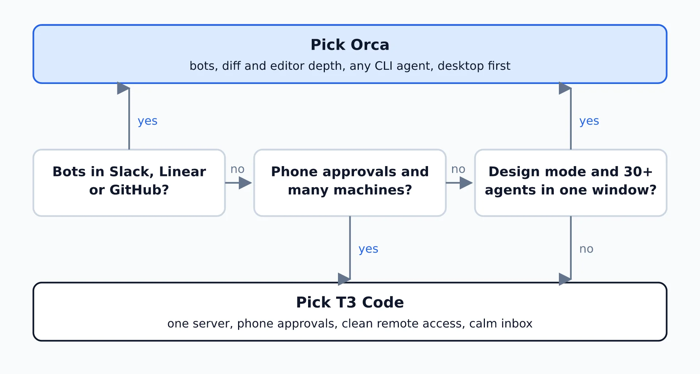

*Three questions that settle it for most people.*

Pick Orca when:

- You want Orca Bots: agents that pick up work from Slack, Linear or GitHub while your desktop does the heavy review.
- You run more than two or three agents at once and want their diffs, terminals and browsers side by side.
- Your agents go beyond the usual names. Anything with a CLI runs.
- You review AI code all day. Line comments that go straight back to the agent are worth the install.

Pick T3 Code when:

- You start work at a desk and approve it from the phone or a browser, on more than one machine.
- You like an inbox: threads hide while they work and come back when they need you.
- You switch models mid-thread, or want one prompt answered by several models at once.
- You want scripts and other agents to start threads through one CLI and one MCP server.

They do not conflict. Orca is a desktop app and T3 Code is a server on one port, so you can keep both and drop the one you stop opening. If you would rather stay in a terminal, the [Herdr review](/herdr-agent-multiplexer/) covers a third way to run many agents. The [Hacker News thread on Conductor joining Meta](https://news.ycombinator.com/item?id=50369503) has Orca and T3 Code users explaining their choice.

Whatever you pick, do this first: open the permission setting and move it off Full access before the first prompt. Then run one throwaway task on a repository you can delete, and read its activity log before you point the tool at anything that matters.

<Accordion label="Are Orca and T3 Code really free?" group="faq" expanded="true">
Yes. Both are MIT licensed and neither resells tokens. You pay the agent vendors you already use. The only paid edges are T3 Chat plans, which raise the T3 Connect limit from 3 machines to 10 or 100, and cloud VMs in Orca, which your own provider bills.
</Accordion>

<Accordion label="Which one is safer by default?" group="faq">
Neither. Orca pre-fills each supported CLI's permission-bypass flag (for example `claude --dangerously-skip-permissions`), and T3 Code starts new threads in Full access. T3 Code is quicker to make safe: pick Supervised in the composer and it asks before each command and file change. In Orca, set the agent to Manual under Settings, Agents.
</Accordion>

<Accordion label="Can I use my Claude Code or Codex subscription with both?" group="faq">
Yes. Both drive the CLIs you are already signed in to. Run `claude auth login` or `codex login` once on the machine that will run the agents, and each tool finds it. T3 Code checks for the CLI on the server's `PATH` and lets you set a binary path per provider.
</Accordion>

<Accordion label="Does T3 Code have bots like Orca?" group="faq">
Not in the same form. T3 Code has scheduled tasks, thread links you can paste into Slack, and an MCP server that lets outside agents start and message threads. It has no built-in Slack, Linear or GitHub bot. That is the one feature where Orca stands alone today.
</Accordion>

<Accordion label="Can I run both on the same machine?" group="faq">
Yes. Orca is a desktop app and T3 Code is a server bound to one local port, so they do not fight. Run `t3 serve --base-dir ~/.t3-second` if you want a second, independent T3 server next to an existing one. Do not point two tools at the same checkout at the same time; give each its own worktree.
</Accordion>

<Accordion label="Which one works better from a phone?" group="faq">
For approvals and replies, T3 Code. Its iOS and Android apps are full clients of the server, and push alerts arrive when a thread finishes, fails or needs you, as long as you connect through T3 Connect. Orca Mobile is a beta companion for a desktop that stays running, and it works over Orca Relay or your LAN without an account on LAN.
</Accordion>

<Accordion label="Do worktrees protect the rest of my files?" group="faq">
No. A worktree gives each task its own checkout and branch, nothing more. In my Orca run the agent searched the whole filesystem with `find /` without a prompt. Keep secrets out of the agent's reach, or use a mode that asks first. Orca's docs describe Docker sandboxes as an open feature request.
</Accordion>

<Accordion label="Which one should I pick if I only use one agent?" group="faq">
T3 Code. One thread list and one server are enough for a single agent, and the phone apps come with it. Orca earns its window size when you juggle several agents, several repos, or bots. If you use one agent and want the lightest setup, the [Codex app with any model](/codex-app-any-model/) is another option.
</Accordion>
