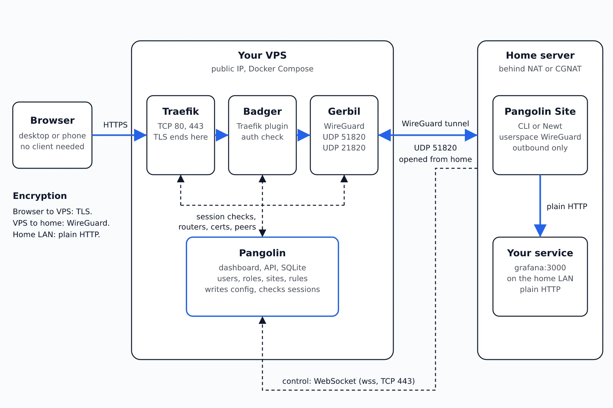
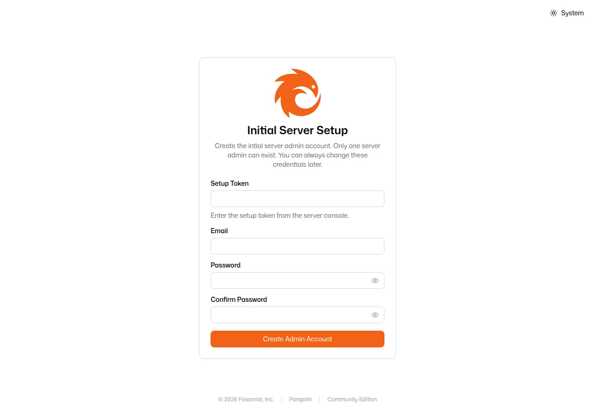
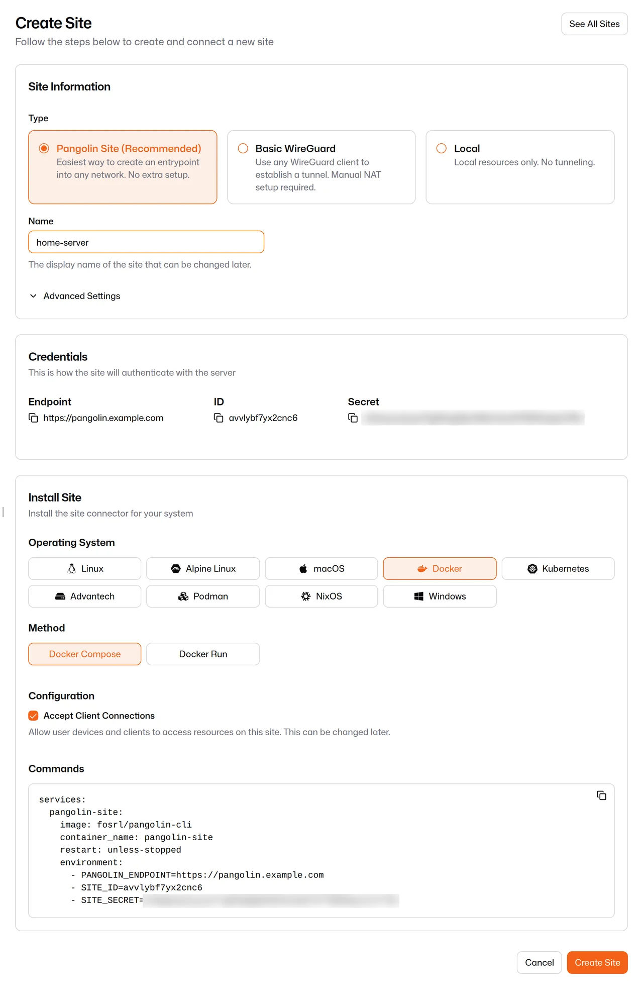
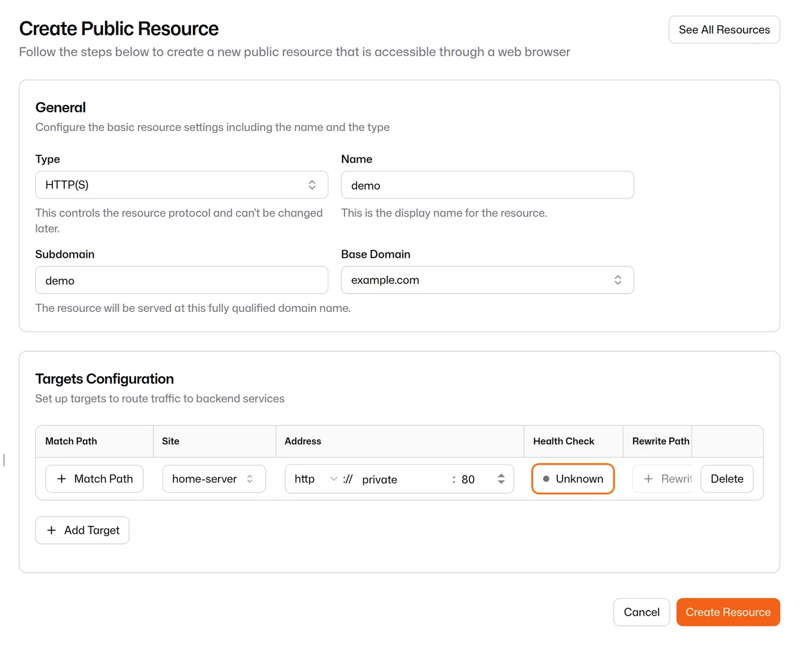
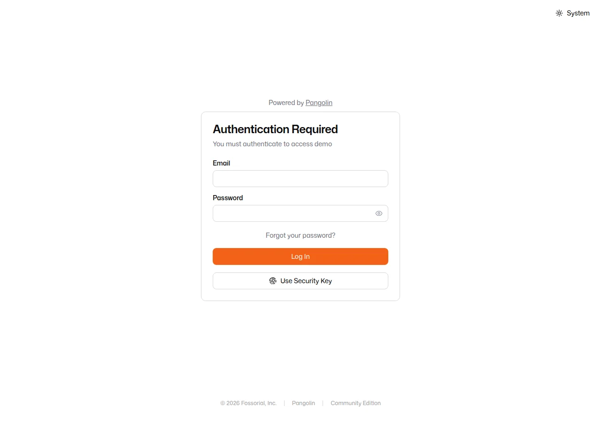

import YouTubeEmbed from "@components/widgets/YouTubeEmbed.astro";
import ListCheck from "@components/widgets/ListCheck.astro";
import Notice from "@components/widgets/Notice.astro";
import Accordion from "@components/widgets/Accordion.astro";

Pangolin is a self-hosted reverse proxy with WireGuard tunnels that replaces Cloudflare Tunnels on a VPS you rent. Version 1.27.1 runs three containers on the VPS and one connector at home, and your home network opens no inbound port.

Every output below is real. It comes from a throwaway Compose stack for Pangolin 1.27.1 on my workstation, with `fosrl/pangolin:1.27.1`, `fosrl/gerbil:1.6.0`, `traefik:v3.7.16`, Badger v1.8.0 and the connector image `fosrl/pangolin-cli` (Pangolin CLI 0.23.0). The lab had no public IP and no real certificate. It used a lab certificate authority, local ports for 80 and 443, and a Docker network in place of the internet. The lab did not exercise Let's Encrypt, public DNS or UDP 51820 over the internet, so those steps quote the official docs.

## Why move away from Cloudflare Tunnels?

Cloudflare Tunnels publishes a home service with one daemon, `cloudflared`, and no inbound port, on a free tier. The limits arrive with large uploads, video and anything that is not HTTP.

| Limit | What Cloudflare documents (checked 2026-11-27) |
|---|---|
| Upload size | 100 MB per request on Free and Pro, 200 MB on Business, up to 5 GB on Enterprise. A larger request gets a [413 error](https://developers.cloudflare.com/support/troubleshooting/http-status-codes/4xx-client-error/error-413/). |
| Video and large files | On Free, Pro and Business plans, a [public hostname](https://developers.cloudflare.com/tunnel/concepts/routing/) must use a paid Cloudflare service for video and other large files. Private network routes are not affected. |
| TLS | Cloudflare applies CDN caching, WAF and DDoS protection before the request reaches your origin, which means Cloudflare reads every request. |
| Other protocols | TCP, SSH, RDP and SMB work on a published hostname, but the person connecting installs `cloudflared`. The published-hostname list has no UDP. |
| Account | Tunnels, DNS and access rules live in one account. A [Quick Tunnel](https://developers.cloudflare.com/tunnel/get-started/quick-tunnels/) has no uptime guarantee and allows 200 in-flight requests. |

For a blog or a public API that fits those limits, I would stay with Cloudflare. The same swap exists on the compute side: [OpenOrange runs Cloudflare Workers and Durable Objects on your own servers](/open-orange-cloudflare-workers/).

## What is Pangolin?

Pangolin is an open-source remote access platform: a reverse proxy with logins and rules in front, and WireGuard tunnels behind. A dashboard writes the proxy and tunnel configuration for you.

Fossorial maintains it. The repository had 24,016 stars on 2026-11-27, and the licence is AGPL-3.0 unless a file carries the Fossorial Commercial License.

| Part | Runs as | Job |
|---|---|---|
| Pangolin | container `fosrl/pangolin:1.27.1` | Dashboard, REST API and the SQLite database. Stores users, roles, sites and resources, writes the Traefik routers and the WireGuard peer list, answers Badger's session checks. |
| Traefik | container `traefik:v3.7.16` | Terminates TLS, requests the Let's Encrypt certificates, routes each hostname. |
| Badger | Traefik plugin v1.8.0 | Runs inside Traefik on every request to a resource, asks Pangolin whether the session may pass, and adds `Remote-User`, `Remote-Email`, `Remote-Name` and `Remote-Role` headers for the service. |
| Gerbil | container `fosrl/gerbil:1.6.0` | The WireGuard server. Sites connect on UDP 51820, devices with the Pangolin client on UDP 21820. |
| Pangolin Site | image `fosrl/pangolin-cli` on your home server | The connector. Opens a WebSocket to Pangolin for control messages and a WireGuard tunnel to Gerbil for traffic, then forwards to services on your LAN. |

The connector went by the engineering name Newt. Release 1.23.0 (2026-09-16) renamed it Pangolin Site and made the Pangolin CLI the preferred install. `fosrl/newt` still works for existing sites and as the smallest connector. The [Traefik reverse proxy in Docker guide](/traefik-proxy-docker/) covers Traefik's file provider and ACME resolver.

| Version | Date | What changed |
|---|---|---|
| 1.19.0 | 2026-06-11 | SSH, RDP and VNC sessions in the browser |
| 1.22.0 | 2026-08-27 | AI Gateway resources; SSH, RDP, VNC and private HTTPS in Community Edition |
| 1.23.0 | 2026-09-16 | Newt renamed Pangolin Site; clustering for Enterprise Edition |
| 1.24.0 | 2026-09-30 | Exit node resources; Badger settings in `config.yml` |
| 1.25.0 | 2026-10-21 | Redirects; client certificates for public resources |
| 1.26.0 | 2026-11-04 | Opt-in CrowdSec bot detection, in alpha |
| 1.27.1 | 2026-11-20 | Current release; client settings managed per role (Enterprise) |

## How does a request reach a service at home?

Traefik receives the HTTPS request on the VPS, and Badger asks Pangolin whether the session may pass. Gerbil then sends the request through the WireGuard tunnel to the connector, which forwards it to the service on your LAN.

TLS ends on the VPS, and the tunnel protects the hop from the VPS to your home.



The lab shows the same path. For a resource `demo.example.com` with the target `http://private:80`, Pangolin wrote a router `1-demo-router` with the rule `` Host(`demo.example.com`) `` and the `badger` middleware. Its service points at `http://100.89.128.4:57777`, the connector on its WireGuard subnet `100.89.128.4/30`; Gerbil took `100.89.128.1/22`. The connector runs WireGuard in user space, and its container needed no extra capability.

A signed-in browser reached the service, and the service echoed what it received:

```text
server: nginx/1.29.8
x-seen-client: 172.24.0.3
x-seen-email: admin@example.com
x-seen-user: admin@example.com
```

The last two lines are the `Remote-Email` and `Remote-User` headers; my test service renamed them. `172.24.0.3` is the connector's address on the home network, because the connector performs source NAT.

<Notice type="warning" title="TLS ends on your VPS">
Pangolin decrypts traffic on the VPS, as Cloudflare does on its network. The difference is who holds the keys. Traefik stores them in `config/letsencrypt/acme.json` on a machine you rent. Switch on "Enable TLS" on the resource's HTTP(S) tab when the service itself speaks HTTPS, so the last hop is encrypted as well.
</Notice>

## How does Pangolin compare to Cloudflare Tunnels?

Pangolin gives up Cloudflare's edge network for a VPS you control. In return the upload limit and the plan terms disappear, and the database with your users and rules stays on your disk.

| What | Pangolin 1.27.1 self-hosted | Cloudflare Tunnels |
|---|---|---|
| TLS end point | Traefik on your VPS | Cloudflare's network |
| Upload limit | None from Pangolin; your VPS disk and bandwidth set it | 100 MB on Free and Pro, 200 MB on Business, up to 5 GB on Enterprise |
| Video and large files | Your rules | Public hostnames on Free, Pro and Business need a paid service for video and large files |
| Non-HTTP services | SSH, RDP and VNC in a browser, raw TCP and UDP on a VPS port, private hosts and networks with the Pangolin client | TCP, SSH, RDP and SMB with `cloudflared` on the client |
| Sign-in | Users and roles, OIDC providers, PIN, passcode, email code, share links, client certificates | Cloudflare Access |
| DDoS and WAF | Your VPS, plus optional CrowdSec from a community guide | Included at the edge |
| High availability | One VPS; clusters need Enterprise Edition | Up to 25 replicas per tunnel on Cloudflare's network |
| Cost | The VPS rental and your time | Free tier available |
| Data | SQLite or PostgreSQL on the VPS | A Cloudflare account |

## What do I need before the install?

You need four things: a VPS with a public IP, a domain with one wildcard record, Docker with the Compose plugin, and a machine at home that stays on.

<ListCheck>
<ul>
<li>A VPS with a public IP address. The docs recommend Ubuntu 20.04 or newer, or Debian 11 or newer.</li>
<li>A domain whose DNS records you can edit.</li>
<li>Docker and the Compose plugin on the VPS.</li>
<li>A home server, NAS or any machine that runs Docker and keeps running.</li>
</ul>
</ListCheck>

The docs rate 1 vCPU, 2 GB RAM and 8 GB disk as enough for most installs, and the generated Compose file caps the Pangolin container at 2 GB. Bandwidth is the cost that grows with use. The same docs note that most plans include 1 to 2 TB a month and charge for overages. Current plan numbers are in the [Hetzner Cloud pricing guide](/hetzner-cloud-cost-optimized-plans/), and [what changed in VPS prices](/vps-price-increases/) covers the 2026 increases.

*Disclosure: this guide contains referral links. If you buy through them, I may earn a commission at no extra cost to you.* [Hetzner](https://go.bitdoze.com/hetzner) and [Hostinger](https://go.bitdoze.com/hostinger-vps) both work for this.

| Type | Name | Value | Why |
|---|---|---|---|
| A | `*` | the VPS IP address | every resource subdomain and the dashboard |
| A | `@` (optional) | the VPS IP address | only when the root domain itself is a resource |

| Port | Protocol | Used for | When you need it |
|---|---|---|---|
| 80 | TCP | Let's Encrypt HTTP-01 challenge and the redirect to HTTPS | Default install; a wildcard certificate removes the need |
| 443 | TCP | Dashboard, API, control WebSocket and every HTTPS resource | Always |
| 443 | UDP | HTTP/3 | Optional; the installer publishes it |
| 51820 | UDP | WireGuard tunnels from site connectors | With Gerbil |
| 21820 | UDP | WireGuard tunnels and relays for devices that run the Pangolin client | Only for private resources |

Open the ports in the provider's firewall and in the host firewall. The VPS is now part of your security boundary. Docker also publishes ports through its own iptables rules, which skip UFW and firewalld, as the [Docker bypasses firewall guide](/docker-bypasses-firewall/) shows.

The installer uses the HTTP-01 challenge on port 80, so each hostname gets its own certificate. A wildcard certificate needs a DNS-01 challenge and your DNS provider's API token; the [Traefik wildcard certificate guide](/traefik-wildcard-certificate/) has that setup.

## How do I install Pangolin on the VPS?

Run two commands on the VPS and answer eleven prompts. The installer writes `docker-compose.yml` and a `config/` directory, pulls three images and starts them.

```bash
curl -fsSL https://static.pangolin.net/get-installer.sh | bash
sudo ./installer
```

The first line downloads the `installer` binary from the latest GitHub release into the current directory; on 2026-11-27 that was v1.27.1. `./installer --help` lists a flag for every prompt, and `-non-interactive` takes those flags without questions.

| Prompt | Answer | Note |
|---|---|---|
| `Enter the installation directory (default: /opt/pangolin)` | Enter | The installer creates the directory when it is missing. |
| `Do you want to install the Enterprise version of Pangolin?` | No | Community Edition needs no licence key. |
| `Do you want to use PostgreSQL (not recommended for most users)?` | No | SQLite is the default. |
| `Enter your base domain` | `example.com` | Resources get subdomains of it. |
| `Enter the domain for the Pangolin dashboard` | Enter | The default is `pangolin.example.com`. |
| `Enter email for Let's Encrypt certificates` | your address | The same address logs in as admin. |
| `Do you want to use Gerbil to allow tunneled connections` | Yes | Without Gerbil, Pangolin is a plain reverse proxy on the VPS. |
| `Enable email functionality (SMTP)` | No | Needed for email one-time codes and password resets. |
| `Is your server IPv6 capable?` | your case | The default is yes and turns on IPv6 for the Docker network. |
| `Do you want to download the MaxMind GeoLite2 Country and ASN databases for blocking functionality?` | Yes | Country, region and ASN rules need them. |
| `Would you like to install and start the containers?` | Yes | |

| File | Contents |
|---|---|
| `docker-compose.yml` | The three services with pinned image tags. Traefik shares Gerbil's network namespace; the file publishes ports 80, 443, 443/udp, 51820/udp and 21820/udp. |
| `config/config.yml` | Dashboard URL, base domain, `server.secret`, CORS, flags, MaxMind paths |
| `config/traefik/traefik_config.yml` | Static Traefik config: entry points, the `letsencrypt` resolver, the Badger plugin |
| `config/traefik/dynamic_config.yml` | Dashboard routers, the Badger middleware, the HTTPS redirect |
| `config/privateConfig.yml` | Empty by default |
| `config/GeoLite2-*.mmdb` | The two GeoIP databases, when you accepted the download |
| `config/db/db.sqlite`, `config/key`, `config/letsencrypt/acme.json` | The containers write them at first start: database, Gerbil's WireGuard key, certificates |

The generated `config/config.yml` in the lab, without its two comment lines and with the secret replaced:

```yaml
gerbil:
    start_port: 51820
    base_endpoint: "pangolin.example.com"

app:
    dashboard_url: "https://pangolin.example.com"
    log_level: "info"
    telemetry:
        anonymous_usage: true

domains:
    domain1:
        base_domain: "example.com"

server:
    secret: "<44 characters generated by the installer>"
    cors:
        origins: ["https://pangolin.example.com"]
        methods: ["GET", "POST", "PUT", "DELETE", "PATCH"]
        allowed_headers: ["X-CSRF-Token", "Content-Type"]
        credentials: false
    maxmind_db_path: "./config/GeoLite2-Country.mmdb"
    maxmind_asn_path: "./config/GeoLite2-ASN.mmdb"

flags:
    require_email_verification: false
    disable_signup_without_invite: true
    disable_user_create_org: false
    allow_raw_resources: true
```

Three settings matter before the first start. `server.secret` encrypts values in the database and rotates only through `pangctl rotate-server-secret`. `anonymous_usage` is `true`, so the server reports counts of sites, users, resources and clients plus traffic volumes, hashed and without personal data; set it to `false` to opt out. `allow_raw_resources` is `true` and lets admins open raw TCP and UDP ports on the VPS.

The first boot prints the setup token, which I masked:

```bash
sudo docker compose logs pangolin
```

```text
Running migrations...
Migrations completed successfully.
2026-11-27T17:13:12+00:00 [warn]: Email SMTP configuration is missing. Emails will not be sent.
=== SETUP TOKEN GENERATED ===
Token: (masked)
Use this token on the initial setup page
================================
```



Open `https://pangolin.example.com/auth/initial-setup`, paste the token and create the server admin. The first certificate can take a minute, so a browser warning right after the start is normal. The first login then starts a three-step wizard for the organization, the site and a resource.

Port 80 answers with a redirect as soon as Traefik is up; the lab reached it through a local port:

```bash
curl -s -o /dev/null -w '%{http_code} %{redirect_url}\n' http://pangolin.example.com/
```

```text
302 https://pangolin.example.com/
```

When the setup page does not load, the DNS record does not point at the server yet or ports 80 and 443 are closed. When `pangolin` never turns healthy, read `sudo docker compose logs -f pangolin`.

## How do I connect my home server as a site?

The connector is one container on the home server with three variables: the dashboard URL, a site ID and a site secret. It dials the VPS on TCP 443 and UDP 51820, so home needs no inbound port and works behind CGNAT.



| Site type | What it is | Trade-off |
|---|---|---|
| Pangolin Site (Recommended) | The `fosrl/pangolin-cli` connector, with a WebSocket control channel and a WireGuard tunnel | The connector has to run on the remote machine |
| Local | A proxy to services on the VPS itself, with no tunnel | Self-hosted only; no private resources, health checks or Docker socket scanning |
| Basic WireGuard | A raw WireGuard peer without the connector | Manual NAT for other hosts; no control channel, private resources or health checks |

In the dashboard open **Sites** and **Add Site**. Keep the type `Pangolin Site (Recommended)`, name the site, choose `Docker` under Operating System and copy the snippet. The page generates the ID and secret when it loads. Click **Create Site** so the server stores that pair, because the connector authenticates with it on every start.

```yaml
services:
  pangolin-site:
    image: fosrl/pangolin-cli
    container_name: pangolin-site
    restart: unless-stopped
    environment:
      - PANGOLIN_ENDPOINT=https://pangolin.example.com
      - SITE_ID=<from the Create Site page>
      - SITE_SECRET=<from the Create Site page>
```

Put the connector on the same Docker network as the containers it proxies. For a service on the host itself, use `http://172.17.0.1:3000`, the Docker bridge gateway that the docs list. Without Docker, `curl -fsSL https://static.pangolin.net/get-cli.sh | bash` installs the CLI, and `sudo pangolin service install site --id <id> --secret <secret> --endpoint <url>` registers a systemd service.

```bash
docker compose up -d
docker compose logs pangolin-site
```

```text
INFO: 2026/11/27 17:17:21 Server version: 1.27.1
INFO: 2026/11/27 17:17:21 Websocket connected
INFO: 2026/11/27 17:17:22 Connecting to endpoint: pangolin.example.com
INFO: 2026/11/27 17:17:22 Tunnel connection to server established successfully!
```

The Sites table then showed `Online` with the agent `Pangolin CLI v0.23.0`. A wrong secret retries every three seconds:

```text
ERROR: 2026/11/27 17:44:41 Failed to connect: failed to get token: failed to get token with status code: 400, body: {"data":null,"success":false,"error":true,"message":"Secret is incorrect","status":400,"stack":null}. Retrying in 3s...
```

The site's Credentials tab regenerates the ID and secret and invalidates the old pair.

## How do I expose my first service?

Create an HTTP(S) resource with a subdomain and one target on the site. Pangolin writes the Traefik router, requests the certificate, and keeps the resource behind the Pangolin login until you change that.



Open **Resources**, click **Add Resource** and keep the type `HTTP(S)`. Fill in the Name and Subdomain fields. Under Targets Configuration click **Add Target**, pick the site, then type the host and port, for example `http://grafana:3000` for a container named `grafana` on the connector's network. The Create Resource button stays greyed out until the host and port have a value. The type cannot change later.

An anonymous request stops at the VPS. Both commands also carried `--cacert` and `--connect-to` in the lab:

```bash
curl -s -o /dev/null -w '%{http_code}\n' https://demo.example.com/
```

```text
401
```

```bash
curl -s -o /dev/null -w '%{http_code} %{redirect_url}\n' -A 'Mozilla/5.0 (X11; Linux x86_64) AppleWebKit/537.36 (KHTML, like Gecko) Chrome/150.0.0.0 Safari/537.36' https://demo.example.com/
```

```text
302 https://pangolin.example.com/auth/resource/c9def627-7f1c-43a5-bc2e-015a5a01ef8f?redirect=https%3A%2F%2Fdemo.example.com%2F
```

The User-Agent decides. The same curl with a desktop Chrome User-Agent got the 302; curl's default and headless Chrome's got `401 Unauthorized`. Badger redirects a browser to the dashboard login, which returns with a session cookie, so scripts need a shareable link or an access token.



The Authentication tab lists the gates:

| Method | What the visitor does | Needs |
|---|---|---|
| Platform SSO | Signs in with a Pangolin account you invite, or with a role you assign | Nothing; it is on by default |
| External identity provider | Signs in with Authentik, Keycloak, Okta, Google or Entra ID through OIDC | Client ID, client secret, authorization URL, token URL, claim paths |
| PIN or passcode | Types a shared code | Nothing |
| Email one-time code | Types a code mailed to an allow-listed address | SMTP |
| Basic header auth | Sends a header, or answers a browser password prompt | Nothing |
| Shareable link | Opens a link that can expire | Nothing |
| Client certificate | Presents a certificate signed by your CA during the TLS handshake | Your CA and "Require client certificate" on the resource |

Access Rules come in three actions: bypass auth, block access, pass to auth. They match a path, an IP, a CIDR, a country, a region, an ASN or an HTTP method, and run from the top until one is true.

With the connector stopped, a request does not fail fast. With SSO off on the lab resource, the service answered `200`. After I stopped the connector, the next request was still waiting at curl's 20-second limit (status `000`). The resource's Maintenance Page tab exists for that case.

## What else can Pangolin do?

Pangolin also publishes SSH, RDP and VNC sessions, raw TCP and UDP ports, private networks for devices that run its client, and sign-in with rules. The table lists what each part of version 1.27.1 needs.

| Job | Feature | What it does | Needs |
|---|---|---|---|
| Publish for browsers | HTTP(S) | Reverse proxy on a hostname, with login and rules | Nothing |
| Publish for browsers | SSH, RDP, VNC | A terminal, a desktop or a screen rendered in the browser | A Pangolin Site; Community Edition since 1.22.0 |
| Publish for browsers | AI Gateway | One hostname for model APIs, with virtual keys and budgets | A provider and its keys |
| Publish for browsers | Redirects | Forward a path to another URL | Nothing; added in 1.25.0 |
| Publish without a browser | TCP and UDP | A port on the VPS, forwarded as is, with no login | `allow_raw_resources`, a compose port, a Traefik entry point named `tcp-1602` or `udp-1704`; self-hosted only |
| Private access | Host, CIDR, exit node, HTTP, SSH | Reach home addresses and ranges from a device | The Pangolin client on the device, UDP 21820 |
| Identity | Users, roles, identity providers | Local accounts, several roles per user, OIDC, Google, Entra ID | A provider for SSO |
| Gates per resource | SSO, PIN, passcode, email code, header auth, share link, client certificate | Decide who may pass | SMTP for email codes, a CA for client certificates |
| Rules | Bypass, block, pass to auth | Match path, IP, CIDR, country, region, ASN, HTTP method | The MaxMind databases for country, region and ASN |
| Reliability | Several targets, health checks, failover, maintenance page | Drop a target that fails its checks | Nothing; configure the maintenance page yourself |
| Operations | Logs, blueprints, labels, Integration API, alerts | Request and sign-in logs, resources as YAML or container labels, a REST API | `enable_integration_api: true` for the API |
| Editions | Community, Enterprise | The same core; Enterprise adds clustering | A licence key, free under 100,000 USD revenue for 25 users and 25 sites |

A raw TCP or UDP resource is the odd one out. It binds a port on the VPS and forwards without reading the traffic, so the service's own login is the only gate. Three settings decide how many sites and clients one VPS serves: `gerbil.subnet_group`, `gerbil.block_size` and `gerbil.site_block_size`. Change them before the first site connects, because a later change means `pangctl clear-exit-nodes`.

Community Edition is the default. Enterprise Edition runs from the `ee` image with a licence key and adds clustering. A personal licence is free under 100,000 USD gross annual revenue for 25 users and 25 sites. Set `flags.disable_enterprise_features: true` to hide the locked entries.

## How do I add CrowdSec?

Run the installer with the `--crowdsec` flag and answer yes to its CrowdSec question. The installer then adds a CrowdSec container that reads the Traefik access log, and a Traefik plugin that checks each visitor against CrowdSec's decisions.

The files the installer generated with that flag show what changes:

- A `crowdsec` service from `crowdsecurity/crowdsec:latest` with the Traefik and AppSec collections. It publishes port 6060 on every interface.
- The Traefik access log, switched on in `config/traefik/logs/access.log`, because CrowdSec reads it.
- The bouncer plugin `github.com/maxlerebourg/crowdsec-bouncer-traefik-plugin` v1.8.1 on the HTTPS entry point.
- A `security-headers` middleware with HSTS for the dashboard routers.

Two cautions. The Pangolin docs page is a community guide that the project does not support. Port 6060 is CrowdSec's metrics port, and a published port skips the host firewall, so bind it to `127.0.0.1` or close it at the provider.

Since 1.26 the installer also offers bot detection, in alpha. Browsers must solve a challenge before any resource, and the prompt warns that mobile apps, API tools and scripts may be blocked. The access log grows without rotation, so the installer writes a logrotate job as root or prints the snippet, daily for 7 days. For CrowdSec on the rest of the VPS, read [how to secure a VPS with CrowdSec](/crowdsec-secure-server/).

## How do I back up and update Pangolin?

Stop the stack and copy the `config/` directory. It holds the database, the certificates, the WireGuard key and both Traefik files, and nothing of value lives elsewhere on a default install.

```bash
cd /opt/pangolin
sudo docker compose down
sudo tar -czf pangolin-config-$(date +%F).tgz config
sudo tar -tzf pangolin-config-$(date +%F).tgz
```

The `sudo` on the tar line is required. The lab ran the same tar as an unprivileged user with the stack stopped, and the archive came out incomplete:

```bash
tar -czf /tmp/bitdoze-refresh-pang/backup/pangolin-config-20261127.tgz config
```

```text
tar: config/letsencrypt/acme.json: Cannot open: Permission denied
tar: Exiting with failure status due to previous errors
```

Two files in `config/` belong to root, because the containers write them. The lab's `acme.json` is empty because no certificate authority was contacted.

```bash
ls -l config/key config/letsencrypt/acme.json config/db/db.sqlite config/config.yml
```

```text
-rw-rw-r-- 1 dragos dragos     868 Nov 27 19:12 config/config.yml
-rw-r--r-- 1 root   root   1187840 Nov 27 19:25 config/db/db.sqlite
-rw-r--r-- 1 root   root       44 Nov 27 19:13 config/key
-rw------- 1 root   root         0 Nov 27 19:13 config/letsencrypt/acme.json
```

With PostgreSQL instead of SQLite, the installer adds a `postgres:18` container with its data in `./postgres18`; add that directory to the archive.

The restore runs backwards. I moved `config/` aside, untarred the archive and ran `docker compose up -d`, which took twelve seconds. The connector reconnected on its own:

```text
INFO: 2026/11/27 17:31:39 Server version: 1.27.1
INFO: 2026/11/27 17:31:39 Websocket connected
INFO: 2026/11/27 17:31:39 Connecting to endpoint: pangolin.example.com
INFO: 2026/11/27 17:31:39 Tunnel connection to server established successfully!
INFO: 2026/11/27 17:31:39 Started tcp proxy to private:80
```

An update follows the docs: stop the stack, read the release pages, raise the tags, pull, start. The tags live in `docker-compose.yml`:

```yaml
services:
  pangolin:
    image: docker.io/fosrl/pangolin:1.27.1
  gerbil:
    image: docker.io/fosrl/gerbil:1.6.0
  traefik:
    image: docker.io/traefik:v3.7.16
```

Badger is not an image. Its version sits in `config/traefik/traefik_config.yml`:

```yaml
experimental:
  plugins:
    badger:
      moduleName: "github.com/fosrl/badger"
      version: "v1.8.0"
```

```bash
sudo docker compose pull
sudo docker compose up -d
sudo docker compose logs -f
```

Pangolin runs its migrations at start. With SQLite it copies the database first unless `DISABLE_BACKUP_ON_MIGRATION` is `true`, and a failed migration stops the server. The docs advise one major version at a time and warn that a downgrade is sometimes impossible.

Locked out? `docker exec -it pangolin pangctl set-admin-credentials --email you@example.com --password 'new-password'` resets the server admin; the lab answered `Server admin password updated`.

## What happens when the VPS is down?

Every public resource goes down with the VPS, because the traffic enters there. Your services keep running at home, and the connector keeps retrying until the VPS returns.

I stopped the three server containers in the lab. Once its token expired, the connector logged this every three seconds:

```text
ERROR: 2026/11/27 17:30:52 Failed to connect: failed to get token: failed to request new token: Post "https://pangolin.example.com/api/v1/auth/newt/get-token": dial tcp: lookup pangolin.example.com on 127.0.0.11:53: no such host. Retrying in 3s...
ERROR: 2026/11/27 17:30:55 Failed to connect: failed to get token: failed to request new token: Post "https://pangolin.example.com/api/v1/auth/newt/get-token": dial tcp: lookup pangolin.example.com on 127.0.0.11:53: no such host. Retrying in 3s...
```

The lookup error is a lab artefact, since the dashboard name resolved to a stopped container. On a VPS, expect the same retry with a connection error. After the restart the connector was online within seconds.

So treat the VPS as the machine to protect: provider snapshots, the `config/` archive on a second small VPS, and monitoring from outside. The [Uptime Kuma deployment guide](/deploy-uptime-kuma/) and the [Beszel and Uptime Kuma guide](/beszel-uptime-kuma/) cover two ways to get that alert.

## Should you switch?

Switch if you already rent a VPS and most of the traffic is yours: admin panels, Grafana, Immich, Jellyfin for a handful of people. The tunnel model is the same as Cloudflare's, the upload limit disappears, and video is nobody's business but yours.

Stay with Cloudflare for a public site that needs its edge cache and DDoS filtering.

Pangolin is not a mesh VPN. If your goal is that laptops and phones reach each other, one of these fits better:

- The [Tailscale setup guide](/tailscale-setup-guide/), for Tailscale with its hosted control server.
- The [Headscale self-hosted control server guide](/headscale-self-hosted-tailscale-setup/), for the self-hosted control server.
- The [NetBird self-hosted setup](/netbird-self-hosted-setup/), for an open-source mesh on Docker.
- The [mesh VPN comparison](/netbird-vs-headscale-vs-tailscale/), for all three.

If you want to host the apps on the VPS instead of tunneling to a machine at home, compare a self-hosted PaaS such as [Coolify](/coolify-v5-self-hosted-paas-review/).

<YouTubeEmbed
  url="https://www.youtube.com/embed/CrM8uhD5BIs"
  label="Pangolin: Free Open Source Alternative to Cloudflare Tunnels"
/>

## FAQ

<Accordion label="Does Pangolin work behind CGNAT?" group="faq">
Yes. The connector dials the VPS on TCP 443 and UDP 51820, and nothing at home accepts an inbound connection. The lab connector had no published port and logged `Tunnel connection to server established successfully!` on start.
</Accordion>

<Accordion label="Can I use Pangolin without a site connector?" group="faq">
Partly. A Basic WireGuard site accepts any WireGuard client but has no control channel and needs manual NAT to reach other hosts. A Local site proxies services on the VPS itself, with no tunnel.
</Accordion>

<Accordion label="Is Newt still supported?" group="faq">
Yes. Release 1.23.0 made the `fosrl/pangolin-cli` image the preferred install, and the docs say existing Newt deployments keep working. `fosrl/newt` 1.20.1 (2026-11-19) is for anyone who wants the smaller connector.
</Accordion>

<Accordion label="How much RAM does a VPS need for Pangolin?" group="faq">
The docs rate 1 vCPU, 2 GB RAM and 8 GB disk as enough for most installs, with 1 GB of RAM needing swap. The generated Compose file limits the Pangolin container to 2 GB and reserves 512 MB.
</Accordion>

<Accordion label="Is Pangolin free?" group="faq">
Community Edition is free and needs no key. Enterprise Edition is free under 100,000 USD gross annual revenue, with a licence key for 25 users and 25 sites, and costs money above that.
</Accordion>

<Accordion label="Can I keep Cloudflare in front of Pangolin?" group="faq">
Yes, with conditions from the Pangolin docs: wildcard certificates through a DNS-01 challenge and the SSL mode Full (Strict) only. Put the VPS IP in `gerbil.base_endpoint` and `server.trust_proxy: 2` in the config, so Pangolin trusts the second proxy. Port 80 can then stay closed.
</Accordion>

<Accordion label="Which ports does the connector need at home?" group="faq">
Two outbound connections to the VPS: TCP 443 for the dashboard API and the control WebSocket, and UDP 51820 for the WireGuard tunnel. It also needs DNS, and home needs no inbound port.
</Accordion>
