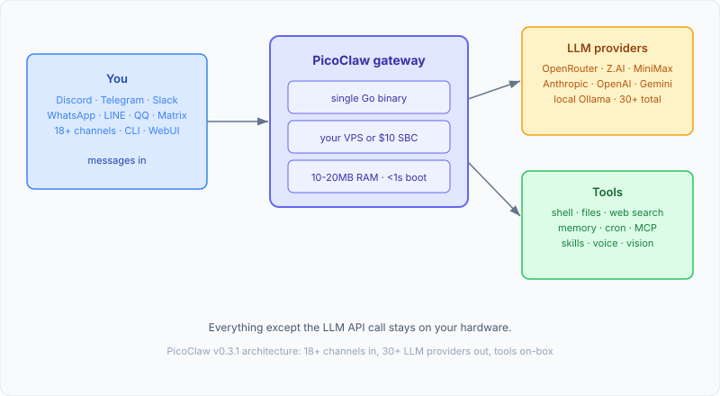
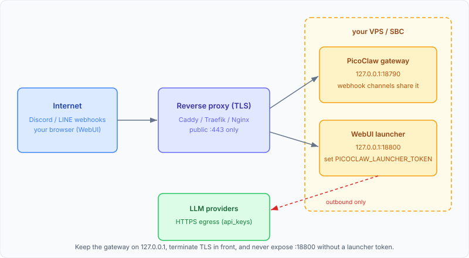

import YouTubeEmbed from "@components/widgets/YouTubeEmbed.astro";
import Button from "@components/widgets/Button.astro";
import Notice from "@components/widgets/Notice.astro";
import ListCheck from "@components/widgets/ListCheck.astro";
import Accordion from "@components/widgets/Accordion.astro";
import Tabs from "@components/widgets/Tabs.astro";
import Tab from "@components/widgets/Tab.astro";

*Disclosure: this guide contains referral links. If you buy through them, I may earn a commission at no extra cost to you.*

This PicoClaw setup guide covers v0.3.1, the current release of Sipeed's single-binary AI assistant. PicoClaw is a Go binary with no runtime dependencies, boots in under a second on slow hardware, and sits in 10-20MB of RAM. As of late 2026 it ships 18+ chat channels (Discord, Telegram, Slack, WhatsApp and more), 30+ LLM providers, a browser WebUI, native MCP support, and an Android APK. The repo is past 30,000 stars. If you want a self-hosted AI assistant on hardware that would choke on Python, this is the one I'd pick.

The project describes itself as inspired by NanoBot and rebuilt in Go from scratch, not a fork of OpenClaw, NanoBot, or any other project. Around 95% of the migration was reportedly written by the AI agent itself with human review. I ran it next to my nanobot and ZeroClaw setups back at v0.1.x in February 2026 and the resource numbers were real. This guide walks through installing PicoClaw on a VPS or single-board computer, configuring GLM-5.3 and MiniMax M3.1 models with fallbacks, wiring up Discord and web search, and hardening the deployment. Daily cost lands at a few dollars per month on Flash-tier models. The math is in the FAQ.

<Button text="PicoClaw GitHub" link="https://github.com/sipeed/picoclaw" variant="solid" color="blue" size="md" icon="github" />
<Button text="Download PicoClaw" link="https://picoclaw.io/download" variant="outline" color="blue" size="md" />

<Notice type="error" title="Official channels only">
picoclaw.io, docs.picoclaw.io, and github.com/sipeed/picoclaw are the only official PicoClaw properties. Third-party `.ai`/`.org`/`.com` lookalike domains exist and are not affiliated with the project. There is no PicoClaw crypto token. Any pump.fun listing, airdrop, or "buy $PICOCLAW" post is a scam.
</Notice>

<Notice type="warning" title="Pre-v1.0 software">
The README is blunt about it: PicoClaw is in early rapid development, and you should not deploy it to production before v1.0. Fine for a personal bot on a VPS or a $10 board. Not fine as the only pager for your on-call rotation. Keep the systemd `Restart=always` advice in this guide in mind and expect breaking changes between releases.
</Notice>

<Notice type="info" title="What this guide covers">
<ListCheck>
<ul>
<li>Installing PicoClaw from tarball, .deb/.rpm, Docker, the WebUI launcher, or the Android APK</li>
<li>Configuring GLM-5.3 and MiniMax M3.1 models with fallback chains</li>
<li>Discord setup plus the other 17 channels</li>
<li>Web search including self-hosted SearXNG</li>
<li>MCP, skills, memory, heartbeat, and scheduled tasks</li>
<li>Hardened systemd deployment, backups, and troubleshooting</li>
</ul>
</ListCheck>
</Notice>

If you're comparing self-hosted bot options, our [OpenClaw alternatives](/openclaw-alternatives/) roundup includes PicoClaw alongside nanobot, NanoClaw, memU, IronClaw, and ZeroClaw.

## What is PicoClaw?

PicoClaw is an open-source AI assistant from Sipeed, the RISC-V hardware company behind NanoKVM and MaixCAM. It compiles to a single Go binary for x86_64, ARM64, ARMv6/7, RISC-V, MIPS, LoongArch, and s390x, plus an Android build. No Python, no Node, no runtime to install. The design target is Sipeed's own $10 LicheeRV-Nano board, so anything with 128MB of RAM is luxurious by comparison.

The message flow is the same shape as nanobot: messages arrive from a chat app, the gateway routes them to whichever LLM you configured, and the model can call built-in tools to run shell commands, read and write files, search the web, and manage memory. Everything except the LLM API calls stays on your machine.



The v0.3.x line added the surface area that matters for 2026: a browser WebUI launcher, native MCP support, installable skills from ClawHub, per-model fallbacks and key rotation, and an Android APK that needs no Termux. The core is still the same single binary.

### PicoClaw vs OpenClaw vs NanoBot vs ZeroClaw

Four self-hosted assistants, four different bets. Numbers below are project-claimed (README figures, late 2026), not a benchmark I ran.

| Aspect | PicoClaw | NanoBot | ZeroClaw | OpenClaw |
|--------|----------|---------|----------|----------|
| Language | Go | Python | Rust | TypeScript |
| RAM | 10-20MB\* | ~100MB | < 5MB | > 1GB |
| Startup (weak single core) | < 1s | > 30s | < 10ms | > 500s |
| Binary | Single Go binary | N/A (scripts) | ~3.4MB Rust binary | ~28MB (dist) |
| Min hardware cost | $10 board | ~$50 SBC | ~$10-50 SBC | $599 Mac Mini |
| Channels | 18+ | 9 | ~8 | 4 |
| Providers | 30+ | 13+ | 22+ | Several |
| Memory | File-based workspace | File-based | SQLite hybrid search | File + semantic |
| Security | Workspace sandbox | Allowlists | Pairing + sandbox | Allowlists + sandbox |
| Install | tarball / .deb / Docker | pip | cargo / binary | npm / Node toolchain |

\* Recent PicoClaw builds run 10-20MB rather than the original under-10MB figure. Optimization is planned after feature stabilization. Still tiny.

Takeaways from the comparison: PicoClaw is the cheapest to deploy, nanobot has the biggest community and channel coverage, ZeroClaw has the strongest memory system (now positioning itself as an "agent runtime" at v0.8.6 with WASM plugins and OIDC), and OpenClaw is the heavyweight you run when you want the full desktop-agent experience and can pay [what OpenClaw needs to run well](/best-mac-mini-for-openclaw/). For the others, see the [nanobot setup guide](/nanobot-setup-guide/) and the [ZeroClaw setup guide](/zeroclaw-setup-guide/). If you want the original OpenClaw path, there's an [OpenClaw setup guide](/clawdbot-setup-guide/) too.

## PicoClaw models in late 2026: GLM-5.3 + a Flash model

The model pairing I'd default to for an always-on personal bot: a Flash-tier model for daily traffic and a flagship as a fallback for hard tasks. Flash-tier input runs about $0.15 per million tokens, so a bot that answers a few dozen messages a day stays in the single-digit dollars per month. When the cheap model stalls, `fallbacks` cascades to GLM-5.3 or MiniMax M3. That chain is where the money is saved. Live pricing moves fast, so check our [current GLM-5.3 and MiniMax M3.1-Flash pricing](/best-opensource-models-for-openclaw/) before you commit.

<Notice type="error" title="Migrating a February config?">
MiniMax M2.5 and M2.7 closed to new users on 2026-10-19 and stop working entirely on **2026-11-18**. GLM-5 and the `glm-4.7` config examples are superseded by GLM-5.3 (shipped 2026-08-18). If your `config.json` still says `MiniMax-M2.5` or `glm-4.7`, migrate now: swap the entries to the `model_list` format in this guide and run `picoclaw migrate` if you're on an old config version. A dead model ID on a 24/7 bot is a silent outage until you notice nobody's answering.
</Notice>

<Notice type="info" title="Z.AI plans and key types changed">
Z.AI Coding Plans are points-based (from $18/month; off-peak including weekends burns 50% of quota; GLM-5.3-Flash burns one third). Since 2026-10-16, coding-plan keys and standard API keys are billed separately. Using a coding-plan key on the standard API endpoint (or the reverse) fails with an auth error that looks like a bad key. Use PicoClaw's `zai-coding` provider prefix for plan keys and `zhipu` for standard keys.
</Notice>

### GLM-5.3 and GLM-5.3-Flash (Z.AI)

GLM-5.3 is the flagship, GLM-5.3-Flash is the volume model. Both have a 1M token context window, which means a chatty Discord bot will not hit context limits for a long time.

| Spec | GLM-5.3 | GLM-5.3-Flash |
|------|---------|---------------|
| Price (in/out per M) | $1.40 / $4.40 | $0.15 / $0.50 |
| Context window | 1M tokens | 1M tokens |
| Architecture | 744B-class MoE | 320B MoE, 18B active |
| Benchmarks | DeepSWE v1.1 66.9%, TB3.0 28.3 | multimodal (preview) |
| Coding plan quota | 1x | 3x efficiency |

One gotcha: GLM-5.3 rejects `thinking.type: "disabled"` calls. If you set thinking controls through `extra_body`, don't try to hard-disable thinking on this model.

Endpoints: general API at `https://api.z.ai/api/paas/v4`, coding-plan API at `https://api.z.ai/api/coding/paas/v4`, Anthropic-compatible at `https://api.z.ai/api/anthropic`. The mainland path under `open.bigmodel.cn` still works, but the `api.z.ai` endpoints are the global default. Exact model IDs on each PicoClaw provider prefix (`glm-5.3` vs `glm5.3`) should be checked against your provider dashboard before you lock a config; if PicoClaw reports the model isn't found, the ID is the first thing to fix.

<Notice type="success" title="Z.AI GLM coding plan (10% off)">
Z.AI offers [GLM coding plans](https://z.ai/subscribe?ic=NKNUNYDRZT) sized for continuous developer workloads. Use that link for 10% off. The models themselves (GLM-5.3 and GLM-5.3-Flash) are also on [Z.AI GLM models](https://go.bitdoze.com/glm) if you want the general API instead of a plan.
</Notice>

### MiniMax M3.1-Flash and MiniMax M3

MiniMax retired the M2.x generation and replaced it with the M3 line. For an always-on bot, M3.1-Flash is the cheap pick and M3 is the hard-task fallback.

| Spec | MiniMax M3.1-Flash | MiniMax M3 |
|------|--------------------|------------|
| Price (in/out per M) | $0.15 / $0.60 | $0.30 / $1.20 (≤512K input) |
| Cache read | $0.015/M | n/a |
| Context window | 1M tokens | 1M tokens |
| Extras | Tunable thinking, image input | SWE-Bench Pro 59.0%, TB 2.1 66.0% |

Watch the M3 pricing cliff: input above 512K tokens **doubles** the input rate. A long-context Discord bot with big workspaces can drift past 512K without noticing. M3.1-Flash has no such cliff, which is another reason to lead with it.

<Notice type="success" title="MiniMax coding plan (10% off)">
MiniMax prices its API for developer workloads. [Get 10% off with our referral link](https://go.bitdoze.com/minimax) when you sign up for the [MiniMax API](https://go.bitdoze.com/minimax).
</Notice>

## How to install PicoClaw (v0.3.1)

Here's how to install PicoClaw in under five minutes. v0.3.1 ships tarballs, `.deb`/`.rpm` packages, zips, an Android bundle, and a `picoclaw_<version>_checksums.txt` file. The old bare `picoclaw-linux-amd64` filenames from early guides no longer exist on the releases page. Every command below uses the `releases/latest/download/` pattern, so it keeps working on the next release.

What you need before you start:

<ListCheck>
<ul>
<li>A Linux box (VPS, SBC, Raspberry Pi), macOS, Windows, or a Termux-capable Android device</li>
<li>About 5 minutes</li>
<li>An LLM API key (OpenRouter, Z.AI, MiniMax) or a local model endpoint</li>
<li>Optionally a Discord or Telegram account for the chat channel</li>
</ul>
</ListCheck>

<Button text="All download options" link="https://picoclaw.io/download" variant="outline" color="blue" size="md" />

### Install from prebuilt tarball

Default path. For x86_64 Linux:

```bash
wget https://github.com/sipeed/picoclaw/releases/latest/download/picoclaw_Linux_x86_64.tar.gz
tar xzf picoclaw_Linux_x86_64.tar.gz
sudo mv picoclaw /usr/local/bin/
```

For ARM64 (Raspberry Pi 4/5, most modern SBCs, Termux):

```bash
wget https://github.com/sipeed/picoclaw/releases/latest/download/picoclaw_Linux_arm64.tar.gz
tar xzf picoclaw_Linux_arm64.tar.gz
sudo mv picoclaw /usr/local/bin/
```

Other architectures use the same pattern: `picoclaw_Linux_armv7.tar.gz`, `picoclaw_Linux_riscv64.tar.gz`, `picoclaw_Linux_mipsle.tar.gz`, `picoclaw_Linux_loong64.tar.gz`, `picoclaw_Linux_s390x.tar.gz`. If `uname -m` prints something that doesn't match the asset name, you grabbed the wrong file.

Optionally verify the checksum. Each release ships a `picoclaw_<version>_checksums.txt` file. Unlike the tarballs, that filename includes the version, so grab the current one from the [releases page](https://github.com/sipeed/picoclaw/releases) rather than hardcoding it forever:

```bash
# example for v0.3.1, use the checksums filename from the release you downloaded
wget https://github.com/sipeed/picoclaw/releases/latest/download/picoclaw_0.3.1_checksums.txt
sha256sum picoclaw_Linux_x86_64.tar.gz
# compare against the matching line in the checksums file
```

Then initialize and check:

```bash
picoclaw version
picoclaw onboard
picoclaw status
```

`picoclaw version` should print `0.3.1` (or newer). `picoclaw onboard` creates `~/.picoclaw/` with a default `config.json` and a `workspace/` directory. If `picoclaw` isn't found after install, `/usr/local/bin` isn't on your PATH or you forgot the `sudo mv`.

### Install via .deb or .rpm

v0.3.1 ships native packages for x86_64, aarch64, armv6/armv7, riscv64, loong64, and s390x. Grab the right one from [picoclaw.io/download](https://picoclaw.io/download) or the releases page, then:

```bash
# Debian / Ubuntu
sudo dpkg -i picoclaw_*_amd64.deb

# RHEL / Fedora / Alma
sudo rpm -i picoclaw-*.x86_64.rpm
```

Verify with `picoclaw version`, then run `picoclaw onboard`. Package installs put the binary on PATH for you.

### PicoClaw WebUI launcher

If you'd rather not edit JSON by hand first, v0.3.x ships `picoclaw-launcher`, a browser UI for config and chat:

```bash
picoclaw-launcher
# opens http://localhost:18800
```

From a remote box, Docker, or a VM, add `-public` and access it over your own tunnel or reverse proxy. On macOS, Gatekeeper blocks unsigned binaries: right-click the launcher in Finder, choose **Open**, then **Open Anyway**. The binaries aren't notarized. That's the failure mode, not malware.

<Notice type="warning" title="WebUI token">
The dashboard token is random on every restart unless you set `PICOCLAW_LAUNCHER_TOKEN` in the environment. A random token means your bookmarks break after a reboot. Worse, exposing port 18800 publicly without a fixed token means anyone who guesses or logs the token gets your config, including paths to your API keys. Set the token and keep 18800 behind a reverse proxy or an SSH tunnel. Never port-forward it raw to the internet.
</Notice>

### Build from source (Go 1.25+)

The Go requirement moved from 1.21 to 1.25 for current main. If you're developing or want a custom build:

```bash
git clone https://github.com/sipeed/picoclaw.git
cd picoclaw
make deps
make build
make install        # build + install to /usr/local/bin
```

Useful Makefile targets: `make build-all` (cross-compile), `make build-launcher` (WebUI), `make build-pi-zero` (Pi Zero 2W, 32-bit and 64-bit), `make build-android-bundle`. Verify with `picoclaw version`.

### Run PicoClaw with Docker

Two details changed since early guides: the compose file moved to `docker/docker-compose.yml` (so every command needs the `-f` flag) and the workspace is a bind mount `./data:/root/.picoclaw`, not a named volume. Your config and memory land in `docker/data/` on the host, which makes backups trivial.

```bash
git clone https://github.com/sipeed/picoclaw.git
cd picoclaw

# First run generates docker/data/config.json and exits.
# Edit it, then start the gateway:
docker compose -f docker/docker-compose.yml --profile gateway up -d

# Watch startup
docker compose -f docker/docker-compose.yml logs -f picoclaw-gateway

# One-shot query without the gateway
docker compose -f docker/docker-compose.yml run --rm picoclaw-agent -m "What is 2+2?"
```

The new `launcher` profile runs the WebUI on port 18800 with the gateway on 18790 and `PICOCLAW_GATEWAY_HOST=0.0.0.0` set inside the container:

```bash
docker compose -f docker/docker-compose.yml --profile launcher up -d
# http://localhost:18800
```

Images are `docker.io/sipeed/picoclaw:latest` and `docker.io/sipeed/picoclaw:launcher`. To confirm the deployment, `logs -f picoclaw-gateway` should show a clean start and the one-shot `picoclaw-agent -m` call should return an answer. If the gateway is unreachable from outside the container, that's the host bind problem covered in Troubleshooting.

Rebuild after version updates and tear down cleanly when you're done:

```bash
docker compose -f docker/docker-compose.yml --profile gateway build --no-cache
docker compose -f docker/docker-compose.yml --profile gateway up -d

# teardown
docker compose -f docker/docker-compose.yml --profile gateway down
```

### Android APK and Termux

Since 2026-03-31 there's a real Android build: `picoclaw-android-universal.zip` on the releases page contains an APK. No Termux required.

If you prefer Termux anyway (say, you want a shared Linux userspace), use the arm64 tarball and proot:

```bash
wget https://github.com/sipeed/picoclaw/releases/latest/download/picoclaw_Linux_arm64.tar.gz
tar xzf picoclaw_Linux_arm64.tar.gz
pkg install proot
termux-chroot ./picoclaw onboard
```

Verify with `picoclaw version` inside Termux or in the APK's info screen. Raspberry Pi and other SBCs use the same arm64 tarball from the install section above.

**Commands you'll use**

| Command | What it does |
|---------|-------------|
| `picoclaw onboard` | Initialize config and workspace |
| `picoclaw version` | Show installed version |
| `picoclaw status` | Show current status |
| `picoclaw agent -m "..."` | Send a single message |
| `picoclaw agent` | Interactive chat mode |
| `picoclaw gateway` | Start the gateway (chat channels) |
| `picoclaw model` | View or switch the default model |
| `picoclaw mcp add/list/test` | Manage MCP servers |
| `picoclaw skills list/install` | Manage skills |
| `picoclaw cron add/list/disable/remove` | Scheduled jobs |
| `picoclaw migrate` | Migrate an old config format |
| `picoclaw auth login` | Account login helpers |

In interactive mode, type `exit`, `quit`, or press `Ctrl+D` to leave.

## PicoClaw config: model_list and channel_list (v3 schema)

Two facts break every config snippet written before mid-2026:

1. Config `"version": 3` uses **`model_list`** and **`channel_list`**. The old `providers` and `channels` blocks are legacy.
2. API keys and channel tokens don't live in `config.json` anymore. They go to `~/.picoclaw/.security.yml`.

Here's a complete v3 config with a GLM-5.3 flagship, a Flash fallback, Discord, web search, heartbeat, and the gateway block:

```json
{
  "version": 3,
  "agents": {
    "defaults": {
      "workspace": "~/.picoclaw/workspace",
      "model_name": "glm53",
      "max_tokens": 8192,
      "temperature": 0.7,
      "max_tool_iterations": 20,
      "context_window": 131072,
      "summarize_message_threshold": 20,
      "summarize_token_percent": 75,
      "max_llm_retries": 2,
      "llm_retry_backoff_secs": 2,
      "restrict_to_workspace": true
    }
  },
  "model_list": [
    {
      "model_name": "glm53",
      "provider": "zhipu",
      "model": "glm-5.3",
      "api_keys": ["YOUR_ZAI_API_KEY"],
      "api_base": "https://api.z.ai/api/paas/v4",
      "fallbacks": ["flash"]
    },
    {
      "model_name": "flash",
      "provider": "zhipu",
      "model": "glm-5.3-flash",
      "api_keys": ["YOUR_ZAI_API_KEY"],
      "api_base": "https://api.z.ai/api/paas/v4"
    }
  ],
  "channel_list": {
    "discord": {
      "enabled": true,
      "type": "discord",
      "allow_from": ["YOUR_USER_ID"],
      "settings": { "token": "YOUR_DISCORD_BOT_TOKEN" }
    }
  },
  "tools": {
    "web": {
      "provider": "auto",
      "duckduckgo": { "enabled": true, "max_results": 5 },
      "brave": { "enabled": true, "api_keys": ["YOUR_BRAVE_KEY"], "max_results": 5 }
    },
    "cron": {
      "exec_timeout_minutes": 5
    }
  },
  "heartbeat": {
    "enabled": true,
    "interval": 30
  },
  "gateway": {
    "host": "127.0.0.1",
    "port": 18790,
    "log_level": "warn"
  }
}
```

<Notice type="warning" title="Config v3">
Version-0 configs (the old `providers`/`channels` style) auto-migrate on first run and secrets get extracted to `.security.yml`. Configs at versions 1 and 2 need `picoclaw migrate` run manually. After any migration, confirm `"version": 3` at the top of `config.json` and that your keys appear in `.security.yml`.
</Notice>

Settings worth knowing:

| Setting | Default | What it does |
|---------|---------|-------------|
| `agents.defaults.model_name` | none | Alias pointing at a `model_list` entry |
| `agents.defaults.max_tokens` | `8192` | Max tokens per LLM response |
| `agents.defaults.temperature` | `0.7` | Randomness (lower = more deterministic) |
| `agents.defaults.context_window` | `131072` | Context budget PicoClaw manages toward |
| `agents.defaults.summarize_message_threshold` | `20` | Summarize after this many messages |
| `agents.defaults.summarize_token_percent` | `75` | Summarize when context is this full |
| `agents.defaults.max_llm_retries` | `2` | Retry count on LLM errors |
| `agents.defaults.llm_retry_backoff_secs` | `2` | Backoff between retries |
| `agents.defaults.max_tool_iterations` | `20` | Tool calls per turn before stopping |
| `agents.defaults.restrict_to_workspace` | `true` | Sandbox file/shell access to workspace |
| `heartbeat.interval` | `30` | Minutes between periodic task checks |
| `tools.cron.exec_timeout_minutes` | `5` | Timeout for scheduled task execution |
| `gateway.host` / `gateway.port` | `127.0.0.1:18790` | Webhook HTTP server |
| `gateway.log_level` | `warn` | `debug`/`info`/`warn`/`error`/`fatal`; env `PICOCLAW_LOG_LEVEL` |

To confirm the config parses: `picoclaw status` should read it without errors, and `picoclaw agent -m "What's 42 * 17?"` should get a reply. A `model ... not found in model_list` error means the alias or model ID is wrong (Troubleshooting below).

### model_list: models, API keys, fallbacks

`model_list` is where every model lives. The fields that matter:

- `model_name` is **your alias**. `agents.defaults.model_name` references it. It is not the provider's model ID.
- `model` is the **native ID** the provider expects (`glm-5.3`, `z-ai/glm-5.3`, `MiniMax-M3.1-Flash`).
- `api_keys` is an **array**. PicoClaw rotates keys per request. One entry is fine; several spread rate limits.
- `provider` pins the provider prefix. Omit it and the first `/` segment of `model` infers the provider.
- `fallbacks` lists other `model_name` aliases to try when this one fails.
- Duplicate `model_name` entries turn into load balancing across the entries.

Optional per-model knobs: `thinking_level` (`off|low|medium|high|xhigh|adaptive`), `streaming.enabled` (opt-in per model and channel), `rpm` (rate cap), `api_base`, `proxy`, `extra_body`, `custom_headers`, `tool_schema_transform`, `enabled`.

The recommended setup (flagship with a Flash fallback):

```json
{
  "agents": { "defaults": { "model_name": "glm53" } },
  "model_list": [
    {
      "model_name": "glm53",
      "provider": "zhipu",
      "model": "glm-5.3",
      "api_keys": ["YOUR_KEY"],
      "api_base": "https://api.z.ai/api/paas/v4",
      "fallbacks": ["flash"]
    },
    {
      "model_name": "flash",
      "provider": "zhipu",
      "model": "glm-5.3-flash",
      "api_keys": ["YOUR_KEY"],
      "api_base": "https://api.z.ai/api/paas/v4"
    }
  ]
}
```

Three ways to reach a model, depending on what account you have:

<Tabs>
<Tab name="OpenRouter (easiest)">

One key, hundreds of models, 200K free tokens/month to start. Best if you want to swap models weekly.

```json
{
  "agents": { "defaults": { "model_name": "openrouter-glm53" } },
  "model_list": [
    {
      "model_name": "openrouter-glm53",
      "provider": "openrouter",
      "model": "z-ai/glm-5.3",
      "api_keys": ["sk-or-your-key"],
      "api_base": "https://openrouter.ai/api/v1",
      "fallbacks": ["openrouter-flash"]
    },
    {
      "model_name": "openrouter-flash",
      "provider": "openrouter",
      "model": "z-ai/glm-5.3-flash",
      "api_keys": ["sk-or-your-key"],
      "api_base": "https://openrouter.ai/api/v1"
    }
  ]
}
```

</Tab>
<Tab name="Z.AI direct (zhipu prefix)">

Standard Z.AI API keys, billed per token. Use the `zhipu` prefix and the general endpoint.

```json
{
  "agents": { "defaults": { "model_name": "glm53" } },
  "model_list": [
    {
      "model_name": "glm53",
      "provider": "zhipu",
      "model": "glm-5.3",
      "api_keys": ["YOUR_ZAI_API_KEY"],
      "api_base": "https://api.z.ai/api/paas/v4"
    }
  ]
}
```

</Tab>
<Tab name="Z.AI Coding Plan (zai-coding prefix)">

Coding-plan keys are billed separately from standard API keys (since 2026-10-16) and use the coding endpoint. PicoClaw has a dedicated `zai-coding` prefix for them.

```json
{
  "agents": { "defaults": { "model_name": "glm53-plan" } },
  "model_list": [
    {
      "model_name": "glm53-plan",
      "provider": "zai-coding",
      "model": "glm-5.3",
      "api_keys": ["YOUR_CODING_PLAN_KEY"],
      "api_base": "https://api.z.ai/api/coding/paas/v4"
    }
  ]
}
```

Putting a coding-plan key on the general endpoint (or the reverse) returns an auth error that looks like a bad key. If auth fails and the key is definitely right, check which key type you have.

</Tab>
</Tabs>

Provider prefixes PicoClaw resolves directly (22+ of them, 30+ providers reachable total):

| Prefix | Provider | Notes |
|--------|----------|-------|
| `openrouter` | OpenRouter | Recommended gateway; 200K free tokens/mo |
| `zhipu` | Z.AI general API | GLM models |
| `zai-coding` | Z.AI Coding Plan | Plan keys only |
| `minimax` | MiniMax | M3.1-Flash, M3 |
| `anthropic`, `openai`, `gemini`, `deepseek`, `qwen`, `groq`, `moonshot`, `cerebras`, `nvidia`, `mistral`, `volcengine`, `venice`, `nearai`, `avian`, `vivgrid`, `longcat`, `modelscope`, `mimo` | direct APIs | plus Azure OpenAI, AWS Bedrock, LiteLLM |
| (none) | Ollama / LM Studio / vLLM | Any OpenAI-compatible endpoint; no `api_keys` needed |

Local models are a no-key `model_list` entry pointed at your Ollama base URL. If you don't have one running yet, [installing Ollama with Docker](/ollama-docker-install/) takes a few minutes. For hardware that can serve local models, see the [best mini PCs for local LLMs](/best-mini-pc-local-llm/). Cost-wise the split is simple: Flash-tier is $0.15/M in versus $1.40/M in for the flagship. The fallback chain is where the money is saved.

### channel_list: Discord, Telegram and 18+ channels

Each channel is an entry in `channel_list` with a `type`, an `allow_from` list, and a `settings` object that holds the token:

```json
"channel_list": {
  "discord": {
    "enabled": true,
    "type": "discord",
    "allow_from": ["YOUR_USER_ID"],
    "settings": { "token": "YOUR_DISCORD_BOT_TOKEN" }
  }
}
```

Fields per channel: `enabled`, `type`, `allow_from`, `group_trigger.mention_only` (bots reply in groups only when mentioned), `reasoning_channel_id`, and `settings`. The roster: Telegram, Discord, WhatsApp (QR or bridge), Weixin (QR), QQ, Slack (Socket Mode), Matrix, Delta Chat, DingTalk, Feishu/Lark, LINE, WeCom, VK, IRC, OneBot, MQTT, MaixCam, Pico, Pico Client.

Webhook-style channels (LINE and friends) share one HTTP server at `gateway.host:gateway.port`, default `127.0.0.1:18790`. Feishu uses WebSocket instead. If you run webhook channels, you need a reverse proxy in front of 18790, covered in the VPS section. A silent bot after config usually means intents, `allow_from`, or permissions (Troubleshooting below).

### Secrets in .security.yml

On migration or onboard, sensitive values move out of `config.json` into `~/.picoclaw/.security.yml`. That's the API keys and channel tokens.

<Notice type="warning" title="Back up .security.yml">
Old backups restore without secrets. If your backup job predates the `.security.yml` split, a restore gives you a config with no keys and a bot that can't reach any model. Back up all three of these together:
<ListCheck>
<ul>
<li>`~/.picoclaw/workspace/` (memory, sessions, cron, skills)</li>
<li>`~/.picoclaw/config.json`</li>
<li>`~/.picoclaw/.security.yml` (chmod 600, owner-only)</li>
</ul>
</ListCheck>
</Notice>

Include the file in whatever backup job you already run (Rclone to S3, restic, a cron tarball). Keep permissions tight: `chmod 600 ~/.picoclaw/.security.yml`. If a key leaks, rotate it at the provider and re-run `picoclaw onboard` or edit the file.

### Migrate an old config with `picoclaw migrate`

Defensive move for anyone carrying a config from February:

- Version-0 configs (the original `providers`/`channels` format) auto-migrate on first run.
- Versions 1 and 2 need a manual run:

```bash
picoclaw migrate
picoclaw status
```

After migration, check three things: `"version": 3` at the top of `config.json`, `model_list`/`channel_list` present, and your keys in `.security.yml`. If secrets are missing, re-enter them via `picoclaw onboard` or the WebUI.

## PicoClaw Discord setup

Discord is the most common channel for personal bots. The steps are the same as the v0.1 guide; the config shape changed.

### Create a Discord bot

1. Go to [discord.com/developers/applications](https://discord.com/developers/applications)
2. Click **New Application**, give it a name
3. Go to **Bot** in the left sidebar, click **Add Bot**
4. Copy the bot token

### Enable intents

Still in the Bot settings page:

1. Scroll to **Privileged Gateway Intents**
2. Enable **MESSAGE CONTENT INTENT** (required)
3. Optionally enable **SERVER MEMBERS INTENT** if you'll use member-based allow lists

<Notice type="warning" title="MESSAGE CONTENT INTENT">
Without this intent the bot connects, stays online, and reads nothing. It's the single most common "my bot is silent" cause. Enable it before you debug anything else.
</Notice>

### Get your user ID

1. Discord Settings → **Advanced** → enable **Developer Mode**
2. Right-click your avatar anywhere
3. Click **Copy User ID**

### Configure PicoClaw

Add the Discord entry to `channel_list` in `~/.picoclaw/config.json`:

```json
"channel_list": {
  "discord": {
    "enabled": true,
    "type": "discord",
    "allow_from": ["YOUR_USER_ID"],
    "settings": { "token": "YOUR_DISCORD_BOT_TOKEN" }
  }
}
```

Lock `allow_from` to your user ID for a personal bot. An empty list lets anyone in the server drive your agent, which includes driving its shell tool. Don't.

### Invite the bot to your server

1. In the developer portal: **OAuth2** → **URL Generator**
2. Scopes: check `bot`
3. Bot Permissions: `Send Messages` and `Read Message History`
4. Open the generated URL and pick your server

### Start the gateway

```bash
picoclaw gateway
```

Send a message in Discord. The bot should reply within a few seconds. If not: `picoclaw status`, then the gateway logs (`journalctl -u picoclaw -f` under systemd, `docker compose -f docker/docker-compose.yml logs -f picoclaw-gateway` in Docker). Inline fixes: the intent is off, your user ID isn't in `allow_from`, or the bot lacks Send Messages in that channel.

## Web search: Brave, DuckDuckGo and SearXNG

PicoClaw now supports around ten search engines. The old two-engine (Brave + DuckDuckGo) setup still works, but the interesting change is that two of the best options need no API key at all.

<ListCheck>
<ul>
<li>DuckDuckGo, Sogou (enabled in the example config), self-hosted SearXNG, and GLM Search (with a Z.AI model) all run with no API key.</li>
<li>Brave gives 2,000 queries/mo free with a key, Tavily gives 1,000/mo, and Baidu gives 1,500/mo.</li>
<li>Kagi, Perplexity, and Gemini Google Search grounding are paid.</li>
</ul>
</ListCheck>

| Engine | Key needed | Free tier | Notes |
|--------|-----------|-----------|-------|
| DuckDuckGo | No | n/a | Works out of the box |
| Sogou | No | n/a | On by default in the example config |
| SearXNG | No | n/a | Self-hosted, no limits, no telemetry |
| GLM Search | Z.AI key | n/a | Native grounding for GLM models |
| Brave | Yes | 2,000/mo | Good result quality |
| Tavily | Yes | 1,000/mo | Agent-oriented snippets |
| Baidu | Yes | 1,500/mo | Strong for Chinese-language queries |
| Gemini grounding | Yes | n/a | Native Gemini search tool |
| Kagi | Yes | Paid | High-quality, no-tracking |
| Perplexity | Yes | Paid | [Perplexity API](https://go.bitdoze.com/perplexity) for answer-engine results |

Config for a sensible no-key default plus Brave as the quality upgrade:

```json
"tools": {
  "web": {
    "provider": "auto",
    "prefer_native": true,
    "format": "plaintext",
    "duckduckgo": { "enabled": true, "max_results": 5 },
    "searxng": { "enabled": true, "api_base": "http://your-searxng:8080", "max_results": 5 },
    "brave": { "enabled": true, "api_keys": ["YOUR_BRAVE_KEY"], "max_results": 5 }
  }
}
```

`provider: auto` picks the best available engine; `prefer_native` uses a model's built-in search when it has one (Gemini grounding, GLM Search); `format: plaintext` keeps results token-cheap. Brave now takes an `api_keys` array for rotation like `model_list` does. Keep DuckDuckGo enabled as a fallback when Brave rate-limits. For the SearXNG endpoint, [self-host SearXNG with Docker](/searxng-self-host-privacy-search/) and point `api_base` at it. That combination (SearXNG + DuckDuckGo) is a completely free search stack.

## MCP, skills and evolution

Three feature areas landed after v0.2 that change what PicoClaw can do.

**MCP (Model Context Protocol)** has been native since v0.2.1. There's a CLI manager:

```bash
picoclaw mcp add filesystem -- npx -y @modelcontextprotocol/server-filesystem /tmp
picoclaw mcp list
picoclaw mcp test filesystem
```

Servers are declared under `tools.mcp.servers` in the config. One caveat: `picoclaw mcp` edits config and runs tests; it does not keep MCP servers running. They launch per use. If you're new to the protocol, the [MCP introduction for beginners](/mcp-introduction-beginners/) explains what servers buy you.

**Skills** are installable capability packs:

```bash
picoclaw skills search flight-tracker
picoclaw skills install flight-tracker
picoclaw skills list
```

Registries configure under `tools.skills.registries.clawhub` and `tools.skills.registries.github` (the older `tools.skills.github.*` fields are deprecated). ClawHub is the default registry.

<Notice type="warning" title="Third-party skills are code">
A skill can steer the agent's behavior and tool usage. Treat skill installs like package installs: know where they came from before you run them against a workspace that holds real data. For the failure modes this creates in the wild, see the [AI agent security hardening](/openclaw-security-guide/) notes on malicious skills.
</Notice>

**Evolution** is the self-learning piece. The `evolution` config block (default: observe) records completed turns and can draft or apply skills from recurring task patterns. Leave it in observe mode until you trust the patterns it's extracting.

Other v0.3.x features worth knowing:

<ListCheck>
<ul>
<li>Hooks: observe, intercept, or approve tool calls, with a respond action</li>
<li>Steering: inject messages into a running loop</li>
<li>SubTurn subagents with concurrency control</li>
<li>Async task spawn for long jobs</li>
<li>Vision pipeline: base64 images to multimodal models</li>
<li>Voice: Groq Whisper transcription plus `send_tts` replies</li>
<li>Streaming, opt-in per model and channel</li>
</ul>
</ListCheck>

## Memory, workspace files and heartbeat

Everything the agent knows about you lives in `~/.picoclaw/workspace/`:

```
~/.picoclaw/workspace/
├── sessions/          # Conversation sessions and history
├── memory/            # Long-term memory (MEMORY.md)
├── state/             # Persistent state (last channel, etc.)
├── cron/              # Scheduled jobs database
├── skills/            # Installed skills
├── AGENT.md           # Agent behavior guide (was AGENTS.md)
├── HEARTBEAT.md       # Periodic task prompts
├── IDENTITY.md        # Agent identity
├── SOUL.md            # Agent personality
└── USER.md            # Your info and preferences
```

The rename from `AGENTS.md` to `AGENT.md` happened in the repo template; old workspaces may still carry the old name. `TOOLS.md` is no longer part of the template, so don't build workflows around it. Tell the bot to remember something and it writes to `memory/MEMORY.md`. Sessions are stored per conversation.

```bash
nano ~/.picoclaw/workspace/USER.md
```

Put whatever context the bot should always have: projects, preferences, technical background. Same model as [nanobot's workspace files](/nanobot-setup-guide/). Hot-reload is now official behavior: edits to `AGENT.md`, `SOUL.md`, `USER.md`, and `MEMORY.md` are picked up via file mtime with no gateway restart. Edit the file, send a message, the new context is in play.

**Heartbeat** runs `HEARTBEAT.md` on a timer (default every 30 minutes):

```markdown
# Periodic Tasks

- Check the weather forecast
- Search the web for AI news and summarize
```

```json
"heartbeat": {
  "enabled": true,
  "interval": 30
}
```

Long tasks spawn a non-blocking subagent that works in the background and replies through the `message` tool, so the heartbeat loop never jams. One-off and recurring jobs work from the CLI:

```bash
picoclaw cron add --name "morning" --message "Good morning! What's in the news?" --cron "0 9 * * *"
picoclaw cron list
picoclaw cron disable morning
picoclaw cron remove morning
```

Jobs live in `~/.picoclaw/workspace/cron/`. Verify: `picoclaw cron list` shows the job, and editing `USER.md` changes behavior without a restart.

## Security sandbox

PicoClaw sandboxes by default. With `restrict_to_workspace: true`, the agent can only touch files and run commands inside the workspace.

| Tool | Function | Restriction |
|------|----------|-------------|
| `read_file` | Read files | Workspace only |
| `write_file` | Write files | Workspace only |
| `list_dir` | List directories | Workspace only |
| `edit_file` | Edit files | Workspace only |
| `append_file` | Append to files | Workspace only |
| `exec` | Execute commands | Paths must be within workspace |

The sandbox inheritance is the important property: the main agent, subagents, and heartbeat tasks all share `restrict_to_workspace`, and the docs state there is no way to bypass the boundary through subagents or scheduled jobs. Older documentation also listed a dangerous-command blocklist (`rm -rf`, `mkfs`, `dd`, direct disk writes, `shutdown`, fork bombs) that applied even with restrictions off. I have not re-verified that list against v0.3.1 docs, so don't treat a blocklist as your security boundary. The sandbox is the boundary.

To let the agent reach outside the workspace:

```json
{
  "agents": {
    "defaults": {
      "restrict_to_workspace": false
    }
  }
}
```

<Notice type="warning" title="Security risk">
Disabling workspace restriction lets the agent read and write any path the process user can. Combined with a shell tool and a prompt-injection vector (a web page, a Discord message, a third-party skill), that's full user-level access to the box. Only do this in controlled environments where you trust every input. For the wider threat model, including CVEs and malicious skills in this class of agent, see the [AI agent security hardening](/openclaw-security-guide/) write-up.
</Notice>

## Running PicoClaw on a VPS (hardened systemd)

PicoClaw fits on a $10 board, but a VPS gives you stable networking for Discord and webhooks. A [Hetzner CX22](/hetzner-cloud-review/) (2 vCPU, 4GB RAM) at around €4.35/month is overkill for PicoClaw alone, but it leaves room for SearXNG, Ollama, or whatever else you're hosting.

<Notice type="success" title="Hetzner discount">
[Get €20 free credit at Hetzner](https://go.bitdoze.com/hetzner) when you sign up through our link. That covers around 4 months of a CX22. Prefer a different provider? [Hostinger VPS](https://go.bitdoze.com/hostinger-vps) is the other budget option I keep on the list.
</Notice>

_VPS prices moved across the board in 2026. If you're deciding between a rented box and owned hardware, see [what changed and when a mini PC wins](/vps-price-increases/)._

Fresh Ubuntu 24.04 flow, using the tarball install:

```bash
ssh root@YOUR_SERVER_IP
apt update && apt upgrade -y

# dedicated non-root user
useradd -m -s /bin/bash picoclaw

# install binary
wget https://github.com/sipeed/picoclaw/releases/latest/download/picoclaw_Linux_x86_64.tar.gz
tar xzf picoclaw_Linux_x86_64.tar.gz
sudo mv picoclaw /usr/local/bin/

# initialize as the service user
sudo -u picoclaw -H picoclaw onboard
sudo -u picoclaw -H nano /home/picoclaw/.picoclaw/config.json
```

Before you expose anything, [secure your SSH server](/secure-ssh-server-linux/): keys only, no password auth. Then the hardened systemd unit at `/etc/systemd/system/picoclaw.service`:

```ini
[Unit]
Description=PicoClaw gateway
After=network-online.target
Wants=network-online.target

[Service]
Type=simple
User=picoclaw
Environment=HOME=/home/picoclaw
Environment=PICOCLAW_LOG_LEVEL=warn
ExecStart=/usr/local/bin/picoclaw gateway
Restart=always
RestartSec=10
# optional hardening:
# ProtectSystem=strict
# ReadWritePaths=/home/picoclaw/.picoclaw

[Install]
WantedBy=multi-user.target
```

```bash
systemctl daemon-reload
systemctl enable --now picoclaw
systemctl status picoclaw
journalctl -u picoclaw -f
```

Verify: `systemctl status picoclaw` shows `active (running)`, and `journalctl -u picoclaw -f` streams gateway startup without errors.

For webhook channels (LINE, DingTalk-style), the gateway serves HTTP on `127.0.0.1:18790` by default. Put TLS in front of it:



Caddy, Traefik, or Nginx terminate TLS and proxy to 18790. Keep 18800 (WebUI) off the public interface or behind the same proxy with `PICOCLAW_LAUNCHER_TOKEN` set. The gateway's `log_level` (`debug|info|warn|error|fatal`, env `PICOCLAW_LOG_LEVEL`) is your first debugging knob; `debug` is chatty but useful when a channel won't connect.

<ListCheck>
<ul>
<li>Run as a dedicated non-root user with `User=` and `Environment=HOME=`</li>
<li>`chmod 600` on `.security.yml`</li>
<li>SSH keys only, password auth off</li>
<li>Firewall: open 22 and 443 only; 18790/18800 stay on localhost</li>
<li>Backups covering `workspace/`, `config.json`, and `.security.yml`</li>
<li>`Restart=always` and a sane `PICOCLAW_LOG_LEVEL`</li>
</ul>
</ListCheck>

**Backups and teardown.** Back up `~/.picoclaw/workspace/`, `config.json`, and `.security.yml` together (see the secrets section). To remove PicoClaw completely:

```bash
systemctl disable --now picoclaw
sudo rm /etc/systemd/system/picoclaw.service /usr/local/bin/picoclaw
rm -rf /home/picoclaw/.picoclaw    # deletes memory and sessions. back up first.
```

Docker teardown is `docker compose -f docker/docker-compose.yml --profile gateway down`. The bind-mounted `docker/data/` directory survives; delete it manually if you want a clean slate.

### Raspberry Pi, Android and $10 hardware

This is the hardware PicoClaw was designed for. The [hardware-compatibility doc](https://docs.picoclaw.io) covers the range from $5 RISC-V boards to Raspberry Pis to Android phones.

- The **LicheeRV-Nano ($10)** is the design target: Ethernet or WiFi6, runs the RISC-V build, fits a personal assistant with headroom.
- The **LicheeRV-Claw** has been on AliExpress since 2026-05-11 as the follow-up board if you want more I/O.
- The **NanoKVM ($30-50)** does automated server maintenance next to the machine it is babysitting.
- The **MaixCAM** covers smart monitoring use cases with the camera pipeline.
- Any **Raspberry Pi** with networking runs the arm64 tarball. Even a Pi Zero 2W handles it at 10-20MB RAM (`make build-pi-zero` if you want to build locally). That is the answer to "does PicoClaw work on a Raspberry Pi": yes, trivially.
- Old **Android phones** run the APK with no Termux. Termux + proot works too (install section above).

For local models alongside PicoClaw, [installing Ollama with Docker](/ollama-docker-install/) gives you an OpenAI-compatible endpoint on the same box, and pointing PicoClaw at it is a one-line `api_base` change. If you want more headroom than an SBC without a full tower, a compact mini PC like the [ASUS DC510 mini PC](https://go.bitdoze.com/asus-dc510) doubles as a home server. Cost-wise: $10 one-time for the SBC path, ~$50 for a nicer board, or €4-5/month rented.

## PicoClaw troubleshooting

Seven failure modes people hit, each with the fix.

<Accordion label="model ... not found in model_list" group="troubleshooting">

**Symptom:** `picoclaw agent` errors with `model ... not found in model_list`, or OpenRouter returns "free is not a valid model ID".

**Cause:** `agents.defaults.model_name` doesn't match any `model_name` alias in `model_list`, or `model` holds your alias instead of the provider's native ID.

**Fix:** Check the alias chain first (`model_name: "glm53"` must exist in `model_list`). Then check the native ID. For OpenRouter free models, set the provider explicitly:

```json
{ "model_name": "or-free", "provider": "openrouter", "model": "free",
  "api_keys": ["sk-or-your-key"], "api_base": "https://openrouter.ai/api/v1" }
```

Without `provider`, a `/` in `model` infers the provider from the first segment; when in doubt, set `provider` explicitly.

</Accordion>

<Accordion label="Restored a backup and the keys are gone" group="troubleshooting">

**Symptom:** After restoring `config.json` from backup, every provider returns auth errors.

**Cause:** Secrets live in `.security.yml` since the config v3 split. Backups made before that, or backups that only include `config.json`, restore without keys.

**Fix:** Re-enter keys with `picoclaw onboard` or the WebUI, then `chmod 600 ~/.picoclaw/.security.yml` and add the file to your backup job going forward.

</Accordion>

<Accordion label="MiniMax M2.5 config hard-fails after 2026-11-18" group="troubleshooting">

**Symptom:** A config that worked all year suddenly returns 404/model-not-found from MiniMax.

**Cause:** MiniMax M2.5 and M2.7 retired on 2026-11-18. Any `model: "MiniMax-M2.5"` entry is dead after that date.

**Fix:** Swap to the M3 line in `model_list`:

```json
{ "model_name": "flash", "provider": "minimax", "model": "MiniMax-M3.1-Flash",
  "api_keys": ["YOUR_MINIMAX_KEY"] }
```

GLM-5 / `glm-4.7` configs should move to `glm-5.3` the same way. Run `picoclaw migrate` if the config is still on an old version.

</Accordion>

<Accordion label="Z.AI returns a bad-key auth error" group="troubleshooting">

**Symptom:** 401/403 from Z.AI with a key that's definitely valid.

**Cause:** Since 2026-10-16, coding-plan keys and standard API keys are billed separately and accepted by different endpoints. A coding-plan key on the general API (or the reverse) looks exactly like a bad key.

**Fix:** Coding-plan keys use the `zai-coding` prefix with `https://api.z.ai/api/coding/paas/v4`. Standard keys use the `zhipu` prefix with `https://api.z.ai/api/paas/v4`. Check which key type you generated before changing anything else.

</Accordion>

<Accordion label="Docker gateway unreachable" group="troubleshooting">

**Symptom:** `docker compose ... --profile gateway up -d` runs, but nothing can reach the gateway.

**Cause:** The gateway listens on `127.0.0.1:18790` inside the container by default. Also, commands must reference `docker/docker-compose.yml` and the workspace bind mount is `./data`.

**Fix:** Set `PICOCLAW_GATEWAY_HOST=0.0.0.0` in the container environment, and always pass `-f docker/docker-compose.yml`. Confirm your config landed in `docker/data/config.json` (first run generates it and exits). Verify with `docker compose -f docker/docker-compose.yml logs -f picoclaw-gateway`.

</Accordion>

<Accordion label="macOS blocks the launcher" group="troubleshooting">

**Symptom:** "picoclaw-launcher cannot be opened because the developer cannot be verified."

**Cause:** Binaries aren't notarized. Gatekeeper blocks unsigned downloads.

**Fix:** Right-click the binary in Finder → **Open** → **Open Anyway** in System Settings → Privacy & Security. This is expected behavior, not a sign of tampering; verify the checksum if you want certainty.

</Accordion>

<Accordion label="Discord bot is online but silent" group="troubleshooting">

**Symptom:** The bot shows as online in Discord but never replies.

**Cause:** Three candidates, in order of frequency: MESSAGE CONTENT INTENT disabled, your user ID missing from `allow_from`, or the bot lacks Send Messages permission in that channel.

**Fix:** Enable the intent in the developer portal (Bot → Privileged Gateway Intents). Check `allow_from` contains the exact ID you copied (Developer Mode → right-click → Copy User ID). Re-run the OAuth2 invite with `Send Messages` and `Read Message History` checked. Restart with `picoclaw gateway` and watch the logs while you send a test message.

</Accordion>

<Notice type="info" title="Still stuck">
Run `picoclaw status`, then `journalctl -u picoclaw -f` (or the Docker logs). Set `PICOCLAW_LOG_LEVEL=debug` for full verbosity. The project had 31 open issues as of 2026-10-30; check [GitHub issues](https://github.com/sipeed/picoclaw/issues) before assuming you're the only one.
</Notice>

**Clean teardown / rollback.** To undo everything: `systemctl disable --now picoclaw`, `docker compose -f docker/docker-compose.yml --profile gateway down`, `sudo rm /usr/local/bin/picoclaw`, and `rm -rf ~/.picoclaw`. That last one deletes memory and sessions, so back up `workspace/`, `config.json`, and `.security.yml` first if any of it matters.

## FAQ

<Accordion label="How much does it cost to run PicoClaw?" group="faq" expanded="true">

The software is free. The costs are the model API and the box.

On Flash-tier models: GLM-5.3-Flash and MiniMax M3.1-Flash run $0.15/M input and $0.50-0.60/M output. A personal bot answering a few dozen messages a day lands at a few dollars per month, less with cache hits (M3.1-Flash cache reads are $0.015/M). Flagship fallback calls cost more ($1.40/M in for GLM-5.3), but the fallback chain only triggers on hard questions.

The old "MiniMax M2.5 Lightning at ~$1/hour of continuous use" math died with the model. Don't budget on it.

For the box: ~€4-5/month for a VPS like the Hetzner CX22, or $10 one-time if you run it on an SBC. Free tiers to start: OpenRouter 200K tokens/month, Zhipu 200K/month, Brave 2,000 searches/month. For the cheapest options across providers, see the [cheapest AI models under $1 per million tokens](/best-cheap-models-hermes-agent/).

</Accordion>

<Accordion label="Can I use PicoClaw without any API costs?" group="faq">

Partially. DuckDuckGo, Sogou, and self-hosted SearXNG search need no key. For the LLM itself you need a local model: point a `model_list` entry at an Ollama, LM Studio, or vLLM OpenAI-compatible endpoint and `api_keys` can be omitted. [Installing Ollama with Docker](/ollama-docker-install/) is the quick path. You trade quality and speed for a zero API bill.

</Accordion>

<Accordion label="Does PicoClaw work on a Raspberry Pi?" group="faq">

Yes. Grab `picoclaw_Linux_arm64.tar.gz` and it runs on any Pi with networking. 10-20MB RAM means even a Pi Zero 2W handles it; there's a dedicated `make build-pi-zero` target for that board. See the [hardware section](#raspberry-pi-android-and-10-hardware) for the full list.

</Accordion>

<Accordion label="Can multiple people use one PicoClaw instance?" group="faq">

Yes. Add multiple user IDs to `allow_from` in the channel config. Each person gets their own conversation context through the session system. Keep the list tight; an empty `allow_from` opens the bot to everyone in the server.

</Accordion>

<Accordion label="What's the difference between agent and gateway?" group="faq">

`picoclaw agent` is direct CLI chat: one-shot (`-m "..."`) or interactive. `picoclaw gateway` is the long-running service that connects to Discord, Telegram, and the other channels. For 24/7 use, run the gateway under systemd (or the Docker gateway profile).

</Accordion>

<Accordion label="Can I add Telegram alongside Discord?" group="faq">

Yes. Add a `telegram` entry to `channel_list` next to `discord` and the gateway handles both at once. You need a bot token from @BotFather. The [nanobot setup guide](/nanobot-setup-guide/) has the BotFather walkthrough; the steps are identical.

</Accordion>

<Accordion label="Does PicoClaw support voice messages?" group="faq">

Yes. With a Groq API key configured, incoming voice messages (Telegram, for example) get transcribed through Groq's Whisper integration, and the agent can reply with `send_tts`. Voice is one of the v0.3.x feature areas rather than a core channel, so expect rough edges.

</Accordion>

<Accordion label="Is there a PicoClaw crypto token?" group="faq">

No. There is no token, no airdrop, no pump.fun listing. PicoClaw is open-source software under the MIT license from Sipeed. Anyone selling a $PICOCLAW token or running a "presale" is running a scam. picoclaw.io is the only official domain.

</Accordion>

<Accordion label="Why does my bot use 15-20MB of RAM now?" group="faq">

Recent builds run 10-20MB rather than the original under-10MB figure. The README attributes it to rapid PR merges and says resource optimization is planned after feature stabilization. It's still one to two orders of magnitude below the Python and Node alternatives. If you measured 8MB on v0.1.x and 18MB on v0.3.1, that's expected, not a leak.

</Accordion>

<Accordion label="What happened to MiniMax M2.5 and GLM-5?" group="faq">

Both moved on. MiniMax M2.5/M2.7 stopped accepting new users on 2026-10-19 and retire on 2026-11-18; plan users auto-route to M3.1-Flash. GLM-5 was superseded by GLM-5.2 and then GLM-5.3 (2026-08-18). Update any config that references the old IDs, move to `model_list`, and run `picoclaw migrate` if you're on an old config version. The [models roundup](/best-opensource-models-for-openclaw/) tracks the current lineup and pricing.

</Accordion>

If you want to explore other AI coding tools, our [AI coding tools comparison](/ai-coding-tools/) covers the current options. For a self-improving assistant with voice mode and OpenClaw migration, see the [Hermes Agent setup guide](/hermes-agent-setup-guide/). For MCP basics that work across these assistants, check the [MCP introduction for beginners](/mcp-introduction-beginners/).


Re-check the [releases page](https://github.com/sipeed/picoclaw/releases) before you install. This is pre-v1.0 software with active nightlies, and the config format has already moved once this year.

<Button text="PicoClaw on GitHub" link="https://github.com/sipeed/picoclaw" variant="solid" color="blue" size="md" icon="github" />
