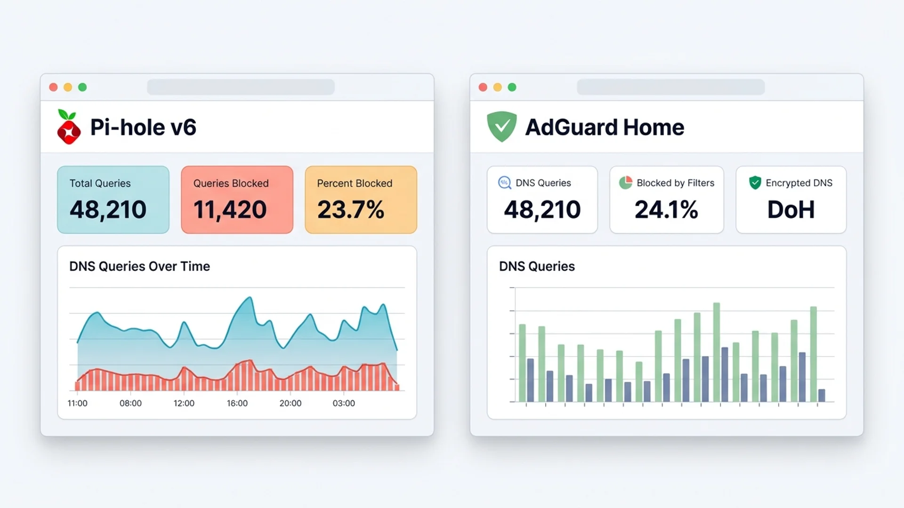
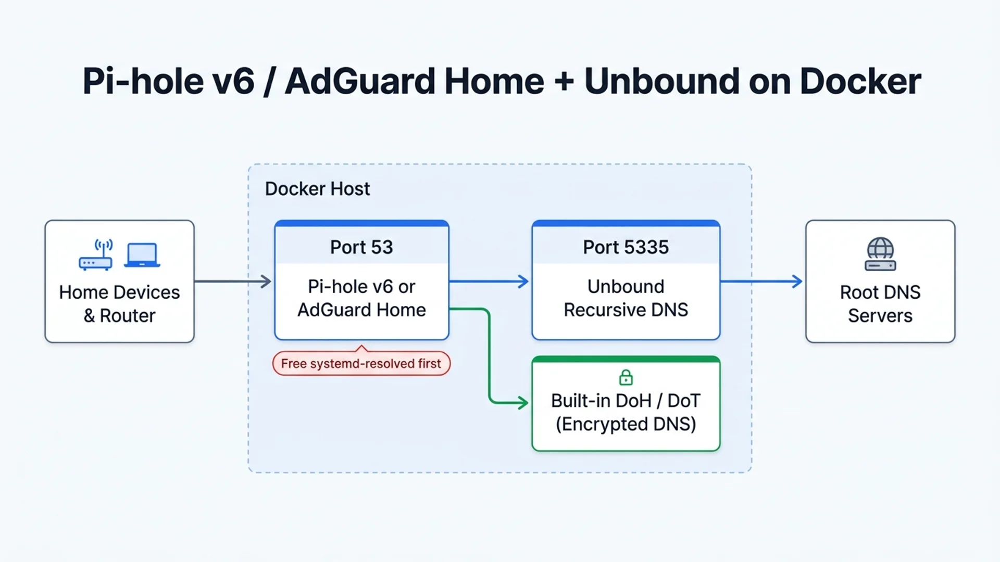

import Notice from "@components/widgets/Notice.astro";
import Tabs from "@components/widgets/Tabs.astro";
import Tab from "@components/widgets/Tab.astro";
import ListCheck from "@components/widgets/ListCheck.astro";
import Accordion from "@components/widgets/Accordion.astro";

Most Pi-hole vs AdGuard Home comparisons online are still arguing about Pi-hole v5. They warn you about `lighttpd`, PHP memory usage, and clunky `WEBPASSWORD` env vars. That was two years ago. Pi-hole v6 dropped both `lighttpd` and PHP, folded the web UI and REST API directly into `pihole-FTL`, and shrank its footprint down to where it sits right next to AdGuard Home.

I spun up fresh containers of both (`pihole/pihole:latest`, `adguard/adguardhome:latest`, and `mvance/unbound:latest`) on Docker 29.2 today to check idle memory, verify the v6 `FTLCONF_*` environment variables, and wire Pi-hole into Unbound over an internal bridge network. Here is what actually separates the two in 2026 and the exact Compose files to run either one cleanly.

## Pi-hole v6 vs AdGuard Home at a glance



Every memory number below was measured at idle via `docker stats --no-stream` on a fresh start before loading extra blocklists:

| Metric | Pi-hole v6 (Core 6.6 / FTL 6.9) | AdGuard Home (v1.0.0) |
|---|---|---|
| Idle RAM in Docker | **15.5 MiB** | **11.2 MiB** |
| Encrypted upstream DNS (DoH/DoT/DoQ) | Needs a separate proxy (or Unbound) | Built in (`https://`, `tls://`, `quic://`) |
| Encrypted DNS server for clients | Not built in | Built in (DoH, DoT, DoQ, DNSCrypt) |
| Web UI + API | Embedded in `pihole-FTL` (no PHP/lighttpd) | Single Go binary |
| Config file | `/etc/pihole/pihole.toml` (TOML) | `AdGuardHome.yaml` (YAML) |
| Docker config style | `FTLCONF_*` env vars (read-only once set) | Web wizard on `:3000`, then YAML |
| Per-device rules & schedules | Groups + lists (no built-in app toggles) | Per-client rules, Safe Search, one-click app blocks |
| Built-in DHCP server | Yes (needs `NET_ADMIN` + port 67/udp) | Yes (needs host network in Docker) |
| Best fit | Homelabs pairing with Unbound or custom scripts | Families, laptops/phones needing DoH/DoT out of the box |

The RAM gap is basically gone. Four megabytes of difference does not matter even on a Raspberry Pi Zero 2 W.

## The one real difference: encrypted DNS

If you strip away UI preferences, the decision comes down to how you want DNS traffic to leave your network and reach your clients.

AdGuard Home speaks DNS-over-HTTPS, DNS-over-TLS, DNS-over-QUIC, and DNSCrypt natively on both sides. You paste `https://dns.quad9.net/dns-query` or `tls://1.1.1.1` into the upstream box, click Save, and you are done. Hand it a TLS certificate and a domain name, and your phone can point Private DNS straight back to your home server while you are on cellular data (or pair it with [Tailscale](/tailscale-setup-guide/) so you never expose port 53 at all).

Pi-hole v6 still refuses to bundle a DoH or DoT client. Its own docs used to point people at `cloudflared`, and Cloudflare deprecated that proxy path in late 2025. The clean answer with Pi-hole has always been pairing it with Unbound as a local recursive resolver so your queries go straight to root nameservers instead of handing your browsing history to Cloudflare, Google, or an ISP. That also insulates you from upstream drama, such as Quad9 shutting down French resolution on November 24, 2026 after court-ordered blocking fines.

Two smaller differences worth knowing before you pick:

- **One-click service blocking.** AdGuard Home has toggle switches to block TikTok, YouTube, Discord, or Roblox per client on a schedule, plus forced Safe Search. In Pi-hole you have to hunt down domain lists and attach them to client groups yourself.
- **Query visibility and ecosystem.** Pi-hole's query log, regex tools, and community gravity lists (like Hagezi and OISD) feel slightly sharper when you spend time debugging why a smart TV app broke. Its v6 REST API is also much cleaner than v5's PHP endpoints.

<Notice type="warning" title="The Pi-hole v6 Docker open-resolver trap">
Pi-hole's official Docker examples often show `FTLCONF_dns_listeningMode: 'ALL'` together with `- "53:53/udp"`. On a VPS or any host with a public IP, that combination turns your box into a public open DNS resolver, because [Docker bypasses UFW](/docker-bypasses-firewall/) when you publish ports without a bind address. Always bind port 53 to your LAN IP (for example `192.168.1.50:53:53/udp`) or loopback/Tailscale IP, never bare `0.0.0.0` on a public server.
</Notice>

## Before you start: free up port 53 on Ubuntu/Debian

Ubuntu and many Debian servers run `systemd-resolved` listening on `127.0.0.53:53`. If you try to bind `53:53` on all interfaces, Docker will fail with `address already in use`.

Check what owns port 53 first:

```bash
sudo ss -tulpn | grep ':53 '
```

If `systemd-resolved` is sitting on it, either bind Docker to your machine's specific LAN IP (`192.168.1.50:53:53/udp`) so it never collides with `127.0.0.53`, or disable the stub listener cleanly:

```bash
sudo mkdir -p /etc/systemd/resolved.conf.d
printf "[Resolve]\nDNS=1.1.1.1\nDNSStubListener=no\n" | sudo tee /etc/systemd/resolved.conf.d/no-stub.conf
sudo ln -sf /run/systemd/resolve/resolv.conf /etc/resolv.conf
sudo systemctl restart systemd-resolved
```

Verify `ss -tulpn | grep ':53 '` returns nothing before bringing the stack up.

## Docker Compose setups (tested on Docker 29.2)



Pick either tab below. Both stacks include a local **Unbound** container (`mvance/unbound:latest`, Unbound 1.22.0, ~57 MiB RAM) on a private bridge network with a fixed IP so your DNS resolver does not rely on any third-party upstream. Replace `192.168.1.50` with your server's LAN or Tailscale IP.

<Tabs>
<Tab name="Pi-hole v6 + Unbound">

Notice two v6 details in this file: every config knob uses the `FTLCONF_<section>_<key>` naming convention (old v5 vars like `WEBPASSWORD` and `PIHOLE_DNS_` are gone), and any setting defined via `FTLCONF_*` becomes read-only in the web UI by design so your Compose file stays the single source of truth. Also, `mvance/unbound` listens on port `53` inside the container, so we point `FTLCONF_dns_upstreams` at `172.30.0.10#53`.

```yaml
services:
  unbound:
    image: mvance/unbound:latest
    container_name: unbound
    restart: unless-stopped
    networks:
      dns_net:
        ipv4_address: 172.30.0.10

  pihole:
    image: pihole/pihole:latest
    container_name: pihole
    restart: unless-stopped
    depends_on:
      - unbound
    ports:
      - "192.168.1.50:53:53/tcp"
      - "192.168.1.50:53:53/udp"
      - "127.0.0.1:8080:80/tcp"
    environment:
      TZ: "UTC"
      FTLCONF_webserver_api_password: "change-this-password"
      FTLCONF_dns_upstreams: "172.30.0.10#53"
      FTLCONF_dns_listeningMode: "ALL"
      # Optional: Unbound already validates DNSSEC; keep true only to show DNSSEC badges in Pi-hole UI
      FTLCONF_dns_dnssec: "true"
    volumes:
      - ./pihole/etc-pihole:/etc/pihole
    networks:
      dns_net:
        ipv4_address: 172.30.0.20

networks:
  dns_net:
    driver: bridge
    ipam:
      config:
        - subnet: 172.30.0.0/24
```

Start the stack and verify both recursive resolution and ad blocking:

```bash
docker compose up -d

# Should return real A records via Unbound
docker exec pihole dig @127.0.0.1 example.com +short

# Should return 0.0.0.0 (blocked)
docker exec pihole dig @127.0.0.1 doubleclick.net +short
```

On my test run, `example.com` resolved recursively (`104.20.23.154` / `172.66.147.243`) and `doubleclick.net` returned `0.0.0.0`. Access the admin panel at `http://127.0.0.1:8080/admin` (or put it behind [Traefik](/traefik-proxy-docker/) or Tailscale).

</Tab>
<Tab name="AdGuard Home + Unbound">

AdGuard Home does not use env vars for initial config. On first start, port `3000` serves the setup wizard; once you finish the wizard, port `80` takes over for the dashboard and you can remove the `3000` mapping.

```yaml
services:
  unbound:
    image: mvance/unbound:latest
    container_name: unbound
    restart: unless-stopped
    networks:
      dns_net:
        ipv4_address: 172.30.0.10

  adguardhome:
    image: adguard/adguardhome:latest
    container_name: adguardhome
    restart: unless-stopped
    depends_on:
      - unbound
    ports:
      - "192.168.1.50:53:53/tcp"
      - "192.168.1.50:53:53/udp"
      - "127.0.0.1:3000:3000/tcp"
      - "127.0.0.1:8080:80/tcp"
      # Uncomment if serving DoT / DoQ to LAN or remote clients:
      # - "192.168.1.50:853:853/tcp"
      # - "192.168.1.50:853:853/udp"
    volumes:
      - ./adguard/work:/opt/adguardhome/work
      - ./adguard/conf:/opt/adguardhome/conf
    networks:
      dns_net:
        ipv4_address: 172.30.0.20

networks:
  dns_net:
    driver: bridge
    ipam:
      config:
        - subnet: 172.30.0.0/24
```

Start it, open `http://127.0.0.1:3000`, finish the two-minute wizard (keep the admin port on `80` inside the container and DNS on `53`), then go to **Settings -> DNS settings** and set **Upstream DNS servers** to `172.30.0.10:53` (or an encrypted upstream like `https://dns.quad9.net/dns-query` if you want to skip Unbound completely).

One AdGuard gotcha: if you ever edit `./adguard/conf/AdGuardHome.yaml` by hand, stop the container first. AdGuard overwrites that file from memory on shutdown.

</Tab>
</Tabs>

## Blocklists and router setup without breaking your house

Adding 2 million domains on day one is the fastest way to make your household hate your homelab. Start lean:

<ListCheck>
<ul>
<li><b>Start with one solid list.</b> Hagezi Multi PRO (or OISD Big) blocks almost everything noisy while barely breaking banking apps, shipping links, or smart TVs.</li>
<li><b>Keep a fallback DNS path or second instance.</b> If your homelab server reboots during a kernel update and it is the only DNS server handed out by DHCP, the entire house loses internet. Run a second tiny container on a Raspberry Pi or keep a secondary DNS configured.</li>
<li><b>Point your router's LAN DHCP DNS to the container, not the WAN DNS.</b> Setting it on LAN DHCP lets Pi-hole or AdGuard see individual device IPs instead of lumping every query under your router's address.</li>
<li><b>Remember DNS cannot block in-stream YouTube ads.</b> YouTube serves ads from the same hostnames as video chunks. Pair network DNS blocking with uBlock Origin Lite or Brave in the browser (covered in [blocking ads after Manifest V3](/block-ads-manifest-v3-nextdns/)).</li>
</ul>
</ListCheck>

If you would rather skip running a local box and pay a couple dollars a month for cloud filtering across phones and laptops, compare NextDNS and Control D in my [DNS ad and malware protection guide](/block-ads-malware-dns-protection/). Otherwise, either container slots neatly into a [home server Docker stack](/docker-containers-home-server/).

## Which one should you run?

Pick **AdGuard Home** if you want encrypted DNS (DoH/DoT/DoQ) without extra containers, per-app parental toggles, and a five-minute setup that stays out of your way. For most home networks, it is the easier default.

Pick **Pi-hole v6 + Unbound** if you like declarative Compose configs (`FTLCONF_*`), want full recursive DNS with zero third-party resolvers, or already have scripts wired to Pi-hole's CLI and REST API. With PHP and `lighttpd` gone in v6, the old resource penalty is no longer a reason to avoid it.

## FAQ

<Accordion label="Does Pi-hole or AdGuard Home block YouTube ads?" group="faq" expanded="true">
No. Neither DNS blocker can reliably strip YouTube video ads because YouTube serves ads from the same domains as the video stream itself. Blocking those domains breaks playback. Use DNS blocking for trackers, smart TVs, and mobile apps, and use a browser extension for YouTube.
</Accordion>

<Accordion label="Why did my old Pi-hole Docker Compose break on v6?" group="faq">
Pi-hole v6 replaced `WEBPASSWORD`, `PIHOLE_DNS_`, and `DNSMASQ_LISTENING` with `FTLCONF_*` variables mapped directly to `/etc/pihole/pihole.toml` (for example `FTLCONF_webserver_api_password` and `FTLCONF_dns_upstreams`). It also dropped the `/etc/dnsmasq.d` mount by default unless you explicitly enable `FTLCONF_misc_etc_dnsmasq_d: "true"`.
</Accordion>

<Accordion label="Is Unbound slower than Cloudflare 1.1.1.1 or Quad9?" group="faq">
Only on the very first cold lookup for an uncached domain (usually 30–120 ms while walking root, TLD, and authoritative servers). Once cached in Unbound's memory, repeat lookups answer in under 1 ms on your LAN, faster than any public resolver over the internet.
</Accordion>

<Accordion label="Can I run AdGuard Home or Pi-hole over Tailscale for my phone?" group="faq">
Yes, and it is safer than opening port 53 to the public internet. Bind the DNS container to your server's Tailscale IP, set that IP as a Global Nameserver in the Tailscale admin console, and toggle Override DNS servers. Your phone gets home ad-blocking everywhere without exposing a public resolver.
</Accordion>
