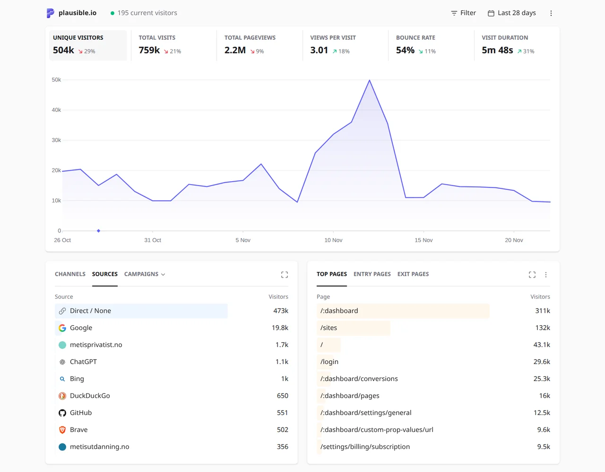
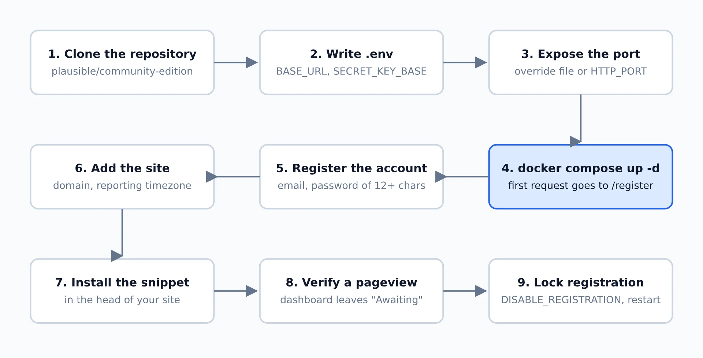
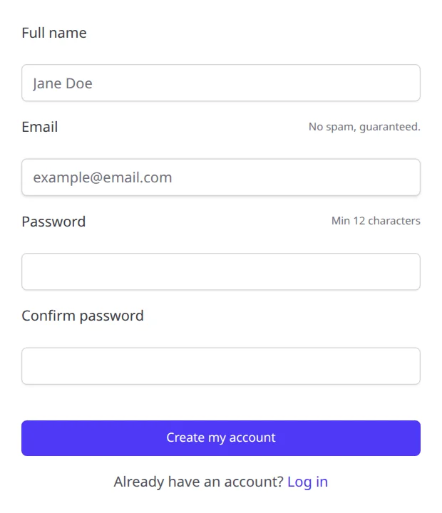
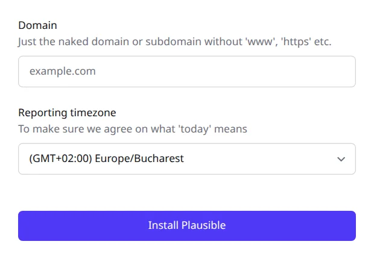
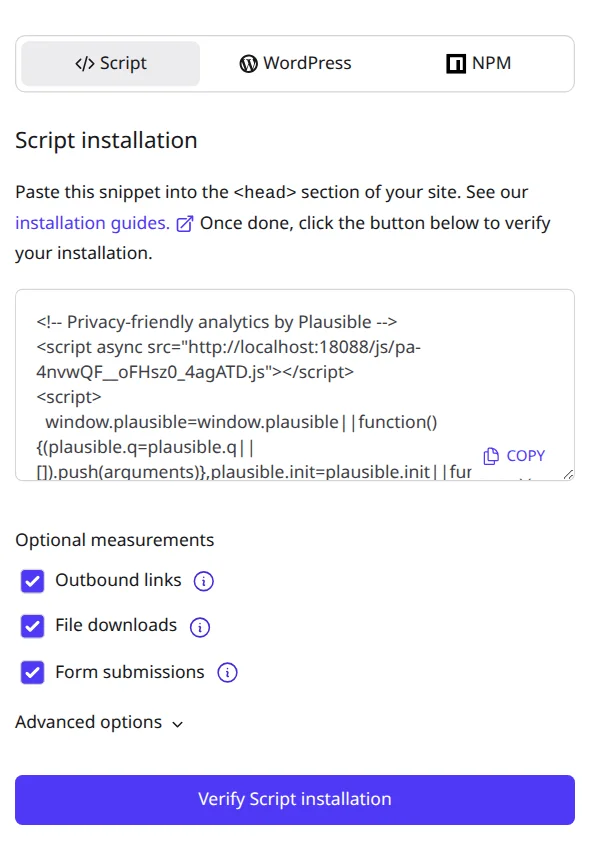
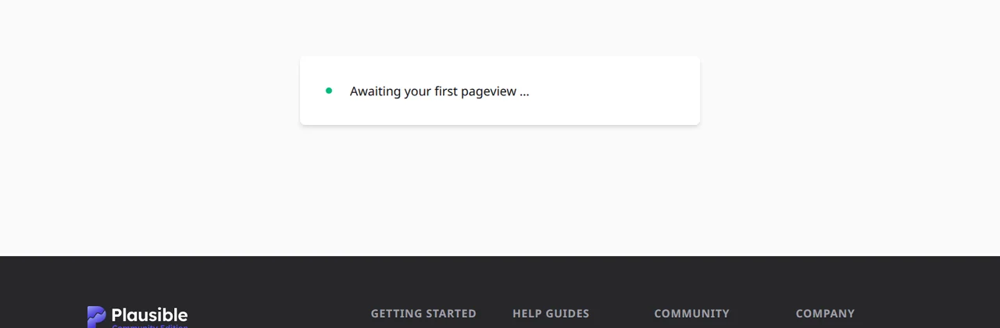

import YouTubeEmbed from "@components/widgets/YouTubeEmbed.astro";
import Notice from "@components/widgets/Notice.astro";
import Button from "@components/widgets/Button.astro";
import Accordion from "@components/widgets/Accordion.astro";

Plausible Analytics is a cookie-free, open source web analytics tool. Cloud costs money after a 30-day trial. The self-hosted Community Edition is free but has no funnels or revenue goals, and runs on Docker Compose with Postgres and ClickHouse.

This review covers what you get today, what the free self-hosted edition is missing, how to run it with Docker Compose and how to confirm your site sends data. I rewrote it because the 2023 version was a bullet list. Since then the Stats API was rebuilt and the tracker script got a new form in October 2025, described in the [script update guide](https://plausible.io/docs/script-update-guide).

<YouTubeEmbed
  url="https://www.youtube.com/embed/NoBp7bqAHUI"
  label="Plausible Analytics"
/>

> If you want more free and open source apps to self-host, browse the [toolhunt.net self-hosted section](https://toolhunt.net/sh/).

## What Plausible is today

Plausible is open source under the GNU AGPL v3, and the code lives in the [plausible/analytics](https://github.com/plausible/analytics) repository. The tracker snippet you embed is MIT licensed, so putting it on a commercial site does not pull AGPL onto your codebase. The project is funded only by its paid cloud service, with no investors and no ad revenue.

You can run it in two ways:

- **Plausible Cloud**: the managed service, hosted in the EU on Hetzner and UpCloud infrastructure. You add a snippet and they handle updates, backups and bot filtering.
- **Plausible Community Edition (CE)**: the free, self-hosted release. Same core code, you run it on your own server with Docker Compose.

The docs compare only Cloud and CE, and CE is the only thing you can install from the official repository.

## What Community Edition lacks

CE is not the whole product. Plausible keeps a few features cloud-only on purpose, to keep subscriptions funding the development. From the [self-hosting page](https://plausible.io/docs/self-hosting), checked 2026-11-23:

| | Cloud | Community Edition |
|---|---|---|
| Funnels and user journeys | Yes | No |
| Ecommerce revenue goals | Yes | No |
| Sites API (provisioning) | Enterprise | No |
| SSO | Enterprise | No |
| Bot filtering | Advanced, network-wide | Basic, User-Agent and referrer spam |
| Releases | Several per week | Long term release, twice a year |
| Support | From the team | Community only |
| Data Studio connector | Yes | No |

The release cadence is the one that catches people. The docs call CE a long term release published twice a year, so a feature announced on the Plausible blog may take months to land in your instance. The [CHANGELOG](https://github.com/plausible/analytics/blob/master/CHANGELOG.md) lists v3.1.0 on 2025-11-13, v3.2.0 on 2026-01-16, v3.2.1 on 2026-05-12 and v3.2.2 on 2026-11-23, the latest tag at the time of writing.

## Script size, cookies and personal data

The old version of this post said the script is "less than 1 KB". That is no longer true. On 2026-11-23 the legacy `https://plausible.io/js/script.js` measured 2841 bytes raw and about 1.3 KB gzipped. The per-site script the installer hands out today, `pa-<id>.js`, measured 5972 bytes raw and about 2.5 KB gzipped on plausible.io. A CE v3.2.2 test instance served its own `pa-<id>.js` at 6190 bytes with no `Content-Encoding` header, even when the request asked for gzip, so put a compressing proxy in front of it if the bytes matter. Do not quote the 1 KB number anymore.

The privacy claims hold. The [data policy](https://plausible.io/data-policy) states that Plausible uses no cookies, no local storage and no persistent identifiers. Uniqueness is computed per day from a salted hash of the website domain, the IP address and the User-Agent string, and the daily salt changes every 24 hours. That is why no cookie banner is needed for analytics. The same page publishes a legal GDPR assessment, which is what your compliance person will ask for.

A caveat for self-hosters: the policy describes the cloud. On your own instance, you are the data controller, and what gets logged depends on your reverse proxy and ClickHouse config. Keep the proxy access log short or off for the `/api/event` path.

This is the whole request path. The browser loads one small script per site, every pageview leaves as a `POST /api/event`, and the event lands in ClickHouse:


*Tracking flow: direct path, proxy path for ad-blocked visitors, and the optional measurements.*

## Features you will use

The dashboard is one page, and that is the point. There is no report builder. This is the public demo dashboard Plausible keeps for its own site:



*Plausible's public demo dashboard (plausible.io/plausible.io), with the metric row, chart, sources and top pages.*

Here is the full inventory, grouped by the job it does. The Cloud and CE column follows the [self-hosting comparison](https://plausible.io/docs/self-hosting) and the settings menu I saw on CE v3.2.2; the plan notes follow the [pricing page](https://plausible.io/docs/subscription-plans), both checked 2026-11-23.

### Measure

| Feature | What it does | Cloud or CE | Default |
|---|---|---|---|
| Top line | Unique visitors, visits, pageviews, bounce rate, visit duration, with date comparison | Both | On |
| Sources | Referrers, UTM channels and tags, landing and exit pages | Both | On |
| Pages | Top, entry and exit pages, plus 404 error pages | Both | On; 404s need a snippet on your 404 page and a goal |
| Locations | Country, region, city | Both | On |
| Devices | Browser, OS, device type | Both | On |
| Goals | Pageview goals need no code; custom event goals need one call | Both | Off until you add a goal |
| Outbound links, file downloads, form submissions | Automatic enhanced measurements | Both | Switches under Default tracking |
| Custom events and props | Attach key-value props to pageviews and events, then filter by them | Both; Business plan on Cloud | Off until you send props |
| Segments | Save any set of filters and reuse it | Both; team segments need Growth or higher on Cloud | Off until you save one |
| Funnels and user journeys | Multi-step drop-off analysis, sequential, flexible or strict funnels | Cloud only (Business) | n/a |

### Analyse

| Feature | What it does | Cloud or CE | Default |
|---|---|---|---|
| Stats API v2 | `POST /api/v2/query` returns JSON for any metric, dimension and filter | Both; Business plan on Cloud | Off until you create a key |
| CSV export | One CSV per dashboard report for the selected range and segment | Both | Manual, from the dashboard menu |
| Data Studio connector | Pull Plausible data into Google's report builder | Cloud only (Business) | n/a |

### Share

| Feature | What it does | Cloud or CE | Default |
|---|---|---|---|
| Email reports, including Slack | Weekly on Monday, monthly on the 1st, or both, to any number of recipients; Slack works through a channel email address | Both; CE needs SMTP configured | Off |
| Shared links | Private link to one dashboard, with optional password and a locked segment | Both | Off |
| Public stats | Dashboard URL anyone can open | Both | Off, stats are private |
| People and roles | Owner, Admin, Editor, Billing, Viewer, plus per-site guests | Both | One owner |

### Protect

| Feature | What it does | Cloud or CE | Default |
|---|---|---|---|
| Shields: IP addresses | Drop visits from specific addresses, up to 30 per site, no ranges | Both | Empty |
| Shields: Countries, Pages, Hostnames | Drop visits by country, page path or hostname | Both | Empty |
| Bot filtering | User-Agent and referrer spam checks | Both; Cloud adds data center ranges | Always on |

### Integrate and administer

| Feature | What it does | Cloud or CE | Default |
|---|---|---|---|
| WordPress plugin | Official plugin, excludes admin visits and has a one-click proxy | Both | n/a |
| Google Tag Manager template | Official template for pageviews and events | Both | n/a |
| NPM package | `@plausible-analytics/tracker` bundles the tracker into your build | Both | n/a |
| Proxy | Serve the script from your own domain, for example a Cloudflare Worker | Both | Off |
| Events API | Server-side `POST /api/event` for apps and backends | Both | n/a |
| Imports and exports | GA4 import, CSV import, export all stats | Both; GA4 import on CE needs a Google OAuth client | n/a |
| Visibility and danger zone | Public link, shared links, delete or reset site data | Both | n/a |

A custom event with a property looks like this in the browser:

```html
<button onclick="plausible('Signup', {props: {plan: 'pro'}})">Upgrade</button>
```

With class-based tracking the same event is `class="plausible-event-name=Sign+Up plausible-event-plan=pro"` on the element. Neither form shows up in the dashboard until you add a matching custom event goal under Goals. Funnels also need the events to exist first, then you chain goals as steps.

The optional measurements are switches in the site settings, and they take effect without touching the snippet. Options that used to be separate script files are now `plausible.init` arguments: `hashBasedRouting: true` for a single page app with `#` URLs, `fileDownloads: { fileExtensions: [...] }` to narrow the file types, and `autoCapturePageviews: false` if you send pageviews by hand.

## API: Stats API v2 and Sites API

The Stats API was rebuilt as v2. It is a read-only HTTP interface with a single endpoint, `POST /api/v2/query`, and the old v1 endpoints are now labeled legacy in the docs. Every query needs a `site_id`, a `date_range` and a list of `metrics`; `dimensions`, `filters` and `order_by` are optional. It returns JSON, so it fits a cron job or a status page widget better than the v1 CSV exports did. Keys are scoped to one team. The docs give the default limit as 600 requests per hour, while the CE v3.2.2 source sets 1,000,000 per hour. On Community Edition there is no plan gate: when I set it up on 2026-11-23, a key created under Settings, API keys returned `200` with a `results` array.

The Sites API (`/api/v1/sites`) is the provisioning interface: create sites, change domains, manage guests. Write access is an Enterprise plan feature. On Cloud, the read-only endpoints (listing sites, teams, goals, custom properties) also work with a normal Stats API key. The routes exist only in the Cloud build: on a CE v3.2.2 test instance, `/api/v1/sites` returned a 404 page, not an upgrade error.

If you self-host, expect the Stats API to work and `/api/v1/sites` to return a 404. That matches the "No" in the CE column above.

## How much does Plausible Cloud cost?

Plausible Cloud is a subscription with a 30-day trial and no free plan. The price depends on the plan and on your monthly pageviews. I am not listing exact prices because they change; check the [pricing section on plausible.io](https://plausible.io/#pricing).

There are four plans: Starter for one site, Growth for teams and sharing, Business for funnels, custom properties, the Stats API and Data Studio, and Enterprise for SSO, the Sites API, the managed proxy and raw exports. The tier counts pageviews plus custom events (outbound clicks, file downloads, form submissions, 404 tracking and manual events). The trial includes every Business feature without a credit card. What matters for the decision, per the [subscription docs](https://plausible.io/docs/subscription-plans):

- A site with little traffic lands in the lowest pageview tier.
- A single month over your tier costs nothing extra. If you exceed it two months in a row, Plausible asks you to upgrade, and the dashboards lock if you do not upgrade within a week of the notice. Self-hosted has no such curve, only your server bill.
- Funnels, revenue goals and the Data Studio connector require a paid plan. If you need them, CE is out regardless of budget.

## Self-host Plausible with Docker Compose

The supported way is the [community-edition](https://github.com/plausible/community-edition) repository. It is an example Compose setup with three services: Plausible itself, a Postgres database for users and sites, and ClickHouse for the events. Requirements from its README, checked 2026-11-23:

- Docker and Docker Compose
- A CPU with SSE 4.2 or NEON (ClickHouse needs it)
- At least 2 GB of RAM recommended
- A domain pointing at the server, if you want TLS from Let's Encrypt

A small VPS covers this, for example one of the cloud plans in the [Hetzner Cloud review](/hetzner-cloud-review/). The README recommends 2 GB because ClickHouse is the memory-hungry part, and the compose file mounts low-resource ClickHouse configs for small servers.

These are the nine steps, from clone to a locked instance:



*Self-host flow for Community Edition: nine steps from clone to a closed registration.*

### Start the stack

```bash
git clone -b v3.2.2 --single-branch https://github.com/plausible/community-edition plausible-ce
cd plausible-ce
touch .env
echo "BASE_URL=https://stats.example.com" >> .env
echo "SECRET_KEY_BASE=$(openssl rand -base64 48)" >> .env
echo "HTTP_PORT=80" >> .env
echo "HTTPS_PORT=443" >> .env
cat > compose.override.yml <<'EOF'
services:
  plausible:
    ports:
      - 80:80
      - 443:443
EOF
docker compose up -d
```

`SECRET_KEY_BASE` has to be at least 64 bytes; `openssl rand -base64 48` gives 64 characters. `BASE_URL` has to match the address you open in the browser, because it feeds the WebSocket origin check. A test with `BASE_URL=http://localhost:18000` opened as `127.0.0.1:18000` logged an origin error and the registration form did nothing. The `compose.yml` in the repository pins the image tag (v3.2.2 when I wrote this). CE also reads a setting from `/run/secrets` when a file there has the variable's name, so you can keep secrets in files. [Docker Compose secrets](/docker-compose-secrets/) explains how that mount works.

The first run pulls Postgres, ClickHouse and Plausible, so give it a few minutes and watch `docker compose logs -f plausible` until the migrations finish. The first request then redirects to `/register`.

### Register the first account

The first screen of a fresh instance is the registration form. Give it a name, an email and a password of at least 12 characters.



*Register screen of a fresh CE v3.2.2 instance, with the five setup steps on the left.*

### Add the site

The domain is the naked domain or subdomain, without `www` or `https`. The reporting timezone sets the day boundary of your reports, so pick the timezone of your audience or your own.



*Add website info: domain without www or https, plus the reporting timezone.*

### Running behind a reverse proxy

Ports 80 and 443 are usually taken by your proxy (Traefik, Caddy, Dokploy). Since v2.1.2 CE can issue its own Let's Encrypt certificates, so a proxy is optional. If you keep one, drop the 80 and 443 override, set `HTTP_PORT=8000` in `.env` and publish that port to localhost only, with `127.0.0.1:8000:8000` under `ports` in `compose.override.yml`. Then point the proxy at `localhost:8000`. Caddy needs only `reverse_proxy localhost:8000`. Nginx needs `X-Forwarded-For` and a second `location /live/websocket` block with the `Upgrade` headers. The [wiki reverse proxy page](https://github.com/plausible/community-edition/wiki/reverse-proxy) has the full blocks, and my [Traefik guide](/traefik-proxy-docker/) covers the Docker labels side.

<Notice type="warning" title="Back up two databases">
  You have a Postgres volume and a ClickHouse volume. Sites, goals and users live in Postgres; events live in ClickHouse. Back up both, or your restore gives you an empty dashboard.
</Notice>

To upgrade, run `git pull origin <new-tag>` (the repository has one branch per version), then `docker compose up -d`. The wiki recommends pinning the image to a full patch tag and notes that security fixes are not backported. The compose command runs `db migrate` on every start. Read the release notes first: a long term release jumps many minor versions at once. The generic pull, recreate and rollback routine is in [update Docker Compose containers](/updating-container-docker-compose/).

### Check that registration is closed

CE defaults to `DISABLE_REGISTRATION=invite_only`, per the [configuration wiki](https://github.com/plausible/community-edition/wiki/configuration#disable_registration). Once the first account exists, `/register` redirects to the login page with "Registration is disabled on this instance", which is what a v3.2.2 test instance did. Only invited users can register. Set `DISABLE_REGISTRATION=true` in `.env` to close invitations too, or `false` to open sign-ups to everyone, then run `docker compose up -d`. This is the last step of the flow diagram: open `/register` in a private window to confirm it.

## Embed the snippet and verify data

In the Cloud dashboard, or on your instance, add your domain under **+ Add website**. Since October 2025 every site gets its own script, `pa-` followed by a site ID, so copy the real snippet from the site's **Settings**, **General**, next to **Site installation** (the link reads **Review installation** on CE v3.2.2). Its shape is this, host and site ID differ per installation:

```html
<!-- Privacy-friendly analytics by Plausible -->
<script async src="https://plausible.io/js/pa-XXXXXXXX.js"></script>
<script>
  window.plausible=window.plausible||function(){(plausible.q=plausible.q||[]).push(arguments)},plausible.init=plausible.init||function(i){plausible.o=i||{}};
  plausible.init()
</script>
```

The installation page has tabs for **Script**, **WordPress** and **NPM**, a copy button for the snippet, the **Optional measurements** switches (Outbound links, File downloads, Form submissions), a link to **Advanced options** and a migration guide for the legacy `data-domain` snippet:



*Script installation page on CE v3.2.2: snippet, optional measurements and the verify button.*

For a self-hosted instance the script URL points at your `BASE_URL`. Put it in the `<head>` of your site; the script tag is `async`, so it does not block parsing. In Astro, that is the base layout or a small component; I wrote a separate guide for [Plausible on Astro with Cloudflare Workers](/astro-plausible-cloudflare-workers/) that proxies the script on your own domain. The legacy `/js/script.js` is still served by v3.2.2, but new installs should use the snippet the installer shows.

Until the first event arrives, the site dashboard says "Awaiting your first pageview":



*The site dashboard of a fresh CE instance, before the first event.*

Then check three things:

1. Open your site in a private window. The dashboard should leave "Awaiting your first pageview" and show the visit under current visitors within seconds.
2. Look at the browser dev tools network tab. You want a `202` on `POST /api/event` and no cookie set in response. A `202` on its own proves little: when I set this up on 2026-11-23, the endpoint answered `202 ok` for a registered site and for an unknown domain, because the event is dropped silently. A dropped event carries an `x-plausible-dropped: 1` response header. The dashboard, not the status code, is the proof.
3. Query the API, so you know the key and the `site_id` work before a script depends on it.

For step 3, create a Stats API key in your account settings (keys are scoped to one team), then:

```bash
curl --request POST \
  --header 'Authorization: Bearer YOUR-KEY' \
  --header 'Content-Type: application/json' \
  --url 'https://plausible.io/api/v2/query' \
  --data '{
    "site_id": "example.com",
    "metrics": ["visitors", "pageviews"],
    "date_range": "day"
  }'
```

A working key returns JSON with a `results` array. Without a key the endpoint answers `401` with `{"error":"Missing API key. Please use a valid Plausible API key as a Bearer Token."}`, which is what came back when I set this up on 2026-11-23. A `401` with a key means the key is wrong or belongs to another team; an error that mentions your plan means the Stats API is not included in it; an empty result set with a `200` means the key is fine and the site received no data yet.

Two more queries from the [Stats API reference](https://plausible.io/docs/stats-api). Top pages for the last seven days, one row per page. Note that `7d` leaves out the current day; use `day` when you want to see today's events:

```bash
curl --request POST \
  --header 'Authorization: Bearer YOUR-KEY' \
  --header 'Content-Type: application/json' \
  --url 'https://plausible.io/api/v2/query' \
  --data '{
    "site_id": "example.com",
    "metrics": ["visitors", "pageviews"],
    "date_range": "7d",
    "dimensions": ["event:page"],
    "order_by": [["visitors", "desc"]]
  }'
```

Visitors for one page only, using a filter with the `is` operator:

```bash
curl --request POST \
  --header 'Authorization: Bearer YOUR-KEY' \
  --header 'Content-Type: application/json' \
  --url 'https://plausible.io/api/v2/query' \
  --data '{
    "site_id": "example.com",
    "metrics": ["visitors", "pageviews"],
    "date_range": "7d",
    "filters": [["is", "event:page", ["/pricing"]]]
  }'
```

Filters are `[operator, dimension, values]` arrays, with `is`, `is_not`, `contains`, `contains_not`, `matches` and `matches_not` (re2 syntax), combined with `and`, `or` and `not`. Each result row holds a `dimensions` list and a `metrics` list in the order you asked for.

If the dashboard stays at zero:

- **Ad blockers**: some blocklists block `plausible.io`, while Firefox and Safari do not by default. Proxy the script on your own domain to recover most of it. Your proxy must forward the visitor IP in `X-Forwarded-For`, or the bot filter drops the event and you still get a `202`.
- **CSP**: add the Plausible host to `script-src` and `connect-src`, or the event never leaves the browser.
- **`localhost`**: the tracker skips pageviews from localhost by default, so test from a real hostname, or a deployed preview, not from your dev server. To count dev traffic, pass `captureOnLocalhost: true` to `plausible.init`.
- **Wrong snippet**: use the snippet issued for that site. With the old `data-domain` snippet, the attribute must match the site you added, or the event is rejected.
- **Cache**: a cached page may still serve the old HTML without the snippet. Purge the cache after adding it.
- **Shields**: an active rule for the visitor's IP, country, page or hostname drops the visit before it is stored.

## Site settings on CE v3.2.2

The site settings menu I saw on 2026-11-23 reads: General, People, Visibility, Goals, Custom properties, Integrations, Imports & exports, Shields (IP addresses, Countries, Pages, Hostnames), Email reports, Danger zone. The General page has Domain, Reporting timezone and the **Review installation** link that opens the snippet page. Three of those deserve a note:

- **Shields**: block your own office or home IP here, one address at a time, up to 30 per site. Add the IPv6 address too, or your visits still get counted.
- **Imports & exports**: the GA4 importer, the CSV importer and the export of all stats live here. The GA4 import links your Google account, you pick a property, and the page emails you when it finishes. On CE that needs SMTP and a Google OAuth client, set up as in the [Google integration wiki](https://github.com/plausible/community-edition/wiki/google-integration). Treat imported data as a rough reference: the [import docs](https://plausible.io/docs/google-analytics-import) say simple filters by source, page or country work and filters by custom properties do not.
- **Visibility**: stats are private until you switch on the public dashboard or create a shared link. A shared link can carry a password (set at creation, never editable) and can be locked to one segment.

## Should you pick Cloud, self-hosted CE or Umami?

Start with the Cloud trial if you need funnels or revenue goals, or you do not want to own an uptime. Self-host CE if you already run a VPS with Docker and only need pageviews, sources, goals and props.

You trade the premium features and advanced bot filtering for a flat server bill and data that never leaves your machine. Self-hosting also makes uptime yours, so put a monitor such as [Uptime Kuma](/install-uptime-kuma/) on the dashboard URL.

If CE without funnels feels too thin and you still want self-hosted, look at [Umami](/umami-analytics-install/). The [Umami docs](https://umami.is/docs) describe v3, checked 2026-11-23:

| | Plausible Cloud | Plausible CE | Umami |
|---|---|---|---|
| License | AGPL v3, hosted | AGPL v3 | MIT |
| Database | Managed for you | Postgres and ClickHouse | PostgreSQL (v12.14 or newer) |
| Funnels | Yes, Business plan | No | Yes, in the self-hosted build |
| API | Stats API v2, Business plan | Stats API v2, no plan gate | REST API with an API key, every operation |
| Script | `pa-<id>.js` from plausible.io, about 2.5 KB gzipped | The same script from your own host | `script.js` from your instance, proxy documented |

Umami also lists journeys, retention, cohorts and session replays in its v3 docs, and one database instead of two is less to back up.

If you run Coolify and would rather skip the terminal, [how to install Plausible analytics](/install-plausible-analytics/) covers the one-click path.

## FAQ

<Accordion label="Does Plausible Analytics use cookies or localStorage?" group="faq">
  No. The [data policy](https://plausible.io/data-policy) states that Plausible sets no cookies, writes nothing to local storage and keeps no persistent identifiers. A unique visitor is a salted daily hash of the domain, the IP address and the User-Agent, and the salt rotates every 24 hours. On a self-hosted instance you are the data controller, so keep the proxy access log off `/api/event`.
</Accordion>

<Accordion label="How large is the Plausible tracking script?" group="faq">
  The legacy `script.js` measured 2841 bytes raw and about 1.3 KB gzipped on 2026-11-23. The per-site `pa-<id>.js` that new installs get is larger, about 6 KB raw and 2.5 KB gzipped on plausible.io, and loads with `async`. A CE v3.2.2 test instance served it uncompressed at 6190 bytes. The "less than 1 KB" figure from older posts is outdated.
</Accordion>

<Accordion label="Is self-hosting Plausible free, and what does CE lack?" group="faq">
  Yes, Community Edition is free under AGPL v3 and costs only your server: 2 GB of RAM recommended, Postgres plus ClickHouse. It has no funnels, user journeys, ecommerce revenue goals, SSO, Sites API or Data Studio connector, and the docs call it a long term release published about twice a year. After the first account, registration is invite only by default; `DISABLE_REGISTRATION` in `.env` changes that.
</Accordion>

<Accordion label="Does Plausible slow down my website?" group="faq">
  The snippet adds one small script, about 2.5 KB gzipped for the per-site `pa-<id>.js` (the legacy `script.js` is about 1.3 KB), loaded with `async` from the `<head>`. There is no cookie banner to render and no third-party pixel chain. The one thing that can break the page is a strict Content Security Policy: add the Plausible host to `script-src` and `connect-src`.
</Accordion>

<Accordion label="How do I count visitors who run ad blockers?" group="faq">
  Proxy the script and the event endpoint through your own domain so the requests look first-party. The [proxy docs](https://plausible.io/docs/proxy/introduction) list Cloudflare, Vercel, Netlify, Nginx, Apache, Caddy and Laravel guides, and the WordPress plugin has a one-click proxy. The proxy must forward the visitor IP in `X-Forwarded-For` (and `CF-Connecting-IP` on Cloudflare), or the event is dropped silently with a `202`. My [Astro and Cloudflare Workers guide](/astro-plausible-cloudflare-workers/) shows one setup.
</Accordion>

<Accordion label="Does the Stats API need a paid plan?" group="faq">
  On Plausible Cloud the Stats API v2 is a Business plan feature; the trial includes it. On Community Edition there is no plan gate: the endpoint answers `401` with "Missing API key" until you create a key, then `POST /api/v2/query` returns JSON, as it did on my CE v3.2.2 test on 2026-11-23. Keys are scoped to one team. The docs give the Cloud limit as 600 requests per hour, and the CE v3.2.2 source sets 1,000,000.
</Accordion>

<Accordion label="Can I import my Google Analytics data into Plausible?" group="faq">
  Yes, GA4 historical stats import from site settings under Imports & exports. You link your Google account, pick a property and get an email when the import finishes: a few minutes for most sites, up to a couple of hours for large ones. On CE you must configure SMTP and a Google OAuth client first. There is also a CSV importer for other tools, and imported data supports simple filters by source, page or country but not custom property filters.
</Accordion>

<Accordion label="How do I move a site to another domain?" group="faq">
  Open site settings, General, and click Change next to the domain. Enter the naked domain without `https://` and `www`, then confirm. You keep the historical stats and you do not export or import anything. For 72 hours Plausible counts stats under both the old and the new domain, and then rejects traffic sent with the old one. The new `pa-` snippet needs no change, but the legacy snippet needs its `data-domain` updated.
</Accordion>

<Button link="https://plausible.io/" text="Check Plausible" />
