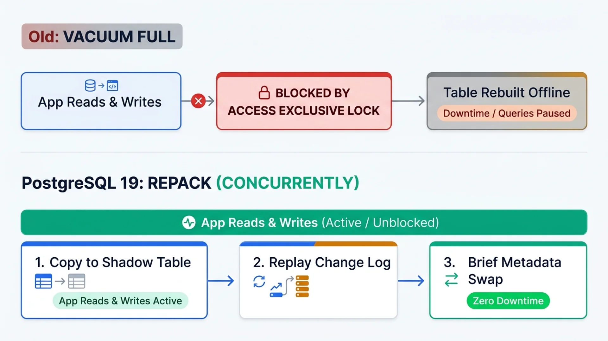
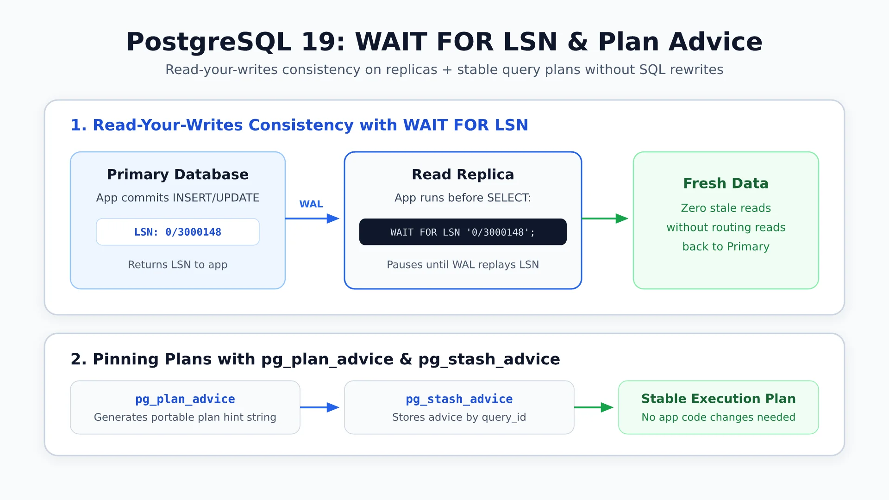

import Notice from "@components/widgets/Notice.astro";
import Tabs from "@components/widgets/Tabs.astro";
import Tab from "@components/widgets/Tab.astro";
import ListCheck from "@components/widgets/ListCheck.astro";
import Accordion from "@components/widgets/Accordion.astro";

PostgreSQL 19 shipped on November 19, 2026, about two months later than the usual September slot after the core team spent autumn chewing through a wave of AI-generated bug reports. The wait paid off. This is the most operationally useful Postgres release in several years.

Two changes explain why: `REPACK (CONCURRENTLY)` finally lets you reclaim table bloat in core Postgres without blocking reads and writes, and `jit` is off by default after years of causing mystery latency spikes on OLTP workloads. Behind those two sit `pg_plan_advice`, `WAIT FOR LSN` for standby reads, zero-restart logical replication, `INSERT ... ON CONFLICT DO SELECT`, JSON output in `COPY`, and `lz4` as the default TOAST compression.

I spun up `postgres:19-alpine` in Docker today and ran through every feature below so you get real SQL, actual `EXPLAIN` output, and the catches that don't jump out of the [official release notes](https://www.postgresql.org/docs/release/19.0/).

## What changed by default in PostgreSQL 19

Before trying new commands, look at the defaults that shifted underneath you. Every value below comes straight from `pg_settings` on a fresh `postgres:19-alpine` container:

| Setting | PG 18 default | PG 19 default | Why it matters |
|---|---|---|---|
| `jit` | `on` | `off` | Stops surprise JIT compile spikes on OLTP queries; analytics workloads need to re-enable it |
| `default_toast_compression` | `pglz` | `lz4` | Faster compression and decompression for wide columns when built with LZ4 |
| `log_lock_waits` | `off` | `on` | Long lock waits show up in your logs out of the box |
| `max_locks_per_transaction` | `64` | `128` | Lock table accounting changed; keep double your old value if you tuned it |
| `io_workers` | `3` | removed | Replaced by auto-scaling `io_min_workers` (`2`) and `io_max_workers` (`8`) |
| `autovacuum_max_parallel_workers` | n/a | `0` | Parallel index vacuuming in autovacuum is opt-in; raise it to use it |
| `md5_password_warnings` | n/a | `on` | Logs a deprecation warning after every MD5 login |
| `standard_conforming_strings` | `on` (changeable) | `on` (locked) | Turning it off is no longer supported on the server |

<Notice type="warning" title="Two config traps before you bump your container tag">
First, if your custom `postgresql.conf` sets `io_workers`, PostgreSQL 19 will refuse to start because the parameter was removed in favor of `io_min_workers` and `io_max_workers`. Second, `postgres:19-alpine` uses `PGDATA=/var/lib/postgresql/19/docker`, same layout introduced in 18. Mount `/var/lib/postgresql` in Docker Compose, not `/var/lib/postgresql/data`, or your data disappears the next time you recreate the container.
</Notice>

## Spin up PostgreSQL 19 in Docker first

If you want to try the queries in this guide without touching a real server, drop this into a scratch folder as `compose.yaml`:

```yaml
services:
  postgres:
    image: postgres:19-alpine
    container_name: pg19-lab
    restart: unless-stopped
    ports:
      - "127.0.0.1:5432:5432"
    environment:
      POSTGRES_USER: postgres
      POSTGRES_PASSWORD: change-me-locally
      POSTGRES_DB: demo
    volumes:
      - pg19_data:/var/lib/postgresql
    healthcheck:
      test: ["CMD-SHELL", "pg_isready -U postgres -d demo"]
      interval: 5s
      timeout: 5s
      retries: 5

volumes:
  pg19_data:
```

Start it and open `psql`:

```bash
docker compose up -d
docker compose exec postgres psql -U postgres -d demo -c "SELECT version();"
```

You should see `PostgreSQL 19.0` back. Binding the port to `127.0.0.1` keeps it off your public interface; remember that [Docker bypasses UFW](/docker-bypasses-firewall/) when you publish `5432:5432` bare. For real deployments, move the password out of plain env vars with [Docker Compose secrets](/docker-compose-secrets/), and if you want one container hosting several databases, the init-script pattern in my [multiple Postgres databases in Docker](/multiple-postgres-databases-docker/) guide works identically on 19.

## REPACK (CONCURRENTLY): reclaim bloat without taking the table offline



Heavy `UPDATE` and `DELETE` traffic leaves dead space inside Postgres tables. Regular `VACUUM` marks those gaps reusable, yet it almost never hands disk space back to the OS. Previously your options in core Postgres were `VACUUM FULL` and `CLUSTER`, and both grab an `ACCESS EXCLUSIVE` lock for the entire rewrite. On a 40 GB table, that meant a maintenance window or installing the third-party `pg_repack` extension.

PostgreSQL 19 brings that workflow into core with `REPACK` (which replaces both `VACUUM FULL` and `CLUSTER`, though the old names remain for compatibility). Adding `CONCURRENTLY` rewrites the table in the background under a `SHARE UPDATE EXCLUSIVE` lock and only takes a brief `ACCESS EXCLUSIVE` lock at the very end to swap the files.

I tested this on a 50,000-row table in `postgres:19-alpine`, deleted half the rows, and ran `REPACK (CONCURRENTLY)` with index reordering:

```sql
CREATE TABLE orders (
  id bigserial PRIMARY KEY,
  customer_id int NOT NULL,
  payload text NOT NULL
);
CREATE INDEX idx_orders_customer ON orders (customer_id);

INSERT INTO orders (customer_id, payload)
SELECT (g % 500) + 1, repeat('x', 200)
FROM generate_series(1, 50000) AS g;

DELETE FROM orders WHERE id % 2 = 0;

SELECT pg_size_pretty(pg_relation_size('orders')) AS before_repack,
       pg_size_pretty(pg_total_relation_size('orders')) AS total_before;
```

Before repacking, `orders` sat at `12 MB` (`13 MB` with indexes). Then I ran:

```sql
REPACK (CONCURRENTLY) orders USING INDEX idx_orders_customer;
```

Afterward, `pg_relation_size('orders')` dropped to `6144 kB` (`6928 kB` total). You can watch longer jobs in real time through the new `pg_stat_progress_repack` view.

Four real caveats I hit or confirmed in the docs before you schedule this in cron:

1. **The table needs an identity index.** Running `REPACK (CONCURRENTLY)` on a table without a primary key or `REPLICA IDENTITY USING INDEX` fails immediately with `Relation "..." has no identity index`.
2. **It cannot run inside a transaction block.** Most migration tools wrap scripts in `BEGIN ... COMMIT` by default, so run `REPACK (CONCURRENTLY)` outside a transaction, just like `CREATE INDEX CONCURRENTLY`.
3. **You need roughly 2x disk headroom.** `REPACK` builds a fresh copy of the table and every index before dropping the old files, plus sort temp space if `USING INDEX` chooses a sort plan.
4. **Concurrent snapshots see an odd edge case.** The docs flag that `REPACK (CONCURRENTLY)` is not MVCC-safe: any transaction that opened its snapshot *before* repacking started will see the table as empty after the repack commits. Don't kick it off while long-running reporting queries are open.

## Pinning bad plans with pg_plan_advice and pg_stash_advice

Every team running Postgres long enough has had a Tuesday afternoon where `ANALYZE` shifts row estimates slightly, the planner flips a nested loop to a hash join (or drops an index scan), and p99 latency jumps tenfold. Previously, fixing that meant either changing app SQL, hacking `enable_*` settings, or installing `pg_hint_plan`.

PostgreSQL 19 ships two built-in modules by Robert Haas: `pg_plan_advice` for describing and enforcing plan choices in a compact mini-language, and `pg_stash_advice` for attaching that advice to a query ID automatically so you don't touch application code.

To see the exact advice string Postgres generates for a query, load `pg_plan_advice` and ask `EXPLAIN`:

```sql
LOAD 'pg_plan_advice';

EXPLAIN (PLAN_ADVICE)
SELECT o.id, o.customer_id
FROM orders o
WHERE o.customer_id = 42;
```

Output from our Docker container:

```text
 Bitmap Heap Scan on orders o  (cost=5.26..335.57 rows=125 width=12)
   Recheck Cond: (customer_id = 42)
   ->  Bitmap Index Scan on idx_orders_customer  (cost=0.00..5.22 rows=125 width=0)
         Index Cond: (customer_id = 42)
 Generated Plan Advice:
   BITMAP_HEAP_SCAN(o)
   NO_GATHER(o)
```

Force a different plan in the current session to test an alternative:

```sql
SET pg_plan_advice.advice = 'SEQ_SCAN(o)';

EXPLAIN (COSTS OFF)
SELECT o.id, o.customer_id
FROM orders o
WHERE o.customer_id = 42;
```

```text
          QUERY PLAN
------------------------------
 Seq Scan on orders o
   Filter: (customer_id = 42)
 Supplied Plan Advice:
   SEQ_SCAN(o) /* matched */
```

To apply advice automatically to production traffic without redeploying the app, add `pg_stash_advice` to `shared_preload_libraries`, restart Postgres, and stash the advice against the `Query Identifier` printed by `EXPLAIN (VERBOSE, PLAN_ADVICE)`:

```sql
CREATE EXTENSION pg_stash_advice;

-- Grab the Query Identifier from EXPLAIN (VERBOSE, PLAN_ADVICE)
SELECT pg_create_advice_stash('prod');
SELECT pg_set_stashed_advice('prod', 4904561378319701717, 'BITMAP_HEAP_SCAN(items)');
ALTER DATABASE demo SET pg_stash_advice.stash_name = 'prod';
```

My honest take on this feature: treat `pg_stash_advice` like a tourniquet, not a lifestyle. It is brilliant when an incident is on fire and you need the old plan back in 60 seconds. Leaving stashed plans around forever hides missing indexes and stale statistics, and the Postgres docs themselves note that evaluating advice carries planning overhead even when the plan doesn't change. Fix the underlying query or stats, then drop the stash entry.

## Developer SQL improvements you will actually write

Half of Postgres 19's SQL additions shave off awkward boilerplate people have been working around for a decade. If you already push extra jobs into Postgres as described in [what Postgres can replace](/what-postgres-replaces/), these make that single-database setup even cleaner.

<Tabs>
<Tab name="ON CONFLICT DO SELECT">

The "get or create" pattern used to force either two round trips or a dummy `DO UPDATE SET slug = EXCLUDED.slug` (which generated pointless dead tuples and WAL writes just so `RETURNING` would fire). Now you can use `DO SELECT`:

```sql
CREATE TABLE tags (
  id bigserial PRIMARY KEY,
  slug text UNIQUE NOT NULL
);

INSERT INTO tags (slug) VALUES ('postgresql')
ON CONFLICT (slug) DO SELECT RETURNING id, slug;

-- Second run hits the conflict and returns the existing row without writing a dead tuple
INSERT INTO tags (slug) VALUES ('postgresql')
ON CONFLICT (slug) DO SELECT RETURNING id, slug;
```

If you need to lock the existing row for the rest of the transaction, add `FOR UPDATE` or `FOR SHARE` (`ON CONFLICT (slug) DO SELECT FOR UPDATE RETURNING id, slug`).

</Tab>
<Tab name="COPY JSON & ON_ERROR">

`COPY TO` now exports JSON directly, either as newline-delimited JSON or wrapped as a single array with `FORCE_ARRAY`:

```sql
COPY (SELECT id, slug FROM tags) TO STDOUT (FORMAT json);
-- {"id":1,"slug":"postgresql"}

COPY (SELECT id, slug FROM tags) TO STDOUT (FORMAT json, FORCE_ARRAY);
-- [{"id":1,"slug":"postgresql"}]
```

`COPY TO` also works directly on partitioned tables now without wrapping them in `COPY (SELECT * FROM ...)`. On the import side, `COPY FROM` can skip multiple header lines (`HEADER 2`) and turn malformed values into `NULL` instead of aborting the whole load:

```sql
CREATE TABLE imports (id int, amount int);

COPY imports FROM STDIN (FORMAT csv, HEADER 2, ON_ERROR set_null);
# Exported from billing
id,amount
1,500
2,not_a_number
3,750
\.
-- NOTICE:  in 1 row, columns were set to null due to data type incompatibility
-- Row 2 loads with amount = NULL instead of failing the import
```

</Tab>
<Tab name="Window IGNORE NULLS">

Gap-filling time-series data in SQL used to require ugly `COUNT()` partition tricks. Now `lead()`, `lag()`, `first_value()`, `last_value()`, and `nth_value()` accept `IGNORE NULLS`:

```sql
CREATE TABLE metrics (day date, price numeric);
INSERT INTO metrics VALUES
  ('2026-11-01', 100),
  ('2026-11-02', NULL),
  ('2026-11-03', NULL),
  ('2026-11-04', 115),
  ('2026-11-05', NULL);

SELECT day,
       price,
       last_value(price) IGNORE NULLS OVER (ORDER BY day) AS filled_price
FROM metrics
ORDER BY day;
```

Row 2 and row 3 carry `100` forward cleanly; row 5 carries `115`.

</Tab>
<Tab name="jsonpath, random & base64url">

Three small quality-of-life additions that cut down glue code:

```sql
-- New jsonpath string methods: ltrim, rtrim, btrim, lower, upper, initcap, replace, split_part
SELECT jsonb_path_query(
  '{"email": "  Admin@Bitdoze.COM  "}',
  '$.email.btrim().lower()'
);
-- "admin@bitdoze.com"

-- Random dates and timestamps without epoch math
SELECT random('2026-01-01'::date, '2026-12-31'::date);

-- URL-safe base64 and sortable base32hex built in
SELECT encode(E'\\x68656c6c6f3f'::bytea, 'base64url');
-- aGVsbG8_
```

</Tab>
</Tabs>

## Replication and standbys: zero-restart logical slots and WAIT FOR LSN



Two long-standing replication headaches disappear in PostgreSQL 19.

### Enabling logical replication without restarting Postgres

Before 19, setting up Change Data Capture or a logical replica meant editing `wal_level = logical` and bouncing the database server. Now, as long as `wal_level` is `replica` (the default), creating your first logical replication slot automatically promotes the server's `effective_wal_level` to `logical`. Drop the last logical slot and it drops back to `replica`.

Here is the exact sequence I ran in Docker with zero restarts:

```sql
SHOW wal_level;           -- replica
SHOW effective_wal_level; -- replica

SELECT slot_name, lsn FROM pg_create_logical_replication_slot('test_slot', 'pgoutput');
SHOW effective_wal_level; -- logical

SELECT pg_drop_replication_slot('test_slot');
SHOW effective_wal_level; -- replica
```

Logical replication also picks up two things people have asked for since Postgres 10:

- **Sequence replication** via `CREATE PUBLICATION seq_pub FOR ALL SEQUENCES;` and `ALTER SUBSCRIPTION ... REFRESH SEQUENCES`. Failovers no longer risk duplicate primary keys because sequences drifted behind.
- **Excluding noisy tables** from `FOR ALL TABLES` with `EXCEPT`:

```sql
CREATE PUBLICATION app_pub FOR ALL TABLES EXCEPT (TABLE audit_scratch);
```

Notice `TABLE` sits *inside* the parentheses. I got a syntax error putting it outside on my first attempt in `psql`, so keep the exact form above.

### Read-your-writes consistency on read replicas with WAIT FOR LSN

If your app writes to a primary and sends reads to a streaming standby, there is always a brief replication lag window where a user saves a record, refreshes the page, and sees stale data. PostgreSQL 19 adds `WAIT FOR LSN` on standbys so a session can pause until WAL replay reaches the exact position of the write.

On the primary after a write:

```sql
UPDATE orders SET payload = 'shipped' WHERE id = 101;
SELECT pg_current_wal_insert_lsn();
-- returns e.g. 0/038D7788 (store in session or signed cookie)
```

On the standby before reading:

```sql
WAIT FOR LSN '0/038D7788' WITH (TIMEOUT '100ms', NO_THROW);
SELECT payload FROM orders WHERE id = 101;
```

Without `NO_THROW`, hitting the timeout raises an error so your app can fall back to the primary explicitly. You can also specify `MODE` (`standby_replay`, `standby_write`, `standby_flush`, or `primary_flush`).

## Performance, monitoring, and server-side SNI

### Speed and smarter defaults

Turning `jit` off by default is the change most self-hosted operators will actually feel. On small and medium queries, LLVM JIT compilation often cost more CPU time than it saved whenever row estimates crossed `jit_above_cost`. Leaving it off removes a tuning tweak I have put in every production `postgresql.conf` since Postgres 14. If you run a warehouse or heavy analytical aggregations, turn `jit = on` back on for that role or database.

Any PostgreSQL 19 build compiled with LZ4, including the official Docker images, now sets `default_toast_compression = lz4` instead of `pglz`. Wide `text` and `jsonb` columns compress and decompress much faster with minimal CPU overhead.

On the storage side, PostgreSQL 19 builds on 18's asynchronous I/O layer: `io_method = worker` now scales background I/O workers automatically between `io_min_workers` (2) and `io_max_workers` (8), and exits idle workers after `io_worker_idle_timeout` (60 seconds). Autovacuum also gets parallel index vacuuming plus a priority scoring system you can inspect in `pg_stat_autovacuum_scores`. One catch: `autovacuum_max_parallel_workers` defaults to `0`, so set it (or the per-table `autovacuum_parallel_workers` parameter) if you have multi-index tables that fall behind.

A few query and write-path wins land with zero config changes. `NOT IN (SELECT ...)` now turns into an anti-join when the columns are proven `NOT NULL` (I verified `Merge Anti Join` in `EXPLAIN` on our `orders` table), some aggregates can run before joins to cut intermediate row counts, foreign-key constraint checks were reworked to make bulk inserts close to 2x faster in testing, and `NOTIFY` now wakes only backends listening on the matching channel instead of waking almost everyone.

### Observability and TLS SNI

Debugging slow I/O and lock contention takes less guesswork in 19. `EXPLAIN (ANALYZE, BUFFERS, IO)` prints asynchronous prefetch metrics right inside the plan (`Prefetch: avg=1.00 max=1 capacity=94`), `pg_stat_lock` tracks per-lock-type wait counts and wait times, and `pg_stat_recovery` exposes standby recovery progress. `log_lock_waits` also defaults to `on`, which should have been the default years ago.

For multi-tenant hosts, server-side TLS SNI finally arrived via `PGDATA/pg_hosts.conf`. A single Postgres server can now present different TLS certificates depending on the hostname the client connects to.

## Breaking changes and upgrade checklist

Major upgrades in Postgres still require `pg_dumpall`, `pg_upgrade`, or logical replication. Before moving an existing 16, 17, or 18 cluster to 19, walk through this list:

<ListCheck>
<ul>
<li><b>Take an off-box backup first.</b> If you deploy with Dokploy, set up automated dumps with my [Dokploy backups to Cloudflare R2 guide](/dokploy-backups-cloudflare-r2/) before touching the container tag.</li>
<li><b>Remove <code>io_workers</code> from custom configs.</b> It was removed in 19; replace it with <code>io_min_workers</code> and <code>io_max_workers</code> if you tuned AIO in PG 18.</li>
<li><b>Audit extensions before upgrading.</b> If you rely on pgvector (see my [pgvector and pgAdmin Docker guide](/deploy-pgvector-pgadmin-docker/)), PostGIS, or TimescaleDB, confirm your exact Docker image or OS package has a PostgreSQL 19 build first. Core PG 19 shipped yesterday; extension packaging always trails by days or weeks.</li>
<li><b>Check <code>btree_gist</code> indexes on <code>inet</code>/<code>cidr</code>.</b> Those opclasses were broken and <code>pg_upgrade</code> will refuse to upgrade clusters containing them. Drop and recreate them with standard GiST before upgrading.</li>
<li><b>Check MD5 passwords and RADIUS.</b> RADIUS authentication was removed completely. MD5 logins still work for now, yet they trigger warnings (<code>md5_password_warnings = on</code>) and are slated for removal; migrate remaining roles to <code>scram-sha-256</code>.</li>
<li><b>Watch Docker volume paths.</b> Upgrading from PG 17 or earlier in Docker means moving from <code>/var/lib/postgresql/data</code> to <code>/var/lib/postgresql</code>, plus running a dump/restore or <code>pg_upgrade</code> across the major version boundary.</li>
<li><b>Reindex full-text and <code>pg_trgm</code> indexes on non-libc locales.</b> If your database uses ICU or builtin locale providers, character classification changed in 19 and the release notes recommend reindexing FTS/trigram indexes and recomputing stored <code>tsvector</code> columns after <code>pg_upgrade</code>.</li>
<li><b>Double-check <code>max_locks_per_transaction</code> and <code>jit</code>.</b> If you explicitly set <code>max_locks_per_transaction</code> in older releases, double it to keep the same capacity. If you run a warehouse or BI workload that depended on JIT, set <code>jit = on</code> explicitly.</li>
</ul>
</ListCheck>

## Should you upgrade today?

For local dev, CI, and new greenfield apps that don't depend on third-party extensions yet to publish PG 19 packages, yes. `postgres:19-alpine` is already live on Docker Hub and clean to run alongside the rest of a [self-hosted Docker stack](/docker-containers-home-server/).

For production databases, wait for 19.1 unless you are actively fighting a problem that 19 solves directly, such as bloated tables you cannot lock for `VACUUM FULL` or a primary you cannot restart to enable logical replication. Every `.0` major Postgres release shakes out edge cases in the first minor point release, and third-party extension ecosystems (especially `pgvector` and PostGIS Docker tags) usually catch up in the same window. Use the next few weeks to test a copy of your production dump against `postgres:19-alpine` in Docker and verify your query plans with `jit = off`.

## FAQ

<Accordion label="Does REPACK (CONCURRENTLY) replace the pg_repack extension completely?" group="faq" expanded="true">
For most tables, yes. It reclaims bloat and can reorder rows by an index without blocking reads or writes, all inside core Postgres with no extension to compile or upgrade. Keep two limits in mind: the table still needs an identity index (primary key or unique non-null index), and you still need free disk space equal to the table plus its indexes while the rewrite runs.
</Accordion>

<Accordion label="Will turning JIT off by default slow down my database?" group="faq">
For typical web apps, SaaS backends, and self-hosted tools (OLTP), turning JIT off usually makes tail latency better, not worse. Many teams already forced `jit = off` in PG 14-18 because JIT compilation overhead hurt short-to-medium queries. Only data warehouses and heavy analytical queries generally benefit from turning `jit = on` back on.
</Accordion>

<Accordion label="Can I upgrade directly from PostgreSQL 16 or 17 to 19 in Docker?" group="faq">
Yes, via `pg_dumpall` and restore into a fresh `postgres:19-alpine` container, or with `pg_upgrade` using a multi-version upgrade image. You cannot simply change the image tag in `compose.yaml` and point PostgreSQL 19 at a PG 16, 17, or 18 data directory. Remember that PostgreSQL 14 reached EOL on November 12, 2026, so older clusters should prioritize moving off 14 soon.
</Accordion>

<Accordion label="How do I enable parallel autovacuum in PostgreSQL 19?" group="faq">
Parallel index vacuuming in autovacuum defaults to disabled (`autovacuum_max_parallel_workers = 0`). Set `autovacuum_max_parallel_workers` to a non-zero number (for example `2` or `4`, within `max_parallel_workers`) in `postgresql.conf` or via `ALTER SYSTEM`, then reload. You can inspect which tables autovacuum prioritizes next by querying `pg_stat_autovacuum_scores`.
</Accordion>
