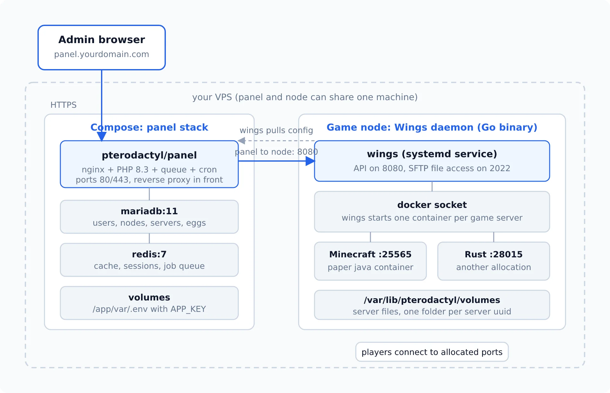
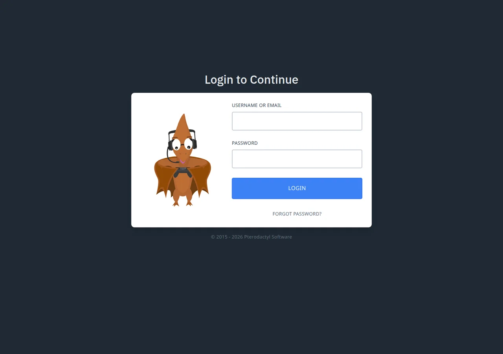
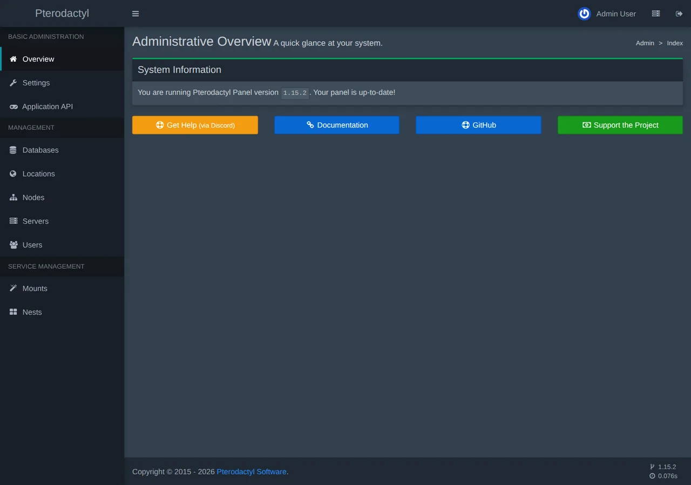
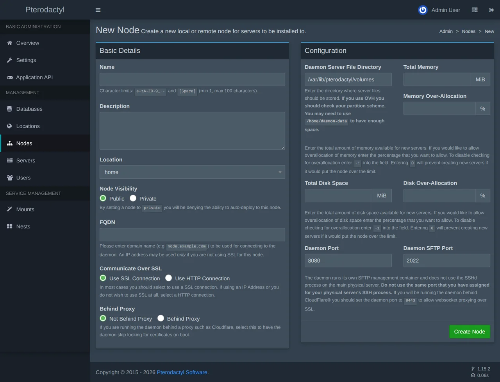
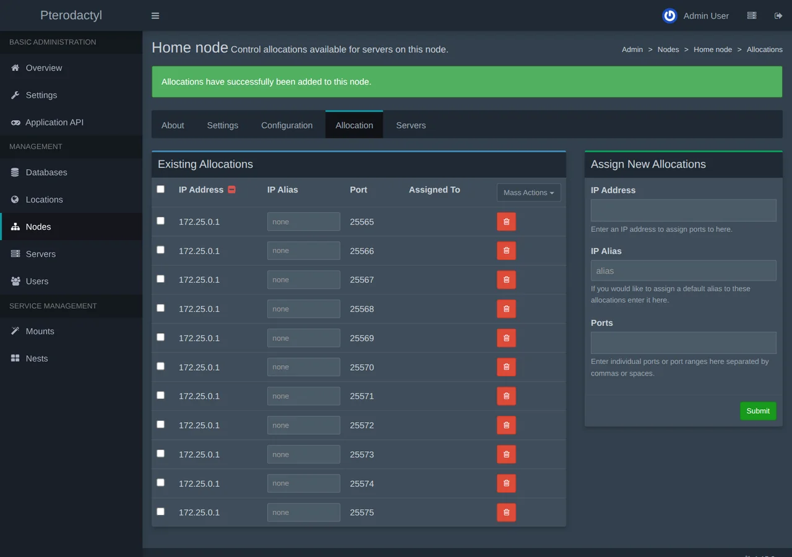
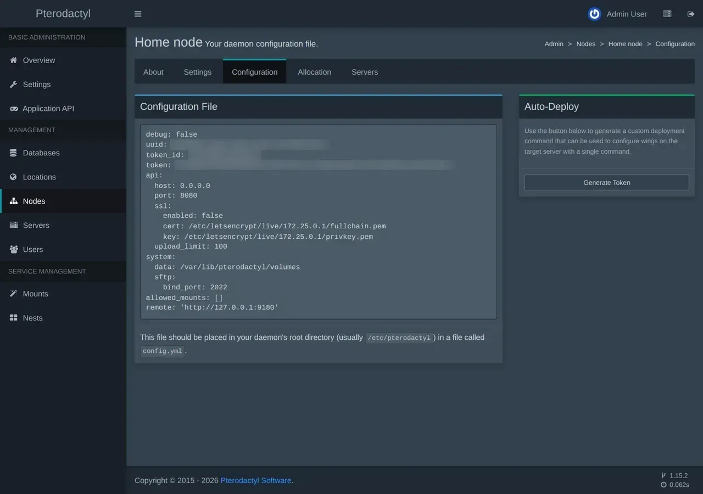
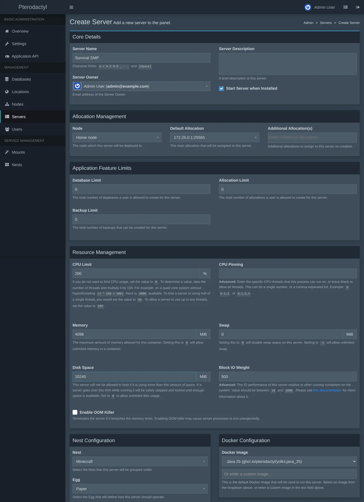
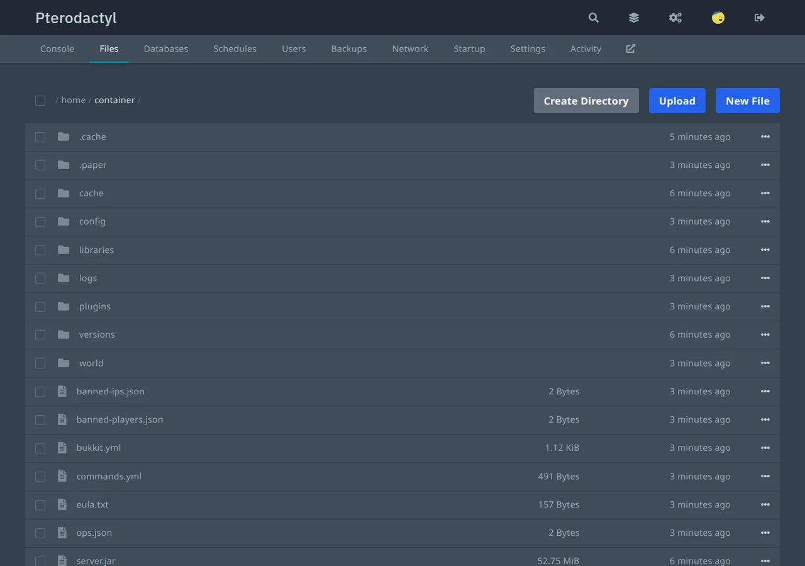
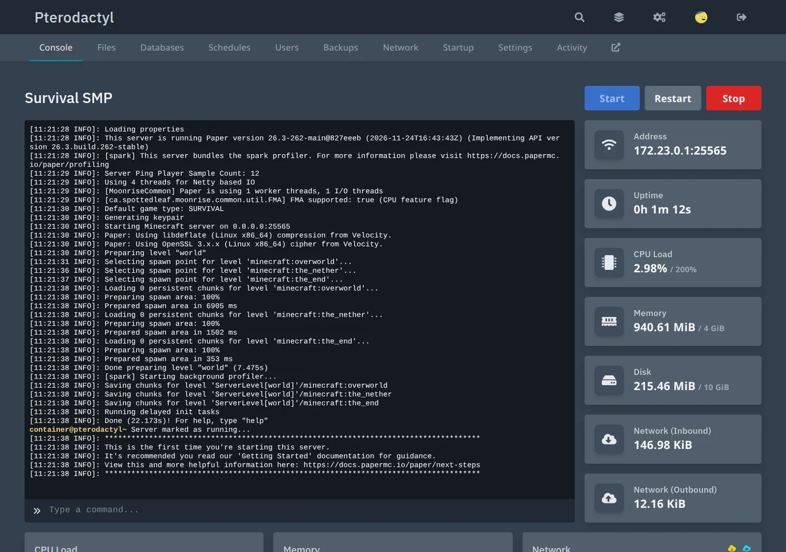

import Notice from "@components/widgets/Notice.astro";
import ListCheck from "@components/widgets/ListCheck.astro";
import Tabs from "@components/widgets/Tabs.astro";
import Tab from "@components/widgets/Tab.astro";
import Accordion from "@components/widgets/Accordion.astro";

Install Pterodactyl by running the panel, MariaDB, and Redis in Docker Compose, then installing the [Wings daemon](https://docs.pterodactyl.io/v1/wings/installing) as a systemd service on the same machine. The panel is your web UI and API; Wings is the agent that starts game servers in Docker containers. A single 4 GB VPS runs both fine for a handful of servers.

I tested every step below on a live host running panel v1.15.2 and Wings v1.13.5. I logged in, registered a node, assigned ports, and booted a Paper Minecraft server from the panel console.

## What Pterodactyl is

Pterodactyl is a free, open source game server management panel. Two separate pieces of software make it work, and confusing them is the number one source of install problems:

- **Panel**: a PHP/Laravel web application. You log into it, create servers, manage files, and configure everything. It needs MariaDB and Redis.
- **Wings**: a small Go daemon that runs on every machine hosting game servers. Wings reads a token the panel generates, talks to Docker directly, and starts one container per game server.

Four terms matter most before you start. A **node** runs Wings, and a **nest** groups a game family (Minecraft, Rust, Source Engine). An **egg** holds the install script for one server type (Paper, Forge, Vanilla), while a **server** binds to a port **allocation** on a node.


*Pterodactyl's two halves: the panel stack in Compose, Wings driving game containers on the node.*

That split explains why running both halves in containers gets awkward. Wings expects direct control over the host Docker socket, so containerizing Wings introduces nested Docker or bind-path mismatches that break volume mounts. On a single VPS, run **the panel in Docker and Wings as a host systemd service**.

## Prerequisites

<ListCheck>
<ul>
<li>A VPS or home server with **KVM virtualization**. The [Wings requirements](https://docs.pterodactyl.io/v1/wings/installing) say OpenVZ, Virtuozzo and LXC will most likely not work and KVM is guaranteed to. Check with `systemd-detect-virt`: `kvm` or `none` is fine.</li>
<li>**4 GB RAM** is a comfortable floor for the panel plus one or two game servers. Minecraft alone wants 2 to 4 GB. If you are shopping for hardware, the mini PCs in my [home server roundup](/best-mini-pc-home-server/) handle this stack comfortably.</li>
<li>Docker installed: `curl -sSL https://get.docker.com/ | CHANNEL=stable bash`, then `sudo systemctl enable --now docker`.</li>
<li>Docker Compose v2 (included in current Docker installs; verify with `docker compose version`).</li>
<li>A domain pointed at the VPS, like `panel.example.com`, if you want HTTPS. You can test on a bare IP without it.</li>
<li>Ports include **80/443** for your reverse proxy, **2022** for Wings SFTP, **8080** for the panel-to-Wings API, and **25565+** for Minecraft.</li>
</ul>
</ListCheck>

Enable swap if you host for others because Java game servers trigger the Linux OOM killer quickly. Linux kernel 6.1 and newer enable swap accounting by default. On older kernels where `docker info` prints `WARNING: No swap limit support`, add `swapaccount=1` to `GRUB_CMDLINE_LINUX_DEFAULT`, run `sudo update-grub`, and reboot.

## Deploy the panel with Docker Compose

The official `ghcr.io/pterodactyl/panel` image bundles nginx, PHP 8.3, the queue worker, and a cron entry for the scheduler into one container. You supply MariaDB and Redis. The compose file below follows the project's [docker-compose.example.yml](https://github.com/pterodactyl/panel/blob/1.0-develop/docker-compose.example.yml); I pinned the image tag, published the panel on localhost only and dropped the mail block. Create a project directory and this compose file:

```yaml title="compose.yaml"
x-common:
  database:
    &db-environment
    # Do not remove the "&db-password" from the end of the line below, it is important
    # for Panel functionality.
    MYSQL_PASSWORD: &db-password "CHANGE_ME"
    MYSQL_ROOT_PASSWORD: "CHANGE_ME_TOO"
  panel:
    &panel-environment
    APP_URL: "https://panel.example.com"
    APP_TIMEZONE: "UTC"
    APP_SERVICE_AUTHOR: "noreply@example.com"

services:
  database:
    image: mariadb:11
    restart: always
    command: --default-authentication-plugin=mysql_native_password
    volumes:
      - "/srv/pterodactyl/database:/var/lib/mysql"
    environment:
      <<: *db-environment
      MYSQL_DATABASE: "panel"
      MYSQL_USER: "pterodactyl"
  cache:
    image: redis:7-alpine
    restart: always
  panel:
    image: ghcr.io/pterodactyl/panel:v1.15.2
    restart: always
    ports:
      - "127.0.0.1:8081:80"
    links:
      - database
      - cache
    volumes:
      - "/srv/pterodactyl/var/:/app/var/"
      - "/srv/pterodactyl/nginx/:/etc/nginx/http.d/"
      - "/srv/pterodactyl/certs/:/etc/letsencrypt/"
      - "/srv/pterodactyl/logs/:/app/storage/logs"
    environment:
      <<: *panel-environment
      DB_PASSWORD: *db-password
      APP_ENV: "production"
      APP_ENVIRONMENT_ONLY: "false"
      CACHE_DRIVER: "redis"
      SESSION_DRIVER: "redis"
      QUEUE_DRIVER: "redis"
      REDIS_HOST: "cache"
      DB_HOST: "database"
      DB_PORT: "3306"
      HASHIDS_LENGTH: 8
```

Three things to edit before starting anything:

1. Set both passwords to real random values.
2. Set `APP_URL` to your final URL, including `https://` if you use TLS. Changing it later means editing `.env` and reconfiguring, so decide now.
3. I publish the panel on `127.0.0.1:8081` and put a reverse proxy in front for TLS. For the container's built-in Let's Encrypt support instead, see the TLS tabs below.

Now boot the database and cache first, then migrate and create your admin user:

```bash
docker compose up -d database cache
docker compose run --rm panel php artisan migrate --seed --force --no-interaction
docker compose run --rm panel php artisan p:user:make \
  --email=you@example.com --username=admin \
  --name-first=Admin --name-last=User \
  --password='PickSomethingStrong123' --admin=1 --no-interaction
docker compose up -d panel
```

The migration seeds all the default nests and eggs (Minecraft, Source Engine, Rust, Voice Servers) and takes well under a minute on a small VPS. The user creation prints a table with your admin account.

Verify the panel responds:

```bash
curl -s -o /dev/null -w "%{http_code}\n" http://127.0.0.1:8081/auth/login
# 200
```


*The login screen means the panel, database, and redis are all up.*

<Notice type="warning" title="Back up APP_KEY immediately">
On first boot the container writes `/srv/pterodactyl/var/.env` with a generated `APP_KEY` and `HASHIDS_SALT`. Every encrypted secret in the database (API keys, node tokens) is encrypted with this key. Lose it and even a perfect database backup is useless. Copy the whole `.env` file into your password manager or backup system today.
</Notice>

<Notice type="info" title="reCAPTCHA can block the login page">
The panel image ships with reCAPTCHA on (`RECAPTCHA_ENABLED` defaults to true in `config/recaptcha.php`) and with Pterodactyl's own public site and secret keys, so every login runs a Google check. If a browser or network blocks Google, or Google asks for its mobile verification step ([issue #5632](https://github.com/pterodactyl/panel/issues/5632)), you cannot log in. Add `RECAPTCHA_ENABLED: "false"` to the panel environment and recreate the container, or set your own `RECAPTCHA_WEBSITE_KEY` and `RECAPTCHA_SECRET_KEY`. Disabling it removes brute-force protection on the login form, so do it only on a private panel.
</Notice>

## Set up TLS for the panel

<Tabs>
<Tab name="Reverse proxy">

Publish the panel on `127.0.0.1:8081` (as in the compose file above) and point your TLS termination at it. If you already run [Traefik](/traefik-proxy-docker/) or nginx proxy manager, the panel is just another upstream. Two requirements:

- The proxy must send `X-Forwarded-Proto` and `X-Forwarded-For` correctly, or every login session breaks.
- Set `TRUSTED_PROXIES` in the panel environment to your proxy's IP or `*` for a quick test. The image's `config/trustedproxy.php` reads this variable, and without it the forwarded headers are not trusted, so URLs come out wrong.

</Tab>
<Tab name="Built-in Let's Encrypt">

Change the port mapping to `"80:80"` and `"443:443"`, set `APP_URL` to your `https://` address and add `LE_EMAIL: "you@example.com"` to the panel environment. This is the option the [official docker-compose.example.yml](https://github.com/pterodactyl/panel/blob/1.0-develop/docker-compose.example.yml) documents ("set to a non-empty value if you want to use Let's Encrypt"). Ports 80 and 443 must be free on the host and the domain must already point at it.

</Tab>
</Tabs>

If you use [Dokploy](/dokploy-install/) for the rest of your apps, resist the urge to import this stack there. Dokploy is great for stateless web apps, but Wings needs host-level control that no PaaS-style manager gives you. Run this compose project directly.

## Install Wings on the host

Wings is a single Go binary. These are the commands from the [official Wings install guide](https://docs.pterodactyl.io/v1/wings/installing); Wings is Linux only and the guide states it will not run on Windows:

```bash
sudo mkdir -p /etc/pterodactyl
curl -L -o /usr/local/bin/wings \
  "https://github.com/pterodactyl/wings/releases/latest/download/wings_linux_$([[ "$(uname -m)" == "x86_64" ]] && echo "amd64" || echo "arm64")"
sudo chmod u+x /usr/local/bin/wings
```

Wings is useless without its `config.yml`, and you do not write that file by hand. The panel generates it when you create a node.

## Create the node and allocations in the panel

Log into the panel as your admin user and open the admin area (the gear icon, or append `/admin`). You get the administrative overview with the system information block, which should report your panel version as up to date.


*Admin overview. The version block tells you at a glance if you are behind.*

First create a **location** under Locations. A location is just a grouping label ("home", "frankfurt", "oracle-free-tier"); you need at least one. Then open Nodes, Create New:

- **Name**: anything, for example `Home node`.
- **Location**: the one you just created.
- **FQDN**: the hostname or IP players and the panel use to reach this node. If you chose HTTP instead of SSL for the node, an IP is allowed. For production, use a real hostname and SSL.
- **Communicate over SSL**: use SSL in production. Wings requires its own TLS certificate for the node's FQDN. Per the [Wings guide](https://docs.pterodactyl.io/v1/wings/installing), create that certificate before starting the daemon. For a LAN-only lab, HTTP is fine.
- **Total memory / disk**: how much of the machine the node may hand out, in MB. Over-allocation of memory `-1` means unlimited; `0` means no over-allocation.
- **Daemon port**: `8080` is the default, change it if 8080 is taken on your host.
- **Daemon SFTP port**: `2022`, almost never worth changing.


*The node form. Memory and disk are in MB; the daemon ports must be free on the host.*

After saving, open the node's **Allocation** tab and create port allocations. Type the node's IP into the IP field and a range like `25565-25575` into the ports field. Each Minecraft server consumes one allocation; each Rust server consumes two or three. Ranges of 10 ports per game type is a comfortable default.


*Eleven allocations, each one a future game server.*

## Generate the Wings config and start the daemon

Still on the node, open the **Configuration** tab. The panel shows the complete `config.yml` for Wings, including the node's UUID and token. Copy the whole block and paste it into `/etc/pterodactyl/config.yml` on the node machine. There is also a Generate Token button that prints a one-line `wings configure` command; the paste method is easier to audit.


*The config.yml the panel generates. The token is a secret; treat it like a password.*

The `remote` key in that file is how Wings reaches the panel. If the panel runs on the same host inside Docker, `http://127.0.0.1:8081` works. If Wings runs on a different machine, it must be the panel's public HTTPS URL. Test the daemon in the foreground first:

```bash
sudo wings --debug
```

A healthy startup ends with lines like `configuring internal webserver host_port=8080` and `sftp server listening for connections listen=0.0.0.0:2022`. If you see `bind: address already in use`, another process owns port 8080. I hit that conflict during testing because a local dev service squatted on it, and changed `daemonListen` on both the node and Wings config. Stop with Ctrl+C and daemonize:

```ini title="/etc/systemd/system/wings.service"
[Unit]
Description=Pterodactyl Wings Daemon
After=docker.service
Requires=docker.service
PartOf=docker.service

[Service]
User=root
WorkingDirectory=/etc/pterodactyl
LimitNOFILE=4096
PIDFile=/var/run/wings/daemon.pid
ExecStart=/usr/local/bin/wings
Restart=on-failure
StartLimitInterval=180
StartLimitBurst=30
RestartSec=5s

[Install]
WantedBy=multi-user.target
```

```bash
sudo systemctl daemon-reload
sudo systemctl enable --now wings
```

Verify the panel can reach Wings by opening the node in the admin area: the About tab shows a green heart when the daemon is reachable. You can also check from inside the panel container. The image's busybox `wget` exits non-zero on any HTTP error, so `|| echo unreachable` would also fire on a healthy 401. Print the status line instead:

```bash
docker compose exec panel wget -S -O /dev/null http://<node-ip>:8080/api/system 2>&1 | grep HTTP/
# HTTP/1.1 401 Unauthorized  <- the daemon answers, you just have no token
```

I tested this against a throwaway HTTP server returning 401 from inside the `ghcr.io/pterodactyl/panel:v1.15.2` container. A dead port prints no `HTTP/` line and `wget` reports `can't connect to remote host`. The real Wings API's response body may differ, but a status line proves the daemon answered.

## Create your first Minecraft server

Servers, Create New. The form is long but every field matters:

- **Name**: what players see in your list, for example `Survival SMP`.
- **Owner**: the user who controls the server day to day. For now that is you.
- **Node**: your node. **Default allocation**: pick `25565`.
- **Resource limits**: for Paper, 2 CPU (200%), 4096 MB RAM, 10 GB disk is a sane starting point. Memory `0` is unlimited but then the OOM killer picks your victims for you.
- **Nest**: Minecraft, **egg**: Paper. Paper is the high-performance fork of vanilla Minecraft; for modded setups use Forge or Fabric instead.
- **Start server when installed**: check it.


*One form, everything the egg needs: owner, allocation, resources, and the Docker image.*

Hit Create Server and watch the node run setup. Wings fetches the egg's installer container, downloads the Paper jar, and writes files into `/var/lib/pterodactyl/volumes/<uuid>/`. In my test the install took under a minute on a quiet VPS.

## Why Minecraft crashes on first start (EULA)

A brand new Minecraft server stops on first start, every time, because Mojang's EULA defaults to `eula=false`. That is the single most common "Pterodactyl is broken" complaint, and it has nothing to do with Pterodactyl. Open the server's **Files** tab in the panel, edit `eula.txt`, change it to `eula=true`, save, and press Start again.


*The file manager: no FTP client needed for quick edits like the EULA.*

Within a minute the console shows the world generating and `Done (22.173s)! For help, type "help"`, while the sidebar fills with live CPU, memory, disk, and network stats:


*A real Paper server booting in the panel console, with live stats on the right.*

Players connect to the allocated address, for example `your-server-ip:25565`. The console input at the bottom accepts any vanilla or Paper command (`op yourname` is usually the first one).

## Running multiple games and managing ports

Every additional server is the same flow: allocate more ports on the node, create a server, pick the next free allocation. A few rules of thumb:

- One allocation per server, always. Two Minecraft servers cannot share 25565.
- Different game types want different ranges. Rust wants 28015 plus the query and RCON ports around it; CS2 and other Source games default to 27015. Keep ranges separated per game so you can firewall them as groups.
- The panel never checks whether the host firewall or another process uses a port. Allocations are bookkeeping, nothing more. Check for conflicts yourself with `ss -ltn`.
- Watch the node's total memory and disk limits, because the panel blocks new launches once you reach them. That safeguard protects smaller hosts.

If you share the machine with other containers, my [Docker containers for home servers](/docker-containers-home-server/) list covers useful companions. Keep the game node dedicated when hosting for friends, though, because Java garbage-collection spikes degrade nearby services.

## Backups and updates

Two different things need backing up:

1. **Panel state**: the MariaDB database plus `/srv/pterodactyl/var/.env`. A nightly `mariadb-dump` into your backup system plus the `.env` file is enough to rebuild the panel anywhere.
2. **Game server data**: lives on the node in `/var/lib/pterodactyl/volumes/<uuid>/`. The panel has a built-in backup feature (Backups tab on each server) that archives to local disk or S3-compatible storage. Configure S3 in the admin settings and point it at whatever object storage you already run; if you self-host one, [RustFS](/rustfs-self-host/) works with it.

Updating the panel is a tag bump plus a migration:

```bash
docker compose pull panel
docker compose up -d panel
docker compose exec panel php artisan migrate --force
docker compose exec panel php artisan up
```

Updating Wings is replacing the binary with the new release and `sudo systemctl restart wings`. Both projects publish proper release notes; read them, because Wings and panel versions have a loose compatibility contract and big jumps sometimes need config migrations.

## Security notes you should not skip

<Notice type="warning" title="Wings runs as root: firewall port 8080">
Wings has to run as root because it manages Docker. Allow the Wings API port (8080 by default) only from the panel's IP, and never expose it to the whole internet.
</Notice>

- **The node token is root-equivalent.** Anyone who holds it can talk to the daemon as the panel. It lives in `/etc/pterodactyl/config.yml`; keep that file root-only.
- **Use SSL everywhere in production.** HTTP between panel and Wings means tokens and server data travel in cleartext. The lab setup here skips it deliberately; the internet does not forgive that.
- **SFTP on 2022 is the file access channel** for your users, keyed off panel credentials. Expose it, but expect brute force noise; rate limiting at the firewall helps.
- Game servers run as unprivileged users inside their containers, but the containers themselves share your kernel. Do not hand server ownership to people you would not trust with a shell script.

## Where Pterodactyl falls short

Pterodactyl is free and open source under a plain MIT License. Its [LICENSE.md](https://github.com/pterodactyl/panel/blob/1.0-develop/LICENSE.md) credits Dane Everitt and contributors without restrictive clauses, which only triggers GitHub's classifier to show "other" instead of MIT. There is no paid tier or feature gating, leaving backups, database maintenance, TLS, and runtime troubleshooting as your operational cost.

The honest caveats after running it:

- **There is no Windows support.** Wings is Linux-only, full stop. Windows game servers need to run inside Linux containers or on a separate box with a different tool.
- **The release cadence has been uneven.** Long gaps in 1.x development during 2023 and 2024 led part of the community to fork [Pelican Panel](https://pelican.dev). Activity later returned with [panel v1.15.2](https://github.com/pterodactyl/panel/releases) on October 21, 2026 for PHP security fixes and [Wings v1.13.5](https://github.com/pterodactyl/wings/releases) on November 11, 2026. A ground-up 2.0 rewrite is also in beta (v2.0.0-beta.3 on November 18, 2026), so check release cadence before committing.
- **Eggs are community maintained.** Popular games are well covered, niche or newly released games sometimes have broken or stale eggs. You will end up editing egg install scripts sooner or later.
- **The admin UI is dated.** It works, but it is a server-rendered PHP interface that feels its age next to anything modern.

If those tradeoffs feel heavy, read my full [Pterodactyl vs Pelican](/pterodactyl-vs-pelican/) comparison covering where the fork diverges. For simpler Minecraft-only setups, [Crafty Controller](/crafty-controller-docker-install/) runs in a single container, and my [self-hosted server panels comparison](/best-self-hosted-panels/) covers other options.

## FAQ

<Accordion label="Is Pterodactyl panel free?" group="faq">
Yes, completely. The panel is [MIT licensed](https://github.com/pterodactyl/panel/blob/1.0-develop/LICENSE.md), Wings is MIT licensed too, and there is no paid tier and no feature gating. Your only costs are the VPS itself (a 4 GB machine runs the panel plus a couple of game servers) and optionally object storage for backups.
</Accordion>

<Accordion label="Is Pterodactyl dead or unmaintained?" group="faq">
No, though the worry has real history behind it. Quiet periods in 2023 and 2024 pushed contributors to fork Pelican Panel. Maintenance resumed with panel [v1.15.2](https://github.com/pterodactyl/panel/releases) (October 21, 2026), [Wings v1.13.5](https://github.com/pterodactyl/wings/releases) (November 11, 2026), and a 2.0 beta (v2.0.0-beta.3, November 18, 2026). With around 9.5k stars and sparse commits on 1.x (October 21 and November 18, 2026), expect security patches rather than rapid feature work.
</Accordion>

<Accordion label="What is the difference between Pterodactyl panel and Wings?" group="faq">
The panel is the PHP web app where you manage users, servers, files, and settings, backed by MariaDB and Redis. Wings is the Go daemon installed on each game host that receives commands from the panel and runs game containers. Deploy the panel once and install Wings on every game node.
</Accordion>

<Accordion label="Does Pterodactyl work on Windows?" group="faq">
No. Wings is Linux-only because it depends on the Linux Docker engine, cgroups, and namespace features. Windows-based game servers either run inside Linux containers (the egg system handles this for some titles through Wine or native Linux builds) or you need a different panel entirely.
</Accordion>

<Accordion label="Why can't I connect to my Minecraft server?" group="faq">
Check three things in order. First, read the console for the EULA prompt and set `eula=true` in `eula.txt`, then restart. Next, verify the server allocation binds the IP and port you are connecting to (shown in the sidebar as `203.0.113.10:25565`). Finally, run `sudo ss -ltn | grep 25565` on the node and verify your host UFW or VPS firewall permits inbound traffic.
</Accordion>

<Accordion label="Can panel and Wings run on the same machine?" group="faq">
Yes, running the panel in Docker alongside Wings as a host systemd service is the standard single-VPS layout, communicating over the node's IP. Idle overhead before any game server boots is low. An idle test of this compose stack (panel v1.15.2, MariaDB 11, Redis 7) used about 103 MiB for the panel. MariaDB took 101 MiB and Redis took 3 MiB, putting idle usage near 210 MiB. Expect much higher consumption once games start.
</Accordion>

<Accordion label="How much RAM do I need for Pterodactyl?" group="faq">
Because the panel stack idled near 210 MiB in testing, 1 GB is a practical floor for the panel alone (my estimate, not an official spec). Add per-game allocations on top, such as 2 to 4 GB for Paper Minecraft or 8 GB+ for Rust. A 4 GB VPS fits the panel and one or two light worlds, while 16 GB suits a small community.
</Accordion>

<Accordion label="How do I update Pterodactyl without breaking it?" group="faq">
Back up the database and `/srv/pterodactyl/var/.env` first, always. Then bump the image tag in compose.yaml, run `docker compose pull panel && docker compose up -d panel`, and finish with `docker compose exec panel php artisan migrate --force`. For Wings, download the new binary over `/usr/local/bin/wings` and restart the service. Never generate a new APP_KEY on an existing database.
</Accordion>
