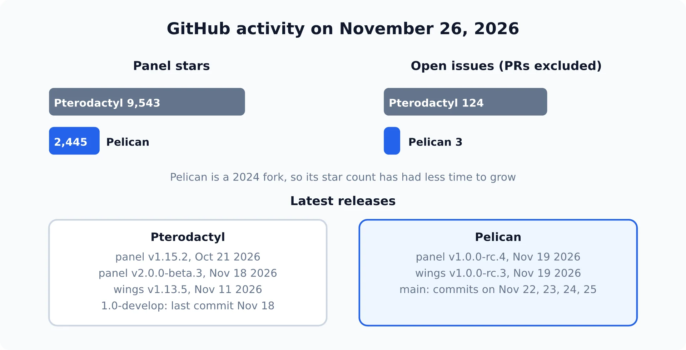
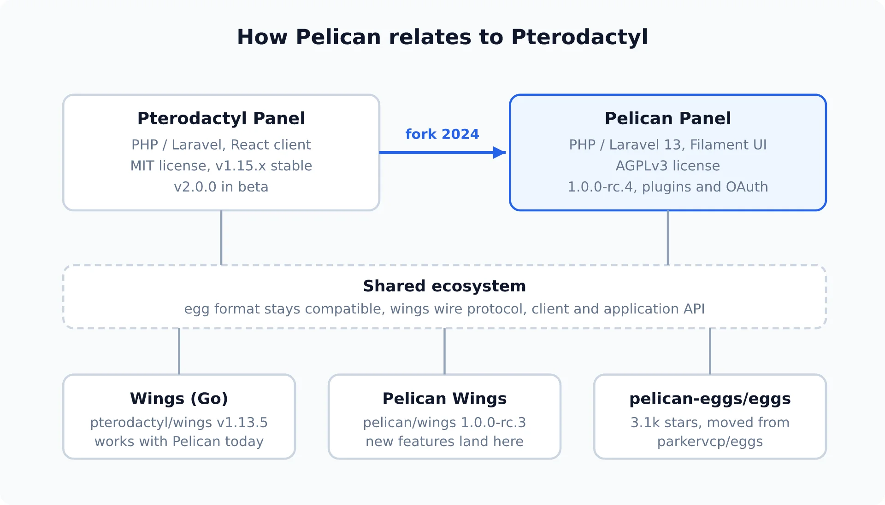
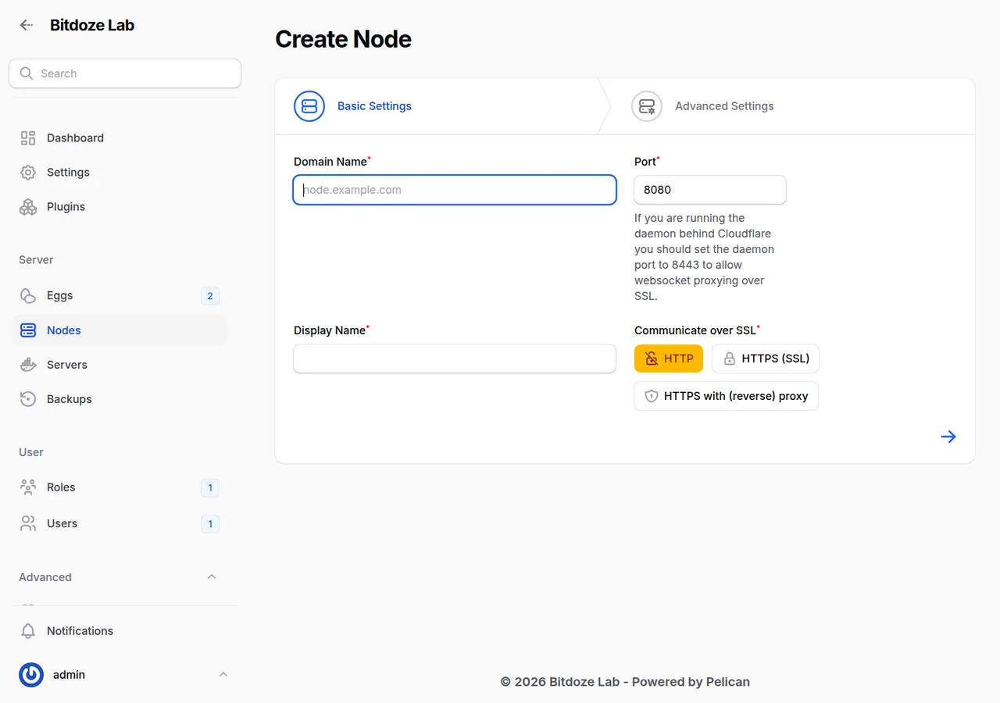
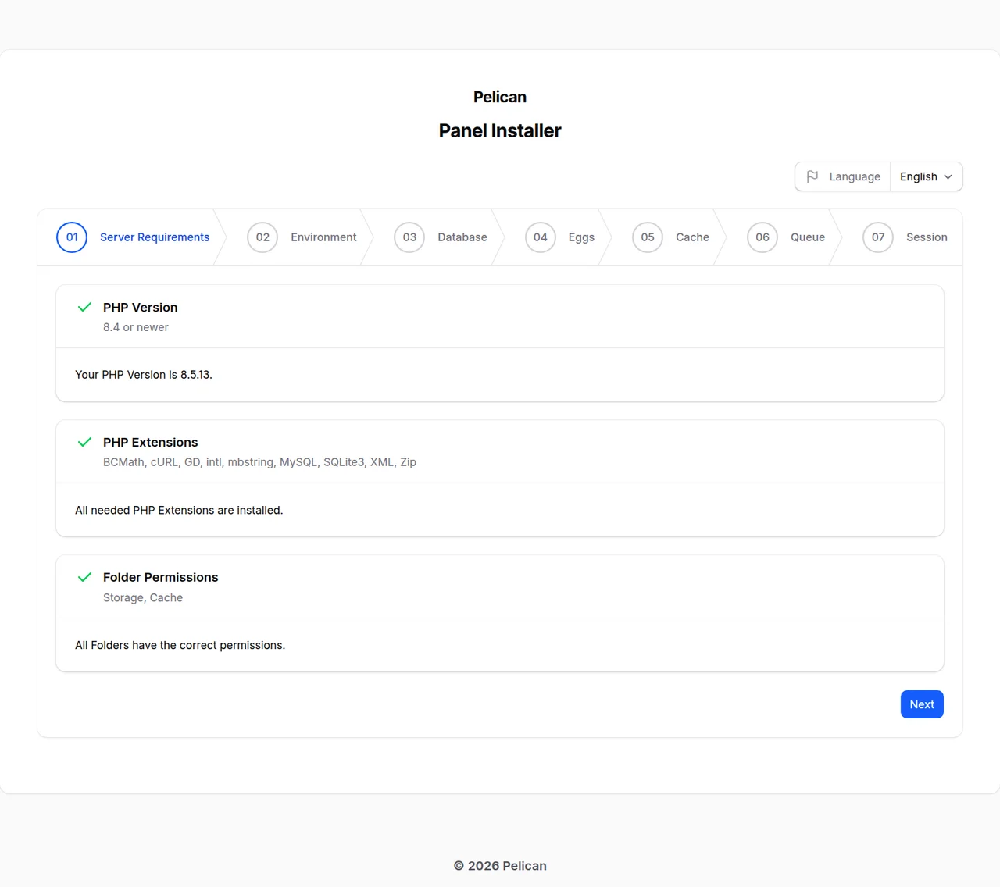
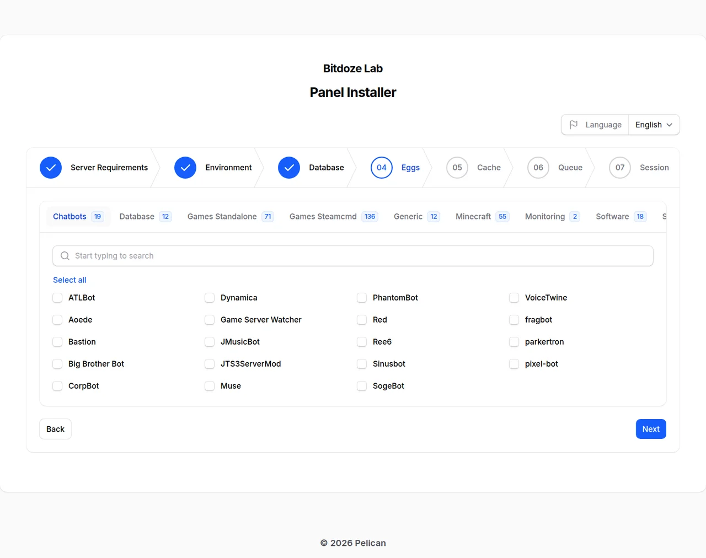
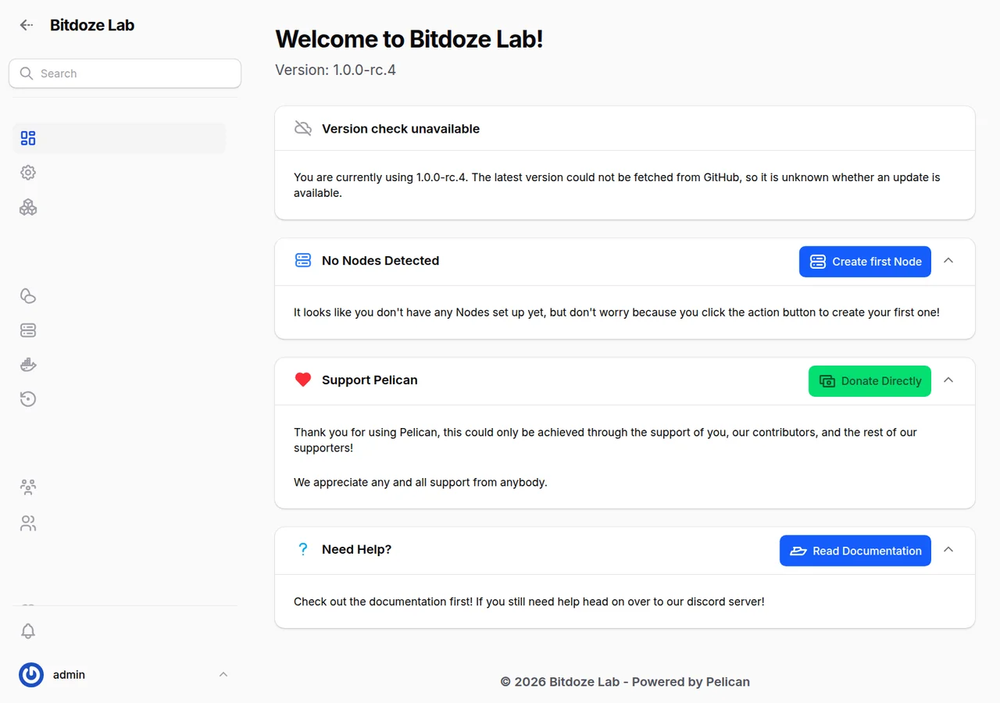

import Accordion from "@components/widgets/Accordion.astro";
import Notice from "@components/widgets/Notice.astro";
import ListCheck from "@components/widgets/ListCheck.astro";

**Pick [Pelican](https://pelican.dev/faq) for a new install in 2026.** Active development and community eggs have shifted to the fork, while existing Pterodactyl 1.x admins face no urgent cutoff if they plan a migration window. Stay on Pterodactyl for now only if you rely on Blueprint extensions or custom panel patches.

That summary hides an unusual relationship. Pelican is not a ground-up rival; former contributors forked it from Pterodactyl in 2024. Both remain PHP and Laravel panels controlling game servers through a Go daemon called Wings, so an in-place upgrade keeps your database, servers, users, and API keys intact. They differ mainly in release cadence, licensing, and where new features land.

I run self-hosted panels on VPS instances for setups like this. Every fact below comes from live checks on November 26, 2026 across GitHub releases, official docs for both panels, and a fresh Docker Pelican deployment built for screenshots.

## Quick comparison table

| | Pterodactyl | Pelican |
| :--- | :--- | :--- |
| **Latest panel release** | [v1.15.2](https://github.com/pterodactyl/panel/releases) (Oct 21, 2026), v2.0.0-beta.3 (Nov 18, 2026) | [v1.0.0-rc.4](https://github.com/pelican/panel/releases) (Nov 19, 2026) |
| **Latest wings release** | v1.13.5 (Nov 11, 2026) | v1.0.0-rc.3 (Nov 19, 2026) |
| **Panel stars** | 9,543 | 2,445 |
| **Open issues (PRs excluded)** | 124 | 3 |
| **License** | MIT | AGPLv3 |
| **Frontend** | React on v1, rewritten in the v2 beta | Filament (Livewire) for both client and admin |
| **Laravel version** | Laravel 12, PHP 8.2 or 8.3 | Laravel 13, PHP 8.4 or newer |
| **Egg compatibility** | Native format | Pterodactyl eggs run unchanged, newer YAML format added |
| **Plugin system** | Third-party Blueprint mods | First-party plugin system plus Hub marketplace |
| **Admin roles** | No admin roles | Roles and permissions for admins |
| **Auth options** | TOTP 2FA, reCAPTCHA | Passkeys, OAuth with 11 providers, email 2FA, Turnstile |
| **Panel databases** | MySQL/MariaDB | MySQL, MariaDB, PostgreSQL, SQLite |
| **Migration path** | n/a | Official script, in-place database upgrade |
| **Docker install** | Official `ghcr.io/pterodactyl/panel` image, artisan setup | Official `ghcr.io/pelican/panel` image with web installer |
| **Activity pattern** | Occasional 1.x releases, v2 in beta | Commits on main most days, an RC every one to three weeks |

These counts come from GitHub and project docs on November 26, 2026 and will shift over time. The trajectory remains consistent, though, with Pterodactyl largely in maintenance mode beside a beta v2 rewrite while Pelican ships steadily toward 1.0.



*Same-day GitHub numbers for both panels. Open issues exclude pull requests, and Pelican is a 2024 fork, so its star count has had less time to grow.*

## What Pelican is and where it came from

Pelican forked from Pterodactyl in 2024. Its [official FAQ](https://pelican.dev/faq) explains the split bluntly as a "Difference of visions, directions, and opinions" and notes "If they could, they would. But they can't, so they shan't." The fork maintainers gave two months of advance notice and report no hostility between the two projects.

The architecture diagram below summarizes how the pieces line up. Because Pelican forked the existing codebase instead of rewriting it, the egg format, Wings wire protocol, and API shapes stayed compatible. Running game servers neither know nor care which panel manages them.


*Pelican forked the panel but kept the ecosystem: eggs, the Wings protocol and the API shapes all carry over.*

Egg maintenance shows where community momentum went. Admins historically relied on `parkervcp/eggs`, which was [archived on May 13, 2024](https://github.com/parkervcp/eggs) and split into category repositories under the `pelican-eggs` organization. Existing eggs keep working across both panels because the format is shared, though new game templates originate on Pelican.

## What Pelican changes compared to Pterodactyl

The Pelican docs maintain a full [comparison page](https://pelican.dev/docs/comparison). These are the changes that matter for an operator, grouped the way I think about them.

**Things you notice on day one:**

- The client and admin areas are rewritten in Filament. Both look and behave like a modern Laravel admin panel instead of the aging React frontend of Pterodactyl v1. Light and dark mode, user avatars, per-user timezone, customizable console font and server list layout.
- A web installer replaces the artisan command wizard. Point your browser at `/installer`, answer seven steps including egg selection, done. I walked through it for this article; it took about four minutes in the official Docker image.
- Passkeys, OAuth with 11 providers, and email-based two-factor auth next to classic TOTP. Google reCAPTCHA is replaced with Cloudflare Turnstile.

**Things that matter at scale:**

- Roles and permissions for admins. Pterodactyl has exactly one root admin tier plus subusers per server; Pelican lets you build staff roles and even assign nodes to roles.
- First-party plugin system with a marketplace (the Hub) for plugins, themes and eggs. Plugins never touch core files, so updates stop being the merge-conflict nightmare that Pterodactyl modifications are.
- Multiple backup hosts, local or S3, assigned per node. Disk quotas per server, CPU limits per node, node diagnostics with one-click log upload, node resource statistics.
- Tags replace nests and locations. Eggs and nodes get free-form tags instead of rigid single groupings.


*Creating a node in Pelican. The Wings daemon setup itself is nearly identical to Pterodactyl's.*

**Things under the hood:**

- Laravel 13 on PHP 8.4 or newer (per Pelican's [composer.json](https://github.com/pelican/panel/blob/main/composer.json)) versus Laravel 12 on PHP 8.2 or 8.3 for Pterodactyl 1.x. SQLite, PostgreSQL and a proper MariaDB driver join MySQL as panel database options.
- IPv6 allocations, multiple startup commands per egg, in-panel egg browsing and import, custom server icons, per-server webhooks, global file search, and UI install logs.
- An official Docker image (`ghcr.io/pelican/panel`) with an integrated Caddy server, which is how I ran the screenshots below in minutes.


*The web installer checks PHP, extensions and permissions before you touch anything. This is step one of seven.*


*You pick eggs during installation: Minecraft, SteamCMD games, voice servers, chat bots and more, all pulled from the community egg repo.*

## Is Pterodactyl abandoned?

No, but it is slow. Here is what the release pages show on November 26, 2026:

- [Panel v1.15.2](https://github.com/pterodactyl/panel/releases) shipped October 21, 2026, a security release for PHP CVEs. The 1.x line gets occasional maintenance releases.
- Panel v2.0.0-beta.3 shipped November 18, 2026 after two earlier October 14 betas, keeping the rewrite in beta. Its release notes mostly cover PHP and Alpine CVE patches, console resizing, and file editor fixes.
- Wings v1.13.5 shipped November 11, 2026. Wings is a small, stable Go daemon and does not need much churn.
- Active v2 work sits on `2.0-develop` (last commit November 18, 2026), while `1.0-develop` had commits on October 6, 16, 21, and November 18. Pelican's `main` branch saw commits daily from November 22 through 25.

So Pterodactyl is not dead software, and security patches still arrive. However, its pace trails Pelican, the v2 rewrite remains in beta, and community egg work moved to the fork. For new installs, picking the slower-moving branch makes little sense, though existing Pterodactyl admins face no fire.

## Is Pelican production ready?

**Yes, Pelican is ready for hobby hosts and small communities, with one caveat.** Because it remains a release candidate (v1.0.0-rc.4, [released November 19, 2026](https://github.com/pelican/panel/releases)) rather than final 1.0.0, judge it accordingly.

Four release candidates landed across October and November 2026 (`rc.1` Oct 10, `rc.2` Oct 22, `rc.3` Nov 14, `rc.4` Nov 19) after August's beta38. Its [plugin system](https://pelican.dev/faq) has shipped since beta30, migrations run routinely, and DreamHost sells managed [Pelican Panel VPS hosting](https://dreamhost.com/hosting/vps/pelican). Provider backing is an encouraging signal, though not a guarantee against bugs.

My own Docker test install for this guide was uneventful, which is ideal for a control panel. The official image came up cleanly, the web installer checked dependencies, SQLite stored everything in one database file, and the admin UI matched the docs. One evening without player load is a shallow test, yet the install workflow holds up well.


*The Pelican admin dashboard after a fresh Docker install. Clean Filament UI, version 1.0.0-rc.4.*

The hard caveats:

1. **Blueprint extensions do not work on Pelican.** The Blueprint author has said they will not port it. If your panel depends on Blueprint mods, that is a hard blocker.
2. **Pterodactyl "addons" do not work either.** Those were core-file modifications, and Pelican's codebase has diverged too much. Look for a plugin on the Hub instead.
3. The [Docker docs](https://pelican.dev/docs/panel/advanced/docker) call the Docker deployment "still a work in progress" and currently recommend the standard (bare-metal) instructions. It worked fine for me, but the team itself treats the non-Docker install as the reference.

## How do you migrate from Pterodactyl to Pelican?

Pelican upgrades a Pterodactyl database in place, carrying over users, servers, nodes, eggs, databases, backups, schedules, subusers, and API keys while game servers keep their data. Its [official migration guide](https://pelican.dev/docs/guides/migrating-from-pterodactyl) covers scripted, manual, and Docker paths thoroughly.

<Notice type="warning" title="Back up first">
The migration rewrites your database and cannot be undone. Back up the database, `/var/www/pterodactyl` and `/etc/pterodactyl` before you run anything. Test the rollback path on a copy if the panel is production for paying users.
</Notice>

Requirements from the [official migration guide](https://pelican.dev/docs/guides/migrating-from-pterodactyl): Pterodactyl 1.11.4 or newer (update Pterodactyl first if needed) and PHP 8.4 or newer with PHP-FPM. The migration in outline:

**1. Run the panel migration script in check mode first:**

```sh
curl -fsSLo migrate-panel.sh https://pelican.dev/migrate-panel.sh
sudo bash migrate-panel.sh --check
```

The check changes nothing and tells you exactly what to fix, like an old PHP version or a missing extension. Once it passes:

```sh
sudo bash migrate-panel.sh
```

The script installs Pelican into `/var/www/pelican`, copies your `.env`, upgrades the database, and sets up the queue worker and cron job. Your old install stays untouched in `/var/www/pterodactyl`, which is your instant rollback path. Finally you point the webserver at `/var/www/pelican/public` and disable the Pterodactyl vhost.

**2. Migrate wings on every node:**

```sh
curl -fsSLo migrate-wings.sh https://pelican.dev/migrate-wings.sh
sudo bash migrate-wings.sh
```

This swaps in Pelican Wings while keeping your existing `config.yml` (copied from `/etc/pterodactyl` to `/etc/pelican`) and all server files. Game servers keep running through the swap.

**3. Understand what changes after migration:**

- Nests and locations convert to tags, assigning old nest names to eggs and old locations to nodes.
- API keys keep working, including old `ptla_` and `ptlc_` keys. The nests and locations API endpoints are gone, so any integration that manages nests or locations needs updating.
- Root admins become the Root Admin role.
- Themes and panel modifications do not carry over. Look for a plugin on the Hub.
- Set `DB_CONNECTION=mysql` (or `mariadb`) in your copied `.env` before migrating. Pterodactyl left that key unset, whereas Pelican defaults to an empty SQLite database if you omit it.

If you prefer manual control, the docs walk through every step. Enable maintenance mode with `artisan down`, dump MySQL, copy `.env`, run `php artisan migrate --seed --force`, fix file permissions, and update web server, queue worker, and cron configs before swapping Wings under systemd. Budget one evening per single hobby node.

## When should you stay on Pterodactyl?

Pelican is the right default, but there are real cases where staying put is correct:

<ListCheck>
<ul>
<li>**You depend on Blueprint extensions or core-file modifications.** They will not work on Pelican; audit each mod and check the Hub first.</li>
<li>**Your billing or provisioning integration uses the nests or locations endpoints.** Those endpoints are gone in Pelican. Integrations that only use the server and user API keep working.</li>
<li>**You want zero churn.** Pterodactyl 1.15.x is known, boring software, and migration risk is a real cost for a commercial panel. Pelican is still on release candidates as of November 26, 2026.</li>
<li>**AGPLv3 is a problem for you.** Pelican relicensed from MIT to AGPLv3. A host running a closed, modified, public panel needs a [commercial license](https://pelican.dev/faq); unmodified use, private use, plugins and themes are unaffected.</li>
</ul>
</ListCheck>

If none of those apply and you are on Pterodactyl today, schedule the migration. The longer you wait, the further the ecosystem drifts.

## Do I even need these panels, or is something simpler better?

If you host servers for communities, friends, or subusers needing console access, file management, and schedules, yes, a full panel is worth running. If you only host one or two servers for yourself, a PHP/Laravel stack, database, and daemon add needless weight. Plain containers like `itzg/minecraft-server` use less RAM and back up faster, as covered in my [Docker containers for home servers](/docker-containers-home-server/) guide. For a lighter Minecraft-only panel that stays inside Docker, see my [Crafty Controller install guide](/crafty-controller-docker-install/).

If you still want a full panel on a fresh box, my [Pterodactyl install guide](/pterodactyl-docker-install/) walks through the original stack, and the migration steps above move you to Pelican. Either way, keep Wings ports off the public internet behind a mesh VPN (see my [NetBird self-hosted setup](/netbird-self-hosted-setup/)). For homelab hardware, see my [best mini PCs for a home server](/best-mini-pc-home-server/) picks, keeping in mind that Minecraft instances eat far more RAM than the panel itself.

## Where this leaves you

For a fresh install, deploy Pelican with the web installer on a dedicated VPS or separate control host. On unmodded Pterodactyl, schedule a migration window, run check mode first, back up, and upgrade in place. If you rely on Blueprint or heavy panel edits, stay put until Pelican Hub plugins match them; Wings and egg compatibility mean game servers migrate cleanly either way.

## FAQ

<Accordion label="Can Pelican use Pterodactyl eggs?" group="faq">
Yes. The [Pelican FAQ](https://pelican.dev/faq) says the original eggs will always work. The old community repo `parkervcp/eggs` was [archived in May 2024](https://github.com/parkervcp/eggs) and split into per-category repositories under the `pelican-eggs` organization, so new egg development happens on the Pelican side. Pelican adds a YAML egg format and multiple startup commands per egg on top.
</Accordion>

<Accordion label="Does original Pterodactyl wings work with a Pelican panel?" group="faq">
Yes, Pelican's FAQ confirms compatibility with the latest original Wings release. New features ship in Pelican's own `pelican/wings` fork (currently v1.0.0-rc.3), so upgrade nodes with the official script when ready without rushing.
</Accordion>

<Accordion label="Will my API keys and integrations survive migration?" group="faq">
Yes, including old `ptla_` and `ptlc_` key formats, because the application and client APIs stay backwards compatible. The exceptions are the nests and locations endpoints, which are gone since Pelican replaces both concepts with tags. WHMCS-style billing integrations that only manage servers and users keep working.
</Accordion>

<Accordion label="Do Blueprint extensions or Pterodactyl addons work on Pelican?" group="faq">
No on both counts. Blueprint's author said they will not port it (quoted in the [Pelican FAQ](https://pelican.dev/faq)), and classic Pterodactyl addons are core-file modifications that cannot apply to Pelican's diverged codebase. Pelican has its own plugin system, released with beta30, plus the [Hub marketplace](https://hub.pelican.dev) where plugins never touch core files.
</Accordion>

<Accordion label="Is Pelican stable enough for production game hosting?" group="faq">
The panel is at v1.0.0-rc.4 as of November 26, 2026, a release candidate rather than a final 1.0.0 tag. Four RCs shipped between October 10 and November 19, one to three weeks apart, and [DreamHost sells Pelican VPS hosting](https://dreamhost.com/hosting/vps/pelican). For hobby and small commercial use it is fine; conservative operators can wait for the 1.0.0 stable tag.
</Accordion>

<Accordion label="How long does the migration from Pterodactyl take?" group="faq">
The panel script finishes in minutes by installing to `/var/www/pelican`, copying `.env`, and running database migrations. Add the per-node Wings script plus DNS updates, and one hobby node finishes in an evening. Just back up the database first and set `DB_CONNECTION=mysql` in `.env` so Pelican avoids falling back to SQLite.
</Accordion>

<Accordion label="Does the AGPLv3 license affect me?" group="faq">
Only if you modify the panel source code, keep those modifications closed and make the modified panel publicly available. The [Pelican FAQ](https://pelican.dev/faq) lists all three conditions and says private panels, plugins and themes do not need a commercial license. Pterodactyl is MIT, so a commercial host maintaining a heavily customized fork should read that FAQ section before migrating.
</Accordion>

<Accordion label="Can I install Pelican with Docker?" group="faq">
Yes. The official `ghcr.io/pelican/panel` image in the [Docker docs](https://pelican.dev/docs/panel/advanced/docker) bundles Caddy and defaults to SQLite with the installer at `/installer`. While that page notes Docker deployment is still stabilizing and favors bare-metal installs, the getting-started guide lists both as supported, and my Docker test install worked end to end.
</Accordion>

