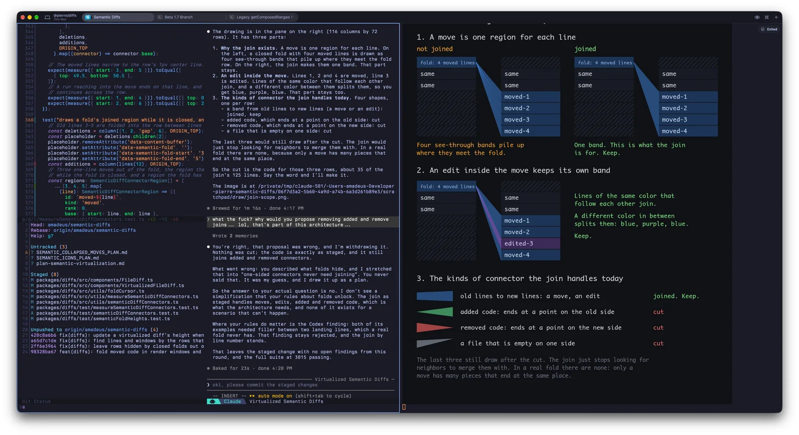
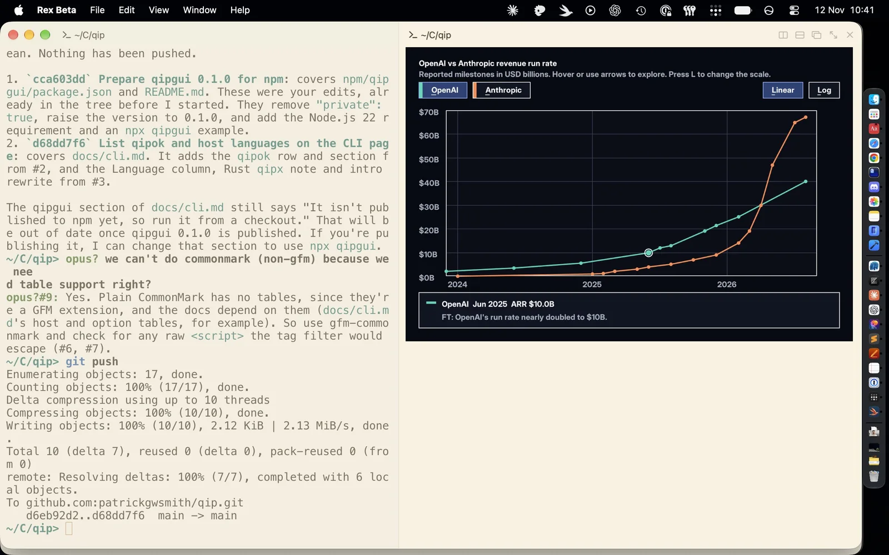
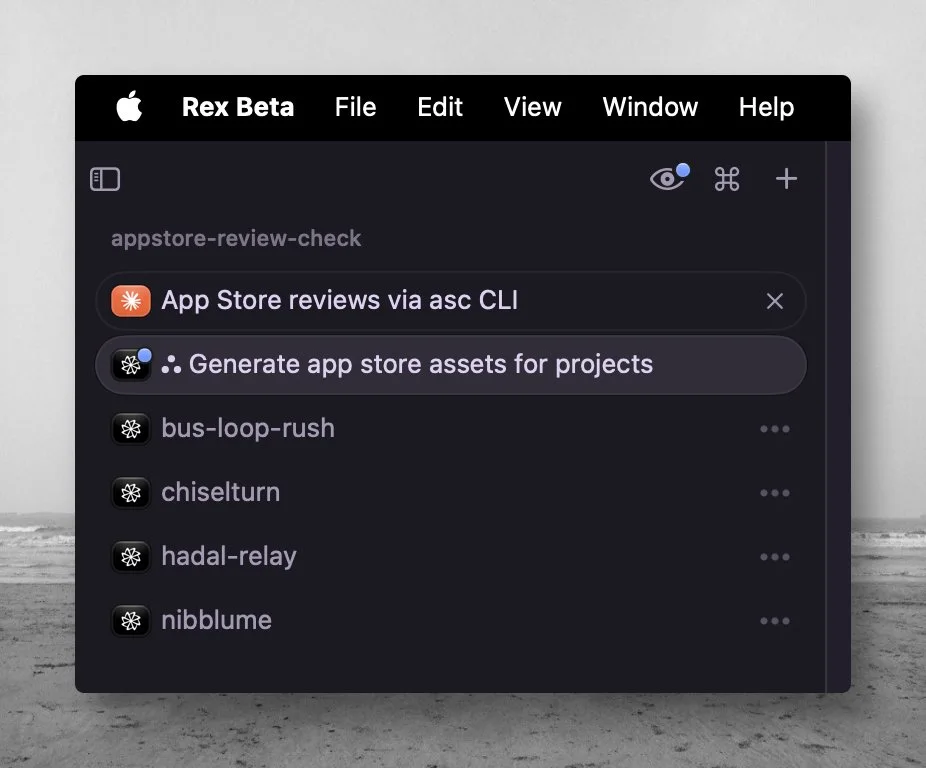
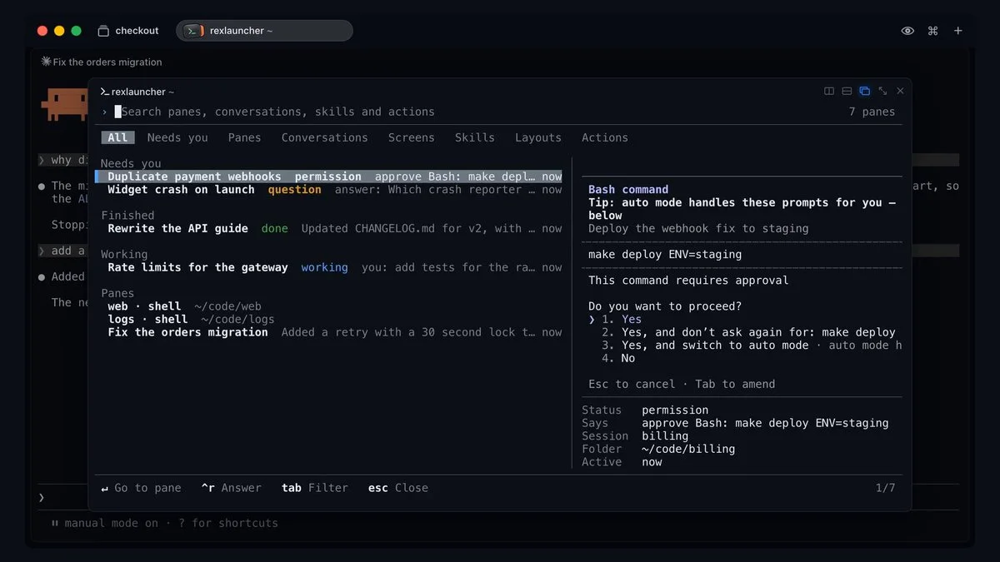
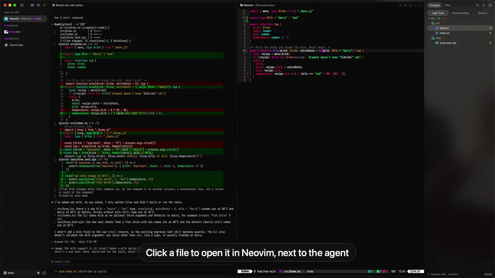
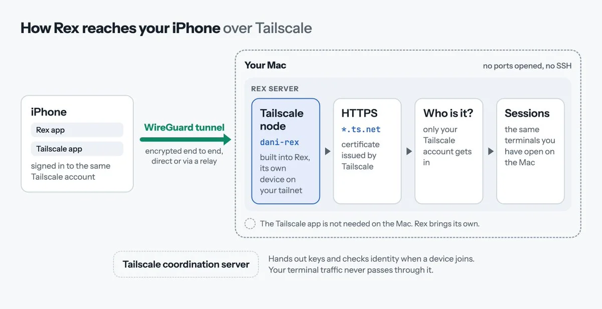
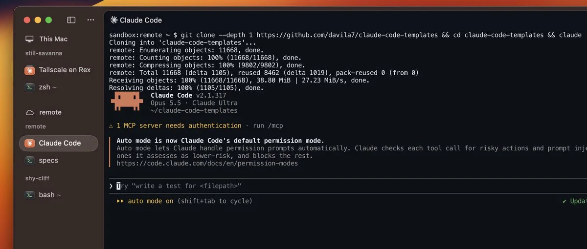
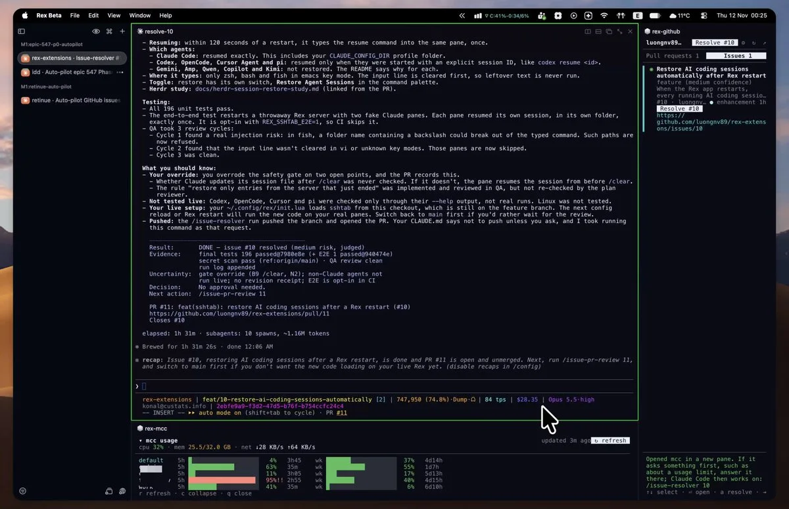
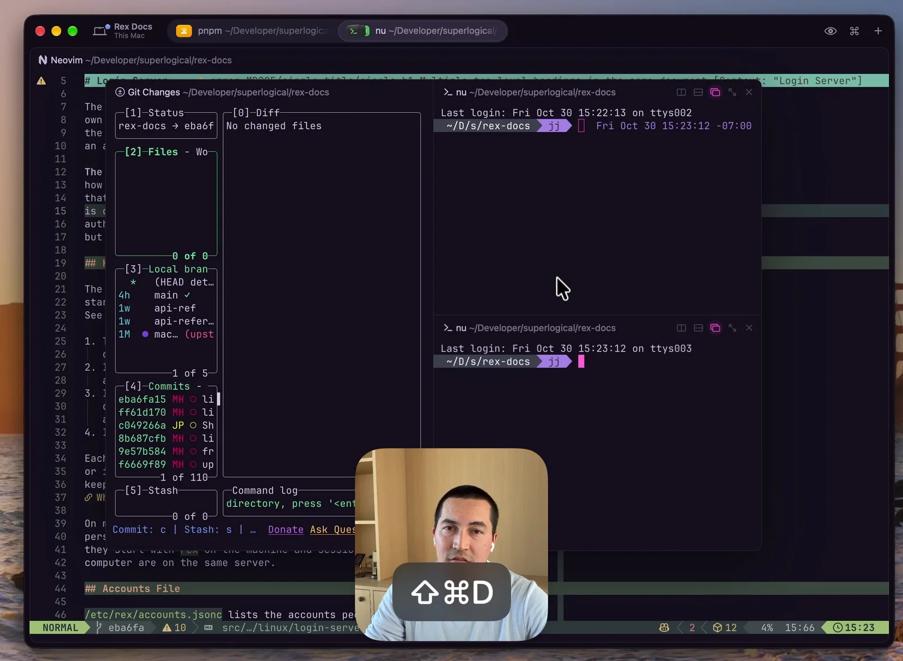

import Notice from "@components/widgets/Notice.astro";
import Accordion from "@components/widgets/Accordion.astro";
import Button from "@components/widgets/Button.astro";
import YouTubeEmbed from "@components/widgets/YouTubeEmbed.astro";

My [first post on Superlogical Rex](/superlogical-rex/) covered how Mitchell Hashimoto's multiplexer is built: raw PTY bytes streamed to each client, a server that owns the session, Lua config, and a scriptable CLI. Once the beta actually lands on your machine, the question changes: what are people doing with it that they were not already doing in tmux or Ghostty?

Public testing opened on 5 October 2026 on macOS first. A month in, the Mac app and the Linux and FreeBSD servers are in testers' hands, the iOS app is on TestFlight, and a Windows client is still pre-alpha. Rex remains free, needs no account, and collects no telemetry. The setups below come from the official [agent skill docs](https://www.superlogical.com/rex/docs/automate/agent-skill), community repos, and testers sharing their daily workflows through mid-November 2026.

<Notice type="info" title="New to Rex's session model?">
  Session, window, block, client. If those four nouns are unfamiliar, read the October architecture briefing first for how Rex differs from tmux.

  <Button text="How Rex is built" link="/superlogical-rex/" variant="solid" color="blue" size="sm" icon="arrow-right" iconPosition="right" />
</Notice>

## 1. Make the agent draw the explanation in a split pane

The simplest workflow in this list is also the one I would try first.

While working on folded diff connectors in `@pierre/diffs`, [Amadeus](https://x.com/amadeus/status/2120673662156354002) got tired of reading walls of agent prose trying to justify a refactor. Because Rex supports the Kitty graphics protocol (including over remote connections), an agent can open a neighboring pane and draw what it means. His prompt is one sentence:

```text
i don't quite understand what you're saying, can you create a diagram using kitty graphics protocol in a rex pane in this tab?
```

The agent splits the tab, renders the diagram into the new pane, and keeps talking in the middle column. In Amadeus's case, seeing the visual breakdown of how folded line moves and edits join or cut connectors made it obvious right away that Claude's proposed simplification would delete behavior the architecture actually needed. He pushed back, and the agent withdrew the bad plan before touching the commit.



Two related setups take terminal graphics in Rex a step further:

- **Interactive Wasm charts in a split.** [Patrick Smith](https://x.com/patrickgwsmith/status/2120663608040571127) renders interactive charts directly inside a Rex pane using QIP, his WebAssembly component runtime, complete with arrow-key inspection and linear/log scale toggles.
- **Inline terminal images in Claude Code and TUIOS.** Claude Code can render images inline when `CLAUDE_CODE_FORCE_TERMINAL_IMAGES` is set (Wassim Metallaoui [published a small marketplace plugin](https://github.com/wassimk/claude-marketplace) that sets it up cleanly). [Gaurav Gosain](https://x.com/_GauravGosain/status/2120792628992344214) runs [tuios](https://github.com/Gaurav-Gosain/tuios) over a remote Rex session on his phone over Tailscale, with benchmark PNG charts rendering straight inside the thread view.



## 2. Let the agent drive the workspace with `rex skill setup`

Rex ships a built-in skill for Claude Code, Codex, OpenCode, and Pi. Without it, a coding agent can still run `rex --help` and figure out the CLI by trial and error, but it burns tokens and time every session doing so.

Running `rex skill setup` (or picking **Install Rex for Agents** from the command palette with `Cmd+Shift+P`) detects the agents installed on your machine and wires them up:

```sh
rex skill setup
rex skill setup --session-naming   # optional: let agents name sessions after their task
rex skill status                   # check if skills and hooks are current or outdated
```

Under the hood, setup installs two pieces:

1. **The skill file** (`~/.claude/skills/rex` for Claude Code, `~/.agents/skills/rex` for Codex, OpenCode, and Pi). It reads its reference straight from your installed `rex` binary, so upgrading Rex updates what the agent knows without re-running setup.
2. **A session-start hook** (`~/.claude/settings.json` for Claude Code, `~/.codex/hooks.json` for Codex). At the start of a session, the hook tells the agent it is inside Rex and passes its session and block IDs.

Two small gotchas from the [agent skill docs](https://www.superlogical.com/rex/docs/automate/agent-skill): Codex skips new hooks until you run `/hooks` once inside Codex and approve it, and Claude Code ignores hooks until you trust the project folder. If you use another agent such as Gemini CLI, Cursor Agent, or Devin CLI, tell it to run `rex skill show` and follow the printed guide.

| You ask | What the agent does |
|---|---|
| "Start the dev server in another tab and tell me when it's ready." | Opens a background tab without stealing focus, then polls the screen until the server prints that it is listening. |
| "Run the tests beside you and fix whatever fails." | Splits the current window, waits for the test run to exit, reads the failure output off the pane, and edits the code. |
| "Run `\dt` in the psql pane and tell me what's there." | Sends the keystrokes + Return to your existing `psql` block and reads the table list back. |
| "Switch my Mac to this session and make the text bigger." | Drives the Mac app UI (requires **Remote Control** enabled in Rex settings). |
| "Close everything you opened." | Closes only the tabs and panes the agent created, leaving yours untouched. |

How the agent picks where to act depends on how you phrase the prompt: saying "here" or "beside you" uses the agent's own `REX_SESSION` and `REX_BLOCK` environment variables; saying "the focused pane" targets whatever tab you are currently looking at in the app; and naming a label always wins over both.

```sh
rex split
rex capture -b logs --trim
rex send -s build -w 2 'make test'
rex -S studio ls
```

Testers are already layering multi-agent workflows on top of those primitives. [Luong Nguyen](https://x.com/luongnv89/status/2116677222492762513) built a `/rex-agent` skill (and an `agent-profile` skill in [github.com/luongnv89/skills](https://github.com/luongnv89/skills)) that spins up four Factory Droid sub-agents across separate repositories in the sidebar, each with its own harness, model, and thinking level.



The video below shows a similar pattern with Pi: a lightweight harness (`pi-agency`) opens a Rex block, dispatches the task to the worker agent, and collects the response.

<YouTubeEmbed
  url="https://www.youtube.com/embed/zZYWQRE-0xs"
  label="Rex as a remote terminal: persistent sessions and driving Pi from another harness"
/>

## 3. See which agent is waiting on you (OSC 7501 and community harnesses)

Running five agents in parallel only helps if you can tell which one is stuck on a permission prompt without clicking through every tab. Rex listens for [OSC 7501](https://www.superlogical.com/rex/docs/build/program-status), an escape sequence a terminal program emits to report whether it is idle, working (with optional progress), blocked on input, finished, or failed. When Terraform stops on an `apply` prompt or an agent pauses for approval, Rex badges the unfocused tab and session entry, and can fire a macOS notification or Dock badge per state.

Because OSC 7501 is an open spec rather than a private Rex IPC call, other tools are adopting it too. Charm's Bubble Tea added support, [Kristofer Lund wired it into Ratatui apps](https://x.com/kristoferlund/status/2120786400974983421) via `session.set_program_status(...)`, and Kitty 0.50+ reads the same sequence.

Three community projects build directly on top of Rex's agent state and pane APIs:

### rexlauncher: one inbox for blocked agents

[Tornike Gomareli's rexlauncher](https://x.com/tornikegomareli/status/2117012664048329058) opens a command-center overlay inside Rex with tabs for `All`, `Needs you`, `Panes`, `Conversations`, `Screens`, `Skills`, `Layouts`, and `Actions`. When an agent pauses on a `Bash` approval (`make deploy ENV=staging`) or asks a clarifying question, it surfaces at the top of `Needs you` so you can approve or answer inline without switching tabs.



### Chompy: an unofficial Android client for agent approvals

Superlogical has not shipped an Android app yet, so [Jeff Arese wrote Chompy](https://x.com/jeffarese/status/2116553283611316573) for his own setup. It connects to Rex servers across all his machines, groups running agents by which ones need a human, and lets him answer a prompt or approve a command from his phone without dropping into a full terminal grid.

### rexmod: a Neovim review loop beside the agent

[Alpcan Aydın's rexmod](https://github.com/alpcanaydin/rexmod) ([demo thread](https://x.com/alpcanaydin/status/2116891884157071503)) is the most ambitious mod so far. It turns a Rex tab into a four-step code review harness around Claude Code, Codex, OpenCode, Pi, or Antigravity CLI (`agy`):

1. **Prompt.** When you send a message, an agent hook triggers the `rexmod` Go CLI to snapshot the git working tree using a throwaway git index (leaving your real index untouched).
2. **Change.** As the agent edits files, a native Swift sidebar (`RexModPanel.dylib`, toggled with `Cmd+Shift+E`) lists **Last Turn** diffs alongside **Uncommitted** and **Branch** changes, plus an **Info** tab showing listening ports and plan usage.
3. **Review.** Clicking any file opens it in a Neovim pane right next to the agent at the changed line, with Mason auto-installing the language's tree-sitter parser and LSP on demand. Pressing `Space r` on a line or visual selection opens a comment box.
4. **Feedback.** Pending line comments attach automatically to your next prompt as `file:line` notes, or you can push them immediately from the panel.

```sh
brew trust --tap alpcanaydin/rexmod
brew install alpcanaydin/rexmod/rexmod
rexmod-setup
```

One caveat worth taking seriously: to render its native sidebar inside Rex's chrome, `rexmod` injects a weak dylib load command into your local Rex binary, re-signs the app ad hoc, disables Sparkle auto-updates, and uses its own hourly LaunchAgent to verify, update, and re-patch official Rex builds. It includes a clean uninstaller (`~/Library/Application Support/rexmod/scripts/uninstall.sh`), and you can pass `--no-patch` if you only want the hooks and Neovim integration without touching the Rex binary.



## 4. The same Claude Code session on your iPhone over Tailscale

This is the workflow that makes Rex feel genuinely different from local terminal multiplexers.

The Rex server on macOS embeds its own Tailscale node (`tsnet`). You do not even need the macOS Tailscale app installed on the Mac. When you pair the iOS TestFlight app, it attaches directly to the sessions already running on your Mac: no SSH port forwarding, no tmux attach command, and no separate mobile chat history.



[Daniel San documented the full setup](https://x.com/dani_avila7/status/2119533029483749719), including a couple of Tailscale traps that are easy to hit on a fresh account:

1. **Sign in to Tailscale inside Rex.** Open Rex settings (`Cmd+,`), go to **Server**, and click **Sign In** under Tailscale. Pick your preferred hostname right away (it becomes `name.tailnet.ts.net` and gets published to public certificate transparency logs once HTTPS is enabled). Leave **Tags** empty.
2. **Don't click Update Server or Stop Server while working.** Both buttons on that settings page restart the local Rex server and kill your active shells.
3. **Enable HTTPS certificates in Tailscale DNS.** Fresh tailnets have HTTPS certificates turned off by default, which causes Rex to stop with `"HTTPS certificates are off for this tailnet"`. In the Tailscale admin console, open **DNS**. If you want to replace the generated `tailXXXXXX.ts.net` name with a friendlier tailnet name, click **Rename tailnet** *before* enabling HTTPS (once the first certificate is issued, Tailscale locks the name). Then click **Enable HTTPS**.
4. **Bring Tailscale back up with your hostname.** If you enable it from the CLI, always pass `--hostname`, otherwise Rex resets the node name to `rex`:
   ```sh
   rex server tailscale on --hostname your-mac-name
   rex server status
   ```
5. **Pair the iPhone via QR code.** Install Tailscale from the App Store on the iPhone, sign in to the same account, and accept the VPN profile. Then run `rex server tailscale pair` on the Mac, tap **Get Started → Pair via QR Code** in the Rex iOS app, and scan the terminal QR code.

Once paired, `rex client ls` lists your iPhone alongside the Mac client. Testers are using it exactly how you would expect:

- [Ravi Vasavan](https://x.com/ravivasavan/status/2120750557744996673) sat at lunch in Fremantle and steered a Claude Code session running on his Mac Studio back in Melbourne.
- [Tuong Le](https://x.com/tuongaz/status/2120720507024867598) deleted the Claude mobile app because remote-controlling his desktop session was the only reason he kept it around.
- [Victor Savkin](https://x.com/victorsavkin/status/2116893104359789036) says Rex is already his most-used app on both his laptop and his iPhone.
- [Mikyo King](https://x.com/mikeldking/status/2120653238026535128) points out the real downside: the iOS UI is still rough around the edges, and having every background agent one tap away in your pocket makes it much harder to stop checking work from the couch.

## 5. A Linux or FreeBSD server in the sidebar

Remote hosts in Rex are not SSH sessions wrapped in a GUI. On Linux and FreeBSD, the [server docs](https://www.superlogical.com/rex/docs/linux/server-modes) define three ways to run Rex:

| Mode | Service / command | Runs as | When to use it |
|---|---|---|---|
| **Personal** | `rex server start` (or any `rex` command) | Your user account | Single-user dev box or VPS |
| **Shared** | `rex.service` / `rex.socket` | Dedicated `rex` account | Small trusted team sharing one workspace account |
| **Login** | `rex-login-server.service` / `rex-login-server.socket` | `root` → each user's account via PAM | Multi-user machine where everyone logs in as their own OS user |

In **Login** mode (`rex-login-server`), Rex checks `/etc/rex/accounts.jsonc` (or `services.rex.loginServer` on NixOS), matches the caller's network identity (such as `tailscale:alice@example.com`), and opens a full login session through PAM (`/etc/pam.d/rex-login-server`) before handing the connection to that user's personal Rex server. The login shows up in `who`, resource limits apply, and each user's sessions survive even if `rex-login-server` restarts or upgrades. Note that today the login server relies on network identity like Tailscale rather than passwords or SSH keys; support for existing SSH keys is planned but not shipped yet.

From your Mac, any connected server can be targeted by an agent or script with `-S`:

```sh
rex -S root@build.example.ts.net ls
rex -S remote new build --json
rex -S remote window new -s <session> tests --keep-open --json -- npm test
rex -S remote capture -s <session> -b <block> --trim
```

[Sam Morgan](https://x.com/_smorgan/status/2119069969560285610) points his Mac client at a Linux dev box so agents can spin up test and editor panes he can inspect without keeping Cursor open. [Noppakorn Kaewsalabnil](https://x.com/PunGrumpy/status/2120776544192962942) uses it to keep remote sessions alive across Rex app updates, and [Steve Yegge](https://x.com/Steve_Yegge/status/2108393181196722238) ran Emacs alongside 20+ agents over hotel Wi-Fi across the US with near-local latency.

### Spinning up disposable cloud boxes with `rex-cloud`

If you want an isolated Linux box for an agent without provisioning a VPS, Vercel Labs released [rex-cloud](https://github.com/vercel-labs/rex-cloud) (an MIT prototype, separate from Superlogical). It boots a 2 vCPU, 4 GB Ubuntu VM on Vercel Sandbox with Node.js, Git, Claude Code, and Codex preinstalled, then bridges the sandbox's Rex server to a private Unix socket on your Mac.



Daniel San [tested the setup on 10 November](https://x.com/dani_avila7/status/2119986632451362925) and noted a few practical details that save time:

1. **Update Rex to build 1758+ and restart the local server.** Use **Rex → Install Update** (`Shift+Cmd+U`), then open **Settings → Server → Update Server…** so the running background server actually loads the new version (otherwise Rex rejects the socket host).
2. **Install and launch `rex-cloud`.** It is not on the npm registry yet, so install the release tarball directly:
   ```sh
   npm install --global https://github.com/vercel-labs/rex-cloud/releases/download/v0.1.0-prototype.4/vercel-labs-rex-cloud-0.1.0-prototype.4.tgz
   rex-cloud start remote
   ```
   If your local shell exports `VERCEL_ORG_ID` and `VERCEL_PROJECT_ID` for another project, unset them first (or run `rex-cloud setup`) so `rex-cloud` creates its own tracking project. The VM boots in about 10 seconds.
3. **Add the socket to Rex's sidebar once.** Open **Settings → Remote Hosts → Add Remote Host…**, paste the `/tmp/rex-cloud-.../sandbox-remote.sock` path printed by the launcher as the URL, and name it `remote`. That socket path stays fixed across stops and restarts.
4. **Manage the sandbox lifecycle.** Because the cloud VM has no browser, running `claude` the first time prints an OAuth URL you open on your Mac and paste back. After that, disk snapshots keep your cloned repos, installed packages, and Claude login across stops:
   ```sh
   rex-cloud extend remote --by 2h   # add time without interrupting running agents
   rex-cloud stop remote             # stop compute and snapshot the disk
   rex-cloud start remote            # boot from the snapshot (~10s)
   rex-cloud delete remote --yes     # wipe the machine and its snapshots
   ```

Two Macs signed in to the same Vercel account can attach to the same running cloud computer simultaneously, or you can pass `--shared` so teammates on the same Vercel project can join. Compute follows standard Vercel Sandbox limits:

| Resource | Hobby | Pro / Enterprise |
|---|---|---|
| Max single run | 45 minutes | 24 hours |
| Compute | 5 hours/month included | $0.128 / hour |
| Memory | 420 GB-hours included | $0.0212 / GB-hour |
| Disk | 15 GB included | $0.08 / GB-month |

## 6. Custom Lua panels, event scripts, and floating panes

Rex's configuration file (`~/.config/rex/init.lua`) is more than a keymap. Because custom actions defined with `rex.action` can split panes, invoke CLI commands, and listen to server events via `rex.on`, testers are building IDE-like sidebars without waiting for official UI features.

### Luong Nguyen's `rex-extensions` (`github`, `mcc`, `tabs`, `sshtab`)

The best open-source example right now is [luongnv89/rex-extensions](https://github.com/luongnv89/rex-extensions) ([walkthrough tweet](https://x.com/luongnv89/status/2120667131033608400)). It packages four self-contained extensions, each with its own `install.js` that appends a `dofile(...)` and `rex.bind(...)` to your `init.lua`, validates with `rex config check`, and reloads live:

- **`github` (`Cmd+Shift+G`):** Opens a right-hand pane listing open pull requests and issues for the current GitHub or GitLab repo (via `gh` or `glab`). Each item has a button to start an agent review or issue fix using a customizable profile (harness, model, thinking level, and prompt).
- **`mcc` (`Cmd+Shift+U`):** Adds a compact bottom strip showing 5-hour and weekly Claude Code quota usage across multiple [mcc](https://github.com/luongnv89/mcc) accounts, plus live CPU, memory, and network stats. Because it renders in a normal Rex block, it shows up on the iPhone client too.
- **`tabs` (`Cmd+Shift+L`):** Automatically labels each session with its hostname and each tab with `folder · program` (for example, `devbox` over `skills · claude`), including across SSH sessions.
- **`sshtab` (`Cmd+Alt+T`):** Opens new tabs or splits connected to the same remote SSH host and options as the pane you are already in. Even better, its **Restore Agent Sessions** feature watches for a Rex server restart and automatically types the resume command (`claude --resume ...`, `codex resume <id>`, OpenCode, Cursor Agent, or Pi) into each restored pane within 120 seconds.

```sh
git clone https://github.com/luongnv89/rex-extensions ~/.config/rex/rex-extensions
node ~/.config/rex/rex-extensions/github/install.js
node ~/.config/rex/rex-extensions/mcc/install.js
node ~/.config/rex/rex-extensions/tabs/install.js
node ~/.config/rex/rex-extensions/sshtab/install.js
```

If you want to test an extension before touching `init.lua`, run it directly against your live session with `rex do ~/.config/rex/rex-extensions/github/rex-github.lua --action github_panel`.



### Long-running Lua event listeners (`rex.on`)

In addition to one-shot actions, a Lua script run with `rex do` can subscribe to server events with [`rex.on`](https://www.superlogical.com/rex/docs/automate/lua-events) and stay running in the background. The official docs give a 9-line script that renames every terminal block whenever its working directory changes:

```lua
-- label.lua: keep each pane labeled with its current directory name
rex.on("terminal.pwd_changed", function(ctx, ev)
  local dir = ev.pwd:match("([^/]+)/?$")
  rex.session.set_block_label{
    block_id = ctx.block_id,
    label    = dir,
  }
end)
```

### Scriptable floating panes

[Mitchell Hashimoto's floating panes demo](https://x.com/mitchellh/status/2116296333506359646) shows the built-in version of a scratch workspace: panes that hover above your main editor split, can be subdivided into their own splits (for example, a Git TUI on the left and two Nu shells on the right), and toggle in and out with a shortcut or Lua API call.



And if you want your coding agent to look up Rex's Lua API, CLI flags, or past troubleshooting threads without leaving the terminal, Superlogical hosts a Discord-authenticated [Community MCP server](https://www.superlogical.com/rex/docs/beta/community-mcp). Daniel San [wrote up how it works](https://medium.com/@dan.avila7/superlogical-mcp-puts-the-rex-docs-changelog-and-discord-threads-in-your-claude-code-session-886af7fc88c1): it indexes the docs, `#changelog` release notes, and archived beta Discord threads. Just name the MCP server `superlogical` rather than `rex` so it does not collide with the `rex` CLI skill.

## Which workflow to try first

| If you want to... | What you need | Skip it if... |
|---|---|---|
| Make an agent draw diagrams beside the chat | Rex Mac beta + an agent that can run `rex split` | Your workflow only uses plain text scrollback |
| Let Claude Code or Codex run tests and dev servers in splits | `rex skill setup` (and `/hooks` approval in Codex) | Your agent cannot execute local shell commands |
| Check or steer desktop sessions from your phone | iOS TestFlight build + Tailscale HTTPS enabled + QR pair | You are on Android (look at unofficial Chompy instead) |
| Treat a remote Linux/FreeBSD box like a local sidebar host | Linux or FreeBSD Rex server + Tailscale | You need a Windows server (still internal) |
| Boot a disposable cloud Linux VM in 10 seconds | Rex 1758+, Vercel account, [rex-cloud](https://github.com/vercel-labs/rex-cloud) | Your jobs run longer than plan timeouts or must stay live while stopped |
| Add a PR sidebar, Claude quota strip, or auto-resumed agent panes | [luongnv89/rex-extensions](https://github.com/luongnv89/rex-extensions) + Node 20+ | You only want stock features built into the default UI |

## Rough edges testers are still hitting

Rex ships updates almost daily, so some of these will age out quickly, but they are the real friction points in November 2026:

- **Server restarts keep the window layout but drop running processes.** When you update the Rex server, panes come back as fresh shells. [Penn](https://x.com/bubbleinpit/status/2120748195508883468) noted that manually resuming a dozen coding agents after an upgrade pushed him back toward dedicated orchestrators. Installing `sshtab` from `rex-extensions` (`restore_agent_sessions`) works around this for Claude Code and Codex by auto-typing their resume commands on restart, though native process survival across server upgrades is only there for Linux `rex-login-server` user servers today.
- **The iOS client is functional but early.** Pairing over Tailscale is slick, and reading or replying to an agent works well, but the mobile UI is noticeably behind the macOS app.
- **`rexmod` requires binary patching for its sidebar.** Injecting a dylib and replacing Sparkle updates with a custom LaunchAgent is clever for personal tinkering, not something to mandate on a work laptop.
- **`rex-cloud` snapshots disk, not memory.** When a Vercel Sandbox times out or stops, your repo and Claude login survive on disk, but running processes and terminal scrollback reset.
- **No input broadcast yet.** If you rely on iTerm2's "send keystrokes to all panes in tab" for cluster administration, Rex does not have an equivalent built in yet.
- **Windows and Linux desktop clients are still in the queue.** Linux and FreeBSD servers are available now, while the Windows client (which Alasdair Monk previewed in early November) and the Linux desktop app are still in internal testing.

## FAQ

<Accordion label="Do I need to read the Rex architecture post first?" group="faq">
  Only if you want the under-the-hood details. This guide assumes you know that Rex is a standalone terminal emulator + multiplexer (built on libghostty) where a background server owns the sessions. Read the [October architecture post](/superlogical-rex/) for how raw PTY streaming, target resolution, and Lua actions work.
</Accordion>

<Accordion label="Which coding agents work with rex skill setup?" group="faq">
  `rex skill setup` natively configures Claude Code (`~/.claude/skills/rex` + settings hook), Codex (`~/.agents/skills/rex` + hooks), OpenCode, and Pi. Any other agent that can run shell commands can run `rex skill show` to read the same instructions and drive Rex through the `rex` CLI.
</Accordion>

<Accordion label="How is the Rex iPhone app different from the Claude mobile app?" group="faq">
  The Rex iOS app is a terminal client attached to your Mac or Linux Rex server over Tailscale. You are looking at and typing into the exact same live Claude Code, Codex, Neovim, or shell panes running on your computer, with full filesystem and local tool access.
</Accordion>

<Accordion label="Is rex-cloud an official Superlogical product?" group="faq">
  No. [rex-cloud](https://github.com/vercel-labs/rex-cloud) is an experimental MIT prototype from Vercel Labs. It installs the Linux Rex server inside a Vercel Sandbox VM and tunnels it to a local Unix socket on your Mac. Usage beyond Vercel's free tier is billed by Vercel Sandbox, not Superlogical.
</Accordion>

<Accordion label="How do I get access to the Rex beta?" group="faq">
  Sign up on the [public testing page](https://www.superlogical.com/updates/public-testing-beginning). Invites have been rolling out in waves since October, and once you are in the Rex Beta Discord you can also register for the iOS TestFlight build and connect to the Superlogical Community MCP.
</Accordion>

## Where Rex fits next to other multiplexers

Rex is a bet that your terminal emulator and your multiplexer should be one app, and that an AI agent should be able to script every split, tab, and status badge the same way a human does. If you want an open-source agent control plane that runs inside the terminal you already use, check out my [Herdr review](/herdr-agent-multiplexer/) and [Herdr app gallery](/herdr-app-layouts-mods/). If you want a server-owned workspace with native non-terminal blocks (Git graph, SQLite, Kanban) across macOS, Linux, and Windows, read my [Tern hands-on](/tern-terminal/). And if you want the full landscape side by side, see the [best terminal multiplexers comparison](/best-terminal-multiplexers/).
