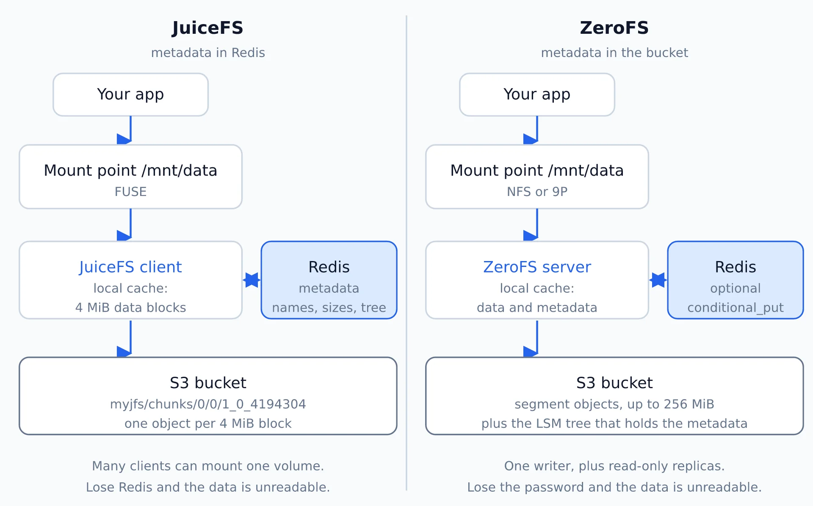
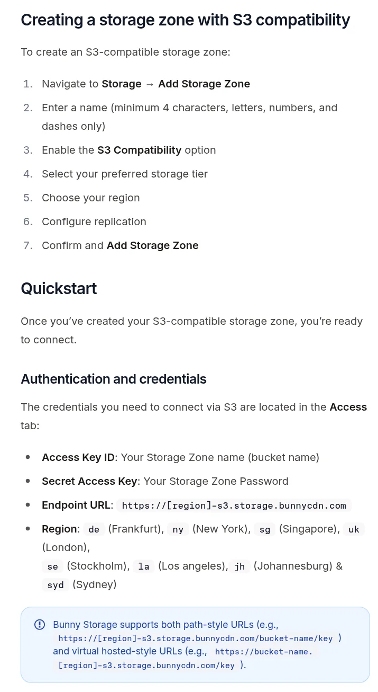
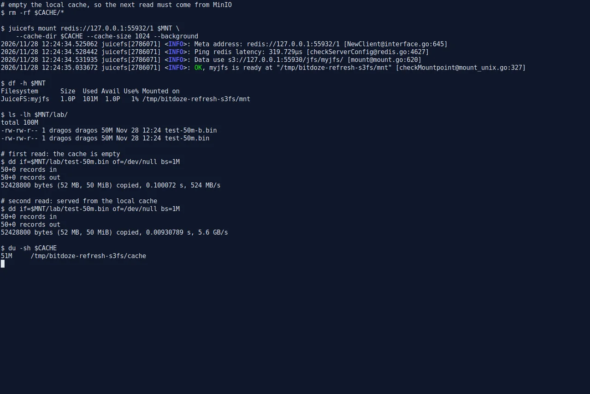
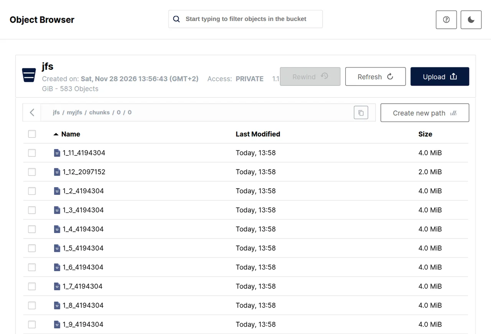
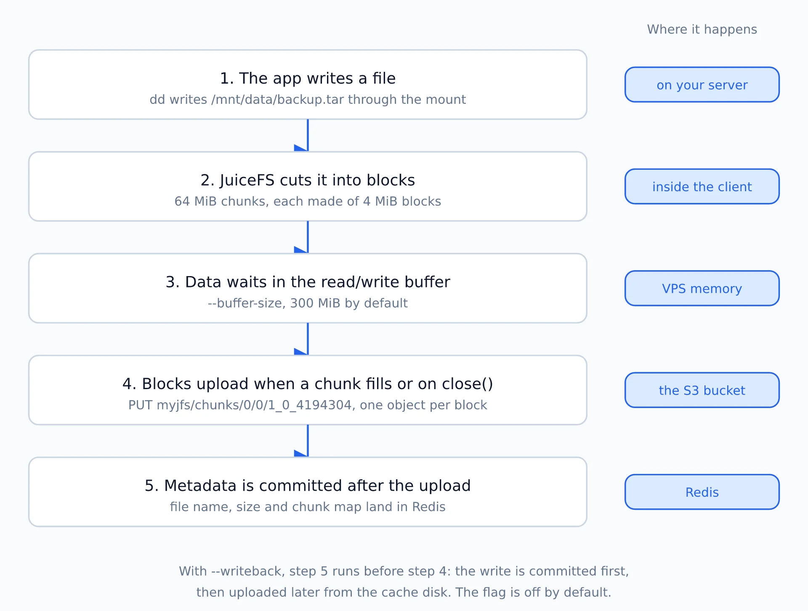
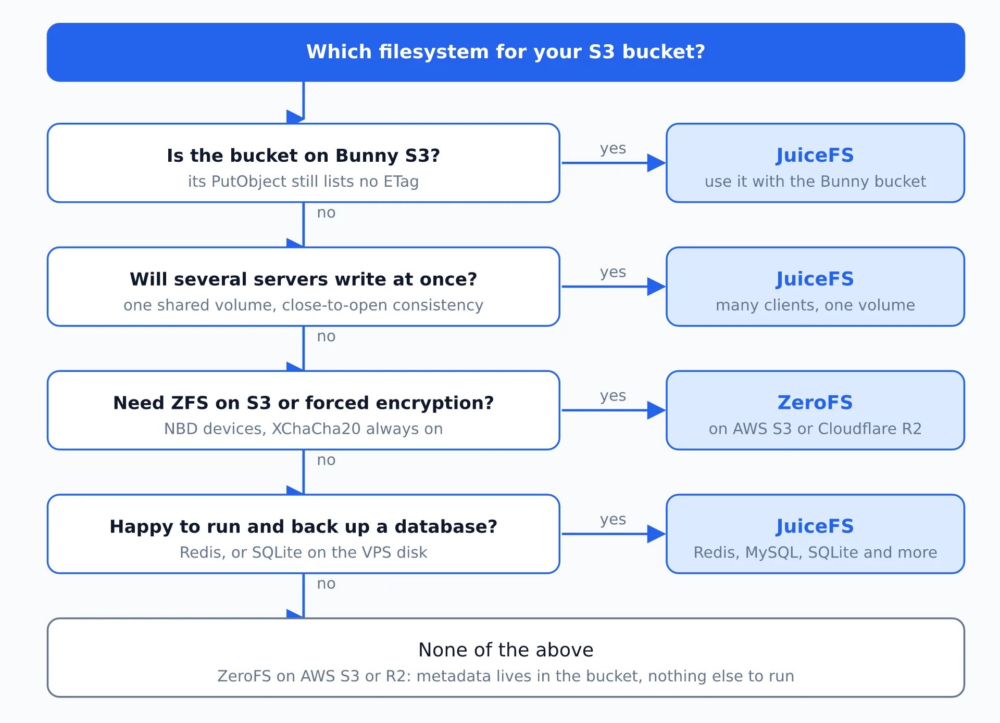

import Button from "@components/widgets/Button.astro";
import Notice from "@components/widgets/Notice.astro";
import ListCheck from "@components/widgets/ListCheck.astro";
import Accordion from "@components/widgets/Accordion.astro";
import Tabs from "@components/widgets/Tabs.astro";
import Tab from "@components/widgets/Tab.astro";
import YouTubeEmbed from "@components/widgets/YouTubeEmbed.astro";

*Disclosure: this guide contains referral links. If you buy through them, I may earn a commission at no extra cost to you.*

ZeroFS and JuiceFS both mount an S3 bucket as a POSIX filesystem on a VPS. On Bunny Storage that means JuiceFS, because Bunny's S3 API [returns no ETag on PUT](https://bunny.net/docs/storage/s3) and ZeroFS fails at startup without one.

Object storage is cheap. A VPS with a big local disk is not. So the obvious move is to keep your bulk data in an S3 bucket and only pay for the storage you use, while your server stays small and fast. The catch is that S3 speaks HTTP, not POSIX, so most apps can't write to it like a normal folder.

That gap is what filesystem layers solve. They sit between your applications and the bucket. To an application the layer looks like a regular mount point such as `/mnt/data`, and in the background it moves bytes to and from object storage. I've been running this setup on a few servers. Bunny.net adding an [S3-compatible API to their storage](https://docs.bunny.net/storage/s3) made it a lot more attractive, mostly because their storage is $0.01/GB with no egress fees through their CDN. The API has been in [public preview](https://bunny.net/docs/changelog) since July 9, 2026, and on November 28, 2026 its compatibility matrix still listed no ETag in the PutObject response.

I'll show you how to set up each tool, with a Bunny.net bucket as the example, then help you pick.

<Notice type="success" title="Try Bunny.net free for 14 days">
  You'll need an S3-compatible bucket for this guide. [Sign up at Bunny.net](https://go.bitdoze.com/bunny) with no credit card and get a 14-day trial. My [full Bunny.net review](/bunny-net-review/) covers the rest of the platform.
</Notice>


<YouTubeEmbed
  url="https://www.youtube.com/embed/P_ZoBPAFsOc"
  label="Is Your VPS Running Out of Space? Use S3 as a Drive"
/>


## Why mount an S3 bucket as a filesystem?

A mount turns the bucket into a path, so tools that cannot speak S3 can still write to cheap object storage. Pointing a filesystem at object storage gets you a few things a plain VPS disk can't:

<ListCheck>
- **Cheap, elastic capacity**: Pay per GB instead of resizing a volume every time you run low
- **Off-server durability**: Files live in object storage, off the VPS disk that can die
- **Shared storage**: Multiple servers can read from the same bucket-backed mount
- **No app changes**: Software writes to a path, not an SDK, so existing tools keep working
- **One path for many uses**: Media libraries, backups, archives and static assets all live under one mount
</ListCheck>

Every uncached block is one HTTPS request to the region. In the lab on November 28, 2026, with MinIO on the same host, `juicefs bench` measured about 20 ms per object request. A distant region adds its round-trip time on top. Both tools cache blocks on local disk, so repeated reads skip the bucket.

If backups are the reason for the mount, two restic front ends covered on this site take a local path as their repository: [Zerobyte restic GUI](/zerobyte-restic-gui/) and [Pluton backup planner](/pluton-self-hosted-backup/).

## What is the difference between ZeroFS and JuiceFS?

ZeroFS keeps file metadata inside the bucket and allows one server to write at a time. JuiceFS keeps metadata in a separate engine such as Redis or SQLite and allows many servers to write at once.



*JuiceFS keeps the metadata in a separate engine. ZeroFS keeps it in the bucket and borrows Redis only for conditional puts.*

| | **ZeroFS** | **JuiceFS** |
|---|---|---|
| Language | Rust | Go |
| Latest release | [v2.3.7](https://github.com/Barre/zerofs/releases/tag/v2.3.7), Nov 14, 2026 | [v1.4.2](https://github.com/juicedata/juicefs/releases/tag/v1.4.2), Oct 22, 2026 |
| Metadata | Stored in the bucket (LSM tree) | Separate engine (Redis, SQLite, MySQL and more) |
| Extra services | None, or Redis for `conditional_put` | A metadata engine; SQLite is just a file |
| Protocols | NFS, 9P, NBD | FUSE mount, S3 gateway |
| Several servers | One writer plus read-only replicas | Many read-write clients |
| Encryption | Always on (XChaCha20) | Optional (RSA key passed to `format`) |
| Compression | zstd or LZ4 | zstd or LZ4 |
| Block devices | Yes (NBD, runs ZFS) | No |
| Setup effort | Low (single binary) | Medium (binary + database) |
| Best for | Simple single-node mounts, block storage | Shared/multi-client, large scale |
| License | AGPL-3.0 / commercial | Apache 2.0 |

In short, **ZeroFS** is simpler because it stores everything (including metadata) in the bucket, so there's no database to run. With **JuiceFS**, many clients share one filesystem, but it needs a metadata engine like Redis alongside the object storage. SQLite counts as that engine and is one file on the VPS disk, which removes the separate service on a single server.

<Notice type="info" title="A note on metadata">
  JuiceFS keeps file metadata (names, sizes, directory structure) in a separate database, so every client sees the same file tree. That database is critical. Lose it and you lose the map to your data. ZeroFS sidesteps this by keeping metadata in the bucket itself as a log-structured merge tree.
</Notice>

## Step 1: Create a Bunny.net S3 bucket

Both tools need an S3-compatible bucket. The steps below follow Bunny's [S3 documentation](https://bunny.net/docs/storage/s3).



*Bunny's S3 documentation: the zone creation steps, the endpoint pattern and the region codes, captured on November 28, 2026.*

<Notice type="warning" title="S3 compatibility is set at creation">
  Bunny's S3 API has been in [public preview](https://bunny.net/docs/changelog) since July 9, 2026 and must be enabled when you create the storage zone. You can't toggle it on an existing zone, so create a fresh one for this.
</Notice>

1. In the Bunny dashboard, go to **Storage** → **Add Storage Zone**
2. Give it a name (4+ characters, letters, numbers, and dashes only). This name becomes your bucket name and your access key
3. Enable the **S3 Compatibility** option
4. Pick a storage tier and a region close to your VPS
5. Turn on replication for at least one extra region (recommended for durability)
6. Confirm and add the zone

Bunny bills replication per region. The Standard tier costs $0.01/GB per region for up to two regions, so this zone starts at $0.02/GB. There is a $1 monthly minimum and no API request fee ([Bunny Storage pricing](https://bunny.net/pricing/storage/), checked November 28, 2026).

Once it's created, open the **Access** tab and grab your credentials. You'll map them to standard S3 values like this:

| S3 setting | Bunny value |
|---|---|
| Access Key ID | Your storage zone name |
| Secret Access Key | Your storage zone password |
| Endpoint | `https://[region]-s3.storage.bunnycdn.com` |
| Region | `de`, `ny`, `sg`, `uk`, `se`, `la`, `jh`, or `syd` |

S3 compatibility works in Frankfurt (`de`), New York (`ny`), Singapore (`sg`), London (`uk`), Stockholm (`se`), Los Angeles (`la`), Johannesburg (`jh`) and Sydney (`syd`). Bunny accepts both **path-style URLs** (`endpoint/bucket-name/key`) and virtual-hosted-style URLs, a change announced in the [August 14, 2026 changelog](https://bunny.net/docs/changelog). The examples below use path-style, which both tools handle fine.

You can test the credentials with the AWS CLI before going further:

```sh
aws s3 ls s3://your-zone-name/ \
  --endpoint-url https://de-s3.storage.bunnycdn.com
```

If you want a deeper look at how Bunny Storage compares on price, I wrote a [Bunny Storage vs S3 vs Backblaze](/bunny-storage-vs-s3-vs-backblaze/) breakdown.

## Prerequisites

For either tool you'll want:

- A Linux VPS (Ubuntu/Debian works well here)
- Root or `sudo` access
- A local SSD for the cache (the ZeroFS template allots 10 GB, JuiceFS 100 GiB)
- The Bunny S3 credentials from above
- For the ZeroFS NFS mount: `nfs-common` on Debian/Ubuntu (`sudo apt install nfs-common`)

<Button link="https://go.bitdoze.com/hetzner" text="Hetzner VPS" />
<Button link="https://go.bitdoze.com/hostinger-vps" text="Hostinger VPS" />
<Button link="https://go.bitdoze.com/do" text="DigitalOcean $100 Free" />

_VPS prices jumped across the board in 2026. If you're rethinking a rented box, see [what changed and when a mini PC wins](/vps-price-increases/)._

If you're new to running services on a VPS, my [Docker on Ubuntu guide](/install-docker-ubuntu-arm/) and [adding a new drive with LVM](/add-new-drive-lvm/) cover the basics around storage and self-hosting.

## Option A: ZeroFS

[ZeroFS](https://github.com/Barre/zerofs) is a Rust tool that serves an S3 bucket as a POSIX filesystem over NFS and 9P, or as a raw block device over NBD. Everything runs in a single userspace process. ZeroFS compresses and encrypts every 32 KiB extent before the upload, and it keeps the metadata in the bucket, so there is no database to run.

### Install ZeroFS

The install script grabs the right prebuilt binary for your platform:

```sh
curl -sSfL https://sh.zerofs.net | sh
```

The current release is [v2.3.7](https://github.com/Barre/zerofs/releases/tag/v2.3.7) (November 14, 2026). Debian and Ubuntu users can also install the signed package from `pkgs.zerofs.net`, which ships a disabled `zerofs.service` and a config skeleton in `/etc/zerofs/` (see the [quick start in the README](https://github.com/Barre/zerofs#quick-start)).

To pin a version and install without root:

```sh
curl -sSfL https://sh.zerofs.net | VERSION=v2.3.7 INSTALL_DIR=$HOME/.local/bin sh
```

<Notice type="warning" title="Older CPUs and the prebuilt binary">
  Up to v1.2.x the release pipeline built the binaries for x86-64-v3, and they crashed with an illegal instruction on CPUs without AVX2 (before Intel Haswell or AMD Excavator). [PR #473](https://github.com/Barre/ZeroFS/pull/473) dropped that release target on June 27, 2026, and the release workflow now sets no `target-cpu`. The v2.3.7 binary still contains AVX2 code, so this is unproven on such CPUs. If it still dies with `Illegal instruction`, build from source with `cargo build --release` inside the `zerofs/` directory.
</Notice>

### Configure ZeroFS

Generate a starter config and edit it:

```sh
zerofs init   # writes zerofs.toml
```

This is the `zerofs.toml` shape for a Bunny.net bucket. Read the warning below before using it on Bunny. Note the `conditional_put` line, which I'll explain below:

```toml
[cache]
dir = "/var/cache/zerofs"
disk_size_gb = 10.0
memory_size_gb = 1.0

[storage]
url = "s3://your-zone-name/zerofs-data"
encryption_password = "${ZEROFS_PASSWORD}"

[filesystem]
compression = "zstd-3"

[servers.nfs]
addresses = ["127.0.0.1:2049"]

[aws]
access_key_id = "${AWS_ACCESS_KEY_ID}"
secret_access_key = "${AWS_SECRET_ACCESS_KEY}"
endpoint = "https://de-s3.storage.bunnycdn.com"
default_region = "de"
conditional_put = "redis://localhost:6379"
```

These are the keys `zerofs init` generates in v2.3.7. A misspelled key outside `[aws]` aborts startup with a parse error that names it. Inside `[aws]`, ZeroFS drops it silently, and the mistake resurfaces as a failed login (see the [configuration guide](https://www.zerofs.net/docs/configuration)).

<Notice type="info" title="Why the Redis line">
  ZeroFS needs conditional writes (put-if-not-exists) to fence against corruption. AWS S3 supports this natively, but some S3-compatible stores do not expose it. Setting `conditional_put` to a Redis URL lets ZeroFS coordinate those writes through Redis instead. Install Redis with `sudo apt install redis-server` and keep it on localhost. If you confirm your Bunny zone handles conditional puts, you can drop this line. The server runs this check at startup and refuses to open the filesystem in read-write mode when it fails.
</Notice>

<Notice type="warning" title="Bunny.net S3 and ZeroFS do not work together yet">
  Bunny's S3 API does not return an ETag header on PUT responses, and ZeroFS requires ETags to verify writes. ZeroFS therefore fails at startup with a `MissingEtag` error even with `conditional_put` configured. The public docs still match that picture on November 28, 2026. The [compatibility matrix](https://bunny.net/docs/storage/s3) lists no ETag in the PutObject response, and the [changelog](https://bunny.net/docs/changelog) added ETag support to HeadObject and GetObject only (August 14, 2026). Until Bunny changes this, use JuiceFS (Option B) with Bunny, or pair ZeroFS with a store that returns ETags, such as AWS S3 or Cloudflare R2. To create the R2 bucket, the API token and the endpoint, follow the [Dokploy backups with Cloudflare R2 guide](/dokploy-backups-cloudflare-r2/).
</Notice>

Bunny may change this after this guide is published. Check it yourself with the probe the ZeroFS maintainer suggests in [issue #517](https://github.com/Barre/ZeroFS/issues/517), trimmed to the PUT:

```sh
export AWS_ACCESS_KEY_ID="your-zone-name"
export AWS_SECRET_ACCESS_KEY="your-storage-password"

aws --endpoint-url https://de-s3.storage.bunnycdn.com s3api put-object \
  --bucket your-zone-name --key etag-probe.txt --body /etc/hostname \
  --query ETag --output text
```

If it prints nothing or `None`, the endpoint still skips the ETag and ZeroFS stays off the table for that zone. A quoted hash means the caveat is gone.

The `encryption_password` is not optional. ZeroFS has no unencrypted mode. Store it safely, because losing it means losing access to everything in the bucket.

### Run ZeroFS

Export your secrets and start the server:

```sh
export AWS_ACCESS_KEY_ID="your-zone-name"
export AWS_SECRET_ACCESS_KEY="your-storage-password"
export ZEROFS_PASSWORD="a-long-random-passphrase"

zerofs run -c zerofs.toml
```

When the S3 store passes that check, the first log lines look like this (lab run against MinIO, timestamps removed):

```text
INFO zerofs::cli::server: ZeroFS v2.3.7
INFO zerofs::storage_compatibility: Checking storage provider compatibility...
INFO zerofs::storage_compatibility: Storage provider compatibility check passed
```

### Mount the filesystem

ZeroFS is now serving NFSv3 on `127.0.0.1:2049`. Debian and Ubuntu need `nfs-common` for `mount.nfs`. Point both the NFS and the mount protocol at port 2049, as the [ZeroFS NFS guide](https://www.zerofs.net/docs/nfs-access) does:

```sh
sudo apt install nfs-common
sudo mkdir -p /mnt/data
sudo mount -t nfs -o vers=3,nolock,tcp,port=2049,mountport=2049 127.0.0.1:/ /mnt/data
```

For a mount that survives reboots, add this line to `/etc/fstab`:

```text
127.0.0.1:/ /mnt/data nfs vers=3,nolock,tcp,port=2049,mountport=2049,_netdev 0 0
```

ZeroFS compresses, encrypts and pushes everything you write to `/mnt/data` to the bucket, and serves repeated reads from the local cache.

Two NFS limits matter for backups. NFS lets `fsync` return before the data reaches the bucket, and ZeroFS implements no NFS file locking. Where either matters, mount over 9P instead. `zerofs mount 127.0.0.1:5564 /mnt/zerofs` runs the bundled FUSE client as the current user. The kernel client works too, with `9p` and `9pnet_fd` loaded:

```sh
sudo modprobe 9p
sudo modprobe 9pnet_fd
sudo mount -t 9p -o trans=tcp,port=5564,version=9p2000.L,access=user 127.0.0.1 /mnt/zerofs
```

Over 9P, `fsync` returns only after the data is stored ([9P access guide](https://www.zerofs.net/docs/9p-access)).

In the lab, ZeroFS 2.3.7 passed its startup check against MinIO without Redis, and `zerofs mount` over the Unix socket worked as a normal user. A 50 MB `cp` took 0.23 s, and 200 small files took 0.44 s to create and 0.32 s to delete.

### Run it as a service

For anything beyond testing, run ZeroFS under systemd so it survives reboots. Create `/etc/systemd/system/zerofs.service`:

```ini
[Unit]
Description=ZeroFS S3-backed filesystem
After=network-online.target redis-server.service
Wants=network-online.target

[Service]
Environment=AWS_ACCESS_KEY_ID=your-zone-name
Environment=AWS_SECRET_ACCESS_KEY=your-storage-password
Environment=ZEROFS_PASSWORD=a-long-random-passphrase
ExecStart=/usr/local/bin/zerofs run -c /etc/zerofs/zerofs.toml
Restart=on-failure

[Install]
WantedBy=multi-user.target
```

Then enable it:

```sh
sudo systemctl daemon-reload
sudo systemctl enable --now zerofs
```

<Notice type="warning" title="Keep secrets out of the unit file">
  Putting credentials directly in a systemd unit is fine for a quick start, but for production move them into an `EnvironmentFile=` with `600` permissions, or use a secrets manager. Never commit these to git.
</Notice>

ZeroFS can also expose the bucket as raw block devices over NBD. Its CI runs a ZFS pool on top of them, which is what the "run ZFS on top of S3" demos rely on. That's beyond a basic mount, but it's there if you need it.

## Option B: JuiceFS

[JuiceFS](https://github.com/juicedata/juicefs) is a Go filesystem. It cuts each file into 4 MiB blocks, uploads the blocks as objects and keeps the file tree in a separate metadata engine such as Redis or SQLite. The README lists 8,813 passing pjdfstest cases and thousands of machines running it in production. The tradeoff is that you run a metadata database alongside it.

### Install Redis for metadata

JuiceFS stores file metadata in an engine like Redis, MySQL, or SQLite. For a single VPS, Redis is the easy choice. You can install it straight on the host or run it in Docker, whichever fits how you manage the box.

<Tabs>
  <Tab name="System package">

```sh
sudo apt update
sudo apt install redis-server
sudo systemctl enable --now redis-server
```

  </Tab>

  <Tab name="Docker">

If you already run Docker (or just prefer keeping services in containers), a small `compose.yaml` does the job. This also applies to the ZeroFS `conditional_put` Redis from Option A, same container works for both.

```yaml
services:
  redis:
    image: redis:7-alpine
    container_name: juicefs-redis
    restart: unless-stopped
    command: redis-server --appendonly yes
    ports:
      - "127.0.0.1:6379:6379"
    volumes:
      - ./redis-data:/data
```

Bring it up:

```sh
docker compose up -d
```

The `--appendonly yes` flag turns on AOF persistence so your metadata survives a container restart, and binding to `127.0.0.1` keeps Redis off the public internet. The volume keeps the data on the host. If you manage stacks through a UI, my [Dockge install guide](/dockge-install/) covers the compose side of Dockge.

  </Tab>
</Tabs>

<Notice type="warning" title="Protect your metadata engine">
  The Redis database is the index to your entire filesystem. Back it up regularly (enable RDB/AOF persistence) and never expose it to the public internet. If you lose the metadata, the data blocks in your bucket become unusable. JuiceFS needs Redis 4.0 or newer and `maxmemory-policy noeviction`; it sets the policy itself at start and logs a warning when it cannot ([metadata engines](https://juicefs.com/docs/community/databases_for_metadata)).
</Notice>

### Install JuiceFS

One command pulls the latest client:

```sh
curl -sSL https://d.juicefs.com/install | sh -
```

Check it installed:

```sh
juicefs version
```

The script resolves the latest release from `d.juicefs.com` (v1.4.2, released October 22, 2026) and verifies the SHA-256 checksum before moving the binary into `/usr/local/bin`. That version prints `juicefs version 1.4.2+2026-10-22.46af7af`. Ubuntu users can also take the client from the [JuiceFS PPA](https://juicefs.com/docs/community/installation).

### Format the filesystem

The `format` command initializes the filesystem. It links your metadata engine to the Bunny bucket. Run it once:

```sh
juicefs format \
  --storage s3 \
  --bucket https://de-s3.storage.bunnycdn.com/your-zone-name \
  --access-key your-zone-name \
  --secret-key your-storage-password \
  redis://localhost:6379/1 \
  myjfs
```

A few notes on the flags:

- `--bucket` uses a path-style URL, with your zone name as the last path segment. Bunny also accepts virtual-hosted URLs. JuiceFS puts every object under the volume name, so the bucket shows `your-zone-name/myjfs/chunks/...`
- `redis://localhost:6379/1` is the metadata engine (database 1 on local Redis)
- `myjfs` is the volume name, used in later commands

`format` saves the credentials in the metadata engine, so `juicefs mount` needs no key flags later.

No Redis on the box? SQLite works as the metadata engine and is one file on the VPS disk:

```sh
sudo mkdir -p /var/lib/juicefs
sudo juicefs format \
  --storage s3 \
  --bucket https://de-s3.storage.bunnycdn.com/your-zone-name \
  --access-key your-zone-name \
  --secret-key your-storage-password \
  sqlite3:///var/lib/juicefs/myjfs.db \
  myjfs
```

Use the same `sqlite3:///var/lib/juicefs/myjfs.db` URL in place of the Redis URL in every later command. On November 28, 2026, JuiceFS 1.4.2 formatted, mounted and read back a 50 MB file this way, and the database file came to 147 KB. That file is the map to the data, so it belongs in the backups.

### Mount the filesystem

Now mount it with the same Redis URL:

```sh
sudo mkdir -p /mnt/data
juicefs mount redis://localhost:6379/1 /mnt/data --background
```

JuiceFS keeps a local cache (default under `/var/jfsCache`) so repeated reads skip the bucket. You can tune the cache size at mount time:

```sh
juicefs mount redis://localhost:6379/1 /mnt/data \
  --cache-size 10240 \
  --background
```

`--cache-size` is in MiB and defaults to `102400` (100 GiB), so `10240` caps the cache at 10 GiB. A normal user cannot write to `/var/jfsCache`. Mount with `--cache-dir ~/jfscache`, or the cache falls back to `~/.juicefs/cache` (the [cache guide](https://juicefs.com/docs/community/guide/cache) lists the defaults).

### Verify the mount

Run `df -h` on the mount point, then read a file twice. The first read comes from the bucket, the second from the local cache.



*A lab run against a local MinIO bucket: the mount, `df -h`, then a cold and a warm read of the same 50 MB file.*

```sh
df -h /mnt/data
dd if=/mnt/data/your-file.bin of=/dev/null bs=1M
```

### Run it as a service

JuiceFS can generate a systemd-friendly mount, but the simplest durable approach is a unit file at `/etc/systemd/system/juicefs.service`:

```ini
[Unit]
Description=JuiceFS mount
After=network-online.target redis-server.service
Wants=network-online.target

[Service]
Type=simple
ExecStart=/usr/local/bin/juicefs mount redis://localhost:6379/1 /mnt/data --cache-size 10240
ExecStop=/usr/local/bin/juicefs umount /mnt/data
Restart=on-failure

[Install]
WantedBy=multi-user.target
```

Enable it:

```sh
sudo systemctl daemon-reload
sudo systemctl enable --now juicefs
```

`juicefs mount --update-fstab` writes the `/etc/fstab` entry for you instead, a feature added in v1.1.0 ([mount at boot time](https://juicefs.com/docs/community/mount_juicefs_at_boot_time)).

### Check the filesystem

JuiceFS ships inspection commands:

```sh
juicefs status redis://localhost:6379/1   # show volume info
juicefs bench /mnt/data                   # run a quick benchmark
```

On November 28, 2026, the JuiceFS path ran against a local MinIO bucket and a Redis container on one host (JuiceFS 1.4.2, 8 cores, one disk), without sudo. The numbers show the client's overhead, not Bunny's network.

| Check | Result |
|---|---|
| `juicefs format` | 0.11 s |
| `juicefs mount --background` | 0.61 s until `OK, myjfs is ready` |
| `df -h` | 1.0P size, 0 used (the default capacity) |
| 50 MB random file, `cp` | 0.16 s |
| Second copy, `dd` with `conv=fsync` | 0.12 s (462 MB/s) |
| 50 MB read right after the write | 0.06 s (998 MB/s) |
| 50 MB first read with an empty cache | 0.08 s to 0.10 s, from MinIO on the same host |
| Same file, second read | 0.007 s to 0.01 s, from the local cache |
| 200 small files: create, list, delete | 1.89 s, 0.01 s, 0.50 s |
| `juicefs bench`, 1 GiB file | write 608 MiB/s, read 1042 MiB/s |
| `juicefs bench`, 128 KiB files | write 81.7 files/s, read 424.3 files/s |

`juicefs bench` finished in 8.9 s and `juicefs umount` took 9 s.

### What the bucket holds

JuiceFS stores no files you can open from the S3 console. Each 4 MiB block becomes one object under `<volume>/chunks/`, and the file name, size and block list live in Redis. `juicefs info /mnt/data/backup.tar` prints the object key behind every block, and `juicefs status` prints the volume's UUID, bucket and settings.



*The lab bucket in MinIO's object browser: numbered chunk objects, nothing you can open directly.*

The bucket holds the data and the metadata engine holds the map. Neither is useful without the other.

## How fast is an S3-backed filesystem?

Every uncached block costs one HTTPS request to the region. A November 28, 2026 lab run against local MinIO wrote a 50 MB file in 0.16 s and read it in 0.08 s cold and 0.007 s warm.



*The default JuiceFS write path. With `--writeback` the last two steps swap and the upload happens later.*

<ListCheck>
- **Cache size has a default**: JuiceFS caps its cache at 100 GiB (`--cache-size 102400`) and the ZeroFS template allots 10 GB on disk. Raise or lower the cap to hold the files you read often
- **Use a fast cache disk**: Put the cache on local NVMe, not a network volume, or you defeat the purpose
- **Writes wait for the bucket**: JuiceFS uploads each block when its chunk is full or on `close()`, and commits the metadata only after the upload. ZeroFS acknowledges writes from memory and flushes to the bucket every 30 seconds, or on fsync over 9P
- **Pick a nearby region**: Match your Bunny region to your VPS location to cut round-trip time
- **Watch Bunny's rate limit**: The S3 API allows 500 requests per second, upload and download combined, and 1 Gbps of throughput ([S3 docs](https://bunny.net/docs/storage/s3))
- **Small files cost metadata calls**: 200 creates took JuiceFS 1.89 s (9.4 ms each) and ZeroFS 0.44 s (2.2 ms each) in the November 28, 2026 lab run
</ListCheck>

Large sequential reads come from the cache after the first pass. In that run, the second read of the 50 MB file took 0.007 s against 0.08 s for the first.

## Which one should you pick, ZeroFS or JuiceFS?

On Bunny Storage, pick JuiceFS, because ZeroFS stops at the missing ETag. On any other store, pick ZeroFS for one server and JuiceFS when several servers write to the same volume.



*Start at the top and follow the first yes. The Bunny branch holds as long as its PutObject returns no ETag.*

After running both, here's my rule of thumb:

**Choose ZeroFS if** you want the simplest setup on a single node. It also fits when encryption must be mandatory, or when you need block devices for running ZFS on top of S3. No extra database to babysit is a real advantage for a small VPS. Pair it with Cloudflare R2 or AWS S3 (Bunny's S3 API currently doesn't return ETags, which ZeroFS needs).

**Choose JuiceFS if** several servers must share one filesystem. It is also the pick when you already run Redis, or when the bucket is on Bunny.net S3 (JuiceFS works fine with Bunny's S3 API). The metadata engine is extra work, and it is what lets many clients write at once.

For a home server or a single VPS holding a media library or backups, I lean ZeroFS for the simplicity. For anything shared across machines, JuiceFS is the pick.

## Troubleshooting

<Accordion label="Mount is extremely slow for small files" group="troubleshoot" expanded="true">

Check the cache first. A cold or undersized cache turns every small read into an HTTPS request. Keep the cache directory on local NVMe (not a network disk), and raise the cache size so it can hold the files you use often. Also confirm your Bunny region matches your VPS location. A Frankfurt bucket served to a Singapore VPS adds latency to every miss.

</Accordion>

<Accordion label="ZeroFS errors about conditional puts or fencing" group="troubleshoot">

ZeroFS needs put-if-not-exists support, which many S3-compatible stores don't expose. Set `conditional_put = "redis://localhost:6379"` in the `[aws]` section of your `zerofs.toml` and make sure Redis is running locally. This lets ZeroFS coordinate those writes through Redis instead of the bucket.

</Accordion>

<Accordion label="JuiceFS mount fails or hangs" group="troubleshoot">

Check that Redis is reachable (`redis-cli ping` should return `PONG`) and that you're using the exact same Redis URL you formatted with. A mismatched database number (the `/1` at the end) points JuiceFS at an empty metadata store. Also verify the bucket URL is path-style, with your zone name as the last segment.

</Accordion>

<Accordion label="Permission denied writing to the mount" group="troubleshoot">

NFS and FUSE mounts map UIDs/GIDs from the server process. For ZeroFS over NFS, mount with `nolock` and check ownership of `/mnt/data`. For JuiceFS, run the mount as the user that needs write access, or adjust the directory permissions after mounting.

</Accordion>

## Wrapping up

Before these two, the usual answer was `s3fs`. In the JuiceFS project's own fio benchmark, JuiceFS reached about 10 times the sequential throughput of `s3fs` ([README](https://github.com/juicedata/juicefs#performance-benchmark)). ZeroFS and JuiceFS both cache blocks on local disk, so repeated reads skip the bucket and object storage works as a filesystem on a VPS.

Pair them with Bunny.net storage at $0.01/GB per region and the mount grows with the bill, not with a resized VPS disk. On Bunny that currently means JuiceFS. ZeroFS needs a store that returns ETags. Start with ZeroFS if you want the least moving parts. Reach for JuiceFS when you need shared storage.

<Button text="Try Bunny.net Free for 14 Days" link="https://go.bitdoze.com/bunny" variant="solid" color="blue" size="lg" />

## Related articles

- [Bunny.net review](/bunny-net-review/): the full platform after a year in production
- [Bunny Storage vs S3 vs Backblaze](/bunny-storage-vs-s3-vs-backblaze/): cloud storage pricing compared
- [Dokploy backups with Cloudflare R2](/dokploy-backups-cloudflare-r2/): create the R2 bucket, API token and endpoint that ZeroFS needs
- [Zerobyte restic GUI](/zerobyte-restic-gui/): scheduled restic backups that can target this mount
- [Pluton self-hosted backups](/pluton-self-hosted-backup/): restic and rclone plans with a local path destination
- [TanStack Start + Bunny Database + Drizzle](/tanstack-start-bunny-database-drizzle/): build a type-safe full-stack app on Bunny
- [Deploy an Astro site to Bunny.net](/deploy-astro-bunny-net/): static hosting on Bunny storage and CDN
- [Bunny Stream guide](/bunny-stream-guide/): video hosting on Bunny
- [Add a new drive with LVM](/add-new-drive-lvm/): growing local storage on a VPS
- [RustFS self-hosting](/rustfs-self-host/): an S3 server you can run yourself
- [Install Dockge](/dockge-install/): manage Docker compose stacks with bucket-backed volumes
- [Install Docker on Ubuntu](/install-docker-ubuntu-arm/): Docker and Compose setup
- [Best Docker containers for a home server](/docker-containers-home-server/): what to run with your new storage

## FAQ

<Accordion label="Is this faster than just using the disk on my VPS?" group="faq">

No. Every uncached block is one HTTPS request to the region, so local disk wins for data that fits on it. An S3-backed filesystem adds cheap, elastic, off-server capacity: media, backups, archives, and shared storage. In a November 28, 2026 lab run, the second read of a 50 MB file took 0.007 s against 0.08 s for the first.

</Accordion>

<Accordion label="Can I use this with Docker containers?" group="faq">

Yes. Once the filesystem is mounted at a path like `/mnt/data`, you can bind-mount that path into containers as a volume. If you manage stacks with a UI, my [Dockge install guide](/dockge-install/) shows how to point compose volumes at any host path.

</Accordion>

<Accordion label="Does Bunny.net charge for the requests these tools make?" group="faq">

Bunny Storage doesn't charge per API request. That matters because JuiceFS uploads one object per 4 MiB block, so a 1 GiB file means 256 PUT requests. You pay for storage ($0.01/GB single region, $0.02/GB with replication, $1 monthly minimum, see [Bunny Storage pricing](https://bunny.net/pricing/storage/)) and for CDN delivery, with no egress fees. See my [Bunny.net review](/bunny-net-review/) for the full pricing picture.

</Accordion>

<Accordion label="Will I lose data if the metadata is lost?" group="faq">

For JuiceFS, yes. The Redis metadata engine is the map to your data blocks, so back it up and never run it without persistence. For ZeroFS, metadata lives in the bucket alongside the data, so there's no separate database to lose. The encryption password is just as critical, because losing it makes the data unrecoverable.

</Accordion>

<Accordion label="Can I use another S3 provider instead of Bunny?" group="faq">

Yes. ZeroFS lists AWS S3, Cloudflare R2 and any S3-compatible store as backends, and JuiceFS documents Amazon S3 and other S3-compatible services. For another store, swap the endpoint and credentials. ZeroFS has two extra needs: an ETag on PUT, and conditional puts unless you set `conditional_put` to a Redis URL. On November 28, 2026, JuiceFS 1.4.2 and ZeroFS 2.3.7 both started against a local MinIO with the settings from this guide. The official `minio/minio` image also refused to pull from Docker Hub that day (`pull access denied`). Pin an image you already have, or follow the [RustFS self-hosting guide](/rustfs-self-host/) to run another S3 server. I focused on Bunny here because of the flat $0.01/GB pricing and no request fees, which suit the chatty access pattern of a filesystem layer.

</Accordion>

<Accordion label="Why does df -h show 1.0P on a JuiceFS mount?" group="faq">

JuiceFS reports the capacity set with `--capacity` (in GiB) at format time, and with no limit set `df` shows a fixed 1.0P, as it did in the lab. ZeroFS shows 16 EiB unless `max_size_gb` in `[filesystem]` sets a quota. Real usage lives in `juicefs status redis://localhost:6379/1`. In the lab it reported 105,689,088 bytes and 205 inodes after two 50 MB files and 200 small files.

</Accordion>

<Accordion label="Do deleted files free up bucket space right away?" group="faq">

Not with JuiceFS. Deleted files move to the trash for one day by default (`TrashDays: 1` in the `juicefs status` output), and their blocks stay in the bucket until then. In the lab, the bucket still listed all 200 small-file objects a few seconds after `rm` removed them. ZeroFS reclaims space by deleting dead segment objects and repacking fragmented ones, a job its server runs in the background.

</Accordion>

<Accordion label="Does mounting need root?" group="faq">

No, not for the FUSE mounts. The lab mounted JuiceFS as a normal user, and the cache fell back to `~/.juicefs/cache` because `/var/jfsCache` belongs to root. ZeroFS ships `zerofs mount`, a FUSE client that runs as the current user against the 9P socket, so `zerofs mount 127.0.0.1:5564 /mnt/zerofs` needs no sudo either. The NFS mount above does need root, like any `mount -t nfs`.

</Accordion>
