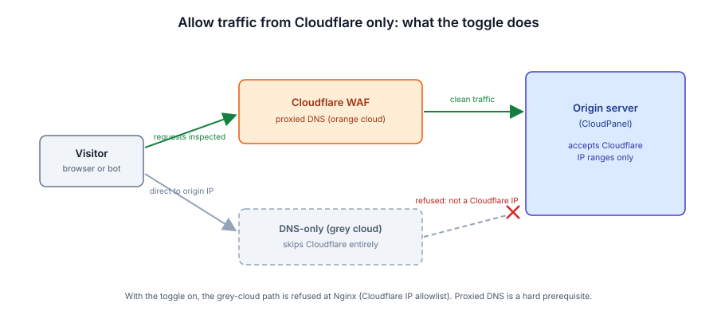

import { Picture } from "astro:assets";
import Button from "@components/widgets/Button.astro";
import Notice from "@components/widgets/Notice.astro";
import ListCheck from "@components/widgets/ListCheck.astro";
import Accordion from "@components/widgets/Accordion.astro";
import Tabs from "@components/widgets/Tabs.astro";
import Tab from "@components/widgets/Tab.astro";
import YouTubeEmbed from "@components/widgets/YouTubeEmbed.astro";
import imgSsl from "../../assets/images/wordpress/cloudpanel-ssl-1024x346.webp";
import imgPorts from "../../assets/images/wordpress/cloudpanel-ports-1024x463.webp";
import imgMyIp from "../../assets/images/wordpress/cloudpanel-myip-1024x597.webp";
import imgSnapshots from "../../assets/images/wordpress/cloudpanel-snapshots-1024x609.webp";
import imgRemote from "../../assets/images/wordpress/remote-backups-1024x426.webp";
import imgCloudflare from "../../assets/images/wordpress/cloudpanel-cloudflare-integration-1024x284.webp";

*Disclosure: this guide contains referral links. If you buy through them, I may earn a commission at no extra cost to you.*

A default CloudPanel install is functional but not hardened. This guide shows how to **secure CloudPanel** in 10 steps: SSH keys, firewall rules, 2FA, backups, malware scanning, a WAF, and a closing verify checklist you can run tonight. Every major change has a command that proves it worked.

<YouTubeEmbed
  url="https://www.youtube.com/embed/sOCD1_oQb6U"
  label="How To Secure CloudPanel"
/>

The video walks the same flow. The written steps below are the current reference: they target CloudPanel CE v2.5.4 (verified against the official docs in November 2026) and may show newer screens than the video or the screenshots.

<Button link="https://go.bitdoze.com/hetzner" text="Hetzner VPS" />
<Button link="https://go.bitdoze.com/hostinger-vps" text="Hostinger VPS" />
<Button link="https://go.bitdoze.com/do" text="DigitalOcean $100 Free" />
<Button link="https://go.bitdoze.com/vultr" text="Vultr $100 Free" />

_VPS prices jumped across the board in 2026. If you're rethinking a rented box, see [what changed and when a mini PC wins](/vps-price-increases/)._

**What you need:**

<ListCheck>
<ul>
<li>A server running CloudPanel CE <strong>2.5.2 or newer</strong> (2.5.4 is current; anything older is behind on known CVEs).</li>
<li>Supported OS: Ubuntu 26.04 / 24.04 / 22.04 LTS or Debian 13 / 12.</li>
<li>A domain whose DNS you control (for the admin subdomain and Cloudflare).</li>
<li>SSH access as root or sudo, plus provider console access (Hetzner web console, DigitalOcean droplet console) as a lockout fallback.</li>
<li>A free Cloudflare account (step 8) and 45 to 60 minutes.</li>
</ul>
</ListCheck>

No CloudPanel yet? [Install CloudPanel and host Node.js apps](/install-cloudpanel-host-nodejs/) first, then come back.

Treat the sequence below as a CloudPanel security baseline. The mental model: each layer catches what the outer one misses.


## 1. Use SSH keys, not passwords

Passwords can be brute-forced. SSH keys can't: the private key never leaves your machine and a properly generated key is not guessable. Generate a key pair on your laptop:

```bash
ssh-keygen -t ed25519 -f ~/.ssh/id_ed25519
```

Ed25519 is the modern default and what CloudPanel's own docs use for SFTP keys. RSA-4096 (`ssh-keygen -t rsa -b 4096`) still works if something in your toolchain only supports RSA.

Two ways to get the public key onto the server:

1. **At VPS creation**: paste the public key into the provider UI. Hetzner and Hostinger both have an SSH key field in the server creation form.
2. **On a live server**: append the public key for the user you log in as:

```bash
echo "ssh-ed25519 AAAA... you@laptop" >> ~/.ssh/authorized_keys
chmod 600 ~/.ssh/authorized_keys
```

### Disable password auth (sshd_config drop-in)

On Ubuntu 22.04+ and Debian 12+, put this in `/etc/ssh/sshd_config.d/99-hardening.conf` instead of editing `sshd_config` directly:

```
PasswordAuthentication no
KbdInteractiveAuthentication no
PermitRootLogin prohibit-password
```

Then restart SSH and verify:

```bash
sudo systemctl restart ssh
sshd -T | grep -i passwordauth
# expect: passwordauthentication no
```

**Failure mode:** some cloud images ship an `/etc/ssh/sshd_config.d/50-cloud-init.conf` that can re-enable password auth. After your change, run `ls /etc/ssh/sshd_config.d/` and re-check the `sshd -T` output. If a drop-in overrides you, edit or remove that file and restart `ssh` again.

<Notice type="warning" title="Lockout risk">
Open a second SSH session with the new key <strong>before</strong> closing your current one. Keep provider console access in a browser tab while you touch sshd. If you get locked out anyway, the console is what lets you re-enable password auth or fix <code>authorized_keys</code>.
</Notice>

For the rest of the SSH surface (ciphers, idle timeouts, key rotation) see the [full SSH server hardening guide](/secure-ssh-server-linux/).

### Fix SSH too many authentication failures

Right after you disable password auth, or once you have several keys loaded, the client can offer the wrong keys first and get rejected before it tries the right one. The error reads `Too many authentication failures`. The usual fix is `ssh -o IdentitiesOnly=yes -i ~/.ssh/id_ed25519 user@server`, or an `IdentityFile` entry in `~/.ssh/config`. Full walkthrough: [fix SSH too many authentication failures](/fix-ssh-too-many-authentication-failures/).

## 2. Add an SSL certificate to the admin area

Point a subdomain (for example `admin.yourdomain.com`) at the server IP, then set it under **Admin Area → Settings → General → CloudPanel Custom Domain**. CloudPanel issues a Let's Encrypt certificate for it.

<Picture formats={["webp"]} fallbackFormat="webp" src={imgSsl} alt="CloudPanel admin area SSL certificate setup on a subdomain" />

With this in place you reach the admin panel over HTTPS on port 443 via the subdomain. You never need to expose port 8443 to the internet (step 3 locks it down either way).

**Verify:** the browser shows a padlock on `https://admin.yourdomain.com`, and `curl -I https://admin.yourdomain.com` returns `HTTP/2 200` over port 443. If curl hangs, the DNS record is wrong or the cert challenge could not reach the server.

## 3. Lock down ports 22 and 8443 with the CloudPanel firewall

CloudPanel's built-in firewall (UFW underneath) handles this. Restrict SSH (port 22) and the admin port (8443) so only your IP can reach them:

<Picture formats={["webp"]} fallbackFormat="webp" src={imgPorts} alt="CloudPanel firewall restricting SSH port 22 and admin port 8443" />

Use the **My IP** option to whitelist your current address in one click:

<Picture formats={["webp"]} fallbackFormat="webp" src={imgMyIp} alt="Adding your current IP to the CloudPanel firewall whitelist with My IP" />

<Notice type="warning" title="You can lock yourself out">
Whitelisting your IP only works while that IP is yours. If your ISP rotates it, you lose panel and SSH access until the rule is updated. Keep provider console access (Hetzner web console, DigitalOcean droplet console) ready while you apply the rule, and keep it ready again for the recovery commands in step 4a.
</Notice>

### Cloud firewall / security groups first

CloudPanel's official best practice is to put the provider firewall in front of the box and block traffic before it reaches the server at all. On Hetzner that is the [Hetzner Cloud Firewall](https://go.bitdoze.com/hetzner) (included free with every cloud server):

| Direction | Protocol / port | Source | Purpose |
|---|---|---|---|
| In | TCP 22 | your admin IP | SSH |
| In | TCP 8443 | your admin IP | panel (only if you keep it exposed) |
| In | TCP 80, 443 | anywhere | sites |
| In | UDP 443 | anywhere | HTTP/3, only if you enable it in a vhost |

DigitalOcean Cloud Firewalls, the Vultr Firewall, and Hostinger's firewall work the same way. They are free on Hetzner and DigitalOcean, so there is no cost reason to skip the layer. If your admin IP changes often, the official docs suggest a small VPN (they mention OpenVPN; WireGuard is leaner) instead of opening 22 to the world.

Two footguns with custom firewall rules:

- **HTTP/3 needs UDP 443.** Enable QUIC in a vhost while your firewall only allows TCP and you will spend an afternoon wondering why HTTP/3 "does not work".
- **fail2ban** next to port restriction is common community practice for repeat SSH offenders. Check it does not fight your UFW rules on your distro before trusting it.

### Basic auth in front of the admin panel

Dynamic IP and no VPN? Official best practice is Basic Auth in front of CloudPanel: it adds an extra layer of security exactly when you cannot whitelist port 8443.

```bash
clpctl cloudpanel:enable:basic-auth --userName='john.doe' --password='password123'
# to remove it again:
clpctl cloudpanel:disable:basic-auth
```

The same setting lives in the UI under **Admin Area → Security → Basic Auth**, and per-site for staging environments. Pair it with 2FA (step 4) for two independent gates: one static (the Basic Auth password), one rotating (the TOTP code).

<Notice type="info" title="Dynamic IP setup">
Whitelist what you can at the provider firewall (80/443 from anywhere, 22/8443 from your IP while it is stable) and put Basic Auth in front of 8443 instead of leaving it open to the whole internet. A VPN in front of SSH is the cleaner fix if your IP churns daily.
</Notice>

## 4. Enable two-factor authentication (2FA)

Click the account icon (top right) → **Security tab** → Enable Two-Factor Authentication. Scan the QR code with Google Authenticator, Duo, or any TOTP app. From then on every login needs a time-based code.

Authy's desktop app was discontinued back in 2024, so use whatever TOTP app you already have on your phone. The protocol is the same.

### 2FA lockout recovery (clpctl)

Lose the phone and you are locked out of the panel. The CLI can reset you, as root over SSH or from the provider console:

```bash
clpctl user:disable:mfa --userName=john.doe
clpctl user:reset:password --userName=john.doe --password='!newPassword!'
```

These commands need shell access. That is why step 3 pushes console fallbacks: recovery via CLI does nothing if you also lost SSH.

<Notice type="warning" title="Store the recovery commands off the server">
Lost phone + no SSH + no console = locked out panel. Save the two <code>clpctl</code> lines above somewhere that is not this server (password manager, notebook), along with the provider console URL.
</Notice>

## 5. Set up CloudPanel backups

Two tracks, and you want both:

- **Snapshots** capture the whole disk. They are the fast path back after a bad update or a botched config.
- **Remote backups** run on a schedule and land off the server. They are what saves you when the server itself is gone.

### Snapshots (Hetzner API)

Go to **CloudPanel → Snapshots**, connect your Hetzner API key, and set the snapshot interval and retention. Snapshots include the full disk: files, databases, config.

<Picture formats={["webp"]} fallbackFormat="webp" src={imgSnapshots} alt="CloudPanel automated Hetzner snapshot configuration" />

**Cost note:** Hetzner bills snapshots per GB. Keep one rolling snapshot plus one offsite copy instead of a stack of month-old images quietly eating money.

### Remote backups: S3, Wasabi, SFTP, Hetzner Storage Box

The native targets (checked against the official docs, Nov 2026): **Amazon S3, Wasabi, DigitalOcean Spaces, Dropbox, Google Drive, SFTP, and Hetzner Storage Box**, plus a **custom Rclone config** (the docs use Backblaze B2 as the example). Each site's job covers the vhost, the site settings, and the site's home directory minus `.ssh`, `logs`, and `tmp`. The **Excludes** field handles extra paths.

Since CloudPanel v2.4.0 (Nov 2023) the remote backup job also **dumps the site's databases first** and ships those dumps with the archive. The old "you need a separate script for databases" workaround is gone. Still confirm the dump lands in your first archive (step 5c): backup features are exactly the kind of thing where the changelog and your box disagree.

<Picture formats={["webp"]} fallbackFormat="webp" src={imgRemote} alt="CloudPanel remote backup provider configuration screen" />

<Notice type="warning" title="Google Drive needs paid Google Workspace">
The Google Drive target works only with a paid Google Workspace account (service-account setup, see <a href="https://rclone.org/drive/">rclone's Drive docs</a>). A plain @gmail.com account fails at auth. For cheap EU storage the <a href="https://go.bitdoze.com/hetzner">Hetzner Storage Box</a> is the boring option that works; note it speaks SFTP on port 23, not 22. Full setup guide: <a href="/cloudpanel-remote-backups/">CloudPanel remote backups to OneDrive and Google Drive</a>.
</Notice>

### Test your restores

An untested backup is a hope, not a backup. CloudPanel's own docs say "Test your Backups", and they are right. After the first run (or trigger one manually):

<ListCheck>
<ul>
<li>Open the archive at the destination and confirm the files are there and not zero bytes.</li>
<li>Pull one database dump out of the archive and read it: <code>zcat backup.sql.gz | head -20</code> should show <code>CREATE TABLE</code> statements.</li>
<li>Restore one file to a scratch directory and diff it against the live copy.</li>
</ul>
</ListCheck>

SFTP targets have a **Remote Server Connection Test** button in the backup config; use it before trusting the schedule. If the archive looks suspiciously small, check the `Excludes` field: you may have excluded more than `.ssh`, `logs`, and `tmp`.

## 6. Keep everything updated (including clp-update)

For a security guide, "update every 3 months" is too slow. Weekly is the floor for OS packages, and unattended security patches are better still.

<Tabs>
<Tab name="Manual weekly">

```bash
sudo apt update && sudo apt upgrade -y
```

A calendar reminder on the same day each week. Takes a minute on a quiet VPS.

</Tab>
<Tab name="unattended-upgrades">

```bash
sudo apt install unattended-upgrades
sudo dpkg-reconfigure -plow unattended-upgrades
```

Answer "yes" and security patches apply themselves. Check `/etc/apt/apt.conf.d/20auto-upgrades` for the cadence. Note this covers apt only: `clp-update` is still a deliberate action.

</Tab>
</Tabs>

### Keep CloudPanel itself patched

`clp-update` updates the panel. Treat it as a deliberate action, not a side effect: a bulk `apt upgrade` also pulls the `cloudpanel` package, so run `clp-update` on purpose, right after a snapshot.

<Notice type="warning" title="Snapshot before clp-update, always">
Panel updates rewrite config and packages. Known failure modes: dpkg failures mid-update, <code>clp-update</code> breakage on new Ubuntu releases, and PHP extensions dropped by a bulk upgrade. Snapshot first, update second, verify sites third. Full process and known pitfalls: <a href="/safely-update-cloudpanel/">how to safely update CloudPanel</a>.
</Notice>

Why the version floor matters. Recent CloudPanel CVEs (checked against NVD, Nov 2026):

| CVE | Affects | Issue | Fixed in |
|---|---|---|---|
| CVE-2025-15241 | CE ≤ 2.5.1 | Open redirect via `Referer` (public PoC exists) | **2.5.2** |
| CVE-2026-24525 | clp-varnish-cache ≤ 1.0.2 | Broken access control | plugin patch |
| CVE-2024-44765 | 2.0.0 to 2.4.2 | Improper authorization | 2.4.2+ |
| CVE-2024-24320 | 2.0.0 to 2.4.0 | Directory traversal | 2.4.1 |

**Version floor: 2.5.2.** The current release is CE v2.5.4 (2026-07-01) with Node.js 24 LTS, MariaDB 12.3, and Ubuntu 26.04 support; v2.5.3 added PHP 8.5, v2.5.2 added MySQL 8.4. The 2.5.0 changelog also credits a fix for "Server IP disclosure despite using Cloudflare", directly relevant to step 8.

**Verify where you stand:**

```bash
dpkg -l cloudpanel | tail -1                 # package version, want >= 2.5.2
clpctl --version                             # CLI version (different number, don't panic)
apt list --upgradable 2>/dev/null | wc -l    # want 0
```

`clpctl --version` reports the CLI version (something like 6.x), which is not the panel package version. The package version is the one the CVEs care about. There is a test release channel (`clpctl cloudpanel:set:release-channel --channel='test'`). Never point production at it.

## 7. Scan for malware (LMD v2 + ClamAV)

Install [LMD (Linux Malware Detect)](https://www.rfxn.com/projects/linux-malware-detect/) and ClamAV, and schedule daily scans of the site directories. CloudPanel isolates each site under its own OS user, so an infected site cannot touch the others, but it can still hurt the server (spam from your IP, miners eating CPU).

Scans add CPU load while running. Schedule them off-peak and watch load the first week before leaving them unattended.

### What changed in LMD v2

The stack was rewritten. LMD v2.0.1 (last push May 2026) is an architectural overhaul: batch-parallel Aho-Corasick scanning, hardware-accelerated SHA-256 where the CPU supports SHA-NI, native YARA-X integration, automatic ClamAV signature export, a quarantine queue, and Discord/Slack/Telegram alerting. The vendor claims order-of-magnitude scan speedups. Measure on your own box before you move a production schedule onto that assumption. Either way, v2 is the version to install today.

For a second opinion on top of scheduled scans, an IPS like CrowdSec learns from other people's attackers and bans them before they reach you. Optional, cheap in RAM, effective: [secure a VPS with CrowdSec](/crowdsec-secure-server/).

## 8. Add a WAF with Cloudflare

Put your sites behind a Web Application Firewall to block DDoS, SQL injection, and XSS before they reach the server. Cloudflare's Free plan includes the WAF and a Free Managed Ruleset (verified on cloudflare.com/plans, Nov 2026). CloudPanel has a native Cloudflare integration that restricts inbound traffic to Cloudflare IPs only:

<Picture formats={["webp"]} fallbackFormat="webp" src={imgCloudflare} alt="CloudPanel Allow traffic from Cloudflare only integration setting" />

Enable this after pointing your domains to Cloudflare. Direct requests to your server IP are then refused, and all traffic must pass through Cloudflare's network first.

### Allow traffic from Cloudflare only

The toggle is per site: **Site → Security → Allow traffic from Cloudflare only**. What it does and does not do:



<Notice type="warning" title="Proxied DNS is a hard prerequisite">
DNS records must be Proxied (orange cloud) <strong>before</strong> you flip the toggle. Enable it while DNS is grey-clouded and the site goes down for everyone: CloudPanel starts refusing the very connections that are serving your traffic. Fix: untoggle (or proxy the DNS and wait for propagation).
</Notice>

Mechanics worth knowing:

- CloudPanel keeps Cloudflare's IP ranges current automatically. `clpctl cloudflare:update:ips` runs daily at 6 AM via cron and writes `/etc/nginx/cloudflare/ips`, which the site vhost includes while the toggle is on.
- Panels older than 2.5.0 leaked the origin IP behind Cloudflare (see the 2.5.0 changelog). Another reason for the version floor in step 6.
- The same screen has per-site **IP Blocking** and **Bots Blocking**. Both free, both built in, both worth flipping on the moment a scraper finds you.

Once it is secure, make it fast: [speed up WordPress with Cloudflare, Varnish and Redis](/speed-up-wordpress-with-cloudflare-varnish-and-redis/), or start with the [CloudPanel Varnish cache](/cloudpanel-varnish-cache/) plugin.

## 9. Block access to sensitive files

Add Nginx rules that block files which should never be public. In the site's Nginx vhost (CloudPanel's Nginx directives field works too):

```nginx
location ~ /\.(env|git|htaccess|htpasswd) {
    return 404;
}

location ~ /\.user\.ini {
    return 404;
}

# already denied in CloudPanel's WordPress template, see below
location = /xmlrpc.php {
    return 403;
}
```

These block `.env` files (database passwords, API keys), `.git` directories (your source code), and the PHP/htaccess files attackers probe for. None of these rules are in the stock vhost templates (checked against the templates repo, Nov 2026), so they are genuinely yours to add.

**Verify, per site:**

```bash
curl -I https://your-site/.env         # expect 404
curl -I https://your-site/.git/config  # expect 404
curl -I https://your-site/xmlrpc.php   # expect 403 or 404
```

Rules are per site. Adding them to one vhost protects one site, so run the curls against each of yours.

### xmlrpc.php: already blocked on WordPress templates

If the site uses CloudPanel's stock WordPress vhost template, `xmlrpc.php` is already denied (`location = /xmlrpc.php { deny all; }`, verified in the [vhost-templates repo](https://github.com/cloudpanel-io/vhost-templates)). Keep the rule anyway for Generic/PHP sites and hand-rolled templates. The templates are auto-imported nightly via `clpctl vhost-templates:import`, and the vhost editor validates syntax and auto-reverts on error, so a bad edit does not take the site down.

<Notice type="info" title="Custom template?">
The stock-template xmlrpc block applies to sites created with the WordPress template. If you hand-wrote the vhost, check for the deny rule yourself. The curl test above is the source of truth.
</Notice>

## 10. Bind MySQL to localhost

MySQL/MariaDB should listen only on `127.0.0.1` so it cannot be reached from outside the server. CloudPanel does this by default; verify it, especially after major updates. On current MariaDB and Debian-family packages the setting lives in `/etc/mysql/mariadb.conf.d/50-server.cnf` (not just `/etc/mysql/my.cnf`):

```
bind-address = 127.0.0.1
```

### Verify commands (ss, SHOW VARIABLES)

```bash
ss -tlnp | grep 3306                             # expect 127.0.0.1:3306 only
sudo mysql -e "SHOW VARIABLES LIKE 'bind_address';"   # expect 127.0.0.1
```

From your laptop, `nc -vz YOUR_SERVER_IP 3306` must fail or time out. If it connects, something is listening on a public interface. Fix that before anything else.

For external databases, CloudPanel supports remote database servers (**Settings → Database Servers**: RDS, DigitalOcean Managed MySQL, and friends). If you use one, the local service can go away entirely: `systemctl stop mysql && systemctl disable mysql`. And if a desktop DB tool needs access to a local MySQL, use an SSH tunnel instead of opening 3306 to the internet.

## What should you know about verify your CloudPanel security: final hardening checklist?

Ten steps done. Run this once to prove the hardening holds, and again after every major update.

<ListCheck>
<ul>
<li><code>ss -tlnp | grep -E '3306|8443'</code>: 3306 on 127.0.0.1 only; 8443 either closed or bound and firewalled to your IP.</li>
<li><code>sshd -T | grep -i passwordauth</code>: <code>passwordauthentication no</code>.</li>
<li><code>dpkg -l cloudpanel | tail -1</code>: panel package at 2.5.2 or newer.</li>
<li><code>curl -I https://your-site/.env</code> → 404 on every site.</li>
<li>External scan from your laptop: <code>nmap -Pn -p 22,8443,3306 YOUR_SERVER_IP</code>. Only the ports you intend are open.</li>
<li>Cloudflare-only check: with the toggle on, a request straight to the origin IP must not serve the site.</li>
<li>Restore drill done: one DB dump pulled and read, one file restored (step 5c).</li>
</ul>
</ListCheck>

That is a hardened CloudPanel: layers outside in, from the provider firewall down to the data itself. Config drift and patches undo good work quietly, so re-run this checklist after every `clp-update`. If you are still choosing a panel, see the [best self-hosted server panels compared](/best-self-hosted-panels/).

### Common questions

<Accordion label="How do I secure the CloudPanel admin panel?" group="faq">
Four moves, in order: put it on a subdomain with SSL (step 2), restrict port 8443 to your IP at the provider firewall and the panel firewall with Basic Auth as the dynamic-IP fallback (step 3), enable 2FA (step 4), and keep the panel at 2.5.2 or newer (step 6). Done together, the admin area is not reachable by anyone but you.
</Accordion>

<Accordion label="Does CloudPanel back up databases?" group="faq">
Yes. Since v2.4.0 (Nov 2023) the remote backup job dumps databases before copying files, and the archive includes the vhost and site settings. Still test a restore (step 5c). The changelog and your box do not always agree.
</Accordion>

<Accordion label="What is the latest CloudPanel version?" group="faq">
CE v2.5.4 as of 2026-07-01, with Node.js 24 LTS, MariaDB 12.3, and Ubuntu 26.04 support. The official changelog at cloudpanel.io is the source of truth. Check it before deciding you are current.
</Accordion>

<Accordion label="How do I reset CloudPanel 2FA if I am locked out?" group="faq">
From a root shell (SSH or provider console): <code>clpctl user:disable:mfa --userName=john.doe</code>, then <code>clpctl user:reset:password --userName=john.doe --password='!newPassword!'</code>. This is exactly why step 3 insists you confirm console access before tightening firewalls.
</Accordion>
